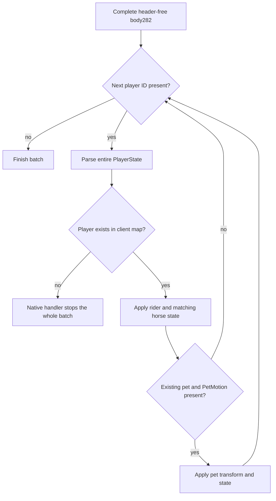
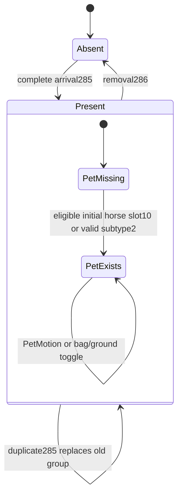

## Player, horse and pet lifecycle: proxy-facing layouts

Follow-up:2026-11-19, client647.349716 with the SHA256 at the top of this reference. This section supersedes earlier ambiguous horse-record labels and expands the concrete actor paths. The grammar in [data/actor-wire-schemas.json](data/actor-wire-schemas.json) and the offline [payload decoder](tools/decode_actor_payload.py) describe **complete application bodies after envelope decryption, header removal and reliable-fragment reassembly**. They do not operate directly on TCP reads or encrypted UDP datagrams.

### Coverage and the distinction between the two horse records

| Path | Recovered body format | Important distinction |
|---|---|---|
|285, remote player arrival/replacement|u8 prefix, varu32 prefix, PlayerShared, HorseBase|One message creates rider, horse and potentially pet; the horse is the shorter base record|
|286, remote removal|varu32 player_id|The native handler removes the actor group and its registry entry|
|282, player/horse/pet movement|Repeated [varu32 player_id,PlayerState], no count|One record carries all three actors' state; absent pet state means no pet update|
|284, visual/equipment/horse changes|u8 subtype followed by the subtype table below|All current subtypes1–12 have concrete byte layouts now|
|9, local player creation|varu16 exit code, CompressedBlob; decompressed prefix below|Use the successful local-creation record to learn local player/user/horse identities; preserve the remaining initialization state|
|190,192|HorseMaster|Horse-created notification and horse swap; these include more fields than285's horse|
|187,189|varu32 count≤16000, repeated HorseMaster|Archive/fetch lists, rather than generic remote world spawns|
|225|varu32,HorseMaster,varu32|Stable guest/host update context|
|228|varu32,HorseMaster,HorseMaster|Stable host swap context|
|203, outgoing|varu32 item_id,u8 owner,varu32 slot,varu32 horse_id,u8 ground_state|Request body differs from incoming284/subtype2; it has no explicit player-ID prefix|
|283|Unresolved: no concrete client reader identified|Preserve opaque; do not assign282's layout based on the similar name|

**HorseBase** is an analysis alias for the wire record read by0x347560/0x349AF0. Its host storage occupies200 bytes; the last transferred member is at host+193. **HorseMaster** means the larger RTTI-named `PXEngine::HorseCreateMasterMessage` read by0x3474B0/0x349DC0: the same base followed by raw16, two varu32 and8 bytes. Its host size is232. Host sizes are not wire lengths. Minimum encoded sizes, using empty strings/maps and zero/minimum-width scalars, are55 and81 bytes respectively.

The earlier reference called the base alone HorseCreateMasterMessage. That name was too broad. RPC readers0x351580 and0x7BF940 demonstrably consume the larger record, while285 calls the shorter reader. Using the larger layout in285 overreads the packet; using the shorter layout in192 leaves data unparsed. The corrected compound tables and grammar retain this distinction.

### Identities and ownership established from consumers

| Wire field | Confirmed use | Evidence |
|---|---|---|
|PlayerShared host+0, first varu32|Player/character network identifier; remote actor-map key|0x7CE750 writes actor+1720 and indexes CPXNetwork+1912 by this value|
|PlayerShared host+4, second varu32|User identifier, distinct from player/character ID|Local creation0x7CBD40 validates it against the runtime user ID; failure diagnostic explicitly names user id|
|HorseBase host+0|Horse identifier|0x7F3810/0x7F3630 transfer it to horse creation state; replacement compares it with the current horse|
|HorseBase host+40|Owning player/character identifier|Conversion places it at state+72;0x7D9AD0 uses that as the remote player-map lookup key|
|284/subtype2 item_id|Equipped pet/item definition identifier|0x7D24E0 checks it against the actual item in the indicated owner/slot before applying pet state|
|284/subtypes10/11 receiver key|Player/character ID, not an arbitrary object index|0x78A000 registers embedded PlayerLook at actor+2016 using actor+1720 through0x209820/0x7F3EC0|

Never conflate these identifiers with local heap pointers, safe-reference indices/generations or an account ID. Message282's leading ID is a player-map key; its inner horse_id is used to decide whether the attached horse's movement state should be applied. The pet-motion record carries neither an independent pet network ID nor an item definition ID.

On successful local creation9,0x7CBD40 writes PlayerShared.player_id to CPXNetwork+1928 and to local actor+1720. **CPXNetwork+1100 is not the local-player-ID source established here**; it is used for another selected/inspected-player path. A proxy does not need those host addresses: it can read the local identities from the successful decompressed9 prefix. Do not infer local identity from a rider class name or assume that every header's connection identifier universally equals that identity.

### Remote arrival285: rider, horse, equipment and initial pet

The body is positional:

```text
u8      prefix_flag         # human meaning remains unassigned
varu32  prefix_value        # always consumed; do not remove because one caller ignores it
PlayerShared player         # complete table earlier in this reference
HorseBase    horse          # shorter base, not HorseMaster
```

PlayerShared's two name components at host+8/+40 are copied into the name-display path, which uses codepage65001 conversion. That provides UTF-8 consumer evidence for those name components; it does not change the byte-string framing or establish a universal encoding rule for every other string. The raw8 at host+232 are PlayerLook initialization bytes, confirmed by0x78A000→0x80B920. Other anonymous bytes/scalars keep their original offset identities; their meanings are unnecessary for boundary-safe slicing.

The actor creation consumer0x7CE750 receives a pointer to the start of PlayerShared and reads the horse at **that host pointer+248**. In0x7D08D0's decompiled stack frame the separately named horse buffer is exactly248 bytes after the player buffer. Thus the horse is genuinely used, despite the decompiler making it look like a parsed/discarded temporary. On the wire there is no248-byte gap: the two independently serialized variable-length records are adjacent.

The native creation path:

1. Looks up/removes any existing remote group with the incoming player's ID.
2. Creates a PlayerSlave and a HorseSlave from the appended horse base, then attaches them.
3. Applies the rider equipment map and the horse equipment map.
4. Stores rider+horse references and inserts the player into the remote map.
5. Looks up horse equipment slot10. If its item has the pet property and the pet-position template is available, creates a PetSlave and stores the reference on the rider.
6. Registers PlayerLook and applies character-activity state.

The13 raw bytes at HorseBase host+80..92 are per-slot equipment-state bytes, rather than an opaque appearance preset. Conversion0x7F3810 places them at creation-state+132;0x488ED0 passes them to equipment loader0x4889A0, which uses the byte for slots below13. The following equipment map has varu16 count and [u8 slot,varu32 item_id] entries. The raw13 and the map are different fields.

Before body parsing,285 also attempts removal using ReceivedPacket+48/PacketHeader+8. Later0x7CE750 separately checks PlayerShared.player_id. Preserve the existing distinction between these header/body fields; this is not permission to rewrite one from the other in every message.

When the game's local context pointer is absent, its dispatcher may stop after the two prefix fields. That is a local execution condition, not an on-wire optional discriminator. The offline decoder deliberately parses the full arrival grammar and requires an exact end.

### Local creation9 and the decompressed master prefix

Reader0x7C1170 consumes varu16 ClientExitCode and CompressedBlob. On exit-code0, callback0x7CB340 reads the **decompressed** body in this order:

```text
PlayerShared player
string   f248
zigzag32 f280
zigzag32 f284
varu32   f288
varu32   f292
varu32   f296
varu32   f300
HorseMaster horse
u8       f536
varu32   contained_stream_length
byte     contained_stream[contained_stream_length]
```

The `f<number>` labels are host offsets in PlayerCreateMaster storage, not byte offsets in the payload. The larger horse begins at host+304; the extra flag is at+536. `contained_stream_length` is an ordinary varu32 in0xA4BF80, **not another CompressedBlob wrapper or a raw32 length**. This inner stream is then passed to the large initialization consumer0x7CBD40. Its many remaining game-state records have not been flattened into this focused actor grammar; the decoder preserves them as opaque bytes with an exact length. The master prefix is sufficient to extract the local identities without rewriting that remaining state.

The offline command uses `--message master` for an already-decompressed body. It does not claim to decrypt/decompress message9 itself or accept an error response as successful creation. Retain the outer exit-code check and use the LZ4 block layout described earlier.

### Update284: all current subtype bodies

Read the subtype u8 first. Remaining fields:

|Subtype|Remaining fields, in order|Native consumer behavior|
|---|---|---|
|1|varu32 player_id,varu32 item_id,u8 owner,varu32 slot|Equip/unequip item on rider(owner1) or attached horse(owner2). item_id0 reaches the empty-item path. Slot is a varu32 on wire even though downstream code narrows it to a byte.|
|2|varu32 player_id,varu32 item_id,u8 owner,varu32 slot,u8 ground_state|Requires the matching equipped item; updates pet model/state or creates the pet if absent and valid.|
|3|varu32 player_id,string horse_name|Updates attached horse's name.|
|4|string actor_path,varu32 player_id,varu32 argument|Invokes a remote-start actor path; retain the actor-path bytes rather than assuming this is pet movement.|
|5|HorseMaster|Converts owner_player_id and may replace that player's attached horse when horse ID differs;0x7D9AD0.|
|6|HorseMaster|Local-owner-gated horse update path0x7CB6D0; preserve the local player's version.|
|7|varu32 player_id,varu32 horse_id,u8 selector,u8 presence; if present2×[varu32,zigzag32,varu32]|Horse appearance changes; presence is parsed regardless of selector. Consumer uses the pair when selector2.|
|8|varu32 player_id,varu32 effect_id,varu32 horse_id|Horse consumable-effect operation, gated by the attached horse identity.|
|9|varu32 player_id,varu32 effect_id,varu32 horse_id|Companion consumable-effect operation, same field widths/order.|
|10|varu32 player_id,u8 makeup|PlayerLook registry lookup then0x80B9F0 applies the makeup byte.|
|11|varu32 player_id,6 raw u8 values|Same lookup;6 transferred bytes mapped to PlayerLook host offsets33,35,34,37,38,39 in that wire order.|
|12|varu32 player_id,varu32 activity_value,u8 activity_byte_a,u8 activity_byte_b|Character activity update.|

The previously unresolved default dispatch reads the player key through0x7F3E10 and invokes PlayerLook's vtable+8 reader0x80B9F0. Its subtype11 first virtual transfer appears to lack a size in pseudocode. Assembly proves R8D remains1 from the `subtype-10 == 1` branch, so **it is one byte, not four**. The next5 calls explicitly transfer one byte each. The registry is keyed by player ID as shown above, and unregisters through0x7F7770/0x7F4240 when the object is destroyed.

These callbacks return without parsing the rest when the registry has no receiver. That native behavior is not a definition of a shorter sender format. The offline grammar can still decode10/11 without having a live actor registry. Unknown future subtype values remain unsupported/opaque, rather than being assigned a guessed payload.

### Movement282 and its nested pet record

There is no leading count, no per-record byte length, and no separate pet position message in this observed path:

```text
repeat until application-body EOF:
    varu32 player_id
    PlayerState state
```

PlayerState has3 initial bytes, varu32 horse_id, optional Transform, a movement variant(tag0/1), optional PetMotion, a flags byte, a varu32, optional varu32 and final varu32. The exact nested layouts are in the earlier compound tables and the grammar. Minimum PlayerState size is54 bytes with movement0 and all optionals absent; the minimum movement1 case is65 bytes. A player ID precedes that size and is itself variable-width. The raw normalized orientation occupies8 wire bytes.

Consumer0x790DD0 applies the rider transform and chooses whether to apply horse movement based on matching horse_id/current horse. It obtains the pet from rider+1656, and only if that reference exists **and** the PetMotion optional is present calls0x3BADE0. Therefore:

- PetMotion absence means **no pet movement/state update**; it is not a pet-delete operation.
- PetMotion presence does not contain enough identity/model data to create a new pet and does not create one in this path.
- Rider, horse and pet movement can share the same player record. Removing the record suppresses all its movement data; removing only pet motion requires modifying its presence/value field and preserving all later fields.

**Unknown-player behavior affects the rest of a batch.**0x7D08D0 fully reads a record, looks up its player ID and continues the loop only if the actor resolves. If it does not, the branch breaks and returns success, leaving later records unused. After suppressing an arrival285, a proxy should not pass that hidden player's position record ahead of retained players and expect the client to skip just one record. A syntax-level decoder must find every record boundary first, then any selected transformation must retain complete intended records in order. An empty282 body is a valid loop termination case in this client.



### Pet ground/bag state and removal

The last byte of incoming284/subtype2 is a ground/bag state.0x2699C0 updates an equipped item's pet-state bit and reaches0x3BC970, which emits **PetInSaddleBag when zero** and **PetOnGround when nonzero**.0x3BD260 updates the remote pet's corresponding bit. This byte is not a pet-delete flag. The matching model/item definition is selected through0x3BCC50; a missing, mismatched or non-pet equipment item prevents the state handler from spawning an arbitrary pet.

No independent remote-pet-delete packet was identified in these paths. Confirmed whole-group removal286 invokes0x7CF960, which obtains the rider's pet reference and destroys that pet, conditionally handles the rider/horse ancestry, destroys the attached horse and erases the remote player-map entry. Equipment changes also run unequip/item callbacks, but a separate complete semantic proof for every pet deletion/visibility branch in those callbacks is not claimed. Do not model pet state0 or a missing optional as guaranteed deletion.

Useful identity state for analysis is `(player_id,owner,slot,item_id)` for pet equipment plus the current attached horse ID. It is not a discovered standalone pet network-ID tuple. Horse replacement can change the equipment owner and model relationships; do not invent a pet lifecycle transition solely from the presence of a horse swap without following subsequent equipment/state updates.



This diagram describes observed creation/removal boundaries, not every asset-load failure or equipment script path. A logically absent pet movement record does not leave PetExists.

### Transport and filtering implications

Use a connection-scoped player registry and distinguish syntax parsing from actor state. Preserve local creation9 and learn local player/user/horse identities from its successful body before classifying local versus remote objects. Preserve local control/race/quest/unknown packets. A remote character's horse ID and user ID are additional attributes; they are not substitutes for the player ID in282/286/284 receiver lookups.

A relay that edits an unreliable282 body can retain the original raw byte spans of selected records; this preserves unknown scalar meanings, float bit patterns, string bytes and map order. It must then rebuild the applicable envelope sizes/checksum/encryption. Reliable messages require more: dropping a reliable285 datagram without handling the missing sequence leaves a hole in the peer's ordered stream and triggers retransmission. Transport termination/ACK/sequence translation or an equivalently correct design must be settled before reliable suppression. An ACK uses the received message ID and sequence; it is not always a message3 packet. Parse/edit only after complete reliable-message reassembly.

Those are protocol requirements exposed by the existing code, not a supplied working proxy. Native returns-success on a partially processed282 batch is not adequate validation for an intermediary. On unknown/truncated payloads, retain the original bytes and decline transformation rather than deleting a guessed byte range. The offline decoder's strict exact-consumption/overflow checks are conservative implementation choices; malformed-input equivalence to the native parser has not been established.

Suppressing an actor's network creation is broader than the existing DLL's model-visibility feature: it prevents client actor/attachment initialization. No visual-only hide flag has been established in these messages. Preserving collision, interaction and race behavior for an omitted actor is not demonstrated by these layouts, and local NPC/obstacle assets must not be assumed to arrive through remote-player285.

### Offline decoder and examples

From the maintained repository root:

```powershell
python docs/research/protocol/tools/decode_actor_payload.py --message 284 --hex "0A 96 01 04"
python docs/research/protocol/tools/decode_actor_payload.py --message 286 --hex "96 01"
python docs/research/protocol/tools/decode_actor_payload.py --message 285 --input arrival-body.bin
python docs/research/protocol/tools/decode_actor_payload.py --message master --input decompressed-local-body.bin
python docs/research/protocol/tools/verify_actor_payloads.py
```

The first example is a synthetic subtype10 update for player150/makeup4. Synthetic subtype11 is `0B 96 01 01 02 03 04 05 06`. A pet-state update for player150/item300/horse-owner2/slot10/on-ground1 is `02 96 01 AC 02 02 0A 01`. These are header-free bodies of message284, not full datagrams. Outgoing203 for that pet is structurally different: `AC 02 02 0A AC 02 01` includes horse300 but omits the player-ID prefix.

The decoder preserves strings and fixed binary values as hex. Record `_span:[start,end]` uses zero-based, end-exclusive offsets in the supplied body, including the player ID for each PositionRecord. Equipment entries remain a list so duplicate keys/wire order are not silently lost. There is no send/receive socket, game memory dependency, actual relay, or filtering operation in the helper.

Synthetic checks cover both movement alternatives, present/absent optionals, two position records and their byte spans, all12 push subtypes, local/remote horse-width distinctions, signed ZigZag fields, unexpected trailing bytes, unsupported283 and malformed varints. They are grammar/bounds tests built from static findings, not captured golden packets, native differential execution or proof of live server compatibility.

### Remaining focused gaps

The global search for decoded immediate283 across the code range found10 candidates; inspected contexts were RewardManager class IDs and bundled parser/table constants, with no player-stream handler. This strengthens the negative result without proving that computed/dynamic dispatch can never reach283. Its layout remains unknown.

The contained master-initialization stream is length-delimited and preserved but not fully expanded here. Several appearance, activity, flag and scalar meanings remain anonymous even though their exact byte boundaries are known. Specific pet equipment-script teardown branches need further semantic work. These limits do not prevent decoding the recovered bodies above; they do prevent claiming a complete, live-validated object-filtering proxy from this document alone.
