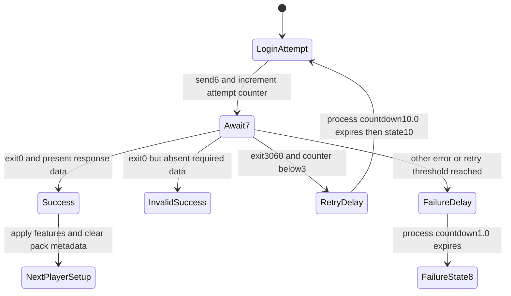
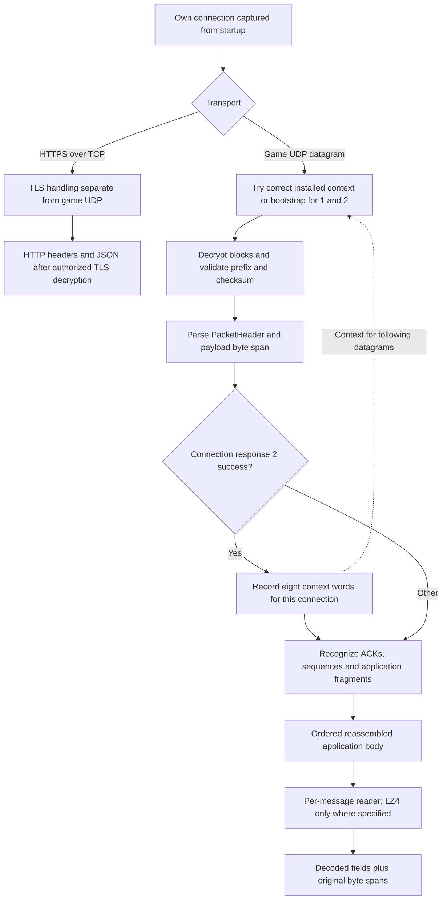

## Launcher handoff, authentication and traffic decryption

Research date: 2026-11-19. This section is maintained separately and embedded in the main specification. It describes installed launcher **2.60.0** and Windows client **647.349716**, not an assumed current server implementation. All native addresses are RVAs relative to image base `0x140000000`.

**The launcher passes an access token to the game as `-AccessToken="..."`. The game uses that token as an HTTPS Bearer credential to obtain server information and a separate game-server ticket. The UDP login sends the ticket, user ID, machine identifier and optional queue token. UDP encryption uses separate bootstrap/connection material; it is not derived from the access token in the inspected code.**

Only installed application code and the archived executable were inspected. No live process command line, password, token, session file, registry identifier or authenticated network exchange was collected. Examples below use placeholders or constructed data. Reading a token's JWT payload is decoding, not decryption or proof of signature validity.

### Evidence identity and reproducible launcher inspection

The game SHA256 remains `62387b246a92a4874d20329caa6eaf06c7a29830263e94982a8bdad6b6110fe1`. The installed Electron `resources/app.asar` is 243,677,227 bytes, SHA256 `390abe5340bfc5dc665bd8f5894b3e77af5f3d92cdea105f712d87bfd40f6b20`; package name `StarStableOnline`, version `2.60.0`, main `dist/index.js`. The launcher and game have independent version numbers.

[data/authentication-evidence.json](data/authentication-evidence.json) retains source hashes, one-based source line landmarks, native procedure roles, exact handoff arguments, endpoints and unresolved questions. The launcher JavaScript was extracted locally without execution; the full proprietary archive and extracted source copies remain in ignored output, outside delivery packages. The retained reader works on the selected static code files, not user profiles:

```powershell
python docs/research/protocol/tools/inspect_launcher_static.py --archive "<installation>/resources/app.asar" --output out/protocol-647/launcher-reviewed
```

ASAR parsing here reads four little-endian 32-bit header words, the JSON tree at offset 16, and packed file data at `8 + header_size + file.offset`. It rejects unpacked/link entries and invalid source bounds. It does not run the launcher or its JavaScript. The source paths below are archive-internal paths.

### Authentication sequence and boundaries

```mermaid
sequenceDiagram
    participant U as User
    participant L as Electron launcher
    participant A as Account and launcher HTTPS services
    participant G as SSOClient
    participant W as Game service HTTPS gateway
    participant S as UDP game endpoint
    U->>L: Normal sign-in or remembered-session login
    L->>A: POST session/create or session/refresh
    A-->>L: access_token and refresh_token
    L->>L: Decode JWT session_id and exp; refresh near expiry
    L->>A: Authenticated initialize and queue requests
    A-->>L: Queue position and queueToken
    L->>G: Spawn with AccessToken, NetworkUserId, LoginQueueToken and service origin
    G->>W: POST game-server/data, Bearer access token
    W-->>G: game_server_address, user_id, region_id and exchange_rate
    G->>W: POST game-server/ticket, Bearer access token
    W-->>G: Opaque ticket string
    G->>S: Bootstrap-encrypted connection request 1
    S-->>G: Bootstrap-encrypted response 2 with connection material
    G->>S: Connection-encrypted login 6, including ticket and queue token
    S-->>G: Login response 7
    Note over G,S: Successful higher-level login continues to player creation 8/9
```

The HTTPS request methods above are recovered from the native request configuration, including libcurl POSTFIELDS and POSTFIELDSIZE; they are not inferred from endpoint names. Successful server acceptance, error codes for every policy decision, ticket expiry and server-side validation internals remain untested. Transport connection success is distinct from account/login success.

### What the launcher gives the game

`dist/windows/game/helpers/executable.js`, lines 26–60, builds an object, drops only null/undefined values, then formats **one dash**, case-preserving names and quoted values: `` `-${key}="${value}"` ``. Empty strings, zero and false-converted-to-zero values are not removed by that null test. `dist/windows/game/index.js`, lines 524–545, first calls `ensureValidAccessToken()`, then passes session state and queue state to this formatter.

| Windows argument | Launcher source / meaning | Native follow-through in this analysis |
|---|---|---|
| `-AccessToken="<access-token>"` | `launcherState.session.accessToken` | Entry `0x1D770` copies to StudioInitialize+352; setup `0x380120` copies to CPXPlayerSetup+192; used in HTTPS Bearer headers |
| `-NetworkUserId="<decimal-account-id>"` | `this.accountId` | Parsed as integer to StudioInitialize+312; checked against HTTPS `user_id`, then sent as varu32 in login 6 |
| `-LoginQueueToken="<uuid-text>"` | `loginQueue.token()` | `0x63DC80` validates/parses to 16 bytes at initializer+944; optional opaque128 in login 6 |
| `-ServiceBaseUrl="<origin>"` | `new URL(gatewayEndpoint).origin` | StudioInitialize+208 → CPXPlayerSetup+160 → native game-service URLs |
| `-NetworkLauncherHash="<session-id>"` | JWT payload's `session_id`, stored in launcher session state | Emission is verified; no consuming native read of this argument name was established. It is **not** evidence that this string is login 6's third string |
| `-NetworkLauncherServer="<api-endpoint>"` | Launcher API base | Emission verified; downstream native use not established |
| `-ProjectUserDataPath="<install-directory>"` | Installation directory | Launcher emission verified; no credential interpretation assigned |
| `-Language="<language>"` | Selected language | Ordinary launch setting |
| `-MetricsServer="<url>"`, `-MetricsGroup="<groups>"` | Metrics configuration | Entry stores these separately at initializer+464 and +496; MetricsGroup is **not** the vector at +960 sent in login 6 |
| `-EnableActorSerializationOnDemand="0-or-1"`, `-EnableNebula="0-or-1"` | Boolean settings converted to numbers | Ordinary feature settings; not authentication credentials |

On macOS the same formatter uses `LauncherHash`, `LauncherServer` and `DataPath` instead of the three Windows-specific names. That is launcher-source evidence, not validation of a macOS game's native parser. Trusted-user/manual argument overrides exist in the launch caller and are outside the default formatter's guarantees.

`dist/windows/game/helpers/gameStart.js`, lines 47–60, calls Node `child_process.spawn` with `shell:true`, `detached:true`, `cwd:installDirectory`, `windowsHide:false`. Its debug call is given the executable arguments. Consequently a diagnostic command-line/log dump can contain an active access token; no actual log contents were read here. Treat this handoff as sensitive even though it is local.

In the game, `GetCommandLineW` → `0x617A0` → `CommandLineToArgvW` → Unicode-to-UTF8 conversion → `0x603F0` argument container. `0x60730` performs option lookup; `0x60EC0` retrieves text and `0x60E50` retrieves an integer. These addresses plus the exact entry body are retained in the procedure appendix. Do not casually substitute GNU `--name value` syntax for the formatter's `-Name="value"` syntax.

The client also accepts `NetworkUserName`, `NetworkTicket`, `NetworkServer` and `NetworkServerPort` in the entry path. These are legacy/manual alternatives, **not arguments emitted by the inspected default launcher**. With a nonempty AccessToken, the setup path fetches fresh server data/ticket; an initial NetworkTicket is not proof that it remains the ticket ultimately sent. With an empty access token, `0x380120` signals setup completion without these HTTP calls. That is a client branch, not evidence the server permits unauthenticated gameplay.

### Launcher account/session HTTP exchanges

Let `gatewayEndpoint` and `apiEndpoint` denote launcher configuration values. They need not be the same base, and `gatewayEndpoint` can already contain a path. The native game's ServiceBaseUrl is only its origin. Avoid accidentally duplicating `/api-gateway/1.0` by treating all three as interchangeable.

The installed production defaults now resolve both bases to **lb-pub.prod.starstable.com**: gateway base `https://lb-pub.prod.starstable.com/api-gateway/1.0`, launcher API base `https://lb-pub.prod.starstable.com/proxy-launcher`. The game receives `https://lb-pub.prod.starstable.com` as ServiceBaseUrl. [ENDPOINTS.md](ENDPOINTS.md) records the packaged source/hash, full native URLs, separate UDP assignment and observation limits; this host is not a proved fixed destination for all gameplay datagrams.

`dist/services/Account/helpers/apiClient.js` constructs:

| Operation | Method and URL | JSON body / consumed result |
|---|---|---|
| Password sign-in | POST `${gatewayEndpoint}/session/create` | `credentials:{email,password}`, `device_info` |
| Google sign-in | Same POST | `token:{id_token,platform:"desktop",provider:"google"}`, `device_info` |
| Verification-code continuation | Same POST | `client_id:"SSO"`, `verification:{verification_id,code}`, `device_info` |
| Token refresh | POST `${gatewayEndpoint}/session/refresh` | `refresh_token`; bypasses offline buffering and automatic refresh recursion |
| Resend verification | POST `${gatewayEndpoint}/session/verification/${verificationId}/resend` | No explicit body in this builder |
| Launcher initialize | POST `${apiEndpoint}/launcher/auth/initialize` | `deviceId`, `launcherVersion`, `launcherPlatform:"desktop"`, `clientOsRelease`, `browserFamily:"Electron"` |

The create and refresh responses provide `access_token` and `refresh_token`; AccountService consumes them and stores the decoded `session_id` with both tokens. Sign-in failures can expose `service_error_code` and `data.verification_id`. This is a description of fields the code accesses; it is not the complete backend response schema. `device_info` comes from the injected optional `getDeviceInfo` callback through `collectDeviceInfo`; errors return undefined, which JSON.stringify omits from the object. The callback's complete builder is expanded below; arbitrary additional backend response fields remain unknown.

`dist/utils/fetch.js` serializes a supplied body with `JSON.stringify` and uses node-fetch. Standard headers are `User-Agent`, `Device-ID`, `X-Platform: DESKTOP_LAUNCHER` and `Content-Type: application/json`. It attaches `Authorization: Bearer <access-token>` when a token exists and `skipAuthRefresh` is false. Create/refresh explicitly set `skipAuthRefresh:true`, avoiding stale Bearer attachment and recursive refresh. Callers may supply headers that override the defaults.

Synthetic shapes, not replayable credentials:

```json
{"credentials":{"email":"<your-email>","password":"<your-password>"},"device_info":{}}
```

```json
{"access_token":"<JWT-access-token>","refresh_token":"<opaque-refresh-token>"}
```

`AccountService.decodeAccessToken()` invokes `jwt-decode`'s `jwtDecode`; the launcher consumes `session_id` and `exp`. `SessionService.getShouldAccessTokenRefresh()` subtracts current epoch seconds from `exp` and refreshes when the result is **≤300 seconds**; missing/failed JWT decode also requests refresh. Concurrent refresh callers share a promise. Successful refresh replaces both token values; failure runs logout handling. Remembered login calls the same refresh endpoint with a saved refresh token. Neither JWT signing algorithm, issuer keys, complete claims nor server revocation/TTL policy can be deduced from these two consumed claims. No actual JWT was decoded for this work.

### Full device_info builder and launcher device identity

Follow-up traced the callback from `dist/index.js` line 210 into `GameRequirementsManager.getDeviceInfo` in `dist/utils/systeminfo.js` lines 187–231. The complete constructed object has this shape (all values below are synthetic):

```json
{
  "schema_version": 1,
  "collected_at": "2026-11-19T00:00:00.000Z",
  "app": {"name": "<Electron app name>", "version": "2.60.0", "distribution": "<store>"},
  "os": {
    "family": "windows", "name": "<OS display name>", "version": "<release>",
    "build": "<build>", "architecture": "<architecture>", "locale": "<locale>", "timezone": "<IANA timezone>"
  },
  "hardware": {
    "manufacturer": "<manufacturer>", "model": "<model>",
    "cpu": {"name": "<trimmed first CPU model>", "architecture": "<OS architecture>", "logical_cores": 8},
    "memory": {"total_bytes": 17179869184},
    "gpus": [{"name": "<deviceString>", "vendor": "<vendorString or mapped vendor>", "driver_version": "<driverVersion>"}]
  },
  "capabilities": {"graphics_api": ["opengl"]}
}
```

The shape/omission rules matter for exact JSON inspection:

- `schema_version` is the number 1; `collected_at` is `new Date().toISOString()` at collection time. JSON numbers here are not gameplay varints.
- `app.name` comes from Electron `app.getName()`, version from the injected launcher version, and distribution from the CLI store value, omitted when falsy.
- OS family maps win32→windows, darwin→macos, linux→linux; unknown platform names pass through. Name/release/build/architecture come from cached system-info results; locale comes from Electron and timezone from Intl. Falsy optional values are converted to undefined and omitted by JSON.stringify.
- Manufacturer/model come from `systeminformation.system()`. CPU name comes from the first `os.cpus()` model, trimmed; logical_cores is array length, omitted if zero. Memory is `os.totalmem()` in **bytes**, without the separate metrics path's MB rounding.
- GPU entries come from Electron `app.getGPUInfo("basic").gpuDevice`. Name/vendor/driver are optional. Vendor uses vendorString first, then IDs 0x10DE→NVIDIA, 0x1002→AMD, 0x8086→Intel, 0x106B→Apple. An empty GPU array is omitted.
- Capabilities is present only when the cached OpenGL version is truthy. The payload sends the string array `["opengl"]`, not the actual numeric OpenGL version. The Windows collector uses the string `"0.0.0"` as a failed-detection fallback, which is still truthy; this field alone is not proof of working OpenGL support.
- Hardware collection errors return an empty source object; optional selected fields disappear. A top-level callback failure makes AccountService omit device_info entirely. The builder selects fields rather than copying the complete raw hardware-library response.

`dist/index.js` obtains `uniqueDeviceId` from `dist/utils/deviceId.js`, which calls `node-machine-id.machineId()` **without** the `original` flag. The installed library's readable source and packed runtime are both hash-indexed in the evidence. On Windows it extracts MachineGuid from REG_SZ output, removes whitespace/newlines, lowercases the value, then returns **SHA256 of that normalized string as lowercase hexadecimal text**. Hyphens remain in the string. No command from this module was executed here and no actual identifier was collected.

That 64-character text is used as the launcher's `Device-ID`, initialization `deviceId`, common analytics ID and SessionService PBKDF2 passphrase. The PBKDF2 input is UTF8 of the hexadecimal text, **not** the 32 digest bytes. Failure returns an empty string, enabling SessionService's fallback. This is distinct from native login6's raw MachineGuid string fallback; their textual values should not be assumed equal. Normal launcher startup also clears Electron default-session cookies outside watch mode; the traced game handoff uses explicit token arguments, not an exported browser cookie jar. This does not enumerate every unrelated webview cookie or service.

### Login queue and UUID encoding

`dist/windows/game/helpers/apiClient.js` and the packed constants module resolve the queue prefix to `launcher/login-queue`, platform `desktop`:

| Operation | Method and URL |
|---|---|
| Create/enqueue | POST `${apiEndpoint}/launcher/login-queue/v2/desktop/token` |
| Poll | GET `${apiEndpoint}/launcher/login-queue/token` |
| Cancel/delete | DELETE `${apiEndpoint}/launcher/login-queue/token` |

These use the launcher Fetch wrapper's Bearer handling. Creation consumes `passedTheQueue`, `queuePosition`, `queueToken`, `loginStateTimeout`; polling consumes the first two. The queue helper retains queueToken for the spawn arguments; it does not put that token in the shown poll/delete URL. Client-side polling intervals depend on position (approximately 3–13 seconds in the randomized schedule). Server validity, binding and expiry policy are unknown.

Native `0x63DC80` validates the text using `0xA440C0` and parses using `0xA441D0`. The accepted form has 36 characters and hyphens at 8/13/18/23, with hexadecimal digits elsewhere; the all-zero UUID is treated as invalid. The parser reads 16 `%02x` components and stores each component's byte in textual order. Thus synthetic `00112233-4455-6677-8899-aabbccddeeff` becomes `00 11 22 33 44 55 66 77 88 99 AA BB CC DD EE FF`, **without Windows GUID field swapping**. Invalid/missing input leaves the constructor's zero value, so login 6 omits the optional. The native presence test is `0xA43D70`.

### Native HTTPS bootstrap: data followed by ticket

`0x380120` copies initializer+208 to setup+160 and initializer+352 to setup+192. Nonempty access token plus empty service base is an error path; nonempty token/base starts `0x3803E0` (**RequestGameServerData**). The callback pointer inside that request is `0x37F2A0`; the request itself is not merely a callback wrapper.

Both native requests ensure a trailing slash on the base, then append:

1. `api-gateway/1.0/game-server/data`
2. `api-gateway/1.0/game-server/ticket`

They add `User-Agent: SSOCLIENT/<formatted-client-version>` and `Authorization: Bearer <initializer-access-token>`. No JSON request body is added by either request builder. Native `0x99710` sets libcurl options `CURLOPT_URL` (10002), `CURLOPT_POSTFIELDS` (10015) to the empty vector's null data pointer, and `CURLOPT_POSTFIELDSIZE` (60) to zero. Setting POSTFIELDS selects POST even for this null pointer/zero-length combination, per [libcurl's POSTFIELDS documentation](https://curl.se/libcurl/c/CURLOPT_POSTFIELDS.html). Submission `0x9A790` and callback setup `0x99530` do not change the method. The recovered request is therefore **POST with zero body length**, not GET inferred from the word “data”. Exact HTTP version, automatically added headers, redirects and a live wire exchange were not measured.

`0x99630` returns a 203,132-byte embedded CA bundle at RVA `0xEFE720` beginning with Mozilla CA-bundle text. `0x99AB0` applies it as `CURLOPT_CAINFO_BLOB` (40309). This function **sets CA material, not an HTTP method**. The earlier library analysis identifies libcurl's Schannel/SSPI TLS path. No proof of a special server public-key pin, negotiated cipher suite or negotiated TLS version was obtained from these request builders. An embedded CA bundle means a Windows trust-store-only change cannot automatically be assumed sufficient for an HTTPS inspector.

The request constructor also sets the following options before the URL/body. IDs/numeric values are read from `0x99710`; names are mapped using the [official curl header](https://raw.githubusercontent.com/curl/curl/master/include/curl/curl.h).

| Option | Value | Recovered policy |
|---|---|---|
| CURLOPT_SSLVERSION, 32 | 6 = CURL_SSLVERSION_TLSv1_2 | TLS **1.2 or later**, not an exact negotiated version. See [libcurl's version-range semantics](https://curl.se/libcurl/c/CURLOPT_SSLVERSION.html). |
| CURLOPT_CONNECTTIMEOUT, 78 | 10 | Connection-phase timeout in seconds, including name resolution/handshakes; see [official semantics](https://curl.se/libcurl/c/CURLOPT_CONNECTTIMEOUT.html). |
| CURLOPT_TIMEOUT, 13 | 15 | Whole-operation timeout of 15 seconds; includes the connection phase. |

The reviewed request constructor/setters/submission path configures the CA blob but supplies no pin, client certificate or peer/hostname-verification disabling option. This is a bounded finding for these requests, not a proof against all generic curl features, external proxy configuration or later runtime changes. Schannel initial handshake `0x9992A0` has explicit SNI/certificate failure branches and rejects an unsupported CA-bundle verification path. Actual negotiated suite, TLS version, trust result and inspection compatibility remain live-session questions.

`0x37F2A0` validates the data response against the embedded JSON schema, then updates the same StudioInitialize object:

| Field | Schema / handling |
|---|---|
| `game_server_address` | Required string → initializer+240 |
| `user_id` | Required nonnegative integer → +312; if existing +312 is nonzero and different, reports user-ID mismatch |
| `region_id` | Required integer in 0..255 → +385 |
| `exchange_rate.format_string` | Required string inside required exchange_rate object → +552 |
| `exchange_rate.price_per_100_sc` | Required string, even though it describes a price → +584 |
| `report_a_player_server` | Optional string → +520 |

On success it calls `0x380770` (**RequestGameServerTicket**). Its result handler `0x37FB10` requires a JSON object with string field `ticket`, copies that string to initializer+320 and signals setup-complete event **176003**. Failure/invalid JSON paths signal **176002**. Unknown extra JSON fields and the service's complete business rules are not inferred from a minimum required-field schema.

The ticket remains opaque: this client path does not decode a JWT, decrypt it, compute it from a password or prove whether it is single-use. The HTTPS exchange demonstrates how a valid launcher credential is exchanged for the UDP login credential; it does not disclose server signing secrets.

### Exact login 6 body and initializer map

`0x7C1800` uses initializer+240 for the login endpoint and +272 for port, with fallback **18971** when no configured port is selected. Entry option `NetworkServerPort` populates +272. Treat this as a fallback, not a universal port for every world/dispatcher connection. Transport connect passes protocol value **534** in `0x7D0120`, independent of executable version 647.

`0x7C1AF0` builds login 6. The tuple stores pointers in reverse-looking host order; **follow serializer `0x7AF880` for wire order**, not stack-local declaration order:

| Order | Wire form | Actual source and role |
|---|---|---|
| 1 | u8 presence; when present byte string, varu32, u8 | Optional record through `0x7A68B0`; initialized absent in this caller |
| 2 | byte string | Username from initializer+280, originally `NetworkUserName`; default launcher does not supply it, so an empty value is possible |
| 3 | byte string | Game-server ticket from initializer+320, populated by HTTPS ticket result |
| 4 | byte string | Machine/device identifier: initializer+432 if nonempty, otherwise Windows MachineGuid fallback |
| 5 | u8 presence, then 16 raw bytes if present | Queue token from initializer+944 via getter `0x63DBF0` |
| 6 | varu32 | User/account ID from initializer+312 |
| 7 | varu32 | Constant **1** in this caller; purpose not assigned |
| 8 | varu32 count ≤16000; repeated `[byte string filename,varu32 size_bytes,varu32 crc32]` | Vector at initializer+960 via getter `0x63DC00`; `0x63DC10` moves it from the pack archive's +248 vector; detailed producer below |

“Byte string” uses the specification's varu32 byte length followed by exactly that many bytes, not a fixed array, NUL terminator or automatically UTF16. The queue UUID's optional presence byte is separate from its 16 bytes. The vector is **not** MetricsGroup (initializer+496), and the +960 field is a C++ vector, not another UUID.

The identifier fallback `0xA4C0A0` reads `HKLM\SOFTWARE\Microsoft\Cryptography`, value `MachineGuid`, using RegOpenKeyExA/RegQueryValueExA. The identifier bytes enter the third login string. No registry contents were read in this investigation. StudioInitialize's constructor `0x63D700` initially empties +432; the reviewed Windows entry does not populate it from NetworkLauncherHash. Other override writers have not been completely enumerated. Therefore **do not rename this field to launcher-session hash** merely because that sounds plausible. This corrects an early investigation hypothesis before delivery.

After transport response 2 installs the connection material, login 6 uses that context. Login response 7 contains varu16 ClientExitCode plus optional LoginResponseData (string, two feature collections, Vec3, Normalized4); see the main compound section for names/count checks. Player creation 8/9 follows higher-level successful login. Ticket text, machine identifier, user ID, queue UUID and game transport key are separate values with separate encodings.

### Pack metadata: filename, size and CRC32

The previously anonymous two scalars are now resolved by following `CPXPackFileArchive::Open` at `0x614190`. It formats base filenames `p_%08d.csa`, opens both each data file and its name plus the literal `header`, and appends **two records per pack** to the vector at archive+248:

1. `<base-name>header`, physical header-file size via `0x6CDD0`, CRC32 over the complete header file via `0x6CB10`→`0x6CA30`.
2. `<base-name>`, stored data-file size and CRC32 from the pack descriptor's +56/+60, populated earlier in the same function.

For the data-file record the CRC is computed only when Open's fourth argument is nonzero; otherwise it stores 0. The reviewed Windows entry calls Open with that argument **1**. A later header validation compares those descriptor fields and reports **Incorrect size** / **Incorrect hash**, supporting their meanings independently of a guessed name. Filenames are relative pack names here, not proof that arbitrary filesystem paths are transmitted.

`0x6CA30` reads chunks up to 1024 bytes and updates CRC through `0x9CB860`→`0x9CB870`. All 256 entries of its table at RVA `0x1069060` match reflected polynomial **0xEDB88320**. It complements the initial and final accumulator, matching ordinary **CRC32/ISO-HDLC**, e.g. Python `zlib.crc32`, not CRC32C. This checksum is separate from the UDP envelope's FNV-1a-32 and the archive's unrelated FNV64 lookup keys.

The size getter passes the open handle in RDX to IO virtual slot +136. Hex-Rays omits that virtual-call argument in one pseudocode view; the saved instruction slice is authoritative. The concrete C-file size method `0x644B0` saves position, seeks to end, reads position and restores the original offset. The memory-IO size method `0x8AAC0` returns its backing record's size.

The vector is moved into StudioInitialize and copied into login6. A successful login7 handler calls `0x63DB90`, which destroys its strings and empties the initializer vector. A decoder must therefore allow an empty metadata vector; nonempty first-login data is not a universal invariant for later calls. No server integrity-enforcement policy, acceptance of altered values or file-validation bypass is established by these field meanings.

### Login response handling, feature duplicates and retry state

Typed callback registration binds `0x7CAF80` to ID7; reader `0x7C10C0` consumes varu16 exit code then optional LoginResponseData before calling it. Code **0** selects success and requires present data; an absent optional is structurally decodable but reaches a native assertion/error path. Success copies the response string, installs feature state, clears the pack metadata vector and continues the player-creation/event path. The response string's full business meaning remains unnamed.

On failure, if exit code is **3060** and CPXNetwork's login-attempt byte at +448 is **below 3**, the handler schedules state **10** with a float countdown **10.0** at +320. Other failures schedule state **8** with countdown **1.0**. `CPXNetwork::Process` at `0x7CFC20` subtracts frame time, applies the pending state when the countdown becomes negative, and calls `0x7C1AF0` when state10 becomes active. The login function increments the attempt byte and enters state7. This proves a delayed resend branch; no human-readable backend name is assigned to code3060. These are application timers, distinct from connection-request retransmission and reliable-UDP ACK timers.



The two feature readers `0x7A98E0` and `0x7A9470` require minimum counts9 and15, cap counts at16000, and reject unknown names. Their loops do **not** reject duplicate known names or require all known names to occur. Each occurrence clears/sets its bit from the current byte: **the last duplicate wins**; any nonzero enabled byte is true. With newly constructed response data the masks start at zero, so omitted named bits remain zero even when duplicate entries satisfy the count minimum. A JSON map that silently keeps the first duplicate, or a decoder that requires unique complete name sets, would disagree with this client. Preserve the entry list and derive a mask separately.

[tools/decode_authentication_payload.py](tools/decode_authentication_payload.py) now decodes complete login6/7 bodies, preserving byte strings as hex and record byte spans. Its canonical schemas are [tools/authentication_schemas.py](tools/authentication_schemas.py), emitted as [data/authentication-wire-schemas.json](data/authentication-wire-schemas.json). It reports semantic notes for success-without-data and3060, but it does not track attempt state or authenticate. Exact full-body consumption and conservative overflow/string caps are offline analysis checks; native callback7 itself does not enforce end-of-stream in its shown body. Native malformed-input behavior is not promised.

```powershell
python docs/research/protocol/tools/verify_authentication_payloads.py
python docs/research/protocol/tools/decode_authentication_payload.py --message 7 --hex "00 00"
```

The second command intentionally demonstrates a structurally parsed exit0/absent-data message with a semantic warning; it is not valid input to send to the client. Tests use7 synthetic bodies,1425 truncated prefixes, duplicate/unknown/minimum-count feature cases, embedded-NUL byte strings, sequential queue bytes and metadata CRC values. No live login bytes were read or sent.

### Encryption layers: what can actually be decoded

| Layer | Mechanism observed | What an inspector needs |
|---|---|---|
| Access-token payload | JWT decode in launcher | Base64url/JSON decoding can expose claims; it does not validate signature, manufacture credentials or decrypt HTTPS |
| Remembered launcher session at rest | AES-256-CTR with PBKDF2-derived key | Separate local file format below; unnecessary for observing an ordinary logged-in game's UDP session |
| Launcher account/queue HTTP | node-fetch with HTTP/HTTPS agents | An HTTPS capture contains TLS records, not automatically visible JSON. A separate authorized TLS inspection arrangement is required for plaintext |
| Native game-service HTTPS | libcurl + Schannel/SSPI, embedded CA bundle | Separate TLS trust/routing/key-export considerations; the UDP keys and JWT do not decrypt it |
| Gameplay UDP | Custom XTEA-style 8-cycle envelope + FNV-1a-32 | Static bootstrap context for 1/2, followed by material delivered in successful connection response 2 |
| Compressed message field | Client CompressedBlob around an LZ4 block | Decrypt/header-parse/reassemble first, then decompress only fields whose reader requests it |

#### Remembered-session file format, static code only

`SessionService` uses `algorithm="aes-256-ctr"`. `saveSession(refreshToken)` writes encrypted UTF8 JSON `{"banana":"<refresh-token>"}`. The outer file is Base64 of UTF8 JSON with three hex strings:

```json
{"saddle":"<16-byte-IV-as-32-hex-digits>","sugar":"<16-byte-salt-as-32-hex-digits>","horseshoe":"<ciphertext-hex>"}
```

`saddle` and `sugar` are independently generated by Node `randomBytes(16)`. `deriveKeyFromPassphrase` uses PBKDF2-HMAC-SHA256, 100,000 iterations, output 32 bytes, salt sugar, and `uniqueDeviceId` as its passphrase. If that ID is absent/falsy, the source's literal fallback is `St@r-$t@bl3-0nlin3-d3$kt0p-l@unCher-$e$$i0n-$t0r@ge-k3y`; this is installed program data, not a recovered user's password. Decryption reverses Base64 → JSON → hex, derives the same key, AES-CTR decrypts with saddle, then parses the inner JSON. `autoLogin` passes `session.banana` to the refresh endpoint. There is no explicit authentication tag in this shown wrapper. This at-rest format is not used as a game UDP frame, and no saved-session decryption utility or live credential extraction was performed.

#### Gameplay UDP envelope and equations

The main envelope section remains authoritative for offsets; this adds executable reference code and auth-context selection. `0xA46670` sets the iteration count at crypto+44 to **8**. Each iteration updates both 32-bit halves, so this is 8 XTEA cycles / 16 half-updates, not the usual assumption of 32 XTEA cycles. `0xA485A0` installs eight little-endian u32 words at crypto+8..39; the reviewed block equations index **only words 0–3**. Preserve all eight in a context record rather than silently deleting returned fields.

For each 8-byte block interpreted as little-endian `(left,right)`, arithmetic wraps modulo 2^32; shifts right are logical:

```text
sum = 0
repeat 8 times:
  left += ((((right << 4) XOR (right >> 5)) + right) XOR (sum + key[sum AND 3]))
  sum += 0x9E3779B9
  right += ((((left << 4) XOR (left >> 5)) + left) XOR (sum + key[(sum >> 11) AND 3]))
```

Inverse starts `sum=8*0x9E3779B9` modulo 2^32, subtracts the right update, subtracts delta from sum, then subtracts the left update, repeating 8 times. Blocks are independent in the observed loop; no TLS record layer, CBC chain or AES operation occurs here.

The static 32-byte bootstrap context is at RVA `0x1020478`:

```text
3A 19 00 00 A2 A6 00 00 62 07 00 00 CA 01 00 00
3E A6 00 00 D0 0B 00 00 02 FB 00 00 7A 01 00 00
```

That is `[6458,42658,1890,458,42558,3024,64258,378]` when read as eight little-endian words. It is embedded program data, **not an account-specific recovered secret**. IDs 1/2 use bootstrap context. Success response 2 alternative 0 carries varu32 connection ID, ZigZag32 anonymous signed value, eight varu32 words and 16 opaque bytes; copy the eight words into a little-endian context for subsequent datagrams. No JWT/password-derived key computation was observed in this install path.

Each encrypted datagram starts with 8 unencrypted bytes: u32le checksum, u8 padding count, u8 salt, u8 tag, u8 reserved. Sender zero-fills to an 8-byte multiple, sets reserved=0 and `tag=salt & plaintext[0] & (key_word0 & 0xFF)`, then encrypts the blocks after this prefix. Its salt depends on the native buffer address and an incrementing context counter; it is **not** an IV chained into the block equations. The checksum is FNV-1a-32 over unpadded plaintext, then bytes 4..7 in order, initial `0x811C9DC5`, multiplier `0x01000193`, modulo 2^32. Checksum and tag checks reject decoding with an incorrect context in normal use; FNV is not a cryptographic authentication MAC.

Native receive `0xA47360` requires the wire length to be a multiple of 8, sufficient output capacity, a matching first-block tag, nonempty result after subtracting padding+8, and matching checksum. The sender produces padding 0..7 and reserved=0. **The receiver does not explicitly enforce those canonical values or zero-valued padding bytes in the inspected body.** The offline reference defaults to strict canonical checks; `canonical=False` reproduces these observed receive predicates more closely, without claiming complete malformed-input equivalence or native buffer behavior.

Encrypted receive `0x80DC00` first tries installed connection context when available; bootstrap fallback must decode to message ID 1 or 2. Encrypted send `0x80E170` chooses bootstrap only for IDs 1/2 and installed context for other IDs. Do not use a successful arbitrary bootstrap decryption as permission to accept message 6 or actor updates under that context. Associate installed material with the correct connection/layer lifetime; do not mix reconnects, redirected endpoints or two independent proxy legs.

### Building a faithful local traffic view



For passive decoding, capturing a successful connection from its beginning can in principle recover the UDP context from bootstrap-decoded response 2 without extracting account tokens. A capture that begins after this exchange may lack the installed context. The bootstrap bytes and layout must be rechecked after updates. This workflow is a static deduction from the client, not a successful live capture performed here.

The retained standard-library [tools/datagram_codec.py](tools/datagram_codec.py) supplies `decrypt_envelope`, a synthetic `encrypt_envelope`, `parse_header`, and `parse_connection_response`. It does not capture, connect, send, forward, edit memory, authenticate, decrypt TLS, derive a launcher storage key or automatically reassemble fragments. Header parsing returns an end-exclusive payload span. Header unknown fields and opaque16 remain visible without guessed names. Its conservative varint bounds and exact response consumption are analysis choices, not proof of all native acceptance behavior.

Synthetic fixture, not recorded traffic: reliable connection request 1, zero opaque ID, sequence 1, protocol 534, flags 0. Header plus body plaintext:

```text
01 01 00 00 00 00 00 00 00 00 00 00 00 00 00 00 00 00 00 00 01 96 04 00
```

Bootstrap-encrypted with explicit salt `5A`, the reference produces:

```text
0E 35 69 F4 00 5A 00 00 C8 A1 19 EB BE 26 79 59
2A 5B 27 FD 6E 83 71 0D B9 21 CC 25 87 57 CB 44
```

Run `python docs/research/protocol/tools/verify_datagram_codec.py`: constructed roundtrips, checksum failures, wrong-key rejection, truncated envelopes/headers, all 16 low-nibble flag combinations, all three connection alternatives, UUID-independent opaque bytes and canonical/native reserved-byte handling are checked. These checks establish tool consistency against the documented formulas, **not native differential execution, a genuine captured golden packet or server acceptance**.

After decryption, obey the existing header/reliability sections. Flags 5 packets are ACKs, even when the message ID resembles a gameplay payload. Application fragmentation and packet sequences must be handled before calling the actor-body decoder; a decrypted fragment is not automatically a complete message. A future terminating/filtering proxy needs independent reliability/ACK/sequence/context state for each leg, plus a policy for references to suppressed actors. This work supplies decoding evidence, not that unimplemented relay.

For HTTPS, TCP reassembly alone still yields encrypted TLS records. An access token, refresh token, game ticket, static UDP context or ordinary TLS server certificate is not a TLS traffic-decryption key. The inspected launcher has `--httpProxy`, but its Fetch agent branch also sets `NODE_TLS_REJECT_UNAUTHORIZED="0"`; this is observed application behavior, **not a setting enabled or recommended by this research**. It applies to the launcher Node path, not automatically the game's Schannel path or UDP. Likewise launcher `--proxy` changes apiEndpoint and `--gateway` changes gatewayEndpoint; those are service-base overrides, not generic TCP proxy switches. No certificate/trust changes or TLS interception were performed. Certificate pinning, system-proxy inheritance, available TLS key logging and actual TLS negotiation need separate verification before promising transparent HTTPS inspection.

A useful inspector should keep encrypted original bytes, decryption status/context identity, parsed header, reassembly provenance, and application byte spans. Shared exports should redact passwords, Authorization, access/refresh tokens, ticket, queue UUID and machine identifier; local raw captures may contain all of them. Decoder success does not establish field meaning or server authorization. The two pack scalars and device_info builder are now resolved. Remaining gaps include complete server authentication policy, full JWT claims/verification, ticket lifetime/binding, the meaning of login6's unused optional record, all +432 override writers, negotiated TLS parameters and live compatibility. See [MISSING_ITEMS.md](MISSING_ITEMS.md) for a scoped audit rather than treating the reference as a complete server implementation.
