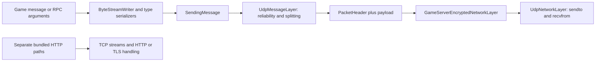
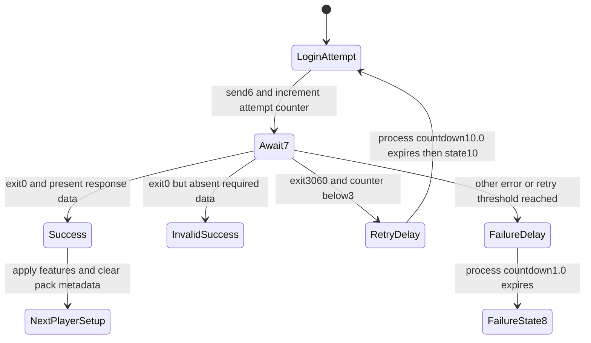
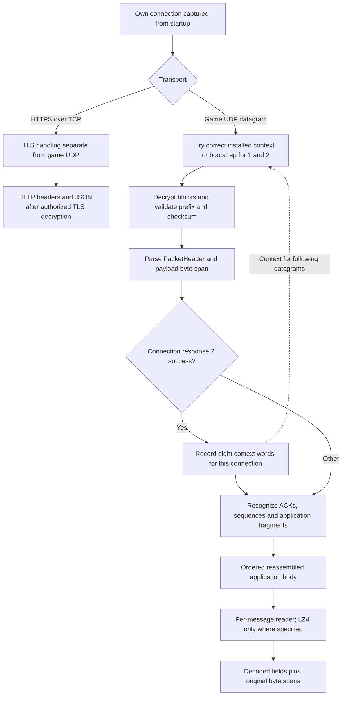
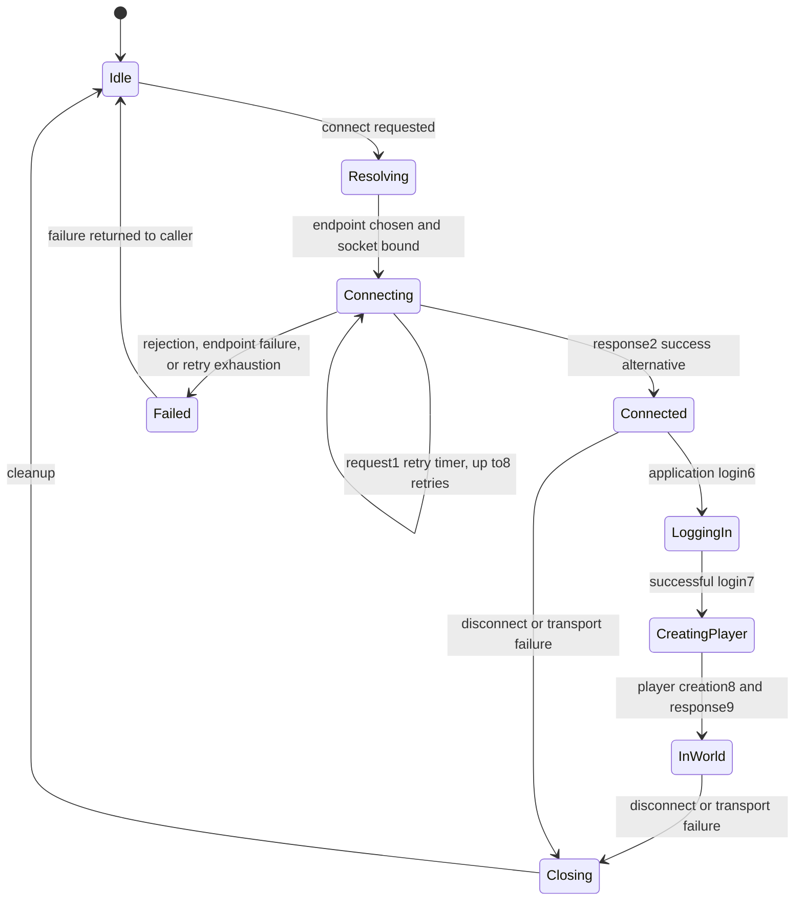
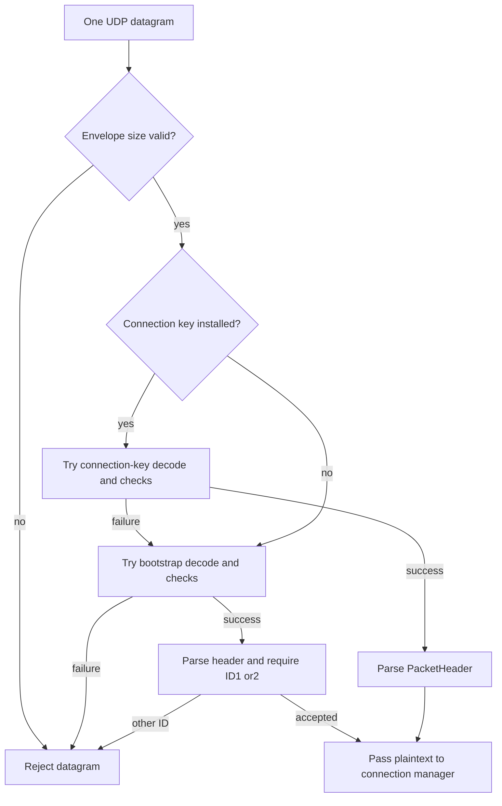
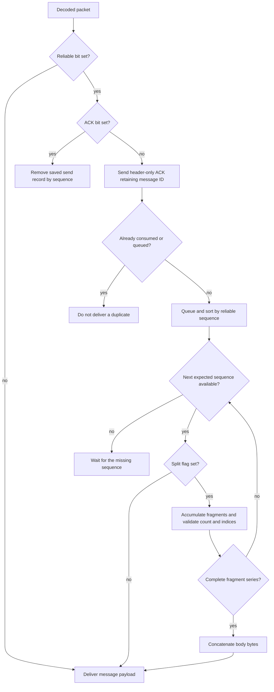
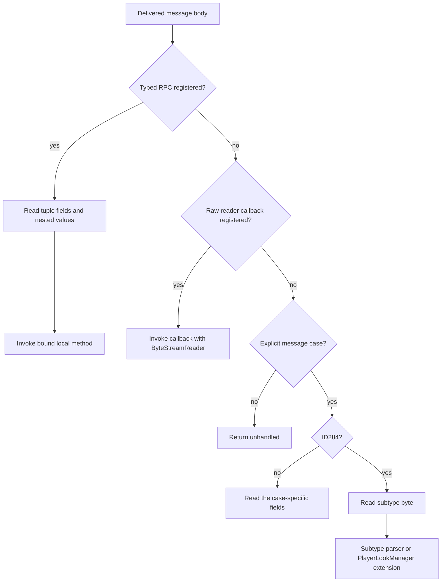
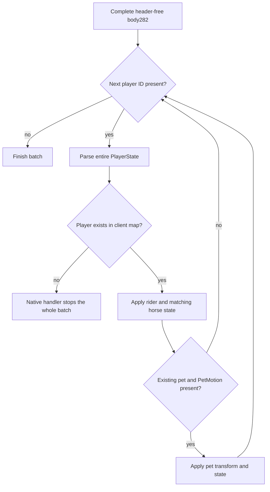
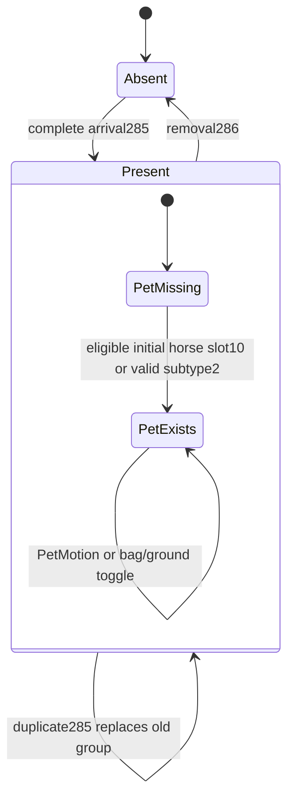

# Star Stable Online client 647 network protocol reference

Research date:2026-11-19. Source: static analysis with the Official IDA MCP server of **SSOClient647.349716**, SHA256 `62387b246a92a4874d20329caa6eaf06c7a29830263e94982a8bdad6b6110fe1`. Image-relative addresses below are **RVAs**, added to preferred IDA image base 0x140000000. They identify this client only.

## Read this first: actual scope and confidence

**The recovered game-server protocol is UDP, not TCP.** It implements its own reliable delivery, ordering, fragmentation, acknowledgements and an encrypted envelope. The client also contains TCP/HTTP code; that is a separate stack. Do not put a TCP length-prefix reader in front of these game datagrams.

This document contains the **complete 436-entry client ID/name table**, the recovered incoming RPC registrations and argument types, transport/primitive/compound layouts, code-backed state diagrams, and a large address-indexed payload-procedure appendix. It is not a claim to know a complete server implementation or every semantic field name. A client can name backend/internal IDs without containing their serializers. Those missing definitions cannot honestly be reconstructed from names alone.

Confidence labels:

- **Verified:** directly read from instructions, a concrete serializer, the ID jump table, or a matching RPC registration/reader.
- **Candidate:** a static metadata reference or stream-dependency path that needs contextual review; it is not by itself a direction/schema proof.
- **Unknown:** absent or not established by this analysis. Anonymous fields keep their offsets/types instead of receiving invented names.

Packet captures, live sessions, successful server acceptance and every possible server-controlled branch were not tested. No live game memory was modified, no game code was executed, and no login/session traffic was collected. This is a reference to recovered client parsers and writers; it does not implement a proxy or claim server behavior absent from this client.

For discovery steps, problems and follow-up addresses, see [JOURNAL.md](JOURNAL.md). The structured extraction data is in [data/](data/). A host-memory offset is never automatically a wire offset: C++ padding, pointers, vector capacity and variant storage are not transmitted.

## Contents

- [Transport stack](#transport-stack)
- [Server domains and endpoint selection](#server-domains-and-endpoint-selection)
- [Library identification and format examples](#library-identification-and-format-examples)
- [Launcher handoff, authentication and traffic decryption](#launcher-handoff-authentication-and-traffic-decryption)
- [Connection states](#connection-states)
- [Encrypted datagram envelope](#encrypted-datagram-envelope)
- [Packet header](#packet-header)
- [Reliable delivery and split messages](#reliable-delivery-and-split-messages)
- [Primitive encodings](#primitive-encodings)
- [Compound records](#compound-records)
- [Player, horse and pet lifecycle](#player-horse-and-pet-lifecycle-proxy-facing-layouts)
- [Complete message ID catalog](#complete-message-id-catalog)
- [Incoming RPC payload catalog](#incoming-rpc-payload-catalog)
- [Payload and transport procedure appendix](#payload-and-transport-procedure-appendix)
- [Remaining gaps](#remaining-gaps)

## Transport stack

RVA 0xA4B4D0 creates `socket(address_family,2,0)`: datagram sockets. Login endpoint resolution 0xA4B7B0 likewise supplies socket type2. UdpNetworkLayer receive 0x80B430 calls 0xA4BA20, which uses `recvfrom`; send 0x80B750 calls 0xA4BB70, which uses `sendto`. The network layer accepts datagrams up to 1500 bytes. Login-server port18971 is a configured-value fallback in 0x7C1800, not proof that all connections always use that port.

The Winsock send/recv callers 0x978EC0/0x9790F0 inspected here belong to bundled HTTP/cURL plumbing, not the discovered gameplay message layer. HTTP/TLS library messages and Sentry/crash-reporting strings must not be mistaken for SSO gameplay RPCs. No separate custom TCP world-message frame format was established.



A UDP receive is already a datagram. OS IP fragmentation is below this layer; the application's split-message fields described below are a separate mechanism. A datagram is transformed/decrypted, its variable-length PacketHeader is consumed, and the remaining bytes become that packet's payload. No application-level TCP reassembly was observed in this path.

## Server domains and endpoint selection

Identified 2026-11-19 from installed launcher2.60.0 and the SHA256-bound client 647.349716. **The configured production hostname for the game's HTTPS bootstrap is `lb-pub.prod.starstable.com`.** The gameplay UDP host is selected separately by the server; the current input does not establish one universal gameplay hostname.

This is a configured-destination finding, not a live packet observation. No SSOClient process was running during this endpoint check. A filtered local DNS-cache query returned no matching Star Stable entries. Those observations do not prove a service is unavailable or that a particular historical session used a different host. No tokens, authenticated requests, packet capture, memory inspection or connection to these services was used to obtain the domains.

### Destination inventory

| Domain / value source | Role and transport | Evidence / confidence |
|---|---|---|
| **lb-pub.prod.starstable.com** | Game-service HTTPS, normally TCP443. Native game-server data and ticket requests. | Verified packaged production default and launcher→native URL-construction path; not a claim of an observed live connection. |
| Response field **game_server_address** | Actual login/game endpoint, custom encrypted UDP; fallback port18971 unless configured otherwise. May be a hostname or numeric address. | Verified response handling→initializer+240→native resolver. Its actual per-account/server value was not collected. Do not substitute the HTTPS API hostname. |
| **sentry.io** | Native client's configured Sentry crash/error reporting DSN host, HTTPS. | Verified two DSN literals at RVAs 0xFFF728/0xFFF768, chosen in initialization 0x720EF0 and passed to SDK configuration 0x900E50. Separate from gameplay. No live upload was observed. |
| MetricsServer from **remoteConfig.metricsUrl** | Optional metrics endpoint passed by the launcher. | GameWindow source line905 sets metricsUrl from fetched remote configuration; formatter emits MetricsServer; native entry stores it separately. No concrete metrics hostname is established by the packaged defaults reviewed here. |
| Response field **report_a_player_server**, or explicit ReportPlayerServer | Optional reporting endpoint. | Native data handler copies the optional response string to initializer+520. Its actual server-provided value was not collected. |
| **launcher-release-prod.starstable.com** | Launcher self-update origin. | Verified packaged AUTO_UPDATE_URL; included to distinguish launcher-only traffic. It is not evidence of SSOClient gameplay or ticket traffic. |

The game's HTTPS hostname is not literally embedded as a starstable.com URL in the reviewed executable string inventory: it is supplied through the launch arguments. The native Sentry DSNs are embedded. String presence alone is not proof a path ran; the role labels above follow the callers and configuration flow. Domains in generic bundled HTTP diagnostics are not automatically SSO destinations.

### Exact production URLs and source chain

Packaged `resources/app.asar` SHA256 `390abe5340bfc5dc665bd8f5894b3e77af5f3d92cdea105f712d87bfd40f6b20` contains static build configuration `dist/.env`:

```text
line4 API_ENDPOINT=https://lb-pub.prod.starstable.com/proxy-launcher
line5 API_GATEWAY_ENDPOINT=https://lb-pub.prod.starstable.com/api-gateway/1.0
line7 AUTO_UPDATE_URL=https://launcher-release-prod.starstable.com
line11 PRODUCTION=true
```

This is the application's packaged build configuration, not a user credential/session file. Its SHA256 is `a0a02f0fbd0c18da12cef22b628fc267cd11db7de2bd1722e63c185e58d69101`. Only the four allowlisted values above are exported; unrelated environment/configuration keys are not copied into the research output.

`dist/utils/config.js` SHA256 `18c0398799dbc44ee5235c276d0b0ac8a9b81533d9c2b55e15598dcdfcf9882f` selects packaged `../.env` when Electron reports app.isPackaged, loads it with dotenv, and maps API_ENDPOINT/API_GATEWAY_ENDPOINT into config. This reader is not an authenticated API request. Native values can differ when a different environment/configuration or explicit CLI override is used; these are installed production defaults, not an immutable domain allowlist.

`dist/index.js` lines113–118 prefers a nonempty explicit CLI endpoint override, otherwise the configured endpoint. Lines188–189 select API/gateway bases. `dist/windows/game/index.js` line535 then passes **`new URL(this.gatewayEndpoint).origin`**, dropping the gateway path. `executable.js` emits:

```text
-ServiceBaseUrl="https://lb-pub.prod.starstable.com"
-NetworkLauncherServer="https://lb-pub.prod.starstable.com/proxy-launcher"
```

Only ServiceBaseUrl's native consumption is established here; emission of NetworkLauncherServer does not prove another game request uses that argument.

Native Windows entry 0x1D770 stores ServiceBaseUrl at StudioInitialize+208. Setup 0x380120 copies it to CPXPlayerSetup+160. Request builders append their own paths, yielding:

```text
POST https://lb-pub.prod.starstable.com/api-gateway/1.0/game-server/data
POST https://lb-pub.prod.starstable.com/api-gateway/1.0/game-server/ticket
```

Both requests have zero-length bodies and use the launcher's access token as an Authorization Bearer credential, as detailed in the authentication section. The `.env` API_GATEWAY_ENDPOINT's existing path must not be appended twice: the formatter's origin operation is what prevents that duplication.

Launcher account/queue calls share the production DNS host but are distinct operations:

```text
POST https://lb-pub.prod.starstable.com/api-gateway/1.0/session/create
POST https://lb-pub.prod.starstable.com/api-gateway/1.0/session/refresh
POST https://lb-pub.prod.starstable.com/proxy-launcher/launcher/auth/initialize
POST https://lb-pub.prod.starstable.com/proxy-launcher/launcher/login-queue/v2/desktop/token
GET/DELETE https://lb-pub.prod.starstable.com/proxy-launcher/launcher/login-queue/token
```

These follow the already recovered launcher templates and packaged bases. They are not evidence that SSOClient sends the initial email/password request itself. All URLs here are static constructions; no account endpoint was probed.

### How the gameplay destination is assigned

1. Native 0x3803E0 requests game-server/data from the HTTPS origin above.
2. Result handler 0x37F2A0 validates the JSON and copies `game_server_address` to StudioInitialize+240. It also validates user_id; the server address is not derived from a local region-name guess.
3. LoginServerConnect 0x7C1800 copies that string, has a diagnostic format `ServerHostname: '%s'`, and uses initializer+272 for port or 18971 when zero. The separate `ServerPort: '%u'` diagnostic reflects the selected port.
4. It passes hostname/port to resolver 0xA4B7B0. Its hints set socket type2 (**SOCK_DGRAM**), with IPv4/IPv6/unspecified selection according to the caller's family selector. Subsequent ProcessConnect/UDP transport code uses the resolved endpoint.

The server-provided hostname/address can change independently of the launcher or client binary. Numeric IPs, CNAME targets, selected region/world/dispatcher destinations and reconnects cannot be reconstructed from the static API origin alone. The response schema accepts a string; it does not constrain that field to a fixed starstable.com suffix. A future proxy should retain the received address and endpoint/connection provenance instead of pinning a guessed hostname or current IP.

To establish an actual assigned hostname in a later authorized session, the relevant evidence is **only** the `game_server_address` field of a decoded game-server/data response, a hostname-only native diagnostic if available, or the corresponding narrowly scoped runtime field. Full launcher command lines/log dumps are unnecessary because they may contain access tokens. No such live value was available or collected in this check.

### Reproduction and update handling

The static ASAR reader now includes config.js and exports only the packaged endpoint allowlist, alongside source hashes:

```powershell
python docs/research/protocol/tools/inspect_launcher_static.py --archive "<installation>/resources/app.asar" --output out/protocol-647/launcher-reviewed
```

Read its identity.json configuration_endpoints field; do not execute extracted JavaScript or copy a user's actual process environment. The curated [data/endpoint-evidence.json](data/endpoint-evidence.json) contains hostname roles, full public URL constructions, native roots, static source identities and the no-live-session limitation. It deliberately omits the Sentry DSN key component, since the requested evidence is its hostname.

For an update, recheck archive/client hashes, packaged defaults, CLI origin formatting and the data-result→resolver path. Do not infer every SSOClient connection from one DNS host, and do not treat launcher updater/crash telemetry as gameplay. No fixed hostname/IP list is claimed for all users or future releases.

## Library identification and format examples

Follow-up analysis: 2026-11-19, the same hashed client 647.349716. **The client combines third-party HTTP/TLS components with an engine-specific gameplay message/RPC/reliable-UDP stack.** Identifying a dependency elsewhere in the executable does not establish that it structures gameplay packets.

| Layer | Identification | Confidence and scope |
|---|---|---|
| HTTP/TCP transfers | libcurl, C API, compiled into the executable | Confirmed libcurl diagnostics, protocol strings and HTTP socket code. Three compiled DICT request templates report `libcurl 8.23.0`; that is a build fingerprint, not a source-revision or unmodified-upstream guarantee. |
| TLS for the examined libcurl HTTPS path | Windows Schannel/SSPI | Confirmed Schannel handshake/error paths and `Secur32!InitSecurityInterfaceW`. No OpenSSL implementation was identified on this path. |
| Additional HTTP upload path | Sentry Native using Windows WinHTTP | Confirmed transport initializer/request code and imports. Corresponding upstream Sentry transport has matching structure/diagnostics. This is separate from the gameplay datagrams. |
| Gameplay socket I/O | Windows Winsock behind PXEngine wrappers | Confirmed `socket`, `sendto`, `recvfrom`. Winsock is the OS socket API; it does not define the application's message schemas. |
| Gameplay framing, ACKs, ordering, fragmentation | PXEngine NetworkShared connection/message layers | Strong evidence for an engine-specific implementation and wire format. No ENet/RakNet/SLikeNet/Asio implementation was identified in the traced path. |
| Gameplay serialization and RPC binding | PXEngine ByteStreamReader/Writer, NetSerialize helpers and RpcExecutor | Confirmed source-path strings, RTTI and concrete readers. Positional fields, custom ID dispatch and C++ tuple/optional/variant handling. No generic Protobuf/FlatBuffers/MessagePack decoder is used by the traced gameplay readers. |
| Selected gameplay compressed fields | LZ4 block algorithm with an SSO length wrapper | Format/algorithm match from concrete code and the upstream block specification. Exact library release/vendor provenance is not established. |
| Gameplay envelope | XTEA-style 8-cycle block operation plus FNV-1a32 and custom metadata | Standard algorithm building blocks in an engine-specific envelope. No named third-party crypto-library implementation was established for this code. |
| JSON handling elsewhere in the client | RapidJSON, C++ | Confirmed RapidJSON schema/DOM-related RTTI. CPXJson also has engine wrapper code. No universal JSON gameplay packet format or exact RapidJSON version is established. |
| MessagePack references elsewhere | Sentry Native/Crashpad scope and breadcrumb serialization | Confirmed association with crash-reporting code. The particular standalone MessagePack library, if any, was not identified; the strings do not prove use of msgpack-c or MPack for world messages. |

“Engine-specific” describes the recovered architecture, interfaces and wire representation. It does not prove the provenance of every stripped helper or that no upstream source was ever adapted. Standard varints, ZigZag and common algorithms alone cannot establish a particular serialization library.

### HTTP/TCP: libcurl and Schannel evidence

The client contains libcurl-specific strings at RVAs 0x1054F50,0x1055468 and 0x10554E8. Request templates at 0x10633B8,0x1063428 and 0x1063458 embed the version fingerprint above. These are DICT capability strings compiled into a multi-protocol library, **not evidence that the game actually uses DICT**. Engine instrumentation at 0x9A140 refers to `curl_multi_perform` and `curl_multi_poll`; its metric-name strings are at 0xF30408/0xF30448. That function constructs metrics, so those xrefs alone are not a call graph to the transfer APIs. HTTP socket send/receive paths previously traced are 0x978EC0/0x9790F0.

libcurl provides URL/HTTP transfer functionality through its C API. Its multi interface allows transfers to be driven by a polling/event loop. This identifies a reusable HTTP component, rather than the schema of an SSO gameplay message. See the [official libcurl overview](https://curl.se/libcurl/) and [programming tutorial](https://curl.se/libcurl/c/libcurl-tutorial.html).

Illustrative C API example, **not recovered SSO source, an SSO endpoint, or a gameplay packet parser**:

```c
#include <curl/curl.h>

int example_http_request(void) {
    if (curl_global_init(CURL_GLOBAL_DEFAULT) != CURLE_OK)
        return 1;
    CURL *request = curl_easy_init();
    if (!request) {
        curl_global_cleanup();
        return 1;
    }
    curl_easy_setopt(request, CURLOPT_URL, "https://example.invalid/status");
    CURLcode result = curl_easy_perform(request);
    curl_easy_cleanup(request);
    curl_global_cleanup();
    return result == CURLE_OK ? 0 : 1;
}
```

Schannel initialization 0x965FD0 calls `InitSecurityInterfaceW`; handshake 0x9992A0 accesses the returned SSPI function table and emits Schannel-specific errors. TLS is handled below the HTTP application body. The identification is consistent with curl's documented [Schannel TLS backend](https://curl.se/docs/ssl-compared.html). This does not make the separate gameplay UDP envelope TLS or DTLS.

### Separate HTTP implementation: Sentry Native and WinHTTP

RVA 0x909AA0 logs the WinHTTP transport initialization, allocates worker state and binds transport callbacks.0x90A390 imports/calls `WinHttpOpen`;0x909C30 uses `WinHttpCrackUrl`, `WinHttpConnect`, `WinHttpOpenRequest`, `WinHttpSendRequest`, `WinHttpReceiveResponse` and `WinHttpQueryHeaders`. The method/headers/body come from a prepared HTTP request object. This matches Sentry's upstream [WinHTTP transport example/version0.7.20](https://raw.githubusercontent.com/getsentry/sentry-native/0.7.20/src/transports/sentry_transport_winhttp.c); the source is a structural comparison, **not an assertion that the embedded SDK is exactly0.7.20**.

The relevant request flow is:

```text
Sentry envelope -> prepared HTTP request -> queued worker task
  -> WinHttpConnect -> WinHttpOpenRequest
  -> WinHttpSendRequest(headers, body) -> WinHttpReceiveResponse
  -> inspect response headers/status -> cleanup
```

RVA 0x908120 serializes a crash-event/scope value before writing an attachment and can log a MessagePack flush failure;0x907FD0 does the corresponding breadcrumb operation. Both call serializer 0x900590. The matching upstream [Crashpad backend](https://github.com/getsentry/sentry-native/blob/master/src/backends/sentry_backend_crashpad.cpp) explicitly uses `sentry_value_to_msgpack` for this work. These references identify crash-reporting serialization; they do not establish that the HTTP upload body or SSO object updates are all MessagePack.

### Gameplay: custom PXEngine serialization and reliable UDP

The strongest evidence combines proprietary interfaces with concrete byte transfers:

- Source references name `Base/Serialize/NetSerialize/PXNetIntegral.h` at 0xF4F150 and `PXNetSerializeStd.h` at 0xF64730.
- RPC source reference 0xF50C80 names `NetworkShared/RPC/PXRpcExecutor.h`;0xF50D10 identifies `PXEngine::RpcExecutor::Bind`.
- Reader/writer source references at 0x10A04D0/0x109ED00 name `PXByteStreamReader.cpp` and `PXByteStreamWriter.cpp`. RTTI names the PXEngine reader, writer and HandlerStub classes.
- Connection sources name `PXConnectionManager.cpp` at 0x101ADC0, `PXUdpMessageLayer.cpp` at 0x101B480 and `PXUdpNetworkLayer.cpp` at 0x101BA90.
- The envelope source reference 0x1020520 names `PXGameServerEncryptedNetworkLayer.cpp`.
- Actual codecs use virtual byte-transfer operations and concrete positional readers such as varu32 helper 0x1D0820 and PacketHeader codec 0x801400. Reliability code 0x809340/0x8097F0 implements the recovered flags, per-fragment sequences and ordering rather than handing these bodies to a recognized external messaging API.

Example derived from the actual message286 reader in 0x7D08D0: its body contains one varu32 player identifier. For a **synthetic** identifier150, the complete body after header removal/decryption is:

```text
96 01                     # varu32(150)
```

The message ID belongs in SSO's separate PacketHeader; its own varu16 representation for286 is `9E 02`. Neither byte example includes the complete header, encrypted envelope, connection metadata or an actual session. They are examples of the recovered encoding, not captured packets or sendable standalone datagrams.

Compare a Protobuf message whose field1 has integer value 150: it has a preceding field tag and encodes as `08 96 01`, as shown in the [official Protobuf encoding guide](https://protobuf.dev/programming-guides/encoding/). SSO's reader does not consume that `08` tag. Both formats can use the same varint primitive while their message structures remain different.

Similarly, C++ RTTI such as `tuple<ClientExitCode,optional<LoginResponseData>>` describes the types bound to a PXEngine reader. It does not imply Boost.Serialization, cereal, a `.proto` schema, a raw memory-struct transfer or an automatic portable RPC protocol. The concrete reader determines widths, presence bytes and order.

### Compression: a standard LZ4 block inside custom lengths

The decompressor 0xE6C020 matches the LZ4 block token/literal/match format. That permits reuse of a compatible LZ4 block decoder for those bytes, while SSO's wrapper and the decompressed message schema still need their own handling. See the upstream [LZ4 block specification](https://github.com/lz4/lz4/blob/dev/doc/lz4_Block_format.md). No standalone LZ4 frame header is present in the recovered CompressedBlob wrapper.

Synthetic example for the five ASCII bytes `Hello`:

```text
0A 00 00 00              # record_length = 10: output-size word + block
05 00 00 00              # uncompressed_length = 5
50 48 65 6C 6C 6F        # LZ4 block: token 0x50, five final literal bytes
```

This is an illustrative14-byte CompressedBlob field, not a complete game packet. A compatible C LZ4 API would receive only the last6 bytes, e.g. `LZ4_decompress_safe(block, output, 6, 5)`, and its result must equal5; see the [upstream C API header](https://github.com/lz4/lz4/blob/dev/lib/lz4.h). The outer two lengths are raw little-endian uint32 values, **not varints**. This example was constructed from the format; it was not replayed against a server or tested against a captured session.

### JSON: identified library, separate encoding

RapidJSON RTTI at 0x1363DC0,0x1363EE0,0x1363FD8 and 0x1364020 names its schema validators, GenericValue, UTF8 and MemoryPoolAllocator types. Engine logging identifies `CPXJson::CreateValue` at function 0xA27A50 and `CPXJson::Insert` at 0xA290F0, with a `PXJSon.cpp` source reference at 0x109F000. These are JSON implementation/wrapper evidence; their existence does not assign JSON encoding to every network field. RapidJSON's [official documentation](https://rapidjson.org/) describes its C++ DOM/parser API.

Illustrative RapidJSON usage, **not an observed SSO body**:

```cpp
#include <rapidjson/document.h>

rapidjson::Document document;
document.Parse(R"({"kind":"example","count":2})");
if (!document.HasParseError() && document.IsObject() &&
    document.HasMember("count") && document["count"].IsInt()) {
    int count = document["count"].GetInt();
    (void)count;
}
```

No exact RapidJSON version or mapping of all HTTP body schemas to JSON libraries was recovered. Fields explicitly typed as strings or compressed bytes must be decoded according to their concrete callers, rather than parsed as JSON automatically.

### Negative results and common false positives

Bounded string/named-symbol searches found no recognizable ENet, RakNet/SLikeNet, Boost.Asio, Protobuf, FlatBuffers, cereal, bitsery, gRPC or GameNetworkingSockets identifiers in support of the traced gameplay stack. Stripping/static linking/renaming can erase fingerprints; absence of names is not a proof of absence throughout the executable. The positive PXEngine source/RTTI/control-flow evidence is stronger than those negative searches.

Boost exception/regex symbols **are** present:101 named-symbol hits in the broader framework probe were all Boost-related, including `regex_error` and regex implementation types. That is not evidence of Boost.Asio or Boost.Serialization. Likewise the `RPCRT4` imports here are `UuidCreate`, `UuidToStringA` and `RpcStringFreeA`; they do not demonstrate that gameplay RPCs use Microsoft RPC. LodePNG zlib diagnostics are image-decoding evidence, not proof that CompressedBlob uses zlib.

For implementation planning, reusable parts identified here are HTTP transfers, TLS, JSON processing where applicable and LZ4 block decoding. SSO's gameplay IDs, positional schemas, header, connection lifecycle, reliable-UDP behavior and encrypted envelope still require the custom protocol described in the rest of this reference.

The authentication continuation also identifies **CRC32/ISO-HDLC** in the login's pack metadata. File hash 0x6CA30 streams1024-byte chunks through 0x9CB860→0x9CB870; the full256-entry table at 0x1069060 matches reflected polynomial 0xEDB88320. Its update/complement behavior matches ordinary zlib.crc32. This is an algorithm identification, not enough to assign a particular zlib version or prove an unmodified library build. Keep its role separate from the game envelope's FNV-1a-32 and archive filename FNV64 lookups; identical-looking checksum-sized fields are not interchangeable.

## Launcher handoff, authentication and traffic decryption

Research date: 2026-11-19. This section is maintained separately and embedded in the main specification. It describes installed launcher **2.60.0** and Windows client **647.349716**, not an assumed current server implementation. All native addresses are RVAs relative to image base `0x140000000`.

**The launcher passes an access token to the game as `-AccessToken="..."`. The game uses that token as an HTTPS Bearer credential to obtain server information and a separate game-server ticket. The UDP login sends the ticket, user ID, machine identifier and optional queue token. UDP encryption uses separate bootstrap/connection material; it is not derived from the access token in the inspected code.**

Only installed application code and the archived executable were inspected. No live process command line, password, token, session file, registry identifier or authenticated network exchange was collected. Examples below use placeholders or constructed data. Reading a token's JWT payload is decoding, not decryption or proof of signature validity.

### Evidence identity and reproducible launcher inspection

The game SHA256 remains `62387b246a92a4874d20329caa6eaf06c7a29830263e94982a8bdad6b6110fe1`. The installed Electron `resources/app.asar` is 243,677,227 bytes, SHA256 `390abe5340bfc5dc665bd8f5894b3e77af5f3d92cdea105f712d87bfd40f6b20`; package name `StarStableOnline`, version `2.60.0`, main `dist/index.js`. The launcher and game have independent version numbers.

[data/authentication-evidence.json](data/authentication-evidence.json) retains source hashes, one-based source line landmarks, native procedure roles, exact handoff arguments, endpoints and unresolved questions. The launcher JavaScript was extracted locally without execution; the full proprietary archive and extracted source copies remain in ignored output, outside delivery packages. The retained reader works on the selected static code files, not user profiles:

```powershell
python docs/research/protocol/tools/inspect_launcher_static.py --archive "<installation>/resources/app.asar" --output out/protocol-647/launcher-reviewed
```

ASAR parsing here reads four little-endian 32-bit header words, the JSON tree at offset 16, and packed file data at `8 + header_size + file.offset`. It rejects unpacked/link entries and invalid source bounds. It does not run the launcher or its JavaScript. The source paths below are archive-internal paths.

### Authentication sequence and boundaries

```mermaid
sequenceDiagram
    participant U as User
    participant L as Electron launcher
    participant A as Account and launcher HTTPS services
    participant G as SSOClient
    participant W as Game service HTTPS gateway
    participant S as UDP game endpoint
    U->>L: Normal sign-in or remembered-session login
    L->>A: POST session/create or session/refresh
    A-->>L: access_token and refresh_token
    L->>L: Decode JWT session_id and exp; refresh near expiry
    L->>A: Authenticated initialize and queue requests
    A-->>L: Queue position and queueToken
    L->>G: Spawn with AccessToken, NetworkUserId, LoginQueueToken and service origin
    G->>W: POST game-server/data, Bearer access token
    W-->>G: game_server_address, user_id, region_id and exchange_rate
    G->>W: POST game-server/ticket, Bearer access token
    W-->>G: Opaque ticket string
    G->>S: Bootstrap-encrypted connection request 1
    S-->>G: Bootstrap-encrypted response 2 with connection material
    G->>S: Connection-encrypted login 6, including ticket and queue token
    S-->>G: Login response 7
    Note over G,S: Successful higher-level login continues to player creation 8/9
```

The HTTPS request methods above are recovered from the native request configuration, including libcurl POSTFIELDS and POSTFIELDSIZE; they are not inferred from endpoint names. Successful server acceptance, error codes for every policy decision, ticket expiry and server-side validation internals remain untested. Transport connection success is distinct from account/login success.

### What the launcher gives the game

`dist/windows/game/helpers/executable.js`, lines 26–60, builds an object, drops only null/undefined values, then formats **one dash**, case-preserving names and quoted values: `` `-${key}="${value}"` ``. Empty strings, zero and false-converted-to-zero values are not removed by that null test. `dist/windows/game/index.js`, lines 524–545, first calls `ensureValidAccessToken()`, then passes session state and queue state to this formatter.

| Windows argument | Launcher source / meaning | Native follow-through in this analysis |
|---|---|---|
| `-AccessToken="<access-token>"` | `launcherState.session.accessToken` | Entry `0x1D770` copies to StudioInitialize+352; setup `0x380120` copies to CPXPlayerSetup+192; used in HTTPS Bearer headers |
| `-NetworkUserId="<decimal-account-id>"` | `this.accountId` | Parsed as integer to StudioInitialize+312; checked against HTTPS `user_id`, then sent as varu32 in login 6 |
| `-LoginQueueToken="<uuid-text>"` | `loginQueue.token()` | `0x63DC80` validates/parses to 16 bytes at initializer+944; optional opaque128 in login 6 |
| `-ServiceBaseUrl="<origin>"` | `new URL(gatewayEndpoint).origin` | StudioInitialize+208 → CPXPlayerSetup+160 → native game-service URLs |
| `-NetworkLauncherHash="<session-id>"` | JWT payload's `session_id`, stored in launcher session state | Emission is verified; no consuming native read of this argument name was established. It is **not** evidence that this string is login 6's third string |
| `-NetworkLauncherServer="<api-endpoint>"` | Launcher API base | Emission verified; downstream native use not established |
| `-ProjectUserDataPath="<install-directory>"` | Installation directory | Launcher emission verified; no credential interpretation assigned |
| `-Language="<language>"` | Selected language | Ordinary launch setting |
| `-MetricsServer="<url>"`, `-MetricsGroup="<groups>"` | Metrics configuration | Entry stores these separately at initializer+464 and +496; MetricsGroup is **not** the vector at +960 sent in login 6 |
| `-EnableActorSerializationOnDemand="0-or-1"`, `-EnableNebula="0-or-1"` | Boolean settings converted to numbers | Ordinary feature settings; not authentication credentials |

On macOS the same formatter uses `LauncherHash`, `LauncherServer` and `DataPath` instead of the three Windows-specific names. That is launcher-source evidence, not validation of a macOS game's native parser. Trusted-user/manual argument overrides exist in the launch caller and are outside the default formatter's guarantees.

`dist/windows/game/helpers/gameStart.js`, lines 47–60, calls Node `child_process.spawn` with `shell:true`, `detached:true`, `cwd:installDirectory`, `windowsHide:false`. Its debug call is given the executable arguments. Consequently a diagnostic command-line/log dump can contain an active access token; no actual log contents were read here. Treat this handoff as sensitive even though it is local.

In the game, `GetCommandLineW` → `0x617A0` → `CommandLineToArgvW` → Unicode-to-UTF8 conversion → `0x603F0` argument container. `0x60730` performs option lookup; `0x60EC0` retrieves text and `0x60E50` retrieves an integer. These addresses plus the exact entry body are retained in the procedure appendix. Do not casually substitute GNU `--name value` syntax for the formatter's `-Name="value"` syntax.

The client also accepts `NetworkUserName`, `NetworkTicket`, `NetworkServer` and `NetworkServerPort` in the entry path. These are legacy/manual alternatives, **not arguments emitted by the inspected default launcher**. With a nonempty AccessToken, the setup path fetches fresh server data/ticket; an initial NetworkTicket is not proof that it remains the ticket ultimately sent. With an empty access token, `0x380120` signals setup completion without these HTTP calls. That is a client branch, not evidence the server permits unauthenticated gameplay.

### Launcher account/session HTTP exchanges

Let `gatewayEndpoint` and `apiEndpoint` denote launcher configuration values. They need not be the same base, and `gatewayEndpoint` can already contain a path. The native game's ServiceBaseUrl is only its origin. Avoid accidentally duplicating `/api-gateway/1.0` by treating all three as interchangeable.

The installed production defaults now resolve both bases to **lb-pub.prod.starstable.com**: gateway base `https://lb-pub.prod.starstable.com/api-gateway/1.0`, launcher API base `https://lb-pub.prod.starstable.com/proxy-launcher`. The game receives `https://lb-pub.prod.starstable.com` as ServiceBaseUrl. [ENDPOINTS.md](ENDPOINTS.md) records the packaged source/hash, full native URLs, separate UDP assignment and observation limits; this host is not a proved fixed destination for all gameplay datagrams.

`dist/services/Account/helpers/apiClient.js` constructs:

| Operation | Method and URL | JSON body / consumed result |
|---|---|---|
| Password sign-in | POST `${gatewayEndpoint}/session/create` | `credentials:{email,password}`, `device_info` |
| Google sign-in | Same POST | `token:{id_token,platform:"desktop",provider:"google"}`, `device_info` |
| Verification-code continuation | Same POST | `client_id:"SSO"`, `verification:{verification_id,code}`, `device_info` |
| Token refresh | POST `${gatewayEndpoint}/session/refresh` | `refresh_token`; bypasses offline buffering and automatic refresh recursion |
| Resend verification | POST `${gatewayEndpoint}/session/verification/${verificationId}/resend` | No explicit body in this builder |
| Launcher initialize | POST `${apiEndpoint}/launcher/auth/initialize` | `deviceId`, `launcherVersion`, `launcherPlatform:"desktop"`, `clientOsRelease`, `browserFamily:"Electron"` |

The create and refresh responses provide `access_token` and `refresh_token`; AccountService consumes them and stores the decoded `session_id` with both tokens. Sign-in failures can expose `service_error_code` and `data.verification_id`. This is a description of fields the code accesses; it is not the complete backend response schema. `device_info` comes from the injected optional `getDeviceInfo` callback through `collectDeviceInfo`; errors return undefined, which JSON.stringify omits from the object. The callback's complete builder is expanded below; arbitrary additional backend response fields remain unknown.

`dist/utils/fetch.js` serializes a supplied body with `JSON.stringify` and uses node-fetch. Standard headers are `User-Agent`, `Device-ID`, `X-Platform: DESKTOP_LAUNCHER` and `Content-Type: application/json`. It attaches `Authorization: Bearer <access-token>` when a token exists and `skipAuthRefresh` is false. Create/refresh explicitly set `skipAuthRefresh:true`, avoiding stale Bearer attachment and recursive refresh. Callers may supply headers that override the defaults.

Synthetic shapes, not replayable credentials:

```json
{"credentials":{"email":"<your-email>","password":"<your-password>"},"device_info":{}}
```

```json
{"access_token":"<JWT-access-token>","refresh_token":"<opaque-refresh-token>"}
```

`AccountService.decodeAccessToken()` invokes `jwt-decode`'s `jwtDecode`; the launcher consumes `session_id` and `exp`. `SessionService.getShouldAccessTokenRefresh()` subtracts current epoch seconds from `exp` and refreshes when the result is **≤300 seconds**; missing/failed JWT decode also requests refresh. Concurrent refresh callers share a promise. Successful refresh replaces both token values; failure runs logout handling. Remembered login calls the same refresh endpoint with a saved refresh token. Neither JWT signing algorithm, issuer keys, complete claims nor server revocation/TTL policy can be deduced from these two consumed claims. No actual JWT was decoded for this work.

### Full device_info builder and launcher device identity

Follow-up traced the callback from `dist/index.js` line 210 into `GameRequirementsManager.getDeviceInfo` in `dist/utils/systeminfo.js` lines 187–231. The complete constructed object has this shape (all values below are synthetic):

```json
{
  "schema_version": 1,
  "collected_at": "2026-11-19T00:00:00.000Z",
  "app": {"name": "<Electron app name>", "version": "2.60.0", "distribution": "<store>"},
  "os": {
    "family": "windows", "name": "<OS display name>", "version": "<release>",
    "build": "<build>", "architecture": "<architecture>", "locale": "<locale>", "timezone": "<IANA timezone>"
  },
  "hardware": {
    "manufacturer": "<manufacturer>", "model": "<model>",
    "cpu": {"name": "<trimmed first CPU model>", "architecture": "<OS architecture>", "logical_cores": 8},
    "memory": {"total_bytes": 17179869184},
    "gpus": [{"name": "<deviceString>", "vendor": "<vendorString or mapped vendor>", "driver_version": "<driverVersion>"}]
  },
  "capabilities": {"graphics_api": ["opengl"]}
}
```

The shape/omission rules matter for exact JSON inspection:

- `schema_version` is the number 1; `collected_at` is `new Date().toISOString()` at collection time. JSON numbers here are not gameplay varints.
- `app.name` comes from Electron `app.getName()`, version from the injected launcher version, and distribution from the CLI store value, omitted when falsy.
- OS family maps win32→windows, darwin→macos, linux→linux; unknown platform names pass through. Name/release/build/architecture come from cached system-info results; locale comes from Electron and timezone from Intl. Falsy optional values are converted to undefined and omitted by JSON.stringify.
- Manufacturer/model come from `systeminformation.system()`. CPU name comes from the first `os.cpus()` model, trimmed; logical_cores is array length, omitted if zero. Memory is `os.totalmem()` in **bytes**, without the separate metrics path's MB rounding.
- GPU entries come from Electron `app.getGPUInfo("basic").gpuDevice`. Name/vendor/driver are optional. Vendor uses vendorString first, then IDs 0x10DE→NVIDIA, 0x1002→AMD, 0x8086→Intel, 0x106B→Apple. An empty GPU array is omitted.
- Capabilities is present only when the cached OpenGL version is truthy. The payload sends the string array `["opengl"]`, not the actual numeric OpenGL version. The Windows collector uses the string `"0.0.0"` as a failed-detection fallback, which is still truthy; this field alone is not proof of working OpenGL support.
- Hardware collection errors return an empty source object; optional selected fields disappear. A top-level callback failure makes AccountService omit device_info entirely. The builder selects fields rather than copying the complete raw hardware-library response.

`dist/index.js` obtains `uniqueDeviceId` from `dist/utils/deviceId.js`, which calls `node-machine-id.machineId()` **without** the `original` flag. The installed library's readable source and packed runtime are both hash-indexed in the evidence. On Windows it extracts MachineGuid from REG_SZ output, removes whitespace/newlines, lowercases the value, then returns **SHA256 of that normalized string as lowercase hexadecimal text**. Hyphens remain in the string. No command from this module was executed here and no actual identifier was collected.

That 64-character text is used as the launcher's `Device-ID`, initialization `deviceId`, common analytics ID and SessionService PBKDF2 passphrase. The PBKDF2 input is UTF8 of the hexadecimal text, **not** the 32 digest bytes. Failure returns an empty string, enabling SessionService's fallback. This is distinct from native login6's raw MachineGuid string fallback; their textual values should not be assumed equal. Normal launcher startup also clears Electron default-session cookies outside watch mode; the traced game handoff uses explicit token arguments, not an exported browser cookie jar. This does not enumerate every unrelated webview cookie or service.

### Login queue and UUID encoding

`dist/windows/game/helpers/apiClient.js` and the packed constants module resolve the queue prefix to `launcher/login-queue`, platform `desktop`:

| Operation | Method and URL |
|---|---|
| Create/enqueue | POST `${apiEndpoint}/launcher/login-queue/v2/desktop/token` |
| Poll | GET `${apiEndpoint}/launcher/login-queue/token` |
| Cancel/delete | DELETE `${apiEndpoint}/launcher/login-queue/token` |

These use the launcher Fetch wrapper's Bearer handling. Creation consumes `passedTheQueue`, `queuePosition`, `queueToken`, `loginStateTimeout`; polling consumes the first two. The queue helper retains queueToken for the spawn arguments; it does not put that token in the shown poll/delete URL. Client-side polling intervals depend on position (approximately 3–13 seconds in the randomized schedule). Server validity, binding and expiry policy are unknown.

Native `0x63DC80` validates the text using `0xA440C0` and parses using `0xA441D0`. The accepted form has 36 characters and hyphens at 8/13/18/23, with hexadecimal digits elsewhere; the all-zero UUID is treated as invalid. The parser reads 16 `%02x` components and stores each component's byte in textual order. Thus synthetic `00112233-4455-6677-8899-aabbccddeeff` becomes `00 11 22 33 44 55 66 77 88 99 AA BB CC DD EE FF`, **without Windows GUID field swapping**. Invalid/missing input leaves the constructor's zero value, so login 6 omits the optional. The native presence test is `0xA43D70`.

### Native HTTPS bootstrap: data followed by ticket

`0x380120` copies initializer+208 to setup+160 and initializer+352 to setup+192. Nonempty access token plus empty service base is an error path; nonempty token/base starts `0x3803E0` (**RequestGameServerData**). The callback pointer inside that request is `0x37F2A0`; the request itself is not merely a callback wrapper.

Both native requests ensure a trailing slash on the base, then append:

1. `api-gateway/1.0/game-server/data`
2. `api-gateway/1.0/game-server/ticket`

They add `User-Agent: SSOCLIENT/<formatted-client-version>` and `Authorization: Bearer <initializer-access-token>`. No JSON request body is added by either request builder. Native `0x99710` sets libcurl options `CURLOPT_URL` (10002), `CURLOPT_POSTFIELDS` (10015) to the empty vector's null data pointer, and `CURLOPT_POSTFIELDSIZE` (60) to zero. Setting POSTFIELDS selects POST even for this null pointer/zero-length combination, per [libcurl's POSTFIELDS documentation](https://curl.se/libcurl/c/CURLOPT_POSTFIELDS.html). Submission `0x9A790` and callback setup `0x99530` do not change the method. The recovered request is therefore **POST with zero body length**, not GET inferred from the word “data”. Exact HTTP version, automatically added headers, redirects and a live wire exchange were not measured.

`0x99630` returns a 203,132-byte embedded CA bundle at RVA `0xEFE720` beginning with Mozilla CA-bundle text. `0x99AB0` applies it as `CURLOPT_CAINFO_BLOB` (40309). This function **sets CA material, not an HTTP method**. The earlier library analysis identifies libcurl's Schannel/SSPI TLS path. No proof of a special server public-key pin, negotiated cipher suite or negotiated TLS version was obtained from these request builders. An embedded CA bundle means a Windows trust-store-only change cannot automatically be assumed sufficient for an HTTPS inspector.

The request constructor also sets the following options before the URL/body. IDs/numeric values are read from `0x99710`; names are mapped using the [official curl header](https://raw.githubusercontent.com/curl/curl/master/include/curl/curl.h).

| Option | Value | Recovered policy |
|---|---|---|
| CURLOPT_SSLVERSION, 32 | 6 = CURL_SSLVERSION_TLSv1_2 | TLS **1.2 or later**, not an exact negotiated version. See [libcurl's version-range semantics](https://curl.se/libcurl/c/CURLOPT_SSLVERSION.html). |
| CURLOPT_CONNECTTIMEOUT, 78 | 10 | Connection-phase timeout in seconds, including name resolution/handshakes; see [official semantics](https://curl.se/libcurl/c/CURLOPT_CONNECTTIMEOUT.html). |
| CURLOPT_TIMEOUT, 13 | 15 | Whole-operation timeout of 15 seconds; includes the connection phase. |

The reviewed request constructor/setters/submission path configures the CA blob but supplies no pin, client certificate or peer/hostname-verification disabling option. This is a bounded finding for these requests, not a proof against all generic curl features, external proxy configuration or later runtime changes. Schannel initial handshake `0x9992A0` has explicit SNI/certificate failure branches and rejects an unsupported CA-bundle verification path. Actual negotiated suite, TLS version, trust result and inspection compatibility remain live-session questions.

`0x37F2A0` validates the data response against the embedded JSON schema, then updates the same StudioInitialize object:

| Field | Schema / handling |
|---|---|
| `game_server_address` | Required string → initializer+240 |
| `user_id` | Required nonnegative integer → +312; if existing +312 is nonzero and different, reports user-ID mismatch |
| `region_id` | Required integer in 0..255 → +385 |
| `exchange_rate.format_string` | Required string inside required exchange_rate object → +552 |
| `exchange_rate.price_per_100_sc` | Required string, even though it describes a price → +584 |
| `report_a_player_server` | Optional string → +520 |

On success it calls `0x380770` (**RequestGameServerTicket**). Its result handler `0x37FB10` requires a JSON object with string field `ticket`, copies that string to initializer+320 and signals setup-complete event **176003**. Failure/invalid JSON paths signal **176002**. Unknown extra JSON fields and the service's complete business rules are not inferred from a minimum required-field schema.

The ticket remains opaque: this client path does not decode a JWT, decrypt it, compute it from a password or prove whether it is single-use. The HTTPS exchange demonstrates how a valid launcher credential is exchanged for the UDP login credential; it does not disclose server signing secrets.

### Exact login 6 body and initializer map

`0x7C1800` uses initializer+240 for the login endpoint and +272 for port, with fallback **18971** when no configured port is selected. Entry option `NetworkServerPort` populates +272. Treat this as a fallback, not a universal port for every world/dispatcher connection. Transport connect passes protocol value **534** in `0x7D0120`, independent of executable version 647.

`0x7C1AF0` builds login 6. The tuple stores pointers in reverse-looking host order; **follow serializer `0x7AF880` for wire order**, not stack-local declaration order:

| Order | Wire form | Actual source and role |
|---|---|---|
| 1 | u8 presence; when present byte string, varu32, u8 | Optional record through `0x7A68B0`; initialized absent in this caller |
| 2 | byte string | Username from initializer+280, originally `NetworkUserName`; default launcher does not supply it, so an empty value is possible |
| 3 | byte string | Game-server ticket from initializer+320, populated by HTTPS ticket result |
| 4 | byte string | Machine/device identifier: initializer+432 if nonempty, otherwise Windows MachineGuid fallback |
| 5 | u8 presence, then 16 raw bytes if present | Queue token from initializer+944 via getter `0x63DBF0` |
| 6 | varu32 | User/account ID from initializer+312 |
| 7 | varu32 | Constant **1** in this caller; purpose not assigned |
| 8 | varu32 count ≤16000; repeated `[byte string filename,varu32 size_bytes,varu32 crc32]` | Vector at initializer+960 via getter `0x63DC00`; `0x63DC10` moves it from the pack archive's +248 vector; detailed producer below |

“Byte string” uses the specification's varu32 byte length followed by exactly that many bytes, not a fixed array, NUL terminator or automatically UTF16. The queue UUID's optional presence byte is separate from its 16 bytes. The vector is **not** MetricsGroup (initializer+496), and the +960 field is a C++ vector, not another UUID.

The identifier fallback `0xA4C0A0` reads `HKLM\SOFTWARE\Microsoft\Cryptography`, value `MachineGuid`, using RegOpenKeyExA/RegQueryValueExA. The identifier bytes enter the third login string. No registry contents were read in this investigation. StudioInitialize's constructor `0x63D700` initially empties +432; the reviewed Windows entry does not populate it from NetworkLauncherHash. Other override writers have not been completely enumerated. Therefore **do not rename this field to launcher-session hash** merely because that sounds plausible. This corrects an early investigation hypothesis before delivery.

After transport response 2 installs the connection material, login 6 uses that context. Login response 7 contains varu16 ClientExitCode plus optional LoginResponseData (string, two feature collections, Vec3, Normalized4); see the main compound section for names/count checks. Player creation 8/9 follows higher-level successful login. Ticket text, machine identifier, user ID, queue UUID and game transport key are separate values with separate encodings.

### Pack metadata: filename, size and CRC32

The previously anonymous two scalars are now resolved by following `CPXPackFileArchive::Open` at `0x614190`. It formats base filenames `p_%08d.csa`, opens both each data file and its name plus the literal `header`, and appends **two records per pack** to the vector at archive+248:

1. `<base-name>header`, physical header-file size via `0x6CDD0`, CRC32 over the complete header file via `0x6CB10`→`0x6CA30`.
2. `<base-name>`, stored data-file size and CRC32 from the pack descriptor's +56/+60, populated earlier in the same function.

For the data-file record the CRC is computed only when Open's fourth argument is nonzero; otherwise it stores 0. The reviewed Windows entry calls Open with that argument **1**. A later header validation compares those descriptor fields and reports **Incorrect size** / **Incorrect hash**, supporting their meanings independently of a guessed name. Filenames are relative pack names here, not proof that arbitrary filesystem paths are transmitted.

`0x6CA30` reads chunks up to 1024 bytes and updates CRC through `0x9CB860`→`0x9CB870`. All 256 entries of its table at RVA `0x1069060` match reflected polynomial **0xEDB88320**. It complements the initial and final accumulator, matching ordinary **CRC32/ISO-HDLC**, e.g. Python `zlib.crc32`, not CRC32C. This checksum is separate from the UDP envelope's FNV-1a-32 and the archive's unrelated FNV64 lookup keys.

The size getter passes the open handle in RDX to IO virtual slot +136. Hex-Rays omits that virtual-call argument in one pseudocode view; the saved instruction slice is authoritative. The concrete C-file size method `0x644B0` saves position, seeks to end, reads position and restores the original offset. The memory-IO size method `0x8AAC0` returns its backing record's size.

The vector is moved into StudioInitialize and copied into login6. A successful login7 handler calls `0x63DB90`, which destroys its strings and empties the initializer vector. A decoder must therefore allow an empty metadata vector; nonempty first-login data is not a universal invariant for later calls. No server integrity-enforcement policy, acceptance of altered values or file-validation bypass is established by these field meanings.

### Login response handling, feature duplicates and retry state

Typed callback registration binds `0x7CAF80` to ID 7; reader `0x7C10C0` consumes varu16 exit code then optional LoginResponseData before calling it. Code **0** selects success and requires present data; an absent optional is structurally decodable but reaches a native assertion/error path. Success copies the response string, installs feature state, clears the pack metadata vector and continues the player-creation/event path. The response string's full business meaning remains unnamed.

On failure, if exit code is **3060** and CPXNetwork's login-attempt byte at +448 is **below 3**, the handler schedules state **10** with a float countdown **10.0** at +320. Other failures schedule state **8** with countdown **1.0**. `CPXNetwork::Process` at `0x7CFC20` subtracts frame time, applies the pending state when the countdown becomes negative, and calls `0x7C1AF0` when state10 becomes active. The login function increments the attempt byte and enters state7. This proves a delayed resend branch; no human-readable backend name is assigned to code3060. These are application timers, distinct from connection-request retransmission and reliable-UDP ACK timers.



The two feature readers `0x7A98E0` and `0x7A9470` require minimum counts9 and 15, cap counts at 16000, and reject unknown names. Their loops do **not** reject duplicate known names or require all known names to occur. Each occurrence clears/sets its bit from the current byte: **the last duplicate wins**; any nonzero enabled byte is true. With newly constructed response data the masks start at zero, so omitted named bits remain zero even when duplicate entries satisfy the count minimum. A JSON map that silently keeps the first duplicate, or a decoder that requires unique complete name sets, would disagree with this client. Preserve the entry list and derive a mask separately.

[tools/decode_authentication_payload.py](tools/decode_authentication_payload.py) now decodes complete login6/7 bodies, preserving byte strings as hex and record byte spans. Its canonical schemas are [tools/authentication_schemas.py](tools/authentication_schemas.py), emitted as [data/authentication-wire-schemas.json](data/authentication-wire-schemas.json). It reports semantic notes for success-without-data and 3060, but it does not track attempt state or authenticate. Exact full-body consumption and conservative overflow/string caps are offline analysis checks; native callback7 itself does not enforce end-of-stream in its shown body. Native malformed-input behavior is not promised.

```powershell
python docs/research/protocol/tools/verify_authentication_payloads.py
python docs/research/protocol/tools/decode_authentication_payload.py --message 7 --hex "00 00"
```

The second command intentionally demonstrates a structurally parsed exit0/absent-data message with a semantic warning; it is not valid input to send to the client. Tests use7 synthetic bodies,1425 truncated prefixes, duplicate/unknown/minimum-count feature cases, embedded-NUL byte strings, sequential queue bytes and metadata CRC values. No live login bytes were read or sent.

### Encryption layers: what can actually be decoded

| Layer | Mechanism observed | What an inspector needs |
|---|---|---|
| Access-token payload | JWT decode in launcher | Base64url/JSON decoding can expose claims; it does not validate signature, manufacture credentials or decrypt HTTPS |
| Remembered launcher session at rest | AES-256-CTR with PBKDF2-derived key | Separate local file format below; unnecessary for observing an ordinary logged-in game's UDP session |
| Launcher account/queue HTTP | node-fetch with HTTP/HTTPS agents | An HTTPS capture contains TLS records, not automatically visible JSON. A separate authorized TLS inspection arrangement is required for plaintext |
| Native game-service HTTPS | libcurl + Schannel/SSPI, embedded CA bundle | Separate TLS trust/routing/key-export considerations; the UDP keys and JWT do not decrypt it |
| Gameplay UDP | Custom XTEA-style 8-cycle envelope + FNV-1a-32 | Static bootstrap context for 1/2, followed by material delivered in successful connection response 2 |
| Compressed message field | Client CompressedBlob around an LZ4 block | Decrypt/header-parse/reassemble first, then decompress only fields whose reader requests it |

#### Remembered-session file format, static code only

`SessionService` uses `algorithm="aes-256-ctr"`. `saveSession(refreshToken)` writes encrypted UTF8 JSON `{"banana":"<refresh-token>"}`. The outer file is Base64 of UTF8 JSON with three hex strings:

```json
{"saddle":"<16-byte-IV-as-32-hex-digits>","sugar":"<16-byte-salt-as-32-hex-digits>","horseshoe":"<ciphertext-hex>"}
```

`saddle` and `sugar` are independently generated by Node `randomBytes(16)`. `deriveKeyFromPassphrase` uses PBKDF2-HMAC-SHA256, 100,000 iterations, output 32 bytes, salt sugar, and `uniqueDeviceId` as its passphrase. If that ID is absent/falsy, the source's literal fallback is `St@r-$t@bl3-0nlin3-d3$kt0p-l@unCher-$e$$i0n-$t0r@ge-k3y`; this is installed program data, not a recovered user's password. Decryption reverses Base64 → JSON → hex, derives the same key, AES-CTR decrypts with saddle, then parses the inner JSON. `autoLogin` passes `session.banana` to the refresh endpoint. There is no explicit authentication tag in this shown wrapper. This at-rest format is not used as a game UDP frame, and no saved-session decryption utility or live credential extraction was performed.

#### Gameplay UDP envelope and equations

The main envelope section remains authoritative for offsets; this adds executable reference code and auth-context selection. `0xA46670` sets the iteration count at crypto+44 to **8**. Each iteration updates both 32-bit halves, so this is 8 XTEA cycles / 16 half-updates, not the usual assumption of 32 XTEA cycles. `0xA485A0` installs eight little-endian u32 words at crypto+8..39; the reviewed block equations index **only words 0–3**. Preserve all eight in a context record rather than silently deleting returned fields.

For each 8-byte block interpreted as little-endian `(left,right)`, arithmetic wraps modulo 2^32; shifts right are logical:

```text
sum = 0
repeat 8 times:
  left += ((((right << 4) XOR (right >> 5)) + right) XOR (sum + key[sum AND 3]))
  sum += 0x9E3779B9
  right += ((((left << 4) XOR (left >> 5)) + left) XOR (sum + key[(sum >> 11) AND 3]))
```

Inverse starts `sum=8*0x9E3779B9` modulo 2^32, subtracts the right update, subtracts delta from sum, then subtracts the left update, repeating 8 times. Blocks are independent in the observed loop; no TLS record layer, CBC chain or AES operation occurs here.

The static 32-byte bootstrap context is at RVA `0x1020478`:

```text
3A 19 00 00 A2 A6 00 00 62 07 00 00 CA 01 00 00
3E A6 00 00 D0 0B 00 00 02 FB 00 00 7A 01 00 00
```

That is `[6458,42658,1890,458,42558,3024,64258,378]` when read as eight little-endian words. It is embedded program data, **not an account-specific recovered secret**. IDs 1/2 use bootstrap context. Success response 2 alternative 0 carries varu32 connection ID, ZigZag32 anonymous signed value, eight varu32 words and 16 opaque bytes; copy the eight words into a little-endian context for subsequent datagrams. No JWT/password-derived key computation was observed in this install path.

Each encrypted datagram starts with 8 unencrypted bytes: u32le checksum, u8 padding count, u8 salt, u8 tag, u8 reserved. Sender zero-fills to an 8-byte multiple, sets reserved=0 and `tag=salt & plaintext[0] & (key_word0 & 0xFF)`, then encrypts the blocks after this prefix. Its salt depends on the native buffer address and an incrementing context counter; it is **not** an IV chained into the block equations. The checksum is FNV-1a-32 over unpadded plaintext, then bytes 4..7 in order, initial `0x811C9DC5`, multiplier `0x01000193`, modulo 2^32. Checksum and tag checks reject decoding with an incorrect context in normal use; FNV is not a cryptographic authentication MAC.

Native receive `0xA47360` requires the wire length to be a multiple of 8, sufficient output capacity, a matching first-block tag, nonempty result after subtracting padding+8, and matching checksum. The sender produces padding 0..7 and reserved=0. **The receiver does not explicitly enforce those canonical values or zero-valued padding bytes in the inspected body.** The offline reference defaults to strict canonical checks; `canonical=False` reproduces these observed receive predicates more closely, without claiming complete malformed-input equivalence or native buffer behavior.

Encrypted receive `0x80DC00` first tries installed connection context when available; bootstrap fallback must decode to message ID 1 or 2. Encrypted send `0x80E170` chooses bootstrap only for IDs 1/2 and installed context for other IDs. Do not use a successful arbitrary bootstrap decryption as permission to accept message 6 or actor updates under that context. Associate installed material with the correct connection/layer lifetime; do not mix reconnects, redirected endpoints or two independent proxy legs.

### Building a faithful local traffic view



For passive decoding, capturing a successful connection from its beginning can in principle recover the UDP context from bootstrap-decoded response 2 without extracting account tokens. A capture that begins after this exchange may lack the installed context. The bootstrap bytes and layout must be rechecked after updates. This workflow is a static deduction from the client, not a successful live capture performed here.

The retained standard-library [tools/datagram_codec.py](tools/datagram_codec.py) supplies `decrypt_envelope`, a synthetic `encrypt_envelope`, `parse_header`, and `parse_connection_response`. It does not capture, connect, send, forward, edit memory, authenticate, decrypt TLS, derive a launcher storage key or automatically reassemble fragments. Header parsing returns an end-exclusive payload span. Header unknown fields and opaque16 remain visible without guessed names. Its conservative varint bounds and exact response consumption are analysis choices, not proof of all native acceptance behavior.

Synthetic fixture, not recorded traffic: reliable connection request 1, zero opaque ID, sequence 1, protocol 534, flags 0. Header plus body plaintext:

```text
01 01 00 00 00 00 00 00 00 00 00 00 00 00 00 00 00 00 00 00 01 96 04 00
```

Bootstrap-encrypted with explicit salt `5A`, the reference produces:

```text
0E 35 69 F4 00 5A 00 00 C8 A1 19 EB BE 26 79 59
2A 5B 27 FD 6E 83 71 0D B9 21 CC 25 87 57 CB 44
```

Run `python docs/research/protocol/tools/verify_datagram_codec.py`: constructed roundtrips, checksum failures, wrong-key rejection, truncated envelopes/headers, all 16 low-nibble flag combinations, all three connection alternatives, UUID-independent opaque bytes and canonical/native reserved-byte handling are checked. These checks establish tool consistency against the documented formulas, **not native differential execution, a genuine captured golden packet or server acceptance**.

After decryption, obey the existing header/reliability sections. Flags 5 packets are ACKs, even when the message ID resembles a gameplay payload. Application fragmentation and packet sequences must be handled before calling the actor-body decoder; a decrypted fragment is not automatically a complete message. A future terminating/filtering proxy needs independent reliability/ACK/sequence/context state for each leg, plus a policy for references to suppressed actors. This work supplies decoding evidence, not that unimplemented relay.

For HTTPS, TCP reassembly alone still yields encrypted TLS records. An access token, refresh token, game ticket, static UDP context or ordinary TLS server certificate is not a TLS traffic-decryption key. The inspected launcher has `--httpProxy`, but its Fetch agent branch also sets `NODE_TLS_REJECT_UNAUTHORIZED="0"`; this is observed application behavior, **not a setting enabled or recommended by this research**. It applies to the launcher Node path, not automatically the game's Schannel path or UDP. Likewise launcher `--proxy` changes apiEndpoint and `--gateway` changes gatewayEndpoint; those are service-base overrides, not generic TCP proxy switches. No certificate/trust changes or TLS interception were performed. Certificate pinning, system-proxy inheritance, available TLS key logging and actual TLS negotiation need separate verification before promising transparent HTTPS inspection.

A useful inspector should keep encrypted original bytes, decryption status/context identity, parsed header, reassembly provenance, and application byte spans. Shared exports should redact passwords, Authorization, access/refresh tokens, ticket, queue UUID and machine identifier; local raw captures may contain all of them. Decoder success does not establish field meaning or server authorization. The two pack scalars and device_info builder are now resolved. Remaining gaps include complete server authentication policy, full JWT claims/verification, ticket lifetime/binding, the meaning of login6's unused optional record, all +432 override writers, negotiated TLS parameters and live compatibility. See [MISSING_ITEMS.md](MISSING_ITEMS.md) for a scoped audit rather than treating the reference as a complete server implementation.


## Connection states

The connection-request path 0x7F1530 builds message1. The response path 0x7F2310 handles message2 before ordinary delivery and installs the returned connection information. The worker 0x7F2680 has a2000ms retry timer with a retry counter checked against8: an initial request followed by up to 8 retries, then failure when the next due retry finds the counter exhausted. CPXNetwork::ProcessConnect 0x7D0120 handles endpoints and failures at a higher level.



This diagram separates the directly recovered transport states from the higher-level login/player sequence. It does not assign an unverified numeric value to every CPXNetwork state or claim all server errors have identical recovery behavior.

### ConnectionRequest, ID 1, client to server

Serialized by 0x7F1530: unsigned32 varint protocol value, followed by one raw user-flags byte. The inspected ProcessConnect call passes protocol value 534. This is distinct from executable version 647.349716. The actual meaning of every user-flags bit was not recovered. The request is sent as a reliable message and uses bootstrap encryption.

### ConnectionResponse, ID 2, server to client

A raw byte selects one of 3 alternatives. The read table at 0x1015EC0 points to 0x7AAE50,0x7AAE00,0x7AAEB0. Alternative 0 delegates to 0x7AA810 and consumes the following fields in order:

|Order|Wire encoding|Recovered role|
|---|---|---|
|1|varu32|Connection identifier installed into connection object+64|
|2|zigzag32|Additional signed value; semantics not assigned|
|3–10|8 times varu32|Connection-specific crypto material copied into the encrypted layer|
|11|16 raw bytes|Opaque endpoint/session identifier installed into connection object+72|

Alternatives 1 and 2 are zero-payload alternatives: their readers set the local variant discriminator and return success without consuming additional body bytes. Their precise human-readable rejection labels are unknown. The discriminator in host memory at+56 is not another wire field. This response is also processed by the normal server-message fallback 0x7D1A00, which does not change its format.

## Encrypted datagram envelope

The envelope surrounds the complete serialized PacketHeader and payload. Constructor 0x80DFF0 initializes a bootstrap crypto context;0x80E2A0 installs connection-specific material. Outgoing IDs 1 and 2 use the bootstrap context; other IDs use the connection-specific context. Receive 0x80DC00 first tries the connection context when installed, then bootstrap; the bootstrap fallback is accepted only if the decoded header's message ID is1 or 2.

The block transform is **XTEA-style with 8 loop iterations**, each updating both32-bit halves. Do not silently substitute a library's usual default round count. Constructor 0xA46670 writes 8 to context+44.0xA47360 is the inverse transform,0xA47B80 the sender. The body is processed in independent8-byte blocks in the reviewed implementation.

|Datagram offset|Width|Meaning|
|---|---|---|
|0|4 raw little-endian bytes|32-bit checksum|
|4|1|Number of padding bytes,0–7 for the native sender|
|5|1|Per-envelope salt byte|
|6|1|Tag = salt AND plaintext[0] AND low_byte(key_word0)|
|7|1|Zero in the native sender|
|8|Multiple of 8|Encrypted PacketHeader plus payload, padded to 8-byte alignment|

For plaintext lengthN, sender length is `8 + ((N+7)&~7)`. The checksum is FNV-1a32 over the unpadded plaintext followed by the four prefix bytes at offsets4..7. Use arithmetic modulo2^32. Decryption checks the first-block tag and checksum, removes padding, and reports the unpadded size. Receive rejects sizes below8 or not divisible by 8 and requires nonempty recovered plaintext. The network buffer is1500 bytes; the receive layer allocates1488 bytes for possible plaintext.

For each little-endian pair of 32-bit body words, the sender's arithmetic can be written as below. All intermediates wrap modulo2^32; logical right shifts are unsigned. The native body uses 8 cycles and no chaining between adjacent blocks:

```text
sum = 0
repeat 8 times:
    v0 += (((v1 << 4) XOR (v1 >> 5)) + v1) XOR (sum + key[sum AND 3])
    sum += 0x9E3779B9
    v1 += (((v0 << 4) XOR (v0 >> 5)) + v0) XOR (sum + key[(sum >> 11) AND 3])
```

The native sender zero-fills the padding. The salt/counter calculation and exact inverse/check failure branches remain visible in 0xA47B80/0xA47360. The checksum's FNV start is 0x811C9DC5 and multiplier 0x01000193; no checksum bytes are included in their own input.

The bootstrap32-byte material is a static array at RVA 0x1020478 in this client. Its bytes are `3a 19 00 00 a2 a6 00 00 62 07 00 00 ca 01 00 00 3e a6 00 00 d0 0b 00 00 02 fb 00 00 7a 01 00 00`. Key installer 0xA485A0 copies 8 little-endian32-bit words into context+8..39. The reviewed block equations index the first4 words; the remaining stored words must not be guessed to be a second separately transmitted key. The per-envelope counter is at+40 and loop count at+44. See the exact procedures below for arithmetic and key indexing. No live account key, password or ticket is included in this document.



## Packet header

RVA 0x801400 serializes/deserializes the header. **Its48-byte C++ structure is not a48-byte wire header.** Fields are emitted individually in the following order:

|Order|Host offset|Wire encoding|Role|
|---|---|---|---|
|1|+0|u8|Flags|
|2|+2|varu16|Message ID from the catalog|
|3|+4|varu32|Header valueA; copied from SendingMessage+12; exact meaning unknown|
|4|+8|varu32|Connection identifier; copied from SendingMessage+8|
|5|+12|16 raw bytes|Opaque endpoint/session identifier|
|6, conditional|+32|varu64|Optional header valueB, present when flags bit 0x08 is set|
|7, conditional|+40|varu32|Reliable sequence number, present when flags bit 0x01 is set|
|8, conditional|+44|varu16|Fragment count, present when `(flags&3)==3`|
|9, conditional|+46|varu16|Zero-based fragment index, under the same condition|

The writer sets 0x08 when the host value at+32 is nonzero. The serializer includes reliable fields whenever bit 0 is set, including ACK packets. Host padding at+1 and+28..31 is not emitted. Parsing ends at the stream cursor; the remainder of the datagram is payload. Flags not evidenced below remain unknown and should not be assigned names from guesswork.

|Flag|Verified interpretation|
|---|---|
|0x01|Reliable packet; includes reliable sequence|
|0x02 together with 0x01|Split reliable packet; adds fragment count then index|
|0x04 together with 0x01|Reliable acknowledgement|
|0x08|Optional varu64 header valueB present|

### Host-side transport objects

These offsets identify compiler layouts for this executable and are **not contiguous wire templates**:

|Object|Recovered host members|
|---|---|
|SendingMessage|+0 reliability selector32; +4 message ID 16; +8 connection ID 32; +12 header valueA32; +16 opaque128; +32 optional64; +40 payload pointer; +48 payload length 32; +52 accounting32|
|ReceivedPacket|+40 PacketHeader; +88 payload pointer; +96 payload length 32; +104 receive time64;112-byte host record|
|PacketHeader|48-byte host object; field order/conditional presence shown above|
|Crypto context|+8..39 key material; +40 per-envelope counter; +44 loop count 8; +48 ready flag|

The same number can appear at different offsets in different objects. In particular ReceivedPacket+48 is PacketHeader+8, the connection identifier. Do not confuse it with header valueA at PacketHeader+4.

## Reliable delivery and split messages

Sender 0x809340 chooses reliable packets; payloads over1024 bytes are split into chunks of at most1024. It writes flags 3, count `ceil(length/1024)`, index starting0 and increments the endpoint's reliable sequence once **per fragment**. Unsplit reliable packets use flags 1. Unreliable sender 0x808E80 writes flags 0 and rejects payloads over1024.

**ACK packets retain the original application message ID.**0x80A020 copies the received ID/connection/identifier fields, writes flags 5, preserves the reliable sequence and emits the header without a payload. The presence of catalog ID 3 does not mean transport ACKs have to use ID 3. ACK receive 0x8091A0 removes the matching saved retransmission record by reliable sequence.

Reliable receive 0x8097F0 acknowledges packets, rejects already-consumed sequence values, buffers out-of-order arrivals, suppresses queued duplicates and consumes only the next expected sequence. Split messages accumulate until the last index; the preceding fragments must have the same count and indices0..count-2. Payload bytes are concatenated in order and only then delivered as a message. The reviewed code does not introduce a separate wire fragment-group identifier. It relies on the ordered stream and repeated count/index fields.

Retransmission 0x809F50 uses `last_send + base_timeout * attempt_count < now`, then increments the attempt count and updates the saved time. This is distinct from the 2-second connection-request retry timer. Base timeout/status handling is supplied through connection status data; a universal fixed RTO was not established.



## Primitive encodings

The client uses positional serialization. It does **not** add a Protobuf-style field tag before every member. A varint prefix in a field is not evidence of Protobuf.

|Encoding|Bytes and interpretation|Evidence RVA|
|---|---|---|
|u8 / raw bool|One byte. Native bool/optional writers use0 or 1; several readers treat any nonzero value as true.|0x2B8840 and per-type readers|
|varu16|Low7 bits per byte,0x80 continuation; at most3 bytes; zero is00.|0x2D2B10; wrapper 0x2D2D70|
|varu32|Same, at most5 bytes; no fixed4-byte padding.|0x1D0820; wrapper 0x1D0C80|
|varu64|Same, at most10 bytes.|0x2AF380; wrapper 0x9CB310|
|zigzag32|Encode `(x<<1) ^ (x>>31)` then unsigned varint; decode `(u>>1) ^ -(u&1)`.|0x200540|
|raw little-endian32|Exactly4 bytes; used by compressed-blob lengths and some scalar float fields. Distinct from varu32.|0x80D7D0 and raw stream calls|
|opaque128|Exactly16 bytes without swapping. No RFC UUID textual byte order is assumed.|0xA44740,0xA44050|
|Vec3|12 raw bytes, three native float32 values on the x64 little-endian client.|0xA25C40|
|Normalized4|8 bytes: four little-endian uint16; decode each as `clamp(2*u/65535-1,-1,1)`. Sender clamps components then quantizes by truncation.|0xA25B40,0xA25A20|
|byte string|varu32 length followed by exactly that many bytes; maximum 8096 in this helper. No terminator is transmitted.|0x2B4D00|
|optional T|Presence byte then T only when present; absent has no value bytes.|Concrete type readers|
|variant T0,T1,...|One byte alternative index, then that alternative's payload; invalid index fails.|Concrete read/write tables|
|vector T|Count prefix then repeated T, with type-specific cap. Common cap16000; do not apply it blindly to every collection.|Concrete vector readers|

`std::string` alone does not prove UTF-8 validation. The byte-string helper copies bytes. UI text usage may imply an encoding, but this extraction does not establish a universal text-normalization rule. Likewise C++ enum storage size does not establish wire width: e.g ClientExitCode reader 0x2D2DB0 consumes varu16 into a wider host field, while other enums use raw bytes or varu32.

Native varint examples:0→`00`,127→`7F`,128→`80 01`,300→`AC 02`,65535→`FF FF 03`. ZigZag maps0→0,−1→1,1→2,−2→3. The 5-byte/10-byte limits describe these concrete encoders/read loops; they do not establish that every malformed/noncanonical representation is accepted or rejected identically to a third-party varint library.

The stream object stores a cursor and another accounting counter. Varint helpers adjust accounting by the difference from the host width; that adjustment is not extra wire padding. Values such as19937 and 0x0BADF00D in decompiled cleanup/registry code are pointer/handle sentinels, not packet framing constants.

### CompressedBlob

The recovered layout is:

```text
u32le record_length       # excludes this length field
u32le uncompressed_length # included in record_length
byte compressed_data[record_length-4]
```

Reader 0x80D7D0 verifies the record fits the remaining input, passes the bounded record to 0x80E3B0, and requires decompression to produce exactly uncompressed_length bytes. Wrapper 0xA4C5E0 calls 0xE6C020; its token/literal/match decoder follows the LZ4 block pattern (high-nibble literal lengths, low-nibble match lengths plus4, extension bytes and 16-bit offsets). This algorithm identification is based on instructions, not on a packet capture. The format is a client-specific length wrapper around a block, not a standard LZ4 frame header. Compression is specific to fields/messages using this type; not every packet body is compressed.

## Compound records

These tables are concrete serializer order. Host offsets help locate consumer semantics in IDA; they are not fixed network offsets. Unknown member meanings are intentionally anonymous.

### PlayerStateData,0x80BFE0

|Order|Host offset|Wire value|
|---|---|---|
|1–3|+0,+1,+2|Three raw bytes|
|4|+12|varu32|
|5|+44|Presence byte for transformA|
|6, if present|+16|Vec3|
|7, if present|+28|Normalized4|
|8|+116|Movement alternative byte:0 or 1|
|9|+48|Selected movement record below|
|10|+120|Optional attachment record below|
|11|+164|Raw byte|
|12|+168|varu32|
|13|+4|Optional varu32 (presence byte then value)|
|14|+172|varu32|

Movement alternative 0 reader 0x80BDB0: raw byte at+0; Vec3+4; Normalized4+16; Vec3+32; raw4+44; raw4+48; varu32+52; optional varu32+56. Raw4 fields are not assigned float meanings without consumer proof.

Movement alternative 1 reader 0x80BCE0: raw byte+0; Vec3+4; Normalized4+16; Vec3+32; Vec3+44; raw4+56; raw4+60; varu32+64. Read dispatch table 0x101C068 and write table 0x101C078 select these alternatives. The different host record sizes are variant storage details, not a transmitted size field.

Optional attachment 0x80BB90: presence byte; when present, Vec3+0, Normalized4+12, optional varu32+28, raw byte+36, raw byte+37. The host presence byte at+40 is not serialized again at the end.

Outgoing IDs 280/281 serialize PlayerStateData then a varu32 time/count value, set from a millisecond-scale clock in 0x7D9D70. Incoming282 is a sequence of `[varu32 player_id, PlayerStateData]` records consumed until the next ID cannot be read; no leading record count is read by 0x7D08D0. Do not assume outgoing and incoming position payloads are identical.

### PlayerCreateSharedMessage,0x7AA8F0 and 0x7AF3D0

The outer wrapper builds a tuple of member references in reverse physical storage order; the visitor reads them in logical field order. The following table follows the visitor, not array-assignment order.

| Order | Host offset | Wire encoding |

|---|---|---|

| 1 | +0 | varu32 |

| 2 | +4 | varu32 |

| 3 | +8 | byte string |

| 4 | +40 | byte string |

| 5 | +72 | varu32 |

| 6 | +76 | u8 |

| 7 | +77 | u8 |

| 8 | +78 | u8 |

| 9 | +79 | u8 |

| 10 | +80 | u8 |

| 11 | +81 | u8 |

| 12 | +82 | u8 |

| 13 | +83 | u8 |

| 14 | +84 | u8 |

| 15 | +88 | varu32 |

| 16 | +92 | varu32 |

| 17 | +96 | map: varu16 count, then repeated [u8 key, varu32 value] |

| 18 | +160 | Vec3 |

| 19 | +172 | Normalized4 |

| 20 | +188 | varu32 |

| 21 | +192 | varu32 |

| 22 | +200 | byte string |

| 23 | +232 | 8 raw bytes |

| 24 | +240 | record: varu32, u8, u8 |


### HorseBase,0x347560 and 0x349AF0

The reference-array entry at byte 192 is index24, the original base pointer. It is the first serialized field, rather than unused metadata. Following it correctly avoids shifting all the member offsets by one slot.

| Order | Host offset | Wire encoding |

|---|---|---|

| 1 | +0 | varu32 |

| 2 | +8 | byte string |

| 3 | +40 | varu32 |

| 4 | +44 | varu32 |

| 5 | +48 | varu32 |

| 6 | +52 | Vec3 |

| 7 | +64 | Normalized4 |

| 8 | +80 | 13 raw bytes |

| 9 | +96 | map: varu16 count, then [u8 key, varu32 value] |

| 10 | +160 | varu32 |

| 11 | +164 | varu32 |

| 12 | +168 | varu32 |

| 13 | +172 | zigzag32 through 0x344090 |

| 14 | +176 | varu32 |

| 15 | +180 | zigzag32 through 0x344090 |

| 16 | +184 | u8 |

| 17 | +185 | u8 |

| 18 | +186 | u8 |

| 19 | +187 | u8 |

| 20 | +188 | u8 |

| 21 | +189 | u8 |

| 22 | +190 | u8 |

| 23 | +191 | u8 |

| 24 | +192 | u8 |

| 25 | +193 | u8 |


HorseBase is an analysis alias for the shorter horse wire record; it is not the entire RTTI-named HorseCreateMasterMessage. The larger HorseCreateMasterMessage read by 0x3474B0/0x349DC0 starts with this entire base record, then adds16 raw bytes at host+200, varu32+216, varu32+220 and 8 raw bytes individually at+224..231. These 16 raw bytes are distinct from the 8-byte Normalized4 encoding. This larger record occurs in push subtypes5/6 and typed horse RPCs; it must not be silently substituted for HorseBase in message285. See the focused lifecycle section for the consumed appended horse, identity fields and per-slot equipment states.

Semantic names such as breed, cosmetic slot or privilege have not been assigned to anonymous fields without consumer evidence.

### Server login messages6,7,9

ID 6 client→server is constructed in 0x7C1AF0 and serialized by 0x7AF880 in this order:

1. Optional record: presence byte; when present, byte string, varu32, raw byte (0x7A68B0). The inspected caller initializes this optional absent.
2. Three byte strings in order: NetworkUserName (possibly empty), HTTPS-provided game-server ticket, machine identifier (initializer+432 override or Windows MachineGuid fallback). These are not the launcher's access/refresh tokens.
3. Optional queue-token opaque128: presence byte followed by 16 raw bytes when present. The text UUID is parsed without Windows GUID field swapping.
4. varu32 user/account ID from initializer+312, then varu32 set to 1 by this caller; the constant's meaning is unresolved.
5. varu32 collection count, at most16000, then that many pack-archive metadata records `[byte string filename,varu32 size_bytes,varu32 crc32]` through 0x7A8330. Source is initializer+960, not MetricsGroup+496. See authentication notes for header/data entries and the conditional CRC calculation.

See [the authentication section](#launcher-handoff-authentication-and-traffic-decryption) for the launcher argument formatter, HTTPS Bearer-to-ticket exchange, exact initializer offsets and offline decryption helper. No actual account credentials or machine identifier were collected.

ID 7 server→client reader 0x7C10C0 consumes ClientExitCode as varu16, then an optional LoginResponseData record (0x7A7DA0): presence byte; if present, byte string, game-feature collection 0x7A98E0, client-feature collection 0x7A9470, Vec3 and Normalized4. Each feature collection uses varu32 count≤16000 followed by `[byte string name,u8 enabled]` entries, rather than sending the host's uint16 bitmask directly. The first reader requires at least 9 entries and rejects unknown names; the second requires at least 15 and also rejects unknown names. The loops accept duplicate known names and overwrite the corresponding bit in wire order: last entry wins. They do not enforce a complete unique set of names; a nonzero enabled byte sets the bit. Handler 0x7CAF80 interprets exit code0 as success and requires present data;3060 permits a timed retry while its attempt counter is below3. See the expanded authentication section for its state/timer branches and metadata cleanup.

Feature names, in local bit order, from 0x7FF100 and 0x7FEC10:

|Bit|Game-feature collection|Client-feature collection|
|---|---|---|
|0|validate_quest_update|compile_script_on_load|
|1|decouple_activities_from_groups|save_metric_on_disc|
|2|kick_player_on_item_release_validation_fail|use_report_player|
|3|new_slave_synchronization|use_actor_refresh_delegates|
|4|enable_archive_horse|enable_quest_cleanup|
|5|enable_event_outbox|enable_actor_streaming|
|6|enable_crafting_system|enable_actors_on_demand|
|7|enable_mystable_grids|enable_space_actors_unload|
|8|enable_refactored_achievement_system|physics_60_ticks_per_second|
|9|—|enable_animation_driven_jousting|
|10|—|enable_nebula|
|11|—|enable_multiple_horse_locations|
|12|—|enable_fashion_week|
|13|—|enable_report_a_message|
|14|—|enable_allow_jump_in_all_triggers|

The field names describe server-selected feature state, not an independently usable setting file. Their on-wire names are short ASCII strings; this does not establish an encoding rule for arbitrary chat text. The client-feature name at bit 10 is stored as a13-byte literal at 0xEED330; a forced oversized IDA string read runs into adjacent data, so only the length used by the matching reader is meaningful.

ID 9 server→client reader 0x7C1170 consumes ClientExitCode as varu16 and then CompressedBlob. Its decompressed object-state body is separate from the compressed outer wrapper. A CompressedBlob is not automatically a UTF-8 document or a generic vector.

### Direct dispatcher payloads

The complete dispatcher reader is 0x7D08D0. In addition to typed RPCs, it has a raw-reader callback map and these explicit cases:

|ID|Directly recovered payload or evidence|
|---|---|
|282|Repeated player_id varu32 plus PlayerStateData, as above|
|284|Raw byte then remaining payload delegated to 0x7D2C00; stream-update field semantics require that reader, not a guessed generic object format|
|285|Raw flag byte, varu32 value, PlayerCreateSharedMessage and HorseBase; see exact conditional branch in 0x7D08D0|
|286|One varu32 player identifier, looked up for removal|
|287|Two varu32 values, used for horse-level-up notification|
|289|Three varu32 values followed by a raw byte, then emote handling|
|291|Two raw bytes, varu32 value, byte string; normal chat receive branch|
|292|Opaque128, raw byte, two varu32 values, byte string; alternate chat receive branch|
|297,299,302|varu32 error value, then byte string; GameServerMessages::ServerError|
|298|varu32 count≤16000, repeated [byte string,4 raw bytes], varu32 value, optional [byte string,4 raw bytes];0x7AF9F0 and 0x7A66A0|
|301|varu32 followed by 4 raw bytes; RaceCompetitionBestScoreResponseMessage|
|374|varu32, vector of leaderboard entries, two raw bytes, optional leaderboard entry; vector/entry formats below|
|375|No bytes consumed by this explicit branch; it only invokes local race-competition logic. This is not a proof the server must send zero bytes.|
|376|Four varu32 values; initial value plus three consumed by 0x7AAB40|

The 374 leaderboard vector starts with varu32 count≤16000, then entries parsed by 0x7AAA70: two byte strings, five varu32 values. The following two raw bytes precede an optional byte and, if present, one more entry of the same format. Anonymous values retain this order without invented ranking/time semantics.

#### Player push update284: subtype byte and body

0x7D2C00 dispatches on the first raw byte, without another subtype length. Each row is the remaining payload:

|Subtype|Native diagnostic name|Wire fields in order|Reader RVA|
|---|---|---|---|
|1|ItemEquipPushMessage|varu32 player ID, varu32, u8, varu32|0x7D2C00|
|2|PetStateChangePushMessage|varu32 player ID, varu32 pet/item ID, u8 owner selector, varu32, u8 pet state|0x7D24E0|
|3|HorseNameChangePushMessage|varu32 player ID, byte string|0x7D2310|
|4|RemoteStartActorPushMessage|byte string actor path, varu32 player ID, varu32 argument|0x7D3360|
|5|HorseCreateMasterMessage diagnostic; local replacement path|Larger horse creation record described above|0x3474B0 via 0x7D2C00|
|6|HorseCreateMasterMessage diagnostic; local update path|Same larger horse creation record|0x3474B0 via 0x7D2C00|
|7|AppearanceChangePushMessage|varu32 player ID, varu32 horse/value ID, u8 appearance selector, presence byte, if present2×[varu32,zigzag32,varu32]|0x7D2020 and 0x7AF240|
|8|HorseConsumableEffect diagnostic|Three varu32 values: player ID, effect/value ID, horse identity checked by consumer|0x7D2C00|
|9|HorseConsumableEffect diagnostic|Three varu32 values, same structural order, different local effect operation|0x7D2C00|
|12|CharacterActivityModifiedPushMessage|varu32 player ID, varu32, u8, u8|0x7D2C00 and 0x77EDE0|
|10|PlayerLook makeup|varu32 player ID,raw u8|0x7F3E10 and 0x80B9F0|
|11|PlayerLook appearance|varu32 player ID,6 raw u8 values|0x7F3E10 and 0x80B9F0|
|Other|Unrecognized extension|No additional known subtype schema; preserve opaque|0x7F3E10|

Pet owner selector1 refers to the rider;2 follows its horse reference. Pet state handling can spawn a Pet or PetSlave and apply state, which is evidence for the pet-state role above. The varu32 field used as a byte by an equipment lookup still occupies a varint on the wire. Subtypes8/9 compare the last ID against the player's current horse, rather than applying to every horse globally. The concrete PlayerLook extension reader now resolves10/11; its registry keys are player IDs. See the lifecycle section for the assembly width check and semantic limits.

Message285 reads its flag byte and varu32 prefix first. It parses PlayerCreateSharedMessage and HorseBase only when the local context pointer checked in this branch is nonzero; that is a client-state condition, not an extra transmitted presence field. Before reading the new records, this branch looks up/removes an existing actor using ReceivedPacket+48, which is PacketHeader+8. This is the field called connection identifier here, not header valueA. This use is a consumer-semantic lead for the connection identifier in routed player broadcasts, without assigning all endpoint-routing semantics from one branch.

### Raw callback messages: gardening and pledges

The raw callback map is registered by 0x7D46B0. Constructors 0x4E11F0 and 0x82BE30 establish9 additional incoming message IDs beyond the 175 typed RPC bindings. Pledge callbacks share invoke 0x4E3CA0; GardenCentre callbacks share 0x82FCB0, which calls 0x82C850 with the captured ID and stream.

|ID|Payload consumed by this client reader|
|---|---|
|331|Two independently count-prefixed vectors: varu32 count≤16000 and that many varu64 garden IDs; then varu32 count≤16000 and that many garden-state vectors. A garden-state vector has varu32 count≤16000 and records [byte string,5×varu32,4 raw bytes,4 raw bytes].0x8292E0,0x829120,0x828D00. The consumer pairs the outer vectors by index.|
|333|varu64,4×varu32,u8; GardeningPlantItemMessageResponse|
|335|varu64,4×varu32,zigzag32; GardeningPickItemMessageResponse|
|337|varu32,varu64,varu32,u8; GardeningDestroyItemMessageResponse|
|339|varu32 count≤16000, then [varu64,varu32,varu32,u8] records; GardeningCreateHybridMessageResponse|
|341|varu64,varu32,varu32,u8 through 0x829550|
|343|varu64,varu32,tagged parameter value,u8,u8; GardeningModifyParameterMessageResponse|
|358,360|The registered invoke routine consumes no payload bytes; branches invoke local pledge completion logic. No zero-length server-payload requirement is inferred merely from an ignoring reader.|

For343, parameter-value reader 0x829610 consumes a raw tag byte:0 has no value bytes;1 has varu32;2 has4 raw bytes. Read table 0x1025AE0 and write table 0x1025AF8 each have3 entries. Alternative 0's decompiled assignments from uninitialized stack locals are host storage artifacts: its reader consumes no value bytes. The last two bytes of 343 follow the selected alternative, not a fixed-size variant union.



The name for283 exists in the catalog, but no283 immediate was found in the inspected network-code interval 0x7A0000..0x80E500 and it has no matching typed RPC registration in the recovered set. This is not proof it never appears; its payload is unknown here. The raw callback registry is another dispatch mechanism and is not interchangeable with RpcExecutor::HandlerStub.

## Player, horse and pet lifecycle: proxy-facing layouts

Follow-up:2026-11-19, client 647.349716 with the SHA256 at the top of this reference. This section supersedes earlier ambiguous horse-record labels and expands the concrete actor paths. The grammar in [data/actor-wire-schemas.json](data/actor-wire-schemas.json) and the offline [payload decoder](tools/decode_actor_payload.py) describe **complete application bodies after envelope decryption, header removal and reliable-fragment reassembly**. They do not operate directly on TCP reads or encrypted UDP datagrams.

### Coverage and the distinction between the two horse records

| Path | Recovered body format | Important distinction |
|---|---|---|
|285, remote player arrival/replacement|u8 prefix, varu32 prefix, PlayerShared, HorseBase|One message creates rider, horse and potentially pet; the horse is the shorter base record|
|286, remote removal|varu32 player_id|The native handler removes the actor group and its registry entry|
|282, player/horse/pet movement|Repeated [varu32 player_id,PlayerState], no count|One record carries all three actors' state; absent pet state means no pet update|
|284, visual/equipment/horse changes|u8 subtype followed by the subtype table below|All current subtypes1–12 have concrete byte layouts now|
|9, local player creation|varu16 exit code, CompressedBlob; decompressed prefix below|Use the successful local-creation record to learn local player/user/horse identities; preserve the remaining initialization state|
|190,192|HorseMaster|Horse-created notification and horse swap; these include more fields than285's horse|
|187,189|varu32 count≤16000, repeated HorseMaster|Archive/fetch lists, rather than generic remote world spawns|
|225|varu32,HorseMaster,varu32|Stable guest/host update context|
|228|varu32,HorseMaster,HorseMaster|Stable host swap context|
|203, outgoing|varu32 item_id,u8 owner,varu32 slot,varu32 horse_id,u8 ground_state|Request body differs from incoming284/subtype2; it has no explicit player-ID prefix|
|283|Unresolved: no concrete client reader identified|Preserve opaque; do not assign282's layout based on the similar name|

**HorseBase** is an analysis alias for the wire record read by 0x347560/0x349AF0. Its host storage occupies200 bytes; the last transferred member is at host+193. **HorseMaster** means the larger RTTI-named `PXEngine::HorseCreateMasterMessage` read by 0x3474B0/0x349DC0: the same base followed by raw16, two varu32 and 8 bytes. Its host size is232. Host sizes are not wire lengths. Minimum encoded sizes, using empty strings/maps and zero/minimum-width scalars, are55 and 81 bytes respectively.

The earlier reference called the base alone HorseCreateMasterMessage. That name was too broad. RPC readers 0x351580 and 0x7BF940 demonstrably consume the larger record, while285 calls the shorter reader. Using the larger layout in 285 overreads the packet; using the shorter layout in 192 leaves data unparsed. The corrected compound tables and grammar retain this distinction.

### Identities and ownership established from consumers

| Wire field | Confirmed use | Evidence |
|---|---|---|
|PlayerShared host+0, first varu32|Player/character network identifier; remote actor-map key|0x7CE750 writes actor+1720 and indexes CPXNetwork+1912 by this value|
|PlayerShared host+4, second varu32|User identifier, distinct from player/character ID|Local creation 0x7CBD40 validates it against the runtime user ID; failure diagnostic explicitly names user id|
|HorseBase host+0|Horse identifier|0x7F3810/0x7F3630 transfer it to horse creation state; replacement compares it with the current horse|
|HorseBase host+40|Owning player/character identifier|Conversion places it at state+72;0x7D9AD0 uses that as the remote player-map lookup key|
|284/subtype2 item_id|Equipped pet/item definition identifier|0x7D24E0 checks it against the actual item in the indicated owner/slot before applying pet state|
|284/subtypes10/11 receiver key|Player/character ID, not an arbitrary object index|0x78A000 registers embedded PlayerLook at actor+2016 using actor+1720 through 0x209820/0x7F3EC0|

Never conflate these identifiers with local heap pointers, safe-reference indices/generations or an account ID. Message282's leading ID is a player-map key; its inner horse_id is used to decide whether the attached horse's movement state should be applied. The pet-motion record carries neither an independent pet network ID nor an item definition ID.

On successful local creation9,0x7CBD40 writes PlayerShared.player_id to CPXNetwork+1928 and to local actor+1720. **CPXNetwork+1100 is not the local-player-ID source established here**; it is used for another selected/inspected-player path. A proxy does not need those host addresses: it can read the local identities from the successful decompressed9 prefix. Do not infer local identity from a rider class name or assume that every header's connection identifier universally equals that identity.

### Remote arrival285: rider, horse, equipment and initial pet

The body is positional:

```text
u8      prefix_flag         # human meaning remains unassigned
varu32  prefix_value        # always consumed; do not remove because one caller ignores it
PlayerShared player         # complete table earlier in this reference
HorseBase    horse          # shorter base, not HorseMaster
```

PlayerShared's two name components at host+8/+40 are copied into the name-display path, which uses codepage65001 conversion. That provides UTF-8 consumer evidence for those name components; it does not change the byte-string framing or establish a universal encoding rule for every other string. The raw8 at host+232 are PlayerLook initialization bytes, confirmed by 0x78A000→0x80B920. Other anonymous bytes/scalars keep their original offset identities; their meanings are unnecessary for boundary-safe slicing.

The actor creation consumer 0x7CE750 receives a pointer to the start of PlayerShared and reads the horse at **that host pointer+248**. In 0x7D08D0's decompiled stack frame the separately named horse buffer is exactly248 bytes after the player buffer. Thus the horse is genuinely used, despite the decompiler making it look like a parsed/discarded temporary. On the wire there is no248-byte gap: the two independently serialized variable-length records are adjacent.

The native creation path:

1. Looks up/removes any existing remote group with the incoming player's ID.
2. Creates a PlayerSlave and a HorseSlave from the appended horse base, then attaches them.
3. Applies the rider equipment map and the horse equipment map.
4. Stores rider+horse references and inserts the player into the remote map.
5. Looks up horse equipment slot10. If its item has the pet property and the pet-position template is available, creates a PetSlave and stores the reference on the rider.
6. Registers PlayerLook and applies character-activity state.

The 13 raw bytes at HorseBase host+80..92 are per-slot equipment-state bytes, rather than an opaque appearance preset. Conversion 0x7F3810 places them at creation-state+132;0x488ED0 passes them to equipment loader 0x4889A0, which uses the byte for slots below13. The following equipment map has varu16 count and [u8 slot,varu32 item_id] entries. The raw13 and the map are different fields.

Before body parsing,285 also attempts removal using ReceivedPacket+48/PacketHeader+8. Later 0x7CE750 separately checks PlayerShared.player_id. Preserve the existing distinction between these header/body fields; this is not permission to rewrite one from the other in every message.

When the game's local context pointer is absent, its dispatcher may stop after the two prefix fields. That is a local execution condition, not an on-wire optional discriminator. The offline decoder deliberately parses the full arrival grammar and requires an exact end.

### Local creation9 and the decompressed master prefix

Reader 0x7C1170 consumes varu16 ClientExitCode and CompressedBlob. On exit-code0, callback 0x7CB340 reads the **decompressed** body in this order:

```text
PlayerShared player
string   f248
zigzag32 f280
zigzag32 f284
varu32   f288
varu32   f292
varu32   f296
varu32   f300
HorseMaster horse
u8       f536
varu32   contained_stream_length
byte     contained_stream[contained_stream_length]
```

The `f<number>` labels are host offsets in PlayerCreateMaster storage, not byte offsets in the payload. The larger horse begins at host+304; the extra flag is at+536. `contained_stream_length` is an ordinary varu32 in 0xA4BF80, **not another CompressedBlob wrapper or a raw32 length**. This inner stream is then passed to the large initialization consumer 0x7CBD40. Its many remaining game-state records have not been flattened into this focused actor grammar; the decoder preserves them as opaque bytes with an exact length. The master prefix is sufficient to extract the local identities without rewriting that remaining state.

The offline command uses `--message master` for an already-decompressed body. It does not claim to decrypt/decompress message9 itself or accept an error response as successful creation. Retain the outer exit-code check and use the LZ4 block layout described earlier.

### Update284: all current subtype bodies

Read the subtype u8 first. Remaining fields:

|Subtype|Remaining fields, in order|Native consumer behavior|
|---|---|---|
|1|varu32 player_id,varu32 item_id,u8 owner,varu32 slot|Equip/unequip item on rider(owner1) or attached horse(owner2). item_id0 reaches the empty-item path. Slot is a varu32 on wire even though downstream code narrows it to a byte.|
|2|varu32 player_id,varu32 item_id,u8 owner,varu32 slot,u8 ground_state|Requires the matching equipped item; updates pet model/state or creates the pet if absent and valid.|
|3|varu32 player_id,string horse_name|Updates attached horse's name.|
|4|string actor_path,varu32 player_id,varu32 argument|Invokes a remote-start actor path; retain the actor-path bytes rather than assuming this is pet movement.|
|5|HorseMaster|Converts owner_player_id and may replace that player's attached horse when horse ID differs;0x7D9AD0.|
|6|HorseMaster|Local-owner-gated horse update path 0x7CB6D0; preserve the local player's version.|
|7|varu32 player_id,varu32 horse_id,u8 selector,u8 presence; if present2×[varu32,zigzag32,varu32]|Horse appearance changes; presence is parsed regardless of selector. Consumer uses the pair when selector2.|
|8|varu32 player_id,varu32 effect_id,varu32 horse_id|Horse consumable-effect operation, gated by the attached horse identity.|
|9|varu32 player_id,varu32 effect_id,varu32 horse_id|Companion consumable-effect operation, same field widths/order.|
|10|varu32 player_id,u8 makeup|PlayerLook registry lookup then 0x80B9F0 applies the makeup byte.|
|11|varu32 player_id,6 raw u8 values|Same lookup;6 transferred bytes mapped to PlayerLook host offsets33,35,34,37,38,39 in that wire order.|
|12|varu32 player_id,varu32 activity_value,u8 activity_byte_a,u8 activity_byte_b|Character activity update.|

The previously unresolved default dispatch reads the player key through 0x7F3E10 and invokes PlayerLook's vtable+8 reader 0x80B9F0. Its subtype11 first virtual transfer appears to lack a size in pseudocode. Assembly proves R8D remains1 from the `subtype-10 == 1` branch, so **it is one byte, not four**. The next5 calls explicitly transfer one byte each. The registry is keyed by player ID as shown above, and unregisters through 0x7F7770/0x7F4240 when the object is destroyed.

These callbacks return without parsing the rest when the registry has no receiver. That native behavior is not a definition of a shorter sender format. The offline grammar can still decode10/11 without having a live actor registry. Unknown future subtype values remain unsupported/opaque, rather than being assigned a guessed payload.

### Movement282 and its nested pet record

There is no leading count, no per-record byte length, and no separate pet position message in this observed path:

```text
repeat until application-body EOF:
    varu32 player_id
    PlayerState state
```

PlayerState has3 initial bytes, varu32 horse_id, optional Transform, a movement variant(tag0/1), optional PetMotion, a flags byte, a varu32, optional varu32 and final varu32. The exact nested layouts are in the earlier compound tables and the grammar. Minimum PlayerState size is54 bytes with movement0 and all optionals absent; the minimum movement1 case is65 bytes. A player ID precedes that size and is itself variable-width. The raw normalized orientation occupies8 wire bytes.

Consumer 0x790DD0 applies the rider transform and chooses whether to apply horse movement based on matching horse_id/current horse. It obtains the pet from rider+1656, and only if that reference exists **and** the PetMotion optional is present calls 0x3BADE0. Therefore:

- PetMotion absence means **no pet movement/state update**; it is not a pet-delete operation.
- PetMotion presence does not contain enough identity/model data to create a new pet and does not create one in this path.
- Rider, horse and pet movement can share the same player record. Removing the record suppresses all its movement data; removing only pet motion requires modifying its presence/value field and preserving all later fields.

**Unknown-player behavior affects the rest of a batch.**0x7D08D0 fully reads a record, looks up its player ID and continues the loop only if the actor resolves. If it does not, the branch breaks and returns success, leaving later records unused. After suppressing an arrival285, a proxy should not pass that hidden player's position record ahead of retained players and expect the client to skip just one record. A syntax-level decoder must find every record boundary first, then any selected transformation must retain complete intended records in order. An empty282 body is a valid loop termination case in this client.



### Pet ground/bag state and removal

The last byte of incoming284/subtype2 is a ground/bag state.0x2699C0 updates an equipped item's pet-state bit and reaches 0x3BC970, which emits **PetInSaddleBag when zero** and **PetOnGround when nonzero**.0x3BD260 updates the remote pet's corresponding bit. This byte is not a pet-delete flag. The matching model/item definition is selected through 0x3BCC50; a missing, mismatched or non-pet equipment item prevents the state handler from spawning an arbitrary pet.

No independent remote-pet-delete packet was identified in these paths. Confirmed whole-group removal286 invokes 0x7CF960, which obtains the rider's pet reference and destroys that pet, conditionally handles the rider/horse ancestry, destroys the attached horse and erases the remote player-map entry. Equipment changes also run unequip/item callbacks, but a separate complete semantic proof for every pet deletion/visibility branch in those callbacks is not claimed. Do not model pet state0 or a missing optional as guaranteed deletion.

Useful identity state for analysis is `(player_id,owner,slot,item_id)` for pet equipment plus the current attached horse ID. It is not a discovered standalone pet network-ID tuple. Horse replacement can change the equipment owner and model relationships; do not invent a pet lifecycle transition solely from the presence of a horse swap without following subsequent equipment/state updates.



This diagram describes observed creation/removal boundaries, not every asset-load failure or equipment script path. A logically absent pet movement record does not leave PetExists.

### Transport and filtering implications

Use a connection-scoped player registry and distinguish syntax parsing from actor state. Preserve local creation9 and learn local player/user/horse identities from its successful body before classifying local versus remote objects. Preserve local control/race/quest/unknown packets. A remote character's horse ID and user ID are additional attributes; they are not substitutes for the player ID in 282/286/284 receiver lookups.

A relay that edits an unreliable282 body can retain the original raw byte spans of selected records; this preserves unknown scalar meanings, float bit patterns, string bytes and map order. It must then rebuild the applicable envelope sizes/checksum/encryption. Reliable messages require more: dropping a reliable285 datagram without handling the missing sequence leaves a hole in the peer's ordered stream and triggers retransmission. Transport termination/ACK/sequence translation or an equivalently correct design must be settled before reliable suppression. An ACK uses the received message ID and sequence; it is not always a message3 packet. Parse/edit only after complete reliable-message reassembly.

Those are protocol requirements exposed by the existing code, not a supplied working proxy. Native returns-success on a partially processed282 batch is not adequate validation for an intermediary. On unknown/truncated payloads, retain the original bytes and decline transformation rather than deleting a guessed byte range. The offline decoder's strict exact-consumption/overflow checks are conservative implementation choices; malformed-input equivalence to the native parser has not been established.

Suppressing an actor's network creation is broader than the existing DLL's model-visibility feature: it prevents client actor/attachment initialization. No visual-only hide flag has been established in these messages. Preserving collision, interaction and race behavior for an omitted actor is not demonstrated by these layouts, and local NPC/obstacle assets must not be assumed to arrive through remote-player285.

### Offline decoder and examples

From the maintained repository root:

```powershell
python docs/research/protocol/tools/decode_actor_payload.py --message 284 --hex "0A 96 01 04"
python docs/research/protocol/tools/decode_actor_payload.py --message 286 --hex "96 01"
python docs/research/protocol/tools/decode_actor_payload.py --message 285 --input arrival-body.bin
python docs/research/protocol/tools/decode_actor_payload.py --message master --input decompressed-local-body.bin
python docs/research/protocol/tools/verify_actor_payloads.py
```

The first example is a synthetic subtype10 update for player150/makeup4. Synthetic subtype11 is `0B 96 01 01 02 03 04 05 06`. A pet-state update for player150/item300/horse-owner2/slot10/on-ground1 is `02 96 01 AC 02 02 0A 01`. These are header-free bodies of message284, not full datagrams. Outgoing203 for that pet is structurally different: `AC 02 02 0A AC 02 01` includes horse300 but omits the player-ID prefix.

The decoder preserves strings and fixed binary values as hex. Record `_span:[start,end]` uses zero-based, end-exclusive offsets in the supplied body, including the player ID for each PositionRecord. Equipment entries remain a list so duplicate keys/wire order are not silently lost. There is no send/receive socket, game memory dependency, actual relay, or filtering operation in the helper.

Synthetic checks cover both movement alternatives, present/absent optionals, two position records and their byte spans, all 12 push subtypes, local/remote horse-width distinctions, signed ZigZag fields, unexpected trailing bytes, unsupported283 and malformed varints. They are grammar/bounds tests built from static findings, not captured golden packets, native differential execution or proof of live server compatibility.

### Remaining focused gaps

The global search for decoded immediate283 across the code range found10 candidates; inspected contexts were RewardManager class IDs and bundled parser/table constants, with no player-stream handler. This strengthens the negative result without proving that computed/dynamic dispatch can never reach283. Its layout remains unknown.

The contained master-initialization stream is length-delimited and preserved but not fully expanded here. Several appearance, activity, flag and scalar meanings remain anonymous even though their exact byte boundaries are known. Specific pet equipment-script teardown branches need further semantic work. These limits do not prevent decoding the recovered bodies above; they do prevent claiming a complete, live-validated object-filtering proxy from this document alone.


## Complete message ID catalog

Every row below comes from the actual436-case jump table. An enum name is not a direction/schema proof. **RPC S→C** means a concrete incoming typed reader was bound. **Direct S→C** means an explicit incoming dispatcher/bootstrap branch. **Writer source** is a candidate outgoing source with matching static ID metadata plus a constructed ByteStreamWriter; functions can contain several messages. A message may have different request/response formats by direction, so do not collapse them without inspecting both paths.

| ID | Hex | Native name | Namespace | Evidence | Writer/caller RVAs |

|---|---|---|---|---|---|

| 0 | 0x0000 | PX_NETWORK_MESSAGE_START | sentinel | catalog only |  |

| 1 | 0x0001 | PX_NETWORK_MESSAGE_CONNECTION_REQUEST | game/server namespace | Writer source | [RVA0x007F1530](#fn-007f1530) |

| 2 | 0x0002 | PX_NETWORK_MESSAGE_CONNECTION_RESPONSE | game/server namespace | Direct S→C |  |

| 3 | 0x0003 | PX_NETWORK_MESSAGE_RECEIPT | game/server namespace | catalog only |  |

| 4 | 0x0004 | PX_NETWORK_MESSAGE_DISCONNECT | game/server namespace | catalog only |  |

| 5 | 0x0005 | PX_NETWORK_MESSAGE_DISCONNECTED | game/server namespace | RPC S→C; Writer source | [RVA0x007F2680](#fn-007f2680) |

| 6 | 0x0006 | PX_NETWORK_MESSAGE_LOGIN | game/server namespace | Writer source | [RVA0x007C1AF0](#fn-007c1af0) |

| 7 | 0x0007 | PX_NETWORK_MESSAGE_LOGIN_RESPONSE | game/server namespace | RPC S→C |  |

| 8 | 0x0008 | PX_NETWORK_MESSAGE_CREATE_PLAYER | game/server namespace | catalog only |  |

| 9 | 0x0009 | PX_NETWORK_MESSAGE_CREATE_PLAYER_RESPONSE | game/server namespace | RPC S→C |  |

| 10 | 0x000A | PX_NETWORK_MESSAGE_SERVER_SHUTDOWN_STATE | game/server namespace | RPC S→C |  |

| 11 | 0x000B | PX_NETWORK_MESSAGE_SET_HIGH_LATENCY_MODE | game/server namespace | catalog only |  |

| 12 | 0x000C | PX_NETWORK_MESSAGE_MODERATION_KICK | game/server namespace | RPC S→C |  |

| 13 | 0x000D | PX_NETWORK_MESSAGE_MODERATION_MESSAGE | game/server namespace | RPC S→C |  |

| 14 | 0x000E | PX_NETWORK_MESSAGE_MODERATION_DISABLE_CHAT | game/server namespace | RPC S→C |  |

| 15 | 0x000F | PX_NETWORK_MESSAGE_MODERATION_RELOCATE_PLAYER | game/server namespace | RPC S→C |  |

| 16 | 0x0010 | PX_NETWORK_MESSAGE_MODERATION_IGNORE_PLAYER | game/server namespace | RPC S→C |  |

| 17 | 0x0011 | PX_NETWORK_MESSAGE_PLAYER_DEBUG | game/server namespace | catalog only |  |

| 18 | 0x0012 | PX_NETWORK_MESSAGE_PLAYER_DEBUG_RESPONSE | game/server namespace | RPC S→C |  |

| 19 | 0x0013 | PX_NETWORK_MESSAGE_FRIEND_INVITE | game/server namespace | RPC S→C; Writer source | [RVA0x007B9080](#fn-007b9080) |

| 20 | 0x0014 | PX_NETWORK_MESSAGE_FRIEND_INVITE_RESPONSE | game/server namespace | RPC S→C |  |

| 21 | 0x0015 | PX_NETWORK_MESSAGE_FRIEND_ACCEPT | game/server namespace | RPC S→C |  |

| 22 | 0x0016 | PX_NETWORK_MESSAGE_FRIEND_ACCEPT_RESPONSE | game/server namespace | RPC S→C |  |

| 23 | 0x0017 | PX_NETWORK_MESSAGE_FRIEND_DELETE | game/server namespace | RPC S→C |  |

| 24 | 0x0018 | PX_NETWORK_MESSAGE_FRIEND_DELETE_RESPONSE | game/server namespace | RPC S→C |  |

| 25 | 0x0019 | PX_NETWORK_MESSAGE_IGNORE | game/server namespace | Writer source | [RVA0x007BB4F0](#fn-007bb4f0) |

| 26 | 0x001A | PX_NETWORK_MESSAGE_IGNORE_BY_ID | game/server namespace | catalog only |  |

| 27 | 0x001B | PX_NETWORK_MESSAGE_IGNORE_ERROR_RESPONSE | game/server namespace | RPC S→C |  |

| 28 | 0x001C | PX_NETWORK_MESSAGE_IGNORE_SUCCESS_RESPONSE | game/server namespace | RPC S→C |  |

| 29 | 0x001D | PX_NETWORK_MESSAGE_IGNORE_DELETE | game/server namespace | catalog only |  |

| 30 | 0x001E | PX_NETWORK_MESSAGE_IGNORE_DELETE_RESPONSE | game/server namespace | RPC S→C |  |

| 31 | 0x001F | PX_NETWORK_MESSAGE_QUEST_UPDATE | game/server namespace | catalog only |  |

| 32 | 0x0020 | PX_NETWORK_MESSAGE_QUEST_UPDATE_RESPONSE | game/server namespace | RPC S→C |  |

| 33 | 0x0021 | PX_NETWORK_MESSAGE_QUEST_BUY_UNLOCK_TIME_DEPENDENCY | game/server namespace | Writer source | [RVA0x002C2B40](#fn-002c2b40) |

| 34 | 0x0022 | PX_NETWORK_MESSAGE_QUEST_BUY_UNLOCK_TIME_DEPENDENCY_RESPONSE | game/server namespace | RPC S→C |  |

| 35 | 0x0023 | PX_NETWORK_MESSAGE_BUY_ITEM_JORVIK_SHILLINGS | game/server namespace | Writer source | [RVA0x002F42C0](#fn-002f42c0) |

| 36 | 0x0024 | PX_NETWORK_MESSAGE_BUY_ITEM_STAR_COINS | game/server namespace | Writer source | [RVA0x002F42C0](#fn-002f42c0) |

| 37 | 0x0025 | PX_NETWORK_MESSAGE_BUY_ITEM_RESPONSE | game/server namespace | RPC S→C |  |

| 38 | 0x0026 | PX_NETWORK_MESSAGE_SELL_ITEM | game/server namespace | Writer source | [RVA0x002F5F20](#fn-002f5f20) |

| 39 | 0x0027 | PX_NETWORK_MESSAGE_GIVE_ITEM_RESPONSE | game/server namespace | RPC S→C |  |

| 40 | 0x0028 | PX_NETWORK_MESSAGE_ITEM_ACTION_RESPONSE | game/server namespace | RPC S→C |  |

| 41 | 0x0029 | PX_NETWORK_MESSAGE_DELETE_ITEM | game/server namespace | Writer source | [RVA0x002F51D0](#fn-002f51d0), [RVA0x002F5330](#fn-002f5330) |

| 42 | 0x002A | PX_NETWORK_MESSAGE_ITEM_DELETED_NOTIFY | game/server namespace | RPC S→C |  |

| 43 | 0x002B | PX_NETWORK_MESSAGE_DEBUG_DELETE_BACKPACK_ITEMS | game/server namespace | catalog only |  |

| 44 | 0x002C | PX_NETWORK_MESSAGE_MOVE_ITEM | game/server namespace | Writer source | [RVA0x002F58F0](#fn-002f58f0) |

| 45 | 0x002D | PX_NETWORK_MESSAGE_SWAP_ITEM | game/server namespace | Writer source | [RVA0x002F58F0](#fn-002f58f0) |

| 46 | 0x002E | PX_NETWORK_MESSAGE_EQUIP_ITEM | game/server namespace | Writer source | [RVA0x002F54E0](#fn-002f54e0), [RVA0x00486100](#fn-00486100) |

| 47 | 0x002F | PX_NETWORK_MESSAGE_GIVE_ITEM | game/server namespace | Writer source | [RVA0x002F5C50](#fn-002f5c50), [RVA0x00494070](#fn-00494070) |

| 48 | 0x0030 | PX_NETWORK_MESSAGE_TRANSFORM_ITEM | game/server namespace | Writer source | [RVA0x002F6160](#fn-002f6160) |

| 49 | 0x0031 | PX_NETWORK_MESSAGE_UPDATE_COUNT_ITEM | game/server namespace | Writer source | [RVA0x002F6690](#fn-002f6690) |

| 50 | 0x0032 | PX_NETWORK_MESSAGE_UNSTACK_ITEM | game/server namespace | catalog only |  |

| 51 | 0x0033 | PX_NETWORK_MESSAGE_CONSUME_ITEM | game/server namespace | Writer source | [RVA0x002F4FF0](#fn-002f4ff0), [RVA0x002F7420](#fn-002f7420) |

| 52 | 0x0034 | PX_NETWORK_MESSAGE_CONSUME_ITEM_RESPONSE | game/server namespace | RPC S→C |  |

| 53 | 0x0035 | PX_NETWORK_MESSAGE_CONSUME_ITEM_IS_ALREADY_ACTIVE | game/server namespace | RPC S→C |  |

| 54 | 0x0036 | PX_NETWORK_MESSAGE_CONSUME_ITEM_REACTIVATE_BUFF_UI_RESPONSE | game/server namespace | RPC S→C |  |

| 55 | 0x0037 | PX_NETWORK_MESSAGE_CONSUMABLE_ITEM_TIMER_END | game/server namespace | RPC S→C |  |

| 56 | 0x0038 | PX_NETWORK_MESSAGE_CONSUME_FREE_APPEARANCE_CHANGE_ITEM_RESPONSE | game/server namespace | RPC S→C |  |

| 57 | 0x0039 | PX_NETWORK_MESSAGE_MAIL_CLAIM_ATTACHED_ITEM | game/server namespace | Writer source | [RVA0x002F7CE0](#fn-002f7ce0) |

| 58 | 0x003A | PX_NETWORK_MESSAGE_MAIL_CLAIM_ATTACHED_ITEM_RESPONSE | game/server namespace | RPC S→C |  |

| 59 | 0x003B | PX_NETWORK_MESSAGE_BUY_STYLE_ITEM_STAR_COINS | game/server namespace | Writer source | [RVA0x002F4610](#fn-002f4610) |

| 60 | 0x003C | PX_NETWORK_MESSAGE_BUY_STYLE_ITEM_JORVIK_SHILLINGS | game/server namespace | Writer source | [RVA0x002F4610](#fn-002f4610) |

| 61 | 0x003D | PX_NETWORK_MESSAGE_BUY_ITEM_WELLBEING | game/server namespace | Writer source | [RVA0x007D6380](#fn-007d6380) |

| 62 | 0x003E | PX_NETWORK_MESSAGE_BUY_ITEM_WELLBEING_RESPONSE | game/server namespace | RPC S→C |  |

| 63 | 0x003F | PX_NETWORK_MESSAGE_SET_FAVORITE_ITEMS | game/server namespace | Writer source | [RVA0x002F2690](#fn-002f2690) |

| 64 | 0x0040 | PX_NETWORK_MESSAGE_SET_FAVORITE_ITEMS_RESPONSE | game/server namespace | RPC S→C |  |

| 65 | 0x0041 | PX_NETWORK_MESSAGE_GET_FAVORITE_ITEMS | game/server namespace | Writer source | [RVA0x002F77E0](#fn-002f77e0) |

| 66 | 0x0042 | PX_NETWORK_MESSAGE_GET_FAVORITE_ITEMS_RESPONSE | game/server namespace | RPC S→C |  |

| 67 | 0x0043 | PX_NETWORK_MESSAGE_HORSE_UPDATE_INSPIRATION_OPTIONS | game/server namespace | catalog only |  |

| 68 | 0x0044 | PX_NETWORK_MESSAGE_HORSE_UPDATE_INSPIRATION_OPTIONS_RESPONSE | game/server namespace | RPC S→C |  |

| 69 | 0x0045 | PX_NETWORK_MESSAGE_HORSE_BUY_NAME | game/server namespace | catalog only |  |

| 70 | 0x0046 | PX_NETWORK_MESSAGE_HORSE_BUY_NAME_RESPONSE | game/server namespace | RPC S→C |  |

| 71 | 0x0047 | PX_NETWORK_MESSAGE_HORSE_BUY_LEVEL | game/server namespace | catalog only |  |

| 72 | 0x0048 | PX_NETWORK_MESSAGE_HORSE_BUY_LEVEL_RESPONSE | game/server namespace | RPC S→C |  |

| 73 | 0x0049 | PX_NETWORK_MESSAGE_HORSE_LEVELUP | game/server namespace | Writer source | [RVA0x001E30E0](#fn-001e30e0) |

| 74 | 0x004A | PX_NETWORK_MESSAGE_HORSE_LEVELUP_RESPONSE | game/server namespace | RPC S→C |  |

| 75 | 0x004B | PX_NETWORK_MESSAGE_HORSE_UPDATE_WELLBEING | game/server namespace | catalog only |  |

| 76 | 0x004C | PX_NETWORK_MESSAGE_HORSE_UPDATE_WELLBEING_RESPONSE | game/server namespace | RPC S→C |  |

| 77 | 0x004D | PX_NETWORK_MESSAGE_ACHIEVEMENTS_INIT | game/server namespace | Writer source | [RVA0x002B61C0](#fn-002b61c0) |

| 78 | 0x004E | PX_NETWORK_MESSAGE_ACHIEVEMENTS_INIT_RESPONSE | game/server namespace | RPC S→C |  |

| 79 | 0x004F | PX_NETWORK_MESSAGE_ACHIEVEMENT_UPDATE | game/server namespace | Writer source | [RVA0x002B0630](#fn-002b0630) |

| 80 | 0x0050 | PX_NETWORK_MESSAGE_ACHIEVEMENT_UPDATE_RESPONSE | game/server namespace | RPC S→C |  |

| 81 | 0x0051 | PX_NETWORK_MESSAGE_FACTION_UPDATE | game/server namespace | Writer source | [RVA0x002CDEB0](#fn-002cdeb0) |

| 82 | 0x0052 | PX_NETWORK_MESSAGE_FACTION_UPDATE_RESPONSE | game/server namespace | RPC S→C |  |

| 83 | 0x0053 | PX_NETWORK_MESSAGE_LOCATION_VISITED | game/server namespace | Writer source | [RVA0x002D4AB0](#fn-002d4ab0), [RVA0x002D8A00](#fn-002d8a00) |

| 84 | 0x0054 | PX_NETWORK_MESSAGE_LOCATION_VISITED_RESPONSE | game/server namespace | RPC S→C |  |

| 85 | 0x0055 | PX_NETWORK_MESSAGE_LOCATION_TRANSPORT | game/server namespace | catalog only |  |

| 86 | 0x0056 | PX_NETWORK_MESSAGE_LOCATION_TRANSPORT_RESPONSE | game/server namespace | RPC S→C |  |

| 87 | 0x0057 | PX_NETWORK_MESSAGE_COLLECTIONS_INIT | game/server namespace | Writer source | [RVA0x003D0500](#fn-003d0500) |

| 88 | 0x0058 | PX_NETWORK_MESSAGE_COLLECTIONS_INIT_RESPONSE | game/server namespace | RPC S→C |  |

| 89 | 0x0059 | PX_NETWORK_MESSAGE_COLLECT_ITEM | game/server namespace | Writer source | [RVA0x003CFDB0](#fn-003cfdb0) |

| 90 | 0x005A | PX_NETWORK_MESSAGE_COLLECT_ITEM_RESPONSE | game/server namespace | RPC S→C |  |

| 91 | 0x005B | PX_NETWORK_MESSAGE_BUY_STARTER_HORSE_APPEARANCE | game/server namespace | Writer source | [RVA0x002EDFA0](#fn-002edfa0) |

| 92 | 0x005C | PX_NETWORK_MESSAGE_BUY_STARTER_HORSE_APPEARANCE_RESPONSE | game/server namespace | RPC S→C |  |

| 93 | 0x005D | PX_NETWORK_MESSAGE_COMPETITION_UPDATE | game/server namespace | Writer source | [RVA0x007D5F10](#fn-007d5f10) |

| 94 | 0x005E | PX_NETWORK_MESSAGE_COMPETITION_LIST | game/server namespace | Writer source | [RVA0x007D5E00](#fn-007d5e00) |

| 95 | 0x005F | PX_NETWORK_MESSAGE_SERVER_ERROR | game/server namespace | RPC S→C |  |

| 96 | 0x0060 | PX_NETWORK_MESSAGE_GROUP_INVITE_BY_ID | game/server namespace | Writer source | [RVA0x007BAB40](#fn-007bab40) |

| 97 | 0x0061 | PX_NETWORK_MESSAGE_GROUP_INVITE_BY_NAME | game/server namespace | Writer source | [RVA0x007BAB40](#fn-007bab40) |

| 98 | 0x0062 | PX_NETWORK_MESSAGE_GROUP_INVITE_RESPONSE | game/server namespace | RPC S→C |  |

| 99 | 0x0063 | PX_NETWORK_MESSAGE_GROUP_INVITE_NOTIFY | game/server namespace | RPC S→C |  |

| 100 | 0x0064 | PX_NETWORK_MESSAGE_GROUP_JOIN | game/server namespace | catalog only |  |

| 101 | 0x0065 | PX_NETWORK_MESSAGE_GROUP_JOIN_NOTIFY | game/server namespace | RPC S→C |  |

| 102 | 0x0066 | PX_NETWORK_MESSAGE_GROUP_JOIN_RESPONSE | game/server namespace | RPC S→C |  |

| 103 | 0x0067 | PX_NETWORK_MESSAGE_GROUP_LEAVE | game/server namespace | Writer source | [RVA0x007BAE00](#fn-007bae00) |

| 104 | 0x0068 | PX_NETWORK_MESSAGE_GROUP_LEAVE_RESPONSE | game/server namespace | RPC S→C |  |

| 105 | 0x0069 | PX_NETWORK_MESSAGE_GROUP_LEAVE_NOTIFY | game/server namespace | RPC S→C |  |

| 106 | 0x006A | PX_NETWORK_MESSAGE_GROUP_FORCE_LEAVE_GROUP | game/server namespace | RPC S→C |  |

| 107 | 0x006B | PX_NETWORK_MESSAGE_GROUP_CHALLENGE_INVITE | game/server namespace | Writer source | [RVA0x007BA490](#fn-007ba490) |

| 108 | 0x006C | PX_NETWORK_MESSAGE_GROUP_CHALLENGE_INVITE_NOTIFY | game/server namespace | RPC S→C |  |

| 109 | 0x006D | PX_NETWORK_MESSAGE_GROUP_CHALLENGE_INVITE_RESPONSE | game/server namespace | RPC S→C |  |

| 110 | 0x006E | PX_NETWORK_MESSAGE_GROUP_CHALLENGE_JOIN | game/server namespace | Writer source | [RVA0x007BA720](#fn-007ba720) |

| 111 | 0x006F | PX_NETWORK_MESSAGE_GROUP_CHALLENGE_JOIN_NOTIFY | game/server namespace | RPC S→C |  |

| 112 | 0x0070 | PX_NETWORK_MESSAGE_GROUP_CHALLENGE_JOIN_RESPONSE | game/server namespace | RPC S→C |  |

| 113 | 0x0071 | PX_NETWORK_MESSAGE_GROUP_CHALLENGE_START | game/server namespace | catalog only |  |

| 114 | 0x0072 | PX_NETWORK_MESSAGE_GROUP_CHALLENGE_START_NOTIFY | game/server namespace | RPC S→C |  |

| 115 | 0x0073 | PX_NETWORK_MESSAGE_GROUP_CHALLENGE_START_RESPONSE | game/server namespace | RPC S→C |  |

| 116 | 0x0074 | PX_NETWORK_MESSAGE_GROUP_CHALLENGE_UPDATE | game/server namespace | Writer source | [RVA0x007BA940](#fn-007ba940) |

| 117 | 0x0075 | PX_NETWORK_MESSAGE_GROUP_CHALLENGE_UPDATE_NOTIFY | game/server namespace | RPC S→C |  |

| 118 | 0x0076 | PX_NETWORK_MESSAGE_GROUP_CHALLENGE_UPDATE_RESPONSE | game/server namespace | RPC S→C |  |

| 119 | 0x0077 | PX_NETWORK_MESSAGE_GROUP_CHALLENGE_UPDATE_END_SCORE | game/server namespace | Writer source | [RVA0x00225B40](#fn-00225b40) |

| 120 | 0x0078 | PX_NETWORK_MESSAGE_GROUP_CHALLENGE_FINISHED | game/server namespace | Writer source | [RVA0x007BA3D0](#fn-007ba3d0) |

| 121 | 0x0079 | PX_NETWORK_MESSAGE_GROUP_CHALLENGE_FINISHED_NOTIFY | game/server namespace | RPC S→C |  |

| 122 | 0x007A | PX_NETWORK_MESSAGE_GROUP_CHALLENGE_FAILED | game/server namespace | Writer source | [RVA0x007BA1A0](#fn-007ba1a0) |

| 123 | 0x007B | PX_NETWORK_MESSAGE_GROUP_CHALLENGE_FAILED_NOTIFY | game/server namespace | RPC S→C |  |

| 124 | 0x007C | PX_NETWORK_MESSAGE_GROUP_CHALLENGE_END | game/server namespace | catalog only |  |

| 125 | 0x007D | PX_NETWORK_MESSAGE_GROUP_CHALLENGE_END_NOTIFY | game/server namespace | RPC S→C |  |

| 126 | 0x007E | PX_NETWORK_MESSAGE_GROUP_CHALLENGE_END_RESPONSE | game/server namespace | RPC S→C |  |

| 127 | 0x007F | PX_NETWORK_MESSAGE_CLUB_VALIDATE_NAME | game/server namespace | Writer source | [RVA0x00451F60](#fn-00451f60) |

| 128 | 0x0080 | PX_NETWORK_MESSAGE_CLUB_VALIDATE_NAME_RESPONSE | game/server namespace | RPC S→C |  |

| 129 | 0x0081 | PX_NETWORK_MESSAGE_CLUB_CREATE | game/server namespace | Writer source | [RVA0x00450CD0](#fn-00450cd0) |

| 130 | 0x0082 | PX_NETWORK_MESSAGE_CLUB_CREATE_RESPONSE | game/server namespace | RPC S→C |  |

| 131 | 0x0083 | PX_NETWORK_MESSAGE_CLUB_UPDATE | game/server namespace | Writer source | [RVA0x00451C50](#fn-00451c50) |

| 132 | 0x0084 | PX_NETWORK_MESSAGE_CLUB_UPDATE_RESPONSE | game/server namespace | RPC S→C |  |

| 133 | 0x0085 | PX_NETWORK_MESSAGE_CLUB_UPDATE_NOTIFY | game/server namespace | RPC S→C |  |

| 134 | 0x0086 | PX_NETWORK_MESSAGE_CLUB_DELETE | game/server namespace | catalog only |  |

| 135 | 0x0087 | PX_NETWORK_MESSAGE_CLUB_DELETE_RESPONSE | game/server namespace | RPC S→C |  |

| 136 | 0x0088 | PX_NETWORK_MESSAGE_CLUB_DELETE_NOTIFY | game/server namespace | RPC S→C |  |

| 137 | 0x0089 | PX_NETWORK_MESSAGE_CLUB_MEMBER_INVITE_BY_ID | game/server namespace | Writer source | [RVA0x004511E0](#fn-004511e0) |

| 138 | 0x008A | PX_NETWORK_MESSAGE_CLUB_MEMBER_INVITE_BY_NAME | game/server namespace | Writer source | [RVA0x004511E0](#fn-004511e0) |

| 139 | 0x008B | PX_NETWORK_MESSAGE_CLUB_MEMBER_INVITE_RESPONSE | game/server namespace | RPC S→C |  |

| 140 | 0x008C | PX_NETWORK_MESSAGE_CLUB_MEMBER_INVITE_NOTIFY | game/server namespace | RPC S→C |  |

| 141 | 0x008D | PX_NETWORK_MESSAGE_CLUB_MEMBER_JOIN | game/server namespace | Writer source | [RVA0x00451460](#fn-00451460) |

| 142 | 0x008E | PX_NETWORK_MESSAGE_CLUB_MEMBER_JOIN_NOTIFY | game/server namespace | RPC S→C |  |

| 143 | 0x008F | PX_NETWORK_MESSAGE_CLUB_MEMBER_JOIN_RESPONSE | game/server namespace | RPC S→C |  |

| 144 | 0x0090 | PX_NETWORK_MESSAGE_CLUB_MEMBER_UPDATE | game/server namespace | RPC S→C; Writer source | [RVA0x0045AB20](#fn-0045ab20) |

| 145 | 0x0091 | PX_NETWORK_MESSAGE_CLUB_MEMBER_UPDATE_RESPONSE | game/server namespace | RPC S→C |  |

| 146 | 0x0092 | PX_NETWORK_MESSAGE_CLUB_MEMBER_LEAVE | game/server namespace | Writer source | [RVA0x0045AA70](#fn-0045aa70) |

| 147 | 0x0093 | PX_NETWORK_MESSAGE_CLUB_MEMBER_LEAVE_NOTIFY | game/server namespace | RPC S→C |  |

| 148 | 0x0094 | PX_NETWORK_MESSAGE_CLUB_MEMBER_LEAVE_RESPONSE | game/server namespace | RPC S→C |  |

| 149 | 0x0095 | PX_NETWORK_MESSAGE_CLUB_MEMBER_DELETE | game/server namespace | catalog only |  |

| 150 | 0x0096 | PX_NETWORK_MESSAGE_CLUB_MEMBER_DELETE_NOTIFY | game/server namespace | RPC S→C |  |

| 151 | 0x0097 | PX_NETWORK_MESSAGE_CLUB_MEMBER_DELETE_RESPONSE | game/server namespace | RPC S→C |  |

| 152 | 0x0098 | PX_NETWORK_MESSAGE_CLUB_ROLES_UPDATE | game/server namespace | RPC S→C; Writer source | [RVA0x0045ADB0](#fn-0045adb0) |

| 153 | 0x0099 | PX_NETWORK_MESSAGE_CLUB_ROLES_UPDATE_RESPONSE | game/server namespace | RPC S→C |  |

| 154 | 0x009A | PX_NETWORK_MESSAGE_ONLINE_STATUS | game/server namespace | RPC S→C |  |

| 155 | 0x009B | PX_NETWORK_MESSAGE_MAIL_SYNC | game/server namespace | Writer source | [RVA0x007ECE70](#fn-007ece70) |

| 156 | 0x009C | PX_NETWORK_MESSAGE_MAIL_SYNC_RESPONSE | game/server namespace | RPC S→C |  |

| 157 | 0x009D | PX_NETWORK_MESSAGE_MAIL_SEND | game/server namespace | Writer source | [RVA0x007EBD50](#fn-007ebd50) |

| 158 | 0x009E | PX_NETWORK_MESSAGE_MAIL_SEND_RESPONSE | game/server namespace | RPC S→C |  |

| 159 | 0x009F | PX_NETWORK_MESSAGE_MAIL_NOTIFY | game/server namespace | RPC S→C |  |

| 160 | 0x00A0 | PX_NETWORK_MESSAGE_MAIL_UPDATE_READ_DATE | game/server namespace | catalog only |  |

| 161 | 0x00A1 | PX_NETWORK_MESSAGE_MAIL_CLAIM_ATTACHED_JS | game/server namespace | catalog only |  |

| 162 | 0x00A2 | PX_NETWORK_MESSAGE_MAIL_CLAIM_ATTACHED_JS_RESPONSE | game/server namespace | RPC S→C |  |

| 163 | 0x00A3 | PX_NETWORK_MESSAGE_MAIL_DELETE | game/server namespace | Writer source | [RVA0x007ECE70](#fn-007ece70) |

| 164 | 0x00A4 | PX_NETWORK_MESSAGE_CHARACTER_SET_HOME_LOCATION | game/server namespace | Writer source | [RVA0x002D8730](#fn-002d8730) |

| 165 | 0x00A5 | PX_NETWORK_MESSAGE_CHARACTER_SET_HOME_LOCATION_RESPONSE | game/server namespace | RPC S→C |  |

| 166 | 0x00A6 | PX_NETWORK_MESSAGE_CHARACTER_NAME_CHANGED_NOTIFY | game/server namespace | RPC S→C |  |

| 167 | 0x00A7 | PX_NETWORK_MESSAGE_REMOTE_START_ACTOR | game/server namespace | Writer source | [RVA0x007D6960](#fn-007d6960) |

| 168 | 0x00A8 | PX_NETWORK_MESSAGE_UPDATE_STARCOINS_FROM_SERVER | game/server namespace | RPC S→C |  |

| 169 | 0x00A9 | PX_NETWORK_MESSAGE_CREATE_SNAPSHOT | game/server namespace | catalog only |  |

| 170 | 0x00AA | PX_NETWORK_MESSAGE_CREATE_SNAPSHOT_RESPONSE | game/server namespace | catalog only |  |

| 171 | 0x00AB | PX_NETWORK_MESSAGE_CHAMPIONSHIP_NOTIFY | game/server namespace | RPC S→C |  |

| 172 | 0x00AC | PX_NETWORK_MESSAGE_CHAMPIONSHIP_JOIN | game/server namespace | catalog only |  |

| 173 | 0x00AD | PX_NETWORK_MESSAGE_CHAMPIONSHIP_JOIN_RESPONSE | game/server namespace | RPC S→C |  |

| 174 | 0x00AE | PX_NETWORK_MESSAGE_CHAMPIONSHIP_LEAVE | game/server namespace | catalog only |  |

| 175 | 0x00AF | PX_NETWORK_MESSAGE_CHAMPIONSHIP_LEAVE_RESPONSE | game/server namespace | RPC S→C |  |

| 176 | 0x00B0 | PX_NETWORK_MESSAGE_CHAMPIONSHIP_WAITING_FOR_START | game/server namespace | RPC S→C |  |

| 177 | 0x00B1 | PX_NETWORK_MESSAGE_CHAMPIONSHIP_START | game/server namespace | RPC S→C |  |

| 178 | 0x00B2 | PX_NETWORK_MESSAGE_CHAMPIONSHIP_TIME_LEFT_SYNC | game/server namespace | catalog only |  |

| 179 | 0x00B3 | PX_NETWORK_MESSAGE_CHAMPIONSHIP_RANK_UPDATE | game/server namespace | RPC S→C |  |

| 180 | 0x00B4 | PX_NETWORK_MESSAGE_CHAMPIONSHIP_RANK_REQUEST | game/server namespace | Writer source | [RVA0x004D6200](#fn-004d6200) |

| 181 | 0x00B5 | PX_NETWORK_MESSAGE_BUY_HORSE | game/server namespace | catalog only |  |

| 182 | 0x00B6 | PX_NETWORK_MESSAGE_BUY_HORSE_RESPONSE | game/server namespace | RPC S→C |  |

| 183 | 0x00B7 | PX_NETWORK_MESSAGE_SET_ARCHIVE_HORSE | game/server namespace | Writer source | [RVA0x0035A700](#fn-0035a700) |

| 184 | 0x00B8 | PX_NETWORK_MESSAGE_GET_ARCHIVED_HORSES | game/server namespace | Writer source | [RVA0x0034EC20](#fn-0034ec20) |

| 185 | 0x00B9 | PX_NETWORK_MESSAGE_SET_ARCHIVE_HORSE_RESPONSE | game/server namespace | RPC S→C |  |

| 186 | 0x00BA | PX_NETWORK_MESSAGE_MYSTABLE_INVITE_ARCHIVE_HORSE_UPDATE | game/server namespace | RPC S→C |  |

| 187 | 0x00BB | PX_NETWORK_MESSAGE_GET_ARCHIVED_HORSES_RESPONSE | game/server namespace | RPC S→C |  |

| 188 | 0x00BC | PX_NETWORK_MESSAGE_FETCH_HORSES | game/server namespace | Writer source | [RVA0x0034EC20](#fn-0034ec20) |

| 189 | 0x00BD | PX_NETWORK_MESSAGE_FETCH_HORSES_RESPONSE | game/server namespace | RPC S→C |  |

| 190 | 0x00BE | PX_NETWORK_MESSAGE_HORSE_CREATED_NOTIFY | game/server namespace | RPC S→C |  |

| 191 | 0x00BF | PX_NETWORK_MESSAGE_SWAP_STABLE_HORSE | game/server namespace | catalog only |  |

| 192 | 0x00C0 | PX_NETWORK_MESSAGE_SWAP_HORSE | game/server namespace | RPC S→C |  |

| 193 | 0x00C1 | PX_NETWORK_MESSAGE_MYSTABLE_ORDER_HORSES | game/server namespace | Writer source | [RVA0x00358EF0](#fn-00358ef0) |

| 194 | 0x00C2 | PX_NETWORK_MESSAGE_GAME_MASTER_REQUEST | game/server namespace | catalog only |  |

| 195 | 0x00C3 | PX_NETWORK_MESSAGE_GAME_MASTER_RESPONSE | game/server namespace | RPC S→C |  |

| 196 | 0x00C4 | PX_NETWORK_MESSAGE_MYSTABLE_BUY_STABLE_CARE | game/server namespace | catalog only |  |

| 197 | 0x00C5 | PX_NETWORK_MESSAGE_MYSTABLE_BUY_STABLE_CARE_RESPONSE | game/server namespace | RPC S→C |  |

| 198 | 0x00C6 | PX_NETWORK_MESSAGE_INSPECT_PLAYER | game/server namespace | RPC S→C; Writer source | [RVA0x007BD540](#fn-007bd540) |

| 199 | 0x00C7 | PX_NETWORK_MESSAGE_CHANGE_APPEARANCE_BATCHED | game/server namespace | catalog only |  |

| 200 | 0x00C8 | PX_NETWORK_MESSAGE_MYSTABLE_UPGRADE | game/server namespace | Writer source | [RVA0x00354D30](#fn-00354d30) |

| 201 | 0x00C9 | PX_NETWORK_MESSAGE_MYSTABLE_UPGRADE_RESPONSE | game/server namespace | RPC S→C |  |

| 202 | 0x00CA | PX_NETWORK_MESSAGE_SWAP_STABLE_POSITION | game/server namespace | Writer source | [RVA0x00352D40](#fn-00352d40), [RVA0x00356700](#fn-00356700) |

| 203 | 0x00CB | PX_NETWORK_MESSAGE_PET_CHANGE_STATE | game/server namespace | Writer source | [RVA0x002EE9F0](#fn-002ee9f0) |

| 204 | 0x00CC | PX_NETWORK_MESSAGE_CONSUMABLE_ACTIVATION | game/server namespace | Writer source | [RVA0x003C15B0](#fn-003c15b0) |

| 205 | 0x00CD | PX_NETWORK_MESSAGE_CONSUMABLE_DEACTIVATION | game/server namespace | Writer source | [RVA0x003C2C50](#fn-003c2c50) |

| 206 | 0x00CE | PX_NETWORK_MESSAGE_CONSUMABLE_DEACTIVATION_BATCHED | game/server namespace | Writer source | [RVA0x003C2FB0](#fn-003c2fb0) |

| 207 | 0x00CF | PX_NETWORK_MESSAGE_CONSUMABLE_DURATION_UPDATE | game/server namespace | Writer source | [RVA0x003C1FB0](#fn-003c1fb0) |

| 208 | 0x00D0 | PX_NETWORK_MESSAGE_GET_ACTIVE_CONSUMABLE | game/server namespace | Writer source | [RVA0x003C2240](#fn-003c2240) |

| 209 | 0x00D1 | PX_NETWORK_MESSAGE_GET_ACTIVE_CONSUMABLE_RESPONSE | game/server namespace | RPC S→C |  |

| 210 | 0x00D2 | PX_NETWORK_MESSAGE_UPDATE_COLLECTED_COUNT_BY_TAG | game/server namespace | Writer source | [RVA0x003D0B10](#fn-003d0b10), [RVA0x003D1520](#fn-003d1520) |

| 211 | 0x00D3 | PX_NETWORK_MESSAGE_ADD_UNLOCKED_COLLECTION | game/server namespace | Writer source | [RVA0x003D3230](#fn-003d3230) |

| 212 | 0x00D4 | PX_NETWORK_MESSAGE_ADD_UNLOCKED_COLLECTION_RESPONSE | game/server namespace | RPC S→C |  |

| 213 | 0x00D5 | PX_NETWORK_MESSAGE_FACTION_SET_REPUTATION | game/server namespace | Writer source | [RVA0x002CE4D0](#fn-002ce4d0) |

| 214 | 0x00D6 | PX_NETWORK_MESSAGE_INITIALIZE_PLAYLIST | game/server namespace | Writer source | [RVA0x003DC3E0](#fn-003dc3e0) |

| 215 | 0x00D7 | PX_NETWORK_MESSAGE_INITIALIZE_PLAYLIST_RESPONSE | game/server namespace | RPC S→C |  |

| 216 | 0x00D8 | PX_NETWORK_MESSAGE_MYSTABLE_ENTER | game/server namespace | Writer source | [RVA0x0034EC20](#fn-0034ec20) |

| 217 | 0x00D9 | PX_NETWORK_MESSAGE_MYSTABLE_LEAVE | game/server namespace | Writer source | [RVA0x0034F400](#fn-0034f400) |

| 218 | 0x00DA | PX_NETWORK_MESSAGE_MYSTABLE_INVITE | game/server namespace | RPC S→C; Writer source | [RVA0x0035AA30](#fn-0035aa30), [RVA0x0035ACE0](#fn-0035ace0) |

| 219 | 0x00DB | PX_NETWORK_MESSAGE_MYSTABLE_INVITE_RESPONSE | game/server namespace | RPC S→C |  |

| 220 | 0x00DC | PX_NETWORK_MESSAGE_MYSTABLE_INVITE_ACCEPT | game/server namespace | catalog only |  |

| 221 | 0x00DD | PX_NETWORK_MESSAGE_MYSTABLE_INVITE_UPDATE_ORDER_HORSES | game/server namespace | RPC S→C |  |

| 222 | 0x00DE | PX_NETWORK_MESSAGE_MYSTABLE_INVITE_UPDATE_GUEST_ACCEPTED | game/server namespace | RPC S→C |  |

| 223 | 0x00DF | PX_NETWORK_MESSAGE_MYSTABLE_INVITE_UPDATE_ADD_GUEST_FAILED | game/server namespace | RPC S→C |  |

| 224 | 0x00E0 | PX_NETWORK_MESSAGE_MYSTABLE_INVITE_UPDATE_KICK_GUEST | game/server namespace | RPC S→C |  |

| 225 | 0x00E1 | PX_NETWORK_MESSAGE_MYSTABLE_INVITE_UPDATE_HORSE_MODIFIED | game/server namespace | RPC S→C |  |

| 226 | 0x00E2 | PX_NETWORK_MESSAGE_MYSTABLE_INVITE_UPDATE_HORSE_EQUIPMENT_MODIFIED | game/server namespace | RPC S→C |  |

| 227 | 0x00E3 | PX_NETWORK_MESSAGE_MYSTABLE_INVITE_KICK | game/server namespace | catalog only |  |

| 228 | 0x00E4 | PX_NETWORK_MESSAGE_MYSTABLE_INVITE_HOST_SWAPPED_HORSE | game/server namespace | RPC S→C |  |

| 229 | 0x00E5 | PX_NETWORK_MESSAGE_MEASURE_LATENCY_REQUEST | game/server namespace | Writer source | [RVA0x007BB2B0](#fn-007bb2b0) |

| 230 | 0x00E6 | PX_NETWORK_MESSAGE_MEASURE_LATENCY_RESPONSE | game/server namespace | RPC S→C |  |

| 231 | 0x00E7 | PX_NETWORK_MESSAGE_SOCIALLY_BLOCKED | game/server namespace | RPC S→C |  |

| 232 | 0x00E8 | PX_NETWORK_MESSAGE_CONSUME_CURRENCY_ITEM_TO_BUY_ITEM | game/server namespace | Writer source | [RVA0x007D6060](#fn-007d6060) |

| 233 | 0x00E9 | PX_NETWORK_MESSAGE_CONSUME_CURRENCY_ITEM_TO_BUY_ITEM_RESPONSE | game/server namespace | RPC S→C |  |

| 234 | 0x00EA | PX_NETWORK_MESSAGE_LOOK_APPLY_FULL_MAKEUP | game/server namespace | RPC S→C; Writer source | [RVA0x007F47F0](#fn-007f47f0) |

| 235 | 0x00EB | PX_NETWORK_MESSAGE_LOOK_BUY_FULL_MAKEUP | game/server namespace | RPC S→C; Writer source | [RVA0x007F4570](#fn-007f4570) |

| 236 | 0x00EC | PX_NETWORK_MESSAGE_LOOK_BUY_APPEARANCE_CHANGE | game/server namespace | RPC S→C |  |

| 237 | 0x00ED | PX_NETWORK_MESSAGE_PLAYER_UPDATE_NW_FLAGS | game/server namespace | Writer source | [RVA0x007D9D70](#fn-007d9d70) |

| 238 | 0x00EE | PX_NETWORK_MESSAGE_HORSE_BONDING_SERVER_INITIATE | game/server namespace | RPC S→C |  |

| 239 | 0x00EF | PX_NETWORK_MESSAGE_HORSE_BONDING_CLIENT_PERFORMED | game/server namespace | Writer source | [RVA0x0031D2D0](#fn-0031d2d0) |

| 240 | 0x00F0 | PX_NETWORK_MESSAGE_HORSE_BONDING_SERVER_ACKNOWLEDGE | game/server namespace | RPC S→C |  |

| 241 | 0x00F1 | PX_NETWORK_MESSAGE_DEV_COMMAND_CHANGE | game/server namespace | RPC S→C |  |

| 242 | 0x00F2 | PX_NETWORK_MESSAGE_USE_HORSE_WELLBEING_BOOST_ITEM | game/server namespace | Writer source | [RVA0x007D7460](#fn-007d7460) |

| 243 | 0x00F3 | PX_NETWORK_MESSAGE_USE_HORSE_WELLBEING_BOOST_ITEM_RESPONSE | game/server namespace | RPC S→C |  |

| 244 | 0x00F4 | PX_NETWORK_MESSAGE_CHARACTER_ACTIVITY_MODIFIED | game/server namespace | Writer source | [RVA0x00792F30](#fn-00792f30) |

| 245 | 0x00F5 | PX_NETWORK_MESSAGE_ACTIVATE_SCHEDULED_EVENT | game/server namespace | RPC S→C |  |

| 246 | 0x00F6 | PX_NETWORK_MESSAGE_DEACTIVATE_SCHEDULED_EVENT | game/server namespace | RPC S→C |  |

| 247 | 0x00F7 | PX_NETWORK_MESSAGE_INITIALIZE_SCHEDULED_EVENTS | game/server namespace | catalog only |  |

| 248 | 0x00F8 | PX_NETWORK_MESSAGE_CONSUMABLE_HORSE_XP_NOTIFICATION | game/server namespace | RPC S→C |  |

| 249 | 0x00F9 | PX_NETWORK_MESSAGE_SAVE_EQUIPMENT_SET_DATA | game/server namespace | Writer source | [RVA0x0048B840](#fn-0048b840) |

| 250 | 0x00FA | PX_NETWORK_MESSAGE_SAVE_EQUIPMENT_SET_DATA_RESPONSE | game/server namespace | RPC S→C |  |

| 251 | 0x00FB | PX_NETWORK_MESSAGE_LOAD_EQUIPMENT_SET_DATA | game/server namespace | Writer source | [RVA0x00489760](#fn-00489760) |

| 252 | 0x00FC | PX_NETWORK_MESSAGE_LOAD_EQUIPMENT_SET_DATA_RESPONSE | game/server namespace | RPC S→C |  |

| 253 | 0x00FD | PX_NETWORK_MESSAGE_EQUIP_EQUIPMENT_SET_DATA_RESPONSE | game/server namespace | RPC S→C |  |

| 254 | 0x00FE | PX_NETWORK_MESSAGE_EQUIP_EQUIPMENT_SET_DATA | game/server namespace | Writer source | [RVA0x0048ABC0](#fn-0048abc0) |

| 255 | 0x00FF | PX_NETWORK_MESSAGE_INIT_CRAFTING | game/server namespace | Writer source | [RVA0x00521D40](#fn-00521d40) |

| 256 | 0x0100 | PX_NETWORK_MESSAGE_INIT_CRAFTING_RESPONSE | game/server namespace | RPC S→C |  |

| 257 | 0x0101 | PX_NETWORK_MESSAGE_PERFORM_CRAFTING | game/server namespace | catalog only |  |

| 258 | 0x0102 | PX_NETWORK_MESSAGE_PERFORM_CRAFTING_RESPONSE | game/server namespace | RPC S→C |  |

| 259 | 0x0103 | PX_NETWORK_MESSAGE_FAILED_CRAFTING_ACTION_RESPONSE | game/server namespace | RPC S→C |  |

| 260 | 0x0104 | PX_NETWORK_MESSAGE_UNLOCK_CRAFTING_RECIPE | game/server namespace | Writer source | [RVA0x00524150](#fn-00524150) |

| 261 | 0x0105 | PX_NETWORK_MESSAGE_UNLOCK_CRAFTING_RECIPE_RESPONSE | game/server namespace | RPC S→C |  |

| 262 | 0x0106 | PX_NETWORK_MESSAGE_SHOW_JUMPING_LEADERBOARD_REQUEST | game/server namespace | catalog only |  |

| 263 | 0x0107 | PX_NETWORK_MESSAGE_SHOW_JUMPING_PERSONAL_BEST_REQUEST | game/server namespace | catalog only |  |

| 264 | 0x0108 | PX_NETWORK_MESSAGE_SHOW_JUMPING_UPDATE | game/server namespace | catalog only |  |

| 265 | 0x0109 | REQUEST_ACTION_TOKEN | game/server namespace | catalog only |  |

| 266 | 0x010A | REQUEST_ACTION_TOKEN_RESPONSE | game/server namespace | RPC S→C |  |

| 267 | 0x010B | GAMESERVER_INTERNAL_MESSAGES_START | sentinel | catalog only |  |

| 268 | 0x010C | PX_NETWORK_MESSAGE_INTERNAL_SUBTRACT_MONEY | internal/backend namespace | catalog only |  |

| 269 | 0x010D | PX_NETWORK_MESSAGE_INTERNAL_GIVE_ITEM | internal/backend namespace | catalog only |  |

| 270 | 0x010E | PX_NETWORK_MESSAGE_INTERNAL_FORCE_DISCONNECT | internal/backend namespace | catalog only |  |

| 271 | 0x010F | PX_NETWORK_MESSAGE_INTERNAL_SOCIAL_LOCK_UPDATE | internal/backend namespace | catalog only |  |

| 272 | 0x0110 | PX_NETWORK_MESSAGE_INTERNAL_CONSUMABLE_ADD_HORSE_XP | internal/backend namespace | catalog only |  |

| 273 | 0x0111 | PX_NETWORK_MESSAGE_INTERNAL_HORSE_CREATED | internal/backend namespace | catalog only |  |

| 274 | 0x0112 | PX_NETWORK_MESSAGE_INTERNAL_DELETE_ITEM_FROM_BACKEND | internal/backend namespace | catalog only |  |

| 275 | 0x0113 | GAMESERVER_INTERNAL_MESSAGES_END | sentinel | catalog only |  |

| 276 | 0x0114 | ROUTER_MESSAGES_START | sentinel | catalog only |  |

| 277 | 0x0115 | MEASURE_SERVER_LATENCY_RESPONSE | router namespace | RPC S→C |  |

| 278 | 0x0116 | MEASURE_SERVER_LATENCY_EVENT_DRIVEN | router namespace | Writer source | [RVA0x007BB2B0](#fn-007bb2b0) |

| 279 | 0x0117 | MEASURE_SERVER_LATENCY_IN_ORDER | router namespace | Writer source | [RVA0x007BB2B0](#fn-007bb2b0) |

| 280 | 0x0118 | BROADCAST_POSITION_REQUEST | router namespace | Writer source | [RVA0x007D9D70](#fn-007d9d70) |

| 281 | 0x0119 | BROADCAST_VALID_POSITION_REQUEST | router namespace | Writer source | [RVA0x007D9D70](#fn-007d9d70) |

| 282 | 0x011A | BROADCAST_UPDATE_PLAYERS_POSITION | router namespace | Direct S→C |  |

| 283 | 0x011B | BROADCAST_UPDATE_PLAYER_STREAM | router namespace | catalog only |  |

| 284 | 0x011C | BROADCAST_PLAYER_PUSH_UPDATE | router namespace | Direct S→C |  |

| 285 | 0x011D | BROADCAST_PLAYER_PUSH_COMPLETE | router namespace | Direct S→C |  |

| 286 | 0x011E | BROADCAST_PLAYER_REMOVE | router namespace | Direct S→C |  |

| 287 | 0x011F | BROADCAST_HORSE_LEVEL_UP_RESPONSE | router namespace | Direct S→C |  |

| 288 | 0x0120 | BROADCAST_EMOTE_REQUEST | router namespace | catalog only |  |

| 289 | 0x0121 | BROADCAST_EMOTE_RESPONSE | router namespace | Direct S→C |  |

| 290 | 0x0122 | CHAT_REQUEST | router namespace | catalog only |  |

| 291 | 0x0123 | CHAT_RESPONSE | router namespace | Direct S→C |  |

| 292 | 0x0124 | CHAT | router namespace | Direct S→C |  |

| 293 | 0x0125 | CHAT_SOCIALLY_BLOCKED_ERROR | router namespace | RPC S→C |  |

| 294 | 0x0126 | CHAT_REPORT_MESSAGE | router namespace | catalog only |  |

| 295 | 0x0127 | CHAT_REPORT_MESSAGE_RESPONSE | router namespace | RPC S→C |  |

| 296 | 0x0128 | RACE_COMPETITION_UPDATE_RESPONSE | router namespace | RPC S→C |  |

| 297 | 0x0129 | RACE_COMPETITION_UPDATE_ERROR_RESPONSE | router namespace | Direct S→C |  |

| 298 | 0x012A | RACE_COMPETITION_LIST_RESPONSE | router namespace | Direct S→C |  |

| 299 | 0x012B | RACE_COMPETITION_LIST_ERROR_RESPONSE | router namespace | Direct S→C |  |

| 300 | 0x012C | RACE_COMPETITION_BEST_SCORE | router namespace | catalog only |  |

| 301 | 0x012D | RACE_COMPETITION_BEST_SCORE_RESPONSE | router namespace | Direct S→C |  |

| 302 | 0x012E | RACE_COMPETITION_BEST_SCORE_ERROR_RESPONSE | router namespace | Direct S→C |  |

| 303 | 0x012F | ACTIVITY_START_REQUEST | router namespace | Writer source | [RVA0x007FB540](#fn-007fb540) |

| 304 | 0x0130 | ACTIVITY_START | router namespace | RPC S→C |  |

| 305 | 0x0131 | ACTIVITY_FINISH_REQUEST | router namespace | Writer source | [RVA0x007FB430](#fn-007fb430) |

| 306 | 0x0132 | ACTIVITY_FINISH | router namespace | RPC S→C |  |

| 307 | 0x0133 | ACTIVITY_STATE_INIT | router namespace | RPC S→C |  |

| 308 | 0x0134 | ACTIVITY_MEMBER_JOINED | router namespace | RPC S→C |  |

| 309 | 0x0135 | ACTIVITY_PARAMETER_CHANGE_REQUEST | router namespace | Writer source | [RVA0x007FAD10](#fn-007fad10) |

| 310 | 0x0136 | ACTIVITY_PARAMETER_CHANGE_ANSWER | router namespace | RPC S→C |  |

| 311 | 0x0137 | ACTIVITY_PARAMETER_CHANGED | router namespace | RPC S→C |  |

| 312 | 0x0138 | ACTIVITY_SEND_EVENT | router namespace | Writer source | [RVA0x007FB730](#fn-007fb730) |

| 313 | 0x0139 | ACTIVITY_RECEIVE_EVENT | router namespace | RPC S→C |  |

| 314 | 0x013A | ACTIVITY_MEMBER_LEFT | router namespace | RPC S→C |  |

| 315 | 0x013B | ACTIVITY_ABORTED | router namespace | RPC S→C |  |

| 316 | 0x013C | ACTIVITY_START_RESPONSE | router namespace | RPC S→C |  |

| 317 | 0x013D | ACTIVITY_TRANSFER_OWNER | router namespace | RPC S→C |  |

| 318 | 0x013E | ACTIVITY_CREATE_LOBBY | router namespace | Writer source | [RVA0x007FAC30](#fn-007fac30) |

| 319 | 0x013F | ACTIVITY_CREATE_LOBBY_RESPONSE | router namespace | RPC S→C |  |

| 320 | 0x0140 | ACTIVITY_INVITE_REQUEST | router namespace | catalog only |  |

| 321 | 0x0141 | ACTIVITY_INVITE_RESPONSE | router namespace | catalog only |  |

| 322 | 0x0142 | ACTIVITY_INVITE | router namespace | RPC S→C |  |

| 323 | 0x0143 | ACTIVITY_ACCEPT_INVITE | router namespace | RPC S→C |  |

| 324 | 0x0144 | ACTIVITY_MEMBER_LOBBY_LEAVE | router namespace | RPC S→C |  |

| 325 | 0x0145 | ACTIVITY_ACCEPT_INVITE_RESPONSE | router namespace | RPC S→C |  |

| 326 | 0x0146 | ACTIVITY_DECLINE_INVITE_RESPONSE | router namespace | catalog only |  |

| 327 | 0x0147 | ACTIVITY_LEAVE | router namespace | catalog only |  |

| 328 | 0x0148 | ACTIVITY_LOBBY_CLOSED | router namespace | RPC S→C |  |

| 329 | 0x0149 | GARDENING_ERROR_RESPONSE | router namespace | catalog only |  |

| 330 | 0x014A | GARDENING_FETCH_GARDEN_REQUEST | router namespace | catalog only |  |

| 331 | 0x014B | GARDENING_FETCH_GARDEN_RESPONSE | router namespace | Raw callback S→C |  |

| 332 | 0x014C | GARDENING_PLANT_ITEM_REQUEST | router namespace | catalog only |  |

| 333 | 0x014D | GARDENING_PLANT_ITEM_RESPONSE | router namespace | Raw callback S→C |  |

| 334 | 0x014E | GARDENING_PICK_ITEM_REQUEST | router namespace | catalog only |  |

| 335 | 0x014F | GARDENING_PICK_ITEM_RESPONSE | router namespace | Raw callback S→C |  |

| 336 | 0x0150 | GARDENING_DESTROY_ITEM_REQUEST | router namespace | catalog only |  |

| 337 | 0x0151 | GARDENING_DESTROY_ITEM_RESPONSE | router namespace | Raw callback S→C |  |

| 338 | 0x0152 | GARDENING_CREATE_HYBRID_REQUEST | router namespace | catalog only |  |

| 339 | 0x0153 | GARDENING_CREATE_HYBRID_RESPONSE | router namespace | Raw callback S→C |  |

| 340 | 0x0154 | GARDENING_FERTILIZE_REQUEST | router namespace | catalog only |  |

| 341 | 0x0155 | GARDENING_FERTILIZE_RESPONSE | router namespace | Raw callback S→C |  |

| 342 | 0x0156 | GARDENING_MODIFY_PARAMETER_REQUEST | router namespace | catalog only |  |

| 343 | 0x0157 | GARDENING_MODIFY_PARAMETER_RESPONSE | router namespace | Raw callback S→C |  |

| 344 | 0x0158 | MY_STABLE_APPLY_CUSTOMIZATION_REQUEST | router namespace | catalog only |  |

| 345 | 0x0159 | MY_STABLE_APPLY_CUSTOMIZATION_RESPONSE | router namespace | RPC S→C |  |

| 346 | 0x015A | MY_STABLE_JOIN_REQUEST | router namespace | catalog only |  |

| 347 | 0x015B | MY_STABLE_LEAVE_REQUEST | router namespace | catalog only |  |

| 348 | 0x015C | MY_STABLE_GET_APPLIED_CUSTOMIZATION_REQUEST | router namespace | Writer source | [RVA0x004B4050](#fn-004b4050) |

| 349 | 0x015D | MY_STABLE_GET_APPLIED_CUSTOMIZATION_RESPONSE | router namespace | RPC S→C |  |

| 350 | 0x015E | MY_STABLE_GET_OWNED_CUSTOMIZATION_REQUEST | router namespace | Writer source | [RVA0x004B4050](#fn-004b4050) |

| 351 | 0x015F | MY_STABLE_GET_OWNED_CUSTOMIZATION_RESPONSE | router namespace | RPC S→C |  |

| 352 | 0x0160 | MY_STABLE_PURCHASE_CUSTOMIZATION_REQUEST | router namespace | Writer source | [RVA0x004B81C0](#fn-004b81c0) |

| 353 | 0x0161 | MY_STABLE_PURCHASE_CUSTOMIZATION_RESPONSE | router namespace | RPC S→C |  |

| 354 | 0x0162 | PLEDGING_AWARD_POINTS_REQUEST | router namespace | catalog only |  |

| 355 | 0x0163 | PLEDGING_CHOOSE_PLEDGE_REQUEST | router namespace | catalog only |  |

| 356 | 0x0164 | PLEDGING_COMPLETE_HOUSE_REQUEST | router namespace | catalog only |  |

| 357 | 0x0165 | PLEDGING_RESET_HOUSE_REQUEST | router namespace | catalog only |  |

| 358 | 0x0166 | PLEDGING_UPDATE_PLEDGE_RESPONSE | router namespace | Raw callback S→C |  |

| 359 | 0x0167 | PLEDGING_FETCH_PLEDGE_REQUEST | router namespace | catalog only |  |

| 360 | 0x0168 | PLEDGING_FETCH_PLEDGE_RESPONSE | router namespace | Raw callback S→C |  |

| 361 | 0x0169 | CLIENT_INTEGRITY_CHECK_PING | router namespace | RPC S→C |  |

| 362 | 0x016A | CLIENT_INTEGRITY_CHECK_PONG | router namespace | Writer source | [RVA0x007B4D60](#fn-007b4d60) |

| 363 | 0x016B | FASHION_WEEK_GET_STATE | router namespace | Writer source | [RVA0x00508D60](#fn-00508d60) |

| 364 | 0x016C | FASHION_WEEK_GET_STATE_RESPONSE | router namespace | RPC S→C |  |

| 365 | 0x016D | FASHION_WEEK_DAY_TRANSITION_NOTIFICATION | router namespace | RPC S→C |  |

| 366 | 0x016E | FASHION_WEEK_SUBMISSION | router namespace | catalog only |  |

| 367 | 0x016F | FASHION_WEEK_SUBMISSION_RESPONSE | router namespace | RPC S→C |  |

| 368 | 0x0170 | FASHION_WEEK_FETCH_SUBMISSIONS | router namespace | Writer source | [RVA0x00508C90](#fn-00508c90) |

| 369 | 0x0171 | FASHION_WEEK_FETCH_SUBMISSIONS_RESPONSE | router namespace | RPC S→C |  |

| 370 | 0x0172 | FASHION_WEEK_VOTE | router namespace | Writer source | [RVA0x00509150](#fn-00509150) |

| 371 | 0x0173 | FASHION_WEEK_VOTE_RESPONSE | router namespace | RPC S→C |  |

| 372 | 0x0174 | FASHION_WEEK_GET_LEADERBOARDS | router namespace | Writer source | [RVA0x005056C0](#fn-005056c0) |

| 373 | 0x0175 | FASHION_WEEK_GET_LEADERBOARDS_RESPONSE | router namespace | RPC S→C |  |

| 374 | 0x0176 | SHOW_JUMPING_LEADERBOARD_RESPONSE | router namespace | Direct S→C |  |

| 375 | 0x0177 | SHOW_JUMPING_LEADERBOARD_ERROR_RESPONSE | router namespace | Direct S→C |  |

| 376 | 0x0178 | SHOW_JUMPING_PERSONAL_BEST_RESPONSE | router namespace | Direct S→C |  |

| 377 | 0x0179 | ROUTER_INTERNAL_MESSAGES_START | sentinel | catalog only |  |

| 378 | 0x017A | ESTABLISH_SECURITY | internal/backend namespace | catalog only |  |

| 379 | 0x017B | CONNECTION_CONNECT | internal/backend namespace | catalog only |  |

| 380 | 0x017C | CONNECTION_CONNECTED | internal/backend namespace | catalog only |  |

| 381 | 0x017D | CONNECTION_DISCONNECT | internal/backend namespace | catalog only |  |

| 382 | 0x017E | NESTED_RECEIVER_MESSAGE | internal/backend namespace | catalog only |  |

| 383 | 0x017F | SESSION_CONNECT | internal/backend namespace | catalog only |  |

| 384 | 0x0180 | SESSION_DISCONNECT | internal/backend namespace | catalog only |  |

| 385 | 0x0181 | CLIENT_MODULE_CONNECT | internal/backend namespace | catalog only |  |

| 386 | 0x0182 | CLIENT_MODULE_DISCONNECT | internal/backend namespace | catalog only |  |

| 387 | 0x0183 | CLIENT_HIGH_LATENCY_MODE_ON | internal/backend namespace | catalog only |  |

| 388 | 0x0184 | CLIENT_HIGH_LATENCY_MODE_OFF | internal/backend namespace | catalog only |  |

| 389 | 0x0185 | CLIENT_LOGIN | internal/backend namespace | catalog only |  |

| 390 | 0x0186 | CLIENT_DISCONNECT | internal/backend namespace | catalog only |  |

| 391 | 0x0187 | BROADCAST_LOGIN | internal/backend namespace | catalog only |  |

| 392 | 0x0188 | BROADCAST_PLAYER_PUSH | internal/backend namespace | catalog only |  |

| 393 | 0x0189 | BROADCAST_PLAYER_LOGIN | internal/backend namespace | catalog only |  |

| 394 | 0x018A | BROADCAST_HORSE_LEVEL_UP | internal/backend namespace | catalog only |  |

| 395 | 0x018B | BROADCAST_RANGE_CHAT_REQUEST | internal/backend namespace | catalog only |  |

| 396 | 0x018C | BROADCAST_ADD_RELATION | internal/backend namespace | catalog only |  |

| 397 | 0x018D | BROADCAST_REMOVE_RELATION | internal/backend namespace | catalog only |  |

| 398 | 0x018E | BROADCAST_GAME_MASTER_LOGIN | internal/backend namespace | catalog only |  |

| 399 | 0x018F | BROADCAST_GAME_MASTER_LOGOUT | internal/backend namespace | catalog only |  |

| 400 | 0x0190 | BROADCAST_CHANGE_GRID | internal/backend namespace | catalog only |  |

| 401 | 0x0191 | CHAT_PLAYER_LOGIN | internal/backend namespace | catalog only |  |

| 402 | 0x0192 | CHAT_PLAYER_LOGOUT | internal/backend namespace | catalog only |  |

| 403 | 0x0193 | CHAT_PLAYER_IGNORE | internal/backend namespace | catalog only |  |

| 404 | 0x0194 | CHAT_PLAYER_UPDATE_FLAGS | internal/backend namespace | catalog only |  |

| 405 | 0x0195 | CHAT_GROUP_ADD | internal/backend namespace | catalog only |  |

| 406 | 0x0196 | CHAT_GROUP_REMOVE | internal/backend namespace | catalog only |  |

| 407 | 0x0197 | CHAT_GROUP_MEMBER_ADD | internal/backend namespace | catalog only |  |

| 408 | 0x0198 | CHAT_GROUP_MEMBER_REMOVE | internal/backend namespace | catalog only |  |

| 409 | 0x0199 | CHAT_CLUB_ADD | internal/backend namespace | catalog only |  |

| 410 | 0x019A | CHAT_CLUB_REMOVE | internal/backend namespace | catalog only |  |

| 411 | 0x019B | CHAT_CLUB_MEMBER_ADD | internal/backend namespace | catalog only |  |

| 412 | 0x019C | CHAT_CLUB_MEMBER_REMOVE | internal/backend namespace | catalog only |  |

| 413 | 0x019D | RACE_COMPETITION_UPDATE | internal/backend namespace | catalog only |  |

| 414 | 0x019E | RACE_COMPETITION_LIST | internal/backend namespace | catalog only |  |

| 415 | 0x019F | RACE_LOGIN | internal/backend namespace | catalog only |  |

| 416 | 0x01A0 | RACE_LOGOUT | internal/backend namespace | catalog only |  |

| 417 | 0x01A1 | SQS_MESSAGE_PROCESSED | internal/backend namespace | catalog only |  |

| 418 | 0x01A2 | SQS_HEARTBEAT_HOURLY | internal/backend namespace | catalog only |  |

| 419 | 0x01A3 | SQS_PENDING_STARCOIN_TRANSACTION | internal/backend namespace | catalog only |  |

| 420 | 0x01A4 | SQS_S3_EVENT | internal/backend namespace | catalog only |  |

| 421 | 0x01A5 | SQS_COMMITTED_STARCOIN_TRANSACTION | internal/backend namespace | catalog only |  |

| 422 | 0x01A6 | MODULE_TO_PLAYER_IN_SERVER | internal/backend namespace | catalog only |  |

| 423 | 0x01A7 | MODULE_UPDATE_STAR_COIN_BALANCE | internal/backend namespace | catalog only |  |

| 424 | 0x01A8 | INTERNAL_DISCONNECT_NETWORK_USER | internal/backend namespace | catalog only |  |

| 425 | 0x01A9 | CHARACTER_NAME_CHANGED | internal/backend namespace | catalog only |  |

| 426 | 0x01AA | PLAYER_SOCIAL_LOCK_UPDATE | internal/backend namespace | catalog only |  |

| 427 | 0x01AB | CHARACTER_NAME_CHANGED_EVENT | internal/backend namespace | catalog only |  |

| 428 | 0x01AC | CHARACTER_DELETED_EVENT | internal/backend namespace | catalog only |  |

| 429 | 0x01AD | HORSE_CREATED_EVENT | internal/backend namespace | catalog only |  |

| 430 | 0x01AE | CHARACTER_ITEM_DELETED_EVENT | internal/backend namespace | catalog only |  |

| 431 | 0x01AF | CLIENT_MODERATION_LOGIN | internal/backend namespace | catalog only |  |

| 432 | 0x01B0 | SHOW_JUMPING_UPDATE_INTERNAL | internal/backend namespace | catalog only |  |

| 433 | 0x01B1 | SHOW_JUMPING_LEADERBOARD_REQUEST_INTERNAL | internal/backend namespace | catalog only |  |

| 434 | 0x01B2 | SHOW_JUMPING_PERSONAL_BEST_REQUEST_INTERNAL | internal/backend namespace | catalog only |  |

| 435 | 0x01B3 | ROUTER_INTERNAL_MESSAGES_END | sentinel | catalog only |  |


## Incoming RPC payload catalog

These 175 registrations use154 distinct HandlerStub classes, since some types are shared. `arg1`, `arg2`, etc. refer to the serialized parameter tuple, not to the bound local receiver or ActorContext. The native tuple type is not itself a byte encoding: use its concrete reader and the nested procedures. No field tags are added. The listed parser reads arguments before invoking the bound method. Failed reads return false and are logged by the dispatcher.

The procedure appendix preserves conditional reads, loops, optionals, variants, length caps and nested calls. It is decompiled evidence, **not compilable reference decoder code**. The catalogue gives exact types/addresses where recovered; unknown semantic member names and unexpanded dynamic/server-side layouts remain limitations.

<a id="packet-5"></a>
### 5 /0x0005 — PX_NETWORK_MESSAGE_DISCONNECTED

Direction: incoming RPC, server→client. Registration at 0x7bba30; ID word 0x1314008; stub vtable 0x1016020.


Serialized parameter tuple:

```cpp
PXEngine::ClientMessages::ServerDisconnectMessage
```

Concrete reader: [RVA0x007BFE00](#fn-007bfe00). Follow its reads in execution order; member widths and optional branches are defined by that procedure and its callees.

<a id="packet-7"></a>
### 7 /0x0007 — PX_NETWORK_MESSAGE_LOGIN_RESPONSE

Direction: incoming RPC, server→client. Registration at 0x7bba30; ID word 0x1313e30; stub vtable 0x1015fd8.


Serialized parameter tuple:

```cpp
enum PXEngine::ClientExitCode,std::optional<PXEngine::ClientMessages::LoginResponseData>
```

Concrete reader: [RVA0x007C10C0](#fn-007c10c0). Follow its reads in execution order; member widths and optional branches are defined by that procedure and its callees.

<a id="packet-9"></a>
### 9 /0x0009 — PX_NETWORK_MESSAGE_CREATE_PLAYER_RESPONSE

Direction: incoming RPC, server→client. Registration at 0x7bba30; ID word 0x1313e38; stub vtable 0x1015ff0.


Serialized parameter tuple:

```cpp
enum PXEngine::ClientExitCode,PXEngine::CompressedBlob
```

Concrete reader: [RVA0x007C1170](#fn-007c1170). Follow its reads in execution order; member widths and optional branches are defined by that procedure and its callees.

<a id="packet-10"></a>
### 10 /0x000A — PX_NETWORK_MESSAGE_SERVER_SHUTDOWN_STATE

Direction: incoming RPC, server→client. Registration at 0x7a54b0; ID word 0x1313fe4; stub vtable 0x1016230.


Serialized parameter tuple:

```cpp
enum PX_GAME_SERVER_STATE
```

Concrete reader: [RVA0x003EE470](#fn-003ee470). Follow its reads in execution order; member widths and optional branches are defined by that procedure and its callees.

<a id="packet-12"></a>
### 12 /0x000C — PX_NETWORK_MESSAGE_MODERATION_KICK

Direction: incoming RPC, server→client. Registration at 0x7bba30; ID word 0x1313ea8; stub vtable 0x1016110.


Serialized parameter tuple:

```cpp
std::basic_string<char,std::char_traits<char>,std::allocator<char>>,std::basic_string<char,std::char_traits<char>,std::allocator<char>>,bool
```

Concrete reader: [RVA0x007BF2A0](#fn-007bf2a0). Follow its reads in execution order; member widths and optional branches are defined by that procedure and its callees.

<a id="packet-13"></a>
### 13 /0x000D — PX_NETWORK_MESSAGE_MODERATION_MESSAGE

Direction: incoming RPC, server→client. Registration at 0x7bba30; ID word 0x1313eac; stub vtable 0x1016128.


Serialized parameter tuple:

```cpp
std::basic_string<char,std::char_traits<char>,std::allocator<char>>,std::basic_string<char,std::char_traits<char>,std::allocator<char>>,enum PX_MODERATOR_TEXT_TYPE,bool
```

Concrete reader: [RVA0x007BF0E0](#fn-007bf0e0). Follow its reads in execution order; member widths and optional branches are defined by that procedure and its callees.

<a id="packet-14"></a>
### 14 /0x000E — PX_NETWORK_MESSAGE_MODERATION_DISABLE_CHAT

Direction: incoming RPC, server→client. Registration at 0x7bba30; ID word 0x1313eb0; stub vtable 0x1016110.


Serialized parameter tuple:

```cpp
std::basic_string<char,std::char_traits<char>,std::allocator<char>>,std::basic_string<char,std::char_traits<char>,std::allocator<char>>,bool
```

Concrete reader: [RVA0x007BF2A0](#fn-007bf2a0). Follow its reads in execution order; member widths and optional branches are defined by that procedure and its callees.

<a id="packet-15"></a>
### 15 /0x000F — PX_NETWORK_MESSAGE_MODERATION_RELOCATE_PLAYER

Direction: incoming RPC, server→client. Registration at 0x7bba30; ID word 0x1313eb8; stub vtable 0x1016158.


Serialized parameter tuple:

```cpp
PXEngine::ClientMessages::RelocateData
```

Concrete reader: [RVA0x007BED20](#fn-007bed20). Follow its reads in execution order; member widths and optional branches are defined by that procedure and its callees.

<a id="packet-16"></a>
### 16 /0x0010 — PX_NETWORK_MESSAGE_MODERATION_IGNORE_PLAYER

Direction: incoming RPC, server→client. Registration at 0x7bba30; ID word 0x1313eb4; stub vtable 0x1016140.


Serialized parameter tuple:

```cpp
std::basic_string<char,std::char_traits<char>,std::allocator<char>>,std::basic_string<char,std::char_traits<char>,std::allocator<char>>
```

Concrete reader: [RVA0x007BEEC0](#fn-007beec0). Follow its reads in execution order; member widths and optional branches are defined by that procedure and its callees.

<a id="packet-18"></a>
### 18 /0x0012 — PX_NETWORK_MESSAGE_PLAYER_DEBUG_RESPONSE

Direction: incoming RPC, server→client. Registration at 0x7bba30; ID word 0x1313edc; stub vtable 0x1016068.


Serialized parameter tuple:

```cpp
PXEngine::GameServerMessages::PlayerDebugMessageResponse
```

Concrete reader: [RVA0x007C07E0](#fn-007c07e0). Follow its reads in execution order; member widths and optional branches are defined by that procedure and its callees.

<a id="packet-19"></a>
### 19 /0x0013 — PX_NETWORK_MESSAGE_FRIEND_INVITE

Direction: incoming RPC, server→client. Registration at 0x7a4d30; ID word 0x131407c; stub vtable 0x1016218.


Serialized parameter tuple:

```cpp
PXEngine::StrongTypeId<PXEngine::CharacterIdType>,std::basic_string<char,std::char_traits<char>,std::allocator<char>>
```

Concrete reader: [RVA0x007C08C0](#fn-007c08c0). Follow its reads in execution order; member widths and optional branches are defined by that procedure and its callees.

<a id="packet-20"></a>
### 20 /0x0014 — PX_NETWORK_MESSAGE_FRIEND_INVITE_RESPONSE

Direction: incoming RPC, server→client. Registration at 0x7a55f0; ID word 0x1314080; stub vtable 0x1016410.


Serialized parameter tuple:

```cpp
enum PX_NETWORK_FRIEND_INVITE_RESPONSE
```

Concrete reader: [RVA0x003EE470](#fn-003ee470). Follow its reads in execution order; member widths and optional branches are defined by that procedure and its callees.

<a id="packet-21"></a>
### 21 /0x0015 — PX_NETWORK_MESSAGE_FRIEND_ACCEPT

Direction: incoming RPC, server→client. Registration at 0x7a37f0; ID word 0x131408c; stub vtable 0x1016428.


Serialized parameter tuple:

```cpp
PXEngine::ClientMessages::FriendAcceptSuccessData
```

Concrete reader: [RVA0x007BF5F0](#fn-007bf5f0). Follow its reads in execution order; member widths and optional branches are defined by that procedure and its callees.

<a id="packet-22"></a>
### 22 /0x0016 — PX_NETWORK_MESSAGE_FRIEND_ACCEPT_RESPONSE

Direction: incoming RPC, server→client. Registration at 0x7a3e30; ID word 0x1314090; stub vtable 0x1016440.


Serialized parameter tuple:

```cpp
std::variant<enum PX_NETWORK_FRIEND_ACCEPT_ERROR,PXEngine::ClientMessages::FriendAcceptSuccessData>
```

Concrete reader: [RVA0x007BFC00](#fn-007bfc00). Follow its reads in execution order; member widths and optional branches are defined by that procedure and its callees.

<a id="packet-23"></a>
### 23 /0x0017 — PX_NETWORK_MESSAGE_FRIEND_DELETE

Direction: incoming RPC, server→client. Registration at 0x7a46f0; ID word 0x1314084; stub vtable 0x1016278.


Serialized parameter tuple:

```cpp
PXEngine::StrongTypeId<PXEngine::CharacterIdType>
```

Concrete reader: [RVA0x007C0880](#fn-007c0880). Follow its reads in execution order; member widths and optional branches are defined by that procedure and its callees.

<a id="packet-24"></a>
### 24 /0x0018 — PX_NETWORK_MESSAGE_FRIEND_DELETE_RESPONSE

Direction: incoming RPC, server→client. Registration at 0x7a4830; ID word 0x1314088; stub vtable 0x1016278.


Serialized parameter tuple:

```cpp
PXEngine::StrongTypeId<PXEngine::CharacterIdType>
```

Concrete reader: [RVA0x007C0880](#fn-007c0880). Follow its reads in execution order; member widths and optional branches are defined by that procedure and its callees.

<a id="packet-27"></a>
### 27 /0x001B — PX_NETWORK_MESSAGE_IGNORE_ERROR_RESPONSE

Direction: incoming RPC, server→client. Registration at 0x7bba30; ID word 0x1313e3c; stub vtable 0x1016038.


Serialized parameter tuple:

```cpp
enum PX_NETWORK_IGNORE_RESPONSE
```

Concrete reader: [RVA0x003EE470](#fn-003ee470). Follow its reads in execution order; member widths and optional branches are defined by that procedure and its callees.

<a id="packet-28"></a>
### 28 /0x001C — PX_NETWORK_MESSAGE_IGNORE_SUCCESS_RESPONSE

Direction: incoming RPC, server→client. Registration at 0x7bba30; ID word 0x1313e40; stub vtable 0x1016050.


Serialized parameter tuple:

```cpp
PXEngine::StrongTypeId<PXEngine::CharacterIdType>,std::basic_string<char,std::char_traits<char>,std::allocator<char>>
```

Concrete reader: [RVA0x007C0A80](#fn-007c0a80). Follow its reads in execution order; member widths and optional branches are defined by that procedure and its callees.

<a id="packet-30"></a>
### 30 /0x001E — PX_NETWORK_MESSAGE_IGNORE_DELETE_RESPONSE

Direction: incoming RPC, server→client. Registration at 0x7a4bf0; ID word 0x1313ff8; stub vtable 0x1016278.


Serialized parameter tuple:

```cpp
PXEngine::StrongTypeId<PXEngine::CharacterIdType>
```

Concrete reader: [RVA0x007C0880](#fn-007c0880). Follow its reads in execution order; member widths and optional branches are defined by that procedure and its callees.

<a id="packet-32"></a>
### 32 /0x0020 — PX_NETWORK_MESSAGE_QUEST_UPDATE_RESPONSE

Direction: incoming RPC, server→client. Registration at 0x2b7ef0; ID word 0x1313ee0; stub vtable 0xf66148.


Serialized parameter tuple:

```cpp
PXEngine::GameServerMessages::QuestUpdateResponseMessage
```

Concrete reader: [RVA0x002BFFB0](#fn-002bffb0). Follow its reads in execution order; member widths and optional branches are defined by that procedure and its callees.

<a id="packet-34"></a>
### 34 /0x0022 — PX_NETWORK_MESSAGE_QUEST_BUY_UNLOCK_TIME_DEPENDENCY_RESPONSE

Direction: incoming RPC, server→client. Registration at 0x2b7d10; ID word 0x1313ee4; stub vtable 0xf66160.


Serialized parameter tuple:

```cpp
PXEngine::GameServerMessages::BuyItemQuestTimeUnlockDependencyResponse
```

Concrete reader: [RVA0x002BFF60](#fn-002bff60). Follow its reads in execution order; member widths and optional branches are defined by that procedure and its callees.

<a id="packet-37"></a>
### 37 /0x0025 — PX_NETWORK_MESSAGE_BUY_ITEM_RESPONSE

Direction: incoming RPC, server→client. Registration at 0x2e9690; ID word 0x1313ec8; stub vtable 0xf6eea8.


Serialized parameter tuple:

```cpp

```

Concrete reader: [RVA0x00205A30](#fn-00205a30). Follow its reads in execution order; member widths and optional branches are defined by that procedure and its callees.

<a id="packet-39"></a>
### 39 /0x0027 — PX_NETWORK_MESSAGE_GIVE_ITEM_RESPONSE

Direction: incoming RPC, server→client. Registration at 0x2e8d30; ID word 0x1313ed4; stub vtable 0xf6ef98.


Serialized parameter tuple:

```cpp
PXEngine::GameServerMessages::GiveItem
```

Concrete reader: [RVA0x002F1D80](#fn-002f1d80). Follow its reads in execution order; member widths and optional branches are defined by that procedure and its callees.

<a id="packet-40"></a>
### 40 /0x0028 — PX_NETWORK_MESSAGE_ITEM_ACTION_RESPONSE

Direction: incoming RPC, server→client. Registration at 0x2e9a50; ID word 0x1313ecc; stub vtable 0xf6eea8.


Serialized parameter tuple:

```cpp

```

Concrete reader: [RVA0x00205A30](#fn-00205a30). Follow its reads in execution order; member widths and optional branches are defined by that procedure and its callees.

<a id="packet-42"></a>
### 42 /0x002A — PX_NETWORK_MESSAGE_ITEM_DELETED_NOTIFY

Direction: incoming RPC, server→client. Registration at 0x2e94b0; ID word 0x1313ed0; stub vtable 0xf6efb0.


Serialized parameter tuple:

```cpp
unsigned int,unsigned int,unsigned int
```

Concrete reader: [RVA0x002B6750](#fn-002b6750). Follow its reads in execution order; member widths and optional branches are defined by that procedure and its callees.

<a id="packet-52"></a>
### 52 /0x0034 — PX_NETWORK_MESSAGE_CONSUME_ITEM_RESPONSE

Direction: incoming RPC, server→client. Registration at 0x2e8790; ID word 0x1314054; stub vtable 0xf6ef38.


Serialized parameter tuple:

```cpp
PXEngine::GameServerMessages::ConsumeItemMessage
```

Concrete reader: [RVA0x002F1C80](#fn-002f1c80). Follow its reads in execution order; member widths and optional branches are defined by that procedure and its callees.

<a id="packet-53"></a>
### 53 /0x0035 — PX_NETWORK_MESSAGE_CONSUME_ITEM_IS_ALREADY_ACTIVE

Direction: incoming RPC, server→client. Registration at 0x2e9870; ID word 0x131405c; stub vtable 0xf6eea8.


Serialized parameter tuple:

```cpp

```

Concrete reader: [RVA0x00205A30](#fn-00205a30). Follow its reads in execution order; member widths and optional branches are defined by that procedure and its callees.

<a id="packet-54"></a>
### 54 /0x0036 — PX_NETWORK_MESSAGE_CONSUME_ITEM_REACTIVATE_BUFF_UI_RESPONSE

Direction: incoming RPC, server→client. Registration at 0x7bba30; ID word 0x1314058; stub vtable 0x1016188.


Serialized parameter tuple:

```cpp
PXEngine::GameServerMessages::ConsumeItemMessage
```

Concrete reader: [RVA0x007BF4E0](#fn-007bf4e0). Follow its reads in execution order; member widths and optional branches are defined by that procedure and its callees.

<a id="packet-55"></a>
### 55 /0x0037 — PX_NETWORK_MESSAGE_CONSUMABLE_ITEM_TIMER_END

Direction: incoming RPC, server→client. Registration at 0x2e92d0; ID word 0x131404c; stub vtable 0xf6ef20.


Serialized parameter tuple:

```cpp
unsigned int
```

Concrete reader: [RVA0x002F1F90](#fn-002f1f90). Follow its reads in execution order; member widths and optional branches are defined by that procedure and its callees.

<a id="packet-56"></a>
### 56 /0x0038 — PX_NETWORK_MESSAGE_CONSUME_FREE_APPEARANCE_CHANGE_ITEM_RESPONSE

Direction: incoming RPC, server→client. Registration at 0x7bba30; ID word 0x1314048; stub vtable 0x1016170.


Serialized parameter tuple:

```cpp

```

Concrete reader: [RVA0x007C1300](#fn-007c1300). Follow its reads in execution order; member widths and optional branches are defined by that procedure and its callees.

<a id="packet-58"></a>
### 58 /0x003A — PX_NETWORK_MESSAGE_MAIL_CLAIM_ATTACHED_ITEM_RESPONSE

Direction: incoming RPC, server→client. Registration at 0x2e8f10; ID word 0x1313f90; stub vtable 0xf6ef68.


Serialized parameter tuple:

```cpp
PXEngine::GameServerMessages::MailAttachedRewardItemResponse
```

Concrete reader: [RVA0x002F1DD0](#fn-002f1dd0). Follow its reads in execution order; member widths and optional branches are defined by that procedure and its callees.

<a id="packet-62"></a>
### 62 /0x003E — PX_NETWORK_MESSAGE_BUY_ITEM_WELLBEING_RESPONSE

Direction: incoming RPC, server→client. Registration at 0x2e81f0; ID word 0x1313ed8; stub vtable 0xf6efc8.


Serialized parameter tuple:

```cpp
PXEngine::GameServerMessages::BuyItemWellbeingResponse
```

Concrete reader: [RVA0x002F1A90](#fn-002f1a90). Follow its reads in execution order; member widths and optional branches are defined by that procedure and its callees.

<a id="packet-64"></a>
### 64 /0x0040 — PX_NETWORK_MESSAGE_SET_FAVORITE_ITEMS_RESPONSE

Direction: incoming RPC, server→client. Registration at 0x2e8b50; ID word 0x1313ee8; stub vtable 0xf6ef80.


Serialized parameter tuple:

```cpp
PXEngine::GameServerMessages::FavoriteItemResponseMessage
```

Concrete reader: [RVA0x002F1CD0](#fn-002f1cd0). Follow its reads in execution order; member widths and optional branches are defined by that procedure and its callees.

<a id="packet-66"></a>
### 66 /0x0042 — PX_NETWORK_MESSAGE_GET_FAVORITE_ITEMS_RESPONSE

Direction: incoming RPC, server→client. Registration at 0x2e8970; ID word 0x1313eec; stub vtable 0xf6ef80.


Serialized parameter tuple:

```cpp
PXEngine::GameServerMessages::FavoriteItemResponseMessage
```

Concrete reader: [RVA0x002F1CD0](#fn-002f1cd0). Follow its reads in execution order; member widths and optional branches are defined by that procedure and its callees.

<a id="packet-68"></a>
### 68 /0x0044 — PX_NETWORK_MESSAGE_HORSE_UPDATE_INSPIRATION_OPTIONS_RESPONSE

Direction: incoming RPC, server→client. Registration at 0x345750; ID word 0x131402c; stub vtable 0xf78c68.


Serialized parameter tuple:

```cpp
PXEngine::GameServerMessages::HorseInspirationResponseMessage
```

Concrete reader: [RVA0x00351F30](#fn-00351f30). Follow its reads in execution order; member widths and optional branches are defined by that procedure and its callees.

<a id="packet-70"></a>
### 70 /0x0046 — PX_NETWORK_MESSAGE_HORSE_BUY_NAME_RESPONSE

Direction: incoming RPC, server→client. Registration at 0x2e8010; ID word 0x1314018; stub vtable 0xf6eec0.


Serialized parameter tuple:

```cpp
PXEngine::GameServerMessages::BuyHorseNameResponse
```

Concrete reader: [RVA0x002F19A0](#fn-002f19a0). Follow its reads in execution order; member widths and optional branches are defined by that procedure and its callees.

<a id="packet-72"></a>
### 72 /0x0048 — PX_NETWORK_MESSAGE_HORSE_BUY_LEVEL_RESPONSE

Direction: incoming RPC, server→client. Registration at 0x2e7e30; ID word 0x1314034; stub vtable 0xf6eed8.


Serialized parameter tuple:

```cpp
PXEngine::GameServerMessages::BuyHorseLevelResponse
```

Concrete reader: [RVA0x002F1830](#fn-002f1830). Follow its reads in execution order; member widths and optional branches are defined by that procedure and its callees.

<a id="packet-74"></a>
### 74 /0x004A — PX_NETWORK_MESSAGE_HORSE_LEVELUP_RESPONSE

Direction: incoming RPC, server→client. Registration at 0x344490; ID word 0x1314030; stub vtable 0xf78cf8.


Serialized parameter tuple:

```cpp
PXEngine::ClientMessages::HorseLevelUpResponseData
```

Concrete reader: [RVA0x003516A0](#fn-003516a0). Follow its reads in execution order; member widths and optional branches are defined by that procedure and its callees.

<a id="packet-76"></a>
### 76 /0x004C — PX_NETWORK_MESSAGE_HORSE_UPDATE_WELLBEING_RESPONSE

Direction: incoming RPC, server→client. Registration at 0x344a30; ID word 0x131401c; stub vtable 0xf78d10.


Serialized parameter tuple:

```cpp
PXEngine::ClientMessages::WellbeingResponseMsg
```

Concrete reader: [RVA0x00351A70](#fn-00351a70). Follow its reads in execution order; member widths and optional branches are defined by that procedure and its callees.

<a id="packet-78"></a>
### 78 /0x004E — PX_NETWORK_MESSAGE_ACHIEVEMENTS_INIT_RESPONSE

Direction: incoming RPC, server→client. Registration at 0x2b44a0; ID word 0x1313e48; stub vtable 0xf646d8.


Serialized parameter tuple:

```cpp
std::vector<PXEngine::ClientMessages::AchievementInitData,std::allocator<PXEngine::ClientMessages::AchievementInitData>>
```

Concrete reader: [RVA0x002B67E0](#fn-002b67e0). Follow its reads in execution order; member widths and optional branches are defined by that procedure and its callees.

<a id="packet-80"></a>
### 80 /0x0050 — PX_NETWORK_MESSAGE_ACHIEVEMENT_UPDATE_RESPONSE

Direction: incoming RPC, server→client. Registration at 0x2b42c0; ID word 0x1313e4c; stub vtable 0xf646f0.


Serialized parameter tuple:

```cpp
unsigned int,unsigned int,unsigned int
```

Concrete reader: [RVA0x002B6750](#fn-002b6750). Follow its reads in execution order; member widths and optional branches are defined by that procedure and its callees.

<a id="packet-82"></a>
### 82 /0x0052 — PX_NETWORK_MESSAGE_FACTION_UPDATE_RESPONSE

Direction: incoming RPC, server→client. Registration at 0x2cd390; ID word 0x1313fd4; stub vtable 0xf679c8.


Serialized parameter tuple:

```cpp
unsigned int,unsigned int,unsigned int
```

Concrete reader: [RVA0x002B6750](#fn-002b6750). Follow its reads in execution order; member widths and optional branches are defined by that procedure and its callees.

<a id="packet-84"></a>
### 84 /0x0054 — PX_NETWORK_MESSAGE_LOCATION_VISITED_RESPONSE

Direction: incoming RPC, server→client. Registration at 0x2d2560; ID word 0x1313ec0; stub vtable 0xf693d0.


Serialized parameter tuple:

```cpp
PXEngine::GameServerMessages::LocationVisitedResponse
```

Concrete reader: [RVA0x002D58C0](#fn-002d58c0). Follow its reads in execution order; member widths and optional branches are defined by that procedure and its callees.

<a id="packet-86"></a>
### 86 /0x0056 — PX_NETWORK_MESSAGE_LOCATION_TRANSPORT_RESPONSE

Direction: incoming RPC, server→client. Registration at 0x2d2380; ID word 0x1313ec4; stub vtable 0xf693e8.


Serialized parameter tuple:

```cpp
PXEngine::GameServerMessages::LocationTransportResponse
```

Concrete reader: [RVA0x002D5820](#fn-002d5820). Follow its reads in execution order; member widths and optional branches are defined by that procedure and its callees.

<a id="packet-88"></a>
### 88 /0x0058 — PX_NETWORK_MESSAGE_COLLECTIONS_INIT_RESPONSE

Direction: incoming RPC, server→client. Registration at 0x3cddb0; ID word 0x1314010; stub vtable 0xf8a890.


Serialized parameter tuple:

```cpp
std::vector<PXEngine::ClientMessages::Collection,std::allocator<PXEngine::ClientMessages::Collection>>
```

Concrete reader: [RVA0x003D1920](#fn-003d1920). Follow its reads in execution order; member widths and optional branches are defined by that procedure and its callees.

<a id="packet-90"></a>
### 90 /0x005A — PX_NETWORK_MESSAGE_COLLECT_ITEM_RESPONSE

Direction: incoming RPC, server→client. Registration at 0x3cdf90; ID word 0x1313fec; stub vtable 0xf8a8a8.


Serialized parameter tuple:

```cpp

```

Concrete reader: [RVA0x00205A30](#fn-00205a30). Follow its reads in execution order; member widths and optional branches are defined by that procedure and its callees.

<a id="packet-92"></a>
### 92 /0x005C — PX_NETWORK_MESSAGE_BUY_STARTER_HORSE_APPEARANCE_RESPONSE

Direction: incoming RPC, server→client. Registration at 0x2e83d0; ID word 0x1314038; stub vtable 0xf6eef0.


Serialized parameter tuple:

```cpp
PXEngine::GameServerMessages::BuyStarterHorseAppearanceResponse
```

Concrete reader: [RVA0x002BFF60](#fn-002bff60). Follow its reads in execution order; member widths and optional branches are defined by that procedure and its callees.

<a id="packet-95"></a>
### 95 /0x005F — PX_NETWORK_MESSAGE_SERVER_ERROR

Direction: incoming RPC, server→client. Registration at 0x7bba30; ID word 0x131400c; stub vtable 0x1016080.


Serialized parameter tuple:

```cpp
PXEngine::GameServerMessages::ServerError
```

Concrete reader: [RVA0x007BFAF0](#fn-007bfaf0). Follow its reads in execution order; member widths and optional branches are defined by that procedure and its callees.

<a id="packet-98"></a>
### 98 /0x0062 — PX_NETWORK_MESSAGE_GROUP_INVITE_RESPONSE

Direction: incoming RPC, server→client. Registration at 0x7a5d70; ID word 0x1313f3c; stub vtable 0x10162d8.


Serialized parameter tuple:

```cpp
enum PX_NETWORK_GROUP_INVITE_RESPONSE,std::optional<PXEngine::ClientMessages::GroupInfo>
```

Concrete reader: [RVA0x007C1210](#fn-007c1210). Follow its reads in execution order; member widths and optional branches are defined by that procedure and its callees.

<a id="packet-99"></a>
### 99 /0x0063 — PX_NETWORK_MESSAGE_GROUP_INVITE_NOTIFY

Direction: incoming RPC, server→client. Registration at 0x7a3a70; ID word 0x1313f38; stub vtable 0x10162a8.


Serialized parameter tuple:

```cpp
PXEngine::GameServerMessages::GroupInviteNotify
```

Concrete reader: [RVA0x007BF850](#fn-007bf850). Follow its reads in execution order; member widths and optional branches are defined by that procedure and its callees.

<a id="packet-101"></a>
### 101 /0x0065 — PX_NETWORK_MESSAGE_GROUP_JOIN_NOTIFY

Direction: incoming RPC, server→client. Registration at 0x7a45b0; ID word 0x1313f44; stub vtable 0x10162f0.


Serialized parameter tuple:

```cpp
unsigned int,PXEngine::StrongTypeId<PXEngine::CharacterIdType>,std::basic_string<char,std::char_traits<char>,std::allocator<char>>
```

Concrete reader: [RVA0x007C0380](#fn-007c0380). Follow its reads in execution order; member widths and optional branches are defined by that procedure and its callees.

<a id="packet-102"></a>
### 102 /0x0066 — PX_NETWORK_MESSAGE_GROUP_JOIN_RESPONSE

Direction: incoming RPC, server→client. Registration at 0x7a5eb0; ID word 0x1313f40; stub vtable 0x10162c0.


Serialized parameter tuple:

```cpp
enum PX_NETWORK_GROUP_JOIN_RESPONSE,std::optional<PXEngine::ClientMessages::GroupInfo>
```

Concrete reader: [RVA0x007C1210](#fn-007c1210). Follow its reads in execution order; member widths and optional branches are defined by that procedure and its callees.

<a id="packet-104"></a>
### 104 /0x0068 — PX_NETWORK_MESSAGE_GROUP_LEAVE_RESPONSE

Direction: incoming RPC, server→client. Registration at 0x7a64f0; ID word 0x1313f50; stub vtable 0x1016170.


Serialized parameter tuple:

```cpp

```

Concrete reader: [RVA0x007C1300](#fn-007c1300). Follow its reads in execution order; member widths and optional branches are defined by that procedure and its callees.

<a id="packet-105"></a>
### 105 /0x0069 — PX_NETWORK_MESSAGE_GROUP_LEAVE_NOTIFY

Direction: incoming RPC, server→client. Registration at 0x7a4fb0; ID word 0x1313f4c; stub vtable 0x1016308.


Serialized parameter tuple:

```cpp
PXEngine::StrongTypeId<PXEngine::CharacterIdType>,enum PX_NETWORK_GROUP_LEAVE_REASON
```

Concrete reader: [RVA0x007C0C80](#fn-007c0c80). Follow its reads in execution order; member widths and optional branches are defined by that procedure and its callees.

<a id="packet-106"></a>
### 106 /0x006A — PX_NETWORK_MESSAGE_GROUP_FORCE_LEAVE_GROUP

Direction: incoming RPC, server→client. Registration at 0x7a63b0; ID word 0x1313f48; stub vtable 0x1016170.


Serialized parameter tuple:

```cpp

```

Concrete reader: [RVA0x007C1300](#fn-007c1300). Follow its reads in execution order; member widths and optional branches are defined by that procedure and its callees.

<a id="packet-108"></a>
### 108 /0x006C — PX_NETWORK_MESSAGE_GROUP_CHALLENGE_INVITE_NOTIFY

Direction: incoming RPC, server→client. Registration at 0x7a4330; ID word 0x1313f58; stub vtable 0x1016320.


Serialized parameter tuple:

```cpp
unsigned int,float
```

Concrete reader: [RVA0x007C0250](#fn-007c0250). Follow its reads in execution order; member widths and optional branches are defined by that procedure and its callees.

<a id="packet-109"></a>
### 109 /0x006D — PX_NETWORK_MESSAGE_GROUP_CHALLENGE_INVITE_RESPONSE

Direction: incoming RPC, server→client. Registration at 0x7a5870; ID word 0x1313f54; stub vtable 0x1016338.


Serialized parameter tuple:

```cpp
enum PX_NETWORK_GROUP_CHALLENGE_INVITE_RESPONSE
```

Concrete reader: [RVA0x003EE470](#fn-003ee470). Follow its reads in execution order; member widths and optional branches are defined by that procedure and its callees.

<a id="packet-111"></a>
### 111 /0x006F — PX_NETWORK_MESSAGE_GROUP_CHALLENGE_JOIN_NOTIFY

Direction: incoming RPC, server→client. Registration at 0x7a4ab0; ID word 0x1313f74; stub vtable 0x1016278.


Serialized parameter tuple:

```cpp
PXEngine::StrongTypeId<PXEngine::CharacterIdType>
```

Concrete reader: [RVA0x007C0880](#fn-007c0880). Follow its reads in execution order; member widths and optional branches are defined by that procedure and its callees.

<a id="packet-112"></a>
### 112 /0x0070 — PX_NETWORK_MESSAGE_GROUP_CHALLENGE_JOIN_RESPONSE

Direction: incoming RPC, server→client. Registration at 0x7a59b0; ID word 0x1313f78; stub vtable 0x10163b0.


Serialized parameter tuple:

```cpp
enum PX_NETWORK_GROUP_CHALLENGE_JOIN_RESPONSE
```

Concrete reader: [RVA0x003EE470](#fn-003ee470). Follow its reads in execution order; member widths and optional branches are defined by that procedure and its callees.

<a id="packet-114"></a>
### 114 /0x0072 — PX_NETWORK_MESSAGE_GROUP_CHALLENGE_START_NOTIFY

Direction: incoming RPC, server→client. Registration at 0x7a41f0; ID word 0x1313f7c; stub vtable 0x10163c8.


Serialized parameter tuple:

```cpp
unsigned int,unsigned int
```

Concrete reader: [RVA0x007C01E0](#fn-007c01e0). Follow its reads in execution order; member widths and optional branches are defined by that procedure and its callees.

<a id="packet-115"></a>
### 115 /0x0073 — PX_NETWORK_MESSAGE_GROUP_CHALLENGE_START_RESPONSE

Direction: incoming RPC, server→client. Registration at 0x7a5af0; ID word 0x1313f80; stub vtable 0x10163e0.


Serialized parameter tuple:

```cpp
enum PX_NETWORK_GROUP_CHALLENGE_START_RESPONSE
```

Concrete reader: [RVA0x003EE470](#fn-003ee470). Follow its reads in execution order; member widths and optional branches are defined by that procedure and its callees.

<a id="packet-117"></a>
### 117 /0x0075 — PX_NETWORK_MESSAGE_GROUP_CHALLENGE_UPDATE_NOTIFY

Direction: incoming RPC, server→client. Registration at 0x7a3930; ID word 0x1313f70; stub vtable 0x1016398.


Serialized parameter tuple:

```cpp
PXEngine::ClientMessages::GroupChallengeUpdateNotifyMessage
```

Concrete reader: [RVA0x007BF710](#fn-007bf710). Follow its reads in execution order; member widths and optional branches are defined by that procedure and its callees.

<a id="packet-118"></a>
### 118 /0x0076 — PX_NETWORK_MESSAGE_GROUP_CHALLENGE_UPDATE_RESPONSE

Direction: incoming RPC, server→client. Registration at 0x7a5c30; ID word 0x1313f6c; stub vtable 0x1016380.


Serialized parameter tuple:

```cpp
enum PX_NETWORK_GROUP_CHALLENGE_UPDATE_RESPONSE
```

Concrete reader: [RVA0x003EE470](#fn-003ee470). Follow its reads in execution order; member widths and optional branches are defined by that procedure and its callees.

<a id="packet-121"></a>
### 121 /0x0079 — PX_NETWORK_MESSAGE_GROUP_CHALLENGE_FINISHED_NOTIFY

Direction: incoming RPC, server→client. Registration at 0x7a4470; ID word 0x1313f68; stub vtable 0x1016368.


Serialized parameter tuple:

```cpp
unsigned int,PXEngine::StrongTypeId<PXEngine::CharacterIdType>,float
```

Concrete reader: [RVA0x007C02D0](#fn-007c02d0). Follow its reads in execution order; member widths and optional branches are defined by that procedure and its callees.

<a id="packet-123"></a>
### 123 /0x007B — PX_NETWORK_MESSAGE_GROUP_CHALLENGE_FAILED_NOTIFY

Direction: incoming RPC, server→client. Registration at 0x7a4970; ID word 0x1313f64; stub vtable 0x1016278.


Serialized parameter tuple:

```cpp
PXEngine::StrongTypeId<PXEngine::CharacterIdType>
```

Concrete reader: [RVA0x007C0880](#fn-007c0880). Follow its reads in execution order; member widths and optional branches are defined by that procedure and its callees.

<a id="packet-125"></a>
### 125 /0x007D — PX_NETWORK_MESSAGE_GROUP_CHALLENGE_END_NOTIFY

Direction: incoming RPC, server→client. Registration at 0x7a6270; ID word 0x1313f5c; stub vtable 0x1016170.


Serialized parameter tuple:

```cpp

```

Concrete reader: [RVA0x007C1300](#fn-007c1300). Follow its reads in execution order; member widths and optional branches are defined by that procedure and its callees.

<a id="packet-126"></a>
### 126 /0x007E — PX_NETWORK_MESSAGE_GROUP_CHALLENGE_END_RESPONSE

Direction: incoming RPC, server→client. Registration at 0x7a5730; ID word 0x1313f60; stub vtable 0x1016350.


Serialized parameter tuple:

```cpp
enum PX_NETWORK_GROUP_CHALLENGE_END_RESPONSE
```

Concrete reader: [RVA0x003EE470](#fn-003ee470). Follow its reads in execution order; member widths and optional branches are defined by that procedure and its callees.

<a id="packet-128"></a>
### 128 /0x0080 — PX_NETWORK_MESSAGE_CLUB_VALIDATE_NAME_RESPONSE

Direction: incoming RPC, server→client. Registration at 0x44b140; ID word 0x1313ef4; stub vtable 0xf9a378.


Serialized parameter tuple:

```cpp
enum PXEngine::ClientMessages::CLUB_NAME_VALIDATION_RESPONSE
```

Concrete reader: [RVA0x004572A0](#fn-004572a0). Follow its reads in execution order; member widths and optional branches are defined by that procedure and its callees.

<a id="packet-130"></a>
### 130 /0x0082 — PX_NETWORK_MESSAGE_CLUB_CREATE_RESPONSE

Direction: incoming RPC, server→client. Registration at 0x44a600; ID word 0x1313ef0; stub vtable 0xf9a330.


Serialized parameter tuple:

```cpp
std::variant<PXEngine::ClubState,enum PX_NETWORK_CLUB_CREATE_ERROR>
```

Concrete reader: [RVA0x00456D40](#fn-00456d40). Follow its reads in execution order; member widths and optional branches are defined by that procedure and its callees.

<a id="packet-132"></a>
### 132 /0x0084 — PX_NETWORK_MESSAGE_CLUB_UPDATE_RESPONSE

Direction: incoming RPC, server→client. Registration at 0x44a240; ID word 0x1313ef8; stub vtable 0xf9a390.


Serialized parameter tuple:

```cpp
PXEngine::ClientMessages::ClubUpdateResponseMessage
```

Concrete reader: [RVA0x00456C40](#fn-00456c40). Follow its reads in execution order; member widths and optional branches are defined by that procedure and its callees.

<a id="packet-133"></a>
### 133 /0x0085 — PX_NETWORK_MESSAGE_CLUB_UPDATE_NOTIFY

Direction: incoming RPC, server→client. Registration at 0x44a060; ID word 0x1313efc; stub vtable 0xf9a3d8.


Serialized parameter tuple:

```cpp
PXEngine::ClientMessages::ClubTextUpdate
```

Concrete reader: [RVA0x00456B50](#fn-00456b50). Follow its reads in execution order; member widths and optional branches are defined by that procedure and its callees.

<a id="packet-135"></a>
### 135 /0x0087 — PX_NETWORK_MESSAGE_CLUB_DELETE_RESPONSE

Direction: incoming RPC, server→client. Registration at 0x44b320; ID word 0x1313f00; stub vtable 0xf9a3a8.


Serialized parameter tuple:

```cpp
enum PX_NETWORK_CLUB_DELETE_RESPONSE
```

Concrete reader: [RVA0x004572A0](#fn-004572a0). Follow its reads in execution order; member widths and optional branches are defined by that procedure and its callees.

<a id="packet-136"></a>
### 136 /0x0088 — PX_NETWORK_MESSAGE_CLUB_DELETE_NOTIFY

Direction: incoming RPC, server→client. Registration at 0x44bc80; ID word 0x1313f04; stub vtable 0xf9a3c0.


Serialized parameter tuple:

```cpp

```

Concrete reader: [RVA0x00205A30](#fn-00205a30). Follow its reads in execution order; member widths and optional branches are defined by that procedure and its callees.

<a id="packet-139"></a>
### 139 /0x008B — PX_NETWORK_MESSAGE_CLUB_MEMBER_INVITE_RESPONSE

Direction: incoming RPC, server→client. Registration at 0x44b500; ID word 0x1313f08; stub vtable 0xf9a348.


Serialized parameter tuple:

```cpp
enum PX_NETWORK_CLUB_MEMBER_INVITE_RESPONSE
```

Concrete reader: [RVA0x004572A0](#fn-004572a0). Follow its reads in execution order; member widths and optional branches are defined by that procedure and its callees.

<a id="packet-140"></a>
### 140 /0x008C — PX_NETWORK_MESSAGE_CLUB_MEMBER_INVITE_NOTIFY

Direction: incoming RPC, server→client. Registration at 0x44a7e0; ID word 0x1313f0c; stub vtable 0xf9a3f0.


Serialized parameter tuple:

```cpp
unsigned int,std::basic_string<char,std::char_traits<char>,std::allocator<char>>,std::basic_string<char,std::char_traits<char>,std::allocator<char>>
```

Concrete reader: [RVA0x00456E80](#fn-00456e80). Follow its reads in execution order; member widths and optional branches are defined by that procedure and its callees.

<a id="packet-142"></a>
### 142 /0x008E — PX_NETWORK_MESSAGE_CLUB_MEMBER_JOIN_NOTIFY

Direction: incoming RPC, server→client. Registration at 0x449e80; ID word 0x1313f24; stub vtable 0xf9a480.


Serialized parameter tuple:

```cpp
PXEngine::ClubMemberState
```

Concrete reader: [RVA0x00456A20](#fn-00456a20). Follow its reads in execution order; member widths and optional branches are defined by that procedure and its callees.

<a id="packet-143"></a>
### 143 /0x008F — PX_NETWORK_MESSAGE_CLUB_MEMBER_JOIN_RESPONSE

Direction: incoming RPC, server→client. Registration at 0x449ca0; ID word 0x1313f28; stub vtable 0xf9a468.


Serialized parameter tuple:

```cpp
PXEngine::GameServerMessages::ClubJoinResponse
```

Concrete reader: [RVA0x00456850](#fn-00456850). Follow its reads in execution order; member widths and optional branches are defined by that procedure and its callees.

<a id="packet-144"></a>
### 144 /0x0090 — PX_NETWORK_MESSAGE_CLUB_MEMBER_UPDATE

Direction: incoming RPC, server→client. Registration at 0x44af60; ID word 0x1313f10; stub vtable 0xf9a408.


Serialized parameter tuple:

```cpp
PXEngine::StrongTypeId<PXEngine::CharacterIdType>,enum PX_CLUB_MEMBER_ROLE
```

Concrete reader: [RVA0x004571E0](#fn-004571e0). Follow its reads in execution order; member widths and optional branches are defined by that procedure and its callees.

<a id="packet-145"></a>
### 145 /0x0091 — PX_NETWORK_MESSAGE_CLUB_MEMBER_UPDATE_RESPONSE

Direction: incoming RPC, server→client. Registration at 0x44baa0; ID word 0x1313f14; stub vtable 0xf9a360.


Serialized parameter tuple:

```cpp
enum PX_NETWORK_CLUB_UPDATE_RESPONSE,std::optional<PXEngine::ClientMessages::ClubMemberUpdateMsg>
```

Concrete reader: [RVA0x00457330](#fn-00457330). Follow its reads in execution order; member widths and optional branches are defined by that procedure and its callees.

<a id="packet-147"></a>
### 147 /0x0093 — PX_NETWORK_MESSAGE_CLUB_MEMBER_LEAVE_NOTIFY

Direction: incoming RPC, server→client. Registration at 0x44ad80; ID word 0x1313f34; stub vtable 0xf9a4b0.


Serialized parameter tuple:

```cpp
PXEngine::StrongTypeId<PXEngine::CharacterIdType>
```

Concrete reader: [RVA0x00352030](#fn-00352030). Follow its reads in execution order; member widths and optional branches are defined by that procedure and its callees.

<a id="packet-148"></a>
### 148 /0x0094 — PX_NETWORK_MESSAGE_CLUB_MEMBER_LEAVE_RESPONSE

Direction: incoming RPC, server→client. Registration at 0x44b6e0; ID word 0x1313f18; stub vtable 0xf9a420.


Serialized parameter tuple:

```cpp
enum PX_NETWORK_CLUB_MEMBER_LEAVE_RESPONSE
```

Concrete reader: [RVA0x004572A0](#fn-004572a0). Follow its reads in execution order; member widths and optional branches are defined by that procedure and its callees.

<a id="packet-150"></a>
### 150 /0x0096 — PX_NETWORK_MESSAGE_CLUB_MEMBER_DELETE_NOTIFY

Direction: incoming RPC, server→client. Registration at 0x44aba0; ID word 0x1313f30; stub vtable 0xf9a4b0.


Serialized parameter tuple:

```cpp
PXEngine::StrongTypeId<PXEngine::CharacterIdType>
```

Concrete reader: [RVA0x00352030](#fn-00352030). Follow its reads in execution order; member widths and optional branches are defined by that procedure and its callees.

<a id="packet-151"></a>
### 151 /0x0097 — PX_NETWORK_MESSAGE_CLUB_MEMBER_DELETE_RESPONSE

Direction: incoming RPC, server→client. Registration at 0x44a9c0; ID word 0x1313f2c; stub vtable 0xf9a498.


Serialized parameter tuple:

```cpp
PXEngine::GameServerMessages::ClubMemberDeleteResponseData
```

Concrete reader: [RVA0x004570B0](#fn-004570b0). Follow its reads in execution order; member widths and optional branches are defined by that procedure and its callees.

<a id="packet-152"></a>
### 152 /0x0098 — PX_NETWORK_MESSAGE_CLUB_ROLES_UPDATE

Direction: incoming RPC, server→client. Registration at 0x44a420; ID word 0x1313f1c; stub vtable 0xf9a438.


Serialized parameter tuple:

```cpp
std::array<enum PX_CLUB_MEMBER_ROLE_PERMISSION_FLAGS,9>
```

Concrete reader: [RVA0x00456CC0](#fn-00456cc0). Follow its reads in execution order; member widths and optional branches are defined by that procedure and its callees.

<a id="packet-153"></a>
### 153 /0x0099 — PX_NETWORK_MESSAGE_CLUB_ROLES_UPDATE_RESPONSE

Direction: incoming RPC, server→client. Registration at 0x44b8c0; ID word 0x1313f20; stub vtable 0xf9a450.


Serialized parameter tuple:

```cpp
enum PX_NETWORK_CLUB_UPDATE_RESPONSE
```

Concrete reader: [RVA0x004572A0](#fn-004572a0). Follow its reads in execution order; member widths and optional branches are defined by that procedure and its callees.

<a id="packet-154"></a>
### 154 /0x009A — PX_NETWORK_MESSAGE_ONLINE_STATUS

Direction: incoming RPC, server→client. Registration at 0x7a50f0; ID word 0x1313fe0; stub vtable 0x1016200.


Serialized parameter tuple:

```cpp
PXEngine::StrongTypeId<PXEngine::CharacterIdType>,bool
```

Concrete reader: [RVA0x007C0D50](#fn-007c0d50). Follow its reads in execution order; member widths and optional branches are defined by that procedure and its callees.

<a id="packet-156"></a>
### 156 /0x009C — PX_NETWORK_MESSAGE_MAIL_SYNC_RESPONSE

Direction: incoming RPC, server→client. Registration at 0x7bba30; ID word 0x1313f88; stub vtable 0x10160b0.


Serialized parameter tuple:

```cpp
PXEngine::CompressedBlob
```

Concrete reader: [RVA0x007C15D0](#fn-007c15d0). Follow its reads in execution order; member widths and optional branches are defined by that procedure and its callees.

<a id="packet-158"></a>
### 158 /0x009E — PX_NETWORK_MESSAGE_MAIL_SEND_RESPONSE

Direction: incoming RPC, server→client. Registration at 0x7bba30; ID word 0x1313f8c; stub vtable 0x10160c8.


Serialized parameter tuple:

```cpp
PXEngine::ClientMessages::SendMailResponseMessage
```

Concrete reader: [RVA0x007C1460](#fn-007c1460). Follow its reads in execution order; member widths and optional branches are defined by that procedure and its callees.

<a id="packet-159"></a>
### 159 /0x009F — PX_NETWORK_MESSAGE_MAIL_NOTIFY

Direction: incoming RPC, server→client. Registration at 0x7bba30; ID word 0x1313f84; stub vtable 0x1016098.


Serialized parameter tuple:

```cpp
PXEngine::GameServerMessages::MailNotifyMessage
```

Concrete reader: [RVA0x007C1320](#fn-007c1320). Follow its reads in execution order; member widths and optional branches are defined by that procedure and its callees.

<a id="packet-162"></a>
### 162 /0x00A2 — PX_NETWORK_MESSAGE_MAIL_CLAIM_ATTACHED_JS_RESPONSE

Direction: incoming RPC, server→client. Registration at 0x7a3f70; ID word 0x1313f94; stub vtable 0x1016458.


Serialized parameter tuple:

```cpp
int
```

Concrete reader: [RVA0x007BFFE0](#fn-007bffe0). Follow its reads in execution order; member widths and optional branches are defined by that procedure and its callees.

<a id="packet-165"></a>
### 165 /0x00A5 — PX_NETWORK_MESSAGE_CHARACTER_SET_HOME_LOCATION_RESPONSE

Direction: incoming RPC, server→client. Registration at 0x2d2740; ID word 0x1313ebc; stub vtable 0xf693b8.


Serialized parameter tuple:

```cpp
PXEngine::GameServerMessages::SetHomeLocationResponse
```

Concrete reader: [RVA0x002D59E0](#fn-002d59e0). Follow its reads in execution order; member widths and optional branches are defined by that procedure and its callees.

<a id="packet-166"></a>
### 166 /0x00A6 — PX_NETWORK_MESSAGE_CHARACTER_NAME_CHANGED_NOTIFY

Direction: incoming RPC, server→client. Registration at 0x7a4e70; ID word 0x1313e44; stub vtable 0x1016218.


Serialized parameter tuple:

```cpp
PXEngine::StrongTypeId<PXEngine::CharacterIdType>,std::basic_string<char,std::char_traits<char>,std::allocator<char>>
```

Concrete reader: [RVA0x007C08C0](#fn-007c08c0). Follow its reads in execution order; member widths and optional branches are defined by that procedure and its callees.

<a id="packet-168"></a>
### 168 /0x00A8 — PX_NETWORK_MESSAGE_UPDATE_STARCOINS_FROM_SERVER

Direction: incoming RPC, server→client. Registration at 0x7a40b0; ID word 0x1313fd8; stub vtable 0x10161d0.


Serialized parameter tuple:

```cpp
int
```

Concrete reader: [RVA0x007BFFE0](#fn-007bffe0). Follow its reads in execution order; member widths and optional branches are defined by that procedure and its callees.

<a id="packet-171"></a>
### 171 /0x00AB — PX_NETWORK_MESSAGE_CHAMPIONSHIP_NOTIFY

Direction: incoming RPC, server→client. Registration at 0x3703b0; ID word 0x1314180; stub vtable 0xf7b168.


Serialized parameter tuple:

```cpp
unsigned int,float,float
```

Concrete reader: [RVA0x00376C90](#fn-00376c90). Follow its reads in execution order; member widths and optional branches are defined by that procedure and its callees.

<a id="packet-173"></a>
### 173 /0x00AD — PX_NETWORK_MESSAGE_CHAMPIONSHIP_JOIN_RESPONSE

Direction: incoming RPC, server→client. Registration at 0x36fff0; ID word 0x1314178; stub vtable 0xf7b180.


Serialized parameter tuple:

```cpp
unsigned int,unsigned int
```

Concrete reader: [RVA0x00376C20](#fn-00376c20). Follow its reads in execution order; member widths and optional branches are defined by that procedure and its callees.

<a id="packet-175"></a>
### 175 /0x00AF — PX_NETWORK_MESSAGE_CHAMPIONSHIP_LEAVE_RESPONSE

Direction: incoming RPC, server→client. Registration at 0x36fc30; ID word 0x131417c; stub vtable 0xf7b198.


Serialized parameter tuple:

```cpp
unsigned int
```

Concrete reader: [RVA0x002F1F90](#fn-002f1f90). Follow its reads in execution order; member widths and optional branches are defined by that procedure and its callees.

<a id="packet-176"></a>
### 176 /0x00B0 — PX_NETWORK_MESSAGE_CHAMPIONSHIP_WAITING_FOR_START

Direction: incoming RPC, server→client. Registration at 0x36fe10; ID word 0x1314188; stub vtable 0xf7b198.


Serialized parameter tuple:

```cpp
unsigned int
```

Concrete reader: [RVA0x002F1F90](#fn-002f1f90). Follow its reads in execution order; member widths and optional branches are defined by that procedure and its callees.

<a id="packet-177"></a>
### 177 /0x00B1 — PX_NETWORK_MESSAGE_CHAMPIONSHIP_START

Direction: incoming RPC, server→client. Registration at 0x3701d0; ID word 0x1314184; stub vtable 0xf7b180.


Serialized parameter tuple:

```cpp
unsigned int,unsigned int
```

Concrete reader: [RVA0x00376C20](#fn-00376c20). Follow its reads in execution order; member widths and optional branches are defined by that procedure and its callees.

<a id="packet-179"></a>
### 179 /0x00B3 — PX_NETWORK_MESSAGE_CHAMPIONSHIP_RANK_UPDATE

Direction: incoming RPC, server→client. Registration at 0x4d45c0; ID word 0x131418c; stub vtable 0xfb0ed8.


Serialized parameter tuple:

```cpp
enum PXEngine::ClientMessages::ChampionshipRankResponseMessage,PXEngine::ChampionshipRankData
```

Concrete reader: [RVA0x004D6130](#fn-004d6130). Follow its reads in execution order; member widths and optional branches are defined by that procedure and its callees.

<a id="packet-182"></a>
### 182 /0x00B6 — PX_NETWORK_MESSAGE_BUY_HORSE_RESPONSE

Direction: incoming RPC, server→client. Registration at 0x345ed0; ID word 0x1313fac; stub vtable 0xf78d28.


Serialized parameter tuple:

```cpp
enum PX_BUY_HORSE_RESPONSE,PXEngine::HorseCreateMasterMessage,unsigned int
```

Concrete reader: [RVA0x00352070](#fn-00352070). Follow its reads in execution order; member widths and optional branches are defined by that procedure and its callees.

<a id="packet-185"></a>
### 185 /0x00B9 — PX_NETWORK_MESSAGE_SET_ARCHIVE_HORSE_RESPONSE

Direction: incoming RPC, server→client. Registration at 0x346470; ID word 0x1313fb0; stub vtable 0xf78d70.


Serialized parameter tuple:

```cpp
bool,unsigned int,bool
```

Concrete reader: [RVA0x003521C0](#fn-003521c0). Follow its reads in execution order; member widths and optional branches are defined by that procedure and its callees.

<a id="packet-186"></a>
### 186 /0x00BA — PX_NETWORK_MESSAGE_MYSTABLE_INVITE_ARCHIVE_HORSE_UPDATE

Direction: incoming RPC, server→client. Registration at 0x345570; ID word 0x1313fb4; stub vtable 0xf78d88.


Serialized parameter tuple:

```cpp
unsigned int,bool
```

Concrete reader: [RVA0x00351EB0](#fn-00351eb0). Follow its reads in execution order; member widths and optional branches are defined by that procedure and its callees.

<a id="packet-187"></a>
### 187 /0x00BB — PX_NETWORK_MESSAGE_GET_ARCHIVED_HORSES_RESPONSE

Direction: incoming RPC, server→client. Registration at 0x3440d0; ID word 0x1313fb8; stub vtable 0xf78d40.


Serialized parameter tuple:

```cpp
std::vector<PXEngine::HorseCreateMasterMessage,std::allocator<PXEngine::HorseCreateMasterMessage>>
```

Concrete reader: [RVA0x00351B60](#fn-00351b60). Follow its reads in execution order; member widths and optional branches are defined by that procedure and its callees.

<a id="packet-189"></a>
### 189 /0x00BD — PX_NETWORK_MESSAGE_FETCH_HORSES_RESPONSE

Direction: incoming RPC, server→client. Registration at 0x344c10; ID word 0x1314024; stub vtable 0xf78d40.


Serialized parameter tuple:

```cpp
std::vector<PXEngine::HorseCreateMasterMessage,std::allocator<PXEngine::HorseCreateMasterMessage>>
```

Concrete reader: [RVA0x00351B60](#fn-00351b60). Follow its reads in execution order; member widths and optional branches are defined by that procedure and its callees.

<a id="packet-190"></a>
### 190 /0x00BE — PX_NETWORK_MESSAGE_HORSE_CREATED_NOTIFY

Direction: incoming RPC, server→client. Registration at 0x3442b0; ID word 0x1314028; stub vtable 0xf78d58.


Serialized parameter tuple:

```cpp
PXEngine::HorseCreateMasterMessage
```

Concrete reader: [RVA0x00351580](#fn-00351580). Follow its reads in execution order; member widths and optional branches are defined by that procedure and its callees.

<a id="packet-192"></a>
### 192 /0x00C0 — PX_NETWORK_MESSAGE_SWAP_HORSE

Direction: incoming RPC, server→client. Registration at 0x7a3bb0; ID word 0x1314020; stub vtable 0x10163f8.


Serialized parameter tuple:

```cpp
PXEngine::HorseCreateMasterMessage
```

Concrete reader: [RVA0x007BF940](#fn-007bf940). Follow its reads in execution order; member widths and optional branches are defined by that procedure and its callees.

<a id="packet-195"></a>
### 195 /0x00C3 — PX_NETWORK_MESSAGE_GAME_MASTER_RESPONSE

Direction: incoming RPC, server→client. Registration at 0x7dccd0; ID word 0x1314004; stub vtable 0x1017428.


Serialized parameter tuple:

```cpp
PXEngine::ClientMessages::ModeratorResponseMessage
```

Concrete reader: [RVA0x007DFBB0](#fn-007dfbb0). Follow its reads in execution order; member widths and optional branches are defined by that procedure and its callees.

<a id="packet-197"></a>
### 197 /0x00C5 — PX_NETWORK_MESSAGE_MYSTABLE_BUY_STABLE_CARE_RESPONSE

Direction: incoming RPC, server→client. Registration at 0x345930; ID word 0x1313fa8; stub vtable 0xf78c50.


Serialized parameter tuple:

```cpp
PXEngine::ClientMessages::MyStableBuyCareResponseMessage
```

Concrete reader: [RVA0x003517D0](#fn-003517d0). Follow its reads in execution order; member widths and optional branches are defined by that procedure and its callees.

<a id="packet-198"></a>
### 198 /0x00C6 — PX_NETWORK_MESSAGE_INSPECT_PLAYER

Direction: incoming RPC, server→client. Registration at 0x7a5230; ID word 0x1313fe8; stub vtable 0x1016248.


Serialized parameter tuple:

```cpp
std::optional<PXEngine::InspectPlayerMessage>
```

Concrete reader: [RVA0x007C0DE0](#fn-007c0de0). Follow its reads in execution order; member widths and optional branches are defined by that procedure and its callees.

<a id="packet-201"></a>
### 201 /0x00C9 — PX_NETWORK_MESSAGE_MYSTABLE_UPGRADE_RESPONSE

Direction: incoming RPC, server→client. Registration at 0x3451b0; ID word 0x1313f98; stub vtable 0xf78c08.


Serialized parameter tuple:

```cpp
unsigned int,int
```

Concrete reader: [RVA0x00351E40](#fn-00351e40). Follow its reads in execution order; member widths and optional branches are defined by that procedure and its callees.

<a id="packet-209"></a>
### 209 /0x00D1 — PX_NETWORK_MESSAGE_GET_ACTIVE_CONSUMABLE_RESPONSE

Direction: incoming RPC, server→client. Registration at 0x3c0580; ID word 0x1314050; stub vtable 0xf875e8.


Serialized parameter tuple:

```cpp
std::vector<PXEngine::ClientMessages::ActiveConsumableReponse,std::allocator<PXEngine::ClientMessages::ActiveConsumableReponse>>
```

Concrete reader: [RVA0x003C2410](#fn-003c2410). Follow its reads in execution order; member widths and optional branches are defined by that procedure and its callees.

<a id="packet-212"></a>
### 212 /0x00D4 — PX_NETWORK_MESSAGE_ADD_UNLOCKED_COLLECTION_RESPONSE

Direction: incoming RPC, server→client. Registration at 0x3cdbd0; ID word 0x1314014; stub vtable 0xf8a8c0.


Serialized parameter tuple:

```cpp
unsigned int
```

Concrete reader: [RVA0x002F1F90](#fn-002f1f90). Follow its reads in execution order; member widths and optional branches are defined by that procedure and its callees.

<a id="packet-215"></a>
### 215 /0x00D7 — PX_NETWORK_MESSAGE_INITIALIZE_PLAYLIST_RESPONSE

Direction: incoming RPC, server→client. Registration at 0x7a3cf0; ID word 0x1314000; stub vtable 0x1016290.


Serialized parameter tuple:

```cpp
PXEngine::ClientMessages::InitializePlaylistResponseMessage
```

Concrete reader: [RVA0x007BF9F0](#fn-007bf9f0). Follow its reads in execution order; member widths and optional branches are defined by that procedure and its callees.

<a id="packet-218"></a>
### 218 /0x00DA — PX_NETWORK_MESSAGE_MYSTABLE_INVITE

Direction: incoming RPC, server→client. Registration at 0x344670; ID word 0x1313fa4; stub vtable 0xf78c38.


Serialized parameter tuple:

```cpp
PXEngine::MyStableInviteMessage
```

Concrete reader: [RVA0x00351950](#fn-00351950). Follow its reads in execution order; member widths and optional branches are defined by that procedure and its callees.

<a id="packet-219"></a>
### 219 /0x00DB — PX_NETWORK_MESSAGE_MYSTABLE_INVITE_RESPONSE

Direction: incoming RPC, server→client. Registration at 0x344850; ID word 0x1313fa0; stub vtable 0xf78c38.


Serialized parameter tuple:

```cpp
PXEngine::MyStableInviteMessage
```

Concrete reader: [RVA0x00351950](#fn-00351950). Follow its reads in execution order; member widths and optional branches are defined by that procedure and its callees.

<a id="packet-221"></a>
### 221 /0x00DD — PX_NETWORK_MESSAGE_MYSTABLE_INVITE_UPDATE_ORDER_HORSES

Direction: incoming RPC, server→client. Registration at 0x346290; ID word 0x1313fbc; stub vtable 0xf78c80.


Serialized parameter tuple:

```cpp

```

Concrete reader: [RVA0x00205A30](#fn-00205a30). Follow its reads in execution order; member widths and optional branches are defined by that procedure and its callees.

<a id="packet-222"></a>
### 222 /0x00DE — PX_NETWORK_MESSAGE_MYSTABLE_INVITE_UPDATE_GUEST_ACCEPTED

Direction: incoming RPC, server→client. Registration at 0x345cf0; ID word 0x1313fc0; stub vtable 0xf78cc8.


Serialized parameter tuple:

```cpp
PXEngine::StrongTypeId<PXEngine::CharacterIdType>
```

Concrete reader: [RVA0x00352030](#fn-00352030). Follow its reads in execution order; member widths and optional branches are defined by that procedure and its callees.

<a id="packet-223"></a>
### 223 /0x00DF — PX_NETWORK_MESSAGE_MYSTABLE_INVITE_UPDATE_ADD_GUEST_FAILED

Direction: incoming RPC, server→client. Registration at 0x3460b0; ID word 0x1313fc4; stub vtable 0xf78c80.


Serialized parameter tuple:

```cpp

```

Concrete reader: [RVA0x00205A30](#fn-00205a30). Follow its reads in execution order; member widths and optional branches are defined by that procedure and its callees.

<a id="packet-224"></a>
### 224 /0x00E0 — PX_NETWORK_MESSAGE_MYSTABLE_INVITE_UPDATE_KICK_GUEST

Direction: incoming RPC, server→client. Registration at 0x345b10; ID word 0x1313fc8; stub vtable 0xf78c98.


Serialized parameter tuple:

```cpp
PXEngine::StrongTypeId<PXEngine::CharacterIdType>,PXEngine::StrongTypeId<PXEngine::CharacterIdType>
```

Concrete reader: [RVA0x00351FB0](#fn-00351fb0). Follow its reads in execution order; member widths and optional branches are defined by that procedure and its callees.

<a id="packet-225"></a>
### 225 /0x00E1 — PX_NETWORK_MESSAGE_MYSTABLE_INVITE_UPDATE_HORSE_MODIFIED

Direction: incoming RPC, server→client. Registration at 0x344fd0; ID word 0x1313fcc; stub vtable 0xf78cb0.


Serialized parameter tuple:

```cpp
unsigned int,PXEngine::HorseCreateMasterMessage,unsigned int
```

Concrete reader: [RVA0x00351D40](#fn-00351d40). Follow its reads in execution order; member widths and optional branches are defined by that procedure and its callees.

<a id="packet-226"></a>
### 226 /0x00E2 — PX_NETWORK_MESSAGE_MYSTABLE_INVITE_UPDATE_HORSE_EQUIPMENT_MODIFIED

Direction: incoming RPC, server→client. Registration at 0x345390; ID word 0x1313fd0; stub vtable 0xf78ce0.


Serialized parameter tuple:

```cpp
unsigned int,unsigned int,unsigned int
```

Concrete reader: [RVA0x002B6750](#fn-002b6750). Follow its reads in execution order; member widths and optional branches are defined by that procedure and its callees.

<a id="packet-228"></a>
### 228 /0x00E4 — PX_NETWORK_MESSAGE_MYSTABLE_INVITE_HOST_SWAPPED_HORSE

Direction: incoming RPC, server→client. Registration at 0x344df0; ID word 0x1313f9c; stub vtable 0xf78c20.


Serialized parameter tuple:

```cpp
unsigned int,PXEngine::HorseCreateMasterMessage,PXEngine::HorseCreateMasterMessage
```

Concrete reader: [RVA0x00351BC0](#fn-00351bc0). Follow its reads in execution order; member widths and optional branches are defined by that procedure and its callees.

<a id="packet-230"></a>
### 230 /0x00E6 — PX_NETWORK_MESSAGE_MEASURE_LATENCY_RESPONSE

Direction: incoming RPC, server→client. Registration at 0x7bba30; ID word 0x1313e34; stub vtable 0x1016008.


Serialized parameter tuple:

```cpp
unsigned int,unsigned int
```

Concrete reader: [RVA0x007BFF60](#fn-007bff60). Follow its reads in execution order; member widths and optional branches are defined by that procedure and its callees.

<a id="packet-231"></a>
### 231 /0x00E7 — PX_NETWORK_MESSAGE_SOCIALLY_BLOCKED

Direction: incoming RPC, server→client. Registration at 0x7a5ff0; ID word 0x1313ff0; stub vtable 0x1016260.


Serialized parameter tuple:

```cpp
enum PX_SOCIAL_LOCK_LEVEL
```

Concrete reader: [RVA0x003EE470](#fn-003ee470). Follow its reads in execution order; member widths and optional branches are defined by that procedure and its callees.

<a id="packet-233"></a>
### 233 /0x00E9 — PX_NETWORK_MESSAGE_CONSUME_CURRENCY_ITEM_TO_BUY_ITEM_RESPONSE

Direction: incoming RPC, server→client. Registration at 0x2e85b0; ID word 0x1314060; stub vtable 0xf6ef50.


Serialized parameter tuple:

```cpp
PXEngine::GameServerMessages::ConsumeCurrencyItemToBuyItemResponse
```

Concrete reader: [RVA0x002F1B70](#fn-002f1b70). Follow its reads in execution order; member widths and optional branches are defined by that procedure and its callees.

<a id="packet-234"></a>
### 234 /0x00EA — PX_NETWORK_MESSAGE_LOOK_APPLY_FULL_MAKEUP

Direction: incoming RPC, server→client. Registration at 0x200100; ID word 0x13140bc; stub vtable 0xf50e18.


Serialized parameter tuple:

```cpp

```

Concrete reader: [RVA0x00205A30](#fn-00205a30). Follow its reads in execution order; member widths and optional branches are defined by that procedure and its callees.

<a id="packet-235"></a>
### 235 /0x00EB — PX_NETWORK_MESSAGE_LOOK_BUY_FULL_MAKEUP

Direction: incoming RPC, server→client. Registration at 0x1fff20; ID word 0x13140c0; stub vtable 0xf50e30.


Serialized parameter tuple:

```cpp
PXEngine::GameServerMessages::BuyMakeUpResponse
```

Concrete reader: [RVA0x002059B0](#fn-002059b0). Follow its reads in execution order; member widths and optional branches are defined by that procedure and its callees.

<a id="packet-236"></a>
### 236 /0x00EC — PX_NETWORK_MESSAGE_LOOK_BUY_APPEARANCE_CHANGE

Direction: incoming RPC, server→client. Registration at 0x1ffd40; ID word 0x13140c4; stub vtable 0xf50e48.


Serialized parameter tuple:

```cpp
PXEngine::GameServerMessages::BuyAppearanceResponse
```

Concrete reader: [RVA0x00205930](#fn-00205930). Follow its reads in execution order; member widths and optional branches are defined by that procedure and its callees.

<a id="packet-238"></a>
### 238 /0x00EE — PX_NETWORK_MESSAGE_HORSE_BONDING_SERVER_INITIATE

Direction: incoming RPC, server→client. Registration at 0x3090f0; ID word 0x1314040; stub vtable 0xf72150.


Serialized parameter tuple:

```cpp
PXEngine::GameServerMessages::HorseBondingTimerElapsedMessage
```

Concrete reader: [RVA0x002D59E0](#fn-002d59e0). Follow its reads in execution order; member widths and optional branches are defined by that procedure and its callees.

<a id="packet-240"></a>
### 240 /0x00F0 — PX_NETWORK_MESSAGE_HORSE_BONDING_SERVER_ACKNOWLEDGE

Direction: incoming RPC, server→client. Registration at 0x308f10; ID word 0x1314044; stub vtable 0xf72168.


Serialized parameter tuple:

```cpp
PXEngine::GameServerMessages::BondingAcknowledge
```

Concrete reader: [RVA0x00315EB0](#fn-00315eb0). Follow its reads in execution order; member widths and optional branches are defined by that procedure and its callees.

<a id="packet-241"></a>
### 241 /0x00F1 — PX_NETWORK_MESSAGE_DEV_COMMAND_CHANGE

Direction: incoming RPC, server→client. Registration at 0x7a36a0; ID word 0x1313fdc; stub vtable 0x10161e8.


Serialized parameter tuple:

```cpp
PXEngine::GameServerMessages::DevApiChange
```

Concrete reader: [RVA0x007BFD10](#fn-007bfd10). Follow its reads in execution order; member widths and optional branches are defined by that procedure and its callees.

<a id="packet-243"></a>
### 243 /0x00F3 — PX_NETWORK_MESSAGE_USE_HORSE_WELLBEING_BOOST_ITEM_RESPONSE

Direction: incoming RPC, server→client. Registration at 0x2e90f0; ID word 0x131403c; stub vtable 0xf6ef08.


Serialized parameter tuple:

```cpp
PXEngine::GameServerMessages::UseHorseWellbeingBoostItemResponse
```

Concrete reader: [RVA0x002F1F20](#fn-002f1f20). Follow its reads in execution order; member widths and optional branches are defined by that procedure and its callees.

<a id="packet-245"></a>
### 245 /0x00F5 — PX_NETWORK_MESSAGE_ACTIVATE_SCHEDULED_EVENT

Direction: incoming RPC, server→client. Registration at 0x7bba30; ID word 0x1314068; stub vtable 0x10161a0.


Serialized parameter tuple:

```cpp
PXEngine::GameServerMessages::ActivateScheduledEvent
```

Concrete reader: [RVA0x007BF420](#fn-007bf420). Follow its reads in execution order; member widths and optional branches are defined by that procedure and its callees.

<a id="packet-246"></a>
### 246 /0x00F6 — PX_NETWORK_MESSAGE_DEACTIVATE_SCHEDULED_EVENT

Direction: incoming RPC, server→client. Registration at 0x7bba30; ID word 0x131406c; stub vtable 0x10161b8.


Serialized parameter tuple:

```cpp
PXEngine::GameServerMessages::DeactivateScheduledEvent
```

Concrete reader: [RVA0x007BF420](#fn-007bf420). Follow its reads in execution order; member widths and optional branches are defined by that procedure and its callees.

<a id="packet-248"></a>
### 248 /0x00F8 — PX_NETWORK_MESSAGE_CONSUMABLE_HORSE_XP_NOTIFICATION

Direction: incoming RPC, server→client. Registration at 0x3c0760; ID word 0x1314064; stub vtable 0xf87600.


Serialized parameter tuple:

```cpp
unsigned int,unsigned int,unsigned int
```

Concrete reader: [RVA0x002B6750](#fn-002b6750). Follow its reads in execution order; member widths and optional branches are defined by that procedure and its callees.

<a id="packet-250"></a>
### 250 /0x00FA — PX_NETWORK_MESSAGE_SAVE_EQUIPMENT_SET_DATA_RESPONSE

Direction: incoming RPC, server→client. Registration at 0x481610; ID word 0x1314070; stub vtable 0xfa4da8.


Serialized parameter tuple:

```cpp

```

Concrete reader: [RVA0x00205A30](#fn-00205a30). Follow its reads in execution order; member widths and optional branches are defined by that procedure and its callees.

<a id="packet-252"></a>
### 252 /0x00FC — PX_NETWORK_MESSAGE_LOAD_EQUIPMENT_SET_DATA_RESPONSE

Direction: incoming RPC, server→client. Registration at 0x481430; ID word 0x1314074; stub vtable 0xfa4dc0.


Serialized parameter tuple:

```cpp
PXEngine::GameServerMessages::EquipmentSetDataMessage
```

Concrete reader: [RVA0x00488F60](#fn-00488f60). Follow its reads in execution order; member widths and optional branches are defined by that procedure and its callees.

<a id="packet-253"></a>
### 253 /0x00FD — PX_NETWORK_MESSAGE_EQUIP_EQUIPMENT_SET_DATA_RESPONSE

Direction: incoming RPC, server→client. Registration at 0x481250; ID word 0x1314078; stub vtable 0xfa4dc0.


Serialized parameter tuple:

```cpp
PXEngine::GameServerMessages::EquipmentSetDataMessage
```

Concrete reader: [RVA0x00488F60](#fn-00488f60). Follow its reads in execution order; member widths and optional branches are defined by that procedure and its callees.

<a id="packet-256"></a>
### 256 /0x0100 — PX_NETWORK_MESSAGE_INIT_CRAFTING_RESPONSE

Direction: incoming RPC, server→client. Registration at 0x519a50; ID word 0x13140ac; stub vtable 0xfbd690.


Serialized parameter tuple:

```cpp
PXEngine::GameServerMessages::CraftingInitResponseData
```

Concrete reader: [RVA0x00521FD0](#fn-00521fd0). Follow its reads in execution order; member widths and optional branches are defined by that procedure and its callees.

<a id="packet-258"></a>
### 258 /0x0102 — PX_NETWORK_MESSAGE_PERFORM_CRAFTING_RESPONSE

Direction: incoming RPC, server→client. Registration at 0x519c30; ID word 0x13140b0; stub vtable 0xfbd6a8.


Serialized parameter tuple:

```cpp
PXEngine::GameServerMessages::CraftingPerformCraftingResponseData
```

Concrete reader: [RVA0x00522100](#fn-00522100). Follow its reads in execution order; member widths and optional branches are defined by that procedure and its callees.

<a id="packet-259"></a>
### 259 /0x0103 — PX_NETWORK_MESSAGE_FAILED_CRAFTING_ACTION_RESPONSE

Direction: incoming RPC, server→client. Registration at 0x519e10; ID word 0x13140b4; stub vtable 0xfbd6c0.


Serialized parameter tuple:

```cpp
PXEngine::GameServerMessages::FailedCraftingCraftingActionResponseData
```

Concrete reader: [RVA0x00522190](#fn-00522190). Follow its reads in execution order; member widths and optional branches are defined by that procedure and its callees.

<a id="packet-261"></a>
### 261 /0x0105 — PX_NETWORK_MESSAGE_UNLOCK_CRAFTING_RECIPE_RESPONSE

Direction: incoming RPC, server→client. Registration at 0x519ff0; ID word 0x13140b8; stub vtable 0xfbd6d8.


Serialized parameter tuple:

```cpp
unsigned int
```

Concrete reader: [RVA0x002F1F90](#fn-002f1f90). Follow its reads in execution order; member widths and optional branches are defined by that procedure and its callees.

<a id="packet-266"></a>
### 266 /0x010A — REQUEST_ACTION_TOKEN_RESPONSE

Direction: incoming RPC, server→client. Registration at 0x7a5370; ID word 0x13140c8; stub vtable 0x1016470.


Serialized parameter tuple:

```cpp
std::optional<std::basic_string<char,std::char_traits<char>,std::allocator<char>>>
```

Concrete reader: [RVA0x007C0FE0](#fn-007c0fe0). Follow its reads in execution order; member widths and optional branches are defined by that procedure and its callees.

<a id="packet-277"></a>
### 277 /0x0115 — MEASURE_SERVER_LATENCY_RESPONSE

Direction: incoming RPC, server→client. Registration at 0x7bba30; ID word 0x1313e50; stub vtable 0x10160e0.


Serialized parameter tuple:

```cpp
unsigned int,std::basic_string<char,std::char_traits<char>,std::allocator<char>>
```

Concrete reader: [RVA0x007C0020](#fn-007c0020). Follow its reads in execution order; member widths and optional branches are defined by that procedure and its callees.

<a id="packet-293"></a>
### 293 /0x0125 — CHAT_SOCIALLY_BLOCKED_ERROR

Direction: incoming RPC, server→client. Registration at 0x7a6130; ID word 0x1313ff4; stub vtable 0x1016260.


Serialized parameter tuple:

```cpp
enum PX_SOCIAL_LOCK_LEVEL
```

Concrete reader: [RVA0x003EE470](#fn-003ee470). Follow its reads in execution order; member widths and optional branches are defined by that procedure and its callees.

<a id="packet-295"></a>
### 295 /0x0127 — CHAT_REPORT_MESSAGE_RESPONSE

Direction: incoming RPC, server→client. Registration at 0x3ee270; ID word 0x1313ea4; stub vtable 0xf8e490.


Serialized parameter tuple:

```cpp
enum PXEngine::ReportAMessageResponse
```

Concrete reader: [RVA0x003EE470](#fn-003ee470). Follow its reads in execution order; member widths and optional branches are defined by that procedure and its callees.

<a id="packet-296"></a>
### 296 /0x0128 — RACE_COMPETITION_UPDATE_RESPONSE

Direction: incoming RPC, server→client. Registration at 0x2c7490; ID word 0x1314138; stub vtable 0xf67028.


Serialized parameter tuple:

```cpp
PXEngine::ModuleMessages::RaceCompetitionUpdateResponseMessage
```

Concrete reader: [RVA0x002CA920](#fn-002ca920). Follow its reads in execution order; member widths and optional branches are defined by that procedure and its callees.

<a id="packet-304"></a>
### 304 /0x0130 — ACTIVITY_START

Direction: incoming RPC, server→client. Registration at 0x46c470; ID word 0x1313e58; stub vtable 0xf9e758.


Serialized parameter tuple:

```cpp
PXEngine::StrongTypeId<ActivtyIdType>,PXEngine::ModuleMessages::ActivityStartMsg
```

Concrete reader: [RVA0x004713B0](#fn-004713b0). Follow its reads in execution order; member widths and optional branches are defined by that procedure and its callees.

<a id="packet-306"></a>
### 306 /0x0132 — ACTIVITY_FINISH

Direction: incoming RPC, server→client. Registration at 0x46b930; ID word 0x1313e54; stub vtable 0xf9e740.


Serialized parameter tuple:

```cpp
PXEngine::StrongTypeId<ActivtyIdType>,PXEngine::ModuleMessages::ActivityFinishMsg
```

Concrete reader: [RVA0x00470BF0](#fn-00470bf0). Follow its reads in execution order; member widths and optional branches are defined by that procedure and its callees.

<a id="packet-307"></a>
### 307 /0x0133 — ACTIVITY_STATE_INIT

Direction: incoming RPC, server→client. Registration at 0x46c830; ID word 0x1313e68; stub vtable 0xf9e7b8.


Serialized parameter tuple:

```cpp
PXEngine::StrongTypeId<ActivtyIdType>,PXEngine::ModuleMessages::ActivityStateInitMessage
```

Concrete reader: [RVA0x00471580](#fn-00471580). Follow its reads in execution order; member widths and optional branches are defined by that procedure and its callees.

<a id="packet-308"></a>
### 308 /0x0134 — ACTIVITY_MEMBER_JOINED

Direction: incoming RPC, server→client. Registration at 0x46bb10; ID word 0x1313e6c; stub vtable 0xf9e7d0.


Serialized parameter tuple:

```cpp
PXEngine::StrongTypeId<ActivtyIdType>,PXEngine::ModuleMessages::ActivityMemberJoinedMessage
```

Concrete reader: [RVA0x00470CB0](#fn-00470cb0). Follow its reads in execution order; member widths and optional branches are defined by that procedure and its callees.

<a id="packet-310"></a>
### 310 /0x0136 — ACTIVITY_PARAMETER_CHANGE_ANSWER

Direction: incoming RPC, server→client. Registration at 0x46bed0; ID word 0x1313e5c; stub vtable 0xf9e770.


Serialized parameter tuple:

```cpp
PXEngine::StrongTypeId<ActivtyIdType>,PXEngine::ModuleMessages::ActivityParameterChangeResponse
```

Concrete reader: [RVA0x00471070](#fn-00471070). Follow its reads in execution order; member widths and optional branches are defined by that procedure and its callees.

<a id="packet-311"></a>
### 311 /0x0137 — ACTIVITY_PARAMETER_CHANGED

Direction: incoming RPC, server→client. Registration at 0x46c0b0; ID word 0x1313e60; stub vtable 0xf9e788.


Serialized parameter tuple:

```cpp
PXEngine::StrongTypeId<ActivtyIdType>,PXEngine::ModuleMessages::ActivityParameterChangedMessage
```

Concrete reader: [RVA0x00471160](#fn-00471160). Follow its reads in execution order; member widths and optional branches are defined by that procedure and its callees.

<a id="packet-313"></a>
### 313 /0x0139 — ACTIVITY_RECEIVE_EVENT

Direction: incoming RPC, server→client. Registration at 0x46c290; ID word 0x1313e64; stub vtable 0xf9e7a0.


Serialized parameter tuple:

```cpp
PXEngine::StrongTypeId<ActivtyIdType>,PXEngine::ModuleMessages::ActivitySendEventMessage
```

Concrete reader: [RVA0x00471260](#fn-00471260). Follow its reads in execution order; member widths and optional branches are defined by that procedure and its callees.

<a id="packet-314"></a>
### 314 /0x013A — ACTIVITY_MEMBER_LEFT

Direction: incoming RPC, server→client. Registration at 0x46bcf0; ID word 0x1313e70; stub vtable 0xf9e7e8.


Serialized parameter tuple:

```cpp
PXEngine::StrongTypeId<ActivtyIdType>,PXEngine::ModuleMessages::ActivityMemberLeft
```

Concrete reader: [RVA0x00470EE0](#fn-00470ee0). Follow its reads in execution order; member widths and optional branches are defined by that procedure and its callees.

<a id="packet-315"></a>
### 315 /0x013B — ACTIVITY_ABORTED

Direction: incoming RPC, server→client. Registration at 0x46b750; ID word 0x1313e74; stub vtable 0xf9e800.


Serialized parameter tuple:

```cpp
PXEngine::StrongTypeId<ActivtyIdType>
```

Concrete reader: [RVA0x00352030](#fn-00352030). Follow its reads in execution order; member widths and optional branches are defined by that procedure and its callees.

<a id="packet-316"></a>
### 316 /0x013C — ACTIVITY_START_RESPONSE

Direction: incoming RPC, server→client. Registration at 0x46c650; ID word 0x1313e78; stub vtable 0xf9e758.


Serialized parameter tuple:

```cpp
PXEngine::StrongTypeId<ActivtyIdType>,PXEngine::ModuleMessages::ActivityStartMsg
```

Concrete reader: [RVA0x004713B0](#fn-004713b0). Follow its reads in execution order; member widths and optional branches are defined by that procedure and its callees.

<a id="packet-317"></a>
### 317 /0x013D — ACTIVITY_TRANSFER_OWNER

Direction: incoming RPC, server→client. Registration at 0x46ca10; ID word 0x1313e7c; stub vtable 0xf9e818.


Serialized parameter tuple:

```cpp
PXEngine::StrongTypeId<ActivtyIdType>,PXEngine::ModuleMessages::TransferOwner
```

Concrete reader: [RVA0x00471850](#fn-00471850). Follow its reads in execution order; member widths and optional branches are defined by that procedure and its callees.

<a id="packet-319"></a>
### 319 /0x013F — ACTIVITY_CREATE_LOBBY_RESPONSE

Direction: incoming RPC, server→client. Registration at 0x46cfb0; ID word 0x1313e80; stub vtable 0xf9e6b0.


Serialized parameter tuple:

```cpp
enum PXEngine::ClientMessages::LOBBY_CREATE_RESPONSE,std::optional<PXEngine::ClientMessages::LobbyInfo>
```

Concrete reader: [RVA0x00471AD0](#fn-00471ad0). Follow its reads in execution order; member widths and optional branches are defined by that procedure and its callees.

<a id="packet-322"></a>
### 322 /0x0142 — ACTIVITY_INVITE

Direction: incoming RPC, server→client. Registration at 0x46b390; ID word 0x1313e88; stub vtable 0xf9e6c8.


Serialized parameter tuple:

```cpp
PXEngine::LobbyInstance::LobbyInvite
```

Concrete reader: [RVA0x004709D0](#fn-004709d0). Follow its reads in execution order; member widths and optional branches are defined by that procedure and its callees.

<a id="packet-323"></a>
### 323 /0x0143 — ACTIVITY_ACCEPT_INVITE

Direction: incoming RPC, server→client. Registration at 0x46b570; ID word 0x1313e8c; stub vtable 0xf9e6e0.


Serialized parameter tuple:

```cpp
PXEngine::Member,PXEngine::StrongTypeId<PXEngine::LobbyNumberType>
```

Concrete reader: [RVA0x00470AE0](#fn-00470ae0). Follow its reads in execution order; member widths and optional branches are defined by that procedure and its callees.

<a id="packet-324"></a>
### 324 /0x0144 — ACTIVITY_MEMBER_LOBBY_LEAVE

Direction: incoming RPC, server→client. Registration at 0x46cbf0; ID word 0x1313e94; stub vtable 0xf9e710.


Serialized parameter tuple:

```cpp
PXEngine::StrongTypeId<PXEngine::CharacterIdType>,PXEngine::StrongTypeId<PXEngine::LobbyNumberType>,std::optional<PXEngine::StrongTypeId<PXEngine::CharacterIdType>>
```

Concrete reader: [RVA0x00471900](#fn-00471900). Follow its reads in execution order; member widths and optional branches are defined by that procedure and its callees.

<a id="packet-325"></a>
### 325 /0x0145 — ACTIVITY_ACCEPT_INVITE_RESPONSE

Direction: incoming RPC, server→client. Registration at 0x46cdd0; ID word 0x1313e90; stub vtable 0xf9e6f8.


Serialized parameter tuple:

```cpp
enum PXEngine::ClientMessages::LOBBY_ACCEPT_INVITE_RESPONSE,PXEngine::StrongTypeId<PXEngine::LobbyNumberType>,std::optional<PXEngine::ClientMessages::LobbyInfo>
```

Concrete reader: [RVA0x00471A00](#fn-00471a00). Follow its reads in execution order; member widths and optional branches are defined by that procedure and its callees.

<a id="packet-328"></a>
### 328 /0x0148 — ACTIVITY_LOBBY_CLOSED

Direction: incoming RPC, server→client. Registration at 0x46d190; ID word 0x1313e98; stub vtable 0xf9e728.


Serialized parameter tuple:

```cpp

```

Concrete reader: [RVA0x00205A30](#fn-00205a30). Follow its reads in execution order; member widths and optional branches are defined by that procedure and its callees.

<a id="packet-345"></a>
### 345 /0x0159 — MY_STABLE_APPLY_CUSTOMIZATION_RESPONSE

Direction: incoming RPC, server→client. Registration at 0x4b72a0; ID word 0x1314194; stub vtable 0xfae410.


Serialized parameter tuple:

```cpp
std::vector<PXEngine::ModuleMessages::MyStable::ApplyCustomizationResponse,std::allocator<PXEngine::ModuleMessages::MyStable::ApplyCustomizationResponse>>,bool,bool
```

Concrete reader: [RVA0x004B4780](#fn-004b4780). Follow its reads in execution order; member widths and optional branches are defined by that procedure and its callees.

<a id="packet-349"></a>
### 349 /0x015D — MY_STABLE_GET_APPLIED_CUSTOMIZATION_RESPONSE

Direction: incoming RPC, server→client. Registration at 0x4b72a0; ID word 0x13141a4; stub vtable 0xfae428.


Serialized parameter tuple:

```cpp
std::vector<PXEngine::ModuleMessages::MyStable::AppliedCustomizationData,std::allocator<PXEngine::ModuleMessages::MyStable::AppliedCustomizationData>>
```

Concrete reader: [RVA0x004B44D0](#fn-004b44d0). Follow its reads in execution order; member widths and optional branches are defined by that procedure and its callees.

<a id="packet-351"></a>
### 351 /0x015F — MY_STABLE_GET_OWNED_CUSTOMIZATION_RESPONSE

Direction: incoming RPC, server→client. Registration at 0x4b72a0; ID word 0x13141ac; stub vtable 0xfae440.


Serialized parameter tuple:

```cpp
std::vector<unsigned int,std::allocator<unsigned int>>
```

Concrete reader: [RVA0x004B42F0](#fn-004b42f0). Follow its reads in execution order; member widths and optional branches are defined by that procedure and its callees.

<a id="packet-353"></a>
### 353 /0x0161 — MY_STABLE_PURCHASE_CUSTOMIZATION_RESPONSE

Direction: incoming RPC, server→client. Registration at 0x4b72a0; ID word 0x13141b4; stub vtable 0xfae458.


Serialized parameter tuple:

```cpp
std::vector<unsigned int,std::allocator<unsigned int>>,enum PX_CURRENCY_TYPE,unsigned int,unsigned int,bool
```

Concrete reader: [RVA0x004B43A0](#fn-004b43a0). Follow its reads in execution order; member widths and optional branches are defined by that procedure and its callees.

<a id="packet-361"></a>
### 361 /0x0169 — CLIENT_INTEGRITY_CHECK_PING

Direction: incoming RPC, server→client. Registration at 0x7bba30; ID word 0x1313e9c; stub vtable 0x10160f8.


Serialized parameter tuple:

```cpp
PXEngine::ModuleMessages::IntegrityPingMessage
```

Concrete reader: [RVA0x007C0590](#fn-007c0590). Follow its reads in execution order; member widths and optional branches are defined by that procedure and its callees.

<a id="packet-364"></a>
### 364 /0x016C — FASHION_WEEK_GET_STATE_RESPONSE

Direction: incoming RPC, server→client. Registration at 0x4fd240; ID word 0x1314094; stub vtable 0xfb8ec8.


Serialized parameter tuple:

```cpp
tl::expected<PXEngine::ClientMessages::FashionWeekStateResponse,enum PXEngine::FASHION_WEEK_STATE_ERROR>
```

Concrete reader: [RVA0x005050A0](#fn-005050a0). Follow its reads in execution order; member widths and optional branches are defined by that procedure and its callees.

<a id="packet-365"></a>
### 365 /0x016D — FASHION_WEEK_DAY_TRANSITION_NOTIFICATION

Direction: incoming RPC, server→client. Registration at 0x4fd7e0; ID word 0x1314098; stub vtable 0xfb8ee0.


Serialized parameter tuple:

```cpp

```

Concrete reader: [RVA0x00205A30](#fn-00205a30). Follow its reads in execution order; member widths and optional branches are defined by that procedure and its callees.

<a id="packet-367"></a>
### 367 /0x016F — FASHION_WEEK_SUBMISSION_RESPONSE

Direction: incoming RPC, server→client. Registration at 0x4fd420; ID word 0x131409c; stub vtable 0xfb8ef8.


Serialized parameter tuple:

```cpp
enum PXEngine::FASHION_WEEK_SUBMISSION_RESULT
```

Concrete reader: [RVA0x004572A0](#fn-004572a0). Follow its reads in execution order; member widths and optional branches are defined by that procedure and its callees.

<a id="packet-369"></a>
### 369 /0x0171 — FASHION_WEEK_FETCH_SUBMISSIONS_RESPONSE

Direction: incoming RPC, server→client. Registration at 0x4fce80; ID word 0x13140a0; stub vtable 0xfb8f10.


Serialized parameter tuple:

```cpp
PXEngine::ClientMessages::FashionWeekFetchSubmissionsMessage
```

Concrete reader: [RVA0x00504F30](#fn-00504f30). Follow its reads in execution order; member widths and optional branches are defined by that procedure and its callees.

<a id="packet-371"></a>
### 371 /0x0173 — FASHION_WEEK_VOTE_RESPONSE

Direction: incoming RPC, server→client. Registration at 0x4fd600; ID word 0x13140a4; stub vtable 0xfb8f28.


Serialized parameter tuple:

```cpp
enum PXEngine::FASHION_WEEK_VOTE_RESULT
```

Concrete reader: [RVA0x004572A0](#fn-004572a0). Follow its reads in execution order; member widths and optional branches are defined by that procedure and its callees.

<a id="packet-373"></a>
### 373 /0x0175 — FASHION_WEEK_GET_LEADERBOARDS_RESPONSE

Direction: incoming RPC, server→client. Registration at 0x4fd060; ID word 0x13140a8; stub vtable 0xfb8f40.


Serialized parameter tuple:

```cpp
tl::expected<PXEngine::ClientMessages::FashionWeekLeaderboardResponse,enum PXEngine::FASHION_WEEK_LEADERBOARD_ERROR>
```

Concrete reader: [RVA0x00504FA0](#fn-00504fa0). Follow its reads in execution order; member widths and optional branches are defined by that procedure and its callees.

## Payload and transport procedure appendix

The following is the recoverable static evidence behind the catalog. Function names retain the image-relative lookup identity. `a1:`, `a2:` in calls are decompiler argument annotations, not C++ named arguments. Pointer arithmetic describes host object storage. A virtual stream call at vtable+8 tests read mode; at+16 it transfers bytes. Follow the latter's explicit byte count. Container resize/allocation and destructor/cleanup code are host mechanics, not extra network fields.

This appendix includes direct concrete readers, nested helper candidates and outgoing writer contexts. A candidate helper's presence does not establish its semantic type or an independent packet. Some guessed prototypes or aggregate layouts remain imperfect; the journal describes the disassembly checks and the enum-switch decompiler failure. The broken decompilation of 0x80C330 is intentionally omitted; its jump table supplies the catalog instead.

<a id="fn-0001a520"></a>
### RVA 0x0001A520

```cpp
char sub_14001A520()
{
  return 1;
}
```

<a id="fn-0001d770"></a>
### RVA 0x0001D770

```cpp
__int64 __fastcall sub_14001D770(HINSTANCE a1, __int64 a2, __int64 a3)
{
  unsigned int v4; // r12d
  __int64 v5; // rax
  DWORD TickCount; // eax
  LPWSTR CommandLineW; // rax
  __int64 v8; // rdx
  __int64 v9; // rcx
  __int64 v10; // rdi
  __int64 v11; // rax
  const CHAR *v12; // rdi
  const CHAR *v13; // rcx
  unsigned int v14; // r14d
  LPVOID *v15; // rdx
  __int64 v16; // rax
  unsigned int v17; // ebx
  unsigned __int64 v18; // rcx
  LPVOID *v19; // rcx
  unsigned __int64 v20; // rdx
  LPVOID *v21; // r9
  _WORD *v22; // rdi
  unsigned __int64 i; // rcx
  void *v24; // rcx
  LPVOID *v25; // r8
  char v26; // bl
  void *v27; // rcx
  char v28; // bl
  _BYTE *v29; // rdx
  __int64 v30; // rax
  __int64 v31; // rax
  __int64 v32; // rdi
  __int64 v33; // rax
  __int64 v34; // rax
  __int64 v35; // rax
  char *v36; // rdi
  char *v37; // rbx
  _BYTE *v38; // rcx
  int nWidth; // r13d
  int nHeight; // r14d
  const char *v41; // r8
  __int64 v42; // rax
  __int64 v43; // rax
  __int64 v44; // rax
  __int64 v45; // rax
  __int64 v46; // rdi
  __int64 v47; // rax
  __int64 v48; // rdi
  __int64 v49; // rax
  __int64 v50; // rdi
  __int64 v51; // rax
  __int64 v52; // rdi
  __int64 v53; // rax
  __int64 v54; // rdi
  __int64 v55; // rax
  __int64 v56; // rdi
  __int64 v57; // rax
  __int64 v58; // rdi
  __int64 v59; // rax
  void *v60; // rcx
  HICON IconA; // rdi
  const CHAR *v62; // rcx
  __int64 v63; // rdx
  __int64 v64; // r8
  unsigned __int64 v65; // rbx
  _BYTE *v66; // rsi
  const CHAR *v67; // rcx
  unsigned __int64 v68; // r9
  __int64 v69; // rdi
  unsigned __int64 v70; // rax
  unsigned __int64 v71; // rcx
  __int64 v72; // rax
  __int64 v73; // rcx
  const CHAR *v74; // rax
  const CHAR *v75; // r8
  const CHAR *v76; // rdx
  __int64 v77; // rsi
  HWND Window; // rax
  int v79; // r15d
  int SystemMetrics; // ebx
  int v81; // edi
  LONG v82; // r15d
  LONG v83; // r14d
  LONG X; // esi
  int Y; // ebx
  LONG v86; // ecx
  DWORD v87; // edi
  HWND hWndParent; // rax
  const CHAR *v89; // r8
  const CHAR *v90; // rdx
  void *v91; // rcx
  unsigned __int8 v92; // al
  void *v93; // rcx
  __int64 v94; // rax
  void (__fastcall ***v95)(_QWORD, __int64); // rdi
  __int64 v96; // rax
  __int64 v97; // rax
  __int64 v98; // rax
  __int64 v99; // rax
  HWND v100; // rax
  __int64 v101; // rax
  __int128 *v102; // rdx
  __int128 *v103; // rdx
  unsigned int v104; // r13d
  __int128 *v105; // rdx
  __int128 *v106; // rdx
  __int64 v107; // rax
  __int64 v108; // rax
  __int64 v109; // rax
  __int64 v110; // rax
  __int64 v111; // rax
  int wParam; // ebx
  __int64 v113; // r15
  __int64 v114; // r14
  __int64 v115; // rbx
  LPVOID *v116; // r9
  unsigned __int64 v117; // rax
  char v118; // bl
  int v119; // eax
  __int64 v120; // rax
  __int64 v121; // rax
  __int64 v122; // rax
  __int64 v123; // rax
  __int64 v124; // rax
  __int64 v125; // rbx
  __int64 v126; // rax
  __int64 v127; // rax
  __int64 v128; // rdx
  const char *v129; // r8
  const CHAR *v130; // rdx
  __int64 v131; // rax
  __int64 v132; // rax
  __int128 *v133; // rdx
  __int64 v134; // rsi
  __int128 *v135; // rdx
  __int128 *v136; // rdx
  __int64 v137; // rax
  char v138; // bl
  __int64 v139; // rbx
  const char *v140; // rax
  char **v141; // rcx
  char v142; // bl
  __int64 v143; // rbx
  __int64 v144; // rax
  _QWORD *v145; // rax
  _QWORD *v146; // rbx
  LPVOID *v147; // r9
  void *v148; // rcx
  CHAR *v149; // rcx
  void *v150; // rcx
  void *v151; // rcx
  void *v152; // rcx
  void *v153; // rcx
  void *v154; // rcx
  void *v155; // rcx
  void *v156; // rcx
  unsigned __int8 v158; // [rsp+70h] [rbp-90h]
  bool v159; // [rsp+70h] [rbp-90h]
  _BYTE v160[24]; // [rsp+78h] [rbp-88h] BYREF
  bool v161; // [rsp+90h] [rbp-70h]
  bool v162; // [rsp+91h] [rbp-6Fh]
  int v163; // [rsp+94h] [rbp-6Ch]
  const char *v164; // [rsp+98h] [rbp-68h] BYREF
  __int64 v165; // [rsp+A0h] [rbp-60h]
  int v166; // [rsp+A8h] [rbp-58h]
  int v167; // [rsp+ACh] [rbp-54h]
  __int64 v168; // [rsp+B0h] [rbp-50h] BYREF
  LPVOID *v169; // [rsp+B8h] [rbp-48h]
  _BYTE v170[16]; // [rsp+D0h] [rbp-30h] BYREF
  void **v171; // [rsp+E0h] [rbp-20h] BYREF
  _QWORD v172[2]; // [rsp+E8h] [rbp-18h] BYREF
  struct tagMSG Msg; // [rsp+F8h] [rbp-8h] BYREF
  int v174; // [rsp+128h] [rbp+28h] BYREF
  __int64 v175; // [rsp+130h] [rbp+30h]
  __int64 v176; // [rsp+138h] [rbp+38h]
  char v177; // [rsp+140h] [rbp+40h]
  WNDCLASSEXA hInstance; // [rsp+150h] [rbp+50h] BYREF
  _BYTE v179[16]; // [rsp+1A0h] [rbp+A0h] BYREF
  void **v180; // [rsp+1B0h] [rbp+B0h] BYREF
  __int128 v181; // [rsp+1B8h] [rbp+B8h]
  __int64 v182; // [rsp+1C8h] [rbp+C8h]
  void **v183; // [rsp+1D0h] [rbp+D0h] BYREF
  int v184; // [rsp+1D8h] [rbp+D8h]
  int v185; // [rsp+1DCh] [rbp+DCh]
  __int128 v186; // [rsp+1E0h] [rbp+E0h]
  __int128 v187; // [rsp+1F0h] [rbp+F0h]
  __int128 v188; // [rsp+200h] [rbp+100h]
  __int128 v189; // [rsp+210h] [rbp+110h]
  __int128 v190; // [rsp+220h] [rbp+120h]
  __int128 v191; // [rsp+230h] [rbp+130h]
  __int128 v192; // [rsp+240h] [rbp+140h]
  __int64 v193; // [rsp+250h] [rbp+150h]
  _BYTE v194[48]; // [rsp+260h] [rbp+160h] BYREF
  _BYTE v195[128]; // [rsp+290h] [rbp+190h] BYREF
  _BYTE v196[1072]; // [rsp+310h] [rbp+210h] BYREF
  LPVOID lpMem[2]; // [rsp+740h] [rbp+640h] BYREF
  unsigned __int64 v198; // [rsp+750h] [rbp+650h]
  unsigned __int64 v199; // [rsp+758h] [rbp+658h]
  __int64 (__fastcall *v200)(); // [rsp+760h] [rbp+660h]
  _BYTE lpWindowName[12]; // [rsp+780h] [rbp+680h] BYREF
  int v202; // [rsp+78Ch] [rbp+68Ch]
  unsigned __int64 v203; // [rsp+790h] [rbp+690h]
  unsigned __int64 v204; // [rsp+798h] [rbp+698h]
  struct tagRECT Rect; // [rsp+7A0h] [rbp+6A0h] BYREF
  LPCSTR v206[2]; // [rsp+7B0h] [rbp+6B0h] BYREF
  unsigned __int64 v207; // [rsp+7C0h] [rbp+6C0h]
  unsigned __int64 v208; // [rsp+7C8h] [rbp+6C8h]
  __int128 v209; // [rsp+7D0h] [rbp+6D0h] BYREF
  __int64 v210; // [rsp+7E0h] [rbp+6E0h]
  unsigned __int64 v211; // [rsp+7E8h] [rbp+6E8h]
  __int128 v212; // [rsp+7F0h] [rbp+6F0h] BYREF
  __int64 v213; // [rsp+800h] [rbp+700h]
  unsigned __int64 v214; // [rsp+808h] [rbp+708h]
  __int128 v215; // [rsp+810h] [rbp+710h] BYREF
  __int64 v216; // [rsp+820h] [rbp+720h]
  unsigned __int64 v217; // [rsp+828h] [rbp+728h]
  __int128 v218; // [rsp+830h] [rbp+730h] BYREF
  __int64 v219; // [rsp+840h] [rbp+740h]
  unsigned __int64 v220; // [rsp+848h] [rbp+748h]
  __int128 v221; // [rsp+850h] [rbp+750h] BYREF
  __int64 v222; // [rsp+860h] [rbp+760h]
  unsigned __int64 v223; // [rsp+868h] [rbp+768h]
  LPCSTR lpText[3]; // [rsp+870h] [rbp+770h] BYREF
  unsigned __int64 v225; // [rsp+888h] [rbp+788h]
  char v226; // [rsp+890h] [rbp+790h]
  __int128 v227; // [rsp+8B0h] [rbp+7B0h] BYREF
  __int64 v228; // [rsp+8C0h] [rbp+7C0h]
  unsigned __int64 v229; // [rsp+8C8h] [rbp+7C8h]
  _BYTE v230[64]; // [rsp+8D0h] [rbp+7D0h] BYREF
  _BYTE v231[64]; // [rsp+910h] [rbp+810h] BYREF
  _BYTE v232[16]; // [rsp+950h] [rbp+850h] BYREF
  __int64 v233; // [rsp+960h] [rbp+860h]
  _BYTE v234[64]; // [rsp+990h] [rbp+890h] BYREF
  char v235[8]; // [rsp+9D0h] [rbp+8D0h] BYREF
  char v236[264]; // [rsp+9D8h] [rbp+8D8h] BYREF
  _QWORD v237[6]; // [rsp+AE0h] [rbp+9E0h] BYREF
  _BYTE v238[248]; // [rsp+B10h] [rbp+A10h] BYREF
  char v239[24]; // [rsp+C08h] [rbp+B08h] BYREF
  _BYTE v240[120]; // [rsp+C20h] [rbp+B20h] BYREF
  _BYTE v241[568]; // [rsp+C98h] [rbp+B98h] BYREF
  __int64 v242; // [rsp+ED0h] [rbp+DD0h]
  bool v243; // [rsp+ED8h] [rbp+DD8h]
  char v244; // [rsp+F80h] [rbp+E80h]
  __int64 v245; // [rsp+1000h] [rbp+F00h]
  _QWORD *v246; // [rsp+1090h] [rbp+F90h]
  _BYTE *v247; // [rsp+10A8h] [rbp+FA8h]
  __int64 v248; // [rsp+10E8h] [rbp+FE8h]
  _QWORD v249[103]; // [rsp+1118h] [rbp+1018h] BYREF
  _BYTE v250[512]; // [rsp+1450h] [rbp+1350h] BYREF
  _BYTE v251[384]; // [rsp+1650h] [rbp+1550h] BYREF
  _BYTE v252[1312]; // [rsp+17D0h] [rbp+16D0h] BYREF
  _BYTE v253[1008]; // [rsp+1CF0h] [rbp+1BF0h] BYREF
  CHAR v254[1008]; // [rsp+20E0h] [rbp+1FE0h] BYREF
  CHAR Filename[32768]; // [rsp+24D0h] [rbp+23D0h] BYREF

  v168 = a3;
  SetProcessDpiAwarenessContext(a1: -4);
  sub_14006B2F0(a1: "Main Thread");
  sub_1409E3140(a1: "Process started");
  v4 = 1;
  v5 = sub_1409E2B30(a1: 1);
  sub_1409E2FF0(a1: v5);
  TickCount = GetTickCount();
  sub_1409E29F0(a1: TickCount);
  v202 = 0;
  v203 = 11;
  v204 = 15;
  strcpy(lpWindowName, "Star Stable");
  v215 = 0;
  v216 = 0;
  v217 = 15;
  LOBYTE(v215) = 0;
  v218 = 0;
  v219 = 0;
  v220 = 15;
  LOBYTE(v218) = 0;
  v221 = 0;
  v222 = 0;
  v223 = 15;
  LOBYTE(v221) = 0;
  v212 = 0;
  v213 = 0;
  v214 = 15;
  LOBYTE(v212) = 0;
  CommandLineW = GetCommandLineW();
  sub_1400617A0(a1: v160, a2: CommandLineW);
  if ( (unsigned __int8)sub_140060730(a1: v160, a2: "Version") != 0 )
  {
    sub_1409CB830(a1: v9, a2: v8);
    v4 = 0;
    goto LABEL_321;
  }
  if ( (unsigned __int8)sub_140060730(a1: v160, a2: "ApplicationName") != 0 )
  {
    v10 = sub_140060EC0(a1: v160, a2: "ApplicationName");
    v11 = sub_140E82CD0(a1: v10);
    sub_14000D680(a1: lpWindowName, a2: v10, a3: v11);
  }
  v12 = lpWindowName;
  if ( v204 > 0xF )
    v12 = *(const CHAR **)lpWindowName;
  v13 = lpWindowName;
  if ( v204 > 0xF )
    v13 = *(const CHAR **)lpWindowName;
  if ( FindWindowA(lpClassName: v13, lpWindowName: v12) != nullptr )
  {
    v4 = 0;
    goto LABEL_321;
  }
  *(_OWORD *)lpMem = 0;
  v198 = 0;
  v199 = 7;
  LOWORD(lpMem[0]) = 0;
  sub_140012870(a1: (unsigned int)lpMem, a2: 260, a3: v158, a4: 260, a5: 0);
  do
  {
    v14 = v198;
    v15 = lpMem;
    if ( v199 > 7 )
      v15 = (LPVOID *)lpMem[0];
    v16 = sub_1409D3770(a1: (unsigned int)v198, a2: v15);
    v17 = v16;
    v164 = (const char *)v16;
    v18 = v198;
    if ( (unsigned int)v16 > v198 )
    {
      v20 = (unsigned int)v16 - v198;
      if ( v20 > v199 - v198 )
      {
        sub_140012870(a1: (unsigned int)lpMem, a2: v20, a3: v158, a4: v16 - v198, a5: 0);
      }
      else
      {
        v198 = (unsigned int)v16;
        v21 = lpMem;
        if ( v199 > 7 )
          v21 = (LPVOID *)lpMem[0];
        v22 = (_WORD *)v21 + v18;
        if ( v20 != 0 )
        {
          for ( i = (unsigned int)v16 - v18; i != 0; --i )
            *v22++ = 0;
        }
        *((_WORD *)v21 + (unsigned int)v16) = 0;
      }
    }
    else
    {
      v198 = (unsigned int)v16;
      v19 = lpMem;
      if ( v199 > 7 )
        v19 = (LPVOID *)lpMem[0];
      *((_WORD *)v19 + (unsigned int)v16) = 0;
    }
  }
  while ( v17 >= v14 );
  sub_14004F830(a1: v230, a2: lpMem);
  if ( v199 > 7 )
  {
    v24 = lpMem[0];
    if ( 2 * v199 + 2 >= 0x1000 )
    {
      if ( (unsigned __int64)lpMem[0] - *((_QWORD *)lpMem[0] - 1) - 8 > 0x1F )
        goto LABEL_347;
      v24 = *((void **)lpMem[0] - 1);
    }
    sub_1409DB4C0(lpMem: v24);
  }
  lpMem[0] = (LPVOID)19937;
  v198 = 0;
  v199 = 15;
  if ( HIDWORD(v164) == 0 )
  {
    v162 = false;
    v159 = false;
    v28 = 1;
    v29 = lpWindowName;
    if ( v204 > 0xF )
      v29 = *(_BYTE **)lpWindowName;
    sub_14001A2C0(a1: v232, a2: v29);
    if ( (unsigned __int8)sub_140060730(a1: v160, a2: "ProjectPath") != 0 )
    {
      v30 = sub_140060EC0(a1: v160, a2: "ProjectPath");
    }
    else
    {
      if ( (unsigned __int8)sub_140060730(a1: v160, a2: "DataPath") == 0 )
        goto LABEL_50;
      v30 = sub_140060EA0(a1: v160, a2: "DataPath", a3: &byte_140EEC5C5);
    }
    v31 = sub_140019F70(a1: lpMem, a2: v30, a3: 1);
    sub_1400500D0(a1: v230, a2: v31);
    sub_14001B610(a1: lpMem);
    v199 = 15;
    v198 = 0;
    lpMem[0] = (LPVOID)19937;
LABEL_50:
    if ( (unsigned __int8)sub_140060730(a1: v160, a2: "AccessToken") != 0 )
    {
      v32 = sub_140060EC0(a1: v160, a2: "AccessToken");
      v33 = sub_140E82CD0(a1: v32);
      sub_14000D680(a1: &v212, a2: v32, a3: v33);
    }
    if ( (unsigned __int8)sub_140060730(a1: v160, a2: "WhatsNewDev") != 0 )
      v162 = (unsigned int)sub_140060E70(a1: v160, a2: "WhatsNewDev", a3: 1) != 0;
    if ( (unsigned __int8)sub_140060730(a1: v160, a2: "UseTerrainPatchFiles") != 0 )
      v159 = (unsigned int)sub_140060E70(a1: v160, a2: "UseTerrainPatchFiles", a3: 0) != 0;
    if ( (unsigned __int8)sub_140060730(a1: v160, a2: "DisableSentryDebugMessages") != 0 )
      v28 = (unsigned int)sub_140060E70(a1: v160, a2: "DisableSentryDebugMessages", a3: 0) != 1;
    sub_140058A60();
    sub_140E827B0(a1: Filename, a2: 0, a3: 0x7FFF);
    GetModuleFileNameA(hModule: nullptr, lpFilename: Filename, nSize: 0x7FFFu);
    v34 = sub_14004F9A0(a1: lpMem, a2: Filename);
    sub_140051250(a1: v34, a2: v231);
    sub_14004FE80(a1: lpMem);
    *(_OWORD *)lpMem = 0;
    v198 = 0;
    v35 = sub_140060EC0(a1: v160, a2: "ServiceBaseUrl");
    sub_1406078C0(
      a1: (unsigned int)lpText,
      a2: (unsigned int)"SSOClient",
      a3: (unsigned int)v231,
      a4: (unsigned int)v230,
      a5: v35,
      a6: v28,
      a7: (__int64)lpMem);
    v36 = (char *)lpMem[0];
    if ( lpMem[0] != nullptr )
    {
      v37 = (char *)lpMem[1];
      if ( lpMem[0] != lpMem[1] )
      {
        do
        {
          sub_14004FE80(a1: v36);
          v36 += 64;
        }
        while ( v36 != v37 );
        v36 = (char *)lpMem[0];
      }
      if ( ((v198 - (_QWORD)v36) & 0xFFFFFFFFFFFFFFC0uLL) < 0x1000 )
      {
        v38 = v36;
      }
      else
      {
        v38 = *((_BYTE **)v36 - 1);
        if ( (unsigned __int64)(v36 - v38 - 8) > 0x1F )
          goto LABEL_347;
      }
      sub_1409DB4C0(lpMem: v38);
    }
    LODWORD(v164) = 0;
    v167 = 0;
    v161 = false;
    nWidth = 1366;
    nHeight = 768;
    v163 = 768;
    v166 = 0;
    *(__m128i *)lpMem = _mm_load_si128((const __m128i *)&xmmword_140EEE200);
    v198 = 19937;
    if ( v226 == 0 )
    {
      v41 = (const char *)lpText;
      if ( v225 > 0xF )
        v41 = lpText[0];
      if ( (unsigned __int8)sub_140059D90(a1: off_140EECCE8, a2: "Can't initialize crash handler. %s", v41) != 0 )
        __debugbreak();
    }
    if ( (unsigned __int8)sub_140060730(a1: v160, a2: "EditorPerforceUser") != 0 )
    {
      v42 = sub_140060EC0(a1: v160, a2: "EditorPerforceUser");
      sub_140607FE0(a1: "editor_p4user", a2: v42);
    }
    if ( (unsigned __int8)sub_140060730(a1: v160, a2: "AutotestRunId") != 0 )
    {
      v43 = sub_140060EC0(a1: v160, a2: "AutotestRunId");
      sub_140607FE0(a1: "autotest_run_id", a2: v43);
    }
    if ( v226 == 0 )
    {
      sub_14001B5A0(a1: lpText);
      lpText[0] = (LPCSTR)19937;
      lpText[2] = nullptr;
      v225 = 31;
    }
    sub_14004FE80(a1: v231);
    if ( (unsigned __int8)sub_140060730(a1: v160, a2: "ProjectUserDataPath") != 0 && v233 == 0 )
    {
      v44 = sub_140060EC0(a1: v160, a2: "ProjectUserDataPath");
      v45 = sub_140019F70(a1: lpMem, a2: v44, a3: 1);
      sub_1400500D0(a1: v232, a2: v45);
      sub_14001B610(a1: lpMem);
      lpMem[0] = (LPVOID)19937;
      v198 = 0;
      v199 = 15;
    }
    if ( (unsigned __int8)sub_140060730(a1: v160, a2: "GraphicsWidth") != 0
      && (unsigned __int8)sub_140060730(a1: v160, a2: "GraphicsHeight") != 0 )
    {
      nWidth = sub_140060E50(a1: v160, a2: "GraphicsWidth");
      nHeight = sub_140060E50(a1: v160, a2: "GraphicsHeight");
      v163 = nHeight;
    }
    if ( (unsigned __int8)sub_140060730(a1: v160, a2: "GraphicsWindow") != 0
      || (unsigned __int8)sub_140060730(a1: v160, a2: "Window") != 0 )
    {
      byte_141310000 = 0;
    }
    if ( (unsigned __int8)sub_140060730(a1: v160, a2: "Emulate") != 0 )
      v166 = sub_140060E50(a1: v160, a2: "Emulate");
    v46 = sub_140060EA0(a1: v160, a2: "StudioRegionCode", a3: &byte_140EEC5C5);
    v227 = 0;
    v228 = 0;
    v229 = 0;
    v47 = sub_140E82CD0(a1: v46);
    sub_14000D7F0(a1: &v227, a2: v46, a3: v47);
    v48 = sub_140060EA0(a1: v160, a2: "Language", a3: &byte_140EEC5C5);
    v209 = 0;
    v210 = 0;
    v211 = 0;
    v49 = sub_140E82CD0(a1: v48);
    sub_14000D7F0(a1: &v209, a2: v48, a3: v49);
    if ( (unsigned __int8)sub_140060730(a1: v160, a2: "StudioLanguageCode") != 0 )
    {
      v50 = sub_140060EC0(a1: v160, a2: "StudioLanguageCode");
      v51 = sub_140E82CD0(a1: v50);
      sub_14000D680(a1: &v209, a2: v50, a3: v51);
    }
    if ( (unsigned __int8)sub_140060730(a1: v160, a2: "NetworkUserName") != 0 )
    {
      v52 = sub_140060EC0(a1: v160, a2: "NetworkUserName");
      v53 = sub_140E82CD0(a1: v52);
      sub_14000D680(a1: &v215, a2: v52, a3: v53);
    }
    if ( (unsigned __int8)sub_140060730(a1: v160, a2: "NetworkUserId") != 0 )
      LODWORD(v164) = sub_140060E50(a1: v160, a2: "NetworkUserId");
    if ( (unsigned __int8)sub_140060730(a1: v160, a2: "NetworkTicket") != 0 )
    {
      v54 = sub_140060EC0(a1: v160, a2: "NetworkTicket");
      v55 = sub_140E82CD0(a1: v54);
      sub_14000D680(a1: &v218, a2: v54, a3: v55);
    }
    if ( (unsigned __int8)sub_140060730(a1: v160, a2: "NetworkServer") != 0 )
    {
      v56 = sub_140060EC0(a1: v160, a2: "NetworkServer");
      v57 = sub_140E82CD0(a1: v56);
      sub_14000D680(a1: &v221, a2: v56, a3: v57);
    }
    if ( (unsigned __int8)sub_140060730(a1: v160, a2: "NetworkServerPort") != 0 )
      v167 = sub_140060E50(a1: v160, a2: "NetworkServerPort");
    if ( (unsigned __int8)sub_140060730(a1: v160, a2: "NetworkResetProgress") != 0 )
      v161 = (unsigned int)sub_140060E50(a1: v160, a2: "NetworkResetProgress") != 0;
    if ( byte_141310000 != 0 )
    {
      nWidth = GetSystemMetrics(nIndex: 0);
      nHeight = GetSystemMetrics(nIndex: 1);
      v163 = nHeight;
    }
    sub_140608550(a1: v170);
    if ( sub_140060BB0(a1: v160, a2: "FeatureFlags") != 0 )
    {
      v58 = sub_140060BB0(a1: v160, a2: "FeatureFlags");
      *(_OWORD *)lpMem = 0;
      v198 = 0;
      v199 = 0;
      v59 = sub_140E82CD0(a1: v58);
      sub_14000D7F0(a1: lpMem, a2: v58, a3: v59);
      if ( v199 > 0xF )
      {
        v60 = lpMem[0];
        if ( v199 + 1 >= 0x1000 )
        {
          if ( (unsigned __int64)lpMem[0] - *((_QWORD *)lpMem[0] - 1) - 8 > 0x1F )
            goto LABEL_347;
          v60 = *((void **)lpMem[0] - 1);
        }
        sub_1409DB4C0(lpMem: v60);
      }
      lpMem[0] = (LPVOID)19937;
      v198 = 0;
      v199 = 31;
    }
    IconA = LoadIconA(hInstance: a1, lpIconName: (LPCSTR)0x6B);
    hInstance.cbSize = 80;
    hInstance.style = 72;
    hInstance.lpfnWndProc = (WNDPROC)sub_14001A5B0;
    *(_QWORD *)&hInstance.cbClsExtra = 0;
    hInstance.hInstance = GetModuleHandleA(lpModuleName: nullptr);
    hInstance.hIcon = IconA;
    memset(&hInstance.hCursor, 0, 24);
    v62 = lpWindowName;
    if ( v204 > 0xF )
      v62 = *(const CHAR **)lpWindowName;
    hInstance.lpszClassName = v62;
    hInstance.hIconSm = IconA;
    RegisterClassExA(a1: &hInstance);
    Rect = 0;
    *(_OWORD *)v206 = 0;
    v207 = 0;
    v208 = 0;
    v65 = v203;
    v66 = lpWindowName;
    v67 = *(const CHAR **)lpWindowName;
    v68 = v204;
    if ( v204 > 0xF )
      v66 = *(_BYTE **)lpWindowName;
    v69 = 0x7FFFFFFFFFFFFFFFLL;
    if ( v203 > 0x7FFFFFFFFFFFFFFFLL )
      sub_14001B680(a1: *(_QWORD *)lpWindowName, a2: v63);
    if ( v203 <= 0xF )
    {
      v207 = v203;
      v70 = 15;
      v208 = 15;
      *(_OWORD *)v206 = *(_OWORD *)v66;
      goto LABEL_131;
    }
    if ( (v203 | 0xF) > 0x7FFFFFFFFFFFFFFFLL )
    {
      v71 = 0x8000000000000027uLL;
LABEL_121:
      v72 = sub_1409DB470(a1: v71);
      v73 = v72;
      if ( v72 == 0 )
        goto LABEL_347;
      v74 = (const CHAR *)((v72 + 39) & 0xFFFFFFFFFFFFFFE0uLL);
      *((_QWORD *)v74 - 1) = v73;
      goto LABEL_130;
    }
    v69 = v203 | 0xF;
    if ( (v203 | 0xF) < 0x16 )
      v69 = 22;
    v74 = (const CHAR *)(v69 + 1);
    if ( v69 != -1 )
    {
      if ( (unsigned __int64)v74 >= 0x1000 )
      {
        v71 = v69 + 40;
        if ( v69 + 40 < (unsigned __int64)(v69 + 1) )
        {
          sub_14001B170(a1: v71, a2: v63, a3: v64, a4: v204);
          __debugbreak();
        }
        goto LABEL_121;
      }
      v74 = (const CHAR *)sub_1409DB470(a1: v69 + 1);
    }
LABEL_130:
    v206[0] = v74;
    v207 = v65;
    v208 = v69;
    sub_140E82100(a1: v74, a2: v66, a3: v65 + 1);
    v68 = v204;
    v67 = *(const CHAR **)lpWindowName;
    v70 = v208;
LABEL_131:
    if ( byte_141310000 != 0 )
    {
      v75 = (const CHAR *)v206;
      if ( v70 > 0xF )
        v75 = v206[0];
      v76 = lpWindowName;
      if ( v68 > 0xF )
        v76 = v67;
      v77 = 0;
      Window = CreateWindowExA(
                 dwExStyle: 0x40000u,
                 lpClassName: v76,
                 lpWindowName: v75,
                 dwStyle: 0x80080000,
                 X: 0,
                 Y: 0,
                 nWidth,
                 nHeight,
                 hWndParent: nullptr,
                 hMenu: nullptr,
                 hInstance: hInstance.hInstance,
                 lpParam: nullptr);
    }
    else
    {
      v79 = 2 * GetSystemMetrics(nIndex: 7);
      SystemMetrics = GetSystemMetrics(nIndex: 8);
      v81 = GetSystemMetrics(nIndex: 4);
      SetRect(lprc: &rc, xLeft: 0, yTop: 0, xRight: 0, yBottom: 0);
      EnumDisplayMonitors(hdc: nullptr, lprcClip: nullptr, lpfnEnum: fnEnum, dwData: 0);
      v82 = nWidth + v79;
      v83 = v81 + 2 * SystemMetrics + nHeight;
      X = GetSystemMetrics(nIndex: 0) / 2 - v82 / 2;
      Y = GetSystemMetrics(nIndex: 1) / 2 - v83 / 2;
      Rect.left = X;
      v86 = 0;
      if ( Y > 0 )
        v86 = Y;
      Rect.top = v86;
      Rect.right = v82;
      Rect.bottom = v83;
      v87 = 655360;
      if ( rc.right == rc.left )
        v87 = 13565952;
      hWndParent = GetDesktopWindow();
      v89 = (const CHAR *)v206;
      if ( v208 > 0xF )
        v89 = v206[0];
      v90 = lpWindowName;
      if ( v204 > 0xF )
        v90 = *(const CHAR **)lpWindowName;
      Window = CreateWindowExA(
                 dwExStyle: 0,
                 lpClassName: v90,
                 lpWindowName: v89,
                 dwStyle: v87,
                 X,
                 Y,
                 nWidth: v82,
                 nHeight: v83,
                 hWndParent,
                 hMenu: nullptr,
                 hInstance: hInstance.hInstance,
                 lpParam: nullptr);
      nHeight = v163;
      v77 = 0;
    }
    hWnd = Window;
    if ( Window == nullptr )
      goto LABEL_304;
    ShowWindow(hWnd: Window, nCmdShow: 5);
    UpdateWindow(hWnd: hWnd);
    if ( byte_141310000 == 0 )
    {
      AdjustWindowRectEx(lpRect: &Rect, dwStyle: 0xCA0000u, bMenu: false, dwExStyle: 0x40000u);
      SetWindowPos(
        hWnd: hWnd,
        hWndInsertAfter: nullptr,
        X: Rect.left,
        Y: Rect.top,
        cx: Rect.right,
        cy: Rect.bottom,
        uFlags: 0x41u);
    }
    SetFocus(hWnd: hWnd);
    *(_OWORD *)lpMem = 0;
    v198 = 0;
    sub_14009A070(a1: v195, a2: lpMem);
    if ( lpMem[0] != nullptr )
    {
      sub_14000DBD0(a1: lpMem[0], a2: lpMem[1], a3: lpMem);
      if ( ((v198 - (unsigned __int64)lpMem[0]) & 0xFFFFFFFFFFFFFFC0uLL) < 0x1000 )
      {
        v91 = lpMem[0];
      }
      else
      {
        v91 = *((void **)lpMem[0] - 1);
        if ( (unsigned __int64)((char *)lpMem[0] - (char *)v91 - 8) > 0x1F )
          goto LABEL_347;
      }
      sub_1409DB4C0(lpMem: v91);
    }
    *(__m128i *)lpMem = _mm_load_si128((const __m128i *)&xmmword_140EEE200);
    v198 = 19937;
    qword_141389CA0 = GetTickCount64();
    RegisterHotKey(hWnd: hWnd, id: -2, fsModifiers: 0, vk: 0x2Cu);
    RegisterHotKey(hWnd: hWnd, id: -1, fsModifiers: 0, vk: 0x2Cu);
    if ( v233 == 0 )
      sub_14004FFF0(a1: v232, a2: v230);
    sub_14005FBF0(a1: (unsigned int)v230, a2: (unsigned int)v232, a3: (unsigned int)v230, a4: 0, a5: 4, a6: 0);
    sub_140612FD0(a1: v238);
    sub_14004F6B0(a1: lpText, a2: v230, a3: "PackFiles", a4: 0);
    *(_OWORD *)lpMem = 0;
    v198 = 0;
    v199 = 15;
    LOBYTE(lpMem[0]) = 0;
    v92 = sub_140614190(a1: v238, a2: lpText, a3: lpMem, a4: 1);
    if ( v92 != 0 )
    {
      v147 = lpMem;
      if ( v199 > 0xF )
        v147 = (LPVOID *)lpMem[0];
      wParam = v92;
      if ( (unsigned __int8)sub_140059D90(
                              a1: off_140EECD10,
                              a2: "Failed to load pack file! Error code = %u, msg = %s",
                              v92,
                              (const char *)v147) != 0 )
        __debugbreak();
      if ( v199 > 0xF )
      {
        v148 = lpMem[0];
        if ( v199 + 1 >= 0x1000 )
        {
          if ( (unsigned __int64)lpMem[0] - *((_QWORD *)lpMem[0] - 1) - 8 > 0x1F )
            goto LABEL_347;
          v148 = *((void **)lpMem[0] - 1);
        }
        sub_1409DB4C0(lpMem: v148);
      }
      lpMem[0] = (LPVOID)19937;
      v198 = 0;
      v199 = 31;
      sub_14004FE80(a1: lpText);
      goto LABEL_303;
    }
    sub_140066BA0(a1: v238);
    if ( v199 > 0xF )
    {
      v93 = lpMem[0];
      if ( v199 + 1 >= 0x1000 )
      {
        if ( (unsigned __int64)lpMem[0] - *((_QWORD *)lpMem[0] - 1) - 8 > 0x1F )
          goto LABEL_347;
        v93 = *((void **)lpMem[0] - 1);
      }
      sub_1409DB4C0(lpMem: v93);
    }
    lpMem[0] = (LPVOID)19937;
    v198 = 0;
    v199 = 31;
    sub_14004FE80(a1: lpText);
    if ( (unsigned __int8)sub_140060730(a1: v160, a2: "CreateStackTraces") != 0
      && (unsigned int)sub_140060E70(a1: v160, a2: "CreateStackTraces", a3: 0) != 0 )
    {
      v94 = sub_1409DB470(a1: 104);
      v95 = (void (__fastcall ***)(_QWORD, __int64))v94;
      if ( v94 != 0 )
      {
        *(_DWORD *)(v94 + 9) = 0;
        *(_WORD *)(v94 + 13) = 0;
        *(_BYTE *)(v94 + 15) = 0;
        *(_QWORD *)(v94 + 24) = 2;
        *(_QWORD *)v94 = &PXEngine::StackTraceSystemWin::`vftable';
        *(_BYTE *)(v94 + 8) = 0;
        *(_QWORD *)(v94 + 16) = 0;
        *(_OWORD *)(v94 + 48) = 0;
        *(_OWORD *)(v94 + 64) = 0;
        *(_OWORD *)(v94 + 80) = 0;
        *(_QWORD *)(v94 + 32) = 0;
        *(_QWORD *)(v94 + 40) = 0;
        *(_DWORD *)(v94 + 96) = -1;
        *(_DWORD *)(v94 + 100) = 0;
LABEL_170:
        v96 = sub_1409DB470(a1: 984);
        if ( v96 != 0 )
          v77 = sub_14063D700(a1: v96);
        sub_14063DC10(a1: v77, a2: v239);
        sub_140060EE0(a1: v77 + 616, a2: v168);
        v97 = sub_140060EA0(a1: v160, a2: "LoginQueueToken", a3: &byte_140EEC5C5);
        sub_14063DC80(a1: v77, a2: v97);
        *(_BYTE *)(v77 + 5) = byte_141310000 != 0;
        *(_DWORD *)(v77 + 24) = nWidth;
        *(_DWORD *)(v77 + 28) = nHeight;
        if ( (unsigned __int8)sub_140060730(a1: v160, a2: "GraphicsFreq") != 0 )
          *(_DWORD *)(v77 + 32) = sub_140060E50(a1: v160, a2: "GraphicsFreq");
        *(_BYTE *)(v77 + 644) = (unsigned int)sub_140060E70(a1: v160, a2: "FMODLiveLink", a3: 0) != 0;
        *(_BYTE *)(v77 + 645) = (unsigned int)sub_140060E70(a1: v160, a2: "AudioDebug", a3: 0) != 0;
        if ( (unsigned __int8)sub_140060730(a1: v160, a2: "GraphicsVSync") != 0 )
          *(_BYTE *)(v77 + 48) = (unsigned int)sub_140060E50(a1: v160, a2: "GraphicsVSync") != 0;
        if ( (unsigned __int8)sub_140060730(a1: v160, a2: "SimulateMissingGPUFeature") != 0 )
        {
          v98 = sub_140060EA0(a1: v160, a2: "SimulateMissingGPUFeature", a3: &byte_140EEC5C5);
          sub_140017090(a1: lpMem, a2: v98);
          v99 = sub_140016F80(a1: &v168, a2: lpMem);
          sub_14063DDC0(a1: v77, a2: v99);
          sub_14001B5A0(a1: lpMem);
          lpMem[0] = (LPVOID)19937;
          v198 = 0;
          v199 = 31;
        }
        v100 = hWnd;
        *(_QWORD *)(v77 + 592) = hWnd;
        *(_QWORD *)(v77 + 600) = v100;
        *(_BYTE *)(v77 + 641) = v166;
        *(_BYTE *)(v77 + 49) = 0;
        v101 = sub_140060EC0(a1: v160, a2: "ServiceBaseUrl");
        sub_140018D50(a1: v77 + 208, a2: v101);
        if ( (__int128 *)(v77 + 240) != &v221 )
        {
          v102 = &v221;
          if ( v223 > 0xF )
            v102 = (__int128 *)v221;
          sub_14000D680(a1: v77 + 240, a2: v102, a3: v222);
        }
        *(_DWORD *)(v77 + 272) = v167;
        if ( (__int128 *)(v77 + 280) != &v215 )
        {
          v103 = &v215;
          if ( v217 > 0xF )
            v103 = (__int128 *)v215;
          sub_14000D680(a1: v77 + 280, a2: v103, a3: v216);
        }
        v104 = (unsigned int)v164;
        *(_DWORD *)(v77 + 312) = (_DWORD)v164;
        if ( (__int128 *)(v77 + 320) != &v218 )
        {
          v105 = &v218;
          if ( v220 > 0xF )
            v105 = (__int128 *)v218;
          sub_14000D680(a1: v77 + 320, a2: v105, a3: v219);
        }
        *(_BYTE *)(v77 + 384) = v161;
        if ( (__int128 *)(v77 + 352) != &v212 )
        {
          v106 = &v212;
          if ( v214 > 0xF )
            v106 = (__int128 *)v212;
          sub_14000D680(a1: v77 + 352, a2: v106, a3: v213);
        }
        *(_BYTE *)(v77 + 588) = v162;
        *(_BYTE *)(v77 + 143) = v159;
        if ( (unsigned __int8)sub_140060730(a1: v160, a2: "MetricsServer") != 0 )
        {
          v107 = sub_140060EC0(a1: v160, a2: "MetricsServer");
          sub_140018D50(a1: v77 + 464, a2: v107);
        }
        if ( (unsigned __int8)sub_140060730(a1: v160, a2: "ReportPlayerServer") != 0 )
        {
          v108 = sub_140060EC0(a1: v160, a2: "ReportPlayerServer");
          sub_140018D50(a1: v77 + 520, a2: v108);
        }
        v109 = *(_QWORD *)(v77 + 496);
        if ( v109 != *(_QWORD *)(v77 + 504) )
          *(_QWORD *)(v77 + 504) = v109;
        if ( (unsigned __int8)sub_140060730(a1: v160, a2: "MetricsGroup") != 0 )
        {
          v110 = sub_140060EC0(a1: v160, a2: "MetricsGroup");
          sub_140017090(a1: lpMem, a2: v110);
          v111 = sub_140016F80(a1: &v168, a2: lpMem);
          if ( (unsigned __int8)sub_140610C50(a1: v111, a2: v77 + 496) == 0 )
          {
            if ( (unsigned __int8)sub_140059D90(a1: off_140EECD38, a2: "Invalid format on argument 'MetricsGroup'") != 0 )
              __debugbreak();
            sub_14001B5A0(a1: lpMem);
            wParam = 1;
            sub_140018750(a1: v77);
            sub_1409DB4C0(lpMem: (LPVOID)v77);
            goto LABEL_291;
          }
          if ( v199 > 0xF )
            sub_14001A8F0(a1: lpMem, a2: lpMem[0]);
          lpMem[0] = (LPVOID)19937;
          v198 = 0;
          v199 = 31;
        }
        v113 = sub_140066A30();
        v114 = (unsigned int)sub_1409D2FD0();
        *(_OWORD *)lpMem = 0;
        v198 = 0;
        v199 = 7;
        LOWORD(lpMem[0]) = 0;
        v115 = sub_1409D3000(a1: v114, a2: "renderdoc.dll", a3: 13, a4: 0, a5: 0);
        if ( HIDWORD(v115) != 0 )
          ((void (__noreturn *)(void))sub_14001B250)();
        sub_14001D370(a1: lpMem, a2: (int)v115, a3: 0);
        v116 = lpMem;
        if ( v199 > 7 )
          v116 = (LPVOID *)lpMem[0];
        v117 = (unsigned __int64)sub_1409D3000(a1: (unsigned int)v114, a2: "renderdoc.dll", a3: 13, a4: v116, a5: v115) >> 32;
        if ( (_DWORD)v117 != 0 )
          sub_14001B250(a1: (unsigned int)v117);
        v118 = sub_14006C9C0(a1: lpMem, a2: v113);
        if ( v199 > 7 )
          sub_14001A930(a1: lpMem, a2: lpMem[0]);
        lpMem[0] = (LPVOID)19937;
        v198 = 0;
        v199 = 15;
        if ( v118 != 0 )
          goto LABEL_217;
        if ( (unsigned __int8)sub_140060730(a1: v160, a2: "GLDebugOutput") == 0 )
        {
LABEL_219:
          if ( (unsigned __int8)sub_140060730(a1: v160, a2: "GLDebugSynchronous") != 0
            && (unsigned int)sub_140060E50(a1: v160, a2: "GLDebugSynchronous") != 0 )
          {
            *(_DWORD *)(v77 + 16) = 2;
          }
          else if ( (unsigned __int8)sub_140060730(a1: v160, a2: "GLDebugAsynchronous") != 0
                 && (unsigned int)sub_140060E50(a1: v160, a2: "GLDebugAsynchronous") != 0 )
          {
            *(_DWORD *)(v77 + 16) = 1;
          }
          if ( (unsigned __int8)sub_140060730(a1: v160, a2: "ScriptDebugging") != 0 )
            *(_BYTE *)(v77 + 647) = (unsigned int)sub_140060E50(a1: v160, a2: "ScriptDebugging") != 0;
          if ( (unsigned __int8)sub_140060730(a1: v160, a2: "ScriptVersion") != 0 )
            *(_DWORD *)(v77 + 652) = sub_140060E50(a1: v160, a2: "ScriptVersion");
          if ( (unsigned __int8)sub_140060730(a1: v160, a2: "test") != 0 )
          {
            *(_BYTE *)(v77 + 656) = 1;
            v120 = sub_140060EA0(a1: v160, a2: "TestSuites", a3: &byte_140EEC5C5);
            sub_140018D50(a1: v77 + 664, a2: v120);
            v121 = sub_140060EA0(a1: v160, a2: "TestSet", a3: &byte_140EEC5C5);
            sub_140018D50(a1: v77 + 696, a2: v121);
            if ( (unsigned __int8)sub_140060730(a1: v160, a2: "AssertScreenshotsFolder") != 0 )
            {
              *(_BYTE *)(v77 + 728) = 1;
              v122 = sub_140060EA0(a1: v160, a2: "AssertScreenshotsFolder", a3: &byte_140EEC5C5);
              sub_140018D50(a1: v77 + 736, a2: v122);
            }
            if ( (unsigned __int8)sub_140060730(a1: v160, a2: "DataSetActorPath") != 0 )
            {
              v123 = sub_140060EA0(a1: v160, a2: "DataSetActorPath", a3: &byte_140EEC5C5);
              sub_140018D50(a1: v77 + 768, a2: v123);
            }
            if ( (unsigned __int8)sub_140060730(a1: v160, a2: "SendPerformanceResultsToGrafana") != 0 )
              *(_BYTE *)(v77 + 800) = sub_140060DD0(a1: v160, a2: "SendPerformanceResultsToGrafana", a3: 0);
          }
          if ( (unsigned __int8)sub_140060730(a1: v160, a2: "debugFontScale") != 0 )
            *(float *)(v77 + 804) = sub_140060E10(a1: v160, a2: "debugFontScale");
          if ( (unsigned __int8)sub_140060730(a1: v160, a2: "EnableNebula") != 0
            && (unsigned int)sub_140060E50(a1: v160, a2: "EnableNebula") != 0 )
          {
            v198 = 13;
            v199 = 15;
            strcpy((char *)lpMem, "enable_nebula");
            HIWORD(lpMem[1]) = 0;
            sub_1406085B0(a1: v170, a2: lpMem);
            sub_14001B5A0(a1: lpMem);
            lpMem[0] = (LPVOID)19937;
            v198 = 0;
            v199 = 31;
          }
          v171 = &PXEngine::SystemTime::`vftable';
          v184 = 0;
          v185 = 195948557;
          v183 = &PXEngine::SafeActorPtrAs<CPXStudio>::`vftable';
          v186 = 0;
          v187 = 0;
          v188 = 0;
          v189 = 0;
          v190 = 0;
          v191 = 0;
          v192 = 0;
          v193 = 0;
          sub_140633110(a1: v194, a2: &v183);
          sub_14005B490(a1: v250);
          sub_1409DB310(a1: v253, a2: 24, a3: 42, a4: sub_140017230, a5: sub_140018380);
          sub_1409DB310(a1: v254, a2: 24, a3: 42, a4: sub_140017230, a5: sub_140018160);
          sub_1405F64D0(
            a1: (unsigned int)v252,
            a2: (unsigned int)v250,
            a3: (unsigned int)v253,
            a4: (unsigned int)&v183,
            a5: (__int64)v95,
            a6: 0,
            a7: 0);
          v124 = sub_14005FA40();
          v125 = sub_140016F80(a1: lpMem, a2: v124);
          v126 = sub_14005FB90();
          v127 = sub_140016F80(a1: &v168, a2: v126);
          sub_140765B90(a1: v251, a2: v127, a3: v125);
          sub_140642E40(a1: v235);
          sub_140635220(a1: v196, a2: v235, a3: v250, a4: &v183);
          if ( (unsigned __int8)sub_140060730(a1: v160, a2: "EnableActorStreaming") != 0
            && (unsigned int)sub_140060E50(a1: v160, a2: "EnableActorStreaming") != 0 )
          {
            sub_1405FA540(a1: v252);
          }
          v180 = &PXEngine::WGL_WindowData::`vftable';
          v181 = 0;
          v182 = 0;
          *(_QWORD *)(v77 + 608) = &v180;
          v168 = v77;
          sub_14061ABF0(
            a1: (unsigned int)v240,
            a2: (unsigned int)v251,
            a3: (unsigned int)&v168,
            a4: (unsigned int)v235,
            a5: (__int64)v196,
            a6: (__int64)v250,
            a7: (__int64)v252,
            a8: (__int64)v170,
            a9: (__int64)v194,
            a10: (__int64)v253,
            a11: (__int64)&v183,
            a12: (__int64)&v171,
            a13: (__int64)sub_140019F20,
            a14: (__int64)sub_140019F10);
          sub_140620340(a1: v240);
          v247 = v195;
          if ( *(_BYTE *)(v242 + 641) == 3 )
            v244 = 1;
          sub_140603CB0(a1: v252, a2: *(_QWORD *)&nExitCode);
          sub_1406279F0(a1: v240);
          if ( (unsigned __int8)sub_140060730(a1: v160, a2: "EnableActorSerializationOnDemand") != 0
            && (unsigned int)sub_140060E50(a1: v160, a2: "EnableActorSerializationOnDemand") != 0
            || (unsigned __int8)sub_140608600(a1: v170, a2: 6) != 0 )
          {
            *(_BYTE *)(v248 + 219) = 0;
            LOBYTE(v128) = 1;
            sub_1405FA530(a1: v252, a2: v128);
          }
          sub_1406223D0(a1: v240, a2: lpText);
          if ( v226 != 0 )
          {
            v131 = sub_14060B810(a1: qword_141389CB8);
            sub_140608E20(a1: v131);
            sub_1409CB830(a1: v240, a2: v160);
            sub_140608000(a1: v104, a2: &byte_140EEC5C5);
            v132 = sub_140060EC0(a1: v160, a2: "ServiceBaseUrl");
            sub_140607FB0(a1: 3, a2: v132);
            v133 = &v209;
            if ( v211 > 0xF )
              v133 = (__int128 *)v209;
            sub_140607FB0(a1: 14, a2: v133);
            v134 = v245;
            v135 = &v209;
            if ( v211 > 0xF )
              v135 = (__int128 *)v209;
            sub_1406429B0(a1: v245, a2: v135);
            v136 = &v227;
            if ( v229 > 0xF )
              v136 = (__int128 *)v227;
            sub_140642C10(a1: v134, a2: v136);
            if ( (unsigned __int8)sub_140640E90(a1: v134) != 0 )
            {
              v143 = sub_14005FBA0();
              v144 = sub_14005FA50();
              sub_14004F6B0(a1: v234, a2: v144, a3: "Global", a4: v143);
              if ( (unsigned int)sub_140631130(a1: v248, a2: (unsigned int)v240, a3: (unsigned int)v234, a4: 0, a5: 5) == 1 )
              {
                if ( (unsigned __int8)sub_140060730(a1: v160, a2: "EnableHotReload") != 0 )
                  sub_1405FA520(a1: v252);
                v176 = 0;
                v177 = 1;
                v174 = 1304;
                v175 = 0;
                sub_1405F1D40(a1: (__int64)&v168, a2: (__int64)v241);
                sub_140602E20(a1: v252, a2: &v168, a3: &v174);
                v174 = 1305;
                sub_1405F1D40(a1: (__int64)&v164, a2: (__int64)v241);
                sub_140602E20(a1: v252, a2: &v164, a3: &v174);
                v172[0] = &PXEngine::GuiWindowsAdapter::`vftable';
                v172[1] = hWnd;
                *v246 = v172;
                PeekMessageA(lpMsg: &Msg, hWnd: nullptr, wMsgFilterMin: 0, wMsgFilterMax: 0, wRemoveMsg: 1u);
                sub_140608020(a1: v179, a2: hWnd);
                sub_140619470(a1: &v183, a2: v179);
                while ( Msg.message != 18 )
                {
                  v146 = v246;
                  while ( PeekMessageA(lpMsg: &Msg, hWnd: nullptr, wMsgFilterMin: 0, wMsgFilterMax: 0, wRemoveMsg: 1u) )
                  {
                    if ( Msg.message == 18 )
                      break;
                    TranslateMessage(lpMsg: &Msg);
                    DispatchMessageA(lpMsg: &Msg);
                    if ( Msg.hwnd == hWnd && (unsigned __int8)sub_140608990(a1: v172, a2: v146, a3: &Msg) == 0 )
                      sub_14060BDD0(a1: qword_141389CB8, a2: &Msg);
                  }
                  v243 = IsIconic(hWnd: hWnd);
                  sub_14062BE20(a1: (unsigned int)v240, a2: 0, a3: 0, a4: 0, a5: 0);
                  sub_14009AAD0(a1: v195, a2: 0);
                  sub_14060B780(a1: qword_141389CB8);
                }
                wParam = Msg.wParam;
              }
              else
              {
                v145 = v249;
                if ( v249[3] > 0xFu )
                  v145 = (_QWORD *)v249[0];
                v198 = (unsigned __int64)v145;
                lpMem[0] = (LPVOID)0xB000000000000000LL;
                v199 = (unsigned __int64)v234;
                v200 = sub_140010A00;
                lpMem[1] = (LPVOID)0xD000000000000008LL;
                v168 = 2;
                v169 = lpMem;
                v164 = "{}\nUnable to load the startup file: '{}'";
                v165 = 40;
                if ( (unsigned __int8)sub_140059F60(a1: off_140EECDD8, a2: &v164, a3: &v168) != 0 )
                  __debugbreak();
                wParam = 1;
              }
              sub_14004FE80(a1: v234);
              goto LABEL_290;
            }
            v137 = sub_140640600(a1: v134, a2: v231);
            v138 = sub_140053630(a1: v137);
            sub_14004FE80(a1: v231);
            if ( v138 != 0 )
            {
              lpMem[1] = (LPVOID)sub_140640600(a1: v134, a2: v231);
              v198 = (unsigned __int64)sub_140010A00;
              lpMem[0] = (LPVOID)0xD000000000000000LL;
              v168 = 1;
              v169 = lpMem;
              v140 = "Unable to load translations from file '{}'.";
              v165 = 43;
              v141 = off_140EECDB0;
            }
            else
            {
              v139 = sub_1406409B0(a1: v134, a2: *(unsigned int *)(v134 + 8));
              v198 = sub_140640600(a1: v134, a2: v231);
              v199 = (unsigned __int64)sub_140010A00;
              lpMem[0] = (LPVOID)0xD000000000000000LL;
              v200 = (__int64 (__fastcall *)())v139;
              lpMem[1] = (LPVOID)0xB000000000000010LL;
              v168 = 2;
              v169 = lpMem;
              v140 = "Unable to load translations from file '{}'. Translation file not found for language '{}'. Please re"
                     "place the missing file or switch to English.";
              v165 = 143;
              v141 = off_140EECD88;
            }
            v164 = v140;
            v142 = sub_140059F60(a1: v141, a2: &v164, a3: &v168);
            sub_14004FE80(a1: v231);
            if ( v142 != 0 )
              __debugbreak();
          }
          else
          {
            v129 = (const char *)lpText;
            if ( v225 > 0xF )
              v129 = lpText[0];
            if ( (unsigned __int8)sub_140059D90(a1: off_140EECD60, a2: "%s", v129) != 0 )
              __debugbreak();
            v130 = (const CHAR *)lpText;
            if ( v225 > 0xF )
              v130 = lpText[0];
            MessageBoxA(hWnd: nullptr, lpText: v130, lpCaption: "Initialization error", uType: 0x30u);
            if ( v226 == 0 )
            {
              sub_14001B5A0(a1: lpText);
              wParam = 1;
LABEL_290:
              sub_14061E430(a1: v240);
              sub_140620490();
              sub_140635E00(a1: v196);
              sub_14001B5A0(a1: v237);
              v237[0] = 19937;
              v237[2] = 0;
              v237[3] = 31;
              sub_140070AE0(a1: v236);
              sub_140766260(a1: v251);
              sub_1405F6D50(a1: v252);
              sub_1409DB390(a1: v254, a2: 24, a3: 42, a4: sub_140018160);
              sub_1409DB390(a1: v253, a2: 24, a3: 42, a4: sub_140018380);
              sub_14005BF70(a1: v250);
              sub_1406331E0(a1: v194);
LABEL_291:
              if ( v95 != nullptr )
                (**v95)(a1: v95, a2: 1);
LABEL_303:
              sub_140613370(a1: v238);
              UnregisterHotKey(hWnd: hWnd, id: -2);
              UnregisterHotKey(hWnd: hWnd, id: -1);
              sub_140018560(a1: v195);
              v4 = wParam;
LABEL_304:
              if ( v208 > 0xF )
              {
                v149 = (CHAR *)v206[0];
                if ( v208 + 1 >= 0x1000 )
                {
                  if ( (unsigned __int64)&v206[0][-*((_QWORD *)v206[0] - 1) - 8] > 0x1F )
                    goto LABEL_347;
                  v149 = *((CHAR **)v206[0] - 1);
                }
                sub_1409DB4C0(lpMem: v149);
              }
              v206[0] = (LPCSTR)19937;
              v207 = 0;
              v208 = 31;
              sub_140608570(a1: v170);
              if ( v211 > 0xF )
              {
                v150 = (void *)v209;
                if ( v211 + 1 >= 0x1000 )
                {
                  if ( (unsigned __int64)(v209 - *(_QWORD *)(v209 - 8) - 8) > 0x1F )
                    goto LABEL_347;
                  v150 = *(void **)(v209 - 8);
                }
                sub_1409DB4C0(lpMem: v150);
              }
              *(_QWORD *)&v209 = 19937;
              v210 = 0;
              v211 = 31;
              if ( v229 > 0xF )
              {
                v151 = (void *)v227;
                if ( v229 + 1 >= 0x1000 )
                {
                  if ( (unsigned __int64)(v227 - *(_QWORD *)(v227 - 8) - 8) > 0x1F )
                    goto LABEL_347;
                  v151 = *(void **)(v227 - 8);
                }
                sub_1409DB4C0(lpMem: v151);
              }
              *(_QWORD *)&v227 = 19937;
              v228 = 0;
              v229 = 31;
              sub_140607550();
              sub_14004FE80(a1: v232);
              goto LABEL_320;
            }
          }
          wParam = 1;
          goto LABEL_290;
        }
        v119 = sub_140060E50(a1: v160, a2: "GLDebugOutput");
        if ( v119 != 0 )
LABEL_217:
          LOBYTE(v119) = 1;
        *(_BYTE *)(v77 + 13) = v119;
        goto LABEL_219;
      }
    }
    else
    {
      v95 = (void (__fastcall ***)(_QWORD, __int64))sub_1409DB470(a1: 8);
      if ( v95 != nullptr )
      {
        *v95 = (void (__fastcall **)(_QWORD, __int64))&PXEngine::StackTraceSystem::`vftable';
        goto LABEL_170;
      }
    }
    v95 = nullptr;
    goto LABEL_170;
  }
  ((void (__fastcall *)(__int64 (__fastcall ***)(), LPVOID *))off_141310018[2])(a1: &off_141310018, a2: lpMem);
  v25 = lpMem;
  if ( v199 > 0xF )
    v25 = (LPVOID *)lpMem[0];
  v26 = sub_140059D90(a1: off_140EECCB8, a2: "Failed to get current path: %s", (const char *)v25);
  if ( v199 > 0xF )
  {
    v27 = lpMem[0];
    if ( v199 + 1 >= 0x1000 )
    {
      if ( (unsigned __int64)lpMem[0] - *((_QWORD *)lpMem[0] - 1) - 8 > 0x1F )
        goto LABEL_347;
      v27 = *((void **)lpMem[0] - 1);
    }
    sub_1409DB4C0(lpMem: v27);
  }
  lpMem[0] = (LPVOID)19937;
  v199 = 31;
  if ( v26 != 0 )
    __debugbreak();
LABEL_320:
  sub_14004FE80(a1: v230);
LABEL_321:
  sub_140018220(a1: v160);
  if ( v214 > 0xF )
  {
    v152 = (void *)v212;
    if ( v214 + 1 >= 0x1000 )
    {
      if ( (unsigned __int64)(v212 - *(_QWORD *)(v212 - 8) - 8) > 0x1F )
        goto LABEL_347;
      v152 = *(void **)(v212 - 8);
    }
    sub_1409DB4C0(lpMem: v152);
  }
  *(_QWORD *)&v212 = 19937;
  v213 = 0;
  v214 = 31;
  if ( v223 > 0xF )
  {
    v153 = (void *)v221;
    if ( v223 + 1 >= 0x1000 )
    {
      if ( (unsigned __int64)(v221 - *(_QWORD *)(v221 - 8) - 8) > 0x1F )
        goto LABEL_347;
      v153 = *(void **)(v221 - 8);
    }
    sub_1409DB4C0(lpMem: v153);
  }
  *(_QWORD *)&v221 = 19937;
  v222 = 0;
  v223 = 31;
  if ( v220 > 0xF )
  {
    v154 = (void *)v218;
    if ( v220 + 1 >= 0x1000 )
    {
      if ( (unsigned __int64)(v218 - *(_QWORD *)(v218 - 8) - 8) > 0x1F )
        goto LABEL_347;
      v154 = *(void **)(v218 - 8);
    }
    sub_1409DB4C0(lpMem: v154);
  }
  *(_QWORD *)&v218 = 19937;
  v219 = 0;
  v220 = 31;
  if ( v217 > 0xF )
  {
    v155 = (void *)v215;
    if ( v217 + 1 >= 0x1000 )
    {
      if ( (unsigned __int64)(v215 - *(_QWORD *)(v215 - 8) - 8) > 0x1F )
        goto LABEL_347;
      v155 = *(void **)(v215 - 8);
    }
    sub_1409DB4C0(lpMem: v155);
  }
  *(_QWORD *)&v215 = 19937;
  v216 = 0;
  v217 = 31;
  if ( v204 > 0xF )
  {
    v156 = *(void **)lpWindowName;
    if ( v204 + 1 < 0x1000 )
    {
LABEL_345:
      sub_1409DB4C0(lpMem: v156);
      return v4;
    }
    if ( (unsigned __int64)(*(_QWORD *)lpWindowName - *(_QWORD *)(*(_QWORD *)lpWindowName - 8LL) - 8LL) <= 0x1F )
    {
      v156 = *(void **)(*(_QWORD *)lpWindowName - 8LL);
      goto LABEL_345;
    }
LABEL_347:
    __fastfail(5u);
  }
  return v4;
}
```

<a id="fn-000603f0"></a>
### RVA 0x000603F0

```cpp
__int64 *__fastcall sub_1400603F0(__int64 *a1, __int64 *a2, __int64 a3, __int64 a4)
{
  __int64 v6; // rdi
  unsigned __int64 v7; // rdi
  unsigned __int64 v8; // rdi
  unsigned __int64 v9; // rbx
  unsigned __int64 v10; // rcx
  __int64 v11; // rax
  __int64 v12; // rbp
  __int64 i; // rdi
  const char *v14; // rdi
  __int64 v15; // r8
  unsigned __int64 v16; // rcx
  __int64 v17; // r14
  __int64 v18; // rax
  char *v19; // rdx
  unsigned __int8 v21; // [rsp+80h] [rbp+8h]

  v21 = (unsigned __int8)a1;
  *a1 = 0;
  a1[1] = 0;
  a1[2] = 0;
  v6 = a2[1] - *a2;
  if ( (unsigned __int64)v6 < 0x20 )
  {
    v9 = 0;
    goto LABEL_15;
  }
  v7 = v6 >> 5;
  if ( v7 > 0x7FFFFFFFFFFFFFFLL )
    goto LABEL_36;
  v8 = 32 * v7;
  if ( v8 != 0 )
  {
    if ( v8 < 0x1000 )
    {
      v9 = sub_1409DB470(a1: v8);
      goto LABEL_11;
    }
    v10 = v8 + 39;
    if ( v8 + 39 >= v8 )
    {
      v11 = sub_1409DB470(a1: v10);
      if ( v11 == 0 )
        __fastfail(5u);
      v9 = (v11 + 39) & 0xFFFFFFFFFFFFFFE0uLL;
      *(_QWORD *)(v9 - 8) = v11;
      goto LABEL_11;
    }
    sub_14001B170(a1: v10, a2, a3, a4);
LABEL_36:
    sub_14001B6A0(a1, a2, a3, a4);
  }
  v9 = 0;
LABEL_11:
  *a1 = v9;
  a1[1] = v9;
  a1[2] = v8 + v9;
  v12 = a2[1];
  for ( i = *a2; i != v12; i += 32 )
  {
    sub_140016F80(a1: v9, a2: i);
    v9 += 32LL;
  }
  a1[1] = v9;
LABEL_15:
  v14 = (const char *)*a1;
  if ( *a1 != v9 )
  {
    if ( (__int64)(v9 - (_QWORD)v14) >> 5 == 0 )
      __fastfail(5u);
    v15 = *((_QWORD *)v14 + 2);
    v16 = *((_QWORD *)v14 + 3);
    if ( v16 - v15 < 5 )
    {
      sub_1400126B0(a1: (_DWORD)v14, a2: 5, a3: v21, a4: 0, a5: (__int64)"-exe=", a6: 5);
    }
    else
    {
      *((_QWORD *)v14 + 2) = v15 + 5;
      if ( v16 > 0xF )
        v14 = *(const char **)v14;
      if ( "" <= v14 || "-exe=" > &v14[v15] )
      {
        v17 = 5;
      }
      else if ( v14 > "-exe=" )
      {
        v17 = v14 - "-exe=";
      }
      else
      {
        v17 = 0;
      }
      sub_140E82100(a1: v14 + 5, a2: v14, a3: v15 + 1);
      sub_140E82100(a1: v14, a2: "-exe=", a3: v17);
      sub_140E82100(a1: &v14[v17], a2: &aExe[v17 + 5], a3: 5 - v17);
    }
    if ( (unsigned __int8)sub_140060730(a1, a2: (__int64)"uri") != 0
      && (unsigned __int8)sub_140060730(a1, a2: (__int64)"uriname") == 0 )
    {
      v18 = sub_140060BB0(a1, a2: "uri");
      v19 = &byte_140EEC5C5;
      if ( v18 != 0 )
        v19 = (char *)v18;
      sub_140061090(a1, a2: v19);
    }
  }
  return a1;
}
```

<a id="fn-00060730"></a>
### RVA 0x00060730

```cpp
__int64 __fastcall sub_140060730(__int64 *a1, __int64 a2)
{
  unsigned __int64 v4; // rdi
  __int64 v5; // rax
  unsigned __int64 v6; // r14
  LPVOID *v7; // r15
  __int64 v8; // r13
  __int64 v9; // r9
  __int64 v10; // r8
  __int64 v11; // rcx
  _QWORD *v12; // rsi
  unsigned __int64 v13; // rbx
  unsigned __int64 v14; // rdx
  unsigned __int64 v15; // rdi
  unsigned __int64 v16; // rcx
  unsigned __int64 v17; // rax
  unsigned __int64 v18; // rax
  __int64 v19; // rax
  __int64 v20; // rcx
  __int128 *v21; // rax
  void *v22; // rcx
  __int128 *v23; // rdi
  char *v24; // rbx
  __int64 v25; // rax
  __int128 *v26; // rdi
  char *v27; // rbx
  __int64 v28; // rax
  __int128 *v29; // r8
  char *v30; // r8
  char *v31; // rax
  __int128 *v32; // rax
  char *v33; // r8
  __int128 *v34; // rax
  char *v35; // rax
  __int128 *v36; // rdx
  _QWORD *v37; // rbx
  unsigned __int64 v38; // rdi
  LPVOID *v39; // rcx
  unsigned __int8 v40; // bl
  __int64 v42; // [rsp+20h] [rbp-49h]
  __int128 v43; // [rsp+28h] [rbp-41h] BYREF
  __m128i v44; // [rsp+38h] [rbp-31h]
  LPVOID lpMem[2]; // [rsp+48h] [rbp-21h] BYREF
  __m128i v46; // [rsp+58h] [rbp-11h]
  LPVOID v47[2]; // [rsp+68h] [rbp-1h] BYREF
  __int64 v48; // [rsp+78h] [rbp+Fh]
  unsigned __int64 v49; // [rsp+80h] [rbp+17h]

  v42 = (a1[1] - *a1) >> 5;
  v4 = v42;
  *(_OWORD *)v47 = 0;
  v48 = 0;
  v49 = 0;
  v5 = sub_140E82CD0(a1: a2);
  sub_14000D7F0(a1: v47, a2, a3: v5);
  v6 = 0;
  v7 = (LPVOID *)v47[0];
  if ( v42 == 0 )
  {
LABEL_84:
    v40 = 0;
    goto LABEL_85;
  }
  v8 = v48;
  while ( 1 )
  {
    v9 = 22;
    v10 = 0x7FFFFFFFFFFFFFFFLL;
    v11 = *a1;
    if ( v6 >= (a1[1] - *a1) >> 5 )
      goto LABEL_83;
    v12 = (_QWORD *)(v11 + 32 * v6);
    v43 = 0;
    v44 = 0u;
    v13 = v12[2];
    if ( v12[3] > 0xFu )
      v12 = (_QWORD *)*v12;
    if ( v13 > 0x7FFFFFFFFFFFFFFFLL )
      sub_14001B680(a1: v11, a2: 0);
    if ( v13 <= 0xF )
    {
      v44.m128i_i64[0] = v13;
      v14 = 15;
      v44.m128i_i64[1] = 15;
      v43 = *(_OWORD *)v12;
      goto LABEL_21;
    }
    v15 = v13 | 0xF;
    if ( (v13 | 0xF) > 0x7FFFFFFFFFFFFFFFLL )
    {
      v15 = 0x7FFFFFFFFFFFFFFFLL;
      v16 = 0x8000000000000027uLL;
LABEL_17:
      v19 = sub_1409DB470(a1: v16);
      v20 = v19;
      if ( v19 == 0 )
        __fastfail(5u);
      v18 = (v19 + 39) & 0xFFFFFFFFFFFFFFE0uLL;
      *(_QWORD *)(v18 - 8) = v20;
      goto LABEL_20;
    }
    if ( v15 < 0x16 )
      v15 = 22;
    v17 = v15 + 1;
    if ( v15 == -1 )
    {
      v18 = 0;
    }
    else
    {
      if ( v17 >= 0x1000 )
      {
        v16 = v15 + 40;
        if ( v15 + 40 <= v17 )
        {
          sub_14001B170(a1: v16, a2: 0, a3: 0x7FFFFFFFFFFFFFFFLL, a4: 22);
          JUMPOUT(0x140060BA1LL);
        }
        goto LABEL_17;
      }
      v18 = sub_1409DB470(a1: v15 + 1);
    }
LABEL_20:
    *(_QWORD *)&v43 = v18;
    v44.m128i_i64[0] = v13;
    v44.m128i_i64[1] = v15;
    sub_140E82100(a1: v18, a2: v12, a3: v13 + 1);
    v14 = v44.m128i_u64[1];
    v13 = v44.m128i_i64[0];
    v4 = v42;
LABEL_21:
    v21 = &v43;
    v22 = (void *)v43;
    if ( v14 > 0xF )
      v21 = (__int128 *)v43;
    if ( *(_BYTE *)v21 == 45 )
      break;
    if ( v14 > 0xF )
    {
      if ( v14 + 1 >= 0x1000 )
      {
        if ( (unsigned __int64)(v43 - *(_QWORD *)(v43 - 8) - 8) > 0x1F )
          goto LABEL_83;
        v22 = *(void **)(v43 - 8);
      }
      sub_1409DB4C0(lpMem: v22);
    }
LABEL_73:
    if ( ++v6 >= v4 )
      goto LABEL_84;
  }
  v23 = &v43;
  if ( v14 > 0xF )
    v23 = (__int128 *)v43;
  if ( v13 != 0 )
  {
    v24 = (char *)v23 + v13;
    LOBYTE(v10) = 61;
    v25 = sub_1409D1F00(a1: v23, a2: v24, a3: v10, a4: v9);
    v10 = v25;
    if ( (char *)v25 != v24 )
    {
      v10 = v25 - (_QWORD)v23;
      if ( v25 - (_QWORD)v23 != -1 )
      {
        v14 = v44.m128i_u64[1];
        v22 = (void *)v43;
        goto LABEL_48;
      }
    }
    v14 = v44.m128i_u64[1];
    v13 = v44.m128i_i64[0];
    v22 = (void *)v43;
  }
  v26 = &v43;
  if ( v14 > 0xF )
    v26 = (__int128 *)v22;
  if ( v13 != 0 )
  {
    v27 = (char *)v26 + v13;
    LOBYTE(v10) = 32;
    v28 = sub_1409D1F00(a1: v26, a2: v27, a3: v10, a4: v9);
    if ( (char *)v28 != v27 )
    {
      v10 = v28 - (_QWORD)v26;
      if ( v28 - (_QWORD)v26 != -1 )
      {
        v14 = v44.m128i_u64[1];
        v22 = (void *)v43;
        goto LABEL_48;
      }
    }
    v14 = v44.m128i_u64[1];
    v13 = v44.m128i_i64[0];
    v22 = (void *)v43;
  }
  v29 = &v43;
  if ( v14 > 0xF )
    v29 = (__int128 *)v22;
  v30 = (char *)v29 + v13;
  v31 = (char *)&v43;
  if ( v14 > 0xF )
    v31 = (char *)v22;
  v10 = v30 - v31;
LABEL_48:
  v32 = &v43;
  if ( v14 > 0xF )
    v32 = (__int128 *)v22;
  v33 = (char *)v32 + v10;
  v34 = &v43;
  if ( v14 > 0xF )
    v34 = (__int128 *)v22;
  v35 = (char *)v34 + 1;
  *(_OWORD *)lpMem = 0;
  v46 = 0u;
  if ( v35 == v33 )
  {
    v46.m128i_i64[0] = 0;
    v46.m128i_i64[1] = 15;
    LOBYTE(lpMem[0]) = 0;
  }
  else
  {
    sub_14000D7F0(a1: lpMem, a2: v35, a3: v33 - v35);
    v14 = v44.m128i_u64[1];
    v22 = (void *)v43;
  }
  if ( v14 > 0xF )
  {
    if ( v14 + 1 >= 0x1000 )
    {
      if ( (unsigned __int64)v22 - *((_QWORD *)v22 - 1) - 8 > 0x1F )
        __fastfail(5u);
      v22 = *((void **)v22 - 1);
    }
    sub_1409DB4C0(lpMem: v22);
  }
  v43 = *(_OWORD *)lpMem;
  v44 = v46;
  v36 = &v43;
  v37 = lpMem[0];
  v38 = _mm_srli_si128(v46, 8).m128i_u64[0];
  if ( v38 > 0xF )
    v36 = (__int128 *)lpMem[0];
  v39 = v47;
  if ( v49 > 0xF )
    v39 = v7;
  if ( v8 != v46.m128i_i64[0] || v8 != 0 && (unsigned int)sub_140E82B50(a1: v39, a2: v36) != 0 )
  {
    if ( v38 > 0xF )
    {
      if ( v38 + 1 >= 0x1000 )
      {
        if ( (unsigned __int64)v37 - *(v37 - 1) - 8 > 0x1F )
          goto LABEL_83;
        v37 = (_QWORD *)*(v37 - 1);
      }
      sub_1409DB4C0(lpMem: v37);
    }
    v4 = v42;
    goto LABEL_73;
  }
  if ( v38 > 0xF )
  {
    if ( v38 + 1 >= 0x1000 )
    {
      if ( (unsigned __int64)v37 - *(v37 - 1) - 8 > 0x1F )
LABEL_83:
        __fastfail(5u);
      v37 = (_QWORD *)*(v37 - 1);
    }
    sub_1409DB4C0(lpMem: v37);
  }
  v40 = 1;
LABEL_85:
  if ( v49 > 0xF )
  {
    if ( v49 + 1 >= 0x1000 )
    {
      if ( (unsigned __int64)((char *)v7 - (_BYTE *)*(v7 - 1) - 8) > 0x1F )
        __fastfail(5u);
      v7 = (LPVOID *)*(v7 - 1);
    }
    sub_1409DB4C0(lpMem: v7);
  }
  return v40;
}
```

<a id="fn-00060e50"></a>
### RVA 0x00060E50

```cpp
__int64 __fastcall sub_140060E50(__int64 a1, __int64 a2)
{
  __int64 result; // rax

  result = sub_140060BB0(a1, a2);
  if ( result != 0 )
    return sub_1409E9BA8(a1: result);
  return result;
}
```

<a id="fn-00060ec0"></a>
### RVA 0x00060EC0

```cpp
char *__fastcall sub_140060EC0(__int64 a1, __int64 a2)
{
  __int64 v2; // rax
  char *v3; // rcx

  v2 = sub_140060BB0(a1, a2);
  v3 = &byte_140EEC5C5;
  if ( v2 != 0 )
    return (char *)v2;
  return v3;
}
```

<a id="fn-000617a0"></a>
### RVA 0x000617A0

```cpp
__int64 __fastcall sub_1400617A0(__int64 a1, const WCHAR *a2)
{
  int v3; // r15d
  __int64 v4; // rdx
  __int64 v5; // rcx
  __int64 v6; // r8
  __int64 v7; // r9
  LPWSTR *v8; // r13
  unsigned __int64 v9; // rdi
  _QWORD *v10; // r14
  unsigned __int64 v11; // rcx
  __int64 v12; // rax
  char *v13; // rsi
  _QWORD *v14; // rcx
  char *v15; // rbx
  unsigned __int64 v16; // rcx
  __int64 v17; // rax
  void *v18; // r8
  void *v19; // rcx
  const WCHAR *v20; // r14
  unsigned int v21; // eax
  __int64 v22; // rsi
  CHAR *v23; // rdx
  LPSTR *v24; // rcx
  unsigned __int64 v25; // rax
  __int64 v26; // rcx
  LPSTR *v27; // rcx
  unsigned __int64 v28; // r14
  LPSTR *v29; // rsi
  char *v30; // rsi
  LPSTR v31; // rcx
  unsigned __int8 v33; // [rsp+30h] [rbp-39h]
  LPVOID lpMem[2]; // [rsp+38h] [rbp-31h] BYREF
  _BYTE *v35; // [rsp+48h] [rbp-21h]
  int pNumArgs[4]; // [rsp+50h] [rbp-19h] BYREF
  LPSTR lpMultiByteStr[2]; // [rsp+60h] [rbp-9h] BYREF
  int cbMultiByte[2]; // [rsp+70h] [rbp+7h]
  unsigned __int64 v39; // [rsp+78h] [rbp+Fh]

  *(_QWORD *)pNumArgs = a1;
  v3 = 0;
  v8 = CommandLineToArgvW(lpCmdLine: a2, pNumArgs);
  if ( v8 == nullptr )
  {
    *(_OWORD *)a1 = 0;
    *(_QWORD *)a1 = 0;
    *(_QWORD *)(a1 + 8) = 0;
    *(_QWORD *)(a1 + 16) = 0;
    return a1;
  }
  *(_OWORD *)lpMem = 0;
  v35 = nullptr;
  if ( pNumArgs[0] != 0 )
  {
    if ( (unsigned __int64)pNumArgs[0] > 0x7FFFFFFFFFFFFFFLL )
      sub_14001B6A0(a1: v5, a2: v4, a3: v6, a4: v7);
    v9 = 32LL * pNumArgs[0];
    if ( v9 != 0 )
    {
      if ( v9 < 0x1000 )
      {
        v10 = (_QWORD *)sub_1409DB470(a1: v9);
      }
      else
      {
        v11 = v9 + 39;
        if ( v9 + 39 < v9 )
        {
          sub_14001B170(a1: v11, a2: v4, a3: v6, a4: v7);
          __debugbreak();
        }
        v12 = sub_1409DB470(a1: v11);
        if ( v12 == 0 )
          goto LABEL_61;
        v10 = (_QWORD *)((v12 + 39) & 0xFFFFFFFFFFFFFFE0uLL);
        *(v10 - 1) = v12;
      }
    }
    else
    {
      v10 = nullptr;
    }
    v13 = (char *)lpMem[1];
    v14 = v10;
    v15 = (char *)lpMem[0];
    if ( lpMem[0] != lpMem[1] )
    {
      do
      {
        *(_OWORD *)v14 = 0;
        v14[2] = 0;
        v14[3] = 0;
        *(_OWORD *)v14 = *(_OWORD *)v15;
        *((_OWORD *)v14 + 1) = *((_OWORD *)v15 + 1);
        *((_QWORD *)v15 + 2) = 0;
        *((_QWORD *)v15 + 3) = 15;
        *v15 = 0;
        v14 += 4;
        v15 += 32;
      }
      while ( v15 != v13 );
      v13 = (char *)lpMem[1];
      v15 = (char *)lpMem[0];
    }
    if ( v15 == nullptr )
      goto LABEL_30;
    if ( v15 != v13 )
    {
      do
      {
        v16 = *((_QWORD *)v15 + 3);
        if ( v16 > 0xF )
        {
          v17 = *(_QWORD *)v15;
          if ( v16 + 1 < 0x1000 )
          {
            v18 = *(void **)v15;
          }
          else
          {
            v18 = *(void **)(v17 - 8);
            if ( (unsigned __int64)(v17 - (_QWORD)v18 - 8) > 0x1F )
              goto LABEL_61;
          }
          sub_1409DB4C0(lpMem: v18);
        }
        *(_QWORD *)v15 = 19937;
        *((_QWORD *)v15 + 2) = 0;
        *((_QWORD *)v15 + 3) = 31;
        v15 += 32;
      }
      while ( v15 != v13 );
      v15 = (char *)lpMem[0];
    }
    if ( ((v35 - v15) & 0xFFFFFFFFFFFFFFE0uLL) < 0x1000 )
    {
      v19 = v15;
LABEL_29:
      sub_1409DB4C0(lpMem: v19);
LABEL_30:
      lpMem[0] = v10;
      lpMem[1] = v10;
      v35 = &v10[v9 / 8];
      goto LABEL_31;
    }
    v19 = *((void **)v15 - 1);
    if ( (unsigned __int64)(v15 - (_BYTE *)v19 - 8) <= 0x1F )
      goto LABEL_29;
LABEL_61:
    __fastfail(5u);
  }
LABEL_31:
  if ( pNumArgs[0] > 0 )
  {
    do
    {
      v20 = v8[v3];
      v21 = 2 * sub_14006A8E0(a1: v20);
      if ( v21 != 0 )
      {
        *(_OWORD *)lpMultiByteStr = 0;
        *(_QWORD *)cbMultiByte = 0;
        v39 = 15;
        LOBYTE(lpMultiByteStr[0]) = 0;
        v22 = v21;
        if ( v21 > 0xF )
        {
          sub_140057960(a1: (unsigned int)lpMultiByteStr, a2: v21, a3: v33, a4: v21, a5: 0);
        }
        else
        {
          *(_QWORD *)cbMultiByte = v21;
          sub_140E827B0(a1: lpMultiByteStr, a2: 0, a3: v21);
          *((_BYTE *)lpMultiByteStr + v22) = 0;
        }
        v23 = (CHAR *)lpMultiByteStr;
        if ( v39 > 0xF )
          v23 = lpMultiByteStr[0];
        if ( (unsigned __int8)sub_14006AE00(lpWideCharStr: v20, lpMultiByteStr: v23, cbMultiByte: cbMultiByte[0]) != 0 )
        {
          v24 = lpMultiByteStr;
          if ( v39 > 0xF )
            v24 = (LPSTR *)lpMultiByteStr[0];
          v25 = sub_140069470(a1: v24);
          v26 = *(_QWORD *)cbMultiByte;
          if ( v25 > *(_QWORD *)cbMultiByte )
          {
            v28 = v25 - *(_QWORD *)cbMultiByte;
            if ( v25 - *(_QWORD *)cbMultiByte > v39 - *(_QWORD *)cbMultiByte )
            {
              sub_140057960(
                a1: (unsigned int)lpMultiByteStr,
                a2: v25 - cbMultiByte[0],
                a3: v33,
                a4: v25 - cbMultiByte[0],
                a5: 0);
            }
            else
            {
              *(_QWORD *)cbMultiByte = v25;
              v29 = lpMultiByteStr;
              if ( v39 > 0xF )
                v29 = (LPSTR *)lpMultiByteStr[0];
              v30 = (char *)v29 + v26;
              sub_140E827B0(a1: v30, a2: 0, a3: v25 - v26);
              v30[v28] = 0;
            }
          }
          else
          {
            *(_QWORD *)cbMultiByte = v25;
            v27 = lpMultiByteStr;
            if ( v39 > 0xF )
              v27 = (LPSTR *)lpMultiByteStr[0];
            *((_BYTE *)v27 + v25) = 0;
          }
          if ( lpMem[1] == v35 )
          {
            sub_14005FEF0(a1: lpMem, a2: lpMem[1], a3: lpMultiByteStr);
          }
          else
          {
            sub_140016F80(a1: lpMem[1], a2: lpMultiByteStr);
            lpMem[1] = (char *)lpMem[1] + 32;
          }
        }
        if ( v39 > 0xF )
        {
          v31 = lpMultiByteStr[0];
          if ( v39 + 1 >= 0x1000 )
          {
            if ( (unsigned __int64)&lpMultiByteStr[0][-*((_QWORD *)lpMultiByteStr[0] - 1) - 8] > 0x1F )
              goto LABEL_61;
            v31 = *((LPSTR *)lpMultiByteStr[0] - 1);
          }
          sub_1409DB4C0(lpMem: v31);
        }
      }
      ++v3;
    }
    while ( v3 < pNumArgs[0] );
  }
  LocalFree(hMem: v8);
  sub_1400603F0(a1, a2: lpMem);
  sub_14001B3E0(a1: lpMem);
  return a1;
}
```

<a id="fn-000644b0"></a>
### RVA 0x000644B0

```cpp
__int64 __fastcall sub_1400644B0(__int64 a1, __int64 a2)
{
  unsigned int v4; // eax
  __int64 v5; // r9
  unsigned int v6; // edi
  unsigned int v7; // ebx

  v4 = (*(__int64 (__fastcall **)(__int64))(*(_QWORD *)a1 + 48LL))(a1);
  LOBYTE(v5) = 2;
  v6 = v4;
  (*(void (__fastcall **)(__int64, __int64, _QWORD, __int64))(*(_QWORD *)a1 + 56LL))(a1, a2, a3: 0, a4: v5);
  v7 = (*(__int64 (__fastcall **)(__int64, __int64))(*(_QWORD *)a1 + 48LL))(a1, a2);
  (*(void (__fastcall **)(__int64, __int64, _QWORD, _QWORD))(*(_QWORD *)a1 + 56LL))(a1, a2, a3: v6, a4: 0);
  return v7;
}
```

<a id="fn-0006ca30"></a>
### RVA 0x0006CA30

```cpp
__int64 __fastcall sub_14006CA30(__int64 a1, __int64 a2)
{
  unsigned int v4; // edi
  unsigned int i; // eax
  _BYTE v7[1024]; // [rsp+30h] [rbp-418h] BYREF

  v4 = sub_1409CB860(a1: 0, a2: 0, a3: 0);
  sub_140E827B0(a1: v7, a2: 0, a3: 1024);
  for ( i = (*(__int64 (__fastcall **)(__int64, _BYTE *, __int64, __int64, __int64))(*(_QWORD *)a1 + 24LL))(
              a1,
              a2: v7,
              a3: 1,
              a4: 1024,
              a5: a2);
        i != 0;
        i = (*(__int64 (__fastcall **)(__int64, _BYTE *, __int64, __int64, __int64))(*(_QWORD *)a1 + 24LL))(
              a1,
              a2: v7,
              a3: 1,
              a4: 1024,
              a5: a2) )
  {
    v4 = sub_1409CB860(a1: v4, a2: v7, a3: i);
    if ( (*(unsigned __int8 (__fastcall **)(__int64, __int64))(*(_QWORD *)a1 + 64LL))(a1, a2) != 0 )
      break;
  }
  return v4;
}
```

<a id="fn-0006cb10"></a>
### RVA 0x0006CB10

```cpp
__int64 __fastcall sub_14006CB10(__int64 a1)
{
  if ( *(_QWORD *)(a1 + 128) == 0 )
  {
    if ( (unsigned __int8)sub_140059CA0(a1: off_140EFA078) != 0 )
      __debugbreak();
    sub_1409E29B8(a1: 999);
    JUMPOUT(0x14006CB4BLL);
  }
  return sub_14006CA30(a1: *(_QWORD *)(a1 + 128), a2: *(_QWORD *)(a1 + 120));
}
```

<a id="fn-0006cdd0"></a>
### RVA 0x0006CDD0

```cpp
unsigned int __fastcall sub_14006CDD0(void *file)
{
  __int64 v2; // rcx

  if ( *((_QWORD *)file + 15) == 0 )
    return 0;
  v2 = *((_QWORD *)file + 16);
  if ( v2 == 0 )
  {
    if ( (unsigned __int8)sub_140059CA0(a1: off_140EF9DB8) != 0 )
      __debugbreak();
    sub_1409E29B8(a1: 999);
    JUMPOUT(0x14006CE19LL);
  }
  return (*(unsigned int (__fastcall **)(__int64))(*(_QWORD *)v2 + 136LL))(a1: v2);
}
```

<a id="fn-0006cff0"></a>
### RVA 0x0006CFF0

```cpp
char __fastcall sub_14006CFF0(__int64 a1, __int64 a2)
{
  __int64 v4; // rsi
  __int64 v5; // r14
  unsigned int v6; // ebx
  __int64 v7; // r15
  __int64 v8; // rax
  _BYTE v10[64]; // [rsp+20h] [rbp-78h] BYREF

  *(_BYTE *)(a1 + 138) = 0;
  *(_BYTE *)(a1 + 140) = 1;
  sub_1400500D0(a1: a1 + 56, a2);
  v4 = *(_QWORD *)(a1 + 128);
  v5 = (*(__int64 (__fastcall **)(__int64, __int64, const char *))(*(_QWORD *)v4 + 8LL))(a1: v4, a2, a3: "rb");
  if ( v5 == 0 )
    return 0;
  v6 = (*(__int64 (__fastcall **)(__int64, __int64))(*(_QWORD *)v4 + 136LL))(a1: v4, a2: v5);
  v7 = a1 + 8;
  *(_QWORD *)(a1 + 128) = a1 + 8;
  v8 = sub_14004F830(a1: v10, a2);
  *(_QWORD *)(a1 + 120) = sub_14008ABF0(a1: a1 + 8, a2: v8, a3: "wb", a4: v6);
  sub_14004FE80(a1: v10);
  if ( *(_QWORD *)(a1 + 120) == 0 )
  {
    *(_QWORD *)(a1 + 128) = v4;
    return 0;
  }
  sub_14008A8C0(a1: a1 + 8, a2: v4, a3: v5);
  (*(void (__fastcall **)(__int64, __int64))(*(_QWORD *)v4 + 16LL))(a1: v4, a2: v5);
  (*(void (__fastcall **)(__int64, _QWORD))(*(_QWORD *)v7 + 16LL))(a1: a1 + 8, a2: *(_QWORD *)(a1 + 120));
  *(_QWORD *)(a1 + 120) = (*(__int64 (__fastcall **)(__int64, __int64, const char *))(*(_QWORD *)v7 + 8LL))(
                            a1: a1 + 8,
                            a2,
                            a3: "rb");
  *(_BYTE *)(a1 + 136) = 1;
  return 1;
}
```

<a id="fn-0008aac0"></a>
### RVA 0x0008AAC0

```cpp
__int64 __fastcall sub_14008AAC0(__int64 a1, __int64 a2)
{
  __int64 result; // rax

  result = *(_QWORD *)(a2 + 64);
  if ( result != 0 )
    return *(unsigned int *)(result + 20);
  return result;
}
```

<a id="fn-00099530"></a>
### RVA 0x00099530

```cpp
__int64 __fastcall sub_140099530(_QWORD *a1, __int64 a2)
{
  sub_140952850(a1: *a1, a2: 10001, a3: a2 + 32);
  sub_140952850(a1: *a1, a2: 20011, a3: sub_140099C60);
  sub_140952850(a1: *a1, a2: 10029, a3: a2 + 8);
  return sub_140952850(a1: *a1, a2: 20079, a3: sub_140099B80);
}
```

<a id="fn-00099630"></a>
### RVA 0x00099630

```cpp
_QWORD *__fastcall sub_140099630(_QWORD *a1)
{
  a1[1] = 203132;
  *a1 = &unk_140EFE720;
  return a1;
}
```

<a id="fn-00099710"></a>
### RVA 0x00099710

```cpp
__int64 *__fastcall sub_140099710(__int64 *a1, _QWORD *a2)
{
  _QWORD v5[3]; // [rsp+28h] [rbp-50h] BYREF
  __int64 v6; // [rsp+40h] [rbp-38h]
  __int128 v7; // [rsp+48h] [rbp-30h] BYREF
  __int128 v8; // [rsp+58h] [rbp-20h]

  v6 = sub_14094D810();
  v7 = 0;
  v8 = 0;
  sub_140952850(a1: v6, a2: 32, a3: 6);
  sub_140952850(a1: v6, a2: 78, a3: 10);
  sub_140952850(a1: v6, a2: 13, a3: 15);
  if ( a2[3] > 0xFu )
    a2 = (_QWORD *)*a2;
  sub_140952850(a1: v6, a2: 10002, a3: a2);
  memset(v5, 0, sizeof(v5));
  sub_1400992B0(a1: (char *)&v7 + 8, a2: v5);
  sub_140099290(a1: v5);
  sub_140952850(a1: v6, a2: 10015, a3: *((_QWORD *)&v7 + 1));
  sub_140952850(a1: v6, a2: 60, a3: *((_QWORD *)&v8 + 1));
  *a1 = v6;
  v6 = 0;
  a1[1] = v7;
  *(_QWORD *)&v7 = 0;
  sub_140099250(a1: a1 + 2, a2: (char *)&v7 + 8);
  sub_140099290(a1: (char *)&v7 + 8);
  if ( (_QWORD)v7 != 0 )
    sub_14094C760(lpMem: (LPVOID)v7);
  if ( v6 != 0 )
    sub_14094D750();
  return a1;
}
```

<a id="fn-00099ab0"></a>
### RVA 0x00099AB0

```cpp
__int64 *__fastcall sub_140099AB0(__int64 *a1, __int64 *a2)
{
  char v3; // al
  __int64 v4; // rax
  __int64 v5; // rcx
  _QWORD v7[5]; // [rsp+20h] [rbp-28h] BYREF

  if ( a2[1] != 0 )
  {
    v4 = *a2;
    v7[1] = a2[1];
    v5 = *a1;
    v7[0] = v4;
    v7[2] = 1;
    if ( (unsigned int)sub_140952850(a1: v5, a2: 40309, a3: v7) == 0 )
      return a1;
    v3 = sub_140059D90(a1: off_140F30158, a2: "Http: Failed to apply CA certificate.");
  }
  else
  {
    v3 = sub_140059D90(a1: off_140F30108, a2: "Http: Empty CA certificate.");
  }
  if ( v3 != 0 )
    __debugbreak();
  return a1;
}
```

<a id="fn-00099b20"></a>
### RVA 0x00099B20

```cpp
_QWORD *__fastcall sub_140099B20(_QWORD *a1)
{
  __int64 v2; // rax

  v2 = sub_14094C6C0(a1: a1[1]);
  a1[1] = v2;
  sub_140952850(a1: *a1, a2: 10023, a3: v2);
  return a1;
}
```

<a id="fn-00099b50"></a>
### RVA 0x00099B50

```cpp
_QWORD *__fastcall sub_140099B50(_QWORD *a1, __int64 a2)
{
  sub_140952850(a1: *a1, a2: 10018, a3: a2);
  return a1;
}
```

<a id="fn-0009a790"></a>
### RVA 0x0009A790

```cpp
__int64 __fastcall sub_14009A790(__int64 a1, _QWORD *a2, __int64 a3)
{
  int v6; // eax
  __int64 v7; // rax
  __int64 v8; // rcx
  __int64 result; // rax
  __int64 v10; // rdx
  void *v11; // rcx
  __int64 v12; // rdi
  __int64 v13; // rcx
  __int64 v14; // rdx
  __int64 v15; // rcx
  _BYTE *v16; // rdx
  void *v17; // rcx
  __int64 v18; // rcx
  _BYTE *v19; // [rsp+20h] [rbp-E0h] BYREF
  __int64 v20; // [rsp+28h] [rbp-D8h] BYREF
  __int64 v21; // [rsp+30h] [rbp-D0h] BYREF
  LPVOID v22; // [rsp+38h] [rbp-C8h] BYREF
  _QWORD v23[2]; // [rsp+40h] [rbp-C0h] BYREF
  _BYTE v24[24]; // [rsp+50h] [rbp-B0h] BYREF
  char v25; // [rsp+68h] [rbp-98h]
  _QWORD *v26; // [rsp+70h] [rbp-90h]
  _BYTE v27[56]; // [rsp+78h] [rbp-88h] BYREF
  _BYTE *v28; // [rsp+B0h] [rbp-50h]
  _BYTE v29[8]; // [rsp+B8h] [rbp-48h] BYREF
  _BYTE v30[24]; // [rsp+C0h] [rbp-40h] BYREF
  _BYTE v31[24]; // [rsp+D8h] [rbp-28h] BYREF
  char v32; // [rsp+F0h] [rbp-10h]
  _BYTE v33[80]; // [rsp+F8h] [rbp-8h] BYREF
  _BYTE v34[16]; // [rsp+148h] [rbp+48h] BYREF
  __int64 v35; // [rsp+158h] [rbp+58h]

  v26 = a2;
  v35 = a3;
  v6 = sub_140954600(a1: *(_QWORD *)(a1 + 8), a2: *a2);
  if ( v6 != 0 )
  {
    LODWORD(v21) = v6;
    v25 = 1;
    v7 = sub_140099300(a1: v29, a2: &v21);
    sub_140099300(a1: v33, a2: v7);
    v33[64] = 0;
    v19 = v33;
    v8 = *(_QWORD *)(a3 + 56);
    if ( v8 == 0 )
    {
      sub_1409D2AC0(a1: 0);
      JUMPOUT(0x14009AACELL);
    }
    (*(void (__fastcall **)(__int64, _BYTE *))(*(_QWORD *)v8 + 16LL))(a1: v8, a2: v33);
    sub_1400994C0(a1: v33);
    if ( v32 != -1 && v32 != 0 && v32 != 1 )
    {
      if ( v32 == 2 )
      {
        sub_140099290(a1: v31);
        sub_140018220(a1: v30);
      }
      else
      {
        sub_140017B20(a1: v29);
      }
    }
    v32 = -1;
    if ( v25 != -1 && v25 != 0 && v25 != 1 )
    {
      if ( v25 == 2 )
      {
        sub_140099290(a1: v24);
        sub_140018220(a1: &v22);
      }
      else
      {
        sub_140017B20(a1: &v21);
      }
    }
    result = sub_140099290(a1: a2 + 2);
    v11 = (void *)a2[1];
    if ( v11 != nullptr )
      result = sub_1400995D0(lpMem: v11);
    if ( *a2 != 0 )
      result = sub_1400995C0(a1: *a2);
    goto LABEL_38;
  }
  v12 = sub_1409DB470(a1: 168);
  v19 = (_BYTE *)v12;
  if ( v12 != 0 )
  {
    v28 = nullptr;
    v13 = *(_QWORD *)(a3 + 56);
    if ( v13 != 0 )
    {
      if ( v13 != a3 )
      {
        v28 = *(_BYTE **)(a3 + 56);
        goto LABEL_26;
      }
      v28 = (_BYTE *)(*(__int64 (__fastcall **)(__int64, _BYTE *))(*(_QWORD *)v13 + 8LL))(a1: v13, a2: v27);
      v15 = *(_QWORD *)(a3 + 56);
      if ( v15 != 0 )
      {
        LOBYTE(v14) = v15 != a3;
        (*(void (__fastcall **)(__int64, __int64))(*(_QWORD *)v15 + 32LL))(a1: v15, a2: v14);
LABEL_26:
        *(_QWORD *)(a3 + 56) = 0;
      }
    }
    v21 = *a2;
    *a2 = 0;
    v22 = (LPVOID)a2[1];
    a2[1] = 0;
    sub_140099250(a1: v23, a2: a2 + 2);
    *(_QWORD *)v12 = 0;
    *(_QWORD *)v12 = v21;
    v21 = 0;
    *(_QWORD *)(v12 + 8) = 0;
    *(_QWORD *)(v12 + 8) = v22;
    v22 = nullptr;
    sub_140099250(a1: (_QWORD *)(v12 + 16), a2: v23);
    sub_140099FF0(a1: v12 + 40, a2: v27);
    *(_DWORD *)(v12 + 104) = 0;
    *(_QWORD *)(v12 + 112) = 0;
    *(_QWORD *)(v12 + 120) = 0;
    *(_QWORD *)(v12 + 128) = 0;
    *(_QWORD *)(v12 + 136) = 0;
    *(_QWORD *)(v12 + 144) = 0;
    *(_QWORD *)(v12 + 152) = 0;
    sub_14009B080(a1: v12 + 160);
    sub_140099290(a1: v23);
    if ( v22 != nullptr )
      sub_1400995D0(lpMem: v22);
    if ( v21 != 0 )
      sub_1400995C0(a1: v21);
    if ( v28 != nullptr )
    {
      v16 = v27;
      LOBYTE(v16) = v28 != v27;
      (*(void (__fastcall **)(_BYTE *, _BYTE *))(*(_QWORD *)v28 + 32LL))(a1: v28, a2: v16);
    }
    goto LABEL_34;
  }
  v12 = 0;
LABEL_34:
  v20 = v12;
  v19 = (_BYTE *)v12;
  ((void (__fastcall *)(__int64, _BYTE *, _BYTE **, __int64 *))sub_140099D30)(a1: a1 + 16, a2: v34, a3: &v19, a4: &v20);
  sub_140099530(a1: v12, a2: v12 + 104);
  sub_140952850(a1: *(_QWORD *)v12, a2: 10103, a3: v12);
  sub_140017D50(a1: &v20);
  result = sub_140099290(a1: a2 + 2);
  v17 = (void *)a2[1];
  if ( v17 != nullptr )
    result = sub_1400995D0(lpMem: v17);
  if ( *a2 != 0 )
    result = sub_1400995C0(a1: *a2);
LABEL_38:
  v18 = *(_QWORD *)(a3 + 56);
  if ( v18 != 0 )
  {
    LOBYTE(v10) = v18 != a3;
    result = (*(__int64 (__fastcall **)(__int64, __int64))(*(_QWORD *)v18 + 32LL))(a1: v18, a2: v10);
  }
  *(_QWORD *)(a3 + 56) = 19937;
  return result;
}
```

<a id="fn-001d0820"></a>
### RVA 0x001D0820

```cpp
char __fastcall sub_1401D0820(_DWORD *a1, _DWORD *a2)
{
  unsigned __int64 v4; // r11
  int v5; // r8d
  char v6; // dl
  char v7; // r10
  unsigned int v8; // ecx
  unsigned int v9; // eax
  unsigned __int64 v10; // rax
  unsigned __int8 v11; // cl
  char *v12; // rbx
  int v13; // edi
  int v14; // eax
  unsigned __int8 i; // r9
  int v17; // [rsp+28h] [rbp-30h]
  char v18; // [rsp+2Ch] [rbp-2Ch]
  int v19; // [rsp+30h] [rbp-28h] BYREF
  char v20; // [rsp+34h] [rbp-24h]
  char v21; // [rsp+35h] [rbp-23h] BYREF

  v19 = 0;
  v20 = 0;
  if ( (*(unsigned __int8 (__fastcall **)(_DWORD *))(*(_QWORD *)a1 + 8LL))(a1) == 0 )
  {
    v4 = (unsigned int)*a2;
    v5 = 0;
    v6 = 0;
    v17 = 0;
    v18 = 0;
    v7 = 0;
    v8 = v4;
    if ( (_DWORD)v4 != 0 )
    {
      do
      {
        v9 = v8;
        ++v6;
        v8 >>= 1;
      }
      while ( v9 >= 2 );
    }
    v10 = 0;
    v11 = v6 / 7 + (v6 != 7 * (v6 / 7));
    if ( v11 > 5u )
    {
      if ( (unsigned __int8)sub_140059CA0(a1: off_140F4F128) != 0 )
        __debugbreak();
      sub_1409E29B8(a1: 999);
      __debugbreak();
    }
    if ( v11 != 0 )
    {
      do
      {
        if ( v10 >= 5 )
          __fastfail(5u);
        *((_BYTE *)&v17 + v10) = ((127LL << (7 * (unsigned __int8)v10)) & v4) >> (7 * (unsigned __int8)v10);
        if ( v10 != 0 )
          *((_BYTE *)&v17 + v10 - 1) |= 0x80u;
        ++v10;
      }
      while ( v10 < v11 );
      v7 = v18;
      v5 = v17;
    }
    v19 = v5;
    v20 = v7;
  }
  v12 = (char *)&v19;
  v13 = 0;
  do
  {
    if ( (*(unsigned __int8 (__fastcall **)(_DWORD *, char *, __int64))(*(_QWORD *)a1 + 16LL))(a1, a2: v12, a3: 1) == 0 )
      return 0;
    ++v13;
    if ( *v12 >= 0 )
      break;
    ++v12;
  }
  while ( v12 != &v21 );
  a1[6] += 4 - v13;
  if ( (*(unsigned __int8 (__fastcall **)(_DWORD *))(*(_QWORD *)a1 + 8LL))(a1) != 0 )
  {
    v14 = 0;
    for ( i = 0; i < 5u; ++i )
    {
      v14 |= (unsigned __int64)(*((_BYTE *)&v19 + i) & 0x7F) << (7 * i);
      if ( *((char *)&v19 + i) >= 0 )
        break;
    }
    *a2 = v14;
  }
  return 1;
}
```

<a id="fn-001d0a70"></a>
### RVA 0x001D0A70

```cpp
__int64 __fastcall sub_1401D0A70(__int64 a1, __int64 a2)
{
  __int64 v4; // rsi
  _BYTE v6[24]; // [rsp+20h] [rbp-18h] BYREF

  v4 = sub_1405FD2E0(a1, a2: v6, a3: "HorseForSaleManager");
  if ( (unsigned __int8)sub_1406006A0(a1, a2: v4, a3: 165) != 0 )
  {
    sub_1405F1D60(a1: a2, a2: *(unsigned int *)(v4 + 12), a3: *(unsigned int *)(v4 + 8));
  }
  else
  {
    *(_DWORD *)(a2 + 8) = 0;
    *(_DWORD *)(a2 + 12) = 195948557;
  }
  *(_QWORD *)a2 = &PXEngine::SafeActorPtrAs<CPXHorseManager>::`vftable';
  return a2;
}
```

<a id="fn-001d0c80"></a>
### RVA 0x001D0C80

```cpp
char __fastcall sub_1401D0C80(_DWORD *a1, int *a2)
{
  char result; // al
  int v4; // [rsp+38h] [rbp+10h] BYREF

  v4 = *a2;
  result = sub_1401D0820(a1, a2: &v4);
  if ( result != 0 )
  {
    *a2 = v4;
    return 1;
  }
  return result;
}
```

<a id="fn-001d5f20"></a>
### RVA 0x001D5F20

```cpp
unsigned __int64 __fastcall sub_1401D5F20(__int64 a1, __int64 a2)
{
  __int64 v4; // r8
  unsigned __int64 result; // rax
  __int64 v6; // kr08_8
  int v7; // eax
  int v8; // ecx
  float v9; // xmm1_4
  __int64 v10; // rsi
  __int64 v11; // rbp
  __int64 v12; // rsi
  __int64 v13; // rdx
  char v14; // [rsp+30h] [rbp+8h] BYREF

  if ( *(_QWORD *)(a1 + 2872) == 0
    || (v4 = *(_QWORD *)(*(_QWORD *)(a1 + 2848)
                       + 8 * ((*(_QWORD *)(a1 + 2872) - 1LL + *(_QWORD *)(a1 + 2864)) & (*(_QWORD *)(a1 + 2856) - 1LL))),
        result = (unsigned int)(*(_DWORD *)(a2 + 64) - *(_DWORD *)(v4 + 64)),
        *(_DWORD *)(a2 + 64) - *(_DWORD *)(v4 + 64) > 0) )
  {
    result = (unsigned int)(*(_DWORD *)(a2 + 64) - *(_DWORD *)(a1 + 2952));
    if ( *(_DWORD *)(a2 + 64) - *(_DWORD *)(a1 + 2952) > 0 || (*(_BYTE *)(a1 + 3543) & 8) != 0 )
    {
      if ( *(_BYTE *)(a1 + 2956) != 0 )
      {
        if ( ++*(_BYTE *)(a1 + 2964) > 0xAu )
        {
          *(_BYTE *)(a1 + 2956) = 0;
          sub_1401FF220(a1: a1 + 2840);
          result = (*(__int64 (__fastcall **)(__int64, __int64))(*(_QWORD *)a1 + 864LL))(a1, a2);
          *(_DWORD *)(a1 + 2828) = 0;
          return result;
        }
        if ( (unsigned int)(*(_QWORD *)sub_14009B080(a1: &v14) / 1000000LL) - *(_DWORD *)(a1 + 2960) >= 0xA )
        {
          *(_BYTE *)(a1 + 2956) = 0;
          sub_1401FF220(a1: a1 + 2840);
          result = (*(__int64 (__fastcall **)(__int64, __int64))(*(_QWORD *)a1 + 864LL))(a1, a2);
          *(_DWORD *)(a1 + 2828) = 0;
          return result;
        }
        *(_BYTE *)(a1 + 3543) |= 8u;
      }
      if ( (*(_BYTE *)(a1 + 3543) & 8) != 0 )
      {
        *(_BYTE *)(a1 + 2956) = 1;
        sub_1401FF220(a1: a1 + 2840);
        (*(void (__fastcall **)(__int64, __int64))(*(_QWORD *)a1 + 864LL))(a1, a2);
        *(_BYTE *)(a1 + 3543) &= ~8u;
        v6 = *(_QWORD *)sub_14009B080(a1: &v14);
        *(_DWORD *)(a1 + 2960) = v6 / 1000000;
        return (unsigned __int64)((unsigned __int128)(v6 * (__int128)0x431BDE82D7B634DBLL) >> 64) >> 63;
      }
      else
      {
        v7 = *(_DWORD *)(a1 + 3068);
        if ( v7 != 0 )
        {
          v8 = *(_DWORD *)(a2 + 64) - v7;
          if ( (unsigned int)(v8 - 50) <= 0x2BC )
          {
            v9 = (float)*(int *)(a1 + 3064);
            if ( (float)((float)v8 / v9) < 2.0 )
              *(_DWORD *)(a1 + 3064) = (int)(float)((float)(v9 * 0.69999999) + (float)((float)v8 * 0.30000001));
            else
              *(_DWORD *)(a1 + 3064) = v8;
          }
        }
        *(_DWORD *)(a1 + 3068) = *(_DWORD *)(a2 + 64);
        if ( *(_QWORD *)(a1 + 2856) <= (unsigned __int64)(*(_QWORD *)(a1 + 2872) + 1LL) )
          sub_1401FEFF0(a1: a1 + 2840, a2: 1);
        v10 = *(_QWORD *)(a1 + 2856) - 1LL;
        *(_QWORD *)(a1 + 2864) &= v10;
        v11 = *(_QWORD *)(a1 + 2864) + *(_QWORD *)(a1 + 2872);
        v12 = v11 & v10;
        if ( *(_QWORD *)(*(_QWORD *)(a1 + 2848) + 8 * v12) == 0 )
          *(_QWORD *)(*(_QWORD *)(a1 + 2848) + 8 * v12) = sub_1409DB470(a1: 68);
        v13 = *(_QWORD *)(*(_QWORD *)(a1 + 2848) + 8 * (v11 & (*(_QWORD *)(a1 + 2856) - 1LL)));
        *(_OWORD *)v13 = *(_OWORD *)a2;
        *(_OWORD *)(v13 + 16) = *(_OWORD *)(a2 + 16);
        *(_OWORD *)(v13 + 32) = *(_OWORD *)(a2 + 32);
        *(_OWORD *)(v13 + 48) = *(_OWORD *)(a2 + 48);
        result = *(unsigned int *)(a2 + 64);
        *(_DWORD *)(v13 + 64) = result;
        ++*(_QWORD *)(a1 + 2872);
      }
    }
  }
  return result;
}
```

<a id="fn-001dab30"></a>
### RVA 0x001DAB30

```cpp
__int64 __fastcall sub_1401DAB30(int a1, __int64 a2, __int64 a3, __int64 a4, __int64 a5, unsigned __int8 a6, char a7)
{
  __int64 v9; // rdx
  __int64 *v10; // rbx
  __int64 v11; // rdi
  void ***v12; // rcx
  __int64 v13; // rdi
  __int64 v14; // r13
  __int64 v15; // rdi
  __int64 v16; // rax
  __int64 v17; // rbx
  __int64 v18; // rdi
  char v19; // al
  _DWORD *v20; // rdx
  __int64 v21; // rcx
  _QWORD *v22; // rbx
  __int64 v23; // rcx
  _QWORD *v24; // rdx
  _OWORD *v25; // r15
  __int64 v26; // rcx
  __int64 v27; // rcx
  __int64 v28; // rax
  __int64 v29; // rcx
  __int64 v30; // rcx
  __int64 v31; // rcx
  __int64 v32; // rcx
  __int64 v33; // rcx
  __int64 v34; // rcx
  __int64 v35; // rcx
  __int64 v36; // rcx
  __int64 v37; // rcx
  __int64 v38; // rcx
  __int64 v39; // rcx
  __int64 v40; // rcx
  __int64 v41; // rcx
  __int64 v42; // rcx
  __int64 v43; // rcx
  __int64 v44; // rcx
  __int64 v45; // rcx
  __int64 v46; // rcx
  __int64 v47; // rcx
  __int64 v48; // rcx
  __int64 v49; // rcx
  __int64 v50; // xmm0_8
  __int64 v51; // rcx
  __int64 v52; // rcx
  __int128 v53; // xmm0
  __int64 v54; // rax
  __int64 v55; // rax
  __int64 v56; // rcx
  __int64 v57; // rcx
  __int64 v58; // rcx
  __int64 v59; // rcx
  __int64 v60; // rcx
  int *v61; // rcx
  int *v62; // rdx
  int v63; // eax
  int v64; // edx
  int v65; // xmm0_4
  int *v66; // rax
  __int64 v67; // rax
  __int64 v68; // rax
  __int64 v69; // r8
  __int64 v70; // rdx
  char v71; // r13
  _DWORD *v72; // rbx
  __int64 v73; // r8
  int v74; // ebx
  __int64 v75; // rax
  __int64 v76; // rdx
  char v77; // al
  __int64 v78; // r8
  __int64 v79; // rdx
  __int64 v80; // rdx
  __int64 v81; // rcx
  __int64 v82; // rbx
  __int64 v83; // rdx
  __int64 v84; // rdx
  __int64 v85; // rcx
  __int64 v86; // rax
  __int64 v87; // r8
  __int64 v88; // rdx
  __int64 v89; // rcx
  __int64 *v90; // rbx
  __int64 v91; // rbx
  _QWORD *v92; // rax
  __int64 v93; // rcx
  _QWORD *v94; // r13
  __int64 v95; // rbx
  __int64 v96; // rax
  __int64 v97; // rdx
  __int64 v98; // rcx
  __int64 v99; // rax
  __int64 v100; // r8
  __int64 v101; // rax
  __int64 v102; // rax
  __int64 v103; // rax
  __int64 *v104; // rbx
  __int64 v105; // rax
  _QWORD *v106; // rax
  __int64 v107; // rcx
  _QWORD *v108; // rsi
  __int64 v109; // rbx
  __int64 v110; // rax
  __int64 v111; // rdx
  __int64 v112; // rax
  __int64 v113; // rdx
  __int64 v114; // rbx
  __int64 v115; // rax
  __int64 v116; // rax
  __int64 v117; // rax
  __int64 v118; // r8
  char **v120; // rcx
  char v121; // al
  int v122; // [rsp+28h] [rbp-E0h]
  int v123; // [rsp+28h] [rbp-E0h]
  int v124; // [rsp+38h] [rbp-D0h]
  int v125; // [rsp+38h] [rbp-D0h]
  int v126; // [rsp+58h] [rbp-B0h] BYREF
  int v127; // [rsp+5Ch] [rbp-ACh] BYREF
  __int64 v128; // [rsp+60h] [rbp-A8h] BYREF
  __int64 v129; // [rsp+68h] [rbp-A0h]
  _QWORD v130[2]; // [rsp+70h] [rbp-98h] BYREF
  void **v131; // [rsp+80h] [rbp-88h] BYREF
  int v132; // [rsp+88h] [rbp-80h]
  int v133; // [rsp+8Ch] [rbp-7Ch]
  void **v134; // [rsp+90h] [rbp-78h] BYREF
  int v135; // [rsp+98h] [rbp-70h]
  int v136; // [rsp+9Ch] [rbp-6Ch]
  __int64 v137; // [rsp+A0h] [rbp-68h]
  void **v138; // [rsp+A8h] [rbp-60h] BYREF
  int v139; // [rsp+B0h] [rbp-58h]
  int v140; // [rsp+B4h] [rbp-54h]
  void **v141; // [rsp+B8h] [rbp-50h] BYREF
  int v142; // [rsp+C0h] [rbp-48h]
  int v143; // [rsp+C4h] [rbp-44h]
  void **v144; // [rsp+C8h] [rbp-40h] BYREF
  int v145; // [rsp+D0h] [rbp-38h]
  int v146; // [rsp+D4h] [rbp-34h]
  void **v147; // [rsp+D8h] [rbp-30h] BYREF
  int v148; // [rsp+E0h] [rbp-28h]
  int v149; // [rsp+E4h] [rbp-24h]
  _QWORD v150[2]; // [rsp+E8h] [rbp-20h] BYREF
  _BYTE v151[16]; // [rsp+F8h] [rbp-10h] BYREF
  _BYTE v152[16]; // [rsp+108h] [rbp+0h] BYREF
  _BYTE v153[16]; // [rsp+118h] [rbp+10h] BYREF
  _BYTE v154[16]; // [rsp+128h] [rbp+20h] BYREF
  _BYTE v155[16]; // [rsp+138h] [rbp+30h] BYREF
  char v156[16]; // [rsp+148h] [rbp+40h] BYREF
  char v157[16]; // [rsp+158h] [rbp+50h] BYREF
  char v158[16]; // [rsp+168h] [rbp+60h] BYREF
  char v159[16]; // [rsp+178h] [rbp+70h] BYREF
  char v160[16]; // [rsp+188h] [rbp+80h] BYREF
  char v161[16]; // [rsp+198h] [rbp+90h] BYREF
  char v162[16]; // [rsp+1A8h] [rbp+A0h] BYREF
  char v163[16]; // [rsp+1B8h] [rbp+B0h] BYREF

  if ( *(_QWORD *)&nExitCode == 0 )
    return 0;
  v9 = *(_QWORD *)&nExitCode + 120LL;
  v10 = (__int64 *)qword_14138A6F0;
  if ( a1 == 2 )
  {
    v138 = &PXEngine::SafeActorPtr::`vftable';
    v139 = 0;
    v140 = 195948557;
    sub_1405F1D40(a1: (__int64)v151, a2: v9);
    v141 = &PXEngine::SafeActorPtr::`vftable';
    v142 = 0;
    v143 = 195948557;
    v11 = sub_1405FD6C0(
            a1: v10,
            a2: (__int64)v157,
            a3: (__int64)v151,
            a4: "global/NetworkObjects/HorseSlave",
            a5: (__int64)&v141,
            a6: (__int64)&v138,
            a7: nullptr,
            a8: 0,
            a9: 0);
    if ( (unsigned __int8)sub_1406006A0(a1: v10, a2: v11, a3: 120) != 0 )
      sub_1405F1D60(a1: (__int64)v130, a2: *(_DWORD *)(v11 + 12), a3: *(_DWORD *)(v11 + 8));
    else
      v130[1] = 0xBADF00D00000000LL;
    v130[0] = &PXEngine::SafeActorPtrAs<CPXHorse>::`vftable';
    v12 = (void ***)v130;
  }
  else
  {
    v144 = &PXEngine::SafeActorPtr::`vftable';
    v145 = 0;
    v146 = 195948557;
    sub_1405F1D40(a1: (__int64)v152, a2: v9);
    v147 = &PXEngine::SafeActorPtr::`vftable';
    v148 = 0;
    v149 = 195948557;
    v13 = sub_1405FD6C0(
            a1: v10,
            a2: (__int64)v158,
            a3: (__int64)v152,
            a4: "global/NetworkObjects/Horse",
            a5: (__int64)&v147,
            a6: (__int64)&v144,
            a7: nullptr,
            a8: 0,
            a9: 0);
    if ( (unsigned __int8)sub_1406006A0(a1: v10, a2: v13, a3: 120) != 0 )
    {
      sub_1405F1D60(a1: (__int64)&v131, a2: *(_DWORD *)(v13 + 12), a3: *(_DWORD *)(v13 + 8));
    }
    else
    {
      v132 = 0;
      v133 = 195948557;
    }
    v131 = &PXEngine::SafeActorPtrAs<CPXHorse>::`vftable';
    v12 = &v131;
  }
  v14 = sub_1405F1EE0(a1: (__int64)v12);
  if ( v14 == 0 || a4 == 0 )
  {
    v120 = off_140F4E650;
    goto LABEL_171;
  }
  v15 = sub_14005D330();
  v16 = sub_1400AC1A0(a1: v14, a2: a4, a3: 0, a4: 0, a5: 0, a6: -1, a7: 0);
  v17 = v16;
  if ( v16 != 0 )
  {
    v19 = sub_140645790(a1: v16, a2: 120, a3: v15);
    v18 = 0;
    if ( v19 != 0 )
      v18 = v17;
  }
  else
  {
    v18 = 0;
  }
  if ( *(_QWORD *)(v18 + 80) == 0 )
  {
    v120 = off_140F4E6A8;
LABEL_171:
    v121 = sub_140059CA0(a1: v120);
LABEL_172:
    if ( v121 != 0 )
      __debugbreak();
    sub_1409E29B8(a1: 999);
    __debugbreak();
  }
  if ( a1 != 0 )
  {
    if ( a1 == 1 )
      *(_BYTE *)(v18 + 3543) |= 0x20u;
  }
  else
  {
    sub_1400C28E0(a1: v18);
  }
  (*(void (__fastcall **)(__int64, __int64))(*(_QWORD *)v18 + 168LL))(a1: v18, a2: a5);
  sub_1405F1D40(a1: (__int64)v150, a2: a3);
  v150[0] = &PXEngine::SafeActorPtrAs<CPXPlayerTPNet>::`vftable';
  sub_1401D00E0(a1: v18, a2: v150);
  v20 = (_DWORD *)(v18 + 224);
  v21 = v18 + 228;
  v22 = (_QWORD *)(v18 + 232);
  if ( v18 == 0 )
    v20 = nullptr;
  *v20 = *(_DWORD *)a2;
  if ( v18 == 0 )
    v21 = 4;
  *(_DWORD *)v21 = *(_DWORD *)(a2 + 4);
  v23 = v18 + 232;
  if ( v18 == 0 )
    v23 = 8;
  if ( v20 != (_DWORD *)a2 )
  {
    v24 = (_QWORD *)(a2 + 8);
    if ( *(_QWORD *)(a2 + 32) > 0xFu )
      v24 = (_QWORD *)*v24;
    sub_14000D680(a1: v23, a2: v24, a3: *(_QWORD *)(a2 + 24));
  }
  v25 = (_OWORD *)(a2 + 48);
  v26 = v18 + 264;
  if ( v18 == 0 )
    v26 = 40;
  *(_DWORD *)v26 = *(_DWORD *)(a2 + 40);
  v27 = v18 + 268;
  if ( v18 == 0 )
    v27 = 44;
  *(_BYTE *)v27 = *(_BYTE *)(a2 + 44);
  v28 = v18 + 272;
  if ( v18 == 0 )
    v28 = 48;
  v29 = v18 + 296;
  *(_OWORD *)v28 = *v25;
  *(_QWORD *)(v28 + 16) = *(_QWORD *)(a2 + 64);
  if ( v18 == 0 )
    v29 = 72;
  *(_DWORD *)v29 = *(_DWORD *)(a2 + 72);
  v30 = v18 + 300;
  if ( v18 == 0 )
    v30 = 76;
  *(_DWORD *)v30 = *(_DWORD *)(a2 + 76);
  v31 = v18 + 304;
  if ( v18 == 0 )
    v31 = 80;
  *(_DWORD *)v31 = *(_DWORD *)(a2 + 80);
  v32 = v18 + 308;
  if ( v18 == 0 )
    v32 = 84;
  *(_DWORD *)v32 = *(_DWORD *)(a2 + 84);
  v33 = v18 + 312;
  if ( v18 == 0 )
    v33 = 88;
  *(_BYTE *)v33 = *(_BYTE *)(a2 + 88);
  v34 = v18 + 313;
  if ( v18 == 0 )
    v34 = 89;
  *(_BYTE *)v34 = *(_BYTE *)(a2 + 89);
  v35 = v18 + 314;
  if ( v18 == 0 )
    v35 = 90;
  *(_BYTE *)v35 = *(_BYTE *)(a2 + 90);
  v36 = v18 + 315;
  if ( v18 == 0 )
    v36 = 91;
  *(_BYTE *)v36 = *(_BYTE *)(a2 + 91);
  v37 = v18 + 316;
  if ( v18 == 0 )
    v37 = 92;
  *(_DWORD *)v37 = *(_DWORD *)(a2 + 92);
  v38 = v18 + 320;
  if ( v18 == 0 )
    v38 = 96;
  *(_DWORD *)v38 = *(_DWORD *)(a2 + 96);
  v39 = v18 + 324;
  if ( v18 == 0 )
    v39 = 100;
  *(_DWORD *)v39 = *(_DWORD *)(a2 + 100);
  v40 = v18 + 328;
  if ( v18 == 0 )
    v40 = 104;
  *(_DWORD *)v40 = *(_DWORD *)(a2 + 104);
  v41 = v18 + 332;
  if ( v18 == 0 )
    v41 = 108;
  *(_DWORD *)v41 = *(_DWORD *)(a2 + 108);
  v42 = v18 + 336;
  if ( v18 == 0 )
    v42 = 112;
  *(_DWORD *)v42 = *(_DWORD *)(a2 + 112);
  v43 = v18 + 340;
  if ( v18 == 0 )
    v43 = 116;
  *(_DWORD *)v43 = *(_DWORD *)(a2 + 116);
  v44 = v18 + 344;
  if ( v18 == 0 )
    v44 = 120;
  *(_DWORD *)v44 = *(_DWORD *)(a2 + 120);
  v45 = v18 + 348;
  if ( v18 == 0 )
    v45 = 124;
  *(_DWORD *)v45 = *(_DWORD *)(a2 + 124);
  v46 = v18 + 352;
  if ( v18 == 0 )
    v46 = 128;
  *(_DWORD *)v46 = *(_DWORD *)(a2 + 128);
  v47 = v18 + 356;
  if ( v18 == 0 )
    v47 = 132;
  *(_QWORD *)v47 = *(_QWORD *)(a2 + 132);
  *(_DWORD *)(v47 + 8) = *(_DWORD *)(a2 + 140);
  *(_BYTE *)(v47 + 12) = *(_BYTE *)(a2 + 144);
  v48 = v18 + 376;
  if ( v18 == 0 )
    v48 = 152;
  sub_1401D4D40(a1: v48, a2: a2 + 152);
  v49 = v18 + 440;
  if ( v18 == 0 )
    v49 = 216;
  *(_BYTE *)v49 = *(_BYTE *)(a2 + 216);
  v50 = *(_QWORD *)(a2 + 220);
  v51 = v18 + 444;
  if ( v18 == 0 )
    v51 = 220;
  v129 = a2 + 220;
  *(_QWORD *)v51 = v50;
  *(_DWORD *)(v51 + 8) = *(_DWORD *)(a2 + 228);
  v52 = v18 + 456;
  if ( v18 == 0 )
    v52 = 232;
  *(_QWORD *)v52 = *(_QWORD *)(a2 + 232);
  *(_DWORD *)(v52 + 8) = *(_DWORD *)(a2 + 240);
  v53 = *(_OWORD *)(a2 + 244);
  v137 = a2 + 244;
  v54 = v18 + 468;
  if ( v18 == 0 )
    v54 = 244;
  *(_OWORD *)v54 = v53;
  v55 = v18 + 484;
  if ( v18 == 0 )
    v55 = 260;
  v56 = v18 + 500;
  *(_OWORD *)v55 = *(_OWORD *)(a2 + 260);
  if ( v18 == 0 )
    v56 = 276;
  *(_QWORD *)v56 = *(_QWORD *)(a2 + 276);
  *(_DWORD *)(v56 + 8) = *(_DWORD *)(a2 + 284);
  v57 = v18 + 512;
  if ( v18 == 0 )
    v57 = 288;
  *(_DWORD *)v57 = *(_DWORD *)(a2 + 288);
  v58 = v18 + 516;
  if ( v18 == 0 )
    v58 = 292;
  *(_WORD *)v58 = *(_WORD *)(a2 + 292);
  v59 = v18 + 518;
  if ( v18 == 0 )
    v59 = 294;
  *(_BYTE *)v59 = *(_BYTE *)(a2 + 294);
  v60 = v18 + 519;
  if ( v18 == 0 )
    v60 = 295;
  *(_BYTE *)v60 = *(_BYTE *)(a2 + 295);
  sub_1400787F0(a1: v18 + 536, a2: &String2);
  sub_14007E430(a1: v18 + 536, a2: 65001);
  if ( *(_QWORD *)(v18 + 256) > 0xFu )
    v22 = (_QWORD *)*v22;
  sub_140078700(a1: v18 + 536, a2: v22);
  sub_14007E430(a1: v18 + 536, a2: 0);
  v61 = (int *)(v18 + 332);
  *(_DWORD *)(v18 + 16) = *(_DWORD *)a2;
  v62 = (int *)(v18 + 328);
  *(float *)(v18 + 1716) = (float)*(int *)(a2 + 112);
  *(float *)(v18 + 1748) = (float)*(int *)(a2 + 116);
  *(float *)(v18 + 1780) = (float)*(int *)(a2 + 120);
  *(float *)(v18 + 1844) = (float)*(int *)(a2 + 124);
  *(float *)(v18 + 1812) = (float)*(int *)(a2 + 128);
  if ( v18 != -332 && v18 != -328 && *v61 < (unsigned int)*v62 )
    *v61 = *v62;
  *(_DWORD *)(v18 + 1696) = *(_DWORD *)(v18 + 1692);
  v63 = *v62;
  v64 = *v61;
  if ( *v61 <= (unsigned int)v63 )
  {
    v65 = 1065353216;
  }
  else
  {
    v127 = 1065353216;
    v65 = 0;
    *(float *)&v128 = (float)((float)*(int *)(v18 + 316) - (float)v63) / (float)((float)v64 - (float)v63);
    if ( *(float *)&v128 >= 0.0 )
    {
      v66 = &v127;
      if ( *(float *)&v128 <= 1.0 )
        v66 = (int *)&v128;
      v65 = *v66;
    }
  }
  *(_DWORD *)(v18 + 1692) = v65;
  v67 = sub_140487E00(a1: v159);
  v68 = sub_1405F1EE0(a1: v67);
  if ( v68 == 0 )
  {
    v121 = sub_140059D90(a1: off_140F4E6E8, a2: "Equipment Manager is not available in PXHorse::CreateHorse");
    goto LABEL_172;
  }
  sub_140488ED0(a1: v68, a2, a3: v18);
  if ( qword_14138AA70 == 0 )
  {
    v120 = off_140F38D30;
    goto LABEL_171;
  }
  (*(void (__fastcall **)(__int64))(*(_QWORD *)v18 + 104LL))(a1: v18);
  sub_1401F6DF0(a1: v18, a2: *(unsigned int *)(a2 + 4), a3: 0);
  *(_BYTE *)(v18 + 3546) &= ~4u;
  *(_BYTE *)(v18 + 3546) |= 4 * (a7 ^ 1);
  if ( (unsigned __int8)sub_1400AE640(a1: v18) != 0 || (*(_BYTE *)(v18 + 3543) & 0x20) != 0 )
  {
    v77 = sub_1400AE640(a1: v18);
    v79 = *(unsigned int *)(a2 + 288);
    if ( v77 != 0 )
    {
      sub_1401F86B0(a1: v18, a2: v79, a3: 0);
      v82 = sub_1400AF100(a1: v81, a2: v80);
      sub_1405F1D40(a1: (__int64)v153, a2: v18 + 120);
      sub_1405FFBA0(a1: v82, a2: a5, a3: v153);
      sub_1401D00F0(a1: v18);
      LOBYTE(v83) = 1;
      sub_1400C72E0(a1: v18, a2: v83);
      v86 = sub_1400AF100(a1: v85, a2: v84);
      sub_1400CC2F0(a1: v18, a2: v86);
      LOBYTE(v87) = 1;
      LOBYTE(v124) = (*(_BYTE *)(v18 + 3546) & 4) != 0;
      LOBYTE(v122) = 1;
      (*(void (__fastcall **)(__int64, _QWORD, __int64, _QWORD, int, _QWORD, int))(*(_QWORD *)v18 + 1056LL))(
        a1: v18,
        a2: *(unsigned __int8 *)(a2 + 44),
        a3: v87,
        a4: 0,
        a5: v122,
        a6: 0,
        a7: v124);
    }
    else
    {
      LOBYTE(v78) = 1;
      sub_1401F86B0(a1: v18, a2: v79, a3: v78);
      v90 = (__int64 *)sub_1400AF100(a1: v89, a2: v88);
      sub_1405F1D40(a1: (__int64)v154, a2: v14 + 120);
      v91 = sub_1405FADF0(
              a1: v90,
              a2: (__int64)v160,
              a3: (__int64)v154,
              a4: (int)"HorseSaddleItem",
              a5: -1,
              a6: -1,
              a7: -1,
              a8: 1);
      if ( (unsigned __int8)sub_1405F1F70(a1: v91, a2: 126) != 0 )
      {
        sub_1405F1D60(a1: (__int64)&v134, a2: *(_DWORD *)(v91 + 12), a3: *(_DWORD *)(v91 + 8));
      }
      else
      {
        v135 = 0;
        v136 = 195948557;
      }
      v134 = &PXEngine::SafeActorPtrAs<CPXQuestItem>::`vftable';
      v92 = (_QWORD *)sub_1405F1EE0(a1: (__int64)&v134);
      v94 = v92;
      if ( v92 != nullptr )
      {
        v95 = *v92;
        v96 = sub_1400FBAF0(a1: v93);
        (*(void (__fastcall **)(_QWORD *, __int64, int *, _QWORD, __int64))(v95 + 24))(
          a1: v94,
          a2: 126048,
          a3: &dword_141310688,
          a4: 0,
          a5: v96);
      }
      sub_1400CC300(a1: v18);
      *(_BYTE *)(*(_QWORD *)(v18 + 80) + 80LL) &= ~1u;
      *(_BYTE *)(*(_QWORD *)(v18 + 80) + 80LL) &= ~4u;
      v99 = sub_1400AF100(a1: v98, a2: v97);
      sub_1400CC2F0(a1: v18, a2: v99);
      sub_1400C72E0(a1: v18, a2: 0);
      LOBYTE(v100) = 1;
      LOBYTE(v125) = 0;
      LOBYTE(v123) = 1;
      (*(void (__fastcall **)(__int64, _QWORD, __int64, _QWORD, int, _QWORD, int))(*(_QWORD *)v18 + 1056LL))(
        a1: v18,
        a2: *(unsigned __int8 *)(a2 + 44),
        a3: v100,
        a4: 0,
        a5: v123,
        a6: 0,
        a7: v125);
    }
    if ( qword_14138AA70 == 0 )
    {
      if ( (unsigned __int8)sub_140059CA0(a1: off_140F38D30) != 0 )
        __debugbreak();
      sub_1409E29B8(a1: 999);
      __debugbreak();
    }
    v101 = sub_140619130(a1: qword_14138AA70);
    v102 = sub_1401D09F0(a1: v101, a2: v161);
    v103 = sub_1405F1EE0(a1: v102);
    v71 = a7;
    if ( a7 == 0 && *(_BYTE *)(a2 + 91) == 0 && v103 != 0 )
    {
      sub_1403C2240(a1: v103, a2: *(_DWORD *)a2);
      sub_1405F1EE0(a1: (__int64)&off_141310F50);
      goto LABEL_143;
    }
  }
  else
  {
    LOBYTE(v69) = 1;
    sub_1401F86B0(a1: v18, a2: *(unsigned int *)(a2 + 288), a3: v69);
    LOBYTE(v70) = 1;
    sub_1400C72E0(a1: v18, a2: v70);
    v71 = a7;
  }
  v72 = (_DWORD *)sub_1405F1EE0(a1: (__int64)&off_141310F50);
  if ( v71 == 0
    || (unsigned __int8)sub_1400AE640(a1: v18) != 0
    || (*(unsigned __int8 (__fastcall **)(__int64))(*(_QWORD *)v18 + 1064LL))(a1: v18) != 1
    || v72 == nullptr
    || (v72[4] != *(_DWORD *)(v18 + 16)
     || (*(unsigned __int8 (__fastcall **)(_DWORD *))(*(_QWORD *)v72 + 1064LL))(a1: v72) != 1)
    && v72[4] == *(_DWORD *)(v18 + 16) )
  {
    if ( *(_BYTE *)(a2 + 44) == 2 )
    {
      v74 = 1;
      do
      {
        v75 = *(_QWORD *)v18;
        v76 = *(unsigned __int8 *)(a2 + 44);
        LOBYTE(v124) = 0;
        LOBYTE(v73) = 1;
        LOBYTE(v126) = 0;
        LOBYTE(v122) = a7 ^ 1;
        (*(void (__fastcall **)(__int64, __int64, __int64, _OWORD *, int, int *, int))(v75 + 1056))(
          a1: v18,
          a2: v76,
          a3: v73,
          a4: v25,
          a5: v122,
          a6: &v126,
          a7: v124);
        if ( (_BYTE)v126 != 0 )
          v74 = 0;
        v25 = (_OWORD *)((char *)v25 + 12);
      }
      while ( v25 != (_OWORD *)(a2 + 72) );
      if ( v74 == 0 )
        goto LABEL_144;
    }
    else
    {
      LOBYTE(v124) = 0;
      LOBYTE(v73) = 1;
      LOBYTE(v122) = 1;
      (*(void (__fastcall **)(__int64, _QWORD, __int64, _QWORD, int, _QWORD, int))(*(_QWORD *)v18 + 1056LL))(
        a1: v18,
        a2: *(unsigned __int8 *)(a2 + 44),
        a3: v73,
        a4: 0,
        a5: v122,
        a6: 0,
        a7: v124);
    }
  }
LABEL_143:
  sub_1401E1CB0(a1: v18);
LABEL_144:
  v104 = (__int64 *)qword_14138A6F0;
  if ( qword_14138A6F0 == 0 )
  {
    if ( (unsigned __int8)sub_140059CA0(a1: off_140F35058) != 0 )
      __debugbreak();
    sub_1409E29B8(a1: 999);
    __debugbreak();
  }
  sub_1405F1D40(a1: (__int64)v155, a2: v18 + 120);
  v105 = sub_1405FADF0(
           a1: v104,
           a2: (__int64)v162,
           a3: (__int64)v155,
           a4: (int)"StarRiderStar",
           a5: -1,
           a6: -1,
           a7: -1,
           a8: 1);
  v106 = (_QWORD *)sub_1405F1EE0(a1: v105);
  v108 = v106;
  if ( v106 != nullptr )
  {
    v109 = *v106;
    v110 = sub_1400FBAF0(a1: v107);
    (*(void (__fastcall **)(_QWORD *, _QWORD, __int64))(v109 + 632))(a1: v108, a2: a6, a3: v110);
  }
  if ( *(_DWORD *)(v18 + 300) != 0 && ((unsigned __int8)v71 | (unsigned __int8)sub_1400AE640(a1: v18)) == 0 )
  {
    v111 = *(unsigned int *)(v18 + 300);
    if ( (_DWORD)v111 != 3 )
      sub_1401D58F0(a1: v18, a2: v111);
  }
  v112 = sub_1400FBAF0(a1: v107);
  sub_1400B0190(a1: v18, a2: v112);
  LOBYTE(v113) = 1;
  sub_1400C63A0(a1: v18, a2: v113);
  v114 = v129;
  sub_1400C6FF0(a1: v18, a2: v129, a3: v137, a4: 1);
  v115 = sub_1400C40D0(a1: v18, a2: v156);
  *(float *)(v18 + 728) = sub_14008CD90(a1: v115);
  *(_QWORD *)(v18 + 732) = 0;
  if ( (unsigned __int8)sub_1400AE640(a1: v18) != 0 )
  {
    if ( qword_14138A6F0 == 0 )
    {
      if ( (unsigned __int8)sub_140059CA0(a1: off_140F35058) != 0 )
        __debugbreak();
      sub_1409E29B8(a1: 999);
      __debugbreak();
    }
    v116 = sub_1403C4670(a1: v163, a2: qword_14138A6F0);
    v117 = sub_1405F1EE0(a1: v116);
    if ( v117 != 0 )
    {
      LOBYTE(v118) = 1;
      sub_1403C4EB0(a1: v117, a2: v114, a3: v118);
    }
  }
  return v18;
}
```

<a id="fn-001e30e0"></a>
### RVA 0x001E30E0

```cpp
__int64 __fastcall sub_1401E30E0(__int64 a1, __int64 a2, __int64 a3, __int64 a4, __int64 a5)
{
  int v6; // r15d
  __int64 v9; // rax
  __int64 v10; // rax
  __int64 v11; // rbx
  __int64 v12; // rax
  __int64 v13; // rax
  __int64 v14; // rdx
  __int64 v15; // rdx
  unsigned int v16; // r14d
  void **v17; // r12
  __int64 v18; // rcx
  __int64 v19; // rax
  void **v20; // r15
  int v21; // edi
  void *v22; // rbx
  __int64 v23; // rax
  int v25; // edx
  int v26; // ecx
  unsigned int v27; // ebx
  __int64 v28; // rbx
  __int64 v29; // r13
  __int64 v30; // rax
  unsigned __int64 v31; // rdx
  int v32; // eax
  __int64 v33; // rax
  __int64 v34; // rax
  __int64 v35; // rax
  __int64 v36; // r8
  __int64 v37; // rax
  __int64 v38; // rax
  __int64 v39; // rbx
  __int64 v40; // r14
  __int64 v41; // rbx
  __int64 v42; // r14
  __int64 v43; // r15
  __int64 v44; // r14
  __int64 v45; // rax
  __int64 v46; // r8
  __int64 v47; // rbx
  __int64 v48; // rsi
  __int64 v49; // rax
  char v50; // cl
  __int64 v51; // rax
  int v52; // ebx
  int v53; // eax
  __int64 v54; // rax
  __int64 v55; // rbx
  __int64 v56; // r14
  __int64 v57; // rax
  __int64 v58; // r8
  __int64 v59; // rbx
  __int64 v60; // r14
  __int64 v61; // rbx
  __int64 v62; // r14
  unsigned int v63; // eax
  __int64 v64; // rbx
  __int64 v65; // rax
  __int64 v66; // rax
  __int64 v67; // rbx
  __int64 v68; // rax
  __int64 v69; // r14
  bool v70; // bl
  __int64 v71; // rax
  __int64 v72; // rbx
  void *v73; // rcx
  void **v74; // rcx
  unsigned __int64 v75; // rdx
  _QWORD *v76; // rcx
  __int64 v77; // rax
  __int64 v78; // rax
  __int64 v79; // r15
  __int64 v80; // rax
  __int64 v81; // r14
  __int64 **v82; // rax
  __int64 v83; // rbx
  __int64 v84; // r14
  char v85; // al
  unsigned int v86; // edi
  __int64 v87; // rax
  __int64 v88; // rbx
  __int64 v89; // rax
  __int128 *v90; // rsi
  char *v91; // rbx
  __int64 v92; // rax
  __int128 *v93; // r8
  char *v94; // rcx
  char *v95; // r8
  __int64 v96; // rax
  void ***v97; // rdx
  void **v98; // rcx
  void **v99; // [rsp+50h] [rbp-B0h] BYREF
  int v100; // [rsp+58h] [rbp-A8h]
  int v101; // [rsp+5Ch] [rbp-A4h]
  char v102[8]; // [rsp+60h] [rbp-A0h] BYREF
  _BYTE v103[16]; // [rsp+68h] [rbp-98h] BYREF
  void **v104; // [rsp+78h] [rbp-88h] BYREF
  _DWORD v105[8]; // [rsp+80h] [rbp-80h] BYREF
  __int128 v106; // [rsp+A0h] [rbp-60h] BYREF
  __int128 v107; // [rsp+B0h] [rbp-50h]
  void **v108; // [rsp+C0h] [rbp-40h] BYREF
  unsigned __int64 v109; // [rsp+C8h] [rbp-38h] BYREF
  unsigned __int64 v110; // [rsp+D8h] [rbp-28h]
  char v111; // [rsp+E8h] [rbp-18h]
  __int128 v112; // [rsp+F0h] [rbp-10h] BYREF
  unsigned __int64 v113; // [rsp+100h] [rbp+0h]
  unsigned __int64 v114; // [rsp+108h] [rbp+8h]
  void **v115; // [rsp+110h] [rbp+10h] BYREF
  __int64 v116; // [rsp+118h] [rbp+18h]
  __int64 v117; // [rsp+120h] [rbp+20h] BYREF
  unsigned __int64 v118; // [rsp+128h] [rbp+28h]

  v6 = a3;
  if ( (unsigned int)a3 > 0x1D53A )
  {
    v31 = (unsigned __int64)&_ImageBase;
    switch ( (int)a3 )
    {
      case 120146:
        if ( (*(_BYTE *)(a1 + 3545) & 0x40) != 0 || *(_DWORD *)(a1 + 324) >= *(_DWORD *)(a1 + 320) )
          goto LABEL_43;
        goto LABEL_118;
      case 120147:
        if ( (*(_BYTE *)(a1 + 3545) & 0x40) != 0 || *(_DWORD *)(a1 + 324) >= *(_DWORD *)(a1 + 320) )
          return 1;
        v32 = (*(__int64 (__fastcall **)(__int64))(*(_QWORD *)a1 + 904LL))(a1);
        v116 = 0;
        v117 = 0;
        LODWORD(v118) = 0;
        v115 = &PXEngine::ByteStreamWriter::`vftable';
        LODWORD(v99) = v32;
        if ( sub_1401D0820(a1: &v115, a2: &v99) != 0 )
        {
          LOWORD(v104) = word_141313D58;
          sub_140A255B0(a1: v105, a2: &v115);
          LOWORD(v108) = (_WORD)v104;
          sub_140A255B0(a1: &v109, a2: v105);
          v111 = 1;
          sub_140A25690(a1: v105);
        }
        else
        {
          v111 = 0;
        }
        sub_140A25690(a1: &v115);
        sub_1407EE6B0(a1: &v108);
        return 1;
      case 120228:
        v51 = sub_1400895F0(a1: a4, a2: v103, a3: 0);
        v52 = sub_14007FDC0(a1: v51, a2: 0);
        sub_1400778C0(a1: v103);
        if ( (unsigned int)(v52 - 1) > 0x1F )
        {
          if ( (unsigned __int8)sub_140059D90(
                                  a1: off_140F4D940,
                                  a2: "GetHorseIsCurrentHitEffectCategory parameter %u is not valid,has to be a value between 1-32",
                                  v52) != 0 )
            __debugbreak();
        }
        else
        {
          v53 = *(_DWORD *)(a1 + 3524);
          if ( _bittest(&v53, v52 - 1) )
          {
            LOBYTE(v31) = 1;
            goto LABEL_44;
          }
        }
        v31 = 0;
        goto LABEL_44;
      case 120229:
        sub_140089AA0(a1: a4, a2: a1 + 3528, a3: 4294967294LL);
        return 1;
      case 120231:
        LOBYTE(v31) = *(_BYTE *)(a1 + 3409) == 0;
        goto LABEL_44;
      case 120319:
        v64 = *(_QWORD *)(a1 + 808);
        if ( v64 == 0 )
          return 1;
        v65 = sub_1400895F0(a1: a4, a2: v103, a3: 0);
        *(float *)(v64 + 64) = sub_14007F2A0(a1: v65, a2: 0);
        sub_1400778C0(a1: v103);
        return 1;
      case 120320:
        if ( *(_QWORD *)(a1 + 808) == 0 )
          return sub_1400FBBD0(a1, a2, a3: v6, a4, a5);
        sub_1400897A0(a1: a4, a2: &_ImageBase, a3: 4294967294LL);
        return 1;
      case 120323:
        if ( *(_QWORD *)(a1 + 808) != 0 )
          sub_1405D3EC0();
        goto LABEL_125;
      case 120324:
        if ( *(_QWORD *)(a1 + 808) != 0 )
          sub_1405D3F30();
LABEL_125:
        sub_1400897A0(a1: a4, a2: v31, a3: 4294967294LL);
        return 1;
      case 120328:
        v33 = sub_140619130(a1: a2);
        v34 = sub_1401D0A70(a1: v33, a2: &v115);
        v35 = sub_1405F1EE0(a1: v34);
        if ( v35 == 0 )
          return 1;
        v36 = 2;
        goto LABEL_61;
      case 120329:
        v37 = sub_140619130(a1: a2);
        v38 = sub_1401D0A70(a1: v37, a2: &v115);
        v35 = sub_1405F1EE0(a1: v38);
        if ( v35 == 0 )
          return 1;
        v36 = 6;
        goto LABEL_61;
      case 120330:
        v39 = sub_140619130(a1: a2);
        v40 = sub_1405FD2E0(a1: v39, a2: &v115, a3: "HorseForSaleManager");
        if ( (unsigned __int8)sub_1406006A0(a1: v39, a2: v40, a3: 165) != 0 )
        {
          sub_1405F1D60(a1: &v99, a2: *(unsigned int *)(v40 + 12), a3: *(unsigned int *)(v40 + 8));
        }
        else
        {
          v100 = 0;
          v101 = 195948557;
        }
        v99 = &PXEngine::SafeActorPtrAs<CPXHorseManager>::`vftable';
        v35 = sub_1405F1EE0(a1: (__int64)&v99);
        if ( v35 == 0 )
          return 1;
        v36 = 5;
LABEL_61:
        v31 = (unsigned __int8)sub_140313A80(a1: v35, a2: *(unsigned int *)(a1 + 324), a3: v36);
        goto LABEL_44;
      case 120331:
        v41 = sub_140619130(a1: a2);
        v42 = sub_1405FD2E0(a1: v41, a2: &v115, a3: "HorseForSaleManager");
        if ( (unsigned __int8)sub_1406006A0(a1: v41, a2: v42, a3: 165) != 0 )
        {
          sub_1405F1D60(a1: &v99, a2: *(unsigned int *)(v42 + 12), a3: *(unsigned int *)(v42 + 8));
        }
        else
        {
          v100 = 0;
          v101 = 195948557;
        }
        v99 = &PXEngine::SafeActorPtrAs<CPXHorseManager>::`vftable';
        if ( sub_1405F1EE0(a1: (__int64)&v99) == 0 )
          return 1;
        v43 = qword_14138A6F0;
        if ( qword_14138A6F0 == 0 )
        {
          if ( (unsigned __int8)sub_140059CA0(a1: off_140F35058) != 0 )
            __debugbreak();
          sub_1409E29B8(a1: 999);
          __debugbreak();
        }
        v44 = sub_1405FD2E0(a1: qword_14138A6F0, a2: &v115, a3: "HorseForSaleManager");
        if ( (unsigned __int8)sub_1406006A0(a1: v43, a2: v44, a3: 165) != 0 )
        {
          sub_1405F1D60(a1: &v99, a2: *(unsigned int *)(v44 + 12), a3: *(unsigned int *)(v44 + 8));
        }
        else
        {
          v100 = 0;
          v101 = 195948557;
        }
        v99 = &PXEngine::SafeActorPtrAs<CPXHorseManager>::`vftable';
        v45 = sub_1405F1EE0(a1: (__int64)&v99);
        if ( v45 == 0 )
          goto LABEL_43;
        v46 = 7;
        goto LABEL_117;
      case 120333:
        v31 = *(unsigned __int8 *)(a1 + 3546);
        LOBYTE(v31) = v31 & 1;
        goto LABEL_44;
      case 120334:
        v47 = sub_140619130(a1: a2);
        v48 = sub_1405FD2E0(a1: v47, a2: &v115, a3: "HorseForSaleManager");
        if ( (unsigned __int8)sub_1406006A0(a1: v47, a2: v48, a3: 165) != 0 )
        {
          sub_1405F1D60(a1: &v99, a2: *(unsigned int *)(v48 + 12), a3: *(unsigned int *)(v48 + 8));
        }
        else
        {
          v100 = 0;
          v101 = 195948557;
        }
        v99 = &PXEngine::SafeActorPtrAs<CPXHorseManager>::`vftable';
        v49 = sub_1405F1EE0(a1: (__int64)&v99);
        if ( v49 == 0 )
          return 1;
        v50 = *(_BYTE *)(a1 + 3546);
        if ( (v50 & 1) == 0 )
          return 1;
        *(_BYTE *)(a1 + 3546) = v50 & 0xFE;
        sub_14031D2D0(a1: v49, a2: *(unsigned int *)(a1 + 224));
        return 1;
      case 120335:
        if ( *(_DWORD *)(a1 + 3260) != 0 )
        {
          v54 = sub_1405F1EE0(a1: a1 + 3272);
        }
        else
        {
          LOBYTE(a3) = 1;
          v54 = sub_1401DFB50(a1, a2: 0, a3);
        }
        if ( v54 != 0 )
          v31 = (unsigned __int8)sub_140335F10(a1: v54, a2: 0);
        else
          v31 = 0;
        goto LABEL_44;
      case 120336:
        v55 = qword_14138A6F0;
        if ( qword_14138A6F0 == 0 )
        {
          if ( (unsigned __int8)sub_140059CA0(a1: off_140F35058) != 0 )
            __debugbreak();
          sub_1409E29B8(a1: 999);
          __debugbreak();
        }
        v56 = sub_1405FD2E0(a1: qword_14138A6F0, a2: &v115, a3: "HorseForSaleManager");
        if ( (unsigned __int8)sub_1406006A0(a1: v55, a2: v56, a3: 165) != 0 )
        {
          sub_1405F1D60(a1: &v99, a2: *(unsigned int *)(v56 + 12), a3: *(unsigned int *)(v56 + 8));
        }
        else
        {
          v100 = 0;
          v101 = 195948557;
        }
        v99 = &PXEngine::SafeActorPtrAs<CPXHorseManager>::`vftable';
        v57 = sub_1405F1EE0(a1: (__int64)&v99);
        if ( *(_BYTE *)(a1 + 314) != 0 )
          goto LABEL_118;
        if ( v57 == 0 )
          goto LABEL_43;
        v58 = 4;
        goto LABEL_101;
      case 120337:
        v31 = (unsigned __int8)sub_1401E12F0(a1);
        goto LABEL_44;
      case 120338:
        v59 = qword_14138A6F0;
        if ( qword_14138A6F0 == 0 )
        {
          if ( (unsigned __int8)sub_140059CA0(a1: off_140F35058) != 0 )
            __debugbreak();
          sub_1409E29B8(a1: 999);
          __debugbreak();
        }
        v60 = sub_1405FD2E0(a1: qword_14138A6F0, a2: &v115, a3: "HorseForSaleManager");
        if ( (unsigned __int8)sub_1406006A0(a1: v59, a2: v60, a3: 165) != 0 )
        {
          sub_1405F1D60(a1: &v99, a2: *(unsigned int *)(v60 + 12), a3: *(unsigned int *)(v60 + 8));
        }
        else
        {
          v100 = 0;
          v101 = 195948557;
        }
        v99 = &PXEngine::SafeActorPtrAs<CPXHorseManager>::`vftable';
        v57 = sub_1405F1EE0(a1: (__int64)&v99);
        if ( *(_BYTE *)(a1 + 314) != 0 )
          goto LABEL_118;
        if ( v57 == 0 )
          goto LABEL_43;
        v58 = 3;
LABEL_101:
        if ( (unsigned __int8)sub_140313A80(a1: v57, a2: *(unsigned int *)(a1 + 324), a3: v58) == 0 )
          goto LABEL_43;
        goto LABEL_118;
      case 120339:
        v61 = qword_14138A6F0;
        if ( qword_14138A6F0 == 0 )
        {
          if ( (unsigned __int8)sub_140059CA0(a1: off_140F35058) != 0 )
            __debugbreak();
          sub_1409E29B8(a1: 999);
          goto LABEL_186;
        }
        v62 = sub_1405FD2E0(a1: qword_14138A6F0, a2: &v115, a3: "HorseForSaleManager");
        if ( (unsigned __int8)sub_1406006A0(a1: v61, a2: v62, a3: 165) != 0 )
        {
          sub_1405F1D60(a1: &v99, a2: *(unsigned int *)(v62 + 12), a3: *(unsigned int *)(v62 + 8));
        }
        else
        {
          v100 = 0;
          v101 = 195948557;
        }
        v99 = &PXEngine::SafeActorPtrAs<CPXHorseManager>::`vftable';
        v45 = sub_1405F1EE0(a1: (__int64)&v99);
        if ( v45 == 0 )
          goto LABEL_43;
        v46 = 11;
LABEL_117:
        if ( (unsigned __int8)sub_140313A80(a1: v45, a2: *(unsigned int *)(a1 + 324), a3: v46) != 0 )
LABEL_118:
          LOBYTE(v31) = 1;
        else
LABEL_43:
          LOBYTE(v31) = 0;
LABEL_44:
        sub_1400896B0(a1: a4, a2: v31, a3: 4294967294LL);
        break;
      case 120340:
        if ( *(_QWORD *)(a1 + 808) != 0 )
          v63 = sub_1405D3EA0() - 1;
        else
          v63 = 0;
        sub_140089840(a1: a4, a2: v63, a3: 4294967294LL);
        return 1;
      case 120341:
        v77 = sub_140619130(a1: a2);
        v78 = sub_1401D0A70(a1: v77, a2: &v115);
        v79 = sub_1405F1EE0(a1: v78);
        v80 = sub_14005D330();
        if ( a5 == 0 || (unsigned __int8)sub_140645790(a1: a5, a2: 1, a3: v80) == 0 || v79 == 0 )
          return 1;
        v81 = sub_14005D330();
        v82 = (__int64 **)sub_1400895F0(a1: a4, a2: v103, a3: 0);
        v83 = **v82;
        if ( v83 != 0 )
        {
          v85 = sub_140645790(a1: **v82, a2: 40, a3: v81);
          v84 = 0;
          if ( v85 != 0 )
            v84 = v83;
        }
        else
        {
          v84 = 0;
        }
        sub_1400778C0(a1: v103);
        if ( v84 == 0 )
          return 1;
        v86 = *(_DWORD *)(v79 + 4LL * ((unsigned __int8)sub_1401E8870(a1) ^ 1u) + 1148);
        v87 = sub_1400895F0(a1: a4, a2: &v104, a3: 1);
        v88 = sub_140081CC0(a1: v87, a2: 0);
        v112 = 0;
        v113 = 0;
        v114 = 0;
        v89 = sub_140E82CD0(a1: v88);
        sub_14000D7F0(a1: &v112, a2: v88, a3: v89);
        sub_1400778C0(a1: &v104);
        v90 = &v112;
        if ( v114 > 0xF )
          v90 = (__int128 *)v112;
        if ( v113 < 2
          || (v91 = (char *)v90 + v113,
              (char *)(v92 = sub_1409D23E0(a1: v90, a2: (char *)v90 + v113, a3: "%d", 2)) == v91)
          || v92 - (_QWORD)v90 == -1 )
        {
          if ( v86 >= 0xA )
          {
            v94 = (char *)&v117 + 5;
            do
            {
              v95 = v94;
              v96 = v86 % 0x64;
              v86 /= 0x64u;
              v94 -= 2;
              *(_WORD *)v94 = word_140EE7660[v96];
            }
            while ( v86 >= 0xA );
            if ( v86 != 0 )
            {
              v94 = v95 - 3;
              *(v95 - 3) = v86 + 48;
            }
          }
          else
          {
            BYTE4(v117) = v86 + 48;
            v94 = (char *)&v117 + 4;
          }
          sub_140056380(a1: &v108, a2: v94, a3: (char *)&v117 + 5, a4: v102);
          v97 = &v108;
          if ( v110 > 0xF )
            v97 = (void ***)v108;
          sub_1401486E0(a1: v84, a2: v97, a3: 0);
          if ( v110 > 0xF )
          {
            v98 = v108;
            if ( v110 + 1 >= 0x1000 )
            {
              if ( (unsigned __int64)((char *)v108 - (_BYTE *)*(v108 - 1) - 8) > 0x1F )
                __fastfail(5u);
              v98 = (void **)*(v108 - 1);
            }
            sub_1409DB4C0(lpMem: v98);
          }
        }
        else
        {
          v93 = &v112;
          if ( v114 > 0xF )
            v93 = (__int128 *)v112;
          sub_1400691F0(a1: &v115, a2: 32, a3: v93, a4: v86);
          sub_1401486E0(a1: v84, a2: &v115, a3: 0);
        }
        if ( v114 <= 0xF )
          return 1;
        v75 = v114 + 1;
        v76 = (_QWORD *)v112;
        goto LABEL_147;
      case 120345:
        sub_1400899F0(a1: a4, a2: *(unsigned int *)(a1 + 264), a3: 4294967294LL);
        return 1;
      case 120351:
        v66 = sub_1400895F0(a1: a4, a2: v103, a3: 0);
        v67 = sub_14007ED10(a1: v66);
        v106 = 0;
        v107 = 0u;
        v68 = sub_140E82CD0(a1: v67);
        sub_14000D7F0(a1: &v106, a2: v67, a3: v68);
        sub_1400778C0(a1: v103);
        v69 = sub_1401DFB50(a1, a2: 0, a3: 0);
        if ( v69 == 0 )
          goto LABEL_145;
        v70 = *(_BYTE *)(a1 + 268) == 1;
        v71 = sub_140016F80(a1: &v104, a2: &v106);
        v72 = sub_140335B10(a1: v69, a2: &v115, a3: v71, a4: v70);
        if ( &v106 == (__int128 *)v72 )
          goto LABEL_140;
        if ( *((_QWORD *)&v107 + 1) > 0xFu )
        {
          v73 = (void *)v106;
          if ( (unsigned __int64)(*((_QWORD *)&v107 + 1) + 1LL) >= 0x1000 )
          {
            if ( (unsigned __int64)(v106 - *(_QWORD *)(v106 - 8) - 8) > 0x1F )
              goto LABEL_151;
            v73 = *(void **)(v106 - 8);
          }
          sub_1409DB4C0(lpMem: v73);
        }
        *(_QWORD *)&v107 = 0;
        *((_QWORD *)&v107 + 1) = 15;
        LOBYTE(v106) = 0;
        v106 = *(_OWORD *)v72;
        v107 = *(_OWORD *)(v72 + 16);
        *(_QWORD *)(v72 + 16) = 0;
        *(_QWORD *)(v72 + 24) = 15;
        *(_BYTE *)v72 = 0;
LABEL_140:
        if ( v118 > 0xF )
        {
          v74 = v115;
          if ( v118 + 1 >= 0x1000 )
          {
            if ( (unsigned __int64)((char *)v115 - (_BYTE *)*(v115 - 1) - 8) > 0x1F )
LABEL_151:
              __fastfail(5u);
            v74 = (void **)*(v115 - 1);
          }
          sub_1409DB4C0(lpMem: v74);
        }
LABEL_145:
        sub_1400899A0(a1: a4, a2: &v106, a3: 4294967294LL);
        if ( *((_QWORD *)&v107 + 1) <= 0xFu )
          return 1;
        v75 = *((_QWORD *)&v107 + 1) + 1LL;
        v76 = (_QWORD *)v106;
LABEL_147:
        if ( v75 >= 0x1000 )
        {
          if ( (unsigned __int64)v76 - *(v76 - 1) - 8 > 0x1F )
            __fastfail(5u);
          v76 = (_QWORD *)*(v76 - 1);
        }
        sub_1409DB4C0(lpMem: v76);
        return 1;
      default:
        return sub_1400FBBD0(a1, a2, a3: v6, a4, a5);
    }
    return 1;
  }
  switch ( (_DWORD)a3 )
  {
    case 0x1D53A:
      sub_1401FAD60(a1, a2: a5);
      return 1;
    case 0x3FB:
    case 0x407:
      if ( (unsigned __int8)sub_1400AE640(a1) == 0 )
        return sub_1400FBBD0(a1, a2, a3: v6, a4, a5);
      v28 = sub_1400AF100();
      v108 = &PXEngine::SafeActorPtr::`vftable';
      v109 = 0xBADF00D00000000LL;
      sub_1405F1D40(a1: v103, a2: a1 + 120);
      v104 = &PXEngine::SafeActorPtr::`vftable';
      v105[0] = 0;
      v105[1] = 195948557;
      v29 = sub_1405FD6C0(
              a1: v28,
              a2: (unsigned int)&v115,
              a3: (unsigned int)v103,
              a4: (unsigned int)"global/InRace",
              a5: (__int64)&v104,
              a6: (__int64)&v108,
              a7: 0,
              a8: 0,
              a9: 0);
      if ( (unsigned __int8)sub_1406006A0(a1: v28, a2: v29, a3: 91) != 0 )
      {
        sub_1405F1D60(a1: &v99, a2: *(unsigned int *)(v29 + 12), a3: *(unsigned int *)(v29 + 8));
      }
      else
      {
        v100 = 0;
        v101 = 195948557;
      }
      v99 = &PXEngine::SafeActorPtrAs<CPXData>::`vftable';
      if ( (unsigned __int8)sub_1405F1E20(a1: &v99) != 0 )
      {
        v30 = sub_1405F1EE0(a1: (__int64)&v99);
        if ( v30 == 0 )
        {
          if ( (unsigned __int8)sub_140059CA0(a1: off_140F4EB58) != 0 )
            __debugbreak();
          sub_1409E29B8(a1: 999);
          __debugbreak();
        }
        if ( (unsigned int)sub_14007F310(a1: v30 + 152, a2: 0) != 1 )
          return sub_1400FBBD0(a1, a2, a3: v6, a4, a5);
      }
      return 1;
    case 0x40D:
      v27 = sub_1400FBBD0(a1, a2, a3: 1037, a4, a5);
      sub_1401FC1A0(a1, a2);
      return v27;
    case 0x1D505:
      v25 = *(_DWORD *)(a1 + 332) - *(_DWORD *)(a1 + 328);
      v26 = 0;
      if ( v25 != 0 )
        v26 = v25;
      sub_1400899F0(a1: a4, a2: *(_DWORD *)(a1 + 324) + (unsigned int)(v26 != 0), a3: 4294967294LL);
      return 1;
    default:
      break;
  }
  if ( (_DWORD)a3 != 120085 )
    return sub_1400FBBD0(a1, a2, a3: v6, a4, a5);
  v9 = sub_140619130(a1: a2);
  v10 = sub_1403C4670(a1: v103, a2: v9);
  v11 = sub_1405F1EE0(a1: v10);
  if ( v11 != 0 )
  {
    sub_1400895F0(a1: a4, a2: &v104, a3: 0);
    v12 = sub_140081CC0(a1: &v104, a2: 0);
    v13 = sub_1400332E0(a1: v11, a2: v12);
    v14 = v13;
    if ( v13 == 0 )
    {
      v15 = 0;
      goto LABEL_25;
    }
    if ( *(_DWORD *)(v13 + 296) != 1 )
    {
      v15 = (unsigned int)sub_14007F310(a1: v13 + 232, a2: 0);
LABEL_25:
      sub_140089840(a1: a4, a2: v15, a3: 4294967294LL);
      sub_1400778C0(a1: &v104);
      return 1;
    }
    v16 = *(_DWORD *)(a1 + 16);
    v17 = (void **)(v13 + 216);
    v18 = *(_QWORD *)(v13 + 216);
    v19 = *(_QWORD *)(v18 + 8);
    if ( *(_BYTE *)(v19 + 25) != 0 )
    {
      v21 = 0;
      v20 = *(void ***)(v18 + 8);
    }
    else
    {
      do
      {
        v20 = (void **)v19;
        if ( *(_DWORD *)(v19 + 32) >= v16 )
        {
          v21 = 1;
          v18 = v19;
          v19 = *(_QWORD *)v19;
        }
        else
        {
          v21 = 0;
          v19 = *(_QWORD *)(v19 + 16);
        }
      }
      while ( *(_BYTE *)(v19 + 25) == 0 );
    }
    if ( *(_BYTE *)(v18 + 25) == 0 && v16 >= *(_DWORD *)(v18 + 32) )
    {
LABEL_23:
      v15 = (unsigned int)sub_14007F310(a1: *(_QWORD *)(v18 + 40), a2: 0);
      goto LABEL_25;
    }
    if ( *(_QWORD *)(v14 + 224) != 0x555555555555555LL )
    {
      v22 = *v17;
      v108 = v17;
      v109 = 0;
      v23 = sub_1409DB470(a1: 48);
      *(_DWORD *)(v23 + 32) = v16;
      *(_QWORD *)(v23 + 40) = 0;
      *(_QWORD *)v23 = v22;
      *(_QWORD *)(v23 + 8) = v22;
      *(_QWORD *)(v23 + 16) = v22;
      *(_WORD *)(v23 + 24) = 0;
      v108 = v20;
      v109 = __PAIR64__(HIDWORD(v116), v21);
      v18 = sub_14005A200(a1: v17, a2: &v108, a3: v23);
      goto LABEL_23;
    }
LABEL_186:
    sub_14005A5D0();
  }
  sub_140089840(a1: a4, a2: 0, a3: 4294967294LL);
  return 1;
}
```

<a id="fn-001efc80"></a>
### RVA 0x001EFC80

```cpp
__int64 __fastcall sub_1401EFC80(__int64 a1, unsigned __int8 *a2)
{
  __int64 v4; // rax
  __int64 v5; // rax
  __int64 v6; // rax
  __int64 v7; // rdx
  volatile signed __int32 *v8; // rcx
  __int64 v9; // rsi
  int v10; // xmm7_4
  volatile signed __int32 *v11; // rdi
  __int64 v12; // r15
  signed __int32 v13; // eax
  signed __int32 v14; // ett
  __int64 v15; // rax
  int v16; // eax
  int v17; // r9d
  __int64 v18; // rdx
  __int64 v19; // rdx
  __int64 v20; // rax
  __int64 v21; // rax
  __int64 v22; // rdx
  __int64 v23; // rcx
  __int64 v24; // rax
  __int64 v25; // rcx
  float v26; // xmm2_4
  float v27; // xmm6_4
  __int64 v28; // rdx
  __int64 v29; // rcx
  float v30; // xmm0_4
  float v31; // xmm6_4
  float v32; // xmm2_4
  float v33; // xmm0_4
  __int64 v34; // rcx
  float v35; // xmm0_4
  int *v36; // rax
  __int64 result; // rax
  __int128 v38; // [rsp+40h] [rbp-58h] BYREF
  int v39; // [rsp+A0h] [rbp+8h] BYREF
  int v40; // [rsp+A8h] [rbp+10h]

  v4 = sub_1405F1EE0(a1: a1 + 792);
  if ( (*(_BYTE *)(a1 + 3543) & 8) != 0
    && v4 != 0
    && (*(unsigned int (__fastcall **)(__int64))(*(_QWORD *)v4 + 248LL))(a1: v4) != 0 )
  {
    v5 = sub_1405F1EE0(a1: a1 + 3504);
    if ( v5 != 0 )
    {
      *(_BYTE *)(a1 + 3542) &= 0xF9u;
      sub_140102A80(a1: v5, a2: 0);
    }
  }
  (*(void (__fastcall **)(__int64, _QWORD, bool))(*(_QWORD *)a1 + 1040LL))(
    a1,
    a2: *a2,
    a3: (*(_BYTE *)(a1 + 3543) & 8) != 0);
  v6 = sub_1405F1EE0(a1: a1 + 1440);
  v9 = v6;
  v10 = 0;
  if ( v6 != 0 )
  {
    v11 = *(volatile signed __int32 **)(v6 + 648);
    if ( v11 != nullptr && *((_DWORD *)v11 + 2) != 0 )
    {
      v12 = *(_QWORD *)(v6 + 640);
      _InterlockedIncrement(v11 + 3);
      v38 = 0;
      v13 = *((_DWORD *)v11 + 2);
      if ( v13 != 0 )
      {
        while ( 1 )
        {
          v14 = v13;
          v13 = _InterlockedCompareExchange(v11 + 2, v13 + 1, v13);
          if ( v14 == v13 )
            break;
          if ( v13 == 0 )
            goto LABEL_12;
        }
        *(_QWORD *)&v38 = v12;
        *((_QWORD *)&v38 + 1) = v11;
        v8 = v11;
      }
      else
      {
LABEL_12:
        v8 = v11;
        v11 = *((volatile signed __int32 **)&v38 + 1);
        v12 = v38;
      }
      if ( _InterlockedExchangeAdd(v8 + 3, 0xFFFFFFFF) == 1 )
        (*(void (__fastcall **)(volatile signed __int32 *))(*(_QWORD *)v8 + 8LL))(a1: v8);
      if ( v12 != 0 )
        sub_1406C6A80(a1: v12, a2: *((unsigned int *)a2 + 13));
      if ( v11 != nullptr && _InterlockedExchangeAdd(v11 + 2, 0xFFFFFFFF) == 1 )
      {
        (**(void (__fastcall ***)(volatile signed __int32 *))v11)(a1: v11);
        if ( _InterlockedExchangeAdd(v11 + 3, 0xFFFFFFFF) == 1 )
          (*(void (__fastcall **)(volatile signed __int32 *))(*(_QWORD *)v11 + 8LL))(a1: v11);
      }
    }
    v15 = *(_QWORD *)(v9 + 648);
    if ( v15 != 0 && *(_DWORD *)(v15 + 8) != 0 && (unsigned __int8)sub_1400AE640(a1) == 0 )
    {
      if ( a2[60] != 0 )
      {
        v16 = sub_1400E3540(a1: v9);
        v7 = *((unsigned int *)a2 + 14);
        if ( v16 != (_DWORD)v7 )
        {
          if ( a2[60] == 0 )
            __fastfail(5u);
          sub_1400F0690(a1: v9, a2: v7, a3: 0, a4: v17, a5: 0, a6: 0, a7: 1);
          LOBYTE(v18) = 1;
          sub_1400DED00(a1: v9, a2: v18);
        }
      }
      else if ( (unsigned int)sub_1400E3540(a1: v9) != -1 )
      {
        sub_1400E1960(a1: v9);
        LOBYTE(v19) = 1;
        sub_1400DFE10(a1: v9, a2: v19);
      }
    }
  }
  *(_QWORD *)(a1 + 2756) = *(_QWORD *)(a2 + 4);
  *(_DWORD *)(a1 + 2764) = *((_DWORD *)a2 + 3);
  *(_OWORD *)(a1 + 2768) = *((_OWORD *)a2 + 1);
  v20 = sub_1400AF100(a1: v8, a2: v7);
  v21 = sub_1400C5F00(a1, a2: &v38, a3: v20);
  *(_QWORD *)(a1 + 2728) = *(_QWORD *)v21;
  *(_DWORD *)(a1 + 2736) = *(_DWORD *)(v21 + 8);
  v24 = sub_1400AF100(a1: v23, a2: v22);
  *(_OWORD *)(a1 + 2740) = *(_OWORD *)sub_1400C5FE0(a1, a2: &v38, a3: v24);
  v26 = (float)((float)(*((float *)a2 + 9) * *((float *)a2 + 9)) + (float)(*((float *)a2 + 8) * *((float *)a2 + 8)))
      + (float)(*((float *)a2 + 10) * *((float *)a2 + 10));
  if ( v26 < 0.0 )
    v27 = sub_1409FB100(a1: v25);
  else
    v27 = fsqrt(v26);
  if ( (unsigned int)sub_1400ADE90(a1: *(_QWORD *)&nExitCode + 1064LL) != 4 )
  {
    v30 = *(float *)(a1 + 2736) - *(float *)(a1 + 2764);
    v31 = (float)(v27 + v27) + 8.0;
    v32 = (float)((float)((float)(*(float *)(a1 + 2732) - *(float *)(a1 + 2760))
                        * (float)(*(float *)(a1 + 2732) - *(float *)(a1 + 2760)))
                + (float)((float)(*(float *)(a1 + 2728) - *(float *)(a1 + 2756))
                        * (float)(*(float *)(a1 + 2728) - *(float *)(a1 + 2756))))
        + (float)(v30 * v30);
    v33 = v32 < 0.0 ? sub_1409FB100(a1: v29) : fsqrt(v32);
    if ( v33 > v31 )
    {
      *(_QWORD *)(a1 + 2728) = *(_QWORD *)(a1 + 2756);
      *(_DWORD *)(a1 + 2736) = *(_DWORD *)(a1 + 2764);
      *(_OWORD *)(a1 + 2740) = *(_OWORD *)(a1 + 2768);
      v34 = *(_QWORD *)(a1 + 64);
      if ( v34 != 0 )
      {
        *(_QWORD *)(v34 + 24) = *(_QWORD *)(a1 + 2728);
        *(_DWORD *)(v34 + 32) = *(_DWORD *)(a1 + 2736);
        *(_OWORD *)(v34 + 8) = *(_OWORD *)(a1 + 2740);
      }
      LOBYTE(v28) = 1;
      sub_1400C63A0(a1, a2: v28);
      (*(void (__fastcall **)(__int64))(*(_QWORD *)a1 + 1024LL))(a1);
    }
  }
  *(_DWORD *)(a1 + 2724) = 0;
  v39 = 0x40000000;
  v40 = 0;
  v35 = *((float *)a2 + 11);
  if ( v35 >= 0.0 )
  {
    v36 = &v39;
    if ( v35 <= 2.0 )
      v36 = (int *)(a2 + 44);
    v10 = *v36;
  }
  *(_DWORD *)(a1 + 2784) = v10;
  result = *((unsigned int *)a2 + 12);
  *(_DWORD *)(a1 + 2788) = result;
  *(_BYTE *)(a1 + 3543) &= ~8u;
  return result;
}
```

<a id="fn-00200540"></a>
### RVA 0x00200540

```cpp
char __fastcall sub_140200540(_DWORD *a1, int *a2)
{
  int v4; // eax
  int v5; // r10d
  int v6; // ecx
  char v7; // r8
  int v8; // r11d
  char v9; // bl
  unsigned int v10; // edx
  unsigned int v11; // eax
  unsigned __int64 v12; // rax
  unsigned __int8 v13; // cl
  char *v14; // rbx
  int v15; // edi
  unsigned int v16; // eax
  unsigned __int8 i; // r9
  int v19; // [rsp+28h] [rbp-30h]
  char v20; // [rsp+2Ch] [rbp-2Ch]
  int v21; // [rsp+30h] [rbp-28h] BYREF
  char v22; // [rsp+34h] [rbp-24h]
  char v23; // [rsp+35h] [rbp-23h] BYREF

  v21 = 0;
  v22 = 0;
  if ( (*(unsigned __int8 (__fastcall **)(_DWORD *))(*(_QWORD *)a1 + 8LL))(a1) == 0 )
  {
    v4 = *a2;
    v5 = 0;
    v6 = *a2;
    v19 = 0;
    v6 >>= 31;
    v4 *= 2;
    v7 = 0;
    v8 = v4 ^ v6;
    v9 = 0;
    v20 = 0;
    v10 = v4 ^ v6;
    if ( v6 != v4 )
    {
      do
      {
        v11 = v10;
        ++v7;
        v10 >>= 1;
      }
      while ( v11 >= 2 );
    }
    v12 = 0;
    v13 = v7 / 7 + (v7 != 7 * (v7 / 7));
    if ( v13 > 5u )
    {
      if ( (unsigned __int8)sub_140059CA0(a1: off_140F50E58) != 0 )
        __debugbreak();
      sub_1409E29B8(a1: 999);
      __debugbreak();
    }
    if ( v13 != 0 )
    {
      do
      {
        if ( v12 >= 5 )
          __fastfail(5u);
        *((_BYTE *)&v19 + v12) = ((127LL << (7 * (unsigned __int8)v12)) & (unsigned __int64)v8) >> (7
                                                                                                  * (unsigned __int8)v12);
        if ( v12 != 0 )
          *((_BYTE *)&v19 + v12 - 1) |= 0x80u;
        ++v12;
      }
      while ( v12 < v13 );
      v9 = v20;
      v5 = v19;
    }
    v21 = v5;
    v22 = v9;
  }
  v14 = (char *)&v21;
  v15 = 0;
  do
  {
    if ( (*(unsigned __int8 (__fastcall **)(_DWORD *, char *, __int64))(*(_QWORD *)a1 + 16LL))(a1, a2: v14, a3: 1) == 0 )
      return 0;
    ++v15;
    if ( *v14 >= 0 )
      break;
    ++v14;
  }
  while ( v14 != &v23 );
  a1[6] += 4 - v15;
  if ( (*(unsigned __int8 (__fastcall **)(_DWORD *))(*(_QWORD *)a1 + 8LL))(a1) != 0 )
  {
    v16 = 0;
    for ( i = 0; i < 5u; ++i )
    {
      v16 |= (unsigned __int64)(*((_BYTE *)&v21 + i) & 0x7F) << (7 * i);
      if ( *((char *)&v21 + i) >= 0 )
        break;
    }
    *a2 = -(v16 & 1) ^ (v16 >> 1);
  }
  return 1;
}
```

<a id="fn-00205610"></a>
### RVA 0x00205610

```cpp
__int64 sub_140205610()
{
  __int64 v0; // rbx
  __int64 v1; // rdi
  void **v3; // [rsp+20h] [rbp-28h] BYREF
  int v4; // [rsp+28h] [rbp-20h]
  int v5; // [rsp+2Ch] [rbp-1Ch]
  _BYTE v6[24]; // [rsp+30h] [rbp-18h] BYREF

  v0 = qword_14138A6F0;
  if ( qword_14138A6F0 == 0 )
  {
    if ( (unsigned __int8)sub_140059CA0(a1: off_140F35058) != 0 )
      __debugbreak();
    sub_1409E29B8(a1: 999);
    __debugbreak();
  }
  v1 = sub_1405FD2E0(a1: (_QWORD *)qword_14138A6F0, a2: (__int64)v6, a3: (__int64)"PlayerLookManager");
  if ( (unsigned __int8)sub_1406006A0(a1: v0, a2: v1, a3: 291) != 0 )
  {
    sub_1405F1D60(a1: (__int64)&v3, a2: *(_DWORD *)(v1 + 12), a3: *(_DWORD *)(v1 + 8));
  }
  else
  {
    v4 = 0;
    v5 = 195948557;
  }
  v3 = &PXEngine::SafeActorPtrAs<PXEngine::PlayerLookManager>::`vftable';
  return sub_1405F1EE0(a1: (__int64)&v3);
}
```

<a id="fn-00205930"></a>
### RVA 0x00205930

Incoming RPC IDs: 236.

```cpp
char __fastcall sub_140205930(__int64 a1, _DWORD *a2)
{
  int v5; // [rsp+38h] [rbp+10h] BYREF
  __int64 v6; // [rsp+40h] [rbp+18h] BYREF

  v6 = 0;
  v5 = 0;
  if ( sub_140200540(a1: a2, a2: &v5) == 0 )
    return 0;
  LODWORD(v6) = v5;
  if ( (*(unsigned __int8 (__fastcall **)(_DWORD *, char *, __int64))(*(_QWORD *)a2 + 16LL))(
         a1: a2,
         a2: (char *)&v6 + 4,
         a3: 1) == 0 )
    return 0;
  (*(void (__fastcall **)(__int64, __int64 *))(a1 + 8))(a1: a1 + 16, a2: &v6);
  return 1;
}
```

<a id="fn-002059b0"></a>
### RVA 0x002059B0

Incoming RPC IDs: 235.

```cpp
char __fastcall sub_1402059B0(__int64 a1, _DWORD *a2)
{
  int v5; // [rsp+38h] [rbp+10h] BYREF
  __int64 v6; // [rsp+40h] [rbp+18h] BYREF

  v6 = 0;
  v5 = 0;
  if ( sub_1401D0820(a1: a2, a2: &v5) == 0 )
    return 0;
  LODWORD(v6) = v5;
  v5 = HIDWORD(v6);
  if ( sub_1401D0820(a1: a2, a2: &v5) == 0 )
    return 0;
  HIDWORD(v6) = v5;
  (*(void (__fastcall **)(__int64, __int64 *))(a1 + 8))(a1: a1 + 16, a2: &v6);
  return 1;
}
```

<a id="fn-00205a30"></a>
### RVA 0x00205A30

Incoming RPC IDs: 37, 40, 53, 90, 136, 221, 223, 234, 250, 328, 365.

```cpp
char __fastcall sub_140205A30(__int64 a1)
{
  (*(void (__fastcall **)(__int64))(a1 + 8))(a1: a1 + 16);
  return 1;
}
```

<a id="fn-00209800"></a>
### RVA 0x00209800

```cpp
__int64 __fastcall sub_140209800(__int64 a1, __int64 a2, char a3, unsigned int a4)
{
  *(_BYTE *)(a1 + 712) = a3;
  return sub_1407F4020(a1: a1 + 552, a2, a3: a4);
}
```

<a id="fn-00209820"></a>
### RVA 0x00209820

```cpp
__int64 __fastcall sub_140209820(__int64 a1)
{
  return sub_1407F3EC0(a1: a1 + 552);
}
```

<a id="fn-00218070"></a>
### RVA 0x00218070

```cpp
__int64 __fastcall sub_140218070(__int64 a1, __int64 a2)
{
  __int64 v4; // rsi
  _BYTE v6[24]; // [rsp+20h] [rbp-18h] BYREF

  v4 = sub_1405FD2E0(a1, a2: v6, a3: "CompetitionManager");
  if ( (unsigned __int8)sub_1406006A0(a1, a2: v4, a3: 155) != 0 )
  {
    sub_1405F1D60(a1: a2, a2: *(unsigned int *)(v4 + 12), a3: *(unsigned int *)(v4 + 8));
  }
  else
  {
    *(_DWORD *)(a2 + 8) = 0;
    *(_DWORD *)(a2 + 12) = 195948557;
  }
  *(_QWORD *)a2 = &PXEngine::SafeActorPtrAs<PXEngine::CompetitionManager>::`vftable';
  return a2;
}
```

<a id="fn-00225b40"></a>
### RVA 0x00225B40

```cpp
char __fastcall sub_140225B40(__int64 a1, __int64 a2, char a3, int a4, unsigned int a5, unsigned int a6)
{
  __int64 v9; // rax
  __int64 v10; // r13
  char v11; // bl
  char v12; // r12
  __int64 v13; // rax
  __int64 v14; // rax
  __int64 v15; // rax
  __int64 v17; // rbx
  __int64 v18; // rdi
  __int64 v19; // rax
  int v20; // r14d
  __int64 v21; // rbx
  int v22; // ecx
  int v23; // edx
  __int64 v24; // rax
  __int64 v25; // rax
  __int64 v26; // rax
  __int64 v27; // rax
  __int64 v28; // rsi
  __int64 v29; // rcx
  int v30; // ebx
  int v31; // ebx
  __int64 v32; // rax
  __int64 v33; // rax
  __int64 v34; // rax
  __int64 v35; // rbx
  int v36; // eax
  __int64 v37; // rax
  __int64 v38; // rax
  __int64 v39; // rax
  _QWORD *v40; // rbx
  __int64 v41; // rax
  void **v42; // [rsp+20h] [rbp-89h] BYREF
  int v43; // [rsp+28h] [rbp-81h]
  int v44; // [rsp+2Ch] [rbp-7Dh]
  char v45[8]; // [rsp+30h] [rbp-79h] BYREF
  unsigned int v46; // [rsp+38h] [rbp-71h]
  unsigned int v47; // [rsp+3Ch] [rbp-6Dh]
  _QWORD v48[3]; // [rsp+40h] [rbp-69h] BYREF
  int v49; // [rsp+58h] [rbp-51h]
  __int16 v50; // [rsp+60h] [rbp-49h]
  _BYTE v51[32]; // [rsp+68h] [rbp-41h] BYREF
  __int16 v52; // [rsp+88h] [rbp-21h] BYREF
  _BYTE v53[96]; // [rsp+90h] [rbp-19h] BYREF
  float v54; // [rsp+100h] [rbp+57h] BYREF
  int v55; // [rsp+118h] [rbp+6Fh]

  v55 = a4;
  if ( (*(unsigned __int8 (__fastcall **)(__int64))(*(_QWORD *)a1 + 928LL))(a1) == 0 )
    return 0;
  v9 = sub_1405F1EE0(a1: (__int64)&off_141313B68);
  v10 = v9;
  if ( v9 == 0 )
    return 0;
  if ( *(_BYTE *)(a1 + 1166) != 0 || a2 != 0 && (*(_BYTE *)(a2 + 896) & 0x40) != 0 )
  {
    v11 = 1;
    v12 = 4;
  }
  else
  {
    v11 = 0;
    v12 = 0;
  }
  if ( (unsigned __int8)sub_1407874D0(a1: v9) == 0 && v11 != 0 )
  {
    v13 = sub_1400AF100();
    v14 = sub_1405FD2E0(a1: v13, a2: v45, a3: "QuestMustBeOnHorseDialog");
    v15 = sub_1405F1EE0(a1: v14);
    if ( v15 != 0 )
      sub_1400C29E0(a1: v15);
    return 0;
  }
  if ( (unsigned __int8)sub_1402C9DC0() != 0 && a3 != 0 )
  {
    v17 = sub_1400AF100();
    v18 = sub_1405FD2E0(a1: v17, a2: v45, a3: "Network");
    if ( (unsigned __int8)sub_1406006A0(a1: v17, a2: v18, a3: 122) != 0 )
    {
      sub_1405F1D60(a1: &v42, a2: *(unsigned int *)(v18 + 12), a3: *(unsigned int *)(v18 + 8));
    }
    else
    {
      v43 = 0;
      v44 = 195948557;
    }
    v42 = &PXEngine::SafeActorPtrAs<CPXNetwork>::`vftable';
    v19 = sub_1405F1EE0(a1: (__int64)&v42);
    if ( v19 == 0 )
    {
      if ( (unsigned __int8)sub_140059CA0(a1: off_140F527F8) != 0 )
        __debugbreak();
      sub_1409E29B8(a1: 999);
      __debugbreak();
    }
    sub_1407BAE00(a1: v19, a2: 0);
    return 0;
  }
  (*(void (__fastcall **)(__int64))(*(_QWORD *)a1 + 952LL))(a1);
  v20 = 195948557;
  if ( a2 != 0
    && (v21 = qword_14138A6F0,
        sub_1405F1D40(a1: v45, a2: a2 + 120),
        (unsigned __int8)sub_1406006A0(a1: v21, a2: v45, a3: 123) != 0) )
  {
    sub_1405F1D60(a1: &v42, a2: v47, a3: v46);
    v22 = v44;
    v23 = v43;
  }
  else
  {
    v23 = 0;
    v22 = 195948557;
  }
  v42 = &PXEngine::SafeActorPtrAs<CPXQuest>::`vftable';
  *(_DWORD *)(a1 + 192) = v23;
  *(_DWORD *)(a1 + 196) = v22;
  *(_DWORD *)(a1 + 248) = v55;
  *(_BYTE *)(a1 + 1168) &= ~2u;
  *(_BYTE *)(a1 + 1168) = v12 | (*(_BYTE *)(a1 + 1168) | (2 * a3)) & 0xFB;
  if ( (unsigned __int8)sub_14021CF00(a1) == 0 )
    return 0;
  if ( (*(unsigned __int8 (__fastcall **)(__int64))(*(_QWORD *)a1 + 960LL))(a1) == 0 )
  {
    if ( *(_QWORD *)(a1 + 520) != 0 )
    {
      v24 = sub_1405F1EE0(a1: a1 + 200);
      if ( v24 != 0 )
        (*(void (__fastcall **)(__int64))(*(_QWORD *)v24 + 872LL))(a1: v24);
    }
    return 0;
  }
  if ( *(_QWORD *)&nExitCode != 0 )
  {
    v25 = sub_1400AF100();
    v26 = sub_1400D83A0(a1: v25, a2: v45);
    v27 = sub_1405F1EE0(a1: v26);
    v28 = v27;
    if ( v27 != 0 && (*(_BYTE *)(a1 + 1168) & 2) != 0 )
    {
      v29 = *(_QWORD *)(v27 + 1504);
      if ( v29 != 0 )
      {
        v30 = *(_DWORD *)(v10 + 1720);
        if ( *(_DWORD *)(sub_1407F6B40(a1: v29, a2: 0) + 4) == v30 )
        {
          v31 = *(_DWORD *)(a1 + 960);
          v54 = (float)(int)(v31 + (*(__int64 (__fastcall **)(__int64))(*(_QWORD *)a1 + 992LL))(a1));
          v48[1] = 0;
          v48[2] = 0;
          v49 = 0;
          v48[0] = &PXEngine::ByteStreamWriter::`vftable';
          sub_140A25890(a1: v48, a2: &v54, a3: 4);
          v50 = word_141313C58;
          sub_140A255B0(a1: v51, a2: v48);
          v52 = v50;
          sub_140A255B0(a1: v53, a2: v51);
          v53[32] = 1;
          sub_140A25690(a1: v51);
          sub_140A25690(a1: v48);
          sub_1407D6C20(a1: v28, a2: &v52);
        }
      }
    }
  }
  (*(void (__fastcall **)(__int64, _QWORD, _QWORD))(*(_QWORD *)a1 + 1024LL))(a1, a2: a5, a3: a6);
  v32 = sub_1400AF100();
  v33 = sub_140218070(a1: v32, a2: v48);
  v34 = sub_1405F1EE0(a1: v33);
  v35 = v34;
  if ( v34 == 0 )
  {
    if ( (unsigned __int8)sub_140059CA0(a1: off_140F52F58) != 0 )
      __debugbreak();
    sub_1409E29B8(a1: 999);
    __debugbreak();
  }
  sub_1402C8C50(a1: v34, a2: a1 + 632);
  sub_1405F1D40(a1: v45, a2: v35 + 256);
  if ( (unsigned __int8)sub_1405F1F70(a1: v45, a2: 40) != 0 )
  {
    sub_1405F1D60(a1: &v42, a2: v47, a3: v46);
    v20 = v44;
    v36 = v43;
  }
  else
  {
    v36 = 0;
  }
  dword_141311048 = v36;
  dword_14131104C = v20;
  sub_1400BA030(a1);
  if ( *(_BYTE *)(a1 + 1167) == 0 )
  {
    v37 = sub_1400AF100();
    v38 = sub_1401D0A70(a1: v37, a2: v48);
    v39 = sub_1405F1EE0(a1: v38);
    if ( v39 != 0 )
      *(_BYTE *)(v39 + 1160) = 0;
  }
  sub_1405F1D40(a1: v45, a2: a1 + 120);
  v40 = (_QWORD *)(a1 + 152);
  if ( *(_QWORD *)(a1 + 176) > 0xFu )
    v40 = (_QWORD *)*v40;
  v41 = sub_1400AF100();
  sub_14021B300(a1: v41, a2: v40, a3: v45);
  (*(void (__fastcall **)(__int64))(*(_QWORD *)a1 + 944LL))(a1);
  return 1;
}
```

<a id="fn-002699c0"></a>
### RVA 0x002699C0

```cpp
void __fastcall sub_1402699C0(__int64 a1, unsigned __int8 a2, char a3, char a4)
{
  __int64 v8; // rbp
  __int64 v9; // rax
  __int64 v10; // rbx
  __int64 v11; // rbp
  __int64 v12; // rax
  __int64 v13; // rax
  _BYTE *v14; // rbx
  __int64 v15; // rax
  __int64 v16; // rax
  char v17; // bl
  __int64 v18; // rdx
  __int64 v19; // rcx
  __int64 v20; // rax
  __int64 v21; // rax
  __int64 v22; // rax
  _QWORD v23[5]; // [rsp+20h] [rbp-28h] BYREF

  if ( (*(_BYTE *)(a1 + 1225) & 8) != 0
    && ((unsigned __int8)sub_1405F1E20(a1: a1 + 440) != 0 || (unsigned __int8)sub_14025D910(a1) != 0) )
  {
    *(_BYTE *)(a1 + 1225) &= ~0x10u;
    *(_BYTE *)(a1 + 1225) |= 16 * a2;
    v8 = sub_14005D330();
    v9 = sub_1405F1EE0(a1: a1 + 440);
    v10 = v9;
    if ( v9 != 0 && (unsigned __int8)sub_140645790(a1: v9, a2: 226, a3: v8) != 0 )
      goto LABEL_11;
    v11 = sub_14005D330();
    v12 = sub_1405F1EE0(a1: a1 + 440);
    v10 = v12;
    if ( v12 != 0 )
    {
      if ( (unsigned __int8)sub_140645790(a1: v12, a2: 120, a3: v11) != 0 )
      {
        sub_1405F1D40(a1: (__int64)v23, a2: v10 + 152);
        v23[0] = &PXEngine::SafeActorPtrAs<CPXPlayerTPNet>::`vftable';
        v10 = sub_1405F1EE0(a1: (__int64)v23);
      }
      else
      {
        v10 = 0;
      }
    }
    if ( v10 != 0 )
    {
LABEL_11:
      v13 = sub_140787420(a1: v10);
      if ( v13 != 0 )
        sub_1403BC970(a1: v13, a2);
    }
    if ( a3 != 0 )
      sub_140262C10(a1);
    if ( (*(_BYTE *)(a1 + 1226) & 0x10) == 0 && a4 != 0 )
    {
      v14 = (_BYTE *)sub_1405F1F00(a1: a1 + 440);
      if ( (unsigned __int8)sub_1406456B0(a1: v14, a2: 226) != 0 )
      {
        v15 = sub_14005D330();
        if ( v14 != nullptr
          && (unsigned __int8)sub_140645790(a1: v14, a2: 226, a3: v15) != 0
          && (unsigned __int8)sub_1400AE640(a1: v14) == 0 )
        {
          return;
        }
      }
      else
      {
        if ( (*(unsigned int (__fastcall **)(_BYTE *))(*(_QWORD *)v14 + 152LL))(a1: v14) != 120 )
          return;
        v16 = sub_14005D330();
        if ( (unsigned __int8)sub_140645790(a1: v14, a2: 120, a3: v16) != 0
          && (unsigned __int8)sub_1400AE640(a1: v14) == 0
          && (v14[3543] & 0x20) == 0 )
        {
          return;
        }
      }
      v17 = ((*(unsigned int (__fastcall **)(_BYTE *))(*(_QWORD *)v14 + 152LL))(a1: v14) == 120) + 1;
      v20 = sub_1400AF100(a1: v19, a2: v18);
      v21 = sub_14014F8D0(a1: v20, a2: v23);
      v22 = sub_1405F1EE0(a1: v21);
      if ( v22 == 0 )
      {
        if ( (unsigned __int8)sub_140059CA0(a1: off_140F5A200) != 0 )
          __debugbreak();
        sub_1409E29B8(a1: 999);
        __debugbreak();
      }
      sub_1402EE9F0(a1: v22, a2: a1, a3: v17, a4: 10);
    }
  }
}
```

<a id="fn-002af380"></a>
### RVA 0x002AF380

```cpp
char __fastcall sub_1402AF380(_DWORD *a1, unsigned __int64 *a2)
{
  unsigned __int64 v4; // r10
  __int16 v5; // r8
  char v6; // dl
  unsigned __int64 v7; // rcx
  unsigned __int64 v8; // rax
  unsigned __int64 v9; // rax
  unsigned __int8 v10; // cl
  char *v11; // rbx
  int v12; // edi
  unsigned __int64 v13; // rax
  unsigned __int8 i; // r9
  __int64 v16; // [rsp+38h] [rbp-40h]
  __int16 v17; // [rsp+40h] [rbp-38h]
  __int64 v18; // [rsp+48h] [rbp-30h] BYREF
  __int16 v19; // [rsp+50h] [rbp-28h]
  char v20; // [rsp+52h] [rbp-26h] BYREF

  v18 = 0;
  v19 = 0;
  if ( (*(unsigned __int8 (__fastcall **)(_DWORD *))(*(_QWORD *)a1 + 8LL))(a1) == 0 )
  {
    v4 = *a2;
    v5 = 0;
    v6 = 0;
    v16 = 0;
    v17 = 0;
    v7 = v4;
    if ( v4 != 0 )
    {
      do
      {
        v8 = v7;
        ++v6;
        v7 >>= 1;
      }
      while ( v8 >= 2 );
    }
    v9 = 0;
    v10 = v6 / 7 + (v6 != 7 * (v6 / 7));
    if ( v10 > 0xAu )
    {
      if ( (unsigned __int8)sub_140059CA0(a1: off_140F63F60) != 0 )
        __debugbreak();
      sub_1409E29B8(a1: 999);
      __debugbreak();
    }
    if ( v10 != 0 )
    {
      do
      {
        if ( v9 >= 0xA )
          __fastfail(5u);
        *((_BYTE *)&v16 + v9) = (v4 & (127LL << (7 * (unsigned __int8)v9))) >> (7 * (unsigned __int8)v9);
        if ( v9 != 0 )
          *((_BYTE *)&v16 + v9 - 1) |= 0x80u;
        ++v9;
      }
      while ( v9 < v10 );
      v5 = v17;
    }
    v18 = v16;
    v19 = v5;
  }
  v11 = (char *)&v18;
  v12 = 0;
  do
  {
    if ( (*(unsigned __int8 (__fastcall **)(_DWORD *, char *, __int64))(*(_QWORD *)a1 + 16LL))(a1, a2: v11, a3: 1) == 0 )
      return 0;
    ++v12;
    if ( *v11 >= 0 )
      break;
    ++v11;
  }
  while ( v11 != &v20 );
  a1[6] += 8 - v12;
  if ( (*(unsigned __int8 (__fastcall **)(_DWORD *))(*(_QWORD *)a1 + 8LL))(a1) != 0 )
  {
    v13 = 0;
    for ( i = 0; i < 0xAu; ++i )
    {
      v13 |= (unsigned __int64)(*((_BYTE *)&v18 + i) & 0x7F) << (7 * i);
      if ( *((char *)&v18 + i) >= 0 )
        break;
    }
    *a2 = v13;
  }
  return 1;
}
```

<a id="fn-002b0630"></a>
### RVA 0x002B0630

```cpp
void __fastcall sub_1402B0630(__int64 a1, char a2)
{
  __int64 v3; // rdi
  __int64 v4; // rsi
  __int64 v5; // rdi
  int v6; // ecx
  char (__fastcall *v7)(__int64, __int64, __int64); // r9
  _QWORD v8[3]; // [rsp+20h] [rbp-49h] BYREF
  int v9; // [rsp+38h] [rbp-31h]
  void **v10; // [rsp+40h] [rbp-29h] BYREF
  int v11; // [rsp+48h] [rbp-21h]
  int v12; // [rsp+4Ch] [rbp-1Dh]
  __int16 v13; // [rsp+50h] [rbp-19h]
  _BYTE v14[32]; // [rsp+58h] [rbp-11h] BYREF
  __int16 v15; // [rsp+78h] [rbp+Fh] BYREF
  _BYTE v16[32]; // [rsp+80h] [rbp+17h] BYREF
  char v17; // [rsp+A0h] [rbp+37h]
  char v18; // [rsp+D8h] [rbp+6Fh] BYREF
  __int64 v19; // [rsp+E0h] [rbp+77h] BYREF

  v18 = a2;
  if ( *(_QWORD *)&nExitCode != 0 )
  {
    v3 = qword_14138A6F0;
    if ( qword_14138A6F0 == 0 )
    {
      if ( (unsigned __int8)sub_140059CA0(a1: off_140F35058) != 0 )
        __debugbreak();
      sub_1409E29B8(a1: 999);
      __debugbreak();
    }
    v4 = sub_1405FD2E0(a1: qword_14138A6F0, a2: v8, a3: "Network");
    if ( (unsigned __int8)sub_1406006A0(a1: v3, a2: v4, a3: 122) != 0 )
    {
      sub_1405F1D60(a1: &v10, a2: *(unsigned int *)(v4 + 12), a3: *(unsigned int *)(v4 + 8));
    }
    else
    {
      v11 = 0;
      v12 = 195948557;
    }
    v10 = &PXEngine::SafeActorPtrAs<CPXNetwork>::`vftable';
    v5 = sub_1405F1EE0(a1: (__int64)&v10);
    if ( v5 != 0 )
    {
      v6 = *(_DWORD *)(a1 + 16);
      v8[1] = 0;
      v8[2] = 0;
      v9 = 0;
      v8[0] = &PXEngine::ByteStreamWriter::`vftable';
      LODWORD(v19) = v6;
      if ( sub_1401D0820(a1: v8, a2: &v19) != 0 )
      {
        LODWORD(v19) = *(_DWORD *)(a1 + 240);
        if ( sub_1401D0820(a1: v8, a2: &v19) != 0 )
        {
          *(_DWORD *)(a1 + 240) = v19;
          LODWORD(v19) = *(_DWORD *)(a1 + 208);
          if ( sub_1401D0820(a1: v8, a2: &v19) != 0 )
          {
            *(_DWORD *)(a1 + 208) = v19;
            v19 = *(_QWORD *)(a1 + 216);
            if ( (unsigned __int8)sub_1402AF380(a1: v8, a2: &v19) != 0 )
            {
              *(_QWORD *)(a1 + 216) = v19;
              v7 = *(char (__fastcall **)(__int64, __int64, __int64))(v8[0] + 16LL);
              if ( v7 == sub_1401F6C10 )
              {
                sub_140A25890(a1: v8, a2: &v18, a3: 1);
LABEL_14:
                v13 = word_141313D04;
                sub_140A255B0(a1: v14, a2: v8);
                v15 = v13;
                sub_140A255B0(a1: v16, a2: v14);
                v17 = 1;
                sub_140A25690(a1: v14);
LABEL_16:
                sub_140A25690(a1: v8);
                sub_1407D6C20(a1: v5, a2: &v15);
                return;
              }
              if ( v7(a1: (__int64)v8, a2: (__int64)&v18, a3: 1) != 0 )
                goto LABEL_14;
            }
          }
        }
      }
      v17 = 0;
      goto LABEL_16;
    }
  }
}
```

<a id="fn-002b4880"></a>
### RVA 0x002B4880

```cpp
char __fastcall sub_1402B4880(_DWORD *a1, __int64 *a2)
{
  __int64 v4; // r9
  _QWORD *v5; // rbp
  unsigned __int64 v6; // r13
  unsigned __int64 v7; // r8
  _QWORD *v8; // r15
  _QWORD *i; // rdi
  __int64 v10; // rdi
  __int64 v11; // r14
  __int64 v12; // rbx
  unsigned int v13; // ebp
  __int64 v14; // r15
  unsigned __int64 v16; // [rsp+58h] [rbp+10h] BYREF
  unsigned int v17; // [rsp+60h] [rbp+18h] BYREF

  if ( (unsigned __int64)((a2[1] - *a2) / 56) >= 0xFFFFFFFF && (unsigned __int8)sub_140059CA0(a1: off_140F64700) != 0 )
    __debugbreak();
  v17 = (a2[1] - *a2) / 56;
  if ( sub_1401D0820(a1, a2: &v17) == 0 || v17 > 0x3E80 )
    return 0;
  v4 = *a2;
  v5 = (_QWORD *)a2[1];
  v6 = v17;
  v7 = ((__int64)v5 - *a2) / 56;
  if ( v17 >= v7 )
  {
    if ( v17 > v7 )
    {
      if ( v17 <= (unsigned __int64)((a2[2] - v4) / 56) )
        a2[1] = sub_1402B55F0(a1: v5, a2: v17 - v7, a3: a2);
      else
        sub_1402B5360(a1: a2, a2: v17, a3: &v16);
    }
  }
  else
  {
    v8 = (_QWORD *)(v4 + 56LL * v17);
    for ( i = v8; i != v5; i += 7 )
    {
      sub_14001B5A0(a1: i + 3);
      i[3] = 19937;
      i[5] = 0;
      i[6] = 31;
    }
    a2[1] = (__int64)v8;
  }
  v10 = *a2;
  v11 = 0;
  if ( v17 == 0 )
    return 1;
  while ( 1 )
  {
    v12 = 56 * v11;
    LODWORD(v16) = *(_DWORD *)(v10 + 56 * v11);
    if ( sub_1401D0820(a1, a2: &v16) == 0 )
      break;
    *(_DWORD *)(v10 + 56 * v11) = v16;
    LODWORD(v16) = *(_DWORD *)(v10 + v12 + 4);
    if ( sub_1401D0820(a1, a2: &v16) == 0 )
      break;
    *(_DWORD *)(v10 + v12 + 4) = v16;
    LODWORD(v16) = *(_DWORD *)(v10 + v12 + 8);
    if ( sub_1401D0820(a1, a2: &v16) == 0 )
      break;
    *(_DWORD *)(v10 + v12 + 8) = v16;
    v16 = *(_QWORD *)(v10 + v12 + 16);
    if ( sub_1402AF380(a1, a2: &v16) == 0 )
      break;
    *(_QWORD *)(v10 + v12 + 16) = v16;
    if ( *(_QWORD *)(v10 + v12 + 40) >= 0xFFFFFFFF && (unsigned __int8)sub_140059CA0(a1: off_140F64800) != 0 )
      __debugbreak();
    LODWORD(v16) = *(_DWORD *)(v10 + v12 + 40);
    if ( sub_1401D0820(a1, a2: &v16) == 0 )
      break;
    v13 = v16;
    if ( (unsigned int)v16 > 0x1FA0 )
      break;
    v14 = v12 + v10 + 24;
    sub_14005A6C0(a1: v14, a2: (unsigned int)v16, a3: 0);
    if ( *(_QWORD *)(v10 + v12 + 48) > 0xFu )
      v14 = *(_QWORD *)(v10 + v12 + 24);
    if ( (*(unsigned __int8 (__fastcall **)(_DWORD *, __int64, _QWORD))(*(_QWORD *)a1 + 16LL))(a1, a2: v14, a3: v13) == 0 )
      break;
    if ( ++v11 >= v6 )
      return 1;
  }
  return 0;
}
```

<a id="fn-002b4d00"></a>
### RVA 0x002B4D00

```cpp
char __fastcall sub_1402B4D00(_DWORD *a1, __int64 *a2)
{
  __int64 *v2; // rbx
  unsigned int v5; // [rsp+38h] [rbp+10h] BYREF

  v2 = a2;
  if ( (unsigned __int64)a2[2] >= 0xFFFFFFFF && (unsigned __int8)sub_140059CA0(a1: off_140F64800) != 0 )
    __debugbreak();
  v5 = *((_DWORD *)v2 + 4);
  if ( sub_1401D0820(a1, a2: &v5) == 0 || v5 > 0x1FA0 )
    return 0;
  sub_14005A6C0(a1: v2, a2: v5, a3: 0);
  if ( (unsigned __int64)v2[3] > 0xF )
    v2 = (__int64 *)*v2;
  return (*(__int64 (__fastcall **)(_DWORD *, __int64 *, _QWORD))(*(_QWORD *)a1 + 16LL))(a1, a2: v2, a3: v5);
}
```

<a id="fn-002b61c0"></a>
### RVA 0x002B61C0

```cpp
__int64 __fastcall sub_1402B61C0(__int64 a1, unsigned int a2, __int64 a3, __int64 a4)
{
  __int64 v8; // rax
  __int64 v9; // r14
  unsigned int v10; // ebx
  __int64 v11; // rax
  __int64 v12; // r9
  __int64 v13; // rbx
  __int64 v14; // r14
  __int64 v15; // rbx
  _QWORD v17[3]; // [rsp+20h] [rbp-69h] BYREF
  int v18; // [rsp+38h] [rbp-51h]
  void **v19; // [rsp+40h] [rbp-49h] BYREF
  int v20; // [rsp+48h] [rbp-41h]
  int v21; // [rsp+4Ch] [rbp-3Dh]
  __int16 v22; // [rsp+60h] [rbp-29h]
  _BYTE v23[32]; // [rsp+68h] [rbp-21h] BYREF
  __int16 v24; // [rsp+88h] [rbp-1h] BYREF
  _BYTE v25[48]; // [rsp+90h] [rbp+7h] BYREF

  if ( a2 == 1301 )
  {
    if ( *(_QWORD *)&nExitCode != 0 )
    {
      v13 = qword_14138A6F0;
      if ( qword_14138A6F0 == 0 )
      {
        if ( (unsigned __int8)sub_140059CA0(a1: off_140F35058) != 0 )
          __debugbreak();
        sub_1409E29B8(a1: 999);
        __debugbreak();
      }
      v14 = sub_1405FD2E0(a1: qword_14138A6F0, a2: v17, a3: "Network");
      if ( (unsigned __int8)sub_1406006A0(a1: v13, a2: v14, a3: 122) != 0 )
      {
        sub_1405F1D60(a1: &v19, a2: *(unsigned int *)(v14 + 12), a3: *(unsigned int *)(v14 + 8));
      }
      else
      {
        v20 = 0;
        v21 = 195948557;
      }
      v19 = &PXEngine::SafeActorPtrAs<CPXNetwork>::`vftable';
      v15 = sub_1405F1EE0(a1: (__int64)&v19);
      if ( v15 != 0 )
      {
        sub_1402B44A0(a1);
        sub_1402B42C0(a1);
        v17[1] = 0;
        v17[0] = &PXEngine::ByteStreamWriter::`vftable';
        v22 = word_141313D00;
        v17[2] = 0;
        v18 = 0;
        sub_140A255B0(a1: v23, a2: v17);
        v24 = v22;
        sub_140A255B0(a1: v25, a2: v23);
        v25[32] = 1;
        sub_140A25690(a1: v23);
        sub_140A25690(a1: v17);
        sub_1407D6C20(a1: v15, a2: &v24);
      }
    }
  }
  else if ( a2 == 160020 )
  {
    v8 = sub_1405F1EE0(a1: a1 + 264);
    v9 = v8;
    if ( a3 != 0 && v8 != 0 )
    {
      v10 = *(_DWORD *)(a3 + 16);
      v11 = sub_140016F80(a1: &v19, a2: a3 + 152);
      LOBYTE(v12) = 1;
      sub_14058D350(a1: v9, a2: v11, a3: v10, a4: v12);
    }
  }
  return sub_1400CC5C0(a1, a2, a3, a4);
}
```

<a id="fn-002b6750"></a>
### RVA 0x002B6750

Incoming RPC IDs: 42, 80, 82, 226, 248.

```cpp
char __fastcall sub_1402B6750(__int64 a1, _DWORD *a2)
{
  unsigned int v5; // [rsp+38h] [rbp+10h] BYREF
  unsigned int v6; // [rsp+40h] [rbp+18h] BYREF
  unsigned int v7; // [rsp+48h] [rbp+20h] BYREF

  v7 = 0;
  if ( sub_1401D0820(a1: a2, a2: &v7) == 0 )
    return 0;
  v6 = 0;
  if ( sub_1401D0820(a1: a2, a2: &v6) == 0 )
    return 0;
  v5 = 0;
  if ( sub_1401D0820(a1: a2, a2: &v5) == 0 )
    return 0;
  (*(void (__fastcall **)(__int64, _QWORD, _QWORD, _QWORD))(a1 + 8))(a1: a1 + 16, a2: v7, a3: v6, a4: v5);
  return 1;
}
```

<a id="fn-002b67e0"></a>
### RVA 0x002B67E0

Incoming RPC IDs: 78.

```cpp
__int64 __fastcall sub_1402B67E0(__int64 a1, __int64 a2)
{
  unsigned __int8 v3; // si
  __int64 v4; // rdx
  LPVOID v5; // rcx
  LPVOID v6; // rax
  _QWORD *v7; // rbx
  _QWORD *v8; // rdi
  unsigned __int64 v9; // rcx
  __int64 v10; // rax
  void *v11; // r8
  _BYTE *v12; // rcx
  LPVOID lpMem[2]; // [rsp+20h] [rbp-58h] BYREF
  __int64 v15; // [rsp+30h] [rbp-48h]
  _QWORD v16[8]; // [rsp+38h] [rbp-40h] BYREF

  *(_OWORD *)lpMem = 0;
  v15 = 0;
  if ( (unsigned __int8)sub_1402B4880(a1: a2, a2: lpMem) != 0 )
  {
    v4 = v15;
    v15 = 0;
    v5 = lpMem[1];
    lpMem[1] = nullptr;
    v6 = lpMem[0];
    lpMem[0] = nullptr;
    v16[0] = v6;
    v16[1] = v5;
    v16[2] = v4;
    (*(void (__fastcall **)(__int64, _QWORD *))(a1 + 8))(a1: a1 + 16, a2: v16);
    v3 = 1;
  }
  else
  {
    v3 = 0;
  }
  v7 = lpMem[0];
  if ( lpMem[0] != nullptr )
  {
    v8 = lpMem[1];
    if ( lpMem[0] != lpMem[1] )
    {
      do
      {
        v9 = v7[6];
        if ( v9 > 0xF )
        {
          v10 = v7[3];
          if ( v9 + 1 < 0x1000 )
          {
            v11 = (void *)v7[3];
          }
          else
          {
            v11 = *(void **)(v10 - 8);
            if ( (unsigned __int64)(v10 - (_QWORD)v11 - 8) > 0x1F )
              goto LABEL_16;
          }
          sub_1409DB4C0(lpMem: v11);
        }
        *((_BYTE *)v7 + 24) = 0;
        v7[3] = 19937;
        v7[5] = 0;
        v7[6] = 31;
        v7 += 7;
      }
      while ( v7 != v8 );
      v7 = lpMem[0];
    }
    if ( (unsigned __int64)(56 * ((v15 - (__int64)v7) / 56)) < 0x1000 )
    {
      v12 = v7;
    }
    else
    {
      v12 = (_BYTE *)*(v7 - 1);
      if ( (unsigned __int64)((char *)v7 - v12 - 8) > 0x1F )
LABEL_16:
        __fastfail(5u);
    }
    sub_1409DB4C0(lpMem: v12);
  }
  return v3;
}
```

<a id="fn-002b7cd0"></a>
### RVA 0x002B7CD0

```cpp
char __fastcall sub_1402B7CD0(_DWORD **a1, int *a2)
{
  _DWORD *v3; // rcx
  char result; // al
  int v5; // [rsp+30h] [rbp+8h] BYREF

  v3 = *a1;
  v5 = *a2;
  result = sub_1401D0820(a1: v3, a2: &v5);
  if ( result != 0 )
  {
    *a2 = v5;
    return 1;
  }
  return result;
}
```

<a id="fn-002b82c0"></a>
### RVA 0x002B82C0

```cpp
char __fastcall sub_1402B82C0(_DWORD *a1, __int64 *a2)
{
  unsigned __int64 v4; // rbp
  __int64 v5; // r15
  __int64 v6; // rbx
  unsigned __int64 v7; // rdi
  unsigned int v9; // [rsp+48h] [rbp+10h] BYREF

  if ( (unsigned __int64)(a2[1] - *a2) >= 0x3FFFFFFFCLL && (unsigned __int8)sub_140059CA0(a1: off_140F66170) != 0 )
    __debugbreak();
  v9 = (a2[1] - *a2) >> 2;
  if ( sub_1401D0820(a1, a2: &v9) == 0 )
    return 0;
  v4 = v9;
  if ( v9 > 0x3E80 )
    return 0;
  sub_140213570(a1: a2, a2: v9);
  v5 = *a2;
  v6 = 0;
  if ( (*(unsigned __int8 (__fastcall **)(_DWORD *))(*(_QWORD *)a1 + 8LL))(a1) != 0 )
  {
    v7 = 0;
    if ( (_DWORD)v4 != 0 )
    {
      while ( 1 )
      {
        v9 = 0;
        if ( sub_1401D0820(a1, a2: &v9) == 0 )
          break;
        *(_DWORD *)(v5 + 4 * v7++) = v9;
        if ( v7 >= v4 )
          return 1;
      }
      return 0;
    }
  }
  else if ( (_DWORD)v4 != 0 )
  {
    while ( 1 )
    {
      v9 = *(_DWORD *)(v5 + 4 * v6);
      if ( sub_1401D0820(a1, a2: &v9) == 0 )
        break;
      if ( ++v6 >= v4 )
        return 1;
    }
    return 0;
  }
  return 1;
}
```

<a id="fn-002b8400"></a>
### RVA 0x002B8400

```cpp
char __fastcall sub_1402B8400(__int64 a1, __int64 a2)
{
  char result; // al
  void *v5; // rax
  void *v6; // rax
  __int64 v7; // [rsp+20h] [rbp-79h] BYREF
  __int64 v8; // [rsp+28h] [rbp-71h]
  __int64 v9; // [rsp+30h] [rbp-69h]
  __int64 v10; // [rsp+38h] [rbp-61h]
  __int64 v11; // [rsp+40h] [rbp-59h]
  __int64 v12; // [rsp+48h] [rbp-51h]
  __int64 v13; // [rsp+50h] [rbp-49h]
  __int64 v14; // [rsp+58h] [rbp-41h]
  __int64 v15; // [rsp+60h] [rbp-39h]
  __int64 v16; // [rsp+68h] [rbp-31h]
  __int64 v17; // [rsp+70h] [rbp-29h]
  __int64 v18; // [rsp+78h] [rbp-21h]
  __int128 v19; // [rsp+80h] [rbp-19h] BYREF
  __int128 v20; // [rsp+90h] [rbp-9h] BYREF
  __int128 v21; // [rsp+A0h] [rbp+7h]
  __int64 v22; // [rsp+B0h] [rbp+17h]
  __int64 v23; // [rsp+B8h] [rbp+1Fh]
  __int64 v24; // [rsp+C0h] [rbp+27h]
  __int64 v25; // [rsp+C8h] [rbp+2Fh]
  __int64 v26; // [rsp+D0h] [rbp+37h]
  __int64 v27; // [rsp+D8h] [rbp+3Fh]
  __int64 v28; // [rsp+E0h] [rbp+47h]
  char v29; // [rsp+100h] [rbp+67h] BYREF
  __int64 v30; // [rsp+108h] [rbp+6Fh] BYREF

  v29 = *(_BYTE *)(a2 + 144);
  result = (*(__int64 (__fastcall **)(__int64, char *, __int64))(*(_QWORD *)a1 + 16LL))(a1, a2: &v29, a3: 1);
  if ( result == 0 )
    return result;
  if ( v29 != 0 )
  {
    if ( (*(unsigned __int8 (__fastcall **)(__int64))(*(_QWORD *)a1 + 8LL))(a1) != 0 )
    {
      v18 = 0;
      v7 = 0;
      v8 = 0;
      v9 = 0;
      v10 = 0;
      v11 = 0;
      v12 = 0;
      v13 = 0;
      v14 = 0;
      v15 = 0;
      v16 = 0;
      v17 = 0;
      v19 = 0;
      v20 = 0;
      v21 = 0;
      if ( *(_BYTE *)(a2 + 144) != 0 )
      {
        *(_QWORD *)a2 = 0;
        *(_QWORD *)(a2 + 8) = 0;
        *(_QWORD *)(a2 + 16) = 0;
        *(_QWORD *)(a2 + 24) = 0;
        *(_QWORD *)(a2 + 32) = 0;
        *(_QWORD *)(a2 + 40) = 0;
        *(_QWORD *)(a2 + 48) = 0;
        *(_QWORD *)(a2 + 56) = 0;
        *(_QWORD *)(a2 + 64) = 0;
        *(_QWORD *)(a2 + 72) = 0;
        *(_QWORD *)(a2 + 80) = 0;
        *(_BYTE *)(a2 + 88) = 0;
        sub_1400AB590(a1: a2 + 96, a2: &v19);
        sub_1400AB590(a1: a2 + 120, a2: (char *)&v20 + 8);
      }
      else
      {
        sub_1402BC850(a1: a2, a2: &v7);
        *(_BYTE *)(a2 + 144) = 1;
      }
      if ( *((_QWORD *)&v20 + 1) != 0 )
      {
        if ( (unsigned __int64)(4 * ((__int64)(*((_QWORD *)&v21 + 1) - *((_QWORD *)&v20 + 1)) >> 2)) < 0x1000 )
        {
          v5 = *((void **)&v20 + 1);
        }
        else
        {
          v5 = *(void **)(*((_QWORD *)&v20 + 1) - 8LL);
          if ( (unsigned __int64)(*((_QWORD *)&v20 + 1) - (_QWORD)v5 - 8LL) > 0x1F )
            goto LABEL_23;
        }
        sub_1409DB4C0(lpMem: v5);
      }
      if ( (_QWORD)v19 != 0 )
      {
        if ( (unsigned __int64)(4 * ((__int64)(v20 - v19) >> 2)) < 0x1000 )
        {
          v6 = (void *)v19;
        }
        else
        {
          v6 = *(void **)(v19 - 8);
          if ( (unsigned __int64)(v19 - (_QWORD)v6 - 8) > 0x1F )
            goto LABEL_23;
        }
        sub_1409DB4C0(lpMem: v6);
      }
    }
    if ( *(_BYTE *)(a2 + 144) != 0 )
    {
      v28 = a2;
      v7 = a2 + 120;
      v30 = a1;
      v8 = a2 + 96;
      v9 = a2 + 88;
      v10 = a2 + 84;
      v11 = a2 + 80;
      v12 = a2 + 76;
      v13 = a2 + 72;
      v14 = a2 + 68;
      v15 = a2 + 64;
      v16 = a2 + 60;
      v17 = a2 + 56;
      v18 = a2 + 52;
      *(_QWORD *)&v19 = a2 + 48;
      *((_QWORD *)&v19 + 1) = a2 + 44;
      *(_QWORD *)&v20 = a2 + 40;
      *((_QWORD *)&v20 + 1) = a2 + 36;
      *(_QWORD *)&v21 = a2 + 32;
      *((_QWORD *)&v21 + 1) = a2 + 28;
      v22 = a2 + 24;
      v23 = a2 + 20;
      v24 = a2 + 16;
      v25 = a2 + 12;
      v26 = a2 + 8;
      v27 = a2 + 4;
      return sub_1402BB410(a1: &v7, a2: &v30, a3: 0);
    }
LABEL_23:
    __fastfail(5u);
  }
  if ( *(_BYTE *)(a2 + 144) != 0 )
  {
    sub_1402BCEB0(a1: a2);
    *(_BYTE *)(a2 + 144) = 0;
  }
  return 1;
}
```

<a id="fn-002b8720"></a>
### RVA 0x002B8720

```cpp
char __fastcall sub_1402B8720(_DWORD *a1, __int64 *a2)
{
  char result; // al
  unsigned __int64 v5; // rbp
  __int64 v6; // r15
  __int64 v7; // rbx
  unsigned __int64 v8; // rdi
  unsigned int v9; // [rsp+48h] [rbp+10h] BYREF

  if ( (unsigned __int64)(a2[1] - *a2) >= 0x3FFFFFFFCLL && (unsigned __int8)sub_140059CA0(a1: off_140F66170) != 0 )
    __debugbreak();
  v9 = (a2[1] - *a2) >> 2;
  result = sub_1401D0820(a1, a2: &v9);
  if ( result != 0 )
  {
    v5 = v9;
    if ( v9 > 0x3E80 )
      return 0;
    sub_140213570(a1: a2, a2: v9);
    v6 = *a2;
    v7 = 0;
    if ( (*(unsigned __int8 (__fastcall **)(_DWORD *))(*(_QWORD *)a1 + 8LL))(a1) != 0 )
    {
      v8 = 0;
      if ( (_DWORD)v5 != 0 )
      {
        while ( 1 )
        {
          v9 = 0;
          if ( sub_1401D0820(a1, a2: &v9) == 0 )
            break;
          *(_DWORD *)(v6 + 4 * v8++) = v9;
          if ( v8 >= v5 )
            return 1;
        }
        return 0;
      }
    }
    else if ( (_DWORD)v5 != 0 )
    {
      while ( 1 )
      {
        v9 = *(_DWORD *)(v6 + 4 * v7);
        if ( sub_1401D0820(a1, a2: &v9) == 0 )
          break;
        if ( ++v7 >= v5 )
          return 1;
      }
      return 0;
    }
    return 1;
  }
  return result;
}
```

<a id="fn-002b8840"></a>
### RVA 0x002B8840

```cpp
char __fastcall sub_1402B8840(__int64 *a1, char *a2)
{
  __int64 v4; // rax
  char result; // al
  char v6; // [rsp+30h] [rbp+8h] BYREF

  if ( (*(unsigned __int8 (__fastcall **)(__int64 *))(*a1 + 8))(a1) != 0 )
  {
    v4 = *a1;
    v6 = 0;
    result = (*(__int64 (__fastcall **)(__int64 *, char *, __int64))(v4 + 16))(a1, a2: &v6, a3: 1);
    if ( result != 0 )
    {
      *a2 = v6;
      return 1;
    }
  }
  else
  {
    v6 = *a2;
    return (*(__int64 (__fastcall **)(__int64 *, char *, __int64))(*a1 + 16))(a1, a2: &v6, a3: 1);
  }
  return result;
}
```

<a id="fn-002b88b0"></a>
### RVA 0x002B88B0

```cpp
char __fastcall sub_1402B88B0(_DWORD *a1, __int64 a2, unsigned __int64 a3)
{
  __int64 v6; // rbx
  unsigned __int64 v7; // rdi
  int v9; // [rsp+40h] [rbp+8h] BYREF

  v6 = 0;
  if ( (*(unsigned __int8 (__fastcall **)(_DWORD *))(*(_QWORD *)a1 + 8LL))(a1) == 0 )
  {
    if ( a3 != 0 )
    {
      while ( 1 )
      {
        v9 = *(_DWORD *)(a2 + 4 * v6);
        if ( sub_1401D0820(a1, a2: &v9) == 0 )
          break;
        if ( ++v6 >= a3 )
          return 1;
      }
      return 0;
    }
    return 1;
  }
  v7 = 0;
  if ( a3 == 0 )
    return 1;
  while ( 1 )
  {
    v9 = 0;
    if ( sub_1401D0820(a1, a2: &v9) == 0 )
      break;
    *(_DWORD *)(a2 + 4 * v7++) = v9;
    if ( v7 >= a3 )
      return 1;
  }
  return 0;
}
```

<a id="fn-002bb410"></a>
### RVA 0x002BB410

```cpp
char __fastcall sub_1402BB410(__int64 a1, __int64 **a2)
{
  int *v2; // rsi
  __int64 *v5; // rcx
  int *v6; // rsi
  __int64 *v7; // rcx
  int *v8; // rsi
  __int64 *v9; // rcx
  int *v10; // rsi
  __int64 *v11; // rcx
  int *v12; // rsi
  __int64 *v13; // rcx
  int v15; // [rsp+30h] [rbp+8h] BYREF

  v2 = *(int **)(a1 + 192);
  v5 = *a2;
  v15 = *v2;
  if ( sub_1401D0820(a1: v5, a2: &v15) == 0 )
    return 0;
  *v2 = v15;
  v6 = *(int **)(a1 + 184);
  v7 = *a2;
  v15 = *v6;
  if ( sub_1401D0820(a1: v7, a2: &v15) == 0 )
    return 0;
  *v6 = v15;
  v8 = *(int **)(a1 + 176);
  v9 = *a2;
  v15 = *v8;
  if ( sub_1401D0820(a1: v9, a2: &v15) == 0 )
    return 0;
  *v8 = v15;
  v10 = *(int **)(a1 + 168);
  v11 = *a2;
  v15 = *v10;
  if ( sub_1401D0820(a1: v11, a2: &v15) == 0 )
    return 0;
  *v10 = v15;
  if ( sub_1402B7CD0(a1: (_DWORD **)a2, a2: *(int **)(a1 + 160)) != 0
    && sub_1402B7CD0(a1: (_DWORD **)a2, a2: *(int **)(a1 + 152)) != 0
    && sub_1402B7CD0(a1: (_DWORD **)a2, a2: *(int **)(a1 + 144)) != 0
    && sub_1402B7CD0(a1: (_DWORD **)a2, a2: *(int **)(a1 + 136)) != 0
    && (v12 = *(int **)(a1 + 128), v13 = *a2, v15 = *v12, sub_140200540(a1: v13, a2: &v15) != 0)
    && (*v12 = v15, sub_1402B7CD0(a1: (_DWORD **)a2, a2: *(int **)(a1 + 120)) != 0)
    && sub_1402B7CD0(a1: (_DWORD **)a2, a2: *(int **)(a1 + 112)) != 0
    && sub_1402B7CD0(a1: (_DWORD **)a2, a2: *(int **)(a1 + 104)) != 0
    && sub_1402B7CD0(a1: (_DWORD **)a2, a2: *(int **)(a1 + 96)) != 0
    && sub_1402B7CD0(a1: (_DWORD **)a2, a2: *(int **)(a1 + 88)) != 0
    && sub_1402B7CD0(a1: (_DWORD **)a2, a2: *(int **)(a1 + 80)) != 0
    && sub_1402B7CD0(a1: (_DWORD **)a2, a2: *(int **)(a1 + 72)) != 0
    && sub_1402B7CD0(a1: (_DWORD **)a2, a2: *(int **)(a1 + 64)) != 0
    && sub_1402B7CD0(a1: (_DWORD **)a2, a2: *(int **)(a1 + 56)) != 0
    && sub_1402B7CD0(a1: (_DWORD **)a2, a2: *(int **)(a1 + 48)) != 0
    && sub_1402B7CD0(a1: (_DWORD **)a2, a2: *(int **)(a1 + 40)) != 0
    && sub_1402B7CD0(a1: (_DWORD **)a2, a2: *(int **)(a1 + 32)) != 0
    && sub_1402B7CD0(a1: (_DWORD **)a2, a2: *(int **)(a1 + 24)) != 0
    && sub_1402B8840(a1: *a2, a2: *(char **)(a1 + 16)) != 0
    && sub_1402B8720(a1: *a2, a2: *(__int64 **)(a1 + 8)) != 0
    && sub_1402B8720(a1: *a2, a2: *(__int64 **)a1) != 0 )
  {
    return 1;
  }
  else
  {
    return 0;
  }
}
```

<a id="fn-002bff60"></a>
### RVA 0x002BFF60

Incoming RPC IDs: 34, 92.

```cpp
char __fastcall sub_1402BFF60(__int64 a1, _DWORD *a2)
{
  int v4; // [rsp+38h] [rbp+10h] BYREF
  int v5; // [rsp+40h] [rbp+18h] BYREF

  v5 = 0;
  v4 = 0;
  if ( sub_140200540(a1: a2, a2: &v4) == 0 )
    return 0;
  v5 = v4;
  (*(void (__fastcall **)(__int64, int *))(a1 + 8))(a1: a1 + 16, a2: &v5);
  return 1;
}
```

<a id="fn-002bffb0"></a>
### RVA 0x002BFFB0

Incoming RPC IDs: 32.

```cpp
__int64 __fastcall sub_1402BFFB0(__int64 a1, _DWORD *a2)
{
  unsigned __int8 v4; // bl
  int v6; // [rsp+20h] [rbp-59h] BYREF
  _BYTE v7[4]; // [rsp+24h] [rbp-55h] BYREF
  __int64 v8; // [rsp+28h] [rbp-51h]
  _BYTE v9[144]; // [rsp+30h] [rbp-49h] BYREF
  char v10; // [rsp+C0h] [rbp+47h]
  int v11; // [rsp+E8h] [rbp+6Fh] BYREF

  sub_140E827B0(a1: &v6, a2: 0, a3: 168);
  v6 = 0;
  v7[0] = 0;
  v8 = 0;
  v10 = 0;
  v11 = 0;
  if ( sub_1401D0820(a1: a2, a2: &v11) != 0
    && (v6 = v11, (unsigned __int8)sub_1402B8840(a1: a2, a2: v7) != 0)
    && (v11 = v8, sub_1401D0820(a1: a2, a2: &v11) != 0)
    && (LODWORD(v8) = v11, v11 = HIDWORD(v8), sub_1401D0820(a1: a2, a2: &v11) != 0)
    && (HIDWORD(v8) = v11, (unsigned __int8)sub_1402B8400(a1: a2, a2: v9) != 0) )
  {
    (*(void (__fastcall **)(__int64, int *))(a1 + 8))(a1: a1 + 16, a2: &v6);
    v4 = 1;
  }
  else
  {
    v4 = 0;
  }
  if ( v10 != 0 )
    sub_1402BCEB0(a1: v9);
  return v4;
}
```

<a id="fn-002c2b40"></a>
### RVA 0x002C2B40

```cpp
__int64 __fastcall sub_1402C2B40(_QWORD *a1, LPVOID a2, __int64 a3)
{
  unsigned int v4; // ebx
  char *v5; // rcx
  __int64 v6; // rsi
  __int64 v7; // r14
  __int64 v8; // rax
  __int64 v9; // rdi
  int v10; // ebx
  bool v11; // al
  __int64 v12; // rsi
  __int64 v13; // r14
  __int64 v14; // rax
  __int64 v15; // rdi
  int v16; // ebx
  bool v17; // al
  char *v18; // rbx
  __int64 result; // rax
  void *v20; // rcx
  char *v21; // rdi
  __int64 v22; // r9
  int v23; // r12d
  __int64 v24; // rdx
  unsigned __int64 v25; // rcx
  unsigned __int64 v26; // r8
  __int64 v27; // r13
  unsigned __int64 v28; // r14
  unsigned __int64 v29; // r14
  unsigned __int64 v30; // rsi
  __int64 v31; // rax
  unsigned __int64 v32; // r15
  char *v33; // rdx
  unsigned __int64 v34; // rcx
  signed __int64 v35; // r8
  void *v36; // rax
  _QWORD *v37; // rbx
  __int64 v38; // rdi
  __int64 v39; // rbx
  __int64 v40; // rbx
  char (__fastcall *v41)(__int64, __int64, __int64); // r9
  unsigned int v42; // edi
  void *v43; // rcx
  LPVOID lpMem[2]; // [rsp+20h] [rbp-B9h]
  unsigned __int64 v45; // [rsp+30h] [rbp-A9h]
  LPVOID v46[2]; // [rsp+38h] [rbp-A1h] BYREF
  LPVOID v47; // [rsp+48h] [rbp-91h]
  void **v48; // [rsp+50h] [rbp-89h] BYREF
  int v49; // [rsp+58h] [rbp-81h]
  int v50; // [rsp+5Ch] [rbp-7Dh]
  _QWORD v51[3]; // [rsp+60h] [rbp-79h] BYREF
  int v52; // [rsp+78h] [rbp-61h]
  _QWORD v53[2]; // [rsp+80h] [rbp-59h] BYREF
  __int64 v54; // [rsp+90h] [rbp-49h]
  bool v55[8]; // [rsp+98h] [rbp-41h] BYREF
  __int16 v56; // [rsp+A0h] [rbp-39h]
  _BYTE v57[32]; // [rsp+A8h] [rbp-31h] BYREF
  __int16 v58; // [rsp+C8h] [rbp-11h] BYREF
  char v59[32]; // [rsp+D0h] [rbp-9h] BYREF
  char v60; // [rsp+F0h] [rbp+17h]
  char *v61; // [rsp+140h] [rbp+67h] BYREF
  int v62; // [rsp+148h] [rbp+6Fh]

  v62 = (int)a2;
  v4 = 0;
  LODWORD(v61) = 0;
  *(_OWORD *)v46 = 0;
  v47 = nullptr;
  *(_OWORD *)lpMem = 0;
  v5 = nullptr;
  v45 = 0;
  v6 = a1[43];
  v7 = a1[44];
  if ( v6 != v7 )
  {
    do
    {
      sub_1405F1D40(a1: &v48, a2: v6);
      v48 = &PXEngine::SafeActorPtrAs<CPXQuest>::`vftable';
      v8 = sub_1405F1EE0(a1: (__int64)&v48);
      v9 = v8;
      v61 = (char *)v8;
      if ( v8 != 0 )
      {
        v10 = v4 | 1;
        sub_1405F1D40(a1: v51, a2: v8 + 648);
        v51[0] = &PXEngine::SafeActorPtrAs<CPXQuest>::`vftable';
        v11 = (unsigned __int8)sub_1405F1E20(a1: v51) != 0 && (unsigned int)sub_14026D9C0(a1: v9) == 0;
        v4 = v10 & 0xFFFFFFFE;
        if ( v11 )
        {
          a2 = v46[1];
          if ( v46[1] == v47 )
          {
            sub_140023440(a1: v46, a2: v46[1], a3: &v61);
          }
          else
          {
            *(_QWORD *)v46[1] = v9;
            v46[1] = (char *)v46[1] + 8;
          }
        }
      }
      v6 += 16;
    }
    while ( v6 != v7 );
    v5 = nullptr;
  }
  v12 = a1[55];
  v13 = a1[56];
  if ( v12 != v13 )
  {
    do
    {
      sub_1405F1D40(a1: v51, a2: v12);
      v51[0] = &PXEngine::SafeActorPtrAs<CPXQuest>::`vftable';
      v14 = sub_1405F1EE0(a1: (__int64)v51);
      v15 = v14;
      v61 = (char *)v14;
      if ( v14 != 0 )
      {
        v16 = v4 | 2;
        sub_1405F1D40(a1: &v48, a2: v14 + 648);
        v48 = &PXEngine::SafeActorPtrAs<CPXQuest>::`vftable';
        v17 = (unsigned __int8)sub_1405F1E20(a1: &v48) != 0 && (unsigned int)sub_14026D9C0(a1: v15) == 0;
        v4 = v16 & 0xFFFFFFFD;
        if ( v17 )
        {
          a2 = v46[1];
          if ( v46[1] == v47 )
          {
            sub_140023440(a1: v46, a2: v46[1], a3: &v61);
          }
          else
          {
            *(_QWORD *)v46[1] = v15;
            v46[1] = (char *)v46[1] + 8;
          }
        }
      }
      v12 += 16;
    }
    while ( v12 != v13 );
    v5 = nullptr;
  }
  v18 = (char *)v46[0];
  if ( v46[0] == v46[1] )
  {
    result = 0;
    if ( v46[0] != nullptr )
    {
      if ( (unsigned __int64)(8 * ((signed __int64)((__int64)v47 - (unsigned __int64)v46[0]) >> 3)) < 0x1000 )
      {
        return sub_1409DB4C0(lpMem: v46[0]);
      }
      else
      {
        v20 = *((void **)v46[0] - 1);
        if ( (unsigned __int64)((char *)v46[0] - (char *)v20 - 8) > 0x1F )
          __fastfail(5u);
        return sub_1409DB4C0(lpMem: v20);
      }
    }
    return result;
  }
  v61 = (char *)v46[1];
  v21 = nullptr;
  v22 = 0x3FFFFFFFFFFFFFFFLL;
  do
  {
    if ( *(_QWORD *)v18 == 0 )
      sub_14005A760(a1: v5, a2, a3, a4: 0x3FFFFFFFFFFFFFFFLL);
    v23 = *(_DWORD *)(*(_QWORD *)v18 + 16LL);
    if ( v21 == v5 )
    {
      v24 = (v21 - (char *)lpMem[0]) >> 2;
      if ( v24 == 0x3FFFFFFFFFFFFFFFLL )
        sub_14001B6A0(a1: v5, a2: 0x3FFFFFFFFFFFFFFFLL, a3, a4: 0x3FFFFFFFFFFFFFFFLL);
      v25 = (v5 - (char *)lpMem[0]) >> 2;
      v26 = v25 >> 1;
      if ( v25 > 0x3FFFFFFFFFFFFFFFLL - (v25 >> 1) )
        goto LABEL_91;
      v27 = v24 + 1;
      v28 = v24 + 1;
      if ( v26 + v25 >= v24 + 1 )
        v28 = v26 + v25;
      if ( v28 > 0x3FFFFFFFFFFFFFFFLL )
        goto LABEL_91;
      v29 = 4 * v28;
      if ( v29 != 0 )
      {
        if ( v29 < 0x1000 )
        {
          v30 = sub_1409DB470(a1: v29);
        }
        else
        {
          v25 = v29 + 39;
          if ( v29 + 39 < v29 )
            goto LABEL_91;
          v31 = sub_1409DB470(a1: v25);
          if ( v31 == 0 )
LABEL_81:
            __fastfail(5u);
          v30 = (v31 + 39) & 0xFFFFFFFFFFFFFFE0uLL;
          *(_QWORD *)(v30 - 8) = v31;
        }
      }
      else
      {
        v30 = 0;
      }
      v32 = (v21 - (char *)lpMem[0]) & 0xFFFFFFFFFFFFFFFCuLL;
      *(_DWORD *)(v30 + v32) = v23;
      v33 = (char *)lpMem[0];
      v34 = v30;
      if ( v21 == lpMem[1] )
      {
        v35 = (char *)lpMem[1] - (char *)lpMem[0];
      }
      else
      {
        sub_140E82100(a1: v30, a2: lpMem[0], a3: v21 - (char *)lpMem[0]);
        v35 = (char *)lpMem[1] - (char *)v21;
        v34 = v30 + v32 + 4;
        v33 = v21;
      }
      sub_140E82100(a1: v34, a2: v33, a3: v35);
      if ( lpMem[0] != nullptr )
      {
        if ( (unsigned __int64)(4 * ((__int64)(v45 - (unsigned __int64)lpMem[0]) >> 2)) < 0x1000 )
        {
          v36 = lpMem[0];
        }
        else
        {
          v36 = *((void **)lpMem[0] - 1);
          if ( (unsigned __int64)((char *)lpMem[0] - (char *)v36 - 8) > 0x1F )
            goto LABEL_81;
        }
        sub_1409DB4C0(lpMem: v36);
      }
      lpMem[0] = (LPVOID)v30;
      v21 = (char *)(v30 + 4 * v27);
      v5 = (char *)(v29 + v30);
      v45 = v29 + v30;
      v22 = 0x3FFFFFFFFFFFFFFFLL;
    }
    else
    {
      *(_DWORD *)v21 = v23;
      v21 = (char *)lpMem[1] + 4;
      v5 = (char *)v45;
    }
    lpMem[1] = v21;
    v18 += 8;
  }
  while ( v18 != v61 );
  v37 = v46[0];
  if ( *(_QWORD *)&nExitCode != 0 )
  {
    v53[0] = lpMem[0];
    v53[1] = v21;
    v54 = (__int64)v5;
    lpMem[0] = nullptr;
    v45 = 0;
    v55[0] = v62 != 0;
    v38 = qword_14138A6F0;
    if ( qword_14138A6F0 != 0 )
    {
      v39 = sub_1405FD2E0(a1: qword_14138A6F0, a2: v51, a3: "Network");
      if ( (unsigned __int8)sub_1406006A0(a1: v38, a2: v39, a3: 122) != 0 )
      {
        sub_1405F1D60(a1: &v48, a2: *(unsigned int *)(v39 + 12), a3: *(unsigned int *)(v39 + 8));
      }
      else
      {
        v49 = 0;
        v50 = 195948557;
      }
      v48 = &PXEngine::SafeActorPtrAs<CPXNetwork>::`vftable';
      v40 = sub_1405F1EE0(a1: (__int64)&v48);
      if ( v40 != 0 )
      {
        v51[1] = 0;
        v51[2] = 0;
        v52 = 0;
        v51[0] = &PXEngine::ByteStreamWriter::`vftable';
        if ( (unsigned __int8)sub_1402B8720(a1: v51, a2: v53) != 0 )
        {
          v41 = *(char (__fastcall **)(__int64, __int64, __int64))(v51[0] + 16LL);
          if ( v41 == sub_1401F6C10 )
          {
            sub_140A25890(a1: v51, a2: v55, a3: 1);
LABEL_69:
            v56 = word_141313C94;
            sub_140A255B0(a1: v57, a2: v51);
            v58 = v56;
            sub_140A255B0(a1: v59, a2: v57);
            v60 = 1;
            sub_140A25690(a1: v57);
LABEL_71:
            sub_140A25690(a1: v51);
            sub_1407D6C20(a1: v40, a2: &v58);
            sub_14001B290(a1: v53);
            v54 = 19937;
            v37 = v46[0];
            v5 = nullptr;
            goto LABEL_72;
          }
          if ( v41(a1: (__int64)v51, a2: (__int64)v55, a3: 1) != 0 )
            goto LABEL_69;
        }
        v60 = 0;
        goto LABEL_71;
      }
      if ( (unsigned __int8)sub_140059CA0(a1: off_140F65520) != 0 )
        __debugbreak();
      sub_1409E29B8(a1: 999);
LABEL_97:
      if ( (unsigned __int8)sub_140059CA0(a1: off_140F65578) != 0 )
        __debugbreak();
      sub_1409E29B8(a1: 999);
    }
    if ( (unsigned __int8)sub_140059CA0(a1: off_140F35058) != 0 )
      __debugbreak();
    sub_1409E29B8(a1: 999);
LABEL_91:
    sub_14001B170(a1: v25, a2: v24, a3: v26, a4: v22);
    __debugbreak();
  }
LABEL_72:
  v42 = 0;
  if ( ((char *)v46[1] - (char *)v37) >> 3 != 0 )
  {
    do
    {
      if ( v42 >= (unsigned __int64)(((char *)v46[1] - (char *)v37) >> 3) )
        goto LABEL_81;
      if ( v37[v42] == 0 )
        goto LABEL_97;
      sub_1402839A0();
      ++v42;
      v37 = v46[0];
    }
    while ( v42 < (unsigned __int64)(((char *)v46[1] - (char *)v46[0]) >> 3) );
    v5 = (char *)v45;
  }
  if ( lpMem[0] != nullptr )
  {
    if ( (unsigned __int64)(4 * ((v5 - (char *)lpMem[0]) >> 2)) < 0x1000 )
    {
      v43 = lpMem[0];
    }
    else
    {
      v43 = *((void **)lpMem[0] - 1);
      if ( (unsigned __int64)((char *)lpMem[0] - (char *)v43 - 8) > 0x1F )
        __fastfail(5u);
    }
    sub_1409DB4C0(lpMem: v43);
  }
  return sub_14002ADC0(a1: v46);
}
```

<a id="fn-002ca920"></a>
### RVA 0x002CA920

Incoming RPC IDs: 296.

```cpp
char __fastcall sub_1402CA920(__int64 a1, _DWORD *a2)
{
  _QWORD v5[2]; // [rsp+20h] [rbp-18h] BYREF
  int v6; // [rsp+48h] [rbp+10h] BYREF

  v6 = 0;
  *(_OWORD *)v5 = 0;
  LODWORD(v5[1]) = 0;
  BYTE4(v5[1]) = 0;
  if ( sub_1401D0820(a1: a2, a2: &v6) == 0 )
    return 0;
  LODWORD(v5[0]) = v6;
  v6 = HIDWORD(v5[0]);
  if ( sub_1401D0820(a1: a2, a2: &v6) == 0 )
    return 0;
  HIDWORD(v5[0]) = v6;
  if ( (*(unsigned __int8 (__fastcall **)(_DWORD *, _QWORD *, __int64))(*(_QWORD *)a2 + 16LL))(
         a1: a2,
         a2: &v5[1],
         a3: 4) == 0
    || (*(unsigned __int8 (__fastcall **)(_DWORD *, char *, __int64))(*(_QWORD *)a2 + 16LL))(
         a1: a2,
         a2: (char *)&v5[1] + 4,
         a3: 1) == 0 )
  {
    return 0;
  }
  (*(void (__fastcall **)(__int64, _QWORD *))(a1 + 8))(a1: a1 + 16, a2: v5);
  return 1;
}
```

<a id="fn-002cdeb0"></a>
### RVA 0x002CDEB0

```cpp
__int64 __fastcall sub_1402CDEB0(__int64 a1, __int64 a2, int a3)
{
  __int64 result; // rax
  __int64 v5; // rsi
  __int64 v6; // rbx
  __int64 v7; // rdi
  __int64 v8; // rbx
  int v9; // eax
  void **v10; // [rsp+20h] [rbp-69h] BYREF
  int v11; // [rsp+28h] [rbp-61h]
  int v12; // [rsp+2Ch] [rbp-5Dh]
  _QWORD v13[3]; // [rsp+30h] [rbp-59h] BYREF
  int v14; // [rsp+48h] [rbp-41h]
  __int16 v15; // [rsp+50h] [rbp-39h]
  _BYTE v16[32]; // [rsp+58h] [rbp-31h] BYREF
  __int16 v17; // [rsp+78h] [rbp-11h] BYREF
  _BYTE v18[32]; // [rsp+80h] [rbp-9h] BYREF
  char v19; // [rsp+A0h] [rbp+17h]
  int v20; // [rsp+108h] [rbp+7Fh] BYREF

  result = sub_1402CE670();
  v5 = result;
  if ( result != 0 )
  {
    v6 = qword_14138A6F0;
    if ( qword_14138A6F0 == 0 )
    {
      if ( (unsigned __int8)sub_140059CA0(a1: off_140F35058) != 0 )
        __debugbreak();
      sub_1409E29B8(a1: 999);
      __debugbreak();
    }
    v7 = sub_1405FD2E0(a1: qword_14138A6F0, a2: v13, a3: "Network");
    if ( (unsigned __int8)sub_1406006A0(a1: v6, a2: v7, a3: 122) != 0 )
    {
      sub_1405F1D60(a1: &v10, a2: *(unsigned int *)(v7 + 12), a3: *(unsigned int *)(v7 + 8));
    }
    else
    {
      v11 = 0;
      v12 = 195948557;
    }
    v10 = &PXEngine::SafeActorPtrAs<CPXNetwork>::`vftable';
    v8 = sub_1405F1EE0(a1: (__int64)&v10);
    if ( v8 == 0 )
    {
      if ( (unsigned __int8)sub_140059CA0(a1: off_140F67800) != 0 )
        __debugbreak();
      sub_1409E29B8(a1: 999);
      __debugbreak();
    }
    v9 = *(_DWORD *)(v5 + 16);
    v13[1] = 0;
    v13[2] = 0;
    v14 = 0;
    v13[0] = &PXEngine::ByteStreamWriter::`vftable';
    v20 = v9;
    if ( sub_1401D0820(a1: v13, a2: &v20) != 0 && (v20 = a3, sub_1401D0820(a1: v13, a2: &v20) != 0) )
    {
      v15 = word_141313D08;
      sub_140A255B0(a1: v16, a2: v13);
      v17 = v15;
      sub_140A255B0(a1: v18, a2: v16);
      v19 = 1;
      sub_140A25690(a1: v16);
    }
    else
    {
      v19 = 0;
    }
    sub_140A25690(a1: v13);
    return sub_1407D6C20(a1: v8, a2: &v17);
  }
  return result;
}
```

<a id="fn-002ce4d0"></a>
### RVA 0x002CE4D0

```cpp
__int64 __fastcall sub_1402CE4D0(__int64 a1, __int64 a2, int a3)
{
  __int64 result; // rax
  __int64 v5; // rsi
  __int64 v6; // rbx
  __int64 v7; // rdi
  __int64 v8; // rbx
  int v9; // eax
  void **v10; // [rsp+20h] [rbp-69h] BYREF
  int v11; // [rsp+28h] [rbp-61h]
  int v12; // [rsp+2Ch] [rbp-5Dh]
  _QWORD v13[3]; // [rsp+30h] [rbp-59h] BYREF
  int v14; // [rsp+48h] [rbp-41h]
  __int16 v15; // [rsp+50h] [rbp-39h]
  _BYTE v16[32]; // [rsp+58h] [rbp-31h] BYREF
  __int16 v17; // [rsp+78h] [rbp-11h] BYREF
  _BYTE v18[32]; // [rsp+80h] [rbp-9h] BYREF
  char v19; // [rsp+A0h] [rbp+17h]
  int v20; // [rsp+108h] [rbp+7Fh] BYREF

  result = sub_1402CE670();
  v5 = result;
  if ( result != 0 )
  {
    v6 = qword_14138A6F0;
    if ( qword_14138A6F0 == 0 )
    {
      if ( (unsigned __int8)sub_140059CA0(a1: off_140F35058) != 0 )
        __debugbreak();
      sub_1409E29B8(a1: 999);
      __debugbreak();
    }
    v7 = sub_1405FD2E0(a1: qword_14138A6F0, a2: v13, a3: "Network");
    if ( (unsigned __int8)sub_1406006A0(a1: v6, a2: v7, a3: 122) != 0 )
    {
      sub_1405F1D60(a1: &v10, a2: *(unsigned int *)(v7 + 12), a3: *(unsigned int *)(v7 + 8));
    }
    else
    {
      v11 = 0;
      v12 = 195948557;
    }
    v10 = &PXEngine::SafeActorPtrAs<CPXNetwork>::`vftable';
    v8 = sub_1405F1EE0(a1: (__int64)&v10);
    if ( v8 == 0 )
    {
      if ( (unsigned __int8)sub_140059CA0(a1: off_140F67850) != 0 )
        __debugbreak();
      sub_1409E29B8(a1: 999);
      __debugbreak();
    }
    v9 = *(_DWORD *)(v5 + 16);
    v13[1] = 0;
    v13[2] = 0;
    v14 = 0;
    v13[0] = &PXEngine::ByteStreamWriter::`vftable';
    v20 = v9;
    if ( sub_1401D0820(a1: v13, a2: &v20) != 0 && (v20 = a3, sub_1401D0820(a1: v13, a2: &v20) != 0) )
    {
      v15 = word_141313D0C;
      sub_140A255B0(a1: v16, a2: v13);
      v17 = v15;
      sub_140A255B0(a1: v18, a2: v16);
      v19 = 1;
      sub_140A25690(a1: v16);
    }
    else
    {
      v19 = 0;
    }
    sub_140A25690(a1: v13);
    return sub_1407D6C20(a1: v8, a2: &v17);
  }
  return result;
}
```

<a id="fn-002d2b10"></a>
### RVA 0x002D2B10

```cpp
char __fastcall sub_1402D2B10(_DWORD *a1, _WORD *a2)
{
  unsigned __int64 v4; // r11
  __int16 v5; // r8
  char v6; // dl
  char v7; // r10
  unsigned __int16 v8; // cx
  unsigned __int16 v9; // ax
  unsigned __int64 v10; // rax
  unsigned __int8 v11; // cl
  char *v12; // rbx
  int v13; // esi
  __int16 v14; // r10
  unsigned __int8 i; // r9
  __int16 v17; // [rsp+20h] [rbp-28h] BYREF
  char v18; // [rsp+22h] [rbp-26h]
  char v19; // [rsp+23h] [rbp-25h] BYREF
  __int16 v20; // [rsp+50h] [rbp+8h]
  char v21; // [rsp+52h] [rbp+Ah]

  v17 = 0;
  v18 = 0;
  if ( (*(unsigned __int8 (__fastcall **)(_DWORD *))(*(_QWORD *)a1 + 8LL))(a1) == 0 )
  {
    v4 = (unsigned __int16)*a2;
    v5 = 0;
    v6 = 0;
    v20 = 0;
    v21 = 0;
    v7 = 0;
    v8 = v4;
    if ( (_WORD)v4 != 0 )
    {
      do
      {
        v9 = v8;
        ++v6;
        v8 >>= 1;
      }
      while ( v9 >= 2u );
    }
    v10 = 0;
    v11 = v6 / 7 + (v6 != 7 * (v6 / 7));
    if ( v11 > 3u )
    {
      if ( (unsigned __int8)sub_140059CA0(a1: off_140F693F8) != 0 )
        __debugbreak();
      sub_1409E29B8(a1: 999);
      __debugbreak();
    }
    if ( v11 != 0 )
    {
      do
      {
        if ( v10 >= 3 )
          __fastfail(5u);
        *((_BYTE *)&v20 + v10) = ((127LL << (7 * (unsigned __int8)v10)) & v4) >> (7 * (unsigned __int8)v10);
        if ( v10 != 0 )
          *((_BYTE *)&v20 + v10 - 1) |= 0x80u;
        ++v10;
      }
      while ( v10 < v11 );
      v7 = v21;
      v5 = v20;
    }
    v17 = v5;
    v18 = v7;
  }
  v12 = (char *)&v17;
  v13 = 0;
  do
  {
    if ( (*(unsigned __int8 (__fastcall **)(_DWORD *, char *, __int64))(*(_QWORD *)a1 + 16LL))(a1, a2: v12, a3: 1) == 0 )
      return 0;
    ++v13;
    if ( *v12 >= 0 )
      break;
    ++v12;
  }
  while ( v12 != &v19 );
  a1[6] += 2 - v13;
  if ( (*(unsigned __int8 (__fastcall **)(_DWORD *))(*(_QWORD *)a1 + 8LL))(a1) != 0 )
  {
    v14 = 0;
    for ( i = 0; i < 3u; ++i )
    {
      v14 |= (unsigned __int64)(*((_BYTE *)&v17 + i) & 0x7F) << (7 * i);
      if ( *((char *)&v17 + i) >= 0 )
        break;
    }
    *a2 = v14;
  }
  return 1;
}
```

<a id="fn-002d2d70"></a>
### RVA 0x002D2D70

```cpp
char __fastcall sub_1402D2D70(_DWORD *a1, __int16 *a2)
{
  char result; // al
  __int16 v4; // [rsp+38h] [rbp+10h] BYREF

  v4 = *a2;
  result = sub_1402D2B10(a1, a2: &v4);
  if ( result != 0 )
  {
    *a2 = v4;
    return 1;
  }
  return result;
}
```

<a id="fn-002d2db0"></a>
### RVA 0x002D2DB0

```cpp
char __fastcall sub_1402D2DB0(_DWORD *a1, int *a2)
{
  int v5; // [rsp+30h] [rbp+8h] BYREF

  if ( (*(unsigned __int8 (__fastcall **)(_DWORD *))(*(_QWORD *)a1 + 8LL))(a1) != 0 )
  {
    v5 = 0;
    if ( sub_1401D0820(a1, a2: &v5) != 0 )
    {
      *a2 = v5;
      return 1;
    }
    else
    {
      return 0;
    }
  }
  else
  {
    v5 = *a2;
    return sub_1401D0820(a1, a2: &v5);
  }
}
```

<a id="fn-002d4ab0"></a>
### RVA 0x002D4AB0

```cpp
__int64 __fastcall sub_1402D4AB0(__int64 a1, __int64 a2, char a3)
{
  __int64 result; // rax
  _DWORD *v7; // rdi
  __int64 v8; // rbx
  __int64 v9; // r14
  __int64 v10; // rbx
  unsigned int v11; // ecx
  __int64 v12; // rax
  __int64 v13; // rax
  __int64 v14; // r14
  __int64 v15; // r15
  __int64 v16; // rbx
  __int64 v17; // rax
  unsigned int v18; // ebx
  _DWORD *v19; // rcx
  __int64 v20; // rbx
  __int64 v21; // rax
  __int64 v22; // rax
  void **v23; // [rsp+20h] [rbp-89h] BYREF
  int v24; // [rsp+28h] [rbp-81h]
  int v25; // [rsp+2Ch] [rbp-7Dh]
  _QWORD v26[3]; // [rsp+30h] [rbp-79h] BYREF
  int v27; // [rsp+48h] [rbp-61h]
  _BYTE v28[16]; // [rsp+50h] [rbp-59h] BYREF
  __int16 v29; // [rsp+60h] [rbp-49h]
  _BYTE v30[32]; // [rsp+68h] [rbp-41h] BYREF
  __int16 v31; // [rsp+88h] [rbp-21h] BYREF
  _BYTE v32[32]; // [rsp+90h] [rbp-19h] BYREF
  char v33; // [rsp+B0h] [rbp+7h]
  __int16 v34; // [rsp+128h] [rbp+7Fh] BYREF

  result = sub_1405F1EE0(a1: a2);
  v7 = (_DWORD *)result;
  if ( result != 0 )
  {
    if ( *(_BYTE *)(a1 + 538) != 0 && *(_QWORD *)&nExitCode != 0 )
    {
      if ( (*(_BYTE *)(result + 441) & 1) != 0 )
      {
        sub_1402D73E0(a1, a2: result);
      }
      else
      {
        v8 = qword_14138A6F0;
        if ( qword_14138A6F0 == 0 )
        {
          if ( (unsigned __int8)sub_140059CA0(a1: off_140F35058) != 0 )
            __debugbreak();
          sub_1409E29B8(a1: 999);
          __debugbreak();
        }
        v9 = sub_1405FD2E0(a1: qword_14138A6F0, a2: v28, a3: "Network");
        if ( (unsigned __int8)sub_1406006A0(a1: v8, a2: v9, a3: 122) != 0 )
        {
          sub_1405F1D60(a1: &v23, a2: *(unsigned int *)(v9 + 12), a3: *(unsigned int *)(v9 + 8));
        }
        else
        {
          v24 = 0;
          v25 = 195948557;
        }
        v23 = &PXEngine::SafeActorPtrAs<CPXNetwork>::`vftable';
        v10 = sub_1405F1EE0(a1: (__int64)&v23);
        if ( v10 != 0 )
        {
          v11 = v7[4];
          if ( v11 <= 0xFFFF )
          {
            v26[1] = 0;
            v26[2] = 0;
            v27 = 0;
            v26[0] = &PXEngine::ByteStreamWriter::`vftable';
            v34 = v11;
            if ( sub_1402D2B10(a1: v26, a2: &v34) != 0 )
            {
              v29 = word_141313C80;
              sub_140A255B0(a1: v30, a2: v26);
              v31 = v29;
              sub_140A255B0(a1: v32, a2: v30);
              v33 = 1;
              sub_140A25690(a1: v30);
            }
            else
            {
              v33 = 0;
            }
            sub_140A25690(a1: v26);
            sub_1407D6C20(a1: v10, a2: &v31);
          }
          else if ( (unsigned __int8)sub_140059D90(a1: off_140F68BB0, a2: "locationId exceed uin16 limits!") != 0 )
          {
            __debugbreak();
          }
        }
      }
    }
    v12 = (*(__int64 (__fastcall **)(_DWORD *))(*(_QWORD *)v7 + 176LL))(a1: v7);
    sub_140607FB0(a1: 11, a2: v12);
    if ( a3 != 0 )
      sub_1405F1FB0(a1: a1 + 232);
    if ( (unsigned __int8)sub_1405F1E20(a1: a1 + 232) != 0 )
      return sub_1405F1D80(a1: a1 + 216, a2);
    if ( *(_QWORD *)&nExitCode == 0 )
      goto LABEL_30;
    v13 = sub_1402D5260(a1, a2: v28, a3: (unsigned int)v7[4]);
    v14 = sub_1405F1EE0(a1: v13);
    v15 = qword_14138A6F0;
    if ( qword_14138A6F0 == 0 )
    {
      if ( (unsigned __int8)sub_140059CA0(a1: off_140F35058) != 0 )
        __debugbreak();
      sub_1409E29B8(a1: 999);
      __debugbreak();
    }
    v16 = sub_1405FD2E0(a1: qword_14138A6F0, a2: v26, a3: "Network");
    if ( (unsigned __int8)sub_1406006A0(a1: v15, a2: v16, a3: 122) != 0 )
    {
      sub_1405F1D60(a1: &v23, a2: *(unsigned int *)(v16 + 12), a3: *(unsigned int *)(v16 + 8));
    }
    else
    {
      v24 = 0;
      v25 = 195948557;
    }
    v23 = &PXEngine::SafeActorPtrAs<CPXNetwork>::`vftable';
    v17 = sub_1405F1EE0(a1: (__int64)&v23);
    if ( v17 != 0
      && v14 != 0
      && (v18 = (*(__int64 (__fastcall **)(__int64))(*(_QWORD *)v17 + 880LL))(a1: v17),
          (unsigned int)sub_140252EF0(a1: v14) <= v18) )
    {
      v19 = v7 + 40;
    }
    else
    {
LABEL_30:
      v20 = (*(__int64 (__fastcall **)(_DWORD *))(*(_QWORD *)v7 + 240LL))(a1: v7);
      if ( v20 == 0 )
        return sub_1405F1D80(a1: a1 + 216, a2);
      v21 = sub_14005D330();
      if ( (unsigned __int8)sub_140645790(a1: v20, a2: 158, a3: v21) == 0 )
        return sub_1405F1D80(a1: a1 + 216, a2);
      v19 = (_DWORD *)(v20 + 160);
    }
    v22 = sub_140080FF0(a1: v19, a2: 0);
    sub_1402D9360(a1, a2: v22);
    return sub_1405F1D80(a1: a1 + 216, a2);
  }
  return result;
}
```

<a id="fn-002d5820"></a>
### RVA 0x002D5820

Incoming RPC IDs: 86.

```cpp
char __fastcall sub_1402D5820(__int64 a1, _DWORD *a2)
{
  __int64 v5; // [rsp+20h] [rbp-18h] BYREF
  int v6[4]; // [rsp+28h] [rbp-10h] BYREF
  int v7; // [rsp+48h] [rbp+10h] BYREF

  v6[0] = 3;
  v5 = 0;
  v7 = 0;
  if ( sub_1401D0820(a1: a2, a2: &v7) == 0 )
    return 0;
  LODWORD(v5) = v7;
  v7 = HIDWORD(v5);
  if ( sub_1401D0820(a1: a2, a2: &v7) == 0 )
    return 0;
  HIDWORD(v5) = v7;
  if ( (unsigned __int8)sub_1402D2DB0(a1: a2, a2: v6) == 0 )
    return 0;
  (*(void (__fastcall **)(__int64, __int64 *))(a1 + 8))(a1: a1 + 16, a2: &v5);
  return 1;
}
```

<a id="fn-002d58c0"></a>
### RVA 0x002D58C0

Incoming RPC IDs: 84.

```cpp
char __fastcall sub_1402D58C0(__int64 a1, _DWORD *a2)
{
  __int64 v4; // rax
  __int16 v6; // dx
  char v7; // cl
  char v8; // [rsp+48h] [rbp+28h] BYREF
  char v9; // [rsp+4Bh] [rbp+2Bh]
  __int16 v10; // [rsp+50h] [rbp+30h] BYREF
  int v11; // [rsp+58h] [rbp+38h] BYREF
  __int16 v12; // [rsp+5Ch] [rbp+3Ch]

  v11 = 0;
  v12 = 0;
  if ( (*(unsigned __int8 (__fastcall **)(_DWORD *))(*(_QWORD *)a2 + 8LL))(a1: a2) != 0 )
  {
    v4 = *(_QWORD *)a2;
    v8 = 0;
    if ( (*(unsigned __int8 (__fastcall **)(_DWORD *, char *, __int64))(v4 + 16))(a1: a2, a2: &v8, a3: 1) == 0 )
      return 0;
    LOBYTE(v11) = v8;
  }
  else
  {
    v8 = v11;
    if ( (*(unsigned __int8 (__fastcall **)(_DWORD *, char *, __int64))(*(_QWORD *)a2 + 16LL))(a1: a2, a2: &v8, a3: 1) == 0 )
      return 0;
  }
  v8 = v12;
  if ( (*(unsigned __int8 (__fastcall **)(_DWORD *, char *, __int64))(*(_QWORD *)a2 + 16LL))(a1: a2, a2: &v8, a3: 1) != 0 )
  {
    if ( v8 == 0 )
    {
      LOBYTE(v12) = 0;
      (*(void (__fastcall **)(__int64, int *))(a1 + 8))(a1: a1 + 16, a2: &v11);
      return 1;
    }
    if ( (*(unsigned __int8 (__fastcall **)(_DWORD *))(*(_QWORD *)a2 + 8LL))(a1: a2) != 0 )
    {
      v6 = 0;
      v7 = 1;
      HIWORD(v11) = 0;
      LOBYTE(v12) = 1;
      HIBYTE(v12) = v9;
    }
    else
    {
      v7 = v12;
      v6 = HIWORD(v11);
    }
    if ( v7 == 0 )
      __fastfail(5u);
    v10 = v6;
    if ( sub_1402D2B10(a1: a2, a2: &v10) != 0 )
    {
      HIWORD(v11) = v10;
      (*(void (__fastcall **)(__int64, int *))(a1 + 8))(a1: a1 + 16, a2: &v11);
      return 1;
    }
  }
  return 0;
}
```

<a id="fn-002d59e0"></a>
### RVA 0x002D59E0

Incoming RPC IDs: 165, 238.

```cpp
char __fastcall sub_1402D59E0(__int64 a1, _DWORD *a2)
{
  int v4; // [rsp+38h] [rbp+10h] BYREF
  int v5; // [rsp+40h] [rbp+18h] BYREF

  v5 = 0;
  v4 = 0;
  if ( sub_1401D0820(a1: a2, a2: &v4) == 0 )
    return 0;
  v5 = v4;
  (*(void (__fastcall **)(__int64, int *))(a1 + 8))(a1: a1 + 16, a2: &v5);
  return 1;
}
```

<a id="fn-002d8730"></a>
### RVA 0x002D8730

```cpp
__int64 __fastcall sub_1402D8730(__int64 *a1, __int64 a2)
{
  __int64 result; // rax
  __int64 v5; // rbx
  __int64 v6; // rcx
  __int64 v7; // rax
  __int64 v8; // r14
  __int64 v9; // rax
  __int64 v10; // rax
  __int64 v11; // rbx
  __int64 v12; // rsi
  __int64 v13; // rbx
  __int64 v14; // rbx
  __int64 v15; // rax
  void **v16; // [rsp+40h] [rbp-79h] BYREF
  int v17; // [rsp+48h] [rbp-71h]
  int v18; // [rsp+4Ch] [rbp-6Dh]
  _QWORD v19[3]; // [rsp+50h] [rbp-69h] BYREF
  int v20; // [rsp+68h] [rbp-51h]
  _BYTE v21[16]; // [rsp+70h] [rbp-49h] BYREF
  __int16 v22; // [rsp+80h] [rbp-39h]
  _BYTE v23[32]; // [rsp+88h] [rbp-31h] BYREF
  __int16 v24; // [rsp+A8h] [rbp-11h] BYREF
  _BYTE v25[32]; // [rsp+B0h] [rbp-9h] BYREF
  char v26; // [rsp+D0h] [rbp+17h]
  int v27; // [rsp+130h] [rbp+77h] BYREF

  result = sub_1405F1EE0(a1: a2);
  v5 = result;
  if ( result == 0 )
  {
    if ( (unsigned __int8)sub_140059CA0(a1: off_140F69208) != 0 )
      __debugbreak();
    sub_1409E29B8(a1: 999);
    __debugbreak();
  }
  if ( (*(_BYTE *)(result + 440) & 0x40) != 0 )
  {
    result = *((unsigned int *)a1 + 135);
    if ( *(_DWORD *)(v5 + 16) != (_DWORD)result )
    {
      sub_1402CF940(a1: v5, a2: v21);
      if ( sub_1405F1EE0(a1: (__int64)v21) == 0 )
        goto LABEL_18;
      if ( qword_14138A6F0 == 0 )
      {
        if ( (unsigned __int8)sub_140059CA0(a1: off_140F35058) != 0 )
          __debugbreak();
        sub_1409E29B8(a1: 999);
        __debugbreak();
      }
      v7 = sub_1405FADF0(
             a1: qword_14138A6F0,
             a2: (unsigned int)&v16,
             a3: (unsigned int)v21,
             a4: (unsigned int)"PlayerHomePosition",
             a5: -1,
             a6: -1,
             a7: -1,
             a8: 1);
      v8 = sub_1405F1EE0(a1: v7);
      if ( qword_14138A6F0 == 0 )
      {
        if ( (unsigned __int8)sub_140059CA0(a1: off_140F35058) != 0 )
          __debugbreak();
        sub_1409E29B8(a1: 999);
        __debugbreak();
      }
      v9 = sub_1405FADF0(
             a1: qword_14138A6F0,
             a2: (unsigned int)&v16,
             a3: (unsigned int)v21,
             a4: (unsigned int)"HorseHomePosition",
             a5: -1,
             a6: -1,
             a7: -1,
             a8: 1);
      v10 = sub_1405F1EE0(a1: v9);
      if ( v8 != 0 && v10 != 0 )
      {
        sub_1405F1D80(a1: a1 + 68, a2);
        result = *(unsigned int *)(v5 + 16);
        *((_DWORD *)a1 + 135) = result;
        if ( *(_QWORD *)&nExitCode != 0 )
        {
          v11 = sub_1400AF100();
          v12 = sub_1405FD2E0(a1: v11, a2: v19, a3: "Network");
          if ( (unsigned __int8)sub_1406006A0(a1: v11, a2: v12, a3: 122) != 0 )
          {
            sub_1405F1D60(a1: &v16, a2: *(unsigned int *)(v12 + 12), a3: *(unsigned int *)(v12 + 8));
          }
          else
          {
            v17 = 0;
            v18 = 195948557;
          }
          v16 = &PXEngine::SafeActorPtrAs<CPXNetwork>::`vftable';
          result = sub_1405F1EE0(a1: (__int64)&v16);
          v13 = result;
          if ( result != 0 )
          {
            v19[1] = 0;
            v19[2] = 0;
            v20 = 0;
            v19[0] = &PXEngine::ByteStreamWriter::`vftable';
            v27 = *((_DWORD *)a1 + 135);
            if ( sub_1401D0820(a1: v19, a2: &v27) != 0 )
            {
              *((_DWORD *)a1 + 135) = v27;
              v22 = word_141313C6C;
              sub_140A255B0(a1: v23, a2: v19);
              v24 = v22;
              sub_140A255B0(a1: v25, a2: v23);
              v26 = 1;
              sub_140A25690(a1: v23);
            }
            else
            {
              v26 = 0;
            }
            sub_140A25690(a1: v19);
            return sub_1407D6C20(a1: v13, a2: &v24);
          }
        }
      }
      else
      {
LABEL_18:
        v14 = *a1;
        v15 = sub_1400FBAF0(a1: v6);
        return (*(__int64 (__fastcall **)(__int64 *, __int64, _QWORD, __int64))(v14 + 776))(
                 a1,
                 a2: 159026,
                 a3: 0,
                 a4: v15);
      }
    }
  }
  return result;
}
```

<a id="fn-002d8a00"></a>
### RVA 0x002D8A00

```cpp
void __fastcall sub_1402D8A00(__int64 a1, __int64 a2)
{
  __int64 v3; // rdi
  __int64 v4; // rsi
  __int64 v5; // rdi
  unsigned int v6; // eax
  void **v7; // [rsp+20h] [rbp-49h] BYREF
  int v8; // [rsp+28h] [rbp-41h]
  int v9; // [rsp+2Ch] [rbp-3Dh]
  _QWORD v10[3]; // [rsp+30h] [rbp-39h] BYREF
  int v11; // [rsp+48h] [rbp-21h]
  __int16 v12; // [rsp+50h] [rbp-19h]
  _BYTE v13[32]; // [rsp+58h] [rbp-11h] BYREF
  __int16 v14; // [rsp+78h] [rbp+Fh] BYREF
  _BYTE v15[32]; // [rsp+80h] [rbp+17h] BYREF
  char v16; // [rsp+A0h] [rbp+37h]
  __int16 v17; // [rsp+D0h] [rbp+67h] BYREF

  if ( *(_BYTE *)(a1 + 538) != 0 && *(_QWORD *)&nExitCode != 0 )
  {
    if ( (*(_BYTE *)(a2 + 441) & 1) != 0 )
    {
      sub_1402D73E0(a1, a2);
    }
    else
    {
      v3 = qword_14138A6F0;
      if ( qword_14138A6F0 == 0 )
      {
        if ( (unsigned __int8)sub_140059CA0(a1: off_140F35058) != 0 )
          __debugbreak();
        sub_1409E29B8(a1: 999);
        __debugbreak();
      }
      v4 = sub_1405FD2E0(a1: qword_14138A6F0, a2: v10, a3: "Network");
      if ( (unsigned __int8)sub_1406006A0(a1: v3, a2: v4, a3: 122) != 0 )
      {
        sub_1405F1D60(a1: &v7, a2: *(unsigned int *)(v4 + 12), a3: *(unsigned int *)(v4 + 8));
      }
      else
      {
        v8 = 0;
        v9 = 195948557;
      }
      v7 = &PXEngine::SafeActorPtrAs<CPXNetwork>::`vftable';
      v5 = sub_1405F1EE0(a1: (__int64)&v7);
      if ( v5 != 0 )
      {
        v6 = *(_DWORD *)(a2 + 16);
        if ( v6 <= 0xFFFF )
        {
          v10[1] = 0;
          v10[2] = 0;
          v11 = 0;
          v10[0] = &PXEngine::ByteStreamWriter::`vftable';
          v17 = v6;
          if ( sub_1402D2B10(a1: v10, a2: &v17) != 0 )
          {
            v12 = word_141313C80;
            sub_140A255B0(a1: v13, a2: v10);
            v14 = v12;
            sub_140A255B0(a1: v15, a2: v13);
            v16 = 1;
            sub_140A25690(a1: v13);
          }
          else
          {
            v16 = 0;
          }
          sub_140A25690(a1: v10);
          sub_1407D6C20(a1: v5, a2: &v14);
        }
        else if ( (unsigned __int8)sub_140059D90(a1: off_140F68BB0, a2: "locationId exceed uin16 limits!") != 0 )
        {
          __debugbreak();
        }
      }
    }
  }
}
```

<a id="fn-002e7d10"></a>
### RVA 0x002E7D10

```cpp
char __fastcall sub_1402E7D10(_DWORD **a1, __int64 *a2)
{
  _DWORD *v3; // r14
  char result; // al
  unsigned __int64 v5; // rbp
  __int64 v6; // r15
  __int64 v7; // rbx
  unsigned __int64 v8; // rdi
  unsigned int v9; // [rsp+40h] [rbp+8h] BYREF

  v3 = *a1;
  if ( (unsigned __int64)(a2[1] - *a2) >= 0x3FFFFFFFCLL && (unsigned __int8)sub_140059CA0(a1: off_140F66170) != 0 )
    __debugbreak();
  v9 = (a2[1] - *a2) >> 2;
  result = sub_1401D0820(a1: v3, a2: &v9);
  if ( result != 0 )
  {
    v5 = v9;
    if ( v9 > 0x3E80 )
      return 0;
    sub_140213570(a1: a2, a2: v9);
    v6 = *a2;
    v7 = 0;
    if ( (*(unsigned __int8 (__fastcall **)(_DWORD *))(*(_QWORD *)v3 + 8LL))(a1: v3) != 0 )
    {
      v8 = 0;
      if ( (_DWORD)v5 != 0 )
      {
        while ( 1 )
        {
          v9 = 0;
          if ( sub_1401D0820(a1: v3, a2: &v9) == 0 )
            break;
          *(_DWORD *)(v6 + 4 * v8++) = v9;
          if ( v8 >= v5 )
            return 1;
        }
        return 0;
      }
    }
    else if ( (_DWORD)v5 != 0 )
    {
      while ( 1 )
      {
        v9 = *(_DWORD *)(v6 + 4 * v7);
        if ( sub_1401D0820(a1: v3, a2: &v9) == 0 )
          break;
        if ( ++v7 >= v5 )
          return 1;
      }
      return 0;
    }
    return 1;
  }
  return result;
}
```

<a id="fn-002ea380"></a>
### RVA 0x002EA380

```cpp
bool __fastcall sub_1402EA380(_DWORD *a1, int *a2)
{
  int v2; // eax
  bool result; // al
  int v6; // [rsp+30h] [rbp+8h] BYREF
  _DWORD *v7; // [rsp+38h] [rbp+10h] BYREF

  v2 = *a2;
  v7 = a1;
  v6 = v2;
  result = false;
  if ( sub_1401D0820(a1, a2: &v6) != 0 )
  {
    *a2 = v6;
    v6 = a2[1];
    if ( sub_1401D0820(a1, a2: &v6) != 0 )
    {
      a2[1] = v6;
      v6 = a2[2];
      if ( sub_1401D0820(a1, a2: &v6) != 0 )
      {
        a2[2] = v6;
        if ( (*(unsigned __int8 (__fastcall **)(_DWORD *, int *, __int64))(*(_QWORD *)a1 + 16LL))(a1, a2: a2 + 3, a3: 4) != 0
          && sub_1402B7CD0(a1: &v7, a2: a2 + 4) != 0
          && (*(unsigned __int8 (__fastcall **)(_DWORD *, int *, __int64))(*(_QWORD *)a1 + 16LL))(a1, a2: a2 + 5, a3: 1) != 0
          && (*(unsigned __int8 (__fastcall **)(_DWORD *, __int64, __int64))(*(_QWORD *)a1 + 16LL))(
               a1,
               a2: (__int64)a2 + 21,
               a3: 1) != 0 )
        {
          return true;
        }
      }
    }
  }
  return result;
}
```

<a id="fn-002ea470"></a>
### RVA 0x002EA470

```cpp
bool __fastcall sub_1402EA470(_DWORD *a1, int *a2)
{
  int v2; // eax
  bool result; // al
  int v6; // [rsp+30h] [rbp+8h] BYREF
  _DWORD *v7; // [rsp+38h] [rbp+10h] BYREF

  v2 = *a2;
  v7 = a1;
  v6 = v2;
  result = false;
  if ( sub_1401D0820(a1, a2: &v6) != 0 )
  {
    *a2 = v6;
    v6 = a2[1];
    if ( sub_1401D0820(a1, a2: &v6) != 0 )
    {
      a2[1] = v6;
      if ( sub_1402B8840((__int64 *)a1, a2: (char *)a2 + 8) != 0 )
      {
        v6 = a2[3];
        if ( sub_1401D0820(a1, a2: &v6) != 0 )
        {
          a2[3] = v6;
          if ( sub_1402B7CD0(a1: &v7, a2: a2 + 4) != 0
            && sub_1402B7CD0(a1: &v7, a2: a2 + 5) != 0
            && sub_1402B7CD0(a1: &v7, a2: a2 + 6) != 0 )
          {
            return true;
          }
        }
      }
    }
  }
  return result;
}
```

<a id="fn-002ea550"></a>
### RVA 0x002EA550

```cpp
bool __fastcall sub_1402EA550(_DWORD *a1, int *a2)
{
  int v5; // [rsp+30h] [rbp+8h] BYREF

  v5 = *a2;
  if ( sub_1401D0820(a1, a2: &v5) == 0 )
    return false;
  *a2 = v5;
  v5 = a2[1];
  if ( sub_1401D0820(a1, a2: &v5) == 0 )
    return false;
  a2[1] = v5;
  v5 = a2[2];
  if ( sub_1401D0820(a1, a2: &v5) == 0 )
    return false;
  a2[2] = v5;
  v5 = a2[3];
  if ( sub_1401D0820(a1, a2: &v5) == 0 )
    return false;
  a2[3] = v5;
  if ( (*(unsigned __int8 (__fastcall **)(_DWORD *))(*(_QWORD *)a1 + 8LL))(a1) != 0 )
  {
    LOWORD(v5) = 0;
    if ( sub_1402D2B10(a1, a2: &v5) == 0 )
      return false;
    *((_WORD *)a2 + 8) = v5;
  }
  else
  {
    LOWORD(v5) = *((_WORD *)a2 + 8);
    if ( sub_1402D2B10(a1, a2: &v5) == 0 )
      return false;
  }
  return (*(unsigned __int8 (__fastcall **)(_DWORD *, __int64, __int64))(*(_QWORD *)a1 + 16LL))(
           a1,
           a2: (__int64)a2 + 18,
           a3: 1) != 0;
}
```

<a id="fn-002ea660"></a>
### RVA 0x002EA660

```cpp
char __fastcall sub_1402EA660(_DWORD *a1, int **a2)
{
  int *v2; // rsi
  int *v5; // rsi
  int *v6; // rsi
  int *v7; // rbx
  int v9; // [rsp+30h] [rbp+8h] BYREF

  v2 = a2[3];
  v9 = *v2;
  if ( sub_1401D0820(a1, a2: &v9) == 0 )
    return 0;
  *v2 = v9;
  v5 = a2[2];
  v9 = *v5;
  if ( sub_1401D0820(a1, a2: &v9) == 0 )
    return 0;
  *v5 = v9;
  v6 = a2[1];
  v9 = *v6;
  if ( sub_1401D0820(a1, a2: &v9) == 0 )
    return 0;
  *v6 = v9;
  v7 = *a2;
  v9 = *v7;
  if ( sub_1401D0820(a1, a2: &v9) == 0 )
    return 0;
  *v7 = v9;
  return 1;
}
```

<a id="fn-002ea720"></a>
### RVA 0x002EA720

```cpp
char __fastcall sub_1402EA720(_DWORD *a1, _QWORD *a2)
{
  float v5; // xmm0_4
  unsigned __int64 v6; // rax
  unsigned __int64 v7; // rbx
  float v8; // xmm0_4
  unsigned __int64 v9; // rax
  unsigned __int64 v10; // rdx
  unsigned __int64 v11; // rbp
  int v12; // ecx
  __int64 v13; // rbx
  _QWORD *v14; // rsi
  _QWORD *v15; // rbx
  _BYTE v16[16]; // [rsp+20h] [rbp-28h] BYREF
  int v17; // [rsp+58h] [rbp+10h] BYREF

  if ( a2[2] > 0xFFFFu )
    return 0;
  LOWORD(v17) = a2[2];
  if ( sub_1402D2B10(a1, a2: &v17) == 0 )
    return 0;
  if ( (*(unsigned __int8 (__fastcall **)(_DWORD *))(*(_QWORD *)a1 + 8LL))(a1) == 0 )
  {
    v14 = (_QWORD *)a2[1];
    v15 = (_QWORD *)*v14;
    if ( (_QWORD *)*v14 != v14 )
    {
      while ( 1 )
      {
        v17 = *((_DWORD *)v15 + 4);
        if ( sub_1401D0820(a1, a2: &v17) == 0 )
          break;
        *((_DWORD *)v15 + 4) = v17;
        v15 = (_QWORD *)*v15;
        if ( v15 == v14 )
          return 1;
      }
      return 0;
    }
    return 1;
  }
  sub_1402FCD30(a1: a2);
  v5 = sub_1409E3810();
  v6 = 0;
  if ( v5 >= 9.223372e18 )
  {
    v5 = v5 - 9.223372e18;
    if ( v5 < 9.223372e18 )
      v6 = 0x8000000000000000uLL;
  }
  v7 = v6 + (unsigned int)(int)v5;
  v8 = sub_1409E3810();
  v9 = 0;
  if ( v8 >= 9.223372e18 )
  {
    v8 = v8 - 9.223372e18;
    if ( v8 < 9.223372e18 )
      v9 = 0x8000000000000000uLL;
  }
  v10 = v9 + (unsigned int)(int)v8;
  if ( v10 < v7 )
    v10 = v7;
  if ( v10 > a2[7] )
    sub_1402FC920(a1: a2);
  v11 = (unsigned __int16)v17;
  v12 = 0;
  v13 = 0;
  if ( (_WORD)v17 == 0 )
    return 1;
  while ( 1 )
  {
    v17 = v12;
    if ( sub_1401D0820(a1, a2: &v17) == 0 )
      break;
    sub_1402EC110(a1: a2, a2: v16, a3: &v17);
    if ( ++v13 >= v11 )
      return 1;
    v12 = v17;
  }
  return 0;
}
```

<a id="fn-002edfa0"></a>
### RVA 0x002EDFA0

```cpp
__int64 __fastcall sub_1402EDFA0(__int64 *a1, int a2)
{
  __int64 result; // rax
  __int64 v5; // rbx
  __int64 v6; // r14
  __int64 v7; // rsi
  __int64 v8; // rbx
  __int64 v9; // r14
  __int64 v10; // r14
  __int64 v11; // r8
  _DWORD *v12; // r15
  __int64 v13; // r8
  __int64 v14; // rax
  _DWORD *v15; // rbx
  __int64 v16; // rax
  __int64 v17; // rax
  __int64 v18; // rax
  __int64 v19; // r14
  __int64 v20; // rax
  __int64 v21; // rax
  __int64 v22; // rsi
  char (__fastcall *v23)(__int64, __int64, __int64); // r9
  __int64 v24; // rbx
  __int64 v25; // rcx
  __int64 v26; // rax
  char v27; // al
  char **v28; // rcx
  char **v29; // rcx
  void **v30; // [rsp+20h] [rbp-89h] BYREF
  _DWORD v31[2]; // [rsp+28h] [rbp-81h] BYREF
  _QWORD v32[3]; // [rsp+30h] [rbp-79h] BYREF
  int v33; // [rsp+48h] [rbp-61h]
  _BYTE v34[16]; // [rsp+50h] [rbp-59h] BYREF
  __int16 v35; // [rsp+60h] [rbp-49h]
  _BYTE v36[32]; // [rsp+68h] [rbp-41h] BYREF
  __int16 v37; // [rsp+88h] [rbp-21h] BYREF
  _BYTE v38[32]; // [rsp+90h] [rbp-19h] BYREF
  char v39; // [rsp+B0h] [rbp+7h]
  int v40; // [rsp+120h] [rbp+77h] BYREF

  result = sub_1402EDDA0();
  if ( (_BYTE)result != 0 )
  {
    result = sub_1405F1EE0(a1: (__int64)&off_141313B68);
    v5 = result;
    if ( result != 0 )
    {
      v6 = sub_14005D330();
      result = sub_1405F1EE0(a1: v5 + 1608);
      v7 = result;
      if ( result != 0 )
      {
        result = sub_140645790(a1: result, a2: 120, a3: v6);
        if ( (_BYTE)result != 0 )
        {
          if ( *(_BYTE *)(v7 + 312) != 0 )
          {
            v8 = qword_14138A6F0;
            if ( qword_14138A6F0 != 0 )
            {
              v9 = sub_1405FD2E0(a1: qword_14138A6F0, a2: v32, a3: "EquipmentManager");
              if ( (unsigned __int8)sub_1406006A0(a1: v8, a2: v9, a3: 342) != 0 )
              {
                sub_1405F1D60(a1: &v30, a2: *(unsigned int *)(v9 + 12), a3: *(unsigned int *)(v9 + 8));
              }
              else
              {
                v31[0] = 0;
                v31[1] = 195948557;
              }
              v30 = &PXEngine::SafeActorPtrAs<PXEngine::EquipmentManager>::`vftable';
              v10 = sub_1405F1EE0(a1: (__int64)&v30);
              if ( v10 != 0 )
              {
                sub_1405F1D40(a1: v34, a2: v7 + 120);
                LOBYTE(v11) = 12;
                v12 = (_DWORD *)sub_1404882D0(a1: v10, a2: v34, a3: v11);
                sub_1405F1D40(a1: v32, a2: v7 + 120);
                LOBYTE(v13) = 11;
                v14 = sub_1404882D0(a1: v10, a2: v32, a3: v13);
                v15 = (_DWORD *)v14;
                if ( v12 != nullptr )
                {
                  if ( v14 != 0 )
                  {
                    byte_141310980 = 0;
                    v16 = sub_1405F1EE0(a1: (__int64)(a1 + 54));
                    if ( v16 != 0 )
                    {
                      (*(void (__fastcall **)(__int64))(*(_QWORD *)v16 + 232LL))(a1: v16);
                      v17 = sub_1405F1EE0(a1: (__int64)(a1 + 56));
                      if ( v17 != 0 )
                      {
                        (*(void (__fastcall **)(__int64))(*(_QWORD *)v17 + 232LL))(a1: v17);
                        sub_1405F1FB0(a1: a1 + 54);
                        sub_1405F1FB0(a1: a1 + 56);
                        v18 = (*(__int64 (__fastcall **)(_DWORD *))(*(_QWORD *)v12 + 176LL))(a1: v12);
                        v19 = sub_140152350(a1, a2: v18);
                        v20 = (*(__int64 (__fastcall **)(_DWORD *))(*(_QWORD *)v15 + 176LL))(a1: v15);
                        v21 = sub_140152350(a1, a2: v20);
                        if ( v19 != 0 )
                        {
                          if ( v21 != 0 )
                          {
                            v12[4] = *(_DWORD *)(v19 + 16);
                            v15[4] = *(_DWORD *)(v21 + 16);
                            sub_1401FDEC0(a1: v7);
                            sub_1401F4260(a1: v7);
                            v22 = sub_1402F0630();
                            LODWORD(v30) = v12[4];
                            HIDWORD(v30) = v15[4];
                            LOBYTE(v31[0]) = a2 != 0;
                            v32[1] = 0;
                            v32[2] = 0;
                            v33 = 0;
                            v32[0] = &PXEngine::ByteStreamWriter::`vftable';
                            v40 = (int)v30;
                            if ( sub_1401D0820(a1: v32, a2: &v40) != 0 )
                            {
                              LODWORD(v30) = v40;
                              v40 = HIDWORD(v30);
                              if ( sub_1401D0820(a1: v32, a2: &v40) != 0 )
                              {
                                HIDWORD(v30) = v40;
                                v23 = *(char (__fastcall **)(__int64, __int64, __int64))(v32[0] + 16LL);
                                if ( v23 == sub_1401F6C10 )
                                {
                                  sub_140A25890(a1: v32, a2: v31, a3: 1);
LABEL_22:
                                  v35 = word_141313D4C;
                                  sub_140A255B0(a1: v36, a2: v32);
                                  v37 = v35;
                                  sub_140A255B0(a1: v38, a2: v36);
                                  v39 = 1;
                                  sub_140A25690(a1: v36);
LABEL_24:
                                  sub_140A25690(a1: v32);
                                  sub_1407D6C20(a1: v22, a2: &v37);
                                  v24 = *a1;
                                  v26 = sub_1400FBAF0(a1: v25);
                                  return (*(__int64 (__fastcall **)(__int64 *, __int64, _QWORD, __int64))(v24 + 776))(
                                           a1,
                                           a2: 163033,
                                           a3: 0,
                                           a4: v26);
                                }
                                if ( v23(a1: (__int64)v32, a2: (__int64)v31, a3: 1) != 0 )
                                  goto LABEL_22;
                              }
                            }
                            v39 = 0;
                            goto LABEL_24;
                          }
                          v29 = off_140F6D418;
                        }
                        else
                        {
                          v29 = off_140F6D3E0;
                        }
                      }
                      else
                      {
                        v29 = off_140F402E0;
                      }
                    }
                    else
                    {
                      v29 = off_140F402E0;
                    }
                    v27 = sub_140059CA0(a1: v29);
                  }
                  else
                  {
                    v27 = sub_140059D90(
                            a1: off_140F6D3B8,
                            a2: "ChangeHorseAppearanceEnd - Failed to get equipped horse hair item");
                  }
                }
                else
                {
                  v27 = sub_140059D90(
                          a1: off_140F6D390,
                          a2: "ChangeHorseAppearanceEnd - Failed to get equipped horse body item");
                }
LABEL_40:
                if ( v27 != 0 )
                  __debugbreak();
                sub_1409E29B8(a1: 999);
                __debugbreak();
              }
              v28 = off_140F40268;
            }
            else
            {
              v28 = off_140F35058;
            }
            if ( (unsigned __int8)sub_140059CA0(a1: v28) != 0 )
              __debugbreak();
            sub_1409E29B8(a1: 999);
            __debugbreak();
          }
          v27 = sub_140059D90(
                  a1: off_140F6D338,
                  a2: "ChangeHorseAppearanceEnd - Tried to purchase horse appearance change with another breed that isn't a starter horse");
          goto LABEL_40;
        }
      }
    }
  }
  return result;
}
```

<a id="fn-002ee9f0"></a>
### RVA 0x002EE9F0

```cpp
void __fastcall sub_1402EE9F0(__int64 a1, __int64 a2, char a3, int a4)
{
  __int64 v5; // rax
  __int64 v6; // rbx
  char (__fastcall *v7)(__int64, __int64, __int64); // r9
  int v8; // [rsp+20h] [rbp-69h] BYREF
  int v9; // [rsp+28h] [rbp-61h]
  _BYTE v10[4]; // [rsp+2Ch] [rbp-5Dh] BYREF
  int v11; // [rsp+30h] [rbp-59h]
  int v12; // [rsp+34h] [rbp-55h]
  bool v13[8]; // [rsp+38h] [rbp-51h] BYREF
  _QWORD v14[3]; // [rsp+40h] [rbp-49h] BYREF
  int v15; // [rsp+58h] [rbp-31h]
  __int16 v16; // [rsp+60h] [rbp-29h]
  _BYTE v17[32]; // [rsp+68h] [rbp-21h] BYREF
  __int16 v18; // [rsp+88h] [rbp-1h] BYREF
  _BYTE v19[32]; // [rsp+90h] [rbp+7h] BYREF
  char v20; // [rsp+B0h] [rbp+27h]

  if ( *(_QWORD *)&nExitCode != 0 )
  {
    v12 = 0;
    if ( a2 == 0 )
    {
      if ( (unsigned __int8)sub_140059CA0(a1: off_140F6CD38) != 0 )
        __debugbreak();
      sub_1409E29B8(a1: 999);
      __debugbreak();
    }
    v9 = *(_DWORD *)(a2 + 16);
    v11 = a4;
    v10[0] = a3;
    v13[0] = (*(_BYTE *)(a2 + 1225) & 0x10) != 0;
    v5 = sub_1405F1EE0(a1: (__int64)&off_141310F50);
    v6 = v5;
    if ( v5 == 0 || (unsigned __int8)sub_1406456B0(a1: v5, a2: 120) == 0 )
      v6 = 0;
    if ( a3 == 2 && v6 != 0 )
    {
      v12 = *(_DWORD *)(v6 + 16);
      if ( sub_1401E06C0() != 0 )
        v12 = *(_DWORD *)(sub_1401E06C0() + 16);
    }
    v14[1] = 0;
    v14[2] = 0;
    v15 = 0;
    v14[0] = &PXEngine::ByteStreamWriter::`vftable';
    v8 = v9;
    if ( sub_1401D0820(a1: v14, a2: &v8) != 0 )
    {
      v9 = v8;
      if ( (unsigned __int8)sub_1402B8840(a1: v14, a2: v10) != 0 )
      {
        v8 = v11;
        if ( sub_1401D0820(a1: v14, a2: &v8) != 0 )
        {
          v11 = v8;
          v8 = v12;
          if ( sub_1401D0820(a1: v14, a2: &v8) != 0 )
          {
            v12 = v8;
            v7 = *(char (__fastcall **)(__int64, __int64, __int64))(v14[0] + 16LL);
            if ( v7 == sub_1401F6C10 )
            {
              sub_140A25890(a1: v14, a2: v13, a3: 1);
LABEL_17:
              v16 = word_141313DB8;
              sub_140A255B0(a1: v17, a2: v14);
              v18 = v16;
              sub_140A255B0(a1: v19, a2: v17);
              v20 = 1;
              sub_140A25690(a1: v17);
LABEL_19:
              sub_140A25690(a1: v14);
              sub_1407EE6B0(a1: &v18);
              return;
            }
            if ( v7(a1: (__int64)v14, a2: (__int64)v13, a3: 1) != 0 )
              goto LABEL_17;
          }
        }
      }
    }
    v20 = 0;
    goto LABEL_19;
  }
}
```

<a id="fn-002f1830"></a>
### RVA 0x002F1830

Incoming RPC IDs: 72.

```cpp
char __fastcall sub_1402F1830(__int64 a1, _DWORD *a2)
{
  __int64 v5; // [rsp+20h] [rbp-30h] BYREF
  __int64 v6; // [rsp+28h] [rbp-28h]
  __int64 v7; // [rsp+30h] [rbp-20h] BYREF
  __int64 v8; // [rsp+38h] [rbp-18h] BYREF
  __int64 v9; // [rsp+40h] [rbp-10h] BYREF
  int v10; // [rsp+48h] [rbp-8h] BYREF
  int v11; // [rsp+68h] [rbp+18h] BYREF
  _DWORD *v12; // [rsp+70h] [rbp+20h] BYREF

  v12 = a2;
  v5 = 0;
  v6 = 0;
  v7 = 0;
  v8 = 0;
  v9 = 0;
  v10 = 0;
  v11 = 0;
  if ( sub_1401D0820(a1: a2, a2: &v11) == 0 )
    return 0;
  LODWORD(v5) = v11;
  v11 = HIDWORD(v5);
  if ( sub_1401D0820(a1: a2, a2: &v11) == 0 )
    return 0;
  HIDWORD(v5) = v11;
  v11 = v6;
  if ( sub_1401D0820(a1: a2, a2: &v11) == 0 )
    return 0;
  LODWORD(v6) = v11;
  v11 = HIDWORD(v6);
  if ( sub_1401D0820(a1: a2, a2: &v11) == 0 )
    return 0;
  HIDWORD(v6) = v11;
  if ( (unsigned __int8)sub_1402B7CD0(a1: &v12, a2: &v7) == 0 )
    return 0;
  v11 = HIDWORD(v7);
  if ( sub_140200540(a1: a2, a2: &v11) == 0 )
    return 0;
  HIDWORD(v7) = v11;
  if ( (unsigned __int8)sub_1402B7CD0(a1: &v12, a2: &v8) == 0
    || (unsigned __int8)sub_1402B7CD0(a1: &v12, a2: (char *)&v8 + 4) == 0
    || (unsigned __int8)sub_1402B7CD0(a1: &v12, a2: &v9) == 0
    || (unsigned __int8)sub_1402B7CD0(a1: &v12, a2: (char *)&v9 + 4) == 0
    || (unsigned __int8)sub_1402B7CD0(a1: &v12, a2: &v10) == 0 )
  {
    return 0;
  }
  (*(void (__fastcall **)(__int64, __int64 *))(a1 + 8))(a1: a1 + 16, a2: &v5);
  return 1;
}
```

<a id="fn-002f19a0"></a>
### RVA 0x002F19A0

Incoming RPC IDs: 70.

```cpp
__int64 __fastcall sub_1402F19A0(__int64 a1, _DWORD *a2)
{
  unsigned __int8 v4; // bl
  void *v5; // rcx
  int v7; // [rsp+20h] [rbp-48h] BYREF
  __int128 v8; // [rsp+28h] [rbp-40h] BYREF
  __int64 v9; // [rsp+38h] [rbp-30h]
  unsigned __int64 v10; // [rsp+40h] [rbp-28h]
  __int64 v11; // [rsp+48h] [rbp-20h]

  v8 = 0;
  v9 = 0;
  v10 = 15;
  LOBYTE(v8) = 0;
  v11 = 0;
  if ( (unsigned __int8)sub_1402B4D00(a1: a2, a2: &v8) != 0 && (v7 = v11, sub_1401D0820(a1: a2, a2: &v7) != 0) )
  {
    LODWORD(v11) = v7;
    (*(void (__fastcall **)(__int64, __int128 *))(a1 + 8))(a1: a1 + 16, a2: &v8);
    v4 = 1;
  }
  else
  {
    v4 = 0;
  }
  if ( v10 > 0xF )
  {
    v5 = (void *)v8;
    if ( v10 + 1 >= 0x1000 )
    {
      if ( (unsigned __int64)(v8 - *(_QWORD *)(v8 - 8) - 8) > 0x1F )
        __fastfail(5u);
      v5 = *(void **)(v8 - 8);
    }
    sub_1409DB4C0(lpMem: v5);
  }
  return v4;
}
```

<a id="fn-002f1a90"></a>
### RVA 0x002F1A90

Incoming RPC IDs: 62.

```cpp
char __fastcall sub_1402F1A90(__int64 a1, _DWORD *a2)
{
  __int64 v5; // [rsp+20h] [rbp-18h] BYREF
  _QWORD v6[2]; // [rsp+28h] [rbp-10h] BYREF
  int v7; // [rsp+48h] [rbp+10h] BYREF

  v6[0] = 0;
  v5 = 0;
  v7 = 0;
  if ( sub_1401D0820(a1: a2, a2: &v7) == 0 )
    return 0;
  LODWORD(v5) = v7;
  v7 = HIDWORD(v5);
  if ( sub_1401D0820(a1: a2, a2: &v7) == 0 )
    return 0;
  HIDWORD(v5) = v7;
  v7 = v6[0];
  if ( sub_1401D0820(a1: a2, a2: &v7) == 0 )
    return 0;
  LODWORD(v6[0]) = v7;
  if ( (*(unsigned __int8 (__fastcall **)(_DWORD *, char *, __int64))(*(_QWORD *)a2 + 16LL))(
         a1: a2,
         a2: (char *)v6 + 4,
         a3: 1) == 0
    || (*(unsigned __int8 (__fastcall **)(_DWORD *, char *, __int64))(*(_QWORD *)a2 + 16LL))(
         a1: a2,
         a2: (char *)v6 + 5,
         a3: 1) == 0 )
  {
    return 0;
  }
  (*(void (__fastcall **)(__int64, __int64 *))(a1 + 8))(a1: a1 + 16, a2: &v5);
  return 1;
}
```

<a id="fn-002f1b70"></a>
### RVA 0x002F1B70

Incoming RPC IDs: 233.

```cpp
char __fastcall sub_1402F1B70(__int64 a1, _DWORD *a2)
{
  __int64 v4; // rax
  __int128 v6; // [rsp+20h] [rbp-10h] BYREF
  int v7; // [rsp+48h] [rbp+18h] BYREF

  v7 = 0;
  v6 = 0;
  BYTE12(v6) = 2;
  if ( sub_1401D0820(a1: a2, a2: &v7) != 0 )
  {
    LODWORD(v6) = v7;
    v7 = DWORD1(v6);
    if ( sub_1401D0820(a1: a2, a2: &v7) != 0 )
    {
      DWORD1(v6) = v7;
      v7 = DWORD2(v6);
      if ( sub_1401D0820(a1: a2, a2: &v7) != 0 )
      {
        DWORD2(v6) = v7;
        if ( (*(unsigned __int8 (__fastcall **)(_DWORD *))(*(_QWORD *)a2 + 8LL))(a1: a2) != 0 )
        {
          v4 = *(_QWORD *)a2;
          LOBYTE(v7) = 0;
          if ( (*(unsigned __int8 (__fastcall **)(_DWORD *, int *, __int64))(v4 + 16))(a1: a2, a2: &v7, a3: 1) != 0 )
          {
            BYTE12(v6) = v7;
            (*(void (__fastcall **)(__int64, __int128 *))(a1 + 8))(a1: a1 + 16, a2: &v6);
            return 1;
          }
        }
        else
        {
          LOBYTE(v7) = BYTE12(v6);
          if ( (*(unsigned __int8 (__fastcall **)(_DWORD *, int *, __int64))(*(_QWORD *)a2 + 16LL))(
                 a1: a2,
                 a2: &v7,
                 a3: 1) != 0 )
          {
            (*(void (__fastcall **)(__int64, __int128 *))(a1 + 8))(a1: a1 + 16, a2: &v6);
            return 1;
          }
        }
      }
    }
  }
  return 0;
}
```

<a id="fn-002f1c80"></a>
### RVA 0x002F1C80

Incoming RPC IDs: 52.

```cpp
char __fastcall sub_1402F1C80(__int64 a1, __int64 a2)
{
  char result; // al
  _QWORD v4[5]; // [rsp+20h] [rbp-28h] BYREF

  memset(v4, 0, 24);
  result = sub_1402EA380(a1: a2, a2: v4);
  if ( result != 0 )
  {
    (*(void (__fastcall **)(__int64, _QWORD *))(a1 + 8))(a1: a1 + 16, a2: v4);
    return 1;
  }
  return result;
}
```

<a id="fn-002f1cd0"></a>
### RVA 0x002F1CD0

Incoming RPC IDs: 64, 66.

```cpp
__int64 __fastcall sub_1402F1CD0(__int64 a1, __int64 a2)
{
  unsigned __int8 v4; // bl
  _QWORD v6[6]; // [rsp+20h] [rbp-58h] BYREF
  __m128i si128; // [rsp+50h] [rbp-28h]
  _QWORD v8[3]; // [rsp+60h] [rbp-18h] BYREF

  memset(v6, 0, sizeof(v6));
  si128 = 0;
  v8[0] = 0;
  sub_140082850(a1: v6);
  LOBYTE(v8[0]) = 0;
  if ( (unsigned __int8)sub_1402EA720(a1: a2, a2: v6) != 0
    && (*(unsigned __int8 (__fastcall **)(__int64, _QWORD *, __int64))(*(_QWORD *)a2 + 16LL))(a1: a2, a2: v8, a3: 1) != 0 )
  {
    (*(void (__fastcall **)(__int64, _QWORD *))(a1 + 8))(a1: a1 + 16, a2: v6);
    v4 = 1;
  }
  else
  {
    v4 = 0;
  }
  si128 = _mm_load_si128(&xmmword_140F6EFE0);
  sub_140017A10(a1: &v6[3]);
  sub_140082DD0(a1: &v6[1]);
  return v4;
}
```

<a id="fn-002f1d80"></a>
### RVA 0x002F1D80

Incoming RPC IDs: 39.

```cpp
char __fastcall sub_1402F1D80(__int64 a1, __int64 a2)
{
  char result; // al
  _QWORD v4[2]; // [rsp+20h] [rbp-28h] BYREF
  int v5; // [rsp+30h] [rbp-18h]

  v5 = 40;
  v4[0] = 0;
  v4[1] = 0;
  result = sub_1402EA550(a1: a2, a2: v4);
  if ( result != 0 )
  {
    (*(void (__fastcall **)(__int64, _QWORD *))(a1 + 8))(a1: a1 + 16, a2: v4);
    return 1;
  }
  return result;
}
```

<a id="fn-002f1dd0"></a>
### RVA 0x002F1DD0

Incoming RPC IDs: 58.

```cpp
__int64 __fastcall sub_1402F1DD0(__int64 a1, _DWORD *a2)
{
  unsigned __int8 v3; // bl
  void *v4; // rax
  void *v5; // rax
  __int64 v7; // [rsp+20h] [rbp-40h] BYREF
  _QWORD v8[7]; // [rsp+28h] [rbp-38h] BYREF
  int v9; // [rsp+78h] [rbp+18h] BYREF
  _DWORD *v10; // [rsp+80h] [rbp+20h] BYREF

  v7 = 0;
  memset(v8, 0, 48);
  v10 = a2;
  v9 = 0;
  if ( sub_1401D0820(a1: a2, a2: &v9) != 0
    && (LODWORD(v7) = v9, (unsigned __int8)sub_1402E7D10(a1: &v10, a2: v8) != 0)
    && (unsigned __int8)sub_1402E7D10(a1: &v10, a2: &v8[3]) != 0 )
  {
    (*(void (__fastcall **)(__int64, __int64 *))(a1 + 8))(a1: a1 + 16, a2: &v7);
    v3 = 1;
  }
  else
  {
    v3 = 0;
  }
  if ( v8[3] != 0 )
  {
    if ( (unsigned __int64)(4 * ((__int64)(v8[5] - v8[3]) >> 2)) < 0x1000 )
    {
      v4 = (void *)v8[3];
    }
    else
    {
      v4 = *(void **)(v8[3] - 8LL);
      if ( (unsigned __int64)(v8[3] - (_QWORD)v4 - 8LL) > 0x1F )
        goto LABEL_15;
    }
    sub_1409DB4C0(lpMem: v4);
  }
  *(__m128i *)&v8[3] = _mm_load_si128((const __m128i *)&xmmword_140EEE200);
  v8[5] = 19937;
  if ( v8[0] != 0 )
  {
    if ( (unsigned __int64)(4 * ((__int64)(v8[2] - v8[0]) >> 2)) < 0x1000 )
    {
      v5 = (void *)v8[0];
    }
    else
    {
      v5 = *(void **)(v8[0] - 8LL);
      if ( (unsigned __int64)(v8[0] - (_QWORD)v5 - 8LL) > 0x1F )
LABEL_15:
        __fastfail(5u);
    }
    sub_1409DB4C0(lpMem: v5);
  }
  return v3;
}
```

<a id="fn-002f1f20"></a>
### RVA 0x002F1F20

Incoming RPC IDs: 243.

```cpp
char __fastcall sub_1402F1F20(__int64 a1, __int64 a2)
{
  char result; // al
  __int64 v4; // [rsp+20h] [rbp-38h] BYREF
  __int64 v5; // [rsp+28h] [rbp-30h] BYREF
  _QWORD v6[5]; // [rsp+30h] [rbp-28h] BYREF

  v4 = 0;
  v5 = 0;
  v6[0] = (char *)&v5 + 4;
  v6[1] = &v5;
  v6[2] = (char *)&v4 + 4;
  v6[3] = &v4;
  result = sub_1402EA660(a1: a2, a2: v6);
  if ( result != 0 )
  {
    (*(void (__fastcall **)(__int64, __int64 *))(a1 + 8))(a1: a1 + 16, a2: &v4);
    return 1;
  }
  return result;
}
```

<a id="fn-002f1f90"></a>
### RVA 0x002F1F90

Incoming RPC IDs: 55, 175, 176, 212, 261.

```cpp
char __fastcall sub_1402F1F90(__int64 a1, _DWORD *a2)
{
  unsigned int v4; // [rsp+38h] [rbp+10h] BYREF

  v4 = 0;
  if ( sub_1401D0820(a1: a2, a2: &v4) == 0 )
    return 0;
  (*(void (__fastcall **)(__int64, _QWORD))(a1 + 8))(a1: a1 + 16, a2: v4);
  return 1;
}
```

<a id="fn-002f2690"></a>
### RVA 0x002F2690

```cpp
__int64 __fastcall sub_1402F2690(__int64 *a1, __int64 a2, __int64 a3, __int64 a4, __int64 a5)
{
  __int64 v7; // rbx
  __int64 v8; // rax
  unsigned int v9; // ebx
  void *v10; // rcx
  unsigned int v11; // eax
  __int64 v13; // rbx
  __int64 v14; // rax
  unsigned int v15; // ebx
  void *v16; // rcx
  unsigned int v17; // eax
  __int64 v18; // rax
  unsigned int v19; // r9d
  __int64 v20; // rdx
  __int64 v21; // rcx
  __int64 v22; // rax
  __int64 v23; // rcx
  __int64 v24; // rbx
  __int64 v25; // rax
  __int64 v26; // rax
  unsigned int v27; // r9d
  unsigned __int64 v28; // r8
  __int64 v29; // rdx
  __int64 v30; // r11
  _DWORD *v31; // rbx
  _QWORD *v32; // rcx
  _DWORD *v33; // r10
  _QWORD *v34; // rax
  __int64 v35; // rdx
  _DWORD v36[4]; // [rsp+30h] [rbp-D0h] BYREF
  _BYTE v37[16]; // [rsp+40h] [rbp-C0h] BYREF
  __int16 v38; // [rsp+50h] [rbp-B0h]
  _BYTE v39[32]; // [rsp+58h] [rbp-A8h] BYREF
  __int16 v40; // [rsp+78h] [rbp-88h] BYREF
  char v41[32]; // [rsp+80h] [rbp-80h] BYREF
  char v42; // [rsp+A0h] [rbp-60h]
  char v43[8]; // [rsp+B0h] [rbp-50h] BYREF
  char v44[16]; // [rsp+B8h] [rbp-48h] BYREF
  char v45[24]; // [rsp+C8h] [rbp-38h] BYREF
  __int64 v46; // [rsp+E0h] [rbp-20h]
  __int64 v47; // [rsp+E8h] [rbp-18h]
  __int128 v48; // [rsp+F0h] [rbp-10h] BYREF
  __int64 v49; // [rsp+100h] [rbp+0h]
  unsigned __int64 v50; // [rsp+108h] [rbp+8h]

  switch ( (int)a3 )
  {
    case 163024:
      sub_1400895F0(a1: a4, a2: v36, a3: 0);
      v13 = sub_140081CC0(a1: v36, a2: 0);
      v48 = 0;
      v49 = 0;
      v50 = 0;
      v14 = sub_140E82CD0(a1: v13);
      sub_14000D7F0(a1: &v48, a2: v13, a3: v14);
      v15 = sub_140251500(a1: &v48);
      if ( v50 > 0xF )
      {
        v16 = (void *)v48;
        if ( v50 + 1 >= 0x1000 )
        {
          if ( (unsigned __int64)(v48 - *(_QWORD *)(v48 - 8) - 8) > 0x1F )
            __fastfail(5u);
          v16 = *(void **)(v48 - 8);
        }
        sub_1409DB4C0(lpMem: v16);
      }
      v17 = sub_1402F4E50(a1, a2: v15);
      sub_1400899F0(a1: a4, a2: v17, a3: 4294967294LL);
      sub_1400778C0(a1: v36);
      return 1;
    case 163025:
      sub_1400895F0(a1: a4, a2: v36, a3: 0);
      v7 = sub_140081CC0(a1: v36, a2: 0);
      v48 = 0;
      v49 = 0;
      v50 = 0;
      v8 = sub_140E82CD0(a1: v7);
      sub_14000D7F0(a1: &v48, a2: v7, a3: v8);
      v9 = sub_140251500(a1: &v48);
      if ( v50 > 0xF )
      {
        v10 = (void *)v48;
        if ( v50 + 1 >= 0x1000 )
        {
          if ( (unsigned __int64)(v48 - *(_QWORD *)(v48 - 8) - 8) > 0x1F )
            __fastfail(5u);
          v10 = *(void **)(v48 - 8);
        }
        sub_1409DB4C0(lpMem: v10);
      }
      v11 = sub_1402F40E0(a1, a2: v9);
      sub_1400899F0(a1: a4, a2: v11, a3: 4294967294LL);
      sub_1400778C0(a1: v36);
      return 1;
    case 163027:
      v18 = sub_1400895F0(a1: a4, a2: v36, a3: 0);
      v19 = sub_14007FDC0(a1: v18, a2: 0);
      v20 = a1[49];
      v21 = *(_QWORD *)(v20
                      + 16
                      * (a1[52]
                       & (0x100000001B3LL
                        * (HIBYTE(v19)
                         ^ (0x100000001B3LL
                          * (BYTE2(v19)
                           ^ (0x100000001B3LL
                            * (BYTE1(v19) ^ (0x100000001B3LL * ((unsigned __int8)v19 ^ 0xCBF29CE484222325uLL)))))))))
                      + 8);
      if ( v21 == a1[47] )
        goto LABEL_21;
      if ( v19 != *(_DWORD *)(v21 + 16) )
      {
        while ( v21 != *(_QWORD *)(v20
                                 + 16
                                 * (a1[52]
                                  & (0x100000001B3LL
                                   * (HIBYTE(v19)
                                    ^ (0x100000001B3LL
                                     * (BYTE2(v19)
                                      ^ (0x100000001B3LL
                                       * (BYTE1(v19) ^ (0x100000001B3LL * ((unsigned __int8)v19 ^ 0xCBF29CE484222325uLL)))))))))) )
        {
          v21 = *(_QWORD *)(v21 + 8);
          if ( v19 == *(_DWORD *)(v21 + 16) )
            goto LABEL_22;
        }
LABEL_21:
        v21 = 0;
      }
LABEL_22:
      LOBYTE(v20) = v21 != 0;
      sub_1400896B0(a1: a4, a2: v20, a3: 4294967294LL);
      sub_1400778C0(a1: v36);
      return 1;
    case 163028:
      v22 = sub_1400895F0(a1: a4, a2: &v48, a3: 0);
      v36[0] = sub_14007FDC0(a1: v22, a2: 0);
      if ( *((_BYTE *)a1 + 790) != 0 )
      {
        sub_1402EC110(a1: a1 + 46, a2: v37, a3: v36);
        if ( v37[8] != 0 )
          *((_BYTE *)a1 + 791) = 1;
      }
      else
      {
        v24 = *a1;
        v25 = sub_1400FBAF0(a1: v23);
        (*(void (__fastcall **)(__int64 *, __int64, _QWORD, __int64))(v24 + 776))(a1, a2: 163036, a3: 0, a4: v25);
      }
      sub_1400778C0(a1: &v48);
      return 1;
    case 163029:
      v26 = sub_1400895F0(a1: a4, a2: &v48, a3: 0);
      v27 = sub_14007FDC0(a1: v26, a2: 0);
      v28 = 0x100000001B3LL * (BYTE1(v27) ^ (0x100000001B3LL * ((unsigned __int8)v27 ^ 0xCBF29CE484222325uLL)));
      v29 = a1[49];
      v30 = 2 * (a1[52] & (0x100000001B3LL * (HIBYTE(v27) ^ (0x100000001B3LL * (BYTE2(v27) ^ v28)))));
      v31 = *(_DWORD **)(v29
                       + 16 * (a1[52] & (0x100000001B3LL * (HIBYTE(v27) ^ (0x100000001B3LL * (BYTE2(v27) ^ v28)))))
                       + 8);
      v32 = v31;
      v33 = (_DWORD *)a1[47];
      if ( v31 == v33 )
        goto LABEL_33;
      if ( v27 != v31[4] )
      {
        while ( v32 != *(_QWORD **)(v29 + 8 * v30) )
        {
          v32 = (_QWORD *)v32[1];
          if ( v27 == *((_DWORD *)v32 + 4) )
            goto LABEL_34;
        }
LABEL_33:
        v32 = nullptr;
      }
LABEL_34:
      if ( v32 != nullptr )
      {
        v34 = *(_QWORD **)(v29 + 8 * v30);
        if ( v31 == (_DWORD *)v32 )
        {
          if ( v34 == v32 )
            *(_QWORD *)(v29 + 8 * v30) = v33;
          else
            v33 = (_DWORD *)v32[1];
          *(_QWORD *)(v29 + 8 * v30 + 8) = v33;
        }
        else if ( v34 == v32 )
        {
          *(_QWORD *)(v29 + 8 * v30) = *v32;
        }
        v35 = *v32;
        --a1[48];
        *(_QWORD *)v32[1] = v35;
        *(_QWORD *)(v35 + 8) = v32[1];
        sub_1409DB4C0(lpMem: v32);
      }
      *((_BYTE *)a1 + 791) = 1;
      sub_1400778C0(a1: &v48);
      return 1;
    case 163030:
      if ( *((_BYTE *)a1 + 790) != 0 && *((_BYTE *)a1 + 791) != 0 )
      {
        sub_140082850(a1: v43);
        sub_1402ECF60(a1: v43, a2: a1 + 46);
        *((_QWORD *)&v48 + 1) = 0;
        v49 = 0;
        LODWORD(v50) = 0;
        *(_QWORD *)&v48 = &PXEngine::ByteStreamWriter::`vftable';
        if ( (unsigned __int8)sub_1402EA720(a1: &v48, a2: v43) != 0 )
        {
          v38 = word_141313DC0;
          sub_140A255B0(a1: v39, a2: &v48);
          v40 = v38;
          sub_140A255B0(a1: v41, a2: v39);
          v42 = 1;
          sub_140A25690(a1: v39);
        }
        else
        {
          v42 = 0;
        }
        sub_140A25690(a1: &v48);
        sub_1407EE6B0(a1: &v40);
        v46 = 7;
        v47 = 8;
        sub_140017A10(a1: v45);
        sub_140082DD0(a1: v44);
      }
      return 1;
    case 163031:
      sub_1402F77E0(a1, a2, a3, a4: a5);
      return 1;
    default:
      return sub_1400B0B50((_DWORD)a1, a2, a3, a4, a5);
  }
}
```

<a id="fn-002f42c0"></a>
### RVA 0x002F42C0

```cpp
void __fastcall sub_1402F42C0(__int64 a1, __int64 a2, int a3, int a4, int a5, int a6)
{
  __int64 v8; // rbx
  int v9; // eax
  int v10; // edx
  char v11; // al
  int v12; // [rsp+20h] [rbp-69h] BYREF
  int v13; // [rsp+28h] [rbp-61h]
  int v14; // [rsp+2Ch] [rbp-5Dh]
  int v15; // [rsp+30h] [rbp-59h]
  int v16; // [rsp+34h] [rbp-55h]
  char v17; // [rsp+38h] [rbp-51h] BYREF
  __int16 v18; // [rsp+39h] [rbp-50h]
  char v19; // [rsp+3Bh] [rbp-4Eh]
  void **v20; // [rsp+40h] [rbp-49h] BYREF
  __int64 v21; // [rsp+48h] [rbp-41h]
  __int64 v22; // [rsp+50h] [rbp-39h]
  int v23; // [rsp+58h] [rbp-31h]
  void ***v24; // [rsp+60h] [rbp-29h] BYREF
  __int16 v25; // [rsp+68h] [rbp-21h]
  _BYTE v26[32]; // [rsp+70h] [rbp-19h] BYREF
  __int16 v27; // [rsp+90h] [rbp+7h] BYREF
  _BYTE v28[32]; // [rsp+98h] [rbp+Fh] BYREF
  char v29; // [rsp+B8h] [rbp+2Fh]

  v8 = a2;
  if ( *(_QWORD *)&nExitCode == 0 )
    return;
  if ( a2 == 0 )
  {
    v11 = sub_140059CA0(a1: off_140F6BFD0);
    goto LABEL_33;
  }
  LOBYTE(a2) = 10;
  if ( (unsigned __int8)sub_14025F400(a1: v8, a2) != 0 )
  {
    v11 = sub_140059D90(
            a1: off_140F6C020,
            a2: "CPXPlayerItemManager::PlayerItemBuy: Customization items can't be purchased in item shops");
    goto LABEL_33;
  }
  if ( a3 == 0 )
  {
    v11 = sub_140059D90(a1: off_140F6C0A0, a2: "CPXPlayerItemManager::PlayerItemBuy: No valid inventory id");
    goto LABEL_33;
  }
  if ( a4 == -1 )
  {
    v11 = sub_140059D90(a1: off_140F6C108, a2: "CPXPlayerItemManager::PlayerItemBuy: No valid slot id");
LABEL_33:
    if ( v11 != 0 )
      __debugbreak();
    sub_1409E29B8(a1: 999);
    __debugbreak();
  }
  byte_141310980 = 0;
  v9 = *(_DWORD *)(v8 + 484);
  if ( v9 == 0 )
    v9 = 1;
  v10 = *(_DWORD *)(v8 + 16);
  if ( a5 == 0 )
  {
    v13 = a6;
    v14 = v10;
    v15 = a4;
    v16 = v9;
    v17 = a3;
    v18 = *(_WORD *)((char *)&a3 + 1);
    v19 = HIBYTE(a3);
    v21 = 0;
    v22 = 0;
    v23 = 0;
    v20 = &PXEngine::ByteStreamWriter::`vftable';
    v24 = &v20;
    v12 = a6;
    if ( sub_1401D0820(a1: &v20, a2: &v12) != 0
      && (v13 = v12, v12 = v14, sub_1401D0820(a1: &v20, a2: &v12) != 0)
      && (v14 = v12, v12 = v15, sub_1401D0820(a1: &v20, a2: &v12) != 0)
      && (v15 = v12, v12 = v16, sub_1401D0820(a1: &v20, a2: &v12) != 0)
      && (v16 = v12, (unsigned __int8)sub_1402B7CD0(a1: &v24, a2: &v17) != 0) )
    {
      v25 = word_141313DA4;
      sub_140A255B0(a1: v26, a2: &v20);
      v27 = v25;
      sub_140A255B0(a1: v28, a2: v26);
      v29 = 1;
      sub_140A25690(a1: v26);
    }
    else
    {
      v29 = 0;
    }
LABEL_24:
    sub_140A25690(a1: &v20);
    sub_1407EE6B0(a1: &v27);
    return;
  }
  if ( a5 == 1 )
  {
    v13 = a6;
    v14 = v10;
    v15 = a4;
    v16 = v9;
    v17 = a3;
    v18 = *(_WORD *)((char *)&a3 + 1);
    v19 = HIBYTE(a3);
    v21 = 0;
    v22 = 0;
    v23 = 0;
    v20 = &PXEngine::ByteStreamWriter::`vftable';
    v24 = &v20;
    v12 = a6;
    if ( sub_1401D0820(a1: &v20, a2: &v12) != 0
      && (v13 = v12, v12 = v14, sub_1401D0820(a1: &v20, a2: &v12) != 0)
      && (v14 = v12, v12 = v15, sub_1401D0820(a1: &v20, a2: &v12) != 0)
      && (v15 = v12, v12 = v16, sub_1401D0820(a1: &v20, a2: &v12) != 0)
      && (v16 = v12, (unsigned __int8)sub_1402B7CD0(a1: &v24, a2: &v17) != 0) )
    {
      v25 = word_141313DA8;
      sub_140A255B0(a1: v26, a2: &v20);
      v27 = v25;
      sub_140A255B0(a1: v28, a2: v26);
      v29 = 1;
      sub_140A25690(a1: v26);
    }
    else
    {
      v29 = 0;
    }
    goto LABEL_24;
  }
  if ( (unsigned __int8)sub_140059D90(
                          a1: off_140F6C148,
                          a2: "CPXPlayerItemManager::PlayerItemBuy: Function called with invalid dwCurrency parameter!") != 0 )
    __debugbreak();
}
```

<a id="fn-002f4610"></a>
### RVA 0x002F4610

```cpp
void __fastcall sub_1402F4610(__int64 *a1, _DWORD *a2, int a3, int a4)
{
  unsigned int v5; // r14d
  _DWORD *v6; // r13
  __int64 *v7; // r12
  __int64 v8; // rdx
  __int64 v9; // rsi
  __int64 v10; // rdi
  char v11; // al
  __int64 v12; // rbx
  unsigned int v13; // eax
  __int64 v14; // rax
  _DWORD *v15; // rbx
  _DWORD *v16; // r12
  int v17; // r14d
  int v18; // r14d
  _DWORD *v19; // rsi
  __int64 v20; // rcx
  int v21; // r15d
  __int64 v22; // rax
  _BYTE *v23; // rcx
  void *v24; // rcx
  void *v25; // rcx
  const char *v26; // r9
  unsigned int v27; // r15d
  unsigned int v28; // eax
  void *v29; // rcx
  __int64 v30; // rdx
  __int64 v31; // rdx
  __int64 v32; // rax
  __int64 v33; // r9
  __int64 v34; // rcx
  char v35; // di
  int v36; // esi
  __int64 v37; // rbx
  __int64 v38; // rax
  int v39; // ebx
  __int64 v40; // rax
  __int16 *v41; // rcx
  __int64 v42; // rax
  int v43; // [rsp+30h] [rbp-D0h] BYREF
  __int128 *v44; // [rsp+38h] [rbp-C8h] BYREF
  __int64 v45; // [rsp+40h] [rbp-C0h] BYREF
  int v46; // [rsp+48h] [rbp-B8h]
  int v47; // [rsp+4Ch] [rbp-B4h] BYREF
  LPVOID lpMem[2]; // [rsp+50h] [rbp-B0h] BYREF
  __int64 v49; // [rsp+60h] [rbp-A0h]
  __int128 v50; // [rsp+78h] [rbp-88h] BYREF
  int v51[6]; // [rsp+88h] [rbp-78h] BYREF
  char v52; // [rsp+A0h] [rbp-60h]
  int v53; // [rsp+A8h] [rbp-58h]
  __int128 v54; // [rsp+B0h] [rbp-50h] BYREF
  __int64 v55; // [rsp+C0h] [rbp-40h]
  __int16 v56; // [rsp+C8h] [rbp-38h] BYREF
  char v57[32]; // [rsp+D0h] [rbp-30h] BYREF
  char v58; // [rsp+F0h] [rbp-10h]
  __int128 v59; // [rsp+F8h] [rbp-8h] BYREF
  __int64 v60; // [rsp+108h] [rbp+8h]
  unsigned __int64 v61; // [rsp+110h] [rbp+10h]

  v53 = a4;
  v5 = a3;
  v43 = a3;
  v6 = a2;
  v7 = a1;
  v44 = (__int128 *)a1;
  if ( *(_QWORD *)&nExitCode == 0 || a2 == nullptr )
    return;
  byte_141310980 = 0;
  LOBYTE(a2) = 15;
  if ( (unsigned __int8)sub_14025F400(a1: v6, a2) != 0 )
  {
    v9 = sub_140205610();
    v45 = v9;
    if ( v9 != 0 )
    {
      v59 = 0;
      v60 = 0;
      v61 = 15;
      LOBYTE(v59) = 0;
      v54 = 0;
      v10 = 0;
      v55 = 0;
      *(_OWORD *)lpMem = 0;
      v49 = 0;
      if ( v5 != 0 )
      {
        if ( v5 != 1 )
        {
          if ( v5 != 2 )
          {
            v11 = sub_140059D90(
                    a1: off_140F6C330,
                    a2: "CPXPlayerItemManager::PlayerItemBuyEquipStyle: Attempting to buy a makeup item with an invalid currency type set!");
LABEL_35:
            if ( v11 != 0 )
              __debugbreak();
            if ( lpMem[0] == nullptr )
              goto LABEL_43;
            if ( ((v49 - (unsigned __int64)lpMem[0]) & 0xFFFFFFFFFFFFFFF0uLL) < 0x1000 )
            {
              v24 = lpMem[0];
LABEL_42:
              sub_1409DB4C0(lpMem: v24);
LABEL_43:
              *(__m128i *)lpMem = _mm_load_si128((const __m128i *)&xmmword_140EEE200);
              v49 = 19937;
LABEL_45:
              if ( v61 > 0xF )
              {
                v25 = (void *)v59;
                if ( v61 + 1 >= 0x1000 )
                {
                  if ( (unsigned __int64)(v59 - *(_QWORD *)(v59 - 8) - 8) > 0x1F )
                    __fastfail(5u);
                  v25 = *(void **)(v59 - 8);
                }
                sub_1409DB4C0(lpMem: v25);
              }
              return;
            }
            v24 = *((void **)lpMem[0] - 1);
            if ( (unsigned __int64)((char *)lpMem[0] - (char *)v24 - 8) <= 0x1F )
              goto LABEL_42;
LABEL_60:
            __fastfail(5u);
          }
          v60 = 13;
          strcpy((char *)&v59, "Item Currency");
          if ( v6[114] == 0 || v6[120] == 0 )
          {
            v11 = sub_140059D90(
                    a1: off_140F6C308,
                    a2: "CPXPlayerItemManager::PlayerItemBuyEquipStyle: pPlayerItem does not have an Item Currency Price.");
            goto LABEL_35;
          }
          v12 = sub_140491070();
          v13 = sub_140490C20(a1: v12);
          v14 = sub_140491340(a1: v12, a2: &v50, a3: (unsigned int)v6[114], a4: v13);
          if ( &v54 == (__int128 *)v14 )
          {
            v16 = *((_DWORD **)&v54 + 1);
            v15 = (_DWORD *)v54;
          }
          else
          {
            v15 = *(_DWORD **)v14;
            *(_QWORD *)&v54 = *(_QWORD *)v14;
            v16 = *(_DWORD **)(v14 + 8);
            *((_QWORD *)&v54 + 1) = v16;
            v10 = *(_QWORD *)(v14 + 16);
            v55 = v10;
            *(_QWORD *)v14 = 0;
            *(_QWORD *)(v14 + 8) = 0;
            *(_QWORD *)(v14 + 16) = 0;
          }
          sub_14002AE40(a1: &v50);
          v17 = v6[121];
          if ( v17 == 0 )
            v17 = 1;
          v18 = v6[120] * v17;
          v19 = v15;
          if ( v15 != v16 )
          {
            while ( 1 )
            {
              v20 = *(_QWORD *)v19;
              if ( *(_QWORD *)v19 == 0 )
                goto LABEL_99;
              v21 = *(_DWORD *)(v20 + 488);
              LODWORD(v50) = v19[3];
              DWORD1(v50) = v19[2];
              DWORD2(v50) = *(_DWORD *)(v20 + 16);
              HIDWORD(v50) = v21;
              if ( lpMem[1] == (LPVOID)v49 )
              {
                sub_1400DAA20(a1: lpMem, a2: lpMem[1], a3: &v50);
              }
              else
              {
                *(_OWORD *)lpMem[1] = v50;
                lpMem[1] = (char *)lpMem[1] + 16;
              }
              if ( v21 >= v18 )
                goto LABEL_24;
              v18 -= v21;
              if ( v18 <= 0 )
                break;
              v19 += 4;
              if ( v19 == v16 )
                goto LABEL_24;
            }
            if ( v18 < 0 )
            {
              if ( (unsigned __int8)sub_140059D90(
                                      a1: off_140F6EAC8,
                                      a2: "CPXPlayerItemManager::GatherCurrencyItems totalPrice is negative.") != 0 )
                __debugbreak();
              sub_14002AE40(a1: lpMem);
              goto LABEL_29;
            }
          }
LABEL_24:
          v22 = v59;
          v5 = v43;
          v9 = v45;
          v7 = (__int64 *)v44;
LABEL_53:
          v26 = (const char *)&v59;
          if ( v61 > 0xF )
            v26 = (const char *)v22;
          v27 = v53;
          if ( (unsigned __int8)sub_140059D90(
                                  a1: off_140F6C358,
                                  a2: "Buy makeup request: id = %u, currency = %s, shop id = %u",
                                  v6[4],
                                  v26,
                                  v53) != 0 )
            __debugbreak();
          v28 = sub_1402F0010(a1: v7, a2: v6);
          sub_140205010(a1: v9, a2: v28, a3: v5, a4: v27, a5: lpMem);
          if ( lpMem[0] != nullptr )
          {
            if ( ((v49 - (unsigned __int64)lpMem[0]) & 0xFFFFFFFFFFFFFFF0uLL) < 0x1000 )
            {
              v29 = lpMem[0];
            }
            else
            {
              v29 = *((void **)lpMem[0] - 1);
              if ( (unsigned __int64)((char *)lpMem[0] - (char *)v29 - 8) > 0x1F )
                goto LABEL_60;
            }
            sub_1409DB4C0(lpMem: v29);
          }
          *(__m128i *)lpMem = _mm_load_si128((const __m128i *)&xmmword_140EEE200);
          v49 = 19937;
LABEL_29:
          if ( v15 != nullptr )
          {
            if ( ((v10 - (_QWORD)v15) & 0xFFFFFFFFFFFFFFF0uLL) < 0x1000 )
            {
              v23 = v15;
            }
            else
            {
              v23 = *((_BYTE **)v15 - 1);
              if ( (unsigned __int64)((char *)v15 - v23 - 8) > 0x1F )
                __fastfail(5u);
            }
            sub_1409DB4C0(lpMem: v23);
          }
          goto LABEL_45;
        }
        v60 = 10;
        strcpy((char *)&v59, "Star Coins");
        v22 = 0x696F432072617453LL;
      }
      else
      {
        v22 = sub_1409DB470(a1: 32);
        v60 = 16;
        v61 = 31;
        strcpy((char *)v22, "Jorvik Shillings");
        *(_QWORD *)&v59 = v22;
      }
      v15 = (_DWORD *)v54;
      goto LABEL_53;
    }
    if ( (unsigned __int8)sub_140059CA0(a1: off_140F6C2A8) != 0 )
      __debugbreak();
    sub_1409E29B8(a1: 999);
LABEL_99:
    if ( (unsigned __int8)sub_140059D90(a1: off_140F4B500, a2: "Failed to get item pointer in InventoryItemData") != 0 )
      __debugbreak();
    sub_1409E29B8(a1: 999);
LABEL_102:
    if ( (unsigned __int8)sub_140059D90(
                            a1: off_140F6C380,
                            a2: "CPXPlayerItemManager::PlayerItemBuyEquipStyle: Invalid currency type specified in parameters!") != 0 )
      __debugbreak();
    sub_1409E29B8(a1: 999);
    __debugbreak();
  }
  LOBYTE(v8) = 16;
  if ( (unsigned __int8)sub_14025F400(a1: v6, a2: v8) == 0 )
  {
    LOBYTE(v30) = 28;
    if ( (unsigned __int8)sub_14025F400(a1: v6, a2: v30) == 0 )
      return;
  }
  LOBYTE(v30) = 16;
  if ( (unsigned __int8)sub_14025F400(a1: v6, a2: v30) != 0 )
  {
    v32 = sub_140491070();
    LOBYTE(v33) = 1;
    sub_1404943F0(a1: v32, a2: (unsigned int)v6[4], a3: 1, a4: v33);
  }
  LOBYTE(v31) = 28;
  if ( (unsigned __int8)sub_14025F400(a1: v6, a2: v31) != 0 )
  {
    v35 = 2;
    v36 = 11;
    v37 = *v7;
    v38 = sub_1400FBAF0(a1: v34);
    (*(void (__fastcall **)(__int64 *, __int64, _QWORD, __int64))(v37 + 776))(a1: v7, a2: 163033, a3: 0, a4: v38);
  }
  else
  {
    v35 = 1;
    v36 = 6;
  }
  if ( v5 == 3 )
    goto LABEL_102;
  v39 = v6[4];
  if ( v5 != 0 )
  {
    if ( v5 == 2
      && (unsigned __int8)sub_140059D90(
                            a1: off_140F6C3E0,
                            a2: "CPXPlayerItemManager::PlayerItemBuyEquipStyle: Function not implemented for item currency!") != 0 )
    {
      __debugbreak();
    }
    LODWORD(v50) = v39;
    DWORD2(v50) = v36;
    BYTE4(v50) = v35;
    v42 = sub_1402F0630();
    HIDWORD(v50) = sub_1407B9F30(a1: v42);
    v51[0] = a4;
    *((_QWORD *)&v59 + 1) = 0;
    v60 = 0;
    LODWORD(v61) = 0;
    *(_QWORD *)&v59 = &PXEngine::ByteStreamWriter::`vftable';
    v44 = &v59;
    v43 = v39;
    if ( sub_1401D0820(a1: &v59, a2: &v43) != 0
      && (LODWORD(v50) = v43, (unsigned __int8)sub_1402B8840(a1: &v59, a2: (char *)&v50 + 4) != 0)
      && (v43 = DWORD2(v50), sub_1401D0820(a1: &v59, a2: &v43) != 0)
      && (DWORD2(v50) = v43, v43 = HIDWORD(v50), sub_1401D0820(a1: &v59, a2: &v43) != 0)
      && (HIDWORD(v50) = v43, (unsigned __int8)sub_1402B7CD0(a1: &v44, a2: v51) != 0) )
    {
      LOWORD(lpMem[0]) = word_141313DB0;
      sub_140A255B0(a1: &lpMem[1], a2: &v59);
      v56 = (__int16)lpMem[0];
      sub_140A255B0(a1: v57, a2: &lpMem[1]);
      v58 = 1;
      sub_140A25690(a1: &lpMem[1]);
    }
    else
    {
      v58 = 0;
    }
    sub_140A25690(a1: &v59);
    v41 = &v56;
  }
  else
  {
    LODWORD(v45) = v6[4];
    v46 = v36;
    BYTE4(v45) = v35;
    v40 = sub_1402F0630();
    v47 = sub_1407B9F30(a1: v40);
    *((_QWORD *)&v59 + 1) = 0;
    v60 = 0;
    LODWORD(v61) = 0;
    *(_QWORD *)&v59 = &PXEngine::ByteStreamWriter::`vftable';
    v44 = &v59;
    v43 = v39;
    if ( sub_1401D0820(a1: &v59, a2: &v43) != 0
      && (LODWORD(v45) = v43, (unsigned __int8)sub_1402B8840(a1: &v59, a2: (char *)&v45 + 4) != 0)
      && (v43 = v46, sub_1401D0820(a1: &v59, a2: &v43) != 0)
      && (v46 = v43, (unsigned __int8)sub_1402B7CD0(a1: &v44, a2: &v47) != 0) )
    {
      LOWORD(lpMem[0]) = word_141313DB4;
      sub_140A255B0(a1: &lpMem[1], a2: &v59);
      LOWORD(v50) = lpMem[0];
      sub_140A255B0(a1: (char *)&v50 + 8, a2: &lpMem[1]);
      v52 = 1;
      sub_140A25690(a1: &lpMem[1]);
    }
    else
    {
      v52 = 0;
    }
    sub_140A25690(a1: &v59);
    v41 = (__int16 *)&v50;
  }
  sub_1407EE6B0(a1: v41);
}
```

<a id="fn-002f4ff0"></a>
### RVA 0x002F4FF0

```cpp
void __fastcall sub_1402F4FF0(__int64 a1, int a2, int a3, int a4)
{
  char (__fastcall *v4)(__int64, __int64, __int64); // r9
  char (__fastcall *v5)(__int64, __int64, __int64); // r9
  char (__fastcall *v6)(__int64, __int64, __int64); // r9
  int v7; // [rsp+20h] [rbp-69h] BYREF
  int v8; // [rsp+28h] [rbp-61h]
  int v9; // [rsp+2Ch] [rbp-5Dh]
  int v10; // [rsp+30h] [rbp-59h]
  __int64 v11; // [rsp+34h] [rbp-55h] BYREF
  _WORD v12[2]; // [rsp+3Ch] [rbp-4Dh] BYREF
  _QWORD v13[3]; // [rsp+40h] [rbp-49h] BYREF
  int v14; // [rsp+58h] [rbp-31h]
  _QWORD *v15; // [rsp+60h] [rbp-29h] BYREF
  _QWORD v16[3]; // [rsp+68h] [rbp-21h] BYREF
  int v17; // [rsp+80h] [rbp-9h]
  __int16 v18; // [rsp+88h] [rbp-1h]
  _BYTE v19[32]; // [rsp+90h] [rbp+7h] BYREF
  __int16 v20; // [rsp+B0h] [rbp+27h] BYREF
  _BYTE v21[32]; // [rsp+B8h] [rbp+2Fh] BYREF
  char v22; // [rsp+D8h] [rbp+4Fh]

  if ( *(_QWORD *)&nExitCode != 0 )
  {
    byte_141310980 = 0;
    v16[1] = 0;
    v16[2] = 0;
    v17 = 0;
    v16[0] = &PXEngine::ByteStreamWriter::`vftable';
    v11 = 0;
    v12[0] = 0;
    v8 = a2;
    v9 = a4;
    v10 = a3;
    v13[1] = 0;
    v13[2] = 0;
    v14 = 0;
    v13[0] = &PXEngine::ByteStreamWriter::`vftable';
    v15 = v13;
    v7 = a2;
    if ( sub_1401D0820(a1: v13, a2: &v7) == 0 )
      goto LABEL_16;
    v8 = v7;
    v7 = v9;
    if ( sub_1401D0820(a1: v13, a2: &v7) == 0 )
      goto LABEL_16;
    v9 = v7;
    v7 = v10;
    if ( sub_1401D0820(a1: v13, a2: &v7) == 0 )
      goto LABEL_16;
    v10 = v7;
    v4 = *(char (__fastcall **)(__int64, __int64, __int64))(v13[0] + 16LL);
    if ( v4 == sub_1401F6C10 )
    {
      sub_140A25890(a1: v13, a2: &v11, a3: 4);
    }
    else if ( v4(a1: (__int64)v13, a2: (__int64)&v11, a3: 4) == 0 )
    {
      goto LABEL_16;
    }
    if ( (unsigned __int8)sub_1402B7CD0(a1: &v15, a2: (char *)&v11 + 4) != 0 )
    {
      v5 = *(char (__fastcall **)(__int64, __int64, __int64))(v13[0] + 16LL);
      if ( v5 == sub_1401F6C10 )
      {
        sub_140A25890(a1: v13, a2: v12, a3: 1);
      }
      else if ( v5(a1: (__int64)v13, a2: (__int64)v12, a3: 1) == 0 )
      {
        goto LABEL_16;
      }
      v6 = *(char (__fastcall **)(__int64, __int64, __int64))(v13[0] + 16LL);
      if ( v6 == sub_1401F6C10 )
      {
        sub_140A25890(a1: v13, a2: (char *)v12 + 1, a3: 1);
LABEL_15:
        v18 = word_141313C74;
        sub_140A255B0(a1: v19, a2: v13);
        v20 = v18;
        sub_140A255B0(a1: v21, a2: v19);
        v22 = 1;
        sub_140A25690(a1: v19);
LABEL_17:
        sub_140A25690(a1: v13);
        sub_1407EE6B0(a1: &v20);
        sub_140A25690(a1: v16);
        return;
      }
      if ( v6(a1: (__int64)v13, a2: (__int64)v12 + 1, a3: 1) != 0 )
        goto LABEL_15;
    }
LABEL_16:
    v22 = 0;
    goto LABEL_17;
  }
}
```

<a id="fn-002f51d0"></a>
### RVA 0x002F51D0

```cpp
void __fastcall sub_1402F51D0(__int64 a1, __int64 a2, int a3, int a4)
{
  int v7; // eax
  int v8; // r14d
  char v9; // al
  int v10; // [rsp+20h] [rbp-49h] BYREF
  _QWORD v11[3]; // [rsp+28h] [rbp-41h] BYREF
  int v12; // [rsp+40h] [rbp-29h]
  __int16 v13; // [rsp+48h] [rbp-21h]
  _BYTE v14[32]; // [rsp+50h] [rbp-19h] BYREF
  __int16 v15; // [rsp+70h] [rbp+7h] BYREF
  _BYTE v16[32]; // [rsp+78h] [rbp+Fh] BYREF
  char v17; // [rsp+98h] [rbp+2Fh]

  if ( *(_QWORD *)&nExitCode == 0 )
    return;
  byte_141310980 = 0;
  if ( a3 == 0 )
  {
    v9 = sub_140059D90(a1: off_140F6CAF0, a2: "CPXPlayerItemManager::PlayerItemDelete: No valid inventory id");
    goto LABEL_15;
  }
  if ( a4 == -1 )
  {
    v9 = sub_140059D90(a1: off_140F6CB40, a2: "CPXPlayerItemManager::PlayerItemDelete: No valid slot id");
LABEL_15:
    if ( v9 != 0 )
      __debugbreak();
    sub_1409E29B8(a1: 999);
    __debugbreak();
  }
  v7 = *(_DWORD *)(a2 + 16);
  v8 = *(_DWORD *)(a2 + 488);
  v11[1] = 0;
  v11[2] = 0;
  v12 = 0;
  v11[0] = &PXEngine::ByteStreamWriter::`vftable';
  v10 = v7;
  if ( sub_1401D0820(a1: v11, a2: &v10) != 0
    && (v10 = a4, sub_1401D0820(a1: v11, a2: &v10) != 0)
    && (v10 = v8, sub_1401D0820(a1: v11, a2: &v10) != 0)
    && (v10 = a3, sub_1401D0820(a1: v11, a2: &v10) != 0) )
  {
    v13 = word_141313D8C;
    sub_140A255B0(a1: v14, a2: v11);
    v15 = v13;
    sub_140A255B0(a1: v16, a2: v14);
    v17 = 1;
    sub_140A25690(a1: v14);
  }
  else
  {
    v17 = 0;
  }
  sub_140A25690(a1: v11);
  sub_1407EE6B0(a1: &v15);
  sub_1400AF390(a1: a2);
}
```

<a id="fn-002f5330"></a>
### RVA 0x002F5330

```cpp
void __fastcall sub_1402F5330(__int64 a1, __int64 a2, __int64 a3)
{
  int v5; // esi
  int v6; // eax
  int v7; // edi
  int v8; // eax
  int v9; // r15d
  char v10; // al
  _QWORD v11[3]; // [rsp+20h] [rbp-49h] BYREF
  int v12; // [rsp+38h] [rbp-31h]
  __int16 v13; // [rsp+40h] [rbp-29h]
  _BYTE v14[32]; // [rsp+48h] [rbp-21h] BYREF
  __int16 v15; // [rsp+68h] [rbp-1h] BYREF
  _BYTE v16[32]; // [rsp+70h] [rbp+7h] BYREF
  char v17; // [rsp+90h] [rbp+27h]
  int v18; // [rsp+E8h] [rbp+7Fh] BYREF

  if ( *(_QWORD *)&nExitCode != 0 && a3 != 0 )
  {
    byte_141310980 = 0;
    v5 = sub_140152310(a1: a3);
    v6 = sub_140152330(a1: a3);
    v7 = v6;
    if ( *(_QWORD *)&nExitCode != 0 )
    {
      byte_141310980 = 0;
      if ( v5 != 0 )
      {
        if ( v6 != -1 )
        {
          v8 = *(_DWORD *)(a2 + 16);
          v9 = *(_DWORD *)(a2 + 488);
          v11[1] = 0;
          v11[2] = 0;
          v12 = 0;
          v11[0] = &PXEngine::ByteStreamWriter::`vftable';
          v18 = v8;
          if ( sub_1401D0820(a1: v11, a2: &v18) != 0
            && (v18 = v7, sub_1401D0820(a1: v11, a2: &v18) != 0)
            && (v18 = v9, sub_1401D0820(a1: v11, a2: &v18) != 0)
            && (v18 = v5, sub_1401D0820(a1: v11, a2: &v18) != 0) )
          {
            v13 = word_141313D8C;
            sub_140A255B0(a1: v14, a2: v11);
            v15 = v13;
            sub_140A255B0(a1: v16, a2: v14);
            v17 = 1;
            sub_140A25690(a1: v14);
          }
          else
          {
            v17 = 0;
          }
          sub_140A25690(a1: v11);
          sub_1407EE6B0(a1: &v15);
          sub_1400AF390(a1: a2);
          goto LABEL_13;
        }
        v10 = sub_140059D90(a1: off_140F6CB40, a2: "CPXPlayerItemManager::PlayerItemDelete: No valid slot id");
      }
      else
      {
        v10 = sub_140059D90(a1: off_140F6CAF0, a2: "CPXPlayerItemManager::PlayerItemDelete: No valid inventory id");
      }
      if ( v10 != 0 )
        __debugbreak();
      sub_1409E29B8(a1: 999);
      __debugbreak();
    }
LABEL_13:
    (*(void (__fastcall **)(__int64, _QWORD))(*(_QWORD *)a3 + 1256LL))(a1: a3, a2: 0);
  }
}
```

<a id="fn-002f54e0"></a>
### RVA 0x002F54E0

```cpp
void __fastcall sub_1402F54E0(__int64 *a1, int a2)
{
  __int64 v4; // rax
  __int64 v5; // rdx
  __int64 v6; // rbx
  __int64 v7; // rdx
  __int64 v8; // rdi
  unsigned int v9; // eax
  __int64 v10; // rdi
  __int64 v11; // rsi
  __int64 v12; // rcx
  __int64 v13; // rsi
  __int64 v14; // r12
  __int64 v15; // rax
  _DWORD *v16; // rdi
  __int64 v17; // r15
  __int64 v18; // rax
  _DWORD *v19; // rdi
  __int64 v20; // rcx
  __int64 v21; // rbx
  __int64 v22; // rax
  int v23; // eax
  __int64 v24; // rbx
  __int64 v25; // rax
  int v26; // eax
  int v27; // [rsp+50h] [rbp-B0h] BYREF
  int v28; // [rsp+54h] [rbp-ACh]
  char v29[4]; // [rsp+58h] [rbp-A8h] BYREF
  int v30; // [rsp+5Ch] [rbp-A4h]
  int v31; // [rsp+60h] [rbp-A0h] BYREF
  __int64 v32; // [rsp+64h] [rbp-9Ch] BYREF
  _QWORD v33[3]; // [rsp+70h] [rbp-90h] BYREF
  int v34; // [rsp+88h] [rbp-78h]
  void **v35; // [rsp+90h] [rbp-70h] BYREF
  int v36; // [rsp+98h] [rbp-68h]
  int v37; // [rsp+9Ch] [rbp-64h]
  void **v38; // [rsp+A0h] [rbp-60h] BYREF
  int v39; // [rsp+A8h] [rbp-58h]
  int v40; // [rsp+ACh] [rbp-54h]
  void **v41; // [rsp+B0h] [rbp-50h] BYREF
  int v42; // [rsp+B8h] [rbp-48h]
  int v43; // [rsp+BCh] [rbp-44h]
  __int16 v44; // [rsp+C0h] [rbp-40h]
  _BYTE v45[32]; // [rsp+C8h] [rbp-38h] BYREF
  __int16 v46; // [rsp+E8h] [rbp-18h] BYREF
  _BYTE v47[32]; // [rsp+F0h] [rbp-10h] BYREF
  char v48; // [rsp+110h] [rbp+10h]
  int v49; // [rsp+170h] [rbp+70h] BYREF
  _QWORD *v50; // [rsp+178h] [rbp+78h] BYREF

  if ( *(_QWORD *)&nExitCode != 0 )
  {
    v4 = sub_1401E0840();
    v6 = v4;
    if ( v4 == 0 )
    {
      if ( (unsigned __int8)sub_140059CA0(a1: off_140F6C660) != 0 )
        __debugbreak();
      sub_1409E29B8(a1: 999);
      __debugbreak();
    }
    LOBYTE(v5) = 15;
    if ( (unsigned __int8)sub_14025F400(a1: v4, a2: v5) != 0 )
    {
      v8 = sub_140205610();
      if ( v8 != 0 )
      {
        v9 = sub_1402F0010(a1, a2: v6);
        sub_140204FA0(a1: v8, a2: v9);
      }
    }
    else
    {
      LOBYTE(v7) = 16;
      if ( (unsigned __int8)sub_14025F400(a1: v6, a2: v7) == 0 )
        return;
      v10 = qword_14138A6F0;
      if ( qword_14138A6F0 == 0 )
      {
        if ( (unsigned __int8)sub_140059CA0(a1: off_140F35058) != 0 )
          __debugbreak();
        sub_1409E29B8(a1: 999);
        JUMPOUT(0x1402F58E3LL);
      }
      v38 = &PXEngine::SafeActorPtr::`vftable';
      v39 = 0;
      v40 = 195948557;
      sub_1405F1D40(a1: v33, a2: a1 + 15);
      v41 = &PXEngine::SafeActorPtr::`vftable';
      v42 = 0;
      v43 = 195948557;
      v11 = sub_1405FD6C0(
              a1: v10,
              a2: (unsigned int)&v27,
              a3: (unsigned int)v33,
              a4: (unsigned int)"global/Player/Items/Hair",
              a5: (__int64)&v41,
              a6: (__int64)&v38,
              a7: 0,
              a8: 0,
              a9: 0);
      if ( (unsigned __int8)sub_1406006A0(a1: v10, a2: v11, a3: 1) != 0 )
      {
        sub_1405F1D60(a1: &v35, a2: *(unsigned int *)(v11 + 12), a3: *(unsigned int *)(v11 + 8));
      }
      else
      {
        v36 = 0;
        v37 = 195948557;
      }
      v35 = &PXEngine::SafeActorPtrAs<CPXActor>::`vftable';
      v13 = sub_1405F1EE0(a1: (__int64)&v35);
      if ( v13 != 0 )
      {
        v14 = sub_14005D330();
        v15 = (*(__int64 (__fastcall **)(__int64, _QWORD))(*(_QWORD *)v13 + 256LL))(a1: v13, a2: 0);
        v16 = (_DWORD *)v15;
        if ( v15 != 0 && (unsigned __int8)sub_140645790(a1: v15, a2: 101, a3: v14) != 0 )
        {
          if ( v16[4] == a2 )
            return;
          (*(void (__fastcall **)(_DWORD *))(*(_QWORD *)v16 + 872LL))(a1: v16);
        }
        sub_1406453B0(a1: v13);
        v17 = sub_14005D330();
        v18 = sub_1400AC1A0(a1: v6, a2: v13, a3: 0, a4: 0, a5: 0, a6: -1, a7: 0);
        v19 = (_DWORD *)v18;
        if ( v18 == 0 || (unsigned __int8)sub_140645790(a1: v18, a2: 101, a3: v17) == 0 )
        {
          v26 = sub_1400ADE90(a1: v6);
          if ( (unsigned __int8)sub_140059D90(a1: off_140F6C6D0, a2: "New style item copied from %u is nullptr", v26) != 0 )
            __debugbreak();
          sub_1409E29B8(a1: 999);
          __debugbreak();
        }
        v21 = *(_QWORD *)v19;
        v22 = sub_1400FBAF0(a1: v20);
        (*(void (__fastcall **)(_DWORD *, __int64))(v21 + 104))(a1: v19, a2: v22);
        (*(void (__fastcall **)(_DWORD *))(*(_QWORD *)v19 + 864LL))(a1: v19);
        v23 = v19[4];
        v28 = 0;
        v30 = 0;
        v32 = 0;
        v27 = v23;
        v31 = 6;
        v29[0] = 1;
        v33[1] = 0;
        v33[2] = 0;
        v34 = 0;
        v33[0] = &PXEngine::ByteStreamWriter::`vftable';
        v50 = v33;
        v49 = v23;
        if ( sub_1401D0820(a1: v33, a2: &v49) != 0
          && (v27 = v49, v49 = v28, sub_1401D0820(a1: v33, a2: &v49) != 0)
          && (v28 = v49, (unsigned __int8)sub_1402B8840(a1: v33, a2: v29) != 0)
          && (v49 = v30, sub_1401D0820(a1: v33, a2: &v49) != 0)
          && (v30 = v49, (unsigned __int8)sub_1402B7CD0(a1: &v50, a2: &v31) != 0)
          && (unsigned __int8)sub_1402B7CD0(a1: &v50, a2: &v32) != 0
          && (unsigned __int8)sub_1402B7CD0(a1: &v50, a2: (char *)&v32 + 4) != 0 )
        {
          v44 = word_141313DA0;
          sub_140A255B0(a1: v45, a2: v33);
          v46 = v44;
          sub_140A255B0(a1: v47, a2: v45);
          v48 = 1;
          sub_140A25690(a1: v45);
        }
        else
        {
          v48 = 0;
        }
        sub_140A25690(a1: v33);
        sub_1407EE6B0(a1: &v46);
      }
      v24 = *a1;
      v25 = sub_1400FBAF0(a1: v12);
      (*(void (__fastcall **)(__int64 *, __int64, _QWORD, __int64))(v24 + 776))(a1, a2: 163033, a3: 0, a4: v25);
    }
  }
}
```

<a id="fn-002f58f0"></a>
### RVA 0x002F58F0

```cpp
void __fastcall sub_1402F58F0(__int64 a1, __int64 a2, __int64 a3, __int64 a4, __int64 a5)
{
  int v7; // esi
  int v8; // r14d
  int v9; // r12d
  int v10; // r13d
  int v11; // r15d
  int v12; // eax
  char **v13; // rcx
  int v14; // [rsp+20h] [rbp-A1h] BYREF
  int v15; // [rsp+28h] [rbp-99h]
  int v16; // [rsp+2Ch] [rbp-95h]
  int v17; // [rsp+30h] [rbp-91h]
  int v18; // [rsp+34h] [rbp-8Dh]
  int v19; // [rsp+38h] [rbp-89h] BYREF
  int v20; // [rsp+3Ch] [rbp-85h] BYREF
  _QWORD *v21; // [rsp+40h] [rbp-81h] BYREF
  _QWORD v22[3]; // [rsp+48h] [rbp-79h] BYREF
  int v23; // [rsp+60h] [rbp-61h]
  __int16 v24; // [rsp+68h] [rbp-59h]
  _BYTE v25[32]; // [rsp+70h] [rbp-51h] BYREF
  __int16 v26; // [rsp+90h] [rbp-31h] BYREF
  _BYTE v27[32]; // [rsp+98h] [rbp-29h] BYREF
  char v28; // [rsp+B8h] [rbp-9h]
  _QWORD v29[3]; // [rsp+C0h] [rbp-1h] BYREF
  int v30; // [rsp+D8h] [rbp+17h]

  if ( *(_QWORD *)&nExitCode == 0 )
    return;
  byte_141310980 = 0;
  if ( a3 == 0 )
  {
    v13 = off_140F6CBE8;
    goto LABEL_29;
  }
  if ( a5 == 0 )
  {
    v13 = off_140F6CC50;
    goto LABEL_29;
  }
  v7 = 0;
  if ( a4 != 0 )
    v7 = *(_DWORD *)(a4 + 16);
  if ( a2 == 0 )
  {
    v13 = off_140F6CC90;
LABEL_29:
    if ( (unsigned __int8)sub_140059CA0(a1: v13) != 0 )
      __debugbreak();
    sub_1409E29B8(a1: 999);
    __debugbreak();
  }
  v8 = *(_DWORD *)(a2 + 16);
  v9 = sub_140152310(a1: a3);
  v10 = sub_140152330(a1: a3);
  v11 = sub_140152310(a1: a5);
  v14 = v11;
  v12 = sub_140152330(a1: a5);
  v29[1] = 0;
  v29[2] = 0;
  v30 = 0;
  v29[0] = &PXEngine::ByteStreamWriter::`vftable';
  v15 = v8;
  v16 = v10;
  v17 = v9;
  v22[1] = 0;
  v22[2] = 0;
  v23 = 0;
  v22[0] = &PXEngine::ByteStreamWriter::`vftable';
  if ( a4 != 0 )
  {
    v18 = v7;
    v19 = v12;
    v20 = v11;
    v21 = v22;
    v14 = v8;
    if ( sub_1401D0820(a1: v22, a2: &v14) != 0
      && (v15 = v14, v14 = v16, sub_1401D0820(a1: v22, a2: &v14) != 0)
      && (v16 = v14, v14 = v17, sub_1401D0820(a1: v22, a2: &v14) != 0)
      && (v17 = v14, v14 = v18, sub_1401D0820(a1: v22, a2: &v14) != 0)
      && (v18 = v14, (unsigned __int8)sub_1402B7CD0(a1: &v21, a2: &v19) != 0)
      && (unsigned __int8)sub_1402B7CD0(a1: &v21, a2: &v20) != 0 )
    {
      v24 = word_141313D94;
      sub_140A255B0(a1: v25, a2: v22);
      v26 = v24;
      sub_140A255B0(a1: v27, a2: v25);
      v28 = 1;
      sub_140A25690(a1: v25);
    }
    else
    {
      v28 = 0;
    }
  }
  else
  {
    v18 = v12;
    LOBYTE(v19) = v11;
    *(_WORD *)((char *)&v19 + 1) = *(_WORD *)((char *)&v14 + 1);
    HIBYTE(v19) = HIBYTE(v14);
    v21 = v22;
    v14 = v8;
    if ( sub_1401D0820(a1: v22, a2: &v14) != 0
      && (v15 = v14, v14 = v16, sub_1401D0820(a1: v22, a2: &v14) != 0)
      && (v16 = v14, v14 = v17, sub_1401D0820(a1: v22, a2: &v14) != 0)
      && (v17 = v14, v14 = v18, sub_1401D0820(a1: v22, a2: &v14) != 0)
      && (v18 = v14, (unsigned __int8)sub_1402B7CD0(a1: &v21, a2: &v19) != 0) )
    {
      v24 = word_141313D90;
      sub_140A255B0(a1: v25, a2: v22);
      v26 = v24;
      sub_140A255B0(a1: v27, a2: v25);
      v28 = 1;
      sub_140A25690(a1: v25);
    }
    else
    {
      v28 = 0;
    }
  }
  sub_140A25690(a1: v22);
  sub_1407EE6B0(a1: &v26);
  sub_140A25690(a1: v29);
}
```

<a id="fn-002f5c50"></a>
### RVA 0x002F5C50

```cpp
char __fastcall sub_1402F5C50(__int64 a1, __int64 a2, unsigned int a3, char a4)
{
  __int64 v6; // rdi
  __int64 v7; // rdx
  unsigned int v8; // eax
  unsigned int v10; // r15d
  __int64 v11; // rsi
  unsigned int v12; // eax
  __int64 v13; // rax
  __int64 v14; // rax
  char v15; // al
  int v16; // [rsp+40h] [rbp-89h] BYREF
  _BYTE v17[12]; // [rsp+48h] [rbp-81h] BYREF
  unsigned int v18; // [rsp+54h] [rbp-75h]
  __int16 v19; // [rsp+58h] [rbp-71h]
  char v20; // [rsp+5Ah] [rbp-6Fh]
  void **v21; // [rsp+60h] [rbp-69h] BYREF
  unsigned __int64 v22; // [rsp+68h] [rbp-61h]
  __int64 v23; // [rsp+70h] [rbp-59h]
  int v24; // [rsp+78h] [rbp-51h]
  __int64 v25; // [rsp+88h] [rbp-41h] BYREF
  int v26; // [rsp+90h] [rbp-39h]
  int v27; // [rsp+94h] [rbp-35h]
  __int16 v28; // [rsp+98h] [rbp-31h] BYREF
  _BYTE v29[32]; // [rsp+A0h] [rbp-29h] BYREF
  char v30; // [rsp+C0h] [rbp-9h]
  __int16 v31; // [rsp+C8h] [rbp-1h]
  _BYTE v32[80]; // [rsp+D0h] [rbp+7h] BYREF

  v6 = a2;
  if ( *(_QWORD *)&nExitCode == 0 )
    return 0;
  v16 = 0;
  if ( a4 != 0 )
    v16 = 4;
  LOBYTE(a2) = 27;
  if ( (unsigned __int8)sub_14025F400(a1: v6, a2) != 0 )
  {
    if ( (unsigned __int8)sub_140059D90(
                            a1: off_140F6C758,
                            a2: "Action not allowed: trying to give a horse body item as a reward.") != 0 )
      __debugbreak();
    sub_1409E29B8(a1: 999);
    __debugbreak();
  }
  v8 = *(_DWORD *)(v6 + 548);
  if ( v8 != 0 && a3 > v8 )
    a3 = *(_DWORD *)(v6 + 548);
  LOBYTE(v7) = 10;
  if ( (unsigned __int8)sub_14025F400(a1: v6, a2: v7) == 0 )
  {
    byte_141310980 = 0;
    v10 = *(_DWORD *)(v6 + 16);
    v11 = sub_140491070();
    sub_140490CA0(a1: v11, a2: &v25, a3: v10, a4: a3);
    if ( v25 != 0 )
    {
      sub_140492910(a1: v11, a2: (unsigned int)v17, a3: v10, a4: a3, a5: v27, a6: v26, a7: v16);
LABEL_20:
      v14 = sub_140491070();
      sub_140495E50(a1: v14, a2: v6, a3);
      return 1;
    }
    v12 = sub_140490C20(a1: v11);
    if ( (unsigned int)sub_140490E00(a1: v11, a2: v12) != 0 )
    {
      v16 |= 2u;
      sub_14048FD60(a1: v11, a2: (unsigned int)v17, a3: v6, a4: a3, a5: 4, a6: 0, a7: (__int64)&v16);
      if ( *(_QWORD *)v17 != 0 )
      {
        if ( v18 != 0 )
        {
          if ( *(_DWORD *)&v17[8] != -1 )
          {
            LOWORD(v23) = 40;
            v21 = (void **)__PAIR64__(*(unsigned int *)&v17[8], v10);
            v22 = __PAIR64__(v18, a3);
            BYTE2(v23) = a4;
            v13 = sub_1402ED1C0(a1: &word_141313C88, a2: &v28, a3: &v21);
            sub_1407EE6B0(a1: v13);
            goto LABEL_20;
          }
          v15 = sub_140059D90(
                  a1: off_140F6C868,
                  a2: "PlayerItemManager::PlayerItemRewardInternal: Invalid slot id for reward");
        }
        else
        {
          v15 = sub_140059D90(
                  a1: off_140F6C7F8,
                  a2: "PlayerItemManager::PlayerItemRewardInternal: Invalid inventory id for reward");
        }
        if ( v15 != 0 )
          __debugbreak();
        sub_1409E29B8(a1: 999);
        __debugbreak();
      }
      if ( (unsigned __int8)sub_140059D90(
                              a1: off_140F6C8B8,
                              a2: "PlayerItemManager::PlayerItemRewardInternal: Reward Item Id: %u",
                              *(_DWORD *)(v6 + 16)) != 0 )
        __debugbreak();
      if ( (unsigned __int8)sub_140059D90(
                              a1: off_140F6C8E0,
                              a2: "PlayerItemManager::PlayerItemRewardInternal: Failed to add reward item to backpack inventory") != 0 )
        __debugbreak();
    }
    else
    {
      byte_141310980 = 1;
    }
    return 0;
  }
  *(_QWORD *)&v17[4] = 0;
  v18 = 0;
  *(_DWORD *)v17 = *(_DWORD *)(v6 + 16);
  v20 = a4;
  v19 = 39;
  v22 = 0;
  v23 = 0;
  v24 = 0;
  v21 = &PXEngine::ByteStreamWriter::`vftable';
  if ( (unsigned __int8)sub_1402EA550(a1: &v21, a2: v17) != 0 )
  {
    v31 = word_141313C88;
    sub_140A255B0(a1: v32, a2: &v21);
    v28 = v31;
    sub_140A255B0(a1: v29, a2: v32);
    v30 = 1;
    sub_140A25690(a1: v32);
  }
  else
  {
    v30 = 0;
  }
  sub_140A25690(a1: &v21);
  sub_1407EE6B0(a1: &v28);
  return 1;
}
```

<a id="fn-002f5f20"></a>
### RVA 0x002F5F20

```cpp
void __fastcall sub_1402F5F20(__int64 a1, __int64 a2, __int64 a3)
{
  int v5; // ebx
  int v6; // r15d
  int v7; // r12d
  int v8; // r14d
  _QWORD v9[3]; // [rsp+20h] [rbp-69h] BYREF
  int v10; // [rsp+38h] [rbp-51h]
  __int16 v11; // [rsp+40h] [rbp-49h]
  _BYTE v12[32]; // [rsp+48h] [rbp-41h] BYREF
  __int16 v13; // [rsp+68h] [rbp-21h] BYREF
  _BYTE v14[32]; // [rsp+70h] [rbp-19h] BYREF
  char v15; // [rsp+90h] [rbp+7h]
  int v16; // [rsp+108h] [rbp+7Fh] BYREF

  if ( *(_QWORD *)&nExitCode != 0 && a3 != 0 )
  {
    byte_141310980 = 0;
    if ( a2 == 0 )
    {
      if ( (unsigned __int8)sub_140059CA0(a1: off_140F6CAA0) != 0 )
        __debugbreak();
      sub_1409E29B8(a1: 999);
      __debugbreak();
    }
    v5 = *(_DWORD *)(a2 + 16);
    v6 = *(_DWORD *)(a2 + 488);
    v7 = sub_140152310(a1: a3);
    v8 = sub_140152330(a1: a3);
    v9[1] = 0;
    v9[2] = 0;
    v10 = 0;
    v9[0] = &PXEngine::ByteStreamWriter::`vftable';
    v16 = v5;
    if ( sub_1401D0820(a1: v9, a2: &v16) != 0
      && (v16 = v8, sub_1401D0820(a1: v9, a2: &v16) != 0)
      && (v16 = v6, sub_1401D0820(a1: v9, a2: &v16) != 0)
      && (v16 = v7, sub_1401D0820(a1: v9, a2: &v16) != 0) )
    {
      v11 = word_141313D88;
      sub_140A255B0(a1: v12, a2: v9);
      v13 = v11;
      sub_140A255B0(a1: v14, a2: v12);
      v15 = 1;
      sub_140A25690(a1: v12);
    }
    else
    {
      v15 = 0;
    }
    sub_140A25690(a1: v9);
    sub_1407EE6B0(a1: &v13);
    (*(void (__fastcall **)(__int64, _QWORD))(*(_QWORD *)a3 + 1256LL))(a1: a3, a2: 0);
    sub_1400AF390(a1: a2);
  }
}
```

<a id="fn-002f6160"></a>
### RVA 0x002F6160

```cpp
void __fastcall sub_1402F6160(__int64 a1, int a2, int a3, int a4, int a5, int a6)
{
  int v6; // [rsp+20h] [rbp-59h] BYREF
  int v7; // [rsp+28h] [rbp-51h]
  int v8; // [rsp+2Ch] [rbp-4Dh]
  int v9; // [rsp+30h] [rbp-49h]
  int v10; // [rsp+34h] [rbp-45h]
  int v11; // [rsp+38h] [rbp-41h] BYREF
  _QWORD v12[3]; // [rsp+40h] [rbp-39h] BYREF
  int v13; // [rsp+58h] [rbp-21h]
  _QWORD *v14; // [rsp+60h] [rbp-19h] BYREF
  __int16 v15; // [rsp+68h] [rbp-11h]
  _BYTE v16[32]; // [rsp+70h] [rbp-9h] BYREF
  __int16 v17; // [rsp+90h] [rbp+17h] BYREF
  _BYTE v18[32]; // [rsp+98h] [rbp+1Fh] BYREF
  char v19; // [rsp+B8h] [rbp+3Fh]

  if ( *(_QWORD *)&nExitCode != 0 )
  {
    byte_141310980 = 0;
    v7 = a2;
    v8 = a3;
    v9 = a5;
    v10 = a6;
    v11 = a4;
    v12[1] = 0;
    v12[2] = 0;
    v13 = 0;
    v12[0] = &PXEngine::ByteStreamWriter::`vftable';
    v14 = v12;
    v6 = a2;
    if ( sub_1401D0820(a1: v12, a2: &v6) != 0
      && (v7 = v6, v6 = v8, sub_1401D0820(a1: v12, a2: &v6) != 0)
      && (v8 = v6, v6 = v9, sub_1401D0820(a1: v12, a2: &v6) != 0)
      && (v9 = v6, v6 = v10, sub_1401D0820(a1: v12, a2: &v6) != 0)
      && (v10 = v6, (unsigned __int8)sub_1402B7CD0(a1: &v14, a2: &v11) != 0) )
    {
      v15 = word_141313D98;
      sub_140A255B0(a1: v16, a2: v12);
      v17 = v15;
      sub_140A255B0(a1: v18, a2: v16);
      v19 = 1;
      sub_140A25690(a1: v16);
    }
    else
    {
      v19 = 0;
    }
    sub_140A25690(a1: v12);
    sub_1407EE6B0(a1: &v17);
  }
}
```

<a id="fn-002f6690"></a>
### RVA 0x002F6690

```cpp
void __fastcall sub_1402F6690(__int64 a1, __int64 a2, int a3, int a4, int a5, char a6)
{
  char (__fastcall *v6)(__int64, __int64, __int64); // r9
  int v7; // [rsp+20h] [rbp-59h] BYREF
  int v8; // [rsp+28h] [rbp-51h]
  int v9; // [rsp+2Ch] [rbp-4Dh]
  int v10; // [rsp+30h] [rbp-49h]
  int v11; // [rsp+34h] [rbp-45h]
  char v12[8]; // [rsp+38h] [rbp-41h] BYREF
  _QWORD v13[3]; // [rsp+40h] [rbp-39h] BYREF
  int v14; // [rsp+58h] [rbp-21h]
  __int16 v15; // [rsp+60h] [rbp-19h]
  _BYTE v16[32]; // [rsp+68h] [rbp-11h] BYREF
  __int16 v17; // [rsp+88h] [rbp+Fh] BYREF
  _BYTE v18[32]; // [rsp+90h] [rbp+17h] BYREF
  char v19; // [rsp+B0h] [rbp+37h]

  if ( *(_QWORD *)&nExitCode != 0 )
  {
    byte_141310980 = 0;
    v8 = *(_DWORD *)(a2 + 16);
    v9 = a4;
    v10 = a5;
    v11 = a3;
    v12[0] = a6;
    v13[1] = 0;
    v13[2] = 0;
    v14 = 0;
    v13[0] = &PXEngine::ByteStreamWriter::`vftable';
    v7 = v8;
    if ( sub_1401D0820(a1: v13, a2: &v7) != 0 )
    {
      v8 = v7;
      v7 = v9;
      if ( sub_1401D0820(a1: v13, a2: &v7) != 0 )
      {
        v9 = v7;
        v7 = v10;
        if ( sub_1401D0820(a1: v13, a2: &v7) != 0 )
        {
          v10 = v7;
          v7 = v11;
          if ( sub_1401D0820(a1: v13, a2: &v7) != 0 )
          {
            v11 = v7;
            v6 = *(char (__fastcall **)(__int64, __int64, __int64))(v13[0] + 16LL);
            if ( v6 == sub_1401F6C10 )
            {
              sub_140A25890(a1: v13, a2: v12, a3: 1);
LABEL_9:
              v15 = word_141313D9C;
              sub_140A255B0(a1: v16, a2: v13);
              v17 = v15;
              sub_140A255B0(a1: v18, a2: v16);
              v19 = 1;
              sub_140A25690(a1: v16);
LABEL_11:
              sub_140A25690(a1: v13);
              sub_1407EE6B0(a1: &v17);
              return;
            }
            if ( v6(a1: (__int64)v13, a2: (__int64)v12, a3: 1) != 0 )
              goto LABEL_9;
          }
        }
      }
    }
    v19 = 0;
    goto LABEL_11;
  }
}
```

<a id="fn-002f7420"></a>
### RVA 0x002F7420

```cpp
void __fastcall sub_1402F7420(__int64 a1, unsigned int a2, int a3)
{
  __int64 v6; // rax
  __int64 v7; // rax
  _BYTE *v8; // rax
  _BYTE *v9; // rcx
  _DWORD *v10; // r8
  __int64 v11; // r9
  _DWORD *v12; // rdx
  unsigned int v13; // eax
  unsigned int v14; // edi
  unsigned int v15; // esi
  __int64 v16; // rax
  char (__fastcall *v17)(__int64, __int64, __int64); // r9
  char (__fastcall *v18)(__int64, __int64, __int64); // r9
  char (__fastcall *v19)(__int64, __int64, __int64); // r9
  char v20; // al
  char **v21; // rcx
  char v22; // al
  float v23; // [rsp+2Ch] [rbp-7Dh] BYREF
  int v24; // [rsp+30h] [rbp-79h] BYREF
  _WORD v25[2]; // [rsp+34h] [rbp-75h] BYREF
  _QWORD v26[3]; // [rsp+38h] [rbp-71h] BYREF
  int v27; // [rsp+50h] [rbp-59h]
  _DWORD *v28; // [rsp+58h] [rbp-51h] BYREF
  _DWORD *v29; // [rsp+60h] [rbp-49h]
  __int64 v30; // [rsp+68h] [rbp-41h]
  _QWORD *v31; // [rsp+70h] [rbp-39h] BYREF
  _BYTE v32[16]; // [rsp+78h] [rbp-31h] BYREF
  __int16 v33; // [rsp+88h] [rbp-21h]
  _BYTE v34[32]; // [rsp+90h] [rbp-19h] BYREF
  __int16 v35; // [rsp+B0h] [rbp+7h] BYREF
  char v36[32]; // [rsp+B8h] [rbp+Fh] BYREF
  char v37; // [rsp+D8h] [rbp+2Fh]
  unsigned int v38; // [rsp+128h] [rbp+7Fh] BYREF

  if ( *(_QWORD *)&nExitCode == 0 )
    return;
  v6 = sub_140491070();
  sub_140490C30(a1: v6, a2: v32);
  if ( (unsigned __int8)sub_1405F1E20(a1: v32) == 0 )
    goto LABEL_45;
  v7 = sub_1405F1EE0(a1: (__int64)v32);
  if ( v7 == 0 )
  {
    v20 = sub_140059CA0(a1: off_140F4ECF0);
    goto LABEL_47;
  }
  (*(void (__fastcall **)(__int64, _DWORD **, _QWORD))(*(_QWORD *)v7 + 1304LL))(a1: v7, a2: &v28, a3: a2);
  if ( v28 == v29 )
    goto LABEL_5;
  v10 = nullptr;
  v11 = 0xFFFFFFFFLL;
  v12 = v28;
  do
  {
    if ( *(_QWORD *)v12 == 0 )
    {
      v22 = sub_140059D90(a1: off_140F4B500, a2: "Failed to get item pointer in InventoryItemData", v10, v11);
      goto LABEL_42;
    }
    v13 = *(_DWORD *)(*(_QWORD *)v12 + 488LL);
    if ( v13 < (unsigned int)v11 )
      v10 = v12;
    v12 += 4;
    if ( v13 >= (unsigned int)v11 )
      v13 = v11;
    v11 = v13;
  }
  while ( v12 != v29 );
  if ( v10 == nullptr )
  {
    v21 = off_140F6E5F0;
    goto LABEL_53;
  }
  if ( *(_DWORD *)(*(_QWORD *)v10 + 488LL) == 0 )
  {
LABEL_5:
    if ( v28 == nullptr )
      return;
    if ( ((v30 - (_QWORD)v28) & 0xFFFFFFFFFFFFFFF0uLL) < 0x1000 )
    {
      v8 = v28;
    }
    else
    {
      v8 = *((_BYTE **)v28 - 1);
      if ( (unsigned __int64)((char *)v28 - v8 - 8) > 0x1F )
        goto LABEL_41;
    }
    goto LABEL_10;
  }
  v14 = v10[3];
  v15 = v10[2];
  v16 = sub_1401E0840(a1, a2, a3: v10, a4: v13);
  if ( v16 == 0 )
  {
    while ( 1 )
    {
      v21 = off_140F6E618;
LABEL_53:
      v22 = sub_140059CA0(a1: v21);
LABEL_42:
      if ( v22 != 0 )
        __debugbreak();
      sub_1409E29B8(a1: 999);
LABEL_45:
      v20 = sub_140059D90(
              a1: off_140F6E598,
              a2: "CPXPlayerItemManager::RequestConsumeItem: InventoryManager has no Inventory View for Backpack!");
LABEL_47:
      if ( v20 != 0 )
        __debugbreak();
      sub_1409E29B8(a1: 999);
    }
  }
  v23 = (float)(int)sub_14025E1F0(a1: v16);
  v24 = a3;
  v25[0] = 256;
  v26[1] = 0;
  v26[2] = 0;
  v27 = 0;
  v26[0] = &PXEngine::ByteStreamWriter::`vftable';
  v31 = v26;
  v38 = a2;
  if ( sub_1401D0820(a1: v26, a2: &v38) == 0 )
    goto LABEL_37;
  v38 = v15;
  if ( sub_1401D0820(a1: v26, a2: &v38) == 0 )
    goto LABEL_37;
  v38 = v14;
  if ( sub_1401D0820(a1: v26, a2: &v38) == 0 )
    goto LABEL_37;
  v17 = *(char (__fastcall **)(__int64, __int64, __int64))(v26[0] + 16LL);
  if ( v17 == sub_1401F6C10 )
  {
    sub_140A25890(a1: v26, a2: &v23, a3: 4);
  }
  else if ( v17(a1: (__int64)v26, a2: (__int64)&v23, a3: 4) == 0 )
  {
    goto LABEL_37;
  }
  if ( (unsigned __int8)sub_1402B7CD0(a1: &v31, a2: &v24) != 0 )
  {
    v18 = *(char (__fastcall **)(__int64, __int64, __int64))(v26[0] + 16LL);
    if ( v18 == sub_1401F6C10 )
    {
      sub_140A25890(a1: v26, a2: v25, a3: 1);
    }
    else if ( v18(a1: (__int64)v26, a2: (__int64)v25, a3: 1) == 0 )
    {
      goto LABEL_37;
    }
    v19 = *(char (__fastcall **)(__int64, __int64, __int64))(v26[0] + 16LL);
    if ( v19 == sub_1401F6C10 )
    {
      sub_140A25890(a1: v26, a2: (char *)v25 + 1, a3: 1);
LABEL_36:
      v33 = word_141313C74;
      sub_140A255B0(a1: v34, a2: v26);
      v35 = v33;
      sub_140A255B0(a1: v36, a2: v34);
      v37 = 1;
      sub_140A25690(a1: v34);
      goto LABEL_38;
    }
    if ( v19(a1: (__int64)v26, a2: (__int64)v25 + 1, a3: 1) != 0 )
      goto LABEL_36;
  }
LABEL_37:
  v37 = 0;
LABEL_38:
  sub_140A25690(a1: v26);
  sub_1407EE6B0(a1: &v35);
  v8 = v28;
  if ( v28 != nullptr )
  {
    if ( ((v30 - (_QWORD)v28) & 0xFFFFFFFFFFFFFFF0uLL) >= 0x1000 )
    {
      v9 = *((_BYTE **)v28 - 1);
      if ( (unsigned __int64)((char *)v28 - v9 - 8) > 0x1F )
LABEL_41:
        __fastfail(5u);
      goto LABEL_11;
    }
LABEL_10:
    v9 = v8;
LABEL_11:
    sub_1409DB4C0(lpMem: v9);
  }
}
```

<a id="fn-002f77e0"></a>
### RVA 0x002F77E0

```cpp
__int64 sub_1402F77E0()
{
  _QWORD v1[3]; // [rsp+20h] [rbp-88h] BYREF
  int v2; // [rsp+38h] [rbp-70h]
  __int16 v3; // [rsp+40h] [rbp-68h]
  _BYTE v4[32]; // [rsp+48h] [rbp-60h] BYREF
  __int16 v5; // [rsp+68h] [rbp-40h] BYREF
  _BYTE v6[56]; // [rsp+70h] [rbp-38h] BYREF

  v1[1] = 0;
  v1[2] = 0;
  v2 = 0;
  v1[0] = &PXEngine::ByteStreamWriter::`vftable';
  v3 = word_141313DC4;
  sub_140A255B0(a1: v4, a2: v1);
  v5 = v3;
  sub_140A255B0(a1: v6, a2: v4);
  v6[32] = 1;
  sub_140A25690(a1: v4);
  sub_140A25690(a1: v1);
  return sub_1407EE6B0(a1: &v5);
}
```

<a id="fn-002f7ce0"></a>
### RVA 0x002F7CE0

```cpp
__int64 __fastcall sub_1402F7CE0(__int64 a1, __int64 a2, __int64 a3, __int64 a4)
{
  int v5; // r12d
  int v6; // ebx
  int v7; // r14d
  int v8; // edi
  __int64 v9; // rax
  __int64 v10; // rdx
  int v11; // r15d
  int v12; // esi
  int v13; // ebx
  int v14; // edi
  char v16; // al
  _DWORD v17[6]; // [rsp+30h] [rbp-99h] BYREF
  _QWORD v18[3]; // [rsp+48h] [rbp-81h] BYREF
  int v19; // [rsp+60h] [rbp-69h]
  _QWORD v20[3]; // [rsp+68h] [rbp-61h] BYREF
  int v21; // [rsp+80h] [rbp-49h]
  __int16 v22; // [rsp+88h] [rbp-41h]
  _BYTE v23[32]; // [rsp+90h] [rbp-39h] BYREF
  __int16 v24; // [rsp+B0h] [rbp-19h] BYREF
  _BYTE v25[32]; // [rsp+B8h] [rbp-11h] BYREF
  char v26; // [rsp+D8h] [rbp+Fh]

  v5 = a3;
  v6 = a2;
  v20[1] = 0;
  v20[2] = 0;
  v21 = 0;
  v20[0] = &PXEngine::ByteStreamWriter::`vftable';
  v7 = -1;
  v8 = 0;
  v9 = sub_1401E0840(a1, a2, a3, a4);
  if ( v9 == 0 )
  {
    v16 = sub_140059D90(
            a1: off_140F6E7A8,
            a2: "CPXPlayerItemManager::SendItemMailAttachedReward - Unable to retrieve mail attachment item id %u",
            v6);
    goto LABEL_24;
  }
  LOBYTE(v10) = 10;
  if ( (unsigned __int8)sub_14025F400(a1: v9, a2: v10) == 0 )
  {
    if ( a4 == 0 )
    {
      v16 = sub_140059D90(
              a1: off_140F6E808,
              a2: "CPXPlayerItemManager::SendItemMailAttachedReward - View to place item into is nullptr");
LABEL_24:
      if ( v16 != 0 )
        __debugbreak();
      sub_1409E29B8(a1: 999);
      __debugbreak();
    }
    v8 = sub_140152310(a1: a4);
    v7 = sub_140152330(a1: a4);
  }
  if ( (unsigned __int8)sub_140059D90(
                          a1: off_140F6E840,
                          a2: "CPXPlayerItemManager::SendItemMailAttachedReward - Inventory: %u, Slot: %u, Item: %u",
                          v7,
                          v8,
                          v6) != 0 )
    __debugbreak();
  v17[0] = v6;
  if ( sub_1401D0820(a1: v20, a2: v17) != 0
    && (v11 = v17[0], v17[0] = v7, sub_1401D0820(a1: v20, a2: v17) != 0)
    && (v12 = v17[0], v17[0] = v8, sub_1401D0820(a1: v20, a2: v17) != 0)
    && (v13 = v17[0], v17[0] = v5, sub_1401D0820(a1: v20, a2: v17) != 0) )
  {
    v14 = v17[0];
    v18[1] = 0;
    v18[2] = 0;
    v19 = 0;
    v18[0] = &PXEngine::ByteStreamWriter::`vftable';
    v17[0] = v11;
    if ( sub_1401D0820(a1: v18, a2: v17) != 0
      && (v17[0] = v12, sub_1401D0820(a1: v18, a2: v17) != 0)
      && (v17[0] = v13, sub_1401D0820(a1: v18, a2: v17) != 0)
      && (v17[0] = v14, sub_1401D0820(a1: v18, a2: v17) != 0) )
    {
      v22 = word_141313CA8;
      sub_140A255B0(a1: v23, a2: v18);
      v24 = v22;
      sub_140A255B0(a1: v25, a2: v23);
      v26 = 1;
      sub_140A25690(a1: v23);
    }
    else
    {
      v26 = 0;
    }
    sub_140A25690(a1: v18);
    sub_1407EE6B0(a1: &v24);
  }
  else if ( (unsigned __int8)sub_140059D90(
                               a1: off_140F6E868,
                               a2: "Serialize GameServerMessages::MailAttachedRewardItem!") != 0 )
  {
    __debugbreak();
  }
  return sub_140A25690(a1: v20);
}
```

<a id="fn-00315eb0"></a>
### RVA 0x00315EB0

Incoming RPC IDs: 240.

```cpp
char __fastcall sub_140315EB0(__int64 a1, _DWORD *a2)
{
  __int64 v5; // [rsp+20h] [rbp-20h] BYREF
  __int64 v6; // [rsp+28h] [rbp-18h]
  _DWORD v7[4]; // [rsp+30h] [rbp-10h] BYREF
  int v8; // [rsp+58h] [rbp+18h] BYREF
  _DWORD *v9; // [rsp+60h] [rbp+20h] BYREF

  v9 = a2;
  v5 = 0;
  v6 = 0;
  v7[0] = 0;
  v8 = 0;
  if ( sub_1401D0820(a1: a2, a2: &v8) == 0 )
    return 0;
  LODWORD(v5) = v8;
  v8 = HIDWORD(v5);
  if ( sub_1401D0820(a1: a2, a2: &v8) == 0 )
    return 0;
  HIDWORD(v5) = v8;
  v8 = v6;
  if ( sub_1401D0820(a1: a2, a2: &v8) == 0 )
    return 0;
  LODWORD(v6) = v8;
  v8 = HIDWORD(v6);
  if ( sub_1401D0820(a1: a2, a2: &v8) == 0 )
    return 0;
  HIDWORD(v6) = v8;
  if ( (unsigned __int8)sub_1402B7CD0(a1: &v9, a2: v7) == 0 )
    return 0;
  (*(void (__fastcall **)(__int64, __int64 *))(a1 + 8))(a1: a1 + 16, a2: &v5);
  return 1;
}
```

<a id="fn-0031d2d0"></a>
### RVA 0x0031D2D0

```cpp
__int64 __fastcall sub_14031D2D0(__int64 a1, int a2)
{
  _QWORD v3[3]; // [rsp+20h] [rbp-88h] BYREF
  int v4; // [rsp+38h] [rbp-70h]
  __int16 v5; // [rsp+40h] [rbp-68h]
  _BYTE v6[32]; // [rsp+48h] [rbp-60h] BYREF
  __int16 v7; // [rsp+68h] [rbp-40h] BYREF
  _BYTE v8[32]; // [rsp+70h] [rbp-38h] BYREF
  char v9; // [rsp+90h] [rbp-18h]
  int v10; // [rsp+B8h] [rbp+10h] BYREF

  v3[1] = 0;
  v3[2] = 0;
  v4 = 0;
  v3[0] = &PXEngine::ByteStreamWriter::`vftable';
  v10 = a2;
  if ( sub_1401D0820(a1: v3, a2: &v10) != 0 )
  {
    v5 = word_141313D6C;
    sub_140A255B0(a1: v6, a2: v3);
    v7 = v5;
    sub_140A255B0(a1: v8, a2: v6);
    v9 = 1;
    sub_140A25690(a1: v6);
  }
  else
  {
    v9 = 0;
  }
  sub_140A25690(a1: v3);
  return sub_1407EE6B0(a1: &v7);
}
```

<a id="fn-00344090"></a>
### RVA 0x00344090

```cpp
char __fastcall sub_140344090(_DWORD **a1, int *a2)
{
  _DWORD *v3; // rcx
  char result; // al
  int v5; // [rsp+30h] [rbp+8h] BYREF

  v3 = *a1;
  v5 = *a2;
  result = sub_140200540(a1: v3, a2: &v5);
  if ( result != 0 )
  {
    *a2 = v5;
    return 1;
  }
  return result;
}
```

<a id="fn-00346840"></a>
### RVA 0x00346840

```cpp
char __fastcall sub_140346840(_DWORD *a1, __int64 ***a2)
{
  char v4; // al
  __int64 **v5; // rdi
  unsigned __int64 v6; // rbx
  unsigned int v7; // r14d
  __int64 **v8; // r13
  __int64 *v9; // rax
  __int64 **v10; // rcx
  __int64 *v11; // r15
  int v12; // edi
  __int64 v13; // rbx
  void *v15; // rcx
  __int64 *v16; // rbx
  _BYTE *v17; // rax
  __int64 *i; // rax
  int v19; // [rsp+20h] [rbp-69h] BYREF
  unsigned int v20; // [rsp+24h] [rbp-65h] BYREF
  __int64 v21; // [rsp+28h] [rbp-61h]
  unsigned __int64 v22; // [rsp+30h] [rbp-59h]
  __int64 ***v23; // [rsp+38h] [rbp-51h]
  __int64 v24; // [rsp+40h] [rbp-49h]
  __int64 *v25; // [rsp+50h] [rbp-39h] BYREF
  int v26; // [rsp+58h] [rbp-31h]
  int v27; // [rsp+70h] [rbp-19h]
  __int128 v28; // [rsp+78h] [rbp-11h] BYREF
  __int64 v29; // [rsp+88h] [rbp-1h]
  unsigned __int64 v30; // [rsp+90h] [rbp+7h]
  _BYTE v31[8]; // [rsp+98h] [rbp+Fh] BYREF

  if ( (unsigned __int64)a2[1] > 0xFFFF )
    return 0;
  LOWORD(v19) = (unsigned __int16)a2[1];
  if ( sub_1402D2B10(a1, a2: &v19) == 0 )
    return 0;
  v4 = (*(__int64 (__fastcall **)(_DWORD *))(*(_QWORD *)a1 + 8LL))(a1);
  v5 = *a2;
  if ( v4 != 0 )
  {
    v6 = (unsigned __int16)v19;
    sub_1403484E0(a1: a2, a2, a3: v5[1]);
    v5[1] = (__int64 *)v5;
    *v5 = (__int64 *)v5;
    v5[2] = (__int64 *)v5;
    a2[1] = nullptr;
    v7 = 0;
    v27 = 0;
    v28 = 0;
    v29 = 0;
    v30 = 15;
    LOBYTE(v28) = 0;
    v31[0] = 0;
    v21 = 0;
    v22 = v6;
    if ( (_WORD)v6 == 0 )
    {
LABEL_21:
      sub_14001B5A0(a1: &v28);
      return 1;
    }
    while ( 1 )
    {
      v20 = v7;
      if ( sub_1401D0820(a1, a2: &v20) == 0 )
        break;
      v19 = v27;
      if ( sub_1401D0820(a1, a2: &v19) == 0 )
        break;
      v27 = v19;
      if ( sub_1402B4D00(a1, a2: (__int64 *)&v28) == 0
        || (*(unsigned __int8 (__fastcall **)(_DWORD *, _BYTE *, __int64))(*(_QWORD *)a1 + 16LL))(a1, a2: v31, a3: 1) == 0 )
      {
        break;
      }
      v7 = v20;
      v8 = *a2;
      v9 = (*a2)[1];
      v10 = *a2;
      if ( *((_BYTE *)v9 + 25) != 0 )
      {
        v12 = 0;
        v11 = (*a2)[1];
      }
      else
      {
        do
        {
          v11 = v9;
          if ( *((_DWORD *)v9 + 8) >= v20 )
          {
            v12 = 1;
            v10 = (__int64 **)v9;
            v9 = (__int64 *)*v9;
          }
          else
          {
            v12 = 0;
            v9 = (__int64 *)v9[2];
          }
        }
        while ( *((_BYTE *)v9 + 25) == 0 );
      }
      if ( *((_BYTE *)v10 + 25) != 0 || v20 < *((_DWORD *)v10 + 8) )
      {
        if ( a2[1] == (__int64 **)0x2E8BA2E8BA2E8BALL )
          sub_14005A5D0();
        v23 = a2;
        v24 = 0;
        v13 = sub_1409DB470(a1: 88);
        v24 = v13;
        *(_DWORD *)(v13 + 32) = v7;
        *(_DWORD *)(v13 + 40) = v27;
        sub_140016F80(a1: v13 + 48, a2: &v28);
        *(_BYTE *)(v13 + 80) = v31[0];
        *(_QWORD *)v13 = v8;
        *(_QWORD *)(v13 + 8) = v8;
        *(_QWORD *)(v13 + 16) = v8;
        *(_WORD *)(v13 + 24) = 0;
        v24 = 0;
        v25 = v11;
        v26 = v12;
        sub_14005A200(a1: a2, a2: &v25, a3: v13);
      }
      if ( ++v21 >= v22 )
        goto LABEL_21;
    }
    if ( v30 > 0xF )
    {
      v15 = (void *)v28;
      if ( v30 + 1 >= 0x1000 )
      {
        if ( (unsigned __int64)(v28 - *(_QWORD *)(v28 - 8) - 8) > 0x1F )
          __fastfail(5u);
        v15 = *(void **)(v28 - 8);
      }
      sub_1409DB4C0(lpMem: v15);
    }
    return 0;
  }
  v16 = *v5;
  if ( *((_BYTE *)*v5 + 25) == 0 )
  {
    while ( 1 )
    {
      v20 = *((_DWORD *)v16 + 8);
      if ( sub_1401D0820(a1, a2: &v20) == 0 )
        break;
      *((_DWORD *)v16 + 8) = v20;
      if ( (unsigned __int8)sub_140347680(a1, a2: v16 + 5) == 0 )
        break;
      v17 = (_BYTE *)v16[2];
      if ( v17[25] != 0 )
      {
        for ( i = (__int64 *)v16[1]; *((_BYTE *)i + 25) == 0; i = (__int64 *)i[1] )
        {
          if ( v16 != (__int64 *)i[2] )
            break;
          v16 = i;
        }
        v16 = i;
      }
      else
      {
        v16 = (__int64 *)v16[2];
        if ( *(_BYTE *)(*(_QWORD *)v17 + 25LL) == 0 )
        {
          do
            v16 = (__int64 *)*v16;
          while ( *(_BYTE *)(*v16 + 25) == 0 );
        }
      }
      if ( *((_BYTE *)v16 + 25) != 0 )
        return 1;
    }
    return 0;
  }
  return 1;
}
```

<a id="fn-00346b80"></a>
### RVA 0x00346B80

```cpp
char __fastcall sub_140346B80(_DWORD *a1, __int64 *a2)
{
  __int64 v4; // r9
  __int64 v5; // rbp
  unsigned __int64 v6; // rdi
  unsigned __int64 v7; // r8
  __int64 v8; // r12
  __int64 i; // rbx
  __int64 v10; // rsi
  __int64 v11; // rbx
  char v13; // [rsp+58h] [rbp+10h] BYREF
  unsigned int v14; // [rsp+60h] [rbp+18h] BYREF

  if ( (unsigned __int64)((a2[1] - *a2) / 232) >= 0xFFFFFFFF && (unsigned __int8)sub_140059CA0(a1: off_140F78DC0) != 0 )
    __debugbreak();
  v14 = (a2[1] - *a2) / 232;
  if ( sub_1401D0820(a1, a2: &v14) == 0 || v14 > 0x3E80 )
    return 0;
  v4 = *a2;
  v5 = a2[1];
  v6 = v14;
  v7 = (v5 - *a2) / 232;
  if ( v14 >= v7 )
  {
    if ( v14 > v7 )
    {
      if ( v14 <= (unsigned __int64)((a2[2] - v4) / 232) )
        a2[1] = sub_140349210(a1: v5, a2: v14 - v7, a3: a2);
      else
        sub_140348A30(a1: a2, a2: v14, a3: &v13);
    }
  }
  else
  {
    v8 = v4 + 232LL * v14;
    for ( i = v8; i != v5; i += 232 )
      sub_14034BD00(a1: i);
    a2[1] = v8;
  }
  v10 = *a2;
  v11 = 0;
  if ( v14 == 0 )
    return 1;
  while ( (unsigned __int8)sub_1403474B0(a1, a2: v10 + 232 * v11) != 0 )
  {
    if ( ++v11 >= v6 )
      return 1;
  }
  return 0;
}
```

<a id="fn-00346d30"></a>
### RVA 0x00346D30

```cpp
char __fastcall sub_140346D30(_DWORD *a1, _QWORD *a2)
{
  __int64 v4; // r9
  __int64 v5; // rax
  __int64 v6; // rbp
  unsigned __int64 v7; // rdi
  unsigned __int64 v8; // r14
  __int64 v9; // rax
  unsigned __int64 v10; // rcx
  unsigned __int64 v11; // rdx
  unsigned __int64 v12; // r15
  unsigned __int64 v13; // rsi
  __int64 v14; // rax
  unsigned __int64 v15; // rbp
  __int64 v16; // rsi
  unsigned __int64 v17; // rbx
  unsigned int v19; // [rsp+58h] [rbp+10h] BYREF

  if ( a2[1] - *a2 >= 0x3FFFFFFFCuLL && (unsigned __int8)sub_140059CA0(a1: off_140F78D98) != 0 )
    __debugbreak();
  v19 = (__int64)(a2[1] - *a2) >> 2;
  if ( sub_1401D0820(a1, a2: &v19) == 0 || v19 > 0x3E80 )
    return 0;
  v4 = a2[1];
  v5 = *a2;
  v6 = v4 - *a2;
  v7 = v19;
  v8 = v6 >> 2;
  if ( v19 < (unsigned __int64)(v6 >> 2) )
  {
    v9 = v5 + 4LL * v19;
LABEL_26:
    a2[1] = v9;
    goto LABEL_27;
  }
  if ( v19 <= v8 )
    goto LABEL_27;
  v10 = (a2[2] - v5) >> 2;
  if ( v19 <= v10 )
  {
    v9 = sub_140349280(a1: v4, a2: v19 - v8, a3: a2);
    goto LABEL_26;
  }
  v11 = v10 >> 1;
  if ( v10 > 0x3FFFFFFFFFFFFFFFLL - (v10 >> 1) )
    goto LABEL_34;
  v12 = v11 + v10;
  if ( v11 + v10 >= v19 )
  {
    if ( v12 > 0x3FFFFFFFFFFFFFFFLL )
      goto LABEL_34;
  }
  else
  {
    v12 = v19;
  }
  v10 = 4 * v12;
  if ( 4 * v12 != 0 )
  {
    if ( v10 < 0x1000 )
    {
      v13 = sub_1409DB470(a1: v10);
      goto LABEL_22;
    }
    if ( v10 + 39 >= v10 )
    {
      v14 = sub_1409DB470(a1: v10 + 39);
      if ( v14 == 0 )
        __fastfail(5u);
      v13 = (v14 + 39) & 0xFFFFFFFFFFFFFFE0uLL;
      *(_QWORD *)(v13 - 8) = v14;
      goto LABEL_22;
    }
LABEL_34:
    sub_14001B170(a1: v10, a2: v11, a3: 0x3FFFFFFFFFFFFFFFLL, a4: v4);
    JUMPOUT(0x140346F3DLL);
  }
  v13 = 0;
LABEL_22:
  v15 = v13 + (v6 & 0xFFFFFFFFFFFFFFFCuLL);
  if ( v7 != v8 )
    sub_140E827B0(a1: v15, a2: 0xFFFFFFFFLL, a3: 4 * (v7 - v8));
  sub_140E82100(a1: v13, a2: *a2, a3: a2[1] - *a2);
  sub_14004BDF0(a1: a2, a2: v13, a3: v7, a4: v12);
LABEL_27:
  v16 = *a2;
  v17 = 0;
  if ( v19 == 0 )
    return 1;
  while ( 1 )
  {
    v19 = *(_DWORD *)(v16 + 4 * v17);
    if ( sub_1401D0820(a1, a2: &v19) == 0 )
      break;
    *(_DWORD *)(v16 + 4 * v17++) = v19;
    if ( v17 >= v7 )
      return 1;
  }
  return 0;
}
```

<a id="fn-003474b0"></a>
### RVA 0x003474B0

```cpp
__int64 __fastcall sub_1403474B0(__int64 a1, __int64 a2)
{
  _QWORD v3[13]; // [rsp+20h] [rbp-68h] BYREF
  __int64 v4; // [rsp+90h] [rbp+8h] BYREF

  v3[11] = a2;
  v3[0] = a2 + 231;
  v4 = a1;
  v3[1] = a2 + 230;
  v3[2] = a2 + 229;
  v3[3] = a2 + 228;
  v3[4] = a2 + 227;
  v3[5] = a2 + 226;
  v3[6] = a2 + 225;
  v3[7] = a2 + 224;
  v3[8] = a2 + 220;
  v3[9] = a2 + 216;
  v3[10] = a2 + 200;
  return sub_140349DC0(a1: v3, a2: &v4, a3: 0);
}
```

<a id="fn-00347560"></a>
### RVA 0x00347560

```cpp
__int64 __fastcall sub_140347560(__int64 a1, __int64 a2)
{
  _QWORD v3[26]; // [rsp+20h] [rbp-79h] BYREF
  __int64 v4; // [rsp+100h] [rbp+67h] BYREF

  v3[24] = a2;
  v3[0] = a2 + 193;
  v4 = a1;
  v3[1] = a2 + 192;
  v3[2] = a2 + 191;
  v3[3] = a2 + 190;
  v3[4] = a2 + 189;
  v3[5] = a2 + 188;
  v3[6] = a2 + 187;
  v3[7] = a2 + 186;
  v3[8] = a2 + 185;
  v3[9] = a2 + 184;
  v3[10] = a2 + 180;
  v3[11] = a2 + 176;
  v3[12] = a2 + 172;
  v3[13] = a2 + 168;
  v3[14] = a2 + 164;
  v3[15] = a2 + 160;
  v3[16] = a2 + 96;
  v3[17] = a2 + 80;
  v3[18] = a2 + 64;
  v3[19] = a2 + 52;
  v3[20] = a2 + 48;
  v3[21] = a2 + 44;
  v3[22] = a2 + 40;
  v3[23] = a2 + 8;
  return sub_140349AF0(a1: v3, a2: &v4, a3: 0);
}
```

<a id="fn-00347680"></a>
### RVA 0x00347680

```cpp
bool __fastcall sub_140347680(_DWORD *a1, __int64 *a2)
{
  bool result; // al
  int v5; // [rsp+30h] [rbp+8h] BYREF

  v5 = *(_DWORD *)a2;
  result = false;
  if ( sub_1401D0820(a1, a2: &v5) != 0 )
  {
    *(_DWORD *)a2 = v5;
    if ( sub_1402B4D00(a1, a2: a2 + 1) != 0
      && (*(unsigned __int8 (__fastcall **)(_DWORD *, int *, __int64))(*(_QWORD *)a1 + 16LL))(
           a1,
           a2: (int *)a2 + 10,
           a3: 1) != 0 )
    {
      return true;
    }
  }
  return result;
}
```

<a id="fn-003476f0"></a>
### RVA 0x003476F0

```cpp
char __fastcall sub_1403476F0(_DWORD *a1, _QWORD *a2)
{
  float v5; // xmm0_4
  unsigned __int64 v6; // rax
  unsigned __int64 v7; // rbx
  float v8; // xmm0_4
  unsigned __int64 v9; // rax
  unsigned __int64 v10; // rdx
  unsigned __int64 v11; // r14
  int v12; // ebx
  __int64 v13; // rdi
  _QWORD *v14; // rdi
  _QWORD *v15; // rbx
  char v16[16]; // [rsp+20h] [rbp-38h] BYREF
  int v17; // [rsp+68h] [rbp+10h] BYREF
  int v18; // [rsp+70h] [rbp+18h] BYREF

  if ( a2[2] > 0xFFFFu )
    return 0;
  LOWORD(v18) = a2[2];
  if ( sub_1402D2B10(a1, a2: &v18) == 0 )
    return 0;
  if ( (*(unsigned __int8 (__fastcall **)(_DWORD *))(*(_QWORD *)a1 + 8LL))(a1) == 0 )
  {
    v14 = (_QWORD *)a2[1];
    v15 = (_QWORD *)*v14;
    if ( (_QWORD *)*v14 != v14 )
    {
      while ( (*(unsigned __int8 (__fastcall **)(_DWORD *, _QWORD *, __int64))(*(_QWORD *)a1 + 16LL))(
                a1,
                a2: v15 + 2,
                a3: 1) != 0 )
      {
        v17 = *((_DWORD *)v15 + 5);
        if ( sub_1401D0820(a1, a2: &v17) == 0 )
          break;
        *((_DWORD *)v15 + 5) = v17;
        v15 = (_QWORD *)*v15;
        if ( v15 == v14 )
          return 1;
      }
      return 0;
    }
    return 1;
  }
  sub_1401FF310(a1: a2);
  v5 = sub_1409E3810();
  v6 = 0;
  if ( v5 >= 9.223372e18 )
  {
    v5 = v5 - 9.223372e18;
    if ( v5 < 9.223372e18 )
      v6 = 0x8000000000000000uLL;
  }
  v7 = v6 + (unsigned int)(int)v5;
  v8 = sub_1409E3810();
  v9 = 0;
  if ( v8 >= 9.223372e18 )
  {
    v8 = v8 - 9.223372e18;
    if ( v8 < 9.223372e18 )
      v9 = 0x8000000000000000uLL;
  }
  v10 = v9 + (unsigned int)(int)v8;
  if ( v10 < v7 )
    v10 = v7;
  if ( v10 > a2[7] )
    sub_1401FEE40(a1: a2);
  v11 = (unsigned __int16)v18;
  v12 = 0;
  v13 = 0;
  LOBYTE(v17) = 0;
  if ( (_WORD)v18 == 0 )
    return 1;
  while ( (*(unsigned __int8 (__fastcall **)(_DWORD *, int *, __int64))(*(_QWORD *)a1 + 16LL))(a1, a2: &v17, a3: 1) != 0 )
  {
    v18 = v12;
    if ( sub_1401D0820(a1, a2: &v18) == 0 )
      break;
    v12 = v18;
    sub_140349350(a1: a2, a2: v16, a3: &v17, a4: &v18);
    if ( ++v13 >= v11 )
      return 1;
  }
  return 0;
}
```

<a id="fn-003498d0"></a>
### RVA 0x003498D0

```cpp
char __fastcall sub_1403498D0(__int64 a1, _DWORD **a2)
{
  int *v2; // rsi
  _DWORD *v5; // rcx
  int *v6; // rsi
  _DWORD *v7; // rcx
  int *v8; // rsi
  _DWORD *v9; // rcx
  int *v10; // rsi
  _DWORD *v11; // rcx
  _DWORD *v12; // rbx
  _BYTE *v13; // rdi
  char v14; // al
  int v16; // [rsp+30h] [rbp+8h] BYREF
  char v17; // [rsp+38h] [rbp+10h] BYREF

  v2 = *(int **)(a1 + 96);
  v5 = *a2;
  v16 = *v2;
  if ( sub_1401D0820(a1: v5, a2: &v16) != 0 )
  {
    *v2 = v16;
    v6 = *(int **)(a1 + 88);
    v7 = *a2;
    v16 = *v6;
    if ( sub_1401D0820(a1: v7, a2: &v16) != 0 )
    {
      *v6 = v16;
      v8 = *(int **)(a1 + 80);
      v9 = *a2;
      v16 = *v8;
      if ( sub_1401D0820(a1: v9, a2: &v16) != 0 )
      {
        *v8 = v16;
        v10 = *(int **)(a1 + 72);
        v11 = *a2;
        v16 = *v10;
        if ( sub_1401D0820(a1: v11, a2: &v16) != 0 )
        {
          *v10 = v16;
          if ( sub_1402B7CD0(a1: a2, a2: *(int **)(a1 + 64)) != 0
            && sub_1402B7CD0(a1: a2, a2: *(int **)(a1 + 56)) != 0
            && sub_1402B7CD0(a1: a2, a2: *(int **)(a1 + 48)) != 0
            && sub_1402B7CD0(a1: a2, a2: *(int **)(a1 + 40)) != 0
            && sub_1402B7CD0(a1: a2, a2: *(int **)(a1 + 32)) != 0
            && sub_1402B7CD0(a1: a2, a2: *(int **)(a1 + 24)) != 0
            && sub_1402B7CD0(a1: a2, a2: *(int **)(a1 + 16)) != 0
            && sub_1402B7CD0(a1: a2, a2: *(int **)(a1 + 8)) != 0 )
          {
            v12 = *a2;
            v13 = *(_BYTE **)a1;
            LOBYTE(v16) = 0;
            v17 = 0;
            if ( (*(unsigned __int8 (__fastcall **)(_DWORD *))(*(_QWORD *)v12 + 8LL))(a1: v12) != 0 )
            {
              if ( (*(unsigned __int8 (__fastcall **)(_DWORD *, int *, __int64))(*(_QWORD *)v12 + 16LL))(
                     a1: v12,
                     a2: &v16,
                     a3: 1) != 0
                && (*(unsigned __int8 (__fastcall **)(_DWORD *, char *, __int64))(*(_QWORD *)v12 + 16LL))(
                     a1: v12,
                     a2: &v17,
                     a3: 1) != 0 )
              {
                v14 = v16;
                v13[1] &= ~1u;
                *v13 = v14;
                v13[1] |= v17 & 1;
                return 1;
              }
            }
            else
            {
              LOBYTE(v16) = *v13;
              v17 = v13[1] & 1;
              if ( (*(unsigned __int8 (__fastcall **)(_DWORD *, int *, __int64))(*(_QWORD *)v12 + 16LL))(
                     a1: v12,
                     a2: &v16,
                     a3: 1) != 0
                && (*(unsigned __int8 (__fastcall **)(_DWORD *, char *, __int64))(*(_QWORD *)v12 + 16LL))(
                     a1: v12,
                     a2: &v17,
                     a3: 1) != 0 )
              {
                return 1;
              }
            }
          }
        }
      }
    }
  }
  return 0;
}
```

<a id="fn-00349af0"></a>
### RVA 0x00349AF0

```cpp
bool __fastcall sub_140349AF0(__int64 a1, _DWORD **a2)
{
  int *v2; // rsi
  _DWORD *v5; // rcx
  int *v6; // rsi
  _DWORD *v7; // rcx
  int *v8; // rsi
  _DWORD *v9; // rcx
  _DWORD *v10; // rsi
  _BYTE *v11; // r14
  __int64 v12; // rax
  int v14; // [rsp+50h] [rbp+8h] BYREF

  v2 = *(int **)(a1 + 192);
  v5 = *a2;
  v14 = *v2;
  if ( sub_1401D0820(a1: v5, a2: &v14) == 0 )
    return false;
  *v2 = v14;
  if ( sub_1402B4D00(a1: *a2, a2: *(__int64 **)(a1 + 184)) == 0 )
    return false;
  v6 = *(int **)(a1 + 176);
  v7 = *a2;
  v14 = *v6;
  if ( sub_1401D0820(a1: v7, a2: &v14) == 0 )
    return false;
  *v6 = v14;
  v8 = *(int **)(a1 + 168);
  v9 = *a2;
  v14 = *v8;
  if ( sub_1401D0820(a1: v9, a2: &v14) == 0 )
    return false;
  *v8 = v14;
  if ( sub_1402B7CD0(a1: a2, a2: *(int **)(a1 + 160)) == 0
    || (unsigned __int8)sub_140A25C40(a1: (__int64)*a2, a2: *(_QWORD *)(a1 + 152)) == 0
    || sub_140A25B40(a1: (__int64)*a2, a2: *(float **)(a1 + 144)) == 0
    || (*(unsigned __int8 (__fastcall **)(_QWORD, _QWORD, __int64))(*(_QWORD *)*a2 + 16LL))(
         a1: *a2,
         a2: *(_QWORD *)(a1 + 136),
         a3: 13) == 0
    || (unsigned __int8)sub_1403476F0(a1: *a2, a2: *(_QWORD *)(a1 + 128)) == 0
    || sub_1402B7CD0(a1: a2, a2: *(int **)(a1 + 120)) == 0
    || sub_1402B7CD0(a1: a2, a2: *(int **)(a1 + 112)) == 0
    || sub_1402B7CD0(a1: a2, a2: *(int **)(a1 + 104)) == 0
    || (unsigned __int8)sub_140344090(a1: a2, a2: *(_QWORD *)(a1 + 96)) == 0
    || sub_1402B7CD0(a1: a2, a2: *(int **)(a1 + 88)) == 0
    || (unsigned __int8)sub_140344090(a1: a2, a2: *(_QWORD *)(a1 + 80)) == 0 )
  {
    return false;
  }
  v10 = *a2;
  v11 = *(_BYTE **)(a1 + 72);
  if ( (*(unsigned __int8 (__fastcall **)(_QWORD))(*(_QWORD *)*a2 + 8LL))(a1: *a2) != 0 )
  {
    v12 = *(_QWORD *)v10;
    LOBYTE(v14) = 0;
    if ( (*(unsigned __int8 (__fastcall **)(_DWORD *, int *, __int64))(v12 + 16))(a1: v10, a2: &v14, a3: 1) == 0 )
      return false;
    *v11 = v14;
  }
  else
  {
    LOBYTE(v14) = *v11;
    if ( (*(unsigned __int8 (__fastcall **)(_DWORD *, int *, __int64))(*(_QWORD *)v10 + 16LL))(a1: v10, a2: &v14, a3: 1) == 0 )
      return false;
  }
  return sub_1402B8840(a1: (__int64 *)*a2, a2: *(char **)(a1 + 64)) != 0
      && sub_1402B8840(a1: (__int64 *)*a2, a2: *(char **)(a1 + 56)) != 0
      && (*(unsigned __int8 (__fastcall **)(_QWORD, _QWORD, __int64))(*(_QWORD *)*a2 + 16LL))(
           a1: *a2,
           a2: *(_QWORD *)(a1 + 48),
           a3: 1) != 0
      && (*(unsigned __int8 (__fastcall **)(_QWORD, _QWORD, __int64))(*(_QWORD *)*a2 + 16LL))(
           a1: *a2,
           a2: *(_QWORD *)(a1 + 40),
           a3: 1) != 0
      && (*(unsigned __int8 (__fastcall **)(_QWORD, _QWORD, __int64))(*(_QWORD *)*a2 + 16LL))(
           a1: *a2,
           a2: *(_QWORD *)(a1 + 32),
           a3: 1) != 0
      && (*(unsigned __int8 (__fastcall **)(_QWORD, _QWORD, __int64))(*(_QWORD *)*a2 + 16LL))(
           a1: *a2,
           a2: *(_QWORD *)(a1 + 24),
           a3: 1) != 0
      && (*(unsigned __int8 (__fastcall **)(_QWORD, _QWORD, __int64))(*(_QWORD *)*a2 + 16LL))(
           a1: *a2,
           a2: *(_QWORD *)(a1 + 16),
           a3: 1) != 0
      && (*(unsigned __int8 (__fastcall **)(_QWORD, _QWORD, __int64))(*(_QWORD *)*a2 + 16LL))(
           a1: *a2,
           a2: *(_QWORD *)(a1 + 8),
           a3: 1) != 0
      && (*(unsigned __int8 (__fastcall **)(_QWORD, _QWORD, __int64))(*(_QWORD *)*a2 + 16LL))(
           a1: *a2,
           a2: *(_QWORD *)a1,
           a3: 1) != 0;
}
```

<a id="fn-00349dc0"></a>
### RVA 0x00349DC0

```cpp
char __fastcall sub_140349DC0(_QWORD *a1, _QWORD *a2)
{
  _DWORD *v4; // rsi
  _DWORD *v5; // rcx
  _DWORD *v6; // rsi
  _DWORD *v7; // rcx
  _QWORD v9[24]; // [rsp+20h] [rbp-99h] BYREF
  __int64 v10; // [rsp+E0h] [rbp+27h]
  __int64 v11; // [rsp+120h] [rbp+67h] BYREF

  v10 = a1[11];
  v9[0] = v10 + 193;
  v9[1] = v10 + 192;
  v9[2] = v10 + 191;
  v9[3] = v10 + 190;
  v9[4] = v10 + 189;
  v9[5] = v10 + 188;
  v9[6] = v10 + 187;
  v9[7] = v10 + 186;
  v9[8] = v10 + 185;
  v9[9] = v10 + 184;
  v9[10] = v10 + 180;
  v9[11] = v10 + 176;
  v9[12] = v10 + 172;
  v9[13] = v10 + 168;
  v9[14] = v10 + 164;
  v9[15] = v10 + 160;
  v9[16] = v10 + 96;
  v9[17] = v10 + 80;
  v9[18] = v10 + 64;
  v9[19] = v10 + 52;
  v9[20] = v10 + 48;
  v9[21] = v10 + 44;
  v9[22] = v10 + 40;
  v9[23] = v10 + 8;
  v11 = *a2;
  if ( (unsigned __int8)sub_140349AF0(a1: v9, a2: &v11, a3: 0) == 0 )
    return 0;
  if ( (*(unsigned __int8 (__fastcall **)(_QWORD, _QWORD, __int64))(*(_QWORD *)*a2 + 16LL))(a1: *a2, a2: a1[10], a3: 16) == 0 )
    return 0;
  v4 = (_DWORD *)a1[9];
  v5 = (_DWORD *)*a2;
  LODWORD(v11) = *v4;
  if ( sub_1401D0820(a1: v5, a2: &v11) == 0 )
    return 0;
  *v4 = v11;
  v6 = (_DWORD *)a1[8];
  v7 = (_DWORD *)*a2;
  LODWORD(v11) = *v6;
  if ( sub_1401D0820(a1: v7, a2: &v11) != 0
    && (*v6 = v11,
        (*(unsigned __int8 (__fastcall **)(_QWORD, _QWORD, __int64))(*(_QWORD *)*a2 + 16LL))(a1: *a2, a2: a1[7], a3: 1) != 0)
    && (*(unsigned __int8 (__fastcall **)(_QWORD, _QWORD, __int64))(*(_QWORD *)*a2 + 16LL))(a1: *a2, a2: a1[6], a3: 1) != 0
    && (*(unsigned __int8 (__fastcall **)(_QWORD, _QWORD, __int64))(*(_QWORD *)*a2 + 16LL))(a1: *a2, a2: a1[5], a3: 1) != 0
    && (*(unsigned __int8 (__fastcall **)(_QWORD, _QWORD, __int64))(*(_QWORD *)*a2 + 16LL))(a1: *a2, a2: a1[4], a3: 1) != 0
    && (*(unsigned __int8 (__fastcall **)(_QWORD, _QWORD, __int64))(*(_QWORD *)*a2 + 16LL))(a1: *a2, a2: a1[3], a3: 1) != 0
    && (*(unsigned __int8 (__fastcall **)(_QWORD, _QWORD, __int64))(*(_QWORD *)*a2 + 16LL))(a1: *a2, a2: a1[2], a3: 1) != 0
    && (*(unsigned __int8 (__fastcall **)(_QWORD, _QWORD, __int64))(*(_QWORD *)*a2 + 16LL))(a1: *a2, a2: a1[1], a3: 1) != 0
    && (*(unsigned __int8 (__fastcall **)(_QWORD, _QWORD, __int64))(*(_QWORD *)*a2 + 16LL))(a1: *a2, a2: *a1, a3: 1) != 0 )
  {
    return 1;
  }
  else
  {
    return 0;
  }
}
```

<a id="fn-0034ec20"></a>
### RVA 0x0034EC20

```cpp
_UNKNOWN **__fastcall sub_14034EC20(__int64 a1)
{
  _UNKNOWN **result; // rax
  __int64 v3; // rdi
  __int64 v4; // rsi
  _UNKNOWN **v5; // rsi
  _DWORD *v6; // rdi
  char v7; // al
  __int64 v8; // rax
  unsigned int v9; // eax
  __int64 v10; // rax
  __int64 v11; // rax
  __int64 v12; // rax
  __int64 v13; // r8
  __int64 v14; // rdx
  void **v15; // [rsp+28h] [rbp-49h] BYREF
  int v16; // [rsp+30h] [rbp-41h]
  int v17; // [rsp+34h] [rbp-3Dh]
  _QWORD v18[3]; // [rsp+38h] [rbp-39h] BYREF
  int v19; // [rsp+50h] [rbp-21h]
  __int16 v20; // [rsp+58h] [rbp-19h] BYREF
  _BYTE v21[40]; // [rsp+60h] [rbp-11h] BYREF
  __int16 v22; // [rsp+88h] [rbp+17h]
  _BYTE v23[40]; // [rsp+90h] [rbp+1Fh] BYREF
  _UNKNOWN *retaddr; // [rsp+D0h] [rbp+5Fh] BYREF
  unsigned int v25; // [rsp+E0h] [rbp+6Fh] BYREF

  result = &retaddr;
  if ( *(_QWORD *)&nExitCode != 0 )
  {
    v3 = qword_14138A6F0;
    if ( qword_14138A6F0 == 0 )
    {
      if ( (unsigned __int8)sub_140059CA0(a1: off_140F35058) != 0 )
        __debugbreak();
      sub_1409E29B8(a1: 999);
      __debugbreak();
    }
    v4 = sub_1405FD2E0(a1: qword_14138A6F0, a2: v18, a3: "Network");
    if ( (unsigned __int8)sub_1406006A0(a1: v3, a2: v4, a3: 122) != 0 )
    {
      sub_1405F1D60(a1: &v15, a2: *(unsigned int *)(v4 + 12), a3: *(unsigned int *)(v4 + 8));
    }
    else
    {
      v16 = 0;
      v17 = 195948557;
    }
    v15 = &PXEngine::SafeActorPtrAs<CPXNetwork>::`vftable';
    result = (_UNKNOWN **)sub_1405F1EE0(a1: (__int64)&v15);
    v5 = result;
    if ( result != nullptr )
    {
      result = (_UNKNOWN **)sub_1405F1EE0(a1: (__int64)&off_141310F50);
      v6 = result;
      if ( result != nullptr )
      {
        result = (_UNKNOWN **)sub_1406456B0(a1: result, a2: 120);
        if ( (_BYTE)result != 0 )
        {
          *(_DWORD *)(a1 + 348) = v6[4];
          v7 = (*(__int64 (__fastcall **)(_DWORD *))(*(_QWORD *)v6 + 1064LL))(a1: v6);
          *(_DWORD *)(a1 + 248) = 0;
          *(_BYTE *)(a1 + 352) = v7;
          dword_14138DFD0 = 1;
          byte_14138DFD4 = 0;
          *(_BYTE *)(a1 + 260) = 0;
          v8 = sub_1405F1EE0(a1: (__int64)&off_141313B68);
          if ( v8 != 0 )
            *(_BYTE *)(v8 + 2385) = *(_BYTE *)(v8 + 2385) & 0xFE | (dword_14138DFD0 != 0);
          if ( (unsigned __int8)sub_140059D90(a1: off_140F77008, a2: "EnterStable - Player Enters MyStable") != 0 )
            __debugbreak();
          sub_14034E6D0(a1);
          sub_1400BA030(a1);
          if ( (unsigned __int8)sub_14034C6F0(a1) != 0 )
            v9 = *(_DWORD *)(a1 + 680);
          else
            v9 = *((_DWORD *)v5 + 482);
          v25 = v9;
          v10 = sub_1401D5630(a1: &unk_141313CDC, a2: &v20, a3: &v25);
          sub_1407EE6B0(a1: v10);
          if ( *(_DWORD *)(a1 + 252) == 0 )
          {
            v11 = sub_1401D5630(a1: &unk_141313D44, a2: &v20, a3: &v25);
            sub_1407EE6B0(a1: v11);
            v12 = sub_1404B3830();
            if ( v12 != 0 )
            {
              v14 = v25;
              *(_BYTE *)(a1 + 1168) = 0;
              LOBYTE(v13) = (_DWORD)v14 == *((_DWORD *)v5 + 482);
              sub_1404B4050(a1: v12, a2: v14, a3: v13);
            }
          }
          if ( qword_14138AA40 == 0 )
          {
            if ( (unsigned __int8)sub_140059CA0(a1: off_140F38D90) != 0 )
              __debugbreak();
            sub_1409E29B8(a1: 999);
            __debugbreak();
          }
          result = (_UNKNOWN **)sub_140608610(a1: qword_14138AA40, a2: 4);
          if ( (_BYTE)result != 0 )
          {
            v18[1] = 0;
            v18[0] = &PXEngine::ByteStreamWriter::`vftable';
            v22 = word_141313CFC;
            v18[2] = 0;
            v19 = 0;
            sub_140A255B0(a1: v23, a2: v18);
            v20 = v22;
            sub_140A255B0(a1: v21, a2: v23);
            v21[32] = 1;
            sub_140A25690(a1: v23);
            sub_140A25690(a1: v18);
            return (_UNKNOWN **)sub_1407EE6B0(a1: &v20);
          }
        }
      }
    }
  }
  return result;
}
```

<a id="fn-0034f400"></a>
### RVA 0x0034F400

```cpp
__int64 __fastcall sub_14034F400(__int64 a1)
{
  __int64 result; // rax
  __int64 v3; // rax
  __int64 v4; // r13
  __int64 v5; // rax
  __int64 v6; // rax
  __int64 v7; // r14
  __int64 i; // r15
  __int64 v9; // rax
  __int64 v10; // rdi
  __int64 v11; // rcx
  __int64 v12; // rbx
  __int64 v13; // rax
  void (__fastcall ***v14)(_QWORD, _QWORD); // rbx
  void (__fastcall ***v15)(_QWORD, _QWORD); // rdi
  __int64 v16; // r14
  __int64 v17; // r15
  __m128i si128; // xmm6
  __int64 v19; // rax
  __int64 v20; // rdi
  __int64 v21; // rcx
  __int64 v22; // rbx
  __int64 v23; // rax
  __int64 v24; // rbx
  __int64 v25; // rdi
  __int64 v26; // rax
  __int64 v27; // r8
  unsigned __int8 *v28; // rbx
  unsigned __int8 *v29; // r12
  __int64 v30; // r13
  unsigned int v31; // r15d
  __int64 v32; // rdi
  __int64 v33; // r14
  __int64 v34; // rax
  __int64 v35; // r8
  __int64 v36; // r9
  __int64 v37; // rbx
  __int64 v38; // rdi
  __int64 v39; // rax
  __int64 v40; // rax
  __int64 v41; // rax
  char *v42; // rbx
  char *v43; // rdi
  _BYTE *v44; // rcx
  void (__fastcall ***v45)(_QWORD, _QWORD); // rbx
  void (__fastcall ***v46)(_QWORD, _QWORD); // rdi
  __int64 v47; // rax
  __int64 v48; // rax
  __int64 v49; // rax
  _QWORD *v50; // rbx
  char **v51; // rcx
  char **v52; // rcx
  char **v53; // rcx
  LPVOID lpMem[2]; // [rsp+20h] [rbp-E0h] BYREF
  __int64 v55; // [rsp+30h] [rbp-D0h]
  int v56; // [rsp+38h] [rbp-C8h]
  void **v57; // [rsp+40h] [rbp-C0h] BYREF
  int v58; // [rsp+48h] [rbp-B8h]
  int v59; // [rsp+4Ch] [rbp-B4h]
  void **v60; // [rsp+50h] [rbp-B0h] BYREF
  int v61; // [rsp+58h] [rbp-A8h]
  int v62; // [rsp+5Ch] [rbp-A4h]
  void **v63; // [rsp+60h] [rbp-A0h] BYREF
  int v64; // [rsp+68h] [rbp-98h]
  int v65; // [rsp+6Ch] [rbp-94h]
  __int64 v66; // [rsp+70h] [rbp-90h]
  _BYTE v67[16]; // [rsp+78h] [rbp-88h] BYREF
  __int16 v68; // [rsp+88h] [rbp-78h]
  _BYTE v69[32]; // [rsp+90h] [rbp-70h] BYREF
  __int16 v70; // [rsp+B0h] [rbp-50h] BYREF
  _BYTE v71[40]; // [rsp+B8h] [rbp-48h] BYREF
  _BYTE v72[16]; // [rsp+E0h] [rbp-20h] BYREF
  _BYTE v73[16]; // [rsp+F0h] [rbp-10h] BYREF
  _BYTE v74[16]; // [rsp+100h] [rbp+0h] BYREF
  unsigned int v75; // [rsp+168h] [rbp+68h] BYREF
  __int64 v76; // [rsp+170h] [rbp+70h]
  __int64 v77; // [rsp+178h] [rbp+78h]

  if ( *(_QWORD *)&nExitCode != 0 )
  {
    result = sub_1405F1EE0(a1: (__int64)&off_141310F50);
    if ( result != 0 )
    {
      result = sub_1406456B0(a1: result, a2: 120);
      if ( (_BYTE)result != 0 )
      {
        dword_14138DFD0 = 0;
        byte_14138DFD4 = 0;
        v3 = sub_1405F1EE0(a1: (__int64)&off_141313B68);
        v4 = v3;
        v77 = v3;
        if ( v3 != 0 )
          *(_BYTE *)(v3 + 2385) = *(_BYTE *)(v3 + 2385) & 0xFE | (dword_14138DFD0 != 0);
        if ( sub_1401E06C0() != 0 )
          sub_1401FB3E0();
        v5 = *(_QWORD *)(a1 + 760);
        if ( v5 != *(_QWORD *)(a1 + 768) )
          *(_QWORD *)(a1 + 768) = v5;
        v6 = *(_QWORD *)(a1 + 784);
        if ( v6 != *(_QWORD *)(a1 + 792) )
          *(_QWORD *)(a1 + 792) = v6;
        v7 = *(_QWORD *)(a1 + 152);
        for ( i = *(_QWORD *)(a1 + 160); v7 != i; v7 += 16 )
        {
          v9 = sub_1405F1EE0(a1: v7);
          v10 = v9;
          if ( v9 == 0 )
          {
            if ( (unsigned __int8)sub_140059CA0(a1: off_140F77078) != 0 )
              __debugbreak();
            sub_1409E29B8(a1: 999);
            __debugbreak();
          }
          if ( (unsigned __int8)sub_1401E88C0(a1: v9) != 0 )
          {
            sub_14035E6A0(a1, a2: v10);
            sub_14035E560(a1, a2: *(unsigned int *)(v10 + 3112));
          }
          v12 = *(_QWORD *)v10;
          v13 = sub_1400FBAF0(a1: v11);
          (*(void (__fastcall **)(__int64, __int64))(v12 + 208))(a1: v10, a2: v13);
          sub_1400AF390(a1: v10);
        }
        v14 = *(void (__fastcall ****)(_QWORD, _QWORD))(a1 + 152);
        v15 = *(void (__fastcall ****)(_QWORD, _QWORD))(a1 + 160);
        if ( v14 != v15 )
        {
          do
          {
            (**v14)(a1: v14, a2: 0);
            v14 += 2;
          }
          while ( v14 != v15 );
          *(_QWORD *)(a1 + 160) = *(_QWORD *)(a1 + 152);
        }
        v16 = *(_QWORD *)(a1 + 184);
        v76 = v16;
        v17 = *(_QWORD *)(a1 + 192);
        v66 = v17;
        if ( v16 == v17 )
          goto LABEL_63;
        si128 = _mm_load_si128((const __m128i *)&xmmword_140EEE200);
        while ( 1 )
        {
          v19 = sub_1405F1EE0(a1: v16 + 304);
          v20 = v19;
          if ( v19 != 0 )
          {
            if ( (unsigned __int8)sub_1401E88C0(a1: v19) != 0 )
            {
              sub_14035E6A0(a1, a2: v20);
              sub_14035E560(a1, a2: *(unsigned int *)(v20 + 3112));
            }
            v22 = *(_QWORD *)v20;
            v23 = sub_1400FBAF0(a1: v21);
            (*(void (__fastcall **)(__int64, __int64))(v22 + 208))(a1: v20, a2: v23);
            sub_1400AF390(a1: v20);
            goto LABEL_62;
          }
          if ( v4 == 0 || *(_DWORD *)(v16 + 80) != *(_DWORD *)(v4 + 1720) )
            goto LABEL_62;
          v24 = qword_14138A6F0;
          if ( qword_14138A6F0 == 0 )
          {
            v53 = off_140F35058;
            goto LABEL_94;
          }
          v25 = sub_1405FD2E0(a1: qword_14138A6F0, a2: v72, a3: "EquipmentManager");
          if ( (unsigned __int8)sub_1406006A0(a1: v24, a2: v25, a3: 342) != 0 )
          {
            sub_1405F1D60(a1: &v57, a2: *(unsigned int *)(v25 + 12), a3: *(unsigned int *)(v25 + 8));
          }
          else
          {
            v58 = 0;
            v59 = 195948557;
          }
          v57 = &PXEngine::SafeActorPtrAs<PXEngine::EquipmentManager>::`vftable';
          v26 = sub_1405F1EE0(a1: (__int64)&v57);
          if ( v26 == 0 )
            goto LABEL_92;
          LOBYTE(v27) = 2;
          sub_140488180(a1: v26, a2: lpMem, a3: v27);
          v28 = (unsigned __int8 *)lpMem[0];
          v29 = (unsigned __int8 *)lpMem[1];
          if ( lpMem[0] == lpMem[1] )
            goto LABEL_45;
          v30 = v16 + 8;
          do
          {
            v31 = sub_1407F3550(a1: v30, a2: v28[8]);
            v75 = v31;
            v32 = qword_14138A6F0;
            if ( qword_14138A6F0 == 0 )
            {
              if ( (unsigned __int8)sub_140059CA0(a1: off_140F35058) != 0 )
                __debugbreak();
              sub_1409E29B8(a1: 999);
              __debugbreak();
            }
            v33 = sub_1405FD2E0(a1: qword_14138A6F0, a2: v73, a3: "PlayerItemManager");
            if ( (unsigned __int8)sub_1406006A0(a1: v32, a2: v33, a3: 163) != 0 )
            {
              sub_1405F1D60(a1: &v60, a2: *(unsigned int *)(v33 + 12), a3: *(unsigned int *)(v33 + 8));
            }
            else
            {
              v61 = 0;
              v62 = 195948557;
            }
            v60 = &PXEngine::SafeActorPtrAs<CPXPlayerItemManager>::`vftable';
            v34 = sub_1405F1EE0(a1: (__int64)&v60);
            if ( v34 == 0 )
            {
              v52 = off_140F770C8;
              goto LABEL_86;
            }
            if ( sub_1401E0840(a1: v34, a2: v31, a3: v35, a4: v36) != 0
              && sub_1409D1F10(a1: *(_QWORD *)(a1 + 760), a2: *(_QWORD *)(a1 + 768), a3: v31) == *(_QWORD *)(a1 + 768) )
            {
              sub_1400A9840(a1: a1 + 760, a2: &v75);
            }
            v28 += 72;
          }
          while ( v28 != v29 );
          v16 = v76;
          v4 = v77;
          v17 = v66;
LABEL_45:
          v37 = qword_14138A6F0;
          if ( qword_14138A6F0 == 0 )
          {
            if ( (unsigned __int8)sub_140059CA0(a1: off_140F35058) != 0 )
              __debugbreak();
            sub_1409E29B8(a1: 999);
LABEL_92:
            v53 = off_140F40268;
LABEL_94:
            if ( (unsigned __int8)sub_140059CA0(a1: v53) != 0 )
              __debugbreak();
            sub_1409E29B8(a1: 999);
            __debugbreak();
          }
          v38 = sub_1405FD2E0(a1: qword_14138A6F0, a2: v74, a3: "HorseForSaleManager");
          if ( (unsigned __int8)sub_1406006A0(a1: v37, a2: v38, a3: 165) != 0 )
          {
            sub_1405F1D60(a1: &v63, a2: *(unsigned int *)(v38 + 12), a3: *(unsigned int *)(v38 + 8));
          }
          else
          {
            v64 = 0;
            v65 = 195948557;
          }
          v63 = &PXEngine::SafeActorPtrAs<CPXHorseManager>::`vftable';
          v39 = sub_1405F1EE0(a1: (__int64)&v63);
          if ( v39 == 0 )
          {
            v52 = off_140F770F0;
LABEL_86:
            if ( (unsigned __int8)sub_140059CA0(a1: v52) != 0 )
              __debugbreak();
            sub_1409E29B8(a1: 999);
            __debugbreak();
          }
          v40 = sub_140312350(a1: v39, a2: v67, a3: *(unsigned int *)(v16 + 12), a4: 0);
          v41 = sub_1405F1EE0(a1: v40);
          if ( v41 != 0 )
            sub_14035E560(a1, a2: *(unsigned int *)(v41 + 368));
          v42 = (char *)lpMem[0];
          if ( lpMem[0] != nullptr )
          {
            v43 = (char *)lpMem[1];
            if ( lpMem[0] != lpMem[1] )
            {
              do
              {
                (**(void (__fastcall ***)(LPVOID, _QWORD))v42)(a1: v42, a2: 0);
                v42 += 72;
              }
              while ( v42 != v43 );
              v42 = (char *)lpMem[0];
            }
            if ( (unsigned __int64)(72 * ((v55 - (__int64)v42) / 72)) < 0x1000 )
            {
              v44 = v42;
            }
            else
            {
              v44 = *((_BYTE **)v42 - 1);
              if ( (unsigned __int64)(v42 - v44 - 8) > 0x1F )
                __fastfail(5u);
            }
            sub_1409DB4C0(lpMem: v44);
          }
          *(__m128i *)lpMem = si128;
          v55 = 19937;
LABEL_62:
          v16 += 320;
          v76 = v16;
          if ( v16 == v17 )
          {
LABEL_63:
            v45 = *(void (__fastcall ****)(_QWORD, _QWORD))(a1 + 184);
            v46 = *(void (__fastcall ****)(_QWORD, _QWORD))(a1 + 192);
            if ( v45 != v46 )
            {
              do
              {
                (**v45)(a1: v45, a2: 0);
                v45 += 40;
              }
              while ( v45 != v46 );
              *(_QWORD *)(a1 + 192) = *(_QWORD *)(a1 + 184);
            }
            *(_BYTE *)(a1 + 176) = 0;
            if ( qword_14138A6F0 != 0 )
            {
              v47 = sub_1403AB8B0(a1: v67);
              v48 = sub_1405F1EE0(a1: v47);
              if ( v48 != 0 )
              {
                sub_1403AB2B0(a1: v48);
                *(_DWORD *)(a1 + 252) = 0;
                v49 = sub_140636E40();
                sub_14063C030(a1: v49, a2: 0);
                goto LABEL_69;
              }
              v51 = off_140F75400;
            }
            else
            {
              v51 = off_140F35058;
            }
            if ( (unsigned __int8)sub_140059CA0(a1: v51) != 0 )
              __debugbreak();
            sub_1409E29B8(a1: 999);
            __debugbreak();
          }
        }
      }
    }
  }
  else
  {
LABEL_69:
    if ( *(_BYTE *)(a1 + 260) == 0 && (unsigned __int8)sub_14034C6F0(a1) != 0 )
    {
      *(_DWORD *)(a1 + 680) = 0;
      sub_14000D680(a1: a1 + 648, a2: &byte_140EEC5C5, a3: 0);
      *(_DWORD *)(a1 + 684) = 0;
      v50 = *(_QWORD **)(a1 + 688);
      sub_1403484E0(a1: a1 + 688, a2: a1 + 688, a3: v50[1]);
      v50[1] = v50;
      *v50 = v50;
      v50[2] = v50;
      *(_QWORD *)(a1 + 696) = 0;
    }
    lpMem[1] = nullptr;
    v55 = 0;
    v56 = 0;
    lpMem[0] = &PXEngine::ByteStreamWriter::`vftable';
    v68 = word_141313CE0;
    sub_140A255B0(a1: v69, a2: lpMem);
    v70 = v68;
    sub_140A255B0(a1: v71, a2: v69);
    v71[32] = 1;
    sub_140A25690(a1: v69);
    sub_140A25690(a1: lpMem);
    sub_1407EE6B0(a1: &v70);
    result = sub_140059D90(a1: off_140F77118, a2: "ExitStable - Player Exits MyStable");
    if ( (_BYTE)result != 0 )
      __debugbreak();
  }
  return result;
}
```

<a id="fn-00351580"></a>
### RVA 0x00351580

Incoming RPC IDs: 190.

```cpp
__int64 __fastcall sub_140351580(__int64 a1, __int64 a2)
{
  unsigned __int8 v4; // bl
  __int64 v6; // [rsp+20h] [rbp-E0h] BYREF
  _QWORD v7[12]; // [rsp+30h] [rbp-D0h] BYREF
  _BYTE v8[200]; // [rsp+90h] [rbp-70h] BYREF
  char v9; // [rsp+158h] [rbp+58h] BYREF
  char v10; // [rsp+168h] [rbp+68h] BYREF
  char v11; // [rsp+16Ch] [rbp+6Ch] BYREF
  char v12; // [rsp+170h] [rbp+70h] BYREF
  char v13; // [rsp+171h] [rbp+71h] BYREF
  char v14; // [rsp+172h] [rbp+72h] BYREF
  char v15; // [rsp+173h] [rbp+73h] BYREF
  char v16; // [rsp+174h] [rbp+74h] BYREF
  char v17; // [rsp+175h] [rbp+75h] BYREF
  char v18; // [rsp+176h] [rbp+76h] BYREF
  char v19; // [rsp+177h] [rbp+77h] BYREF

  sub_140E827B0(a1: v8, a2: 0, a3: 232);
  sub_14034B030(a1: v8);
  v7[0] = &v19;
  v7[1] = &v18;
  v7[2] = &v17;
  v7[3] = &v16;
  v7[4] = &v15;
  v7[5] = &v14;
  v7[6] = &v13;
  v7[7] = &v12;
  v7[8] = &v11;
  v7[9] = &v10;
  v7[10] = &v9;
  v7[11] = v8;
  v6 = a2;
  if ( (unsigned __int8)sub_140349DC0(a1: v7, a2: &v6, a3: 0) != 0 )
  {
    (*(void (__fastcall **)(__int64, _BYTE *))(a1 + 8))(a1: a1 + 16, a2: v8);
    v4 = 1;
  }
  else
  {
    v4 = 0;
  }
  sub_14034BD00(a1: v8);
  return v4;
}
```

<a id="fn-003516a0"></a>
### RVA 0x003516A0

Incoming RPC IDs: 74.

```cpp
char __fastcall sub_1403516A0(__int64 a1, _DWORD *a2)
{
  __int64 v5; // [rsp+20h] [rbp-30h] BYREF
  __int64 v6; // [rsp+28h] [rbp-28h]
  __int64 v7; // [rsp+30h] [rbp-20h] BYREF
  __int64 v8; // [rsp+38h] [rbp-18h] BYREF
  _DWORD v9[4]; // [rsp+40h] [rbp-10h] BYREF
  int v10; // [rsp+68h] [rbp+18h] BYREF
  _DWORD *v11; // [rsp+70h] [rbp+20h] BYREF

  v11 = a2;
  v5 = 0;
  v6 = 0;
  v7 = 0;
  v8 = 0;
  v9[0] = 0;
  v10 = 0;
  if ( sub_1401D0820(a1: a2, a2: &v10) == 0 )
    return 0;
  LODWORD(v5) = v10;
  v10 = HIDWORD(v5);
  if ( sub_1401D0820(a1: a2, a2: &v10) == 0 )
    return 0;
  HIDWORD(v5) = v10;
  v10 = v6;
  if ( sub_1401D0820(a1: a2, a2: &v10) == 0 )
    return 0;
  LODWORD(v6) = v10;
  v10 = HIDWORD(v6);
  if ( sub_1401D0820(a1: a2, a2: &v10) == 0 )
    return 0;
  HIDWORD(v6) = v10;
  if ( (unsigned __int8)sub_1402B7CD0(a1: &v11, a2: &v7) == 0
    || (unsigned __int8)sub_1402B7CD0(a1: &v11, a2: (char *)&v7 + 4) == 0
    || (unsigned __int8)sub_1402B7CD0(a1: &v11, a2: &v8) == 0
    || (unsigned __int8)sub_1402B7CD0(a1: &v11, a2: (char *)&v8 + 4) == 0
    || (unsigned __int8)sub_1402B7CD0(a1: &v11, a2: v9) == 0 )
  {
    return 0;
  }
  (*(void (__fastcall **)(__int64, __int64 *))(a1 + 8))(a1: a1 + 16, a2: &v5);
  return 1;
}
```

<a id="fn-003517d0"></a>
### RVA 0x003517D0

Incoming RPC IDs: 197.

```cpp
__int64 __fastcall sub_1403517D0(__int64 a1, _DWORD *a2)
{
  unsigned __int8 v4; // bl
  void *v5; // rax
  void *v6; // rax
  __int128 v8; // [rsp+20h] [rbp-40h] BYREF
  __int128 v9; // [rsp+30h] [rbp-30h] BYREF
  __m128i si128; // [rsp+40h] [rbp-20h]
  __int128 v11; // [rsp+50h] [rbp-10h] BYREF
  int v12; // [rsp+78h] [rbp+18h] BYREF
  _DWORD *v13; // [rsp+80h] [rbp+20h] BYREF

  v8 = 0;
  v9 = 0;
  si128 = 0;
  v11 = 0u;
  v13 = a2;
  if ( (unsigned __int8)sub_1402E7D10(a1: &v13, a2: &v8) != 0
    && (unsigned __int8)sub_1402E7D10(a1: &v13, a2: (char *)&v9 + 8) != 0
    && (v12 = v11, sub_1401D0820(a1: a2, a2: &v12) != 0)
    && (LODWORD(v11) = v12, v12 = DWORD1(v11), sub_1401D0820(a1: a2, a2: &v12) != 0)
    && (DWORD1(v11) = v12, (unsigned __int8)sub_1402B7CD0(a1: &v13, a2: (char *)&v11 + 8) != 0) )
  {
    (*(void (__fastcall **)(__int64, __int128 *))(a1 + 8))(a1: a1 + 16, a2: &v8);
    v4 = 1;
  }
  else
  {
    v4 = 0;
  }
  if ( *((_QWORD *)&v9 + 1) != 0 )
  {
    if ( (unsigned __int64)(4 * ((si128.m128i_i64[1] - *((_QWORD *)&v9 + 1)) >> 2)) < 0x1000 )
    {
      v5 = *((void **)&v9 + 1);
    }
    else
    {
      v5 = *(void **)(*((_QWORD *)&v9 + 1) - 8LL);
      if ( (unsigned __int64)(*((_QWORD *)&v9 + 1) - (_QWORD)v5 - 8LL) > 0x1F )
        goto LABEL_17;
    }
    sub_1409DB4C0(lpMem: v5);
  }
  *((_QWORD *)&v9 + 1) = 19937;
  si128 = _mm_load_si128((const __m128i *)&xmmword_140EEE200);
  if ( (_QWORD)v8 != 0 )
  {
    if ( (unsigned __int64)(4 * ((__int64)(v9 - v8) >> 2)) < 0x1000 )
    {
      v6 = (void *)v8;
    }
    else
    {
      v6 = *(void **)(v8 - 8);
      if ( (unsigned __int64)(v8 - (_QWORD)v6 - 8) > 0x1F )
LABEL_17:
        __fastfail(5u);
    }
    sub_1409DB4C0(lpMem: v6);
  }
  return v4;
}
```

<a id="fn-00351950"></a>
### RVA 0x00351950

Incoming RPC IDs: 218, 219.

```cpp
__int64 __fastcall sub_140351950(__int64 a1, _DWORD *a2)
{
  __int64 v4; // rax
  unsigned __int8 v5; // bl
  _QWORD v7[2]; // [rsp+20h] [rbp-50h] BYREF
  __int128 v8; // [rsp+30h] [rbp-40h] BYREF
  __int64 v9; // [rsp+40h] [rbp-30h]
  __int64 v10; // [rsp+48h] [rbp-28h]
  __int128 v11; // [rsp+50h] [rbp-20h] BYREF
  __int64 v12; // [rsp+60h] [rbp-10h]

  v7[0] = &v8;
  v8 = 0;
  v9 = 0;
  v10 = 15;
  LOBYTE(v8) = 0;
  v11 = 0u;
  v7[1] = (char *)&v11 + 8;
  v12 = 0;
  v4 = sub_1409DB470(a1: 88);
  *(_QWORD *)v4 = v4;
  *(_QWORD *)(v4 + 8) = v4;
  *(_QWORD *)(v4 + 16) = v4;
  *(_WORD *)(v4 + 24) = 257;
  *((_QWORD *)&v11 + 1) = v4;
  if ( (unsigned __int8)sub_1402B4D00(a1: a2, a2: &v8) != 0
    && (LODWORD(v7[0]) = v11, sub_1401D0820(a1: a2, a2: v7) != 0)
    && (LODWORD(v11) = v7[0], LODWORD(v7[0]) = DWORD1(v11), sub_1401D0820(a1: a2, a2: v7) != 0)
    && (DWORD1(v11) = v7[0], (unsigned __int8)sub_140346840(a1: a2, a2: (char *)&v11 + 8) != 0) )
  {
    (*(void (__fastcall **)(__int64, __int128 *))(a1 + 8))(a1: a1 + 16, a2: &v8);
    v5 = 1;
  }
  else
  {
    v5 = 0;
  }
  sub_14034BC90(a1: &v8);
  return v5;
}
```

<a id="fn-00351a70"></a>
### RVA 0x00351A70

Incoming RPC IDs: 76.

```cpp
char __fastcall sub_140351A70(__int64 a1, __int64 a2)
{
  char result; // al
  __int64 v4; // [rsp+20h] [rbp-59h] BYREF
  __int64 v5; // [rsp+28h] [rbp-51h] BYREF
  __int64 v6; // [rsp+30h] [rbp-49h] BYREF
  __int64 v7; // [rsp+38h] [rbp-41h] BYREF
  __int64 v8; // [rsp+40h] [rbp-39h] BYREF
  __int64 v9; // [rsp+48h] [rbp-31h] BYREF
  int v10; // [rsp+50h] [rbp-29h] BYREF
  _QWORD v11[14]; // [rsp+60h] [rbp-19h] BYREF
  __int64 v12; // [rsp+E8h] [rbp+6Fh] BYREF

  v12 = a2;
  v11[0] = &v10;
  v11[1] = (char *)&v9 + 4;
  v10 = 0;
  v11[2] = &v9;
  v4 = 0;
  v11[3] = (char *)&v8 + 4;
  v11[4] = &v8;
  v11[5] = (char *)&v7 + 4;
  v11[6] = &v7;
  v11[7] = (char *)&v6 + 4;
  v11[8] = &v6;
  v11[9] = (char *)&v5 + 4;
  v11[10] = &v5;
  v11[11] = (char *)&v4 + 4;
  v5 = 0;
  v6 = 0;
  v7 = 0;
  v8 = 0;
  v9 = 0;
  v11[12] = &v4;
  result = sub_1403498D0(a1: v11, a2: &v12, a3: 0);
  if ( result != 0 )
  {
    (*(void (__fastcall **)(__int64, __int64 *))(a1 + 8))(a1: a1 + 16, a2: &v4);
    return 1;
  }
  return result;
}
```

<a id="fn-00351b60"></a>
### RVA 0x00351B60

Incoming RPC IDs: 187, 189.

```cpp
__int64 __fastcall sub_140351B60(__int64 a1, __int64 a2)
{
  unsigned __int8 v3; // bl
  __int128 v5; // [rsp+20h] [rbp-28h] BYREF
  __int64 v6; // [rsp+30h] [rbp-18h]

  v5 = 0;
  v6 = 0;
  if ( (unsigned __int8)sub_140346B80(a1: a2, a2: &v5) != 0 )
  {
    (*(void (__fastcall **)(__int64, __int128 *))(a1 + 8))(a1: a1 + 16, a2: &v5);
    v3 = 1;
  }
  else
  {
    v3 = 0;
  }
  sub_14034B830(a1: &v5);
  return v3;
}
```

<a id="fn-00351bc0"></a>
### RVA 0x00351BC0

Incoming RPC IDs: 228.

```cpp
__int64 __fastcall sub_140351BC0(__int64 a1, _DWORD *a2)
{
  unsigned __int8 v4; // bl
  _QWORD v6[2]; // [rsp+20h] [rbp-E0h] BYREF
  _QWORD v7[12]; // [rsp+30h] [rbp-D0h] BYREF
  _BYTE v8[200]; // [rsp+90h] [rbp-70h] BYREF
  char v9; // [rsp+158h] [rbp+58h] BYREF
  char v10; // [rsp+168h] [rbp+68h] BYREF
  char v11; // [rsp+16Ch] [rbp+6Ch] BYREF
  char v12; // [rsp+170h] [rbp+70h] BYREF
  char v13; // [rsp+171h] [rbp+71h] BYREF
  char v14; // [rsp+172h] [rbp+72h] BYREF
  char v15; // [rsp+173h] [rbp+73h] BYREF
  char v16; // [rsp+174h] [rbp+74h] BYREF
  char v17; // [rsp+175h] [rbp+75h] BYREF
  char v18; // [rsp+176h] [rbp+76h] BYREF
  char v19; // [rsp+177h] [rbp+77h] BYREF
  _BYTE v20[232]; // [rsp+178h] [rbp+78h] BYREF
  unsigned int v21; // [rsp+260h] [rbp+160h]

  sub_140E827B0(a1: v8, a2: 0, a3: 232);
  sub_14034B030(a1: v8);
  sub_140E827B0(a1: v20, a2: 0, a3: 232);
  sub_14034B030(a1: v20);
  v21 = 0;
  LODWORD(v6[0]) = 0;
  if ( sub_1401D0820(a1: a2, a2: v6) == 0 )
    goto LABEL_5;
  v21 = v6[0];
  if ( (unsigned __int8)sub_1403474B0(a1: a2, a2: v20) == 0 )
    goto LABEL_5;
  v7[0] = &v19;
  v7[1] = &v18;
  v7[2] = &v17;
  v7[3] = &v16;
  v7[4] = &v15;
  v7[5] = &v14;
  v7[6] = &v13;
  v7[7] = &v12;
  v7[8] = &v11;
  v7[9] = &v10;
  v7[10] = &v9;
  v7[11] = v8;
  v6[0] = a2;
  if ( (unsigned __int8)sub_140349DC0(a1: v7, a2: v6, a3: 0) != 0 )
  {
    (*(void (__fastcall **)(__int64, _QWORD, _BYTE *, _BYTE *))(a1 + 8))(a1: a1 + 16, a2: v21, a3: v20, a4: v8);
    v4 = 1;
  }
  else
  {
LABEL_5:
    v4 = 0;
  }
  sub_14034BD00(a1: v20);
  sub_14034BD00(a1: v8);
  return v4;
}
```

<a id="fn-00351d40"></a>
### RVA 0x00351D40

Incoming RPC IDs: 225.

```cpp
__int64 __fastcall sub_140351D40(__int64 a1, _DWORD *a2)
{
  unsigned __int8 v4; // bl
  _DWORD v6[4]; // [rsp+20h] [rbp-128h] BYREF
  int v7; // [rsp+30h] [rbp-118h]
  _BYTE v8[232]; // [rsp+38h] [rbp-110h] BYREF
  unsigned int v9; // [rsp+120h] [rbp-28h]

  v7 = 0;
  sub_140E827B0(a1: v8, a2: 0, a3: 232);
  sub_14034B030(a1: v8);
  v9 = 0;
  v6[0] = 0;
  if ( sub_1401D0820(a1: a2, a2: v6) != 0
    && (v9 = v6[0], (unsigned __int8)sub_1403474B0(a1: a2, a2: v8) != 0)
    && (v6[0] = v7, sub_1401D0820(a1: a2, a2: v6) != 0) )
  {
    v7 = v6[0];
    (*(void (__fastcall **)(__int64, _QWORD, _BYTE *))(a1 + 8))(a1: a1 + 16, a2: v9, a3: v8);
    v4 = 1;
  }
  else
  {
    v4 = 0;
  }
  sub_14034BD00(a1: v8);
  return v4;
}
```

<a id="fn-00351e40"></a>
### RVA 0x00351E40

Incoming RPC IDs: 201.

```cpp
char __fastcall sub_140351E40(__int64 a1, _DWORD *a2)
{
  unsigned int v5; // [rsp+38h] [rbp+10h] BYREF
  unsigned int v6; // [rsp+40h] [rbp+18h] BYREF

  v6 = 0;
  if ( sub_1401D0820(a1: a2, a2: &v6) == 0 )
    return 0;
  v5 = 0;
  if ( sub_140200540(a1: a2, a2: (int *)&v5) == 0 )
    return 0;
  (*(void (__fastcall **)(__int64, _QWORD, _QWORD))(a1 + 8))(a1: a1 + 16, a2: v6, a3: v5);
  return 1;
}
```

<a id="fn-00351eb0"></a>
### RVA 0x00351EB0

Incoming RPC IDs: 186.

```cpp
char __fastcall sub_140351EB0(__int64 a1, _DWORD *a2)
{
  unsigned int v5; // [rsp+38h] [rbp+10h] BYREF
  unsigned __int8 v6; // [rsp+40h] [rbp+18h] BYREF
  unsigned int v7; // [rsp+44h] [rbp+1Ch]

  v6 = 0;
  v7 = 0;
  v5 = 0;
  if ( sub_1401D0820(a1: a2, a2: &v5) == 0 )
    return 0;
  v7 = v5;
  if ( (*(unsigned __int8 (__fastcall **)(_DWORD *, unsigned __int8 *, __int64))(*(_QWORD *)a2 + 16LL))(
         a1: a2,
         a2: &v6,
         a3: 1) == 0 )
    return 0;
  (*(void (__fastcall **)(__int64, _QWORD, _QWORD))(a1 + 8))(a1: a1 + 16, a2: v7, a3: v6);
  return 1;
}
```

<a id="fn-00351f30"></a>
### RVA 0x00351F30

Incoming RPC IDs: 68.

```cpp
char __fastcall sub_140351F30(__int64 a1, _DWORD *a2)
{
  int v5; // [rsp+38h] [rbp+10h] BYREF
  __int64 v6; // [rsp+40h] [rbp+18h] BYREF

  v6 = 0;
  v5 = 0;
  if ( sub_1401D0820(a1: a2, a2: &v5) == 0 )
    return 0;
  LODWORD(v6) = v5;
  if ( (unsigned __int8)sub_1402B8840(a1: a2, a2: (char *)&v6 + 4) == 0
    || (unsigned __int8)sub_1402B8840(a1: a2, a2: (char *)&v6 + 5) == 0 )
  {
    return 0;
  }
  (*(void (__fastcall **)(__int64, __int64))(a1 + 8))(a1: a1 + 16, a2: v6);
  return 1;
}
```

<a id="fn-00351fb0"></a>
### RVA 0x00351FB0

Incoming RPC IDs: 224.

```cpp
char __fastcall sub_140351FB0(__int64 a1, _DWORD *a2)
{
  unsigned int v5; // [rsp+38h] [rbp+10h] BYREF
  int v6; // [rsp+3Ch] [rbp+14h]
  unsigned int v7; // [rsp+40h] [rbp+18h] BYREF

  v7 = -1;
  v6 = 0;
  if ( sub_1401D0820(a1: a2, a2: &v7) == 0 )
    return 0;
  v5 = -1;
  if ( sub_1401D0820(a1: a2, a2: &v5) == 0 )
    return 0;
  (*(void (__fastcall **)(__int64, _QWORD, _QWORD))(a1 + 8))(a1: a1 + 16, a2: v7, a3: v5);
  return 1;
}
```

<a id="fn-00352030"></a>
### RVA 0x00352030

Incoming RPC IDs: 147, 150, 222, 315.

```cpp
char __fastcall sub_140352030(__int64 a1, _DWORD *a2)
{
  unsigned int v4; // [rsp+38h] [rbp+10h] BYREF

  v4 = -1;
  if ( sub_1401D0820(a1: a2, a2: &v4) == 0 )
    return 0;
  (*(void (__fastcall **)(__int64, _QWORD))(a1 + 8))(a1: a1 + 16, a2: v4);
  return 1;
}
```

<a id="fn-00352070"></a>
### RVA 0x00352070

Incoming RPC IDs: 182.

```cpp
__int64 __fastcall sub_140352070(__int64 a1, _DWORD *a2)
{
  unsigned int v4; // ebx
  void (__fastcall *v5)(__int64, _QWORD, __int64, _QWORD); // rdi
  __int64 v6; // rax
  unsigned __int8 v7; // bl
  unsigned int v9; // [rsp+20h] [rbp-208h] BYREF
  _BYTE v10[232]; // [rsp+28h] [rbp-200h] BYREF
  int v11; // [rsp+110h] [rbp-118h]
  _BYTE v12[232]; // [rsp+118h] [rbp-110h] BYREF
  unsigned int v13; // [rsp+200h] [rbp-28h]

  v11 = 0;
  sub_140E827B0(a1: v12, a2: 0, a3: 232);
  sub_14034B030(a1: v12);
  v13 = 0;
  if ( (*(unsigned __int8 (__fastcall **)(_DWORD *))(*(_QWORD *)a2 + 8LL))(a1: a2) == 0 )
  {
    v9 = v13;
    if ( sub_140200540(a1: a2, a2: (int *)&v9) != 0 )
      goto LABEL_5;
LABEL_8:
    v7 = 0;
    goto LABEL_9;
  }
  v9 = 0;
  if ( sub_140200540(a1: a2, a2: (int *)&v9) == 0 )
    goto LABEL_8;
  v13 = v9;
LABEL_5:
  if ( (unsigned __int8)sub_1403474B0(a1: a2, a2: v12) == 0 )
    goto LABEL_8;
  v9 = v11;
  if ( sub_1401D0820(a1: a2, a2: &v9) == 0 )
    goto LABEL_8;
  v4 = v9;
  v11 = v9;
  v5 = *(void (__fastcall **)(__int64, _QWORD, __int64, _QWORD))(a1 + 8);
  v6 = sub_14034AF70(a1: v10, a2: v12);
  v5(a1: a1 + 16, a2: v13, a3: v6, a4: v4);
  v7 = 1;
LABEL_9:
  sub_14034BD00(a1: v12);
  return v7;
}
```

<a id="fn-003521c0"></a>
### RVA 0x003521C0

Incoming RPC IDs: 185.

```cpp
char __fastcall sub_1403521C0(__int64 a1, _DWORD *a2)
{
  _BYTE v5[4]; // [rsp+20h] [rbp-18h] BYREF
  unsigned int v6; // [rsp+24h] [rbp-14h]
  _BYTE v7[16]; // [rsp+28h] [rbp-10h] BYREF
  unsigned int v8; // [rsp+48h] [rbp+10h] BYREF

  v5[0] = 0;
  v6 = 0;
  v7[0] = 0;
  if ( (*(unsigned __int8 (__fastcall **)(_DWORD *, _BYTE *, __int64))(*(_QWORD *)a2 + 16LL))(a1: a2, a2: v7, a3: 1) == 0 )
    return 0;
  v8 = v6;
  if ( sub_1401D0820(a1: a2, a2: &v8) == 0 )
    return 0;
  v6 = v8;
  if ( (*(unsigned __int8 (__fastcall **)(_DWORD *, _BYTE *, __int64))(*(_QWORD *)a2 + 16LL))(a1: a2, a2: v5, a3: 1) == 0 )
    return 0;
  (*(void (__fastcall **)(__int64, _QWORD, _QWORD, _QWORD))(a1 + 8))(a1: a1 + 16, a2: v7[0], a3: v6, a4: v5[0]);
  return 1;
}
```

<a id="fn-00352d40"></a>
### RVA 0x00352D40

```cpp
__int64 __fastcall sub_140352D40(__int64 a1, int *a2)
{
  unsigned int v4; // r15d
  unsigned int v5; // esi
  __int64 v6; // rdx
  __int64 v7; // rax
  __int64 v8; // rdx
  __int64 v9; // rbx
  int v10; // eax
  void *v11; // rcx
  __int64 v12; // rcx
  __int64 v13; // rbx
  __int64 v14; // rax
  __int64 v15; // rdx
  __int64 v16; // rsi
  __int64 v17; // rax
  __int64 v18; // rdx
  __int64 v19; // rax
  __int64 v20; // rcx
  __int64 v21; // r8
  __int64 i; // rdx
  char **v24; // rcx
  void **v25; // [rsp+20h] [rbp-E0h] BYREF
  int v26; // [rsp+28h] [rbp-D8h]
  int v27; // [rsp+2Ch] [rbp-D4h]
  _QWORD v28[3]; // [rsp+30h] [rbp-D0h] BYREF
  int v29; // [rsp+48h] [rbp-B8h]
  __int16 v30; // [rsp+50h] [rbp-B0h]
  _BYTE v31[32]; // [rsp+58h] [rbp-A8h] BYREF
  __int16 v32; // [rsp+78h] [rbp-88h] BYREF
  char v33[32]; // [rsp+80h] [rbp-80h] BYREF
  char v34; // [rsp+A0h] [rbp-60h]
  int v35; // [rsp+B0h] [rbp-50h]
  int v36; // [rsp+B4h] [rbp-4Ch]
  _QWORD v37[3]; // [rsp+B8h] [rbp-48h] BYREF
  unsigned __int64 v38; // [rsp+D0h] [rbp-30h]
  int v39; // [rsp+D8h] [rbp-28h]
  char v40; // [rsp+DCh] [rbp-24h]
  __int128 v41; // [rsp+E0h] [rbp-20h]
  __int64 v42; // [rsp+F0h] [rbp-10h]
  int v43; // [rsp+F8h] [rbp-8h]
  int v44; // [rsp+FCh] [rbp-4h]
  int v45; // [rsp+100h] [rbp+0h]
  int v46; // [rsp+104h] [rbp+4h]
  char v47; // [rsp+108h] [rbp+8h]
  char v48; // [rsp+109h] [rbp+9h]
  char v49; // [rsp+10Ah] [rbp+Ah]
  char v50; // [rsp+10Bh] [rbp+Bh]
  int v51; // [rsp+10Ch] [rbp+Ch]
  int v52; // [rsp+110h] [rbp+10h]
  int v53; // [rsp+114h] [rbp+14h]
  int v54; // [rsp+118h] [rbp+18h]
  int v55; // [rsp+11Ch] [rbp+1Ch]
  int v56; // [rsp+120h] [rbp+20h]
  int v57; // [rsp+124h] [rbp+24h]
  int v58; // [rsp+128h] [rbp+28h]
  int v59; // [rsp+12Ch] [rbp+2Ch]
  int v60; // [rsp+130h] [rbp+30h]
  __int64 v61; // [rsp+134h] [rbp+34h]
  int v62; // [rsp+13Ch] [rbp+3Ch]
  char v63; // [rsp+140h] [rbp+40h]
  char v64[8]; // [rsp+148h] [rbp+48h] BYREF
  _BYTE v65[16]; // [rsp+150h] [rbp+50h] BYREF
  _BYTE v66[24]; // [rsp+160h] [rbp+60h] BYREF
  __int64 v67; // [rsp+178h] [rbp+78h]
  __int64 v68; // [rsp+180h] [rbp+80h]
  char v69; // [rsp+188h] [rbp+88h]
  __int64 v70; // [rsp+18Ch] [rbp+8Ch]
  int v71; // [rsp+194h] [rbp+94h]
  __int64 v72; // [rsp+198h] [rbp+98h]
  int v73; // [rsp+1A0h] [rbp+A0h]
  __int128 v74; // [rsp+1A4h] [rbp+A4h]
  __int128 v75; // [rsp+1B4h] [rbp+B4h]
  __int64 v76; // [rsp+1C4h] [rbp+C4h]
  int v77; // [rsp+1CCh] [rbp+CCh]
  int v78; // [rsp+1D0h] [rbp+D0h]
  __int16 v79; // [rsp+1D4h] [rbp+D4h]
  char v80; // [rsp+1D6h] [rbp+D6h]
  char v81; // [rsp+1D7h] [rbp+D7h]

  v4 = 0;
  v5 = 0;
  v6 = *(_QWORD *)(a1 + 152);
  if ( (*(_QWORD *)(a1 + 160) - v6) >> 4 != 0 )
  {
    while ( 1 )
    {
      if ( v5 >= (unsigned __int64)((*(_QWORD *)(a1 + 160) - v6) >> 4) )
        goto LABEL_18;
      v7 = sub_1405F1EE0(a1: v6 + 16LL * v5);
      if ( v7 == 0 )
      {
        if ( (unsigned __int8)sub_140059CA0(a1: off_140F78880) != 0 )
          __debugbreak();
        sub_1409E29B8(a1: 999);
        __debugbreak();
      }
      LOBYTE(v8) = 1;
      v9 = sub_1401E09C0(a1: v7, a2: v8);
      v35 = *(_DWORD *)v9;
      v36 = *(_DWORD *)(v9 + 4);
      sub_140016F80(a1: v37, a2: v9 + 8);
      v39 = *(_DWORD *)(v9 + 40);
      v40 = *(_BYTE *)(v9 + 44);
      v41 = *(_OWORD *)(v9 + 48);
      v42 = *(_QWORD *)(v9 + 64);
      v43 = *(_DWORD *)(v9 + 72);
      v44 = *(_DWORD *)(v9 + 76);
      v45 = *(_DWORD *)(v9 + 80);
      v46 = *(_DWORD *)(v9 + 84);
      v47 = *(_BYTE *)(v9 + 88);
      v48 = *(_BYTE *)(v9 + 89);
      v49 = *(_BYTE *)(v9 + 90);
      v50 = *(_BYTE *)(v9 + 91);
      v51 = *(_DWORD *)(v9 + 92);
      v52 = *(_DWORD *)(v9 + 96);
      v53 = *(_DWORD *)(v9 + 100);
      v54 = *(_DWORD *)(v9 + 104);
      v55 = *(_DWORD *)(v9 + 108);
      v56 = *(_DWORD *)(v9 + 112);
      v57 = *(_DWORD *)(v9 + 116);
      v58 = *(_DWORD *)(v9 + 120);
      v59 = *(_DWORD *)(v9 + 124);
      v60 = *(_DWORD *)(v9 + 128);
      v61 = *(_QWORD *)(v9 + 132);
      v62 = *(_DWORD *)(v9 + 140);
      v63 = *(_BYTE *)(v9 + 144);
      sub_1401D1DC0(a1: v64, a2: v9 + 152);
      v69 = *(_BYTE *)(v9 + 216);
      v70 = *(_QWORD *)(v9 + 220);
      v71 = *(_DWORD *)(v9 + 228);
      v72 = *(_QWORD *)(v9 + 232);
      v73 = *(_DWORD *)(v9 + 240);
      v74 = *(_OWORD *)(v9 + 244);
      v75 = *(_OWORD *)(v9 + 260);
      v76 = *(_QWORD *)(v9 + 276);
      v77 = *(_DWORD *)(v9 + 284);
      v78 = *(_DWORD *)(v9 + 288);
      v79 = *(_WORD *)(v9 + 292);
      v80 = *(_BYTE *)(v9 + 294);
      v81 = *(_BYTE *)(v9 + 295);
      v10 = *a2;
      v67 = 7;
      v68 = 8;
      if ( v35 == v10 )
        break;
      sub_140017A10(a1: v66);
      sub_140082DD0(a1: v65);
      if ( v38 > 0xF )
      {
        v11 = (void *)v37[0];
        if ( v38 + 1 >= 0x1000 )
        {
          if ( (unsigned __int64)(v37[0] - *(_QWORD *)(v37[0] - 8LL) - 8LL) > 0x1F )
            goto LABEL_18;
          v11 = *(void **)(v37[0] - 8LL);
        }
        sub_1409DB4C0(lpMem: v11);
      }
      ++v5;
      v6 = *(_QWORD *)(a1 + 152);
      if ( v5 >= (unsigned __int64)((*(_QWORD *)(a1 + 160) - v6) >> 4) )
        goto LABEL_11;
    }
    v4 = v5;
    sub_140017A10(a1: v66);
    sub_140082DD0(a1: v65);
    sub_14001B5A0(a1: v37);
    v37[0] = 19937;
    v38 = 31;
  }
LABEL_11:
  v28[1] = 0;
  v28[2] = 0;
  v29 = 0;
  v28[0] = &PXEngine::ByteStreamWriter::`vftable';
  LODWORD(v25) = 0;
  if ( sub_1401D0820(a1: v28, a2: &v25) != 0
    && (LODWORD(v25) = 0, sub_1401D0820(a1: v28, a2: &v25) != 0)
    && (LODWORD(v25) = *a2, sub_1401D0820(a1: v28, a2: &v25) != 0) )
  {
    *a2 = (int)v25;
    v30 = word_141313D3C;
    sub_140A255B0(a1: v31, a2: v28);
    v32 = v30;
    sub_140A255B0(a1: v33, a2: v31);
    v34 = 1;
    sub_140A25690(a1: v31);
  }
  else
  {
    v34 = 0;
  }
  sub_140A25690(a1: v28);
  sub_1407EE6B0(a1: &v32);
  v12 = *(_QWORD *)(a1 + 152);
  if ( (int)v4 >= (unsigned __int64)((*(_QWORD *)(a1 + 160) - v12) >> 4) )
LABEL_18:
    __fastfail(5u);
  v13 = 16LL * (int)v4;
  v14 = sub_1405F1EE0(a1: v13 + v12);
  v16 = v14;
  if ( v14 == 0 )
  {
    v24 = off_140F77F80;
    goto LABEL_30;
  }
  LOBYTE(v15) = 1;
  sub_1401F7270(a1: v14, a2: v15);
  v17 = sub_1405F1EE0(a1: (__int64)&off_141311CD0);
  if ( v17 == 0 )
  {
    v24 = off_140F78818;
LABEL_30:
    if ( (unsigned __int8)sub_140059CA0(a1: v24) != 0 )
      __debugbreak();
    sub_1409E29B8(a1: 999);
    __debugbreak();
  }
  sub_14034C530(a1: v17, a2: 0, a3: v16);
  v26 = 0;
  v27 = 195948557;
  v25 = &PXEngine::SafeActorPtrAs<CPXHorse>::`vftable';
  LOBYTE(v18) = 1;
  v19 = sub_1401E09C0(a1: v16, a2: v18);
  sub_140349780(a1: a1 + 184, a2: v19, a3: &v25);
  sub_1400AF390(a1: v16);
  v20 = v13 + *(_QWORD *)(a1 + 152);
  v21 = *(_QWORD *)(a1 + 160);
  for ( i = v20 + 16; i != v21; i += 16 )
  {
    *(_DWORD *)(v20 + 8) = *(_DWORD *)(i + 8);
    *(_DWORD *)(v20 + 12) = *(_DWORD *)(i + 12);
    v20 += 16;
  }
  (**(void (__fastcall ***)(__int64, _QWORD))(*(_QWORD *)(a1 + 160) - 16LL))(a1: *(_QWORD *)(a1 + 160) - 16LL, a2: 0);
  *(_QWORD *)(a1 + 160) -= 16LL;
  return sub_14034DB20(a1, a2: *(unsigned int *)(a1 + 704));
}
```

<a id="fn-00354d30"></a>
### RVA 0x00354D30

```cpp
__int64 __fastcall sub_140354D30(__int64 a1, __int64 a2, unsigned int a3, int *a4, __int64 a5)
{
  int v8; // eax
  __int64 v9; // rax
  int v10; // ecx
  unsigned int *v11; // rdx
  __int64 v12; // r8
  unsigned __int64 v13; // rcx
  int v14; // eax
  __int64 v15; // rdx
  __int64 v16; // rax
  __int64 v17; // rax
  __int64 v18; // rax
  __int64 v19; // rcx
  void *v20; // rax
  __int64 v21; // rax
  __int64 v22; // rax
  __int64 v23; // rax
  __int64 v24; // rcx
  __int64 v25; // rax
  __int64 v26; // rax
  __int64 v27; // rax
  __int64 v28; // rax
  __int64 v29; // rcx
  __int64 v30; // rcx
  unsigned int v31; // edx
  int v32; // ebx
  _QWORD *v33; // rdx
  bool v34; // cc
  unsigned int v35; // edx
  __int64 *ii; // rax
  _BYTE *v38; // rcx
  __int64 *jj; // rcx
  int *v40; // rcx
  int *v41; // rdx
  __int64 v42; // rax
  __int64 v43; // r14
  int v44; // eax
  unsigned int v45; // r8d
  __int64 *v46; // rax
  __int64 *v47; // rcx
  __int64 *v48; // rdx
  __int64 v49; // rcx
  __int64 v50; // rbx
  __int64 v51; // rax
  __int64 v52; // rbx
  __int64 v53; // rax
  __int64 v54; // rbx
  __int64 v55; // rcx
  __int64 v56; // rax
  __int64 v57; // rax
  __int64 v58; // rax
  __int64 v59; // rax
  __int64 v60; // rax
  __int64 v61; // rbx
  __int64 v62; // r14
  __int64 v63; // rax
  __int64 v64; // rbx
  __int64 v65; // r14
  __int64 v66; // rax
  __int64 v67; // rax
  __int64 v68; // rbx
  __int64 v69; // r14
  __int64 v70; // rax
  __int64 v71; // rax
  __int64 v72; // rax
  __int64 v73; // rbx
  __int64 v74; // rax
  __int64 v75; // rax
  __int64 v76; // r14
  int v77; // ecx
  __int64 v78; // rax
  char *v79; // rcx
  __int64 v80; // rax
  __int64 v81; // rax
  __int64 v82; // rax
  __int64 v83; // rdx
  __int64 v84; // rax
  __int64 v85; // rax
  __int64 v86; // rax
  __int64 v87; // r14
  unsigned int v88; // ebx
  __int64 v89; // rax
  __int64 v90; // rbx
  __int64 v91; // r14
  __int64 v92; // rax
  __int64 v93; // rax
  __int64 v94; // rbx
  __int64 v95; // r14
  __int64 v96; // rax
  __int64 v97; // rax
  bool v98; // zf
  int v99; // eax
  __int64 v100; // rbx
  __int64 v101; // r14
  __int64 v102; // rax
  __int64 v103; // r14
  __int64 v104; // rax
  int v105; // r15d
  _QWORD *i; // rbx
  _DWORD *v107; // rdx
  __int64 v108; // rbx
  __int64 v109; // r14
  __int64 v110; // rax
  __int64 v111; // rbx
  unsigned int v112; // eax
  __int64 v113; // rdx
  __int64 v114; // rbx
  __int64 v115; // rax
  __int64 v116; // rax
  __int64 v117; // rax
  __int64 v118; // rax
  __int64 v119; // r14
  __int64 v120; // rax
  int v121; // r15d
  __int64 *j; // rbx
  __int64 v123; // rax
  __int64 v124; // rbx
  __int64 v125; // r14
  __int64 v126; // rax
  __int64 v127; // rbx
  __int64 v128; // rax
  __int64 v129; // rbx
  __int64 v130; // rax
  __int64 v131; // rbx
  __int64 v132; // r14
  __int64 v133; // rax
  __int64 v134; // rbx
  __int64 v135; // rax
  __int64 v136; // rbx
  __int64 v137; // rax
  __int64 v138; // rax
  __int64 v139; // rcx
  __int64 v140; // rbx
  __int64 v141; // rax
  __int64 v142; // rcx
  __int64 v143; // rbx
  __int64 v144; // rax
  __int64 v145; // rax
  __int64 v146; // rax
  __int64 v147; // rax
  __int64 v148; // r14
  __int64 v149; // rbx
  __int64 v150; // r15
  __int64 v151; // r8
  __int64 v152; // rdx
  int v153; // ecx
  unsigned int v154; // ecx
  __int64 *k; // rdx
  _BYTE *v156; // rax
  __int64 *m; // rax
  __int64 v158; // rax
  __int64 v159; // rax
  __int64 v160; // rax
  int *v161; // rax
  __int64 v162; // rbx
  __int64 v163; // r14
  __int64 v164; // rax
  __int64 v165; // rbx
  unsigned int v166; // eax
  __int64 v167; // rdx
  __int64 v168; // rax
  __int64 v169; // rax
  __int64 v170; // rax
  __int64 v171; // rax
  __int64 v172; // rbx
  __int64 v173; // rax
  unsigned int v174; // edx
  int *v175; // rax
  _BYTE *v176; // rcx
  __int64 *n; // rcx
  char **v178; // rcx
  int v179; // [rsp+30h] [rbp-D0h] BYREF
  _BYTE v180[16]; // [rsp+38h] [rbp-C8h] BYREF
  void **v181; // [rsp+48h] [rbp-B8h] BYREF
  int v182; // [rsp+50h] [rbp-B0h]
  int v183; // [rsp+54h] [rbp-ACh]
  void **v184; // [rsp+58h] [rbp-A8h] BYREF
  int v185; // [rsp+60h] [rbp-A0h]
  int v186; // [rsp+64h] [rbp-9Ch]
  void **v187; // [rsp+68h] [rbp-98h] BYREF
  int v188; // [rsp+70h] [rbp-90h]
  int v189; // [rsp+74h] [rbp-8Ch]
  void **v190; // [rsp+78h] [rbp-88h] BYREF
  int v191; // [rsp+80h] [rbp-80h]
  int v192; // [rsp+84h] [rbp-7Ch]
  void **v193; // [rsp+88h] [rbp-78h] BYREF
  int v194; // [rsp+90h] [rbp-70h]
  int v195; // [rsp+94h] [rbp-6Ch]
  void **v196; // [rsp+98h] [rbp-68h] BYREF
  int v197; // [rsp+A0h] [rbp-60h]
  int v198; // [rsp+A4h] [rbp-5Ch]
  void **v199; // [rsp+A8h] [rbp-58h] BYREF
  int v200; // [rsp+B0h] [rbp-50h]
  int v201; // [rsp+B4h] [rbp-4Ch]
  void **v202; // [rsp+B8h] [rbp-48h] BYREF
  int v203; // [rsp+C0h] [rbp-40h]
  int v204; // [rsp+C4h] [rbp-3Ch]
  void **v205; // [rsp+C8h] [rbp-38h] BYREF
  int v206; // [rsp+D0h] [rbp-30h]
  int v207; // [rsp+D4h] [rbp-2Ch]
  void **v208; // [rsp+D8h] [rbp-28h] BYREF
  int v209; // [rsp+E0h] [rbp-20h]
  int v210; // [rsp+E4h] [rbp-1Ch]
  void **v211; // [rsp+E8h] [rbp-18h] BYREF
  int v212; // [rsp+F0h] [rbp-10h]
  int v213; // [rsp+F4h] [rbp-Ch]
  _QWORD v214[3]; // [rsp+F8h] [rbp-8h] BYREF
  int v215; // [rsp+110h] [rbp+10h]
  __int128 v216; // [rsp+118h] [rbp+18h] BYREF
  __int64 v217; // [rsp+128h] [rbp+28h]
  __int128 v218; // [rsp+130h] [rbp+30h] BYREF
  __int64 v219; // [rsp+140h] [rbp+40h]
  __int128 v220; // [rsp+148h] [rbp+48h] BYREF
  __int64 v221; // [rsp+158h] [rbp+58h]
  __int16 v222; // [rsp+160h] [rbp+60h]
  _BYTE v223[32]; // [rsp+168h] [rbp+68h] BYREF
  __int16 v224; // [rsp+188h] [rbp+88h] BYREF
  char v225[32]; // [rsp+190h] [rbp+90h] BYREF
  char v226; // [rsp+1B0h] [rbp+B0h]
  char v227[16]; // [rsp+1B8h] [rbp+B8h] BYREF
  char v228[16]; // [rsp+1C8h] [rbp+C8h] BYREF
  char v229[16]; // [rsp+1D8h] [rbp+D8h] BYREF
  char v230[16]; // [rsp+1E8h] [rbp+E8h] BYREF
  char v231[16]; // [rsp+1F8h] [rbp+F8h] BYREF
  char v232; // [rsp+208h] [rbp+108h] BYREF
  char v233[16]; // [rsp+218h] [rbp+118h] BYREF
  char v234[16]; // [rsp+228h] [rbp+128h] BYREF
  char v235[16]; // [rsp+238h] [rbp+138h] BYREF
  char v236[16]; // [rsp+248h] [rbp+148h] BYREF
  char v237[16]; // [rsp+258h] [rbp+158h] BYREF
  char v238[16]; // [rsp+268h] [rbp+168h] BYREF
  char v239[16]; // [rsp+278h] [rbp+178h] BYREF
  char v240[16]; // [rsp+288h] [rbp+188h] BYREF
  char v241[16]; // [rsp+298h] [rbp+198h] BYREF
  char v242[16]; // [rsp+2A8h] [rbp+1A8h] BYREF
  char v243[16]; // [rsp+2B8h] [rbp+1B8h] BYREF
  char v244[16]; // [rsp+2C8h] [rbp+1C8h] BYREF
  char v245[16]; // [rsp+2D8h] [rbp+1D8h] BYREF
  char v246[16]; // [rsp+2E8h] [rbp+1E8h] BYREF
  char v247[16]; // [rsp+2F8h] [rbp+1F8h] BYREF
  char v248[16]; // [rsp+308h] [rbp+208h] BYREF
  char v249[16]; // [rsp+318h] [rbp+218h] BYREF
  char v250; // [rsp+328h] [rbp+228h] BYREF
  char v251[88]; // [rsp+338h] [rbp+238h] BYREF

  if ( a3 > 0x29040 )
  {
    switch ( a3 )
    {
      case 0x29041u:
        sub_14034F400(a1);
        return sub_1400B2120(a1, a2, a3, (_DWORD)a4, a5);
      case 0x29042u:
        byte_14138DFD4 = 1;
        if ( sub_140636E40() != 0 )
        {
          v42 = sub_140636E40();
          sub_14063C030(a1: v42, a2: 0);
        }
        v43 = sub_1405F1EE0(a1: (__int64)&off_141313B68);
        if ( v43 != 0 )
        {
          v44 = *(_DWORD *)(a1 + 680);
          if ( v44 != 0 )
          {
            v45 = *(_DWORD *)(v43 + 1720);
            if ( v44 != v45 )
            {
              v46 = *(__int64 **)(a1 + 688);
              v47 = (__int64 *)v46[1];
              v48 = v46;
              while ( *((_BYTE *)v47 + 25) == 0 )
              {
                if ( *((_DWORD *)v47 + 8) >= v45 )
                {
                  v48 = v47;
                  v47 = (__int64 *)*v47;
                }
                else
                {
                  v47 = (__int64 *)v47[2];
                }
              }
              if ( *((_BYTE *)v48 + 25) != 0 || v45 < *((_DWORD *)v48 + 8) || v48 == v46 )
              {
                if ( sub_1405F1EE0(a1: v43 + 1856) == 0 || (unsigned __int8)sub_140787430(a1: v43) != 0 )
                {
                  v50 = *(_QWORD *)v43;
                  v51 = sub_1405F1EE0(a1: (__int64)&off_141310F50);
                  (*(void (__fastcall **)(__int64, __int64))(v50 + 968))(a1: v43, a2: v51);
                }
                v52 = *(_QWORD *)a1;
                v53 = sub_1400FBAF0(a1: v49);
                (*(void (__fastcall **)(__int64, __int64, _QWORD, __int64))(v52 + 776))(a1, a2: 168020, a3: 0, a4: v53);
                v54 = *(_QWORD *)a1;
                v56 = sub_1400FBAF0(a1: v55);
                (*(void (__fastcall **)(__int64, __int64, _QWORD, __int64))(v54 + 776))(a1, a2: 168021, a3: 0, a4: v56);
                *(_BYTE *)(a1 + 260) = 1;
                sub_14034DAC0(a1: a1 + 648);
              }
            }
          }
        }
        return sub_1400B2120(a1, a2, a3, (_DWORD)a4, a5);
      case 0x29043u:
        *a4 = dword_14138DFD0;
        return sub_1400B2120(a1, a2, a3, (_DWORD)a4, a5);
      case 0x29044u:
        *a4 = (unsigned __int8)sub_1403523E0(a1);
        return sub_1400B2120(a1, a2, a3, (_DWORD)a4, a5);
      case 0x29045u:
        v57 = sub_140619130(a1: a2);
        v58 = sub_14014F8D0(a1: v57, a2: v230);
        if ( (unsigned __int8)sub_1405F1E20(a1: v58) != 0 )
          sub_14034D790(a1, a2: (unsigned int)*a4);
        return sub_1400B2120(a1, a2, a3, (_DWORD)a4, a5);
      case 0x29046u:
        v59 = sub_140619130(a1: a2);
        v60 = sub_14014F8D0(a1: v59, a2: v231);
        if ( (unsigned __int8)sub_1405F1E20(a1: v60) != 0 )
        {
          v61 = qword_14138A6F0;
          if ( qword_14138A6F0 == 0 )
          {
            if ( (unsigned __int8)sub_140059CA0(a1: off_140F35058) != 0 )
              __debugbreak();
            sub_1409E29B8(a1: 999);
            __debugbreak();
          }
          v62 = sub_1405FD2E0(a1: qword_14138A6F0, a2: v249, a3: "PlayerItemManager");
          if ( (unsigned __int8)sub_1406006A0(a1: v61, a2: v62, a3: 163) != 0 )
          {
            sub_1405F1D60(a1: &v181, a2: *(unsigned int *)(v62 + 12), a3: *(unsigned int *)(v62 + 8));
          }
          else
          {
            v182 = 0;
            v183 = 195948557;
          }
          v181 = &PXEngine::SafeActorPtrAs<CPXPlayerItemManager>::`vftable';
          v63 = sub_1405F1EE0(a1: (__int64)&v181);
          if ( v63 != 0 )
            sub_1402F7420(a1: v63, a2: 0x3CECu, a3: 4);
        }
        return sub_1400B2120(a1, a2, a3, (_DWORD)a4, a5);
      case 0x29047u:
        *a4 = *(_DWORD *)(a1 + 424);
        return sub_1400B2120(a1, a2, a3, (_DWORD)a4, a5);
      case 0x29048u:
        v64 = sub_140619130(a1: a2);
        v65 = sub_1405FD2E0(a1: v64, a2: v248, a3: "PlayerItemManager");
        if ( (unsigned __int8)sub_1406006A0(a1: v64, a2: v65, a3: 163) != 0 )
        {
          sub_1405F1D60(a1: &v184, a2: *(unsigned int *)(v65 + 12), a3: *(unsigned int *)(v65 + 8));
        }
        else
        {
          v185 = 0;
          v186 = 195948557;
        }
        v184 = &PXEngine::SafeActorPtrAs<CPXPlayerItemManager>::`vftable';
        v66 = sub_1405F1EE0(a1: (__int64)&v184);
        if ( v66 != 0 )
        {
          v67 = sub_140152350(a1: v66, a2: "BuyStableCareDaySmall");
          if ( v67 != 0 )
            *a4 = (int)(*(float (__fastcall **)(__int64))(*(_QWORD *)v67 + 888LL))(a1: v67);
        }
        return sub_1400B2120(a1, a2, a3, (_DWORD)a4, a5);
      case 0x29049u:
        v68 = sub_140619130(a1: a2);
        v69 = sub_1405FD2E0(a1: v68, a2: v247, a3: "Network");
        if ( (unsigned __int8)sub_1406006A0(a1: v68, a2: v69, a3: 122) != 0 )
        {
          sub_1405F1D60(a1: &v187, a2: *(unsigned int *)(v69 + 12), a3: *(unsigned int *)(v69 + 8));
        }
        else
        {
          v188 = 0;
          v189 = 195948557;
        }
        v187 = &PXEngine::SafeActorPtrAs<CPXNetwork>::`vftable';
        if ( (unsigned __int8)sub_1405F1E20(a1: &v187) != 0 )
          sub_140358EF0(a1);
        return sub_1400B2120(a1, a2, a3, (_DWORD)a4, a5);
      case 0x2904Au:
        *(_OWORD *)(a1 + 280) = *(_OWORD *)a4;
        return sub_1400B2120(a1, a2, a3, (_DWORD)a4, a5);
      case 0x2904Bu:
        *(_OWORD *)a4 = *(_OWORD *)(a1 + 280);
        return sub_1400B2120(a1, a2, a3, (_DWORD)a4, a5);
      case 0x2904Cu:
        *(_OWORD *)(a1 + 296) = *(_OWORD *)a4;
        return sub_1400B2120(a1, a2, a3, (_DWORD)a4, a5);
      case 0x2904Du:
        *(_OWORD *)a4 = *(_OWORD *)(a1 + 296);
        return sub_1400B2120(a1, a2, a3, (_DWORD)a4, a5);
      case 0x2904Eu:
        *(_OWORD *)(a1 + 312) = *(_OWORD *)a4;
        return sub_1400B2120(a1, a2, a3, (_DWORD)a4, a5);
      case 0x2904Fu:
        *(_OWORD *)a4 = *(_OWORD *)(a1 + 312);
        return sub_1400B2120(a1, a2, a3, (_DWORD)a4, a5);
      case 0x29050u:
        *(_OWORD *)(a1 + 328) = *(_OWORD *)a4;
        return sub_1400B2120(a1, a2, a3, (_DWORD)a4, a5);
      case 0x29051u:
        *(_OWORD *)a4 = *(_OWORD *)(a1 + 328);
        return sub_1400B2120(a1, a2, a3, (_DWORD)a4, a5);
      case 0x2905Du:
        if ( sub_1406193D0(a1: a2) == 0 )
          return sub_1400B2120(a1, a2, a3, (_DWORD)a4, a5);
        sub_1406193D0(a1: a2);
        v70 = sub_140619130(a1: a2);
        v71 = sub_1403A82D0(a1: v241, a2: v70);
        v72 = sub_1405F1EE0(a1: v71);
        v73 = v72;
        if ( v72 == 0 )
          return sub_1400B2120(a1, a2, a3, (_DWORD)a4, a5);
        if ( sub_1403A83A0(a1: v72) != 0 )
        {
          v74 = sub_140619130(a1: a2);
          v75 = sub_1400D83A0(a1: v74, a2: v246);
          v76 = sub_1405F1EE0(a1: v75);
          if ( v76 == 0 )
          {
            v178 = off_140F76F50;
LABEL_342:
            if ( (unsigned __int8)sub_140059CA0(a1: v178) != 0 )
              __debugbreak();
            sub_1409E29B8(a1: 999);
            __debugbreak();
          }
          v77 = *(_DWORD *)(sub_1403A83A0(a1: v73) + 16);
          v214[1] = 0;
          v214[2] = 0;
          v215 = 0;
          v214[0] = &PXEngine::ByteStreamWriter::`vftable';
          v179 = v77;
          if ( sub_1401D0820(a1: v214, a2: &v179) != 0 )
          {
            v222 = word_141313CE8;
            sub_140A255B0(a1: v223, a2: v214);
            v224 = v222;
            sub_140A255B0(a1: v225, a2: v223);
            v226 = 1;
            sub_140A25690(a1: v223);
          }
          else
          {
            v226 = 0;
          }
          sub_140A25690(a1: v214);
          sub_1407D6C20(a1: v76, a2: &v224);
        }
        else if ( (unsigned __int8)sub_140059D90(
                                     a1: off_140F76F90,
                                     a2: "Missing room template before calling upgrade stable") != 0 )
        {
          __debugbreak();
        }
        break;
      case 0x2905Eu:
      case 0x2905Fu:
        if ( (unsigned __int8)sub_14034C6F0(a1) != 0 )
        {
          *a4 = *(_DWORD *)(a1 + 684);
          return sub_1400B2120(a1, a2, a3, (_DWORD)a4, a5);
        }
        v78 = sub_1405F1EE0(a1: (__int64)&off_141313B68);
        if ( v78 == 0 )
          goto LABEL_193;
        *a4 = (*(__int64 (__fastcall **)(__int64))(*(_QWORD *)v78 + 928LL))(a1: v78);
        return sub_1400B2120(a1, a2, a3, (_DWORD)a4, a5);
      case 0x29060u:
        *a4 = (__int64)(*(_QWORD *)(a1 + 160) - *(_QWORD *)(a1 + 152)) >> 4;
        return sub_1400B2120(a1, a2, a3, (_DWORD)a4, a5);
      case 0x29061u:
        *a4 = (*(_QWORD *)(a1 + 192) - *(_QWORD *)(a1 + 184)) / 320LL;
        return sub_1400B2120(a1, a2, a3, (_DWORD)a4, a5);
      case 0x29062u:
        *a4 = (*(_QWORD *)(a1 + 192) - *(_QWORD *)(a1 + 184)) / 320LL
            + ((__int64)(*(_QWORD *)(a1 + 160) - *(_QWORD *)(a1 + 152)) >> 4);
        return sub_1400B2120(a1, a2, a3, (_DWORD)a4, a5);
      case 0x29063u:
        *(_DWORD *)(a1 + 704) = *a4;
        sub_140619130(a1: a2);
        v79 = &v250;
        goto LABEL_164;
      case 0x29064u:
        sub_140619130(a1: a2);
        v79 = &v232;
LABEL_164:
        v80 = sub_1403AB8B0(a1: v79);
        v81 = sub_1405F1EE0(a1: v80);
        if ( v81 != 0 )
          sub_1403AD430(a1: v81);
        return sub_1400B2120(a1, a2, a3, (_DWORD)a4, a5);
      case 0x29065u:
        v82 = sub_14018FA40();
        if ( v82 != 0 )
        {
          LOBYTE(v83) = 1;
          *a4 = *(_DWORD *)(sub_1401E09C0(a1: v82, a2: v83) + 40) == *a4;
        }
        else
        {
          *a4 = 0;
        }
        return sub_1400B2120(a1, a2, a3, (_DWORD)a4, a5);
      case 0x29066u:
        *a4 = 1;
        return sub_1400B2120(a1, a2, a3, (_DWORD)a4, a5);
      case 0x29067u:
        *(_DWORD *)(a1 + 552) = -1;
        return sub_1400B2120(a1, a2, a3, (_DWORD)a4, a5);
      case 0x29068u:
        v84 = sub_140619130(a1: a2);
        v85 = sub_1400D83A0(a1: v84, a2: v233);
        v86 = sub_1405F1EE0(a1: v85);
        v87 = v86;
        if ( v86 != 0 )
        {
          v216 = 0;
          v217 = 0;
          v88 = 0;
          if ( (unsigned int)sub_1407B9C40(a1: v86) != 0 )
          {
            do
            {
              v89 = sub_1407B9C10(a1: v87, a2: v88);
              if ( v89 != 0 && *(_DWORD *)(v89 + 260) != 0 )
                sub_1400A9840(a1: &v216, a2: v89);
              ++v88;
            }
            while ( v88 < (unsigned int)sub_1407B9C40(a1: v87) );
          }
          sub_14035AA30(a1, a2: &v216);
          sub_14005BEF0(a1: &v216);
        }
        return sub_1400B2120(a1, a2, a3, (_DWORD)a4, a5);
      case 0x29069u:
        v90 = sub_140619130(a1: a2);
        v91 = sub_1405FD2E0(a1: v90, a2: v234, a3: "Network");
        if ( (unsigned __int8)sub_1406006A0(a1: v90, a2: v91, a3: 122) != 0 )
        {
          sub_1405F1D60(a1: &v190, a2: *(unsigned int *)(v91 + 12), a3: *(unsigned int *)(v91 + 8));
        }
        else
        {
          v191 = 0;
          v192 = 195948557;
        }
        v190 = &PXEngine::SafeActorPtrAs<CPXNetwork>::`vftable';
        v92 = sub_1405F1EE0(a1: (__int64)&v190);
        if ( v92 != 0 )
        {
          v93 = sub_1407B96B0(a1: v92, a2: *(unsigned int *)(a1 + 552));
          if ( v93 != 0 && *(_DWORD *)(v93 + 260) != 0 )
            sub_14035ACE0(a1);
        }
        return sub_1400B2120(a1, a2, a3, (_DWORD)a4, a5);
      case 0x2906Au:
        v94 = sub_140619130(a1: a2);
        v95 = sub_1405FD2E0(a1: v94, a2: v235, a3: "Network");
        if ( (unsigned __int8)sub_1406006A0(a1: v94, a2: v95, a3: 122) != 0 )
        {
          sub_1405F1D60(a1: &v193, a2: *(unsigned int *)(v95 + 12), a3: *(unsigned int *)(v95 + 8));
        }
        else
        {
          v194 = 0;
          v195 = 195948557;
        }
        v193 = &PXEngine::SafeActorPtrAs<CPXNetwork>::`vftable';
        v96 = sub_1405F1EE0(a1: (__int64)&v193);
        if ( v96 == 0 )
          goto LABEL_193;
        v97 = sub_1407B96B0(a1: v96, a2: *(unsigned int *)(a1 + 552));
        if ( v97 == 0 )
          goto LABEL_193;
        v98 = *(_DWORD *)(v97 + 260) == 0;
        goto LABEL_192;
      case 0x2906Bu:
        v100 = sub_140619130(a1: a2);
        v101 = sub_1405FD2E0(a1: v100, a2: v236, a3: "Network");
        if ( (unsigned __int8)sub_1406006A0(a1: v100, a2: v101, a3: 122) != 0 )
        {
          sub_1405F1D60(a1: &v196, a2: *(unsigned int *)(v101 + 12), a3: *(unsigned int *)(v101 + 8));
        }
        else
        {
          v197 = 0;
          v198 = 195948557;
        }
        v196 = &PXEngine::SafeActorPtrAs<CPXNetwork>::`vftable';
        v102 = sub_1405F1EE0(a1: (__int64)&v196);
        if ( v102 != 0 )
        {
          v103 = *(_QWORD *)(v102 + 1504);
          if ( v103 != 0 )
          {
            v104 = sub_1405F1EE0(a1: (__int64)&off_141313B68);
            if ( v104 == 0 )
            {
              if ( (unsigned __int8)sub_140059CA0(a1: off_140F4EF78) != 0 )
                __debugbreak();
              sub_1409E29B8(a1: 999);
              __debugbreak();
            }
            v105 = *(_DWORD *)(v104 + 1720);
            v220 = 0;
            v221 = 0;
            for ( i = *(_QWORD **)(v103 + 64); i != *(_QWORD **)(v103 + 72); ++i )
            {
              v107 = (_DWORD *)(*i + 4LL);
              if ( *v107 != v105 )
                sub_1400A9840(a1: &v220, a2: v107);
            }
            sub_14035AA30(a1, a2: &v220);
            sub_14005BEF0(a1: &v220);
          }
        }
        return sub_1400B2120(a1, a2, a3, (_DWORD)a4, a5);
      case 0x2906Cu:
        v108 = sub_140619130(a1: a2);
        v109 = sub_1405FD2E0(a1: v108, a2: v237, a3: "Network");
        if ( (unsigned __int8)sub_1406006A0(a1: v108, a2: v109, a3: 122) != 0 )
        {
          sub_1405F1D60(a1: &v199, a2: *(unsigned int *)(v109 + 12), a3: *(unsigned int *)(v109 + 8));
        }
        else
        {
          v200 = 0;
          v201 = 195948557;
        }
        v199 = &PXEngine::SafeActorPtrAs<CPXNetwork>::`vftable';
        v110 = sub_1405F1EE0(a1: (__int64)&v199);
        if ( v110 == 0 )
          return sub_1400B2120(a1, a2, a3, (_DWORD)a4, a5);
        v111 = *(_QWORD *)(v110 + 1504);
        if ( v111 == 0 )
          return sub_1400B2120(a1, a2, a3, (_DWORD)a4, a5);
        v112 = sub_1407F6B70(a1: *(_QWORD *)(v110 + 1504));
        v113 = *(unsigned int *)(a1 + 552);
        if ( (unsigned int)v113 >= v112 )
          return sub_1400B2120(a1, a2, a3, (_DWORD)a4, a5);
        v114 = sub_1407F6B40(a1: v111, a2: v113);
        if ( v114 == 0 )
          return sub_1400B2120(a1, a2, a3, (_DWORD)a4, a5);
        v115 = sub_1405F1EE0(a1: (__int64)&off_141313B68);
        if ( v115 == 0 )
          goto LABEL_341;
        if ( *(_DWORD *)(v114 + 4) != *(_DWORD *)(v115 + 1720) )
          sub_14035ACE0(a1);
        return sub_1400B2120(a1, a2, a3, (_DWORD)a4, a5);
      case 0x2906Du:
        v116 = sub_140619130(a1: a2);
        v117 = sub_140347430(a1: v116, a2: v238);
        v118 = sub_1405F1EE0(a1: v117);
        if ( v118 != 0 )
        {
          v119 = *(_QWORD *)(v118 + 1176);
          if ( v119 != 0 )
          {
            v120 = sub_1405F1EE0(a1: (__int64)&off_141313B68);
            if ( v120 == 0 )
            {
              if ( (unsigned __int8)sub_140059CA0(a1: off_140F4EF78) != 0 )
                __debugbreak();
              sub_1409E29B8(a1: 999);
              __debugbreak();
            }
            v121 = *(_DWORD *)(v120 + 1720);
            v218 = 0;
            v219 = 0;
            for ( j = *(__int64 **)(v119 + 80); j != *(__int64 **)(v119 + 88); ++j )
            {
              v123 = *j;
              if ( *(_DWORD *)(*j + 28) != 0 && *(_DWORD *)(v123 + 16) != v121 )
                sub_1400A9840(a1: &v218, a2: v123 + 16);
            }
            sub_14035AA30(a1, a2: &v218);
            sub_14005BEF0(a1: &v218);
          }
        }
        return sub_1400B2120(a1, a2, a3, (_DWORD)a4, a5);
      case 0x2906Eu:
        v124 = sub_140619130(a1: a2);
        v125 = sub_1405FD2E0(a1: v124, a2: v239, a3: "ClubManager");
        if ( (unsigned __int8)sub_1406006A0(a1: v124, a2: v125, a3: 287) != 0 )
        {
          sub_1405F1D60(a1: &v202, a2: *(unsigned int *)(v125 + 12), a3: *(unsigned int *)(v125 + 8));
        }
        else
        {
          v203 = 0;
          v204 = 195948557;
        }
        v202 = &PXEngine::SafeActorPtrAs<PXEngine::ClubManager>::`vftable';
        v126 = sub_1405F1EE0(a1: (__int64)&v202);
        if ( v126 == 0 )
          return sub_1400B2120(a1, a2, a3, (_DWORD)a4, a5);
        v127 = *(_QWORD *)(v126 + 1176);
        if ( v127 == 0 )
          return sub_1400B2120(a1, a2, a3, (_DWORD)a4, a5);
        if ( *(_DWORD *)(a1 + 552) >= (unsigned int)sub_140453400(a1: *(_QWORD *)(v126 + 1176)) )
          return sub_1400B2120(a1, a2, a3, (_DWORD)a4, a5);
        v128 = sub_1404533E0(a1: v127);
        v129 = v128;
        if ( v128 == 0 || *(_DWORD *)(v128 + 28) == 0 )
          return sub_1400B2120(a1, a2, a3, (_DWORD)a4, a5);
        v130 = sub_1405F1EE0(a1: (__int64)&off_141313B68);
        if ( v130 == 0 )
          goto LABEL_341;
        if ( *(_DWORD *)(v129 + 16) != *(_DWORD *)(v130 + 1720) )
          sub_14035ACE0(a1);
        return sub_1400B2120(a1, a2, a3, (_DWORD)a4, a5);
      case 0x2906Fu:
        v131 = sub_140619130(a1: a2);
        v132 = sub_1405FD2E0(a1: v131, a2: v240, a3: "ClubManager");
        if ( (unsigned __int8)sub_1406006A0(a1: v131, a2: v132, a3: 287) != 0 )
        {
          sub_1405F1D60(a1: &v205, a2: *(unsigned int *)(v132 + 12), a3: *(unsigned int *)(v132 + 8));
        }
        else
        {
          v206 = 0;
          v207 = 195948557;
        }
        v205 = &PXEngine::SafeActorPtrAs<PXEngine::ClubManager>::`vftable';
        v133 = sub_1405F1EE0(a1: (__int64)&v205);
        if ( v133 == 0 )
          goto LABEL_193;
        v134 = *(_QWORD *)(v133 + 1176);
        if ( v134 == 0 )
          goto LABEL_193;
        if ( *(_DWORD *)(a1 + 552) >= (unsigned int)sub_140453400(a1: *(_QWORD *)(v133 + 1176)) )
          goto LABEL_193;
        v135 = sub_1404533E0(a1: v134);
        v136 = v135;
        if ( v135 == 0 || *(_DWORD *)(v135 + 28) == 0 )
          goto LABEL_193;
        v137 = sub_1405F1EE0(a1: (__int64)&off_141313B68);
        if ( v137 != 0 )
        {
          v98 = *(_DWORD *)(v136 + 16) == *(_DWORD *)(v137 + 1720);
LABEL_192:
          v99 = 1;
          if ( v98 )
LABEL_193:
            v99 = 0;
          *a4 = v99;
          return sub_1400B2120(a1, a2, a3, (_DWORD)a4, a5);
        }
LABEL_341:
        v178 = off_140F4EF78;
        goto LABEL_342;
      case 0x29070u:
        v138 = sub_1405F1EE0(a1: (__int64)&off_141313B68);
        if ( v138 != 0 && *(_DWORD *)(a1 + 680) != 0 )
        {
          if ( dword_14138DFD0 != 0 )
          {
            v140 = *(_QWORD *)a1;
            v141 = sub_1400FBAF0(a1: v139);
            (*(void (__fastcall **)(__int64, __int64, _QWORD, __int64))(v140 + 776))(a1, a2: 168024, a3: 0, a4: v141);
          }
          else if ( (unsigned __int8)sub_140787480(a1: v138) != 0 )
          {
            if ( *(_QWORD *)&nExitCode != 0 )
            {
              v145 = sub_1400AF100();
              v146 = sub_1400D83A0(a1: v145, a2: v251);
              v147 = sub_1405F1EE0(a1: v146);
              if ( v147 != 0 )
                sub_1407D64B0(a1: v147, a2: a1 + 648);
            }
          }
          else
          {
            v143 = *(_QWORD *)a1;
            v144 = sub_1400FBAF0(a1: v142);
            (*(void (__fastcall **)(__int64, __int64, _QWORD, __int64))(v143 + 776))(a1, a2: 168023, a3: 0, a4: v144);
          }
        }
        return sub_1400B2120(a1, a2, a3, (_DWORD)a4, a5);
      case 0x29071u:
        if ( *(_DWORD *)(a1 + 680) != 0 )
          sub_14034EA80(a1);
        return sub_1400B2120(a1, a2, a3, (_DWORD)a4, a5);
      case 0x29072u:
        sub_14035EA50(a1, a2: (unsigned int)*a4);
        return sub_1400B2120(a1, a2, a3, (_DWORD)a4, a5);
      case 0x29073u:
        *(_DWORD *)(a1 + 592) = -1;
        return sub_1400B2120(a1, a2, a3, (_DWORD)a4, a5);
      case 0x29074u:
        if ( *(_QWORD *)&nExitCode == 0 )
          return sub_1400B2120(a1, a2, a3, (_DWORD)a4, a5);
        v148 = sub_1405F1EE0(a1: (__int64)&off_141313B68);
        if ( v148 == 0 )
          return sub_1400B2120(a1, a2, a3, (_DWORD)a4, a5);
        v149 = qword_14138A6F0;
        if ( qword_14138A6F0 == 0 )
        {
          if ( (unsigned __int8)sub_140059CA0(a1: off_140F35058) != 0 )
            __debugbreak();
          sub_1409E29B8(a1: 999);
          __debugbreak();
        }
        v150 = sub_1405FD2E0(a1: qword_14138A6F0, a2: v242, a3: "Network");
        if ( (unsigned __int8)sub_1406006A0(a1: v149, a2: v150, a3: 122) != 0 )
        {
          sub_1405F1D60(a1: &v208, a2: *(unsigned int *)(v150 + 12), a3: *(unsigned int *)(v150 + 8));
        }
        else
        {
          v209 = 0;
          v210 = 195948557;
        }
        v208 = &PXEngine::SafeActorPtrAs<CPXNetwork>::`vftable';
        v151 = sub_1405F1EE0(a1: (__int64)&v208);
        if ( v151 == 0 )
          return sub_1400B2120(a1, a2, a3, (_DWORD)a4, a5);
        v152 = *(unsigned int *)(a1 + 680);
        if ( (_DWORD)v152 == 0 || (_DWORD)v152 != *(_DWORD *)(v148 + 1720) )
          return sub_1400B2120(a1, a2, a3, (_DWORD)a4, a5);
        v153 = *(_DWORD *)(a1 + 592);
        if ( v153 == 0 )
          goto LABEL_280;
        v154 = v153 - 1;
        if ( (unsigned __int64)v154 < *(_QWORD *)(a1 + 696) )
        {
          for ( k = **(__int64 ***)(a1 + 688); v154 != 0; --v154 )
          {
            v156 = (_BYTE *)k[2];
            if ( v156[25] != 0 )
            {
              for ( m = (__int64 *)k[1]; *((_BYTE *)m + 25) == 0; m = (__int64 *)m[1] )
              {
                if ( k != (__int64 *)m[2] )
                  break;
                k = m;
              }
              k = m;
            }
            else
            {
              k = (__int64 *)k[2];
              if ( *(_BYTE *)(*(_QWORD *)v156 + 25LL) == 0 )
              {
                do
                  k = (__int64 *)*k;
                while ( *(_BYTE *)(*k + 25) == 0 );
              }
            }
          }
          v152 = *((unsigned int *)k + 8);
LABEL_280:
          sub_1407D6580(a1: v151, a2: v152);
        }
        return sub_1400B2120(a1, a2, a3, (_DWORD)a4, a5);
      case 0x29075u:
        *a4 = *(_DWORD *)(a1 + 680);
        return sub_1400B2120(a1, a2, a3, (_DWORD)a4, a5);
      case 0x29076u:
        v158 = sub_140619130(a1: a2);
        v159 = sub_1400D83A0(a1: v158, a2: v243);
        v160 = sub_1405F1EE0(a1: v159);
        if ( v160 == 0 )
          goto LABEL_193;
        v161 = (int *)sub_1407B96B0(a1: v160, a2: *(unsigned int *)(a1 + 552));
        if ( v161 == nullptr )
          goto LABEL_193;
        *a4 = *v161;
        return sub_1400B2120(a1, a2, a3, (_DWORD)a4, a5);
      case 0x29077u:
        v162 = sub_140619130(a1: a2);
        v163 = sub_1405FD2E0(a1: v162, a2: v244, a3: "Network");
        if ( (unsigned __int8)sub_1406006A0(a1: v162, a2: v163, a3: 122) != 0 )
        {
          sub_1405F1D60(a1: &v211, a2: *(unsigned int *)(v163 + 12), a3: *(unsigned int *)(v163 + 8));
        }
        else
        {
          v212 = 0;
          v213 = 195948557;
        }
        v211 = &PXEngine::SafeActorPtrAs<CPXNetwork>::`vftable';
        v164 = sub_1405F1EE0(a1: (__int64)&v211);
        if ( v164 == 0 )
          goto LABEL_193;
        v165 = *(_QWORD *)(v164 + 1504);
        if ( v165 == 0 )
          goto LABEL_193;
        v166 = sub_1407F6B70(a1: *(_QWORD *)(v164 + 1504));
        v167 = *(unsigned int *)(a1 + 552);
        if ( (unsigned int)v167 >= v166 )
          goto LABEL_193;
        v168 = sub_1407F6B40(a1: v165, a2: v167);
        if ( v168 == 0 )
          goto LABEL_193;
        *a4 = *(_DWORD *)(v168 + 4);
        return sub_1400B2120(a1, a2, a3, (_DWORD)a4, a5);
      case 0x29078u:
        v169 = sub_140619130(a1: a2);
        v170 = sub_140347430(a1: v169, a2: v245);
        v171 = sub_1405F1EE0(a1: v170);
        if ( v171 == 0 )
          goto LABEL_193;
        v172 = *(_QWORD *)(v171 + 1176);
        if ( v172 == 0 )
          goto LABEL_193;
        if ( *(_DWORD *)(a1 + 552) >= (unsigned int)sub_140453400(a1: *(_QWORD *)(v171 + 1176)) )
          goto LABEL_193;
        v173 = sub_1404533E0(a1: v172);
        if ( v173 == 0 )
          goto LABEL_193;
        *a4 = *(_DWORD *)(v173 + 16);
        return sub_1400B2120(a1, a2, a3, (_DWORD)a4, a5);
      case 0x29079u:
        v174 = *(_DWORD *)(a1 + 592) - 1;
        if ( (unsigned __int64)v174 >= *(_QWORD *)(a1 + 696) )
        {
          *a4 = 0;
        }
        else
        {
          v175 = **(int ***)(a1 + 688);
          if ( *(_DWORD *)(a1 + 592) != 1 )
          {
            do
            {
              v176 = *((_BYTE **)v175 + 2);
              if ( v176[25] != 0 )
              {
                for ( n = *((__int64 **)v175 + 1); *((_BYTE *)n + 25) == 0; n = (__int64 *)n[1] )
                {
                  if ( v175 != (int *)n[2] )
                    break;
                  v175 = (int *)n;
                }
                v175 = (int *)n;
              }
              else
              {
                v175 = *((int **)v175 + 2);
                if ( *(_BYTE *)(*(_QWORD *)v176 + 25LL) == 0 )
                {
                  do
                    v175 = *(int **)v175;
                  while ( *(_BYTE *)(*(_QWORD *)v175 + 25LL) == 0 );
                }
              }
              --v174;
            }
            while ( v174 != 0 );
          }
          *a4 = v175[8];
        }
        return sub_1400B2120(a1, a2, a3, (_DWORD)a4, a5);
      case 0x2907Au:
        *a4 = *(_DWORD *)(a1 + 596);
        return sub_1400B2120(a1, a2, a3, (_DWORD)a4, a5);
      case 0x2907Fu:
        v40 = (int *)(a1 + 712);
        v41 = a4;
        goto LABEL_326;
      case 0x29080u:
        v41 = (int *)(a1 + 712);
        goto LABEL_325;
      case 0x29082u:
        v40 = (int *)(a1 + 944);
        v41 = a4;
        goto LABEL_326;
      case 0x29083u:
        v41 = (int *)(a1 + 944);
        goto LABEL_325;
      case 0x29084u:
        v40 = (int *)(a1 + 976);
        v41 = a4;
        goto LABEL_326;
      case 0x29085u:
        v41 = (int *)(a1 + 976);
        goto LABEL_325;
      case 0x29086u:
        v40 = (int *)(a1 + 1008);
        v41 = a4;
        goto LABEL_326;
      case 0x29087u:
        v41 = (int *)(a1 + 1008);
        goto LABEL_325;
      case 0x29088u:
        v40 = (int *)(a1 + 1040);
        v41 = a4;
        goto LABEL_326;
      case 0x29089u:
        v41 = (int *)(a1 + 1040);
        goto LABEL_325;
      case 0x2908Au:
        v40 = (int *)(a1 + 1072);
        v41 = a4;
        goto LABEL_326;
      case 0x2908Bu:
        v41 = (int *)(a1 + 1072);
        goto LABEL_325;
      case 0x2908Cu:
        v40 = (int *)(a1 + 1104);
        v41 = a4;
        goto LABEL_326;
      case 0x2908Du:
        v41 = (int *)(a1 + 1104);
        goto LABEL_325;
      case 0x2908Eu:
        v40 = (int *)(a1 + 1136);
        v41 = a4;
        goto LABEL_326;
      case 0x2908Fu:
        v41 = (int *)(a1 + 1136);
LABEL_325:
        v40 = a4;
LABEL_326:
        sub_140018D10(a1: v40, a2: v41);
        return sub_1400B2120(a1, a2, a3, (_DWORD)a4, a5);
      default:
        return sub_1400B2120(a1, a2, a3, (_DWORD)a4, a5);
    }
    return sub_1400B2120(a1, a2, a3, (_DWORD)a4, a5);
  }
  if ( a3 == 168000 )
  {
    sub_14034EC20(a1);
    return sub_1400B2120(a1, a2, a3, (_DWORD)a4, a5);
  }
  if ( a3 != 40202 )
  {
    switch ( a3 )
    {
      case 0x9D0Bu:
        if ( (unsigned __int8)sub_1405F1E20(a1: a1 + 472) != 0 && a5 == sub_1405F1EE0(a1: a1 + 472) )
        {
          sub_14035CFC0(a1, a2: (unsigned int)*a4);
        }
        else
        {
          v9 = sub_1405F1EE0(a1: a1 + 576);
          v10 = *a4;
          if ( a5 == v9 )
            *(_DWORD *)(a1 + 592) = v10;
          else
            *(_DWORD *)(a1 + 552) = v10;
        }
        break;
      case 0x9D0Cu:
        if ( (unsigned __int8)sub_1405F1E20(a1: a1 + 472) != 0 && a5 == sub_1405F1EE0(a1: a1 + 472) )
        {
          *a4 = *(_DWORD *)(a1 + 448);
        }
        else
        {
          if ( a5 == sub_1405F1EE0(a1: a1 + 576) )
            v8 = *(_DWORD *)(a1 + 592);
          else
            v8 = *(_DWORD *)(a1 + 552);
          *a4 = v8;
        }
        break;
      case 0xBBB9u:
        a4[1] = a5 == sub_1405F1EE0(a1: a1 + 456) && *a4 == *(_DWORD *)(a1 + 448);
        break;
      default:
        break;
    }
    return sub_1400B2120(a1, a2, a3, (_DWORD)a4, a5);
  }
  if ( dword_14138E050 > *(_DWORD *)(*((_QWORD *)NtCurrentTeb()->ThreadLocalStoragePointer + (unsigned int)TlsIndex)
                                   + 76LL) )
  {
    sub_1409DBBB0(a1: &dword_14138E050);
    if ( dword_14138E050 == -1 )
    {
      sub_1400775B0(a1: &unk_14138E040, a2: &String2);
      sub_1409DB700(a1: sub_140EDB760);
      sub_1409DBB40(a1: &dword_14138E050);
    }
  }
  if ( a5 == 0 )
    return sub_1400B2120(a1, a2, a3, (_DWORD)a4, a5);
  if ( a5 != sub_1405F1EE0(a1: a1 + 472) )
  {
    if ( a5 == sub_1405F1EE0(a1: a1 + 504) )
    {
      v16 = sub_140619130(a1: a2);
      v17 = sub_1400D83A0(a1: v16, a2: v227);
      v18 = sub_1405F1EE0(a1: v17);
      if ( v18 != 0 )
        v19 = sub_1407B96B0(a1: v18, a2: (unsigned int)a4[1]);
      else
        v19 = 0;
      if ( *a4 != 0 )
      {
        if ( *a4 != 1 )
          return sub_1400B2120(a1, a2, a3, (_DWORD)a4, a5);
        v20 = (void *)(v19 + 4);
        if ( v19 != 0 )
        {
LABEL_48:
          *((_QWORD *)a4 + 1) = v20;
          return sub_1400B2120(a1, a2, a3, (_DWORD)a4, a5);
        }
LABEL_47:
        v20 = &unk_140F76FB8;
        goto LABEL_48;
      }
      if ( v19 != 0 )
      {
        a4[6] = *(_DWORD *)(v19 + 260);
        return sub_1400B2120(a1, a2, a3, (_DWORD)a4, a5);
      }
    }
    else
    {
      if ( a5 == sub_1405F1EE0(a1: a1 + 520) )
      {
        v21 = sub_140619130(a1: a2);
        v22 = sub_1400D83A0(a1: v21, a2: v228);
        v23 = sub_1405F1EE0(a1: v22);
        if ( v23 != 0 && (v24 = *(_QWORD *)(v23 + 1504)) != 0 )
          v25 = sub_1407F6B40(a1: v24, a2: (unsigned int)a4[1]);
        else
          v25 = 0;
        if ( *a4 != 0 )
          return sub_1400B2120(a1, a2, a3, (_DWORD)a4, a5);
        if ( v25 != 0 )
        {
          *((_QWORD *)a4 + 1) = sub_14007F240(a1: v25 + 16);
          return sub_1400B2120(a1, a2, a3, (_DWORD)a4, a5);
        }
        goto LABEL_47;
      }
      if ( a5 != sub_1405F1EE0(a1: a1 + 536) )
      {
        if ( a5 == sub_1405F1EE0(a1: a1 + 576) )
        {
          sub_1400775B0(a1: v180, a2: &String2);
          sub_14007E430(a1: v180, a2: 65001);
          v31 = a4[1];
          if ( v31 != 0 )
          {
            v35 = v31 - 1;
            if ( (unsigned __int64)v35 >= *(_QWORD *)(a1 + 696) )
            {
              sub_1400778C0(a1: v180);
              return 0;
            }
            for ( ii = **(__int64 ***)(a1 + 688); v35 != 0; --v35 )
            {
              v38 = (_BYTE *)ii[2];
              if ( v38[25] != 0 )
              {
                for ( jj = (__int64 *)ii[1]; *((_BYTE *)jj + 25) == 0; jj = (__int64 *)jj[1] )
                {
                  if ( ii != (__int64 *)jj[2] )
                    break;
                  ii = jj;
                }
                ii = jj;
              }
              else
              {
                ii = (__int64 *)ii[2];
                if ( *(_BYTE *)(*(_QWORD *)v38 + 25LL) == 0 )
                {
                  do
                    ii = (__int64 *)*ii;
                  while ( *(_BYTE *)(*ii + 25) == 0 );
                }
              }
            }
            v32 = *((unsigned __int8 *)ii + 80);
            v33 = ii + 6;
            v34 = (unsigned __int64)ii[9] <= 0xF;
          }
          else
          {
            v32 = 2;
            v33 = (_QWORD *)(a1 + 648);
            v34 = *(_QWORD *)(a1 + 672) <= 0xFu;
          }
          if ( !v34 )
            v33 = (_QWORD *)*v33;
          sub_140078700(a1: v180, a2: v33);
          if ( *a4 != 0 )
          {
            if ( *a4 == 1 )
              *((_QWORD *)a4 + 1) = sub_140080FF0(a1: v180, a2: 0);
          }
          else
          {
            a4[6] = v32;
          }
          sub_1400778C0(a1: v180);
        }
        return sub_1400B2120(a1, a2, a3, (_DWORD)a4, a5);
      }
      v26 = sub_140619130(a1: a2);
      v27 = sub_140347430(a1: v26, a2: v229);
      v28 = sub_1405F1EE0(a1: v27);
      if ( v28 != 0 && (v29 = *(_QWORD *)(v28 + 1176)) != 0 )
        v30 = sub_1404533E0(a1: v29);
      else
        v30 = 0;
      if ( *a4 != 0 )
      {
        if ( *a4 != 1 )
          return sub_1400B2120(a1, a2, a3, (_DWORD)a4, a5);
        if ( v30 != 0 )
        {
          *((_QWORD *)a4 + 1) = ((__int64 (*)(void))sub_14007F240)();
          return sub_1400B2120(a1, a2, a3, (_DWORD)a4, a5);
        }
        goto LABEL_47;
      }
      if ( v30 != 0 )
      {
        a4[6] = *(_DWORD *)(v30 + 28);
        return sub_1400B2120(a1, a2, a3, (_DWORD)a4, a5);
      }
    }
    a4[6] = 0;
    return sub_1400B2120(a1, a2, a3, (_DWORD)a4, a5);
  }
  v11 = (unsigned int *)sub_14018FA40();
  v12 = *(_QWORD *)(a1 + 152);
  v13 = (unsigned int)a4[1];
  if ( v13 < (*(_QWORD *)(a1 + 160) - v12) >> 4 )
    v11 = (unsigned int *)sub_1405F1EE0(a1: v12 + 16 * v13);
  if ( v11 == nullptr )
    return sub_1400B2120(a1, a2, a3, (_DWORD)a4, a5);
  v14 = *a4;
  if ( *a4 != 0 )
  {
    if ( v14 == 1 )
    {
      v15 = v11[81];
    }
    else
    {
      if ( v14 == 2 )
      {
        **((_DWORD **)a4 + 4) = v11[423];
        return sub_1400B2120(a1, a2, a3, (_DWORD)a4, a5);
      }
      if ( v14 != 3 )
      {
        if ( v14 == 4 )
          *((_QWORD *)a4 + 1) = sub_1401DFD10(a1: v11[57]);
        return sub_1400B2120(a1, a2, a3, (_DWORD)a4, a5);
      }
      v15 = v11[79];
    }
    sub_1400784D0(a1: &unk_14138E040, a2: v15);
    *((_QWORD *)a4 + 1) = sub_140080FF0(a1: &unk_14138E040, a2: 0);
  }
  else
  {
    *((_QWORD *)a4 + 1) = sub_140080FF0(a1: v11 + 134, a2: 0);
  }
  return sub_1400B2120(a1, a2, a3, (_DWORD)a4, a5);
}
```

<a id="fn-00356700"></a>
### RVA 0x00356700

```cpp
void __fastcall sub_140356700(__int64 a1, __int64 *a2)
{
  unsigned __int8 v4; // r15
  __int64 v5; // rax
  __int64 v6; // rax
  __int64 v7; // r12
  __int64 v8; // rax
  __int64 v9; // rdi
  __int64 v10; // r13
  __int16 v11; // bx
  void *v12; // rcx
  __int64 v13; // rdx
  __int64 v14; // rsi
  char v15; // al
  unsigned int v16; // edi
  __int64 v17; // rax
  __int64 v18; // rax
  _DWORD *v19; // rax
  __int64 v20; // rax
  __int64 v21; // rdi
  __int64 v22; // rdi
  unsigned int v23; // edi
  __int64 v24; // r15
  __int64 v25; // rdi
  int v26; // r9d
  __int64 v27; // rdx
  __int64 v28; // rdi
  __int64 v29; // rcx
  __int64 v30; // rax
  __int64 v31; // rdi
  __int64 v32; // rcx
  __int64 v33; // rax
  __int64 v34; // rdi
  int v35; // eax
  int v36; // ecx
  _QWORD *v37; // rdi
  unsigned int v38; // edi
  __int64 v39; // r15
  __int64 v40; // rdi
  int v41; // r9d
  __int64 v42; // rdx
  void *v43; // rcx
  char **v44; // rcx
  __int64 v45; // [rsp+30h] [rbp-D0h] BYREF
  int v46; // [rsp+38h] [rbp-C8h]
  int v47; // [rsp+3Ch] [rbp-C4h]
  void **v48; // [rsp+40h] [rbp-C0h] BYREF
  int v49; // [rsp+48h] [rbp-B8h]
  int v50; // [rsp+4Ch] [rbp-B4h]
  void **v51; // [rsp+50h] [rbp-B0h] BYREF
  int v52; // [rsp+58h] [rbp-A8h]
  int v53; // [rsp+5Ch] [rbp-A4h]
  void **v54; // [rsp+60h] [rbp-A0h] BYREF
  int v55; // [rsp+68h] [rbp-98h]
  int v56; // [rsp+6Ch] [rbp-94h]
  void **v57; // [rsp+70h] [rbp-90h] BYREF
  int v58; // [rsp+78h] [rbp-88h]
  int v59; // [rsp+7Ch] [rbp-84h]
  _QWORD v60[3]; // [rsp+80h] [rbp-80h] BYREF
  int v61; // [rsp+98h] [rbp-68h]
  void **v62; // [rsp+A0h] [rbp-60h] BYREF
  int v63; // [rsp+A8h] [rbp-58h]
  int v64; // [rsp+ACh] [rbp-54h]
  void **v65; // [rsp+B0h] [rbp-50h] BYREF
  int v66; // [rsp+B8h] [rbp-48h]
  int v67; // [rsp+BCh] [rbp-44h]
  __int64 v68; // [rsp+C0h] [rbp-40h]
  char v69[8]; // [rsp+C8h] [rbp-38h] BYREF
  unsigned int v70; // [rsp+D0h] [rbp-30h]
  unsigned int v71; // [rsp+D4h] [rbp-2Ch]
  char v72[8]; // [rsp+D8h] [rbp-28h] BYREF
  unsigned int v73; // [rsp+E0h] [rbp-20h]
  unsigned int v74; // [rsp+E4h] [rbp-1Ch]
  char v75[8]; // [rsp+E8h] [rbp-18h] BYREF
  unsigned int v76; // [rsp+F0h] [rbp-10h]
  unsigned int v77; // [rsp+F4h] [rbp-Ch]
  _BYTE v78[16]; // [rsp+110h] [rbp+10h] BYREF
  __int16 v79; // [rsp+120h] [rbp+20h]
  _BYTE v80[32]; // [rsp+128h] [rbp+28h] BYREF
  __int16 v81; // [rsp+148h] [rbp+48h] BYREF
  char v82[32]; // [rsp+150h] [rbp+50h] BYREF
  char v83; // [rsp+170h] [rbp+70h]
  char v84[16]; // [rsp+178h] [rbp+78h] BYREF
  char v85[16]; // [rsp+188h] [rbp+88h] BYREF
  char v86[24]; // [rsp+198h] [rbp+98h] BYREF
  unsigned int v87; // [rsp+1B0h] [rbp+B0h] BYREF
  void *v88; // [rsp+1B8h] [rbp+B8h] BYREF
  unsigned __int64 v89; // [rsp+1D0h] [rbp+D0h]
  unsigned int v90; // [rsp+1D8h] [rbp+D8h]
  char v91; // [rsp+209h] [rbp+109h]
  _BYTE v92[16]; // [rsp+250h] [rbp+150h] BYREF
  _BYTE v93[24]; // [rsp+260h] [rbp+160h] BYREF
  __int64 v94; // [rsp+278h] [rbp+178h]
  __int64 v95; // [rsp+280h] [rbp+180h]

  if ( *(_QWORD *)&nExitCode != 0 )
  {
    v4 = sub_14034C6F0(a1);
    v46 = v4;
    if ( (dword_14138DFD0 | v4) == 0 )
    {
      sub_1403570C0(a1, a2);
      return;
    }
    if ( (unsigned __int8)sub_140059D90(
                            a1: off_140F772E0,
                            a2: "FetchHorsesResponse - Horse count: %zu",
                            (a2[1] - *a2) / 232) != 0 )
      __debugbreak();
    if ( qword_14138A6F0 == 0 )
      goto LABEL_96;
    v5 = sub_1403AB8B0(a1: v84);
    v6 = sub_1405F1EE0(a1: v5);
    v7 = v6;
    if ( v4 == 0 && v6 != 0 )
      sub_1403AACF0(a1: v6);
    v8 = sub_1405F1EE0(a1: (__int64)&off_141310F50);
    v9 = v8;
    if ( v8 == 0 || (unsigned __int8)sub_1406456B0(a1: v8, a2: 120) == 0 )
      v9 = 0;
    v10 = *a2;
    v68 = a2[1];
    if ( v10 != v68 )
    {
      v47 = *(_DWORD *)(v9 + 264);
      v11 = word_141313D3C;
      do
      {
        sub_1407F3370(a1: &v87);
        sub_1407F3630(a1: &v87, a2: v10);
        if ( v4 != 0 && v91 != 0 )
        {
          v94 = 7;
          v95 = 8;
          sub_140017A10(a1: v93);
          sub_140082DD0(a1: v92);
          if ( v89 > 0xF )
          {
            v12 = v88;
            if ( v89 + 1 >= 0x1000 )
            {
              if ( (unsigned __int64)v88 - *((_QWORD *)v88 - 1) - 8 > 0x1F )
                goto LABEL_94;
              v12 = *((void **)v88 - 1);
            }
LABEL_21:
            sub_1409DB4C0(lpMem: v12);
          }
        }
        else
        {
          if ( (unsigned __int8)sub_140350EA0(a1, a2: v87) != 0 )
          {
            v94 = 7;
            v95 = 8;
            sub_140017A10(a1: v93);
            sub_140082DD0(a1: v92);
            sub_14001B5A0(a1: &v88);
            goto LABEL_91;
          }
          v14 = 0;
          v15 = v91;
          if ( v91 != 0 )
            goto LABEL_32;
          v63 = 0;
          v64 = 195948557;
          v62 = &PXEngine::SafeActorPtrAs<CPXPlayerTPNet>::`vftable';
          v14 = sub_14034E340(a1, a2: &v87, a3: &v62, a4: 0);
          if ( v14 != 0 )
          {
            v15 = v91;
LABEL_32:
            if ( v4 != 0 )
            {
              if ( v15 == 0 && v14 != 0 )
              {
                v38 = v90;
                *(_DWORD *)(v14 + 264) = v90;
                v39 = sub_14034FCC0(a1, a2: v38);
                sub_14035CDE0(a1, a2: v38, a3: v14);
                v40 = qword_14138A6F0;
                sub_1405F1D40(a1: v75, a2: v14 + 120);
                if ( (unsigned __int8)sub_1406006A0(a1: v40, a2: v75, a3: 120) != 0 )
                {
                  sub_1405F1D60(a1: &v54, a2: v77, a3: v76);
                }
                else
                {
                  v55 = 0;
                  v56 = 195948557;
                }
                v54 = &PXEngine::SafeActorPtrAs<CPXHorse>::`vftable';
                v42 = *(_QWORD *)(a1 + 160);
                if ( v42 == *(_QWORD *)(a1 + 168) )
                {
                  sub_140348040(a1: a1 + 152, a2: v42, a3: &v54);
                }
                else
                {
                  *(_QWORD *)v42 = &PXEngine::SafeActorPtr::`vftable';
                  *(_DWORD *)(v42 + 8) = v55;
                  *(_DWORD *)(v42 + 12) = v56;
                  *(_QWORD *)v42 = &PXEngine::SafeActorPtrAs<CPXHorse>::`vftable';
                  *(_QWORD *)(a1 + 160) += 16LL;
                }
                if ( v39 != 0 )
                {
                  LOBYTE(v41) = 1;
                  sub_1400B0580(a1: v14, a2: v39, a3: -1, a4: v41, a5: 0);
                  sub_14034C530(a1, a2: (unsigned int)dword_14138DFD0, a3: v14);
                  sub_140359BA0(a1, a2: v14);
                }
              }
            }
            else
            {
              if ( v15 != 0 )
                goto LABEL_64;
              v16 = v90;
              if ( v47 == v90 )
                goto LABEL_40;
              if ( qword_14138A6F0 == 0 )
              {
                v44 = off_140F35058;
LABEL_104:
                if ( (unsigned __int8)sub_140059CA0(a1: v44) != 0 )
                  __debugbreak();
                sub_1409E29B8(a1: 999);
                __debugbreak();
              }
              v17 = sub_1403A82D0(a1: v85, a2: qword_14138A6F0);
              v18 = sub_1405F1EE0(a1: v17);
              if ( v18 == 0 )
              {
                v44 = off_140F787B0;
                goto LABEL_104;
              }
              v19 = (_DWORD *)sub_1403A83A0(a1: v18);
              if ( v19 != nullptr && v16 > v19[38] )
              {
                (*(void (__fastcall **)(_DWORD *))(*(_QWORD *)v19 + 176LL))(a1: v19);
                goto LABEL_40;
              }
              v20 = sub_14034FCC0(a1, a2: v16);
              if ( v20 == 0 )
                goto LABEL_111;
              v21 = qword_14138A6F0;
              if ( qword_14138A6F0 == 0 )
                goto LABEL_99;
              sub_1405F1D40(a1: v78, a2: v20 + 120);
              v22 = sub_1405FBE10(a1: v21, a2: v86, a3: v78, a4: 120);
              if ( (unsigned __int8)sub_1405F1F70(a1: v22, a2: 120) != 0 )
              {
                sub_1405F1D60(a1: &v57, a2: *(unsigned int *)(v22 + 12), a3: *(unsigned int *)(v22 + 8));
              }
              else
              {
                v58 = 0;
                v59 = 195948557;
              }
              v57 = &PXEngine::SafeActorPtrAs<CPXHorse>::`vftable';
              if ( sub_1405F1EE0(a1: (__int64)&v57) != 0 )
              {
LABEL_40:
                v91 = 1;
                if ( v14 == 0 )
                {
                  if ( (unsigned __int8)sub_140059CA0(a1: off_140F77330) != 0 )
                    __debugbreak();
                  sub_1409E29B8(a1: 999);
LABEL_96:
                  if ( (unsigned __int8)sub_140059CA0(a1: off_140F35058) != 0 )
                    __debugbreak();
                  sub_1409E29B8(a1: 999);
LABEL_99:
                  if ( (unsigned __int8)sub_140059CA0(a1: off_140F35058) != 0 )
                    __debugbreak();
                  sub_1409E29B8(a1: 999);
                  __debugbreak();
                }
                LOBYTE(v13) = 1;
                sub_1401F7270(a1: v14, a2: v13);
                v60[1] = 0;
                v60[2] = 0;
                v61 = 0;
                v60[0] = &PXEngine::ByteStreamWriter::`vftable';
                LODWORD(v45) = 0;
                if ( sub_1401D0820(a1: v60, a2: &v45) == 0 )
                  goto LABEL_61;
                LODWORD(v45) = 0;
                if ( sub_1401D0820(a1: v60, a2: &v45) != 0
                  && (LODWORD(v45) = v87, sub_1401D0820(a1: v60, a2: &v45) != 0) )
                {
                  v87 = v45;
                  v79 = v11;
                  sub_140A255B0(a1: v80, a2: v60);
                  v81 = v79;
                  sub_140A255B0(a1: v82, a2: v80);
                  v83 = 1;
                  sub_140A25690(a1: v80);
                }
                else
                {
LABEL_61:
                  v83 = 0;
                }
                sub_140A25690(a1: v60);
                sub_1407EE6B0(a1: &v81);
              }
              else
              {
LABEL_111:
                if ( v14 != 0 )
                {
                  v23 = v90;
                  *(_DWORD *)(v14 + 264) = v90;
                  v24 = sub_14034FCC0(a1, a2: v23);
                  sub_14035CDE0(a1, a2: v23, a3: v14);
                  v25 = qword_14138A6F0;
                  sub_1405F1D40(a1: v69, a2: v14 + 120);
                  if ( (unsigned __int8)sub_1406006A0(a1: v25, a2: v69, a3: 120) != 0 )
                  {
                    sub_1405F1D60(a1: &v48, a2: v71, a3: v70);
                  }
                  else
                  {
                    v49 = 0;
                    v50 = 195948557;
                  }
                  v48 = &PXEngine::SafeActorPtrAs<CPXHorse>::`vftable';
                  v27 = *(_QWORD *)(a1 + 160);
                  if ( v27 == *(_QWORD *)(a1 + 168) )
                  {
                    sub_140348040(a1: a1 + 152, a2: v27, a3: &v48);
                  }
                  else
                  {
                    *(_QWORD *)v27 = &PXEngine::SafeActorPtr::`vftable';
                    *(_DWORD *)(v27 + 8) = v49;
                    *(_DWORD *)(v27 + 12) = v50;
                    *(_QWORD *)v27 = &PXEngine::SafeActorPtrAs<CPXHorse>::`vftable';
                    *(_QWORD *)(a1 + 160) += 16LL;
                  }
                  if ( v24 != 0 )
                  {
                    LOBYTE(v26) = 1;
                    sub_1400B0580(a1: v14, a2: v24, a3: -1, a4: v26, a5: 0);
                    sub_14034C530(a1, a2: (unsigned int)dword_14138DFD0, a3: v14);
                    if ( v7 != 0 )
                      sub_1403AA900(a1: v7, a2: &v87);
                  }
                }
              }
              if ( v91 != 0 )
              {
LABEL_64:
                if ( v7 != 0 )
                  sub_1403AB150(a1: v7, a2: &v87);
                if ( v14 == 0 )
                  goto LABEL_71;
                sub_1400CC300(a1: v14);
                v28 = *(_QWORD *)v14;
                v30 = sub_1400FBAF0(a1: v29);
                (*(void (__fastcall **)(__int64, _QWORD, __int64))(v28 + 632))(a1: v14, a2: 0, a3: v30);
                if ( sub_1401E02C0(a1: v14) != 0 )
                {
                  v31 = sub_1401E02C0(a1: v14);
                  v33 = sub_1400FBAF0(a1: v32);
                  sub_140147330(a1: v31, a2: 0, a3: v33);
                }
                sub_1405F1EE0(a1: (__int64)&off_141313B68);
                sub_1401DDA00(a1: v14, a2: 0);
                v34 = qword_14138A6F0;
                sub_1405F1D40(a1: v72, a2: v14 + 120);
                if ( (unsigned __int8)sub_1406006A0(a1: v34, a2: v72, a3: 120) != 0 )
                {
                  sub_1405F1D60(a1: &v51, a2: v74, a3: v73);
                  v35 = v53;
                  v36 = v52;
                }
                else
                {
LABEL_71:
                  v36 = 0;
                  v52 = 0;
                  v35 = 195948557;
                  v53 = 195948557;
                }
                v51 = &PXEngine::SafeActorPtrAs<CPXHorse>::`vftable';
                v37 = *(_QWORD **)(a1 + 192);
                if ( v37 == *(_QWORD **)(a1 + 200) )
                {
                  sub_140347C20(a1: a1 + 184, a2: *(_QWORD *)(a1 + 192), a3: &v87, a4: &v51);
                }
                else
                {
                  v45 = *(_QWORD *)(a1 + 192);
                  v66 = v36;
                  v67 = v35;
                  v65 = &PXEngine::SafeActorPtrAs<CPXHorse>::`vftable';
                  *v37 = &CPXInventoryHorse::`vftable';
                  sub_1401D44F0(a1: v37 + 1, a2: &v87);
                  sub_1405F1D40(a1: v37 + 38, a2: &v65);
                  v37[38] = &PXEngine::SafeActorPtrAs<CPXHorse>::`vftable';
                  *(_QWORD *)(a1 + 192) += 320LL;
                }
              }
            }
            v94 = 7;
            v95 = 8;
            sub_140017A10(a1: v93);
            sub_140082DD0(a1: v92);
            if ( v89 > 0xF )
            {
              v43 = v88;
              if ( v89 + 1 >= 0x1000 )
              {
                if ( (unsigned __int64)v88 - *((_QWORD *)v88 - 1) - 8 > 0x1F )
LABEL_94:
                  __fastfail(5u);
                v43 = *((void **)v88 - 1);
              }
              sub_1409DB4C0(lpMem: v43);
            }
            v4 = v46;
            goto LABEL_91;
          }
          v94 = 7;
          v95 = 8;
          sub_140017A10(a1: v93);
          sub_140082DD0(a1: v92);
          if ( v89 > 0xF )
          {
            v12 = v88;
            if ( v89 + 1 >= 0x1000 )
            {
              if ( (unsigned __int64)v88 - *((_QWORD *)v88 - 1) - 8 > 0x1F )
                goto LABEL_94;
              v12 = *((void **)v88 - 1);
            }
            goto LABEL_21;
          }
        }
LABEL_91:
        v10 += 232;
      }
      while ( v10 != v68 );
    }
    sub_140353270(a1);
    *(_DWORD *)(a1 + 252) = 1;
  }
}
```

<a id="fn-00358ef0"></a>
### RVA 0x00358EF0

```cpp
void __fastcall sub_140358EF0(__int64 a1)
{
  __int64 v2; // rdx
  unsigned int v3; // edi
  __int64 v4; // rax
  __int64 v5; // rdx
  void ***v6; // rsi
  __int64 v7; // rax
  bool v8; // di
  __int64 v9; // rax
  __int64 v10; // rax
  __int64 v11; // rdi
  __int64 v12; // rax
  __int64 v13; // rdx
  __int64 *v14; // rdi
  __int64 v15; // rax
  __int64 v16; // rax
  int v17; // r9d
  __int64 v18; // rbx
  __int64 v19; // rcx
  __int64 v20; // rax
  char **v21; // rcx
  _QWORD v22[3]; // [rsp+30h] [rbp-88h] BYREF
  int v23; // [rsp+48h] [rbp-70h]
  __int16 v24; // [rsp+50h] [rbp-68h]
  _BYTE v25[32]; // [rsp+58h] [rbp-60h] BYREF
  __int16 v26; // [rsp+78h] [rbp-40h] BYREF
  _BYTE v27[56]; // [rsp+80h] [rbp-38h] BYREF
  __int64 v28; // [rsp+C8h] [rbp+10h] BYREF

  if ( *(_QWORD *)&nExitCode != 0 )
  {
    if ( dword_14138DFD0 != 0 )
      sub_14034C640(a1, a2: 0);
    v2 = *(_QWORD *)(a1 + 152);
    v3 = 0;
    if ( (*(_QWORD *)(a1 + 160) - v2) >> 4 != 0 )
    {
      while ( 1 )
      {
        if ( v3 >= (unsigned __int64)((*(_QWORD *)(a1 + 160) - v2) >> 4) )
          __fastfail(5u);
        v4 = sub_1405F1EE0(a1: v2 + 16LL * v3);
        if ( v4 == 0 )
          break;
        sub_1400C6FF0(a1: v4, a2: &qword_140EFD640, a3: &xmmword_1413105E0, a4: 1);
        v2 = *(_QWORD *)(a1 + 152);
        if ( ++v3 >= (unsigned __int64)((*(_QWORD *)(a1 + 160) - v2) >> 4) )
          goto LABEL_8;
      }
      v21 = off_140F78880;
LABEL_26:
      if ( (unsigned __int8)sub_140059CA0(a1: v21) != 0 )
        __debugbreak();
      sub_1409E29B8(a1: 999);
      __debugbreak();
    }
LABEL_8:
    v6 = &off_141313B68;
    if ( (unsigned __int8)sub_14034C6F0(a1) != 0 )
    {
      v7 = sub_1405F1EE0(a1: (__int64)&off_141313B68);
      if ( v7 == 0 )
      {
        v21 = off_140F4EF78;
        goto LABEL_26;
      }
      v8 = *(_DWORD *)(a1 + 680) == *(_DWORD *)(v7 + 1720);
    }
    else
    {
      v8 = true;
    }
    if ( v8 )
    {
      v22[1] = 0;
      v22[0] = &PXEngine::ByteStreamWriter::`vftable';
      v24 = word_141313CE4;
      v22[2] = 0;
      v23 = 0;
      sub_140A255B0(a1: v25, a2: v22);
      v26 = v24;
      sub_140A255B0(a1: v27, a2: v25);
      v27[32] = 1;
      sub_140A25690(a1: v25);
      sub_140A25690(a1: v22);
      sub_1407EE6B0(a1: &v26);
    }
    if ( dword_14138DFD0 != 0 )
    {
      LOBYTE(v5) = 1;
      sub_14034C640(a1, a2: v5);
      if ( !v8 )
      {
        v9 = sub_140350270();
        v6 = (void ***)sub_1407B9B80(a1: v9, a2: v22, a3: *(unsigned int *)(a1 + 680));
      }
      v10 = sub_1405F1EE0(a1: (__int64)v6);
      v11 = v10;
      if ( v10 != 0 && (unsigned __int8)sub_140787480(a1: v10) == 0 )
      {
        v12 = sub_1405F1EE0(a1: v11 + 1608);
        v14 = (__int64 *)v12;
        if ( v12 != 0 )
        {
          LOBYTE(v13) = 1;
          v15 = sub_1401E09C0(a1: v12, a2: v13);
          v16 = sub_14034FCC0(a1, a2: *(unsigned int *)(v15 + 40));
          v28 = v16;
          if ( v16 != 0 )
          {
            LOBYTE(v17) = 1;
            sub_1400B0580(a1: (_DWORD)v14, a2: v16, a3: -1, a4: v17, a5: 0);
            v18 = *v14;
            v20 = sub_1400FBAF0(a1: v19);
            (*(void (__fastcall **)(__int64 *, __int64, __int64 *, _QWORD, __int64))(v18 + 24))(
              a1: v14,
              a2: 1036,
              a3: &v28,
              a4: 0,
              a5: v20);
          }
        }
      }
    }
  }
}
```

<a id="fn-0035a700"></a>
### RVA 0x0035A700

```cpp
void __fastcall sub_14035A700(__int64 *a1, int a2, char a3)
{
  __int64 v5; // rax
  __int64 v6; // rbx
  __int64 v7; // rcx
  __int64 v8; // rdi
  __int64 v9; // rbx
  __int64 v10; // rax
  __int64 v11; // rax
  __int64 v12; // rax
  __int64 v13; // r13
  __int64 v14; // r8
  void **v15; // rdi
  void **v16; // r15
  __int64 v17; // r12
  unsigned __int8 v18; // bl
  __int64 v19; // rax
  __int64 v20; // rdx
  __int64 v21; // rbx
  __int64 v22; // rdx
  char (__fastcall *v23)(__int64, __int64, __int64); // r9
  __int64 v24; // rcx
  __int64 v25; // rbx
  __int64 v26; // rax
  void **v27; // [rsp+20h] [rbp-79h] BYREF
  void **v28; // [rsp+28h] [rbp-71h]
  __int64 v29; // [rsp+30h] [rbp-69h]
  int v30; // [rsp+38h] [rbp-61h]
  _BYTE v31[16]; // [rsp+40h] [rbp-59h] BYREF
  __int16 v32; // [rsp+50h] [rbp-49h]
  _BYTE v33[32]; // [rsp+58h] [rbp-41h] BYREF
  __int16 v34; // [rsp+78h] [rbp-21h] BYREF
  char v35[32]; // [rsp+80h] [rbp-19h] BYREF
  char v36; // [rsp+A0h] [rbp+7h]
  char v37[72]; // [rsp+A8h] [rbp+Fh] BYREF
  char v38; // [rsp+110h] [rbp+77h] BYREF
  int v39; // [rsp+118h] [rbp+7Fh] BYREF

  v38 = a3;
  if ( *(_QWORD *)&nExitCode == 0 )
    return;
  if ( a3 == 0 )
  {
LABEL_28:
    v28 = nullptr;
    v29 = 0;
    v30 = 0;
    v27 = &PXEngine::ByteStreamWriter::`vftable';
    v39 = a2;
    if ( sub_1401D0820(a1: &v27, a2: &v39) != 0 )
    {
      v23 = (char (__fastcall *)(__int64, __int64, __int64))v27[2];
      if ( v23 == sub_1401F6C10 )
      {
        sub_140A25890(a1: &v27, a2: &v38, a3: 1);
LABEL_35:
        v32 = word_141313CF8;
        sub_140A255B0(a1: v33, a2: &v27);
        v34 = v32;
        sub_140A255B0(a1: v35, a2: v33);
        v36 = 1;
        sub_140A25690(a1: v33);
LABEL_37:
        sub_140A25690(a1: &v27);
        sub_1407EE6B0(a1: &v34);
        return;
      }
      if ( v23(a1: (__int64)&v27, a2: (__int64)&v38, a3: 1) != 0 )
        goto LABEL_35;
    }
    v36 = 0;
    goto LABEL_37;
  }
  v5 = sub_14034FB90();
  v6 = v5;
  if ( v5 == 0 )
  {
    if ( (unsigned __int8)sub_140059D90(
                            a1: off_140F78270,
                            a2: "CPXMyStable::RequestSetArchiveHorse: Could not get horse with id %u",
                            a2) != 0 )
      __debugbreak();
LABEL_20:
    v9 = *a1;
    v10 = sub_1400FBAF0(a1: v7);
    (*(void (__fastcall **)(__int64 *, __int64, _QWORD, __int64))(v9 + 776))(a1, a2: 168026, a3: 0, a4: v10);
    return;
  }
  if ( (unsigned __int8)sub_1401E8870(a1: v5) == 0 )
  {
    if ( (unsigned __int8)sub_140059D90(
                            a1: off_140F782C0,
                            a2: "CPXMyStable::RequestSetArchiveHorse: Cannot archived horse that isn't owned, horse id %u",
                            a2) != 0 )
      __debugbreak();
    goto LABEL_20;
  }
  if ( *(_BYTE *)(v6 + 312) != 0 )
  {
    if ( (unsigned __int8)sub_140059D90(
                            a1: off_140F782E8,
                            a2: "CPXMyStable::RequestSetArchiveHorse: Cannot archived original starting horse, horse id %u",
                            a2) != 0 )
      __debugbreak();
    goto LABEL_20;
  }
  v8 = sub_1405F1EE0(a1: (__int64)&off_141313B68);
  if ( v6 == sub_14018FA40() && v8 != 0 && (unsigned __int8)sub_140787480(a1: v8) != 0 )
  {
    if ( (unsigned __int8)sub_140059D90(
                            a1: off_140F78310,
                            a2: "CPXMyStable::RequestSetArchiveHorse: Cannot archive horse when player is mounted.") != 0 )
      __debugbreak();
    goto LABEL_20;
  }
  v11 = sub_1400AF100();
  v12 = sub_14014F9D0(a1: v11, a2: v37);
  v13 = sub_140152830(a1: v12);
  LOBYTE(v14) = 2;
  sub_140488180(a1: v13, a2: &v27, a3: v14);
  v15 = v27;
  v16 = v28;
  if ( v27 == v28 )
  {
LABEL_27:
    sub_1401D4910(a1: &v27);
    goto LABEL_28;
  }
  v17 = v6 + 120;
  while ( 1 )
  {
    v18 = *((_BYTE *)v15 + 8);
    sub_1405F1D40(a1: v31, a2: v17);
    v19 = sub_1404882D0(a1: v13, a2: v31, a3: v18);
    v21 = v19;
    if ( v19 != 0 )
    {
      LOBYTE(v20) = 28;
      if ( (unsigned __int8)sub_14025F400(a1: v19, a2: v20) == 0 )
      {
        LOBYTE(v22) = 27;
        if ( (unsigned __int8)sub_14025F400(a1: v21, a2: v22) == 0 )
          break;
      }
    }
    v15 += 9;
    if ( v15 == v16 )
      goto LABEL_27;
  }
  if ( (unsigned __int8)sub_140059D90(
                          a1: off_140F78338,
                          a2: "CPXMyStable::RequestSetArchiveHorse: Cannot archive horse when it has items equipped.") != 0 )
    __debugbreak();
  v25 = *a1;
  v26 = sub_1400FBAF0(a1: v24);
  (*(void (__fastcall **)(__int64 *, __int64, _QWORD, __int64))(v25 + 776))(a1, a2: 168026, a3: 0, a4: v26);
  sub_1401D4910(a1: &v27);
}
```

<a id="fn-0035aa30"></a>
### RVA 0x0035AA30

```cpp
void __fastcall sub_14035AA30(__int64 a1, _QWORD *a2)
{
  __int64 v4; // rax
  int v5; // ecx
  __int64 v6; // rbx
  __int64 v7; // rdi
  __int64 v8; // rsi
  int v9; // ebx
  __int64 v10; // rbx
  __int64 v11; // rax
  void **v12; // [rsp+50h] [rbp-B0h] BYREF
  int v13; // [rsp+58h] [rbp-A8h]
  int v14; // [rsp+5Ch] [rbp-A4h]
  void **v15; // [rsp+60h] [rbp-A0h] BYREF
  int v16; // [rsp+68h] [rbp-98h]
  int v17; // [rsp+6Ch] [rbp-94h]
  _QWORD v18[3]; // [rsp+70h] [rbp-90h] BYREF
  int v19; // [rsp+88h] [rbp-78h]
  void **v20; // [rsp+90h] [rbp-70h] BYREF
  int v21; // [rsp+98h] [rbp-68h]
  int v22; // [rsp+9Ch] [rbp-64h]
  _BYTE v23[16]; // [rsp+A0h] [rbp-60h] BYREF
  _BYTE v24[16]; // [rsp+B0h] [rbp-50h] BYREF
  __int16 v25; // [rsp+C0h] [rbp-40h]
  _BYTE v26[32]; // [rsp+C8h] [rbp-38h] BYREF
  __int16 v27; // [rsp+E8h] [rbp-18h] BYREF
  _BYTE v28[32]; // [rsp+F0h] [rbp-10h] BYREF
  char v29; // [rsp+110h] [rbp+10h]

  if ( *(_QWORD *)&nExitCode != 0 )
  {
    v4 = sub_1405F1EE0(a1: (__int64)&off_141313B68);
    if ( v4 != 0 && *a2 != a2[1] )
    {
      v5 = *(_DWORD *)(a1 + 680);
      if ( v5 != 0 && v5 != *(_DWORD *)(v4 + 1720) )
      {
        if ( (unsigned __int8)sub_14034C6F0(a1) != 0 )
          return;
        sub_14034EA80(a1);
      }
      if ( *(_QWORD *)(a1 + 696) < 4u )
      {
        v18[1] = 0;
        v18[2] = 0;
        v19 = 0;
        v18[0] = &PXEngine::ByteStreamWriter::`vftable';
        if ( (unsigned __int8)sub_140346D30(a1: v18, a2) != 0 )
        {
          v25 = word_141313C68;
          sub_140A255B0(a1: v26, a2: v18);
          v27 = v25;
          sub_140A255B0(a1: v28, a2: v26);
          v29 = 1;
          sub_140A25690(a1: v26);
        }
        else
        {
          v29 = 0;
        }
        sub_140A25690(a1: v18);
        sub_1407EE6B0(a1: &v27);
      }
      else
      {
        v6 = sub_1400AF100();
        v20 = &PXEngine::SafeActorPtr::`vftable';
        v21 = 0;
        v22 = 195948557;
        sub_1405F1D40(a1: v24, a2: a1 + 120);
        v12 = &PXEngine::SafeActorPtr::`vftable';
        v13 = 0;
        v14 = 195948557;
        v7 = sub_1405FD6C0(
               a1: v6,
               a2: (unsigned int)v23,
               a3: (unsigned int)v24,
               a4: (unsigned int)"global/GenericRequestWindow",
               a5: (__int64)&v12,
               a6: (__int64)&v20,
               a7: 0,
               a8: 0,
               a9: 0);
        if ( (unsigned __int8)sub_1406006A0(a1: v6, a2: v7, a3: 40) != 0 )
        {
          sub_1405F1D60(a1: &v15, a2: *(unsigned int *)(v7 + 12), a3: *(unsigned int *)(v7 + 8));
        }
        else
        {
          v16 = 0;
          v17 = 195948557;
        }
        v15 = &PXEngine::SafeActorPtrAs<CPXView>::`vftable';
        v8 = sub_1405F1EE0(a1: (__int64)&v15);
        if ( v8 != 0 )
        {
          v9 = sub_1400AF100();
          sub_1405F1D40(a1: v23, a2: v8 + 120);
          v10 = sub_1405FADF0(
                  a1: v9,
                  a2: (unsigned int)v18,
                  a3: (unsigned int)v23,
                  a4: (unsigned int)"Message",
                  a5: -1,
                  a6: -1,
                  a7: -1,
                  a8: 1);
          if ( (unsigned __int8)sub_1405F1F70(a1: v10, a2: 40) != 0 )
          {
            sub_1405F1D60(a1: &v12, a2: *(unsigned int *)(v10 + 12), a3: *(unsigned int *)(v10 + 8));
          }
          else
          {
            v13 = 0;
            v14 = 195948557;
          }
          v12 = &PXEngine::SafeActorPtrAs<CPXView>::`vftable';
          v11 = sub_1405F1EE0(a1: (__int64)&v12);
          if ( v11 != 0 )
          {
            sub_1401486E0(a1: v11, a2: "INVITE_LIST_FULL", a3: 1);
            sub_1400C29E0(a1: v8);
          }
        }
      }
    }
  }
}
```

<a id="fn-0035ace0"></a>
### RVA 0x0035ACE0

```cpp
__int64 __fastcall sub_14035ACE0(__int64 a1, int a2)
{
  __int64 result; // rax
  __int64 v4; // rbx
  __int64 v5; // rdi
  __int64 v6; // rsi
  int v7; // ebx
  __int64 v8; // rbx
  void *v9; // rax
  void **v10; // [rsp+50h] [rbp-B0h] BYREF
  int v11; // [rsp+58h] [rbp-A8h]
  int v12; // [rsp+5Ch] [rbp-A4h]
  void **v13; // [rsp+60h] [rbp-A0h] BYREF
  int v14; // [rsp+68h] [rbp-98h]
  int v15; // [rsp+6Ch] [rbp-94h]
  __int128 v16; // [rsp+70h] [rbp-90h] BYREF
  __int64 v17; // [rsp+80h] [rbp-80h]
  _QWORD v18[3]; // [rsp+88h] [rbp-78h] BYREF
  int v19; // [rsp+A0h] [rbp-60h]
  void **v20; // [rsp+A8h] [rbp-58h] BYREF
  int v21; // [rsp+B0h] [rbp-50h]
  int v22; // [rsp+B4h] [rbp-4Ch]
  _BYTE v23[16]; // [rsp+B8h] [rbp-48h] BYREF
  _BYTE v24[16]; // [rsp+C8h] [rbp-38h] BYREF
  __int16 v25; // [rsp+D8h] [rbp-28h]
  _BYTE v26[32]; // [rsp+E0h] [rbp-20h] BYREF
  __int16 v27; // [rsp+100h] [rbp+0h] BYREF
  _BYTE v28[32]; // [rsp+108h] [rbp+8h] BYREF
  char v29; // [rsp+128h] [rbp+28h]
  int v30; // [rsp+158h] [rbp+58h] BYREF

  v30 = a2;
  v16 = 0;
  v17 = 0;
  result = sub_1400A9840(a1: &v16, a2: &v30);
  if ( *(_QWORD *)&nExitCode != 0 )
  {
    result = sub_1405F1EE0(a1: (__int64)&off_141313B68);
    if ( result != 0 && (_QWORD)v16 != *((_QWORD *)&v16 + 1) )
    {
      if ( *(_DWORD *)(a1 + 680) != 0 && *(_DWORD *)(a1 + 680) != *(_DWORD *)(result + 1720) )
      {
        result = sub_14034C6F0(a1);
        if ( (_BYTE)result != 0 )
          goto LABEL_22;
        sub_14034EA80(a1);
      }
      if ( *(_QWORD *)(a1 + 696) < 4u )
      {
        v18[1] = 0;
        v18[2] = 0;
        v19 = 0;
        v18[0] = &PXEngine::ByteStreamWriter::`vftable';
        if ( (unsigned __int8)sub_140346D30(a1: v18, a2: &v16) != 0 )
        {
          v25 = word_141313C68;
          sub_140A255B0(a1: v26, a2: v18);
          v27 = v25;
          sub_140A255B0(a1: v28, a2: v26);
          v29 = 1;
          sub_140A25690(a1: v26);
        }
        else
        {
          v29 = 0;
        }
        sub_140A25690(a1: v18);
        result = sub_1407EE6B0(a1: &v27);
      }
      else
      {
        v4 = sub_1400AF100();
        v20 = &PXEngine::SafeActorPtr::`vftable';
        v21 = 0;
        v22 = 195948557;
        sub_1405F1D40(a1: v24, a2: a1 + 120);
        v10 = &PXEngine::SafeActorPtr::`vftable';
        v11 = 0;
        v12 = 195948557;
        v5 = sub_1405FD6C0(
               a1: v4,
               a2: (unsigned int)v23,
               a3: (unsigned int)v24,
               a4: (unsigned int)"global/GenericRequestWindow",
               a5: (__int64)&v10,
               a6: (__int64)&v20,
               a7: 0,
               a8: 0,
               a9: 0);
        if ( (unsigned __int8)sub_1406006A0(a1: v4, a2: v5, a3: 40) != 0 )
        {
          sub_1405F1D60(a1: &v13, a2: *(unsigned int *)(v5 + 12), a3: *(unsigned int *)(v5 + 8));
        }
        else
        {
          v14 = 0;
          v15 = 195948557;
        }
        v13 = &PXEngine::SafeActorPtrAs<CPXView>::`vftable';
        result = sub_1405F1EE0(a1: (__int64)&v13);
        v6 = result;
        if ( result != 0 )
        {
          v7 = sub_1400AF100();
          sub_1405F1D40(a1: v23, a2: v6 + 120);
          v8 = sub_1405FADF0(
                 a1: v7,
                 a2: (unsigned int)v18,
                 a3: (unsigned int)v23,
                 a4: (unsigned int)"Message",
                 a5: -1,
                 a6: -1,
                 a7: -1,
                 a8: 1);
          if ( (unsigned __int8)sub_1405F1F70(a1: v8, a2: 40) != 0 )
          {
            sub_1405F1D60(a1: &v10, a2: *(unsigned int *)(v8 + 12), a3: *(unsigned int *)(v8 + 8));
          }
          else
          {
            v11 = 0;
            v12 = 195948557;
          }
          v10 = &PXEngine::SafeActorPtrAs<CPXView>::`vftable';
          result = sub_1405F1EE0(a1: (__int64)&v10);
          if ( result != 0 )
          {
            sub_1401486E0(a1: result, a2: "INVITE_LIST_FULL", a3: 1);
            result = sub_1400C29E0(a1: v6);
          }
        }
      }
    }
  }
LABEL_22:
  if ( (_QWORD)v16 != 0 )
  {
    if ( (unsigned __int64)(4 * ((v17 - (__int64)v16) >> 2)) < 0x1000 )
    {
      v9 = (void *)v16;
    }
    else
    {
      v9 = *(void **)(v16 - 8);
      if ( (unsigned __int64)(v16 - (_QWORD)v9 - 8) > 0x1F )
        __fastfail(5u);
    }
    return sub_1409DB4C0(lpMem: v9);
  }
  return result;
}
```

<a id="fn-00376c20"></a>
### RVA 0x00376C20

Incoming RPC IDs: 173, 177.

```cpp
char __fastcall sub_140376C20(__int64 a1, _DWORD *a2)
{
  unsigned int v5; // [rsp+38h] [rbp+10h] BYREF
  unsigned int v6; // [rsp+40h] [rbp+18h] BYREF

  v6 = 0;
  if ( sub_1401D0820(a1: a2, a2: &v6) == 0 )
    return 0;
  v5 = 0;
  if ( sub_1401D0820(a1: a2, a2: &v5) == 0 )
    return 0;
  (*(void (__fastcall **)(__int64, _QWORD, _QWORD))(a1 + 8))(a1: a1 + 16, a2: v6, a3: v5);
  return 1;
}
```

<a id="fn-00376c90"></a>
### RVA 0x00376C90

Incoming RPC IDs: 171.

```cpp
char __fastcall sub_140376C90(__int64 a1, _DWORD *a2)
{
  __int64 v5; // [rsp+20h] [rbp-18h] BYREF
  unsigned int v6; // [rsp+28h] [rbp-10h]
  unsigned int v7; // [rsp+48h] [rbp+10h] BYREF

  v5 = 0;
  v6 = 0;
  v7 = 0;
  if ( sub_1401D0820(a1: a2, a2: &v7) == 0 )
    return 0;
  v6 = v7;
  if ( (*(unsigned __int8 (__fastcall **)(_DWORD *, char *, __int64))(*(_QWORD *)a2 + 16LL))(
         a1: a2,
         a2: (char *)&v5 + 4,
         a3: 4) == 0
    || (*(unsigned __int8 (__fastcall **)(_DWORD *, __int64 *, __int64))(*(_QWORD *)a2 + 16LL))(a1: a2, a2: &v5, a3: 4) == 0 )
  {
    return 0;
  }
  (*(void (__fastcall **)(__int64, _QWORD))(a1 + 8))(a1: a1 + 16, a2: v6);
  return 1;
}
```

<a id="fn-0037f2a0"></a>
### RVA 0x0037F2A0

```cpp
__int64 __fastcall sub_14037F2A0(__int64 *a1, __int64 a2, __int64 a3)
{
  __int64 v6; // rax
  _QWORD *v7; // rax
  _QWORD *v8; // rcx
  char v9; // bl
  void *v10; // rcx
  _DWORD *v11; // rax
  int v12; // ebx
  __int64 v13; // rcx
  void *v14; // rcx
  __int64 v15; // rbx
  __int64 v16; // rax
  _QWORD *v18; // rax
  _QWORD *v19; // rcx
  __int128 *v20; // rcx
  char v21; // bl
  void *v22; // rcx
  __int64 v23; // rcx
  void *v24; // rcx
  __int64 v25; // rbx
  __int64 v26; // rax
  void *v27; // rcx
  int v28; // ebx
  int v29; // eax
  __int64 v30; // rcx
  void *v31; // rcx
  __int64 v32; // rbx
  __int64 v33; // rax
  __int64 v34; // rbx
  __int64 v35; // rax
  __int64 v36; // rax
  __int64 v37; // rax
  float v38; // xmm1_4
  __int64 v39; // rbx
  __int64 v40; // rax
  void *v41; // rcx
  _QWORD v42[2]; // [rsp+20h] [rbp-E0h] BYREF
  _QWORD v43[2]; // [rsp+30h] [rbp-D0h] BYREF
  __int64 v44; // [rsp+40h] [rbp-C0h]
  unsigned __int64 v45; // [rsp+48h] [rbp-B8h]
  char v46; // [rsp+50h] [rbp-B0h]
  _BYTE v47[64]; // [rsp+60h] [rbp-A0h] BYREF
  char v48; // [rsp+A0h] [rbp-60h]
  _BYTE v49[16]; // [rsp+B0h] [rbp-50h] BYREF
  __int64 v50; // [rsp+C0h] [rbp-40h]
  __int64 v51; // [rsp+C8h] [rbp-38h] BYREF
  __int64 v52; // [rsp+D0h] [rbp-30h]
  __int64 v53; // [rsp+D8h] [rbp-28h]
  unsigned __int64 v54; // [rsp+E0h] [rbp-20h]
  _QWORD v55[4]; // [rsp+F0h] [rbp-10h] BYREF
  __int128 v56; // [rsp+110h] [rbp+10h] BYREF
  __int64 v57; // [rsp+120h] [rbp+20h]
  unsigned __int64 v58; // [rsp+128h] [rbp+28h]
  _QWORD v59[3]; // [rsp+130h] [rbp+30h] BYREF
  unsigned __int64 v60; // [rsp+148h] [rbp+48h]
  __int128 *v61; // [rsp+150h] [rbp+50h]
  __int64 v62; // [rsp+158h] [rbp+58h]

  v50 = a3;
  v6 = sub_14037EAC0(a1: v59, a2: a3);
  sub_14037E6B0(a1: v47, a2: v6);
  if ( v48 == 0 )
  {
    v7 = (_QWORD *)sub_140099930(a1: v47, a2: &v56);
    v55[0] = 0;
    if ( v7[3] <= 0xFu )
      v8 = v7;
    else
      v8 = (_QWORD *)*v7;
    v55[1] = v8;
    v55[2] = v7[2];
    v55[0] = 0xC000000000000000uLL;
    v51 = 1;
    v52 = (__int64)v55;
    v42[0] = "HandleGameServerDataResult: '{}'";
    v42[1] = 32;
    v9 = sub_140059F60(a1: off_140F7CBE8, a2: v42, a3: &v51);
    if ( v58 > 0xF )
    {
      v10 = (void *)v56;
      if ( v58 + 1 >= 0x1000 )
      {
        if ( (unsigned __int64)(v56 - *(_QWORD *)(v56 - 8) - 8) > 0x1F )
          goto LABEL_24;
        v10 = *(void **)(v56 - 8);
      }
      sub_1409DB4C0(lpMem: v10);
    }
    *(_QWORD *)&v56 = 19937;
    v57 = 0;
    v58 = 31;
    if ( v9 != 0 )
      __debugbreak();
    if ( (unsigned __int8)sub_1400996F0(a1: v47) != 0 )
    {
      v11 = (_DWORD *)sub_1400995E0(a1: v47, a2: &v51);
    }
    else
    {
      v12 = 1000;
      if ( (unsigned __int8)sub_140099700(a1: v47) == 0 )
      {
LABEL_17:
        LODWORD(v52) = v12;
        v51 = 0x2000000000000000LL;
        v42[0] = "# {}";
        v42[1] = 4;
        v55[0] = 1;
        v55[1] = &v51;
        sub_140058310(a1: &v56, a2: v42, a3: v55);
        sub_140018C70(a1: a1 + 28, a2: &v56);
        if ( v58 <= 0xF )
          goto LABEL_22;
        v14 = (void *)v56;
        if ( v58 + 1 < 0x1000 )
        {
LABEL_21:
          sub_1409DB4C0(lpMem: v14);
LABEL_22:
          v15 = *a1;
          v16 = sub_1400FBAF0(a1: v13);
          (*(void (__fastcall **)(__int64 *, __int64, _QWORD, __int64))(v15 + 776))(a1, a2: 176002, a3: 0, a4: v16);
          if ( v48 != 0 )
            sub_140A278A0(a1: v47);
          else
            sub_140099450(a1: v47);
          if ( *(_BYTE *)(a3 + 64) == 0 )
            return sub_140099450(a1: a3);
          goto LABEL_84;
        }
        if ( (unsigned __int64)(v56 - *(_QWORD *)(v56 - 8) - 8) <= 0x1F )
        {
          v14 = *(void **)(v56 - 8);
          goto LABEL_21;
        }
LABEL_24:
        __fastfail(5u);
      }
      v11 = (_DWORD *)sub_140099650(a1: v47);
    }
    v12 = *v11 + 1000;
    goto LABEL_17;
  }
  sub_140A32850(
    a1: v49,
    a2: "{\n"
    "  \"type\": \"object\",\n"
    "  \"properties\": {\n"
    "    \"exchange_rate\": {\n"
    "      \"type\": \"object\",\n"
    "      \"properties\": {\n"
    "        \"format_string\": { \"type\": \"string\" },\n"
    "        \"price_per_100_sc\": { \"type\": \"string\" }\n"
    "      },\n"
    "      \"required\": [\"format_string\", \"price_per_100_sc\"]\n"
    "    },\n"
    "    \"game_server_address\": { \"type\": \"string\" },\n"
    "    \"region_id\": { \"type\": \"integer\", \"minimum\": 0, \"maximum\": 255 },\n"
    "    \"report_a_player_server\": { \"type\": \"string\" },\n"
    "    \"user_id\": { \"type\": \"integer\", \"minimum\": 0 }\n"
    "  },\n"
    "  \"required\": [\n"
    "    \"exchange_rate\",\n"
    "    \"game_server_address\",\n"
    "    \"region_id\",\n"
    "    \"user_id\"\n"
    "  ]\n"
    "}");
  sub_140A43660(a1: v49, a2: v43, a3: v47);
  if ( (unsigned __int8)sub_140A32FB0(a1: v43) == 0 )
  {
    v56 = 0;
    v57 = 0;
    v58 = 15;
    LOBYTE(v56) = 0;
    sub_140A288B0(a1: v47, a2: &v56);
    v18 = (_QWORD *)sub_140A43880(a1: v43, a2: &v51);
    if ( v18[3] <= 0xFu )
      v19 = v18;
    else
      v19 = (_QWORD *)*v18;
    v59[2] = v19;
    v60 = v18[2];
    v59[0] = 0xC000000000000000uLL;
    v20 = &v56;
    if ( v58 > 0xF )
      v20 = (__int128 *)v56;
    v61 = v20;
    v62 = v57;
    v59[1] = 0xC000000000000010uLL;
    v55[0] = 2;
    v55[1] = v59;
    v42[0] = "HandleGameServerDataResult: Json validation failed: '{}'. '{}'";
    v42[1] = 62;
    v21 = sub_140059F60(a1: off_140F7CC40, a2: v42, a3: v55);
    if ( v54 > 0xF )
    {
      v22 = (void *)v51;
      if ( v54 + 1 >= 0x1000 )
      {
        if ( (unsigned __int64)(v51 - *(_QWORD *)(v51 - 8) - 8) > 0x1F )
          goto LABEL_53;
        v22 = *(void **)(v51 - 8);
      }
      sub_1409DB4C0(lpMem: v22);
    }
    v51 = 19937;
    v53 = 0;
    v54 = 31;
    if ( v21 != 0 )
      __debugbreak();
    LODWORD(v52) = 1000;
    v51 = 0x2000000000000000LL;
    v55[0] = "# {}";
    v55[1] = 4;
    v42[0] = 1;
    v42[1] = &v51;
    sub_140058310(a1: v59, a2: v55, a3: v42);
    sub_140018C70(a1: a1 + 28, a2: v59);
    if ( v60 <= 0xF )
      goto LABEL_46;
    v24 = (void *)v59[0];
    if ( v60 + 1 < 0x1000 )
    {
LABEL_45:
      sub_1409DB4C0(lpMem: v24);
LABEL_46:
      v25 = *a1;
      v26 = sub_1400FBAF0(a1: v23);
      (*(void (__fastcall **)(__int64 *, __int64, _QWORD, __int64))(v25 + 776))(a1, a2: 176002, a3: 0, a4: v26);
      if ( v58 <= 0xF )
      {
LABEL_51:
        *(_QWORD *)&v56 = 19937;
        v57 = 0;
        v58 = 31;
        if ( v46 == 0 )
          goto LABEL_79;
        sub_14001B5A0(a1: v43);
        goto LABEL_78;
      }
      v27 = (void *)v56;
      if ( v58 + 1 < 0x1000 )
      {
LABEL_50:
        sub_1409DB4C0(lpMem: v27);
        goto LABEL_51;
      }
      if ( (unsigned __int64)(v56 - *(_QWORD *)(v56 - 8) - 8) <= 0x1F )
      {
        v27 = *(void **)(v56 - 8);
        goto LABEL_50;
      }
LABEL_67:
      __fastfail(5u);
    }
    if ( (unsigned __int64)(v59[0] - *(_QWORD *)(v59[0] - 8LL) - 8LL) <= 0x1F )
    {
      v24 = *(void **)(v59[0] - 8LL);
      goto LABEL_45;
    }
LABEL_53:
    __fastfail(5u);
  }
  if ( *(_DWORD *)(a2 + 312) == 0
    || (v28 = *(_DWORD *)(a2 + 312)) == (unsigned int)sub_140A28EE0(a1: v47, a2: "user_id") )
  {
    v34 = sub_140A28E70(a1: v47, a2: "game_server_address");
    v35 = sub_140E82CD0(a1: v34);
    sub_14000D680(a1: a2 + 240, a2: v34, a3: v35);
    *(_DWORD *)(a2 + 312) = sub_140A28EE0(a1: v47, a2: "user_id");
    *(_BYTE *)(a2 + 385) = sub_140A28EE0(a1: v47, a2: "region_id");
    sub_140A28B10(a1: v47, a2: &v51, a3: "report_a_player_server");
    if ( (unsigned __int8)sub_140A29430(a1: &v51) == 0 )
    {
      v36 = sub_140A28EC0(a1: &v51);
      sub_140018D50(a1: a2 + 520, a2: v36);
    }
    v37 = sub_140A28E70(a1: v47, a2: "exchange_rate/price_per_100_sc");
    v38 = sub_1400694D0(a1: v37);
    *(float *)(a2 + 584) = v38;
    v39 = sub_140A28E70(a1: v47, a2: "exchange_rate/format_string");
    v40 = sub_140E82CD0(a1: v39);
    sub_14000D680(a1: a2 + 552, a2: v39, a3: v40);
    sub_140380770(a1, a2);
    if ( v46 == 0 )
    {
LABEL_79:
      sub_140A32CF0(a1: v49);
      if ( v48 != 0 )
        sub_140A278A0(a1: v47);
      else
        sub_140099450(a1: v47);
      if ( *(_BYTE *)(a3 + 64) == 0 )
        return sub_140099450(a1: a3);
LABEL_84:
      sub_140099290(a1: a3 + 32);
      return sub_140018220(a1: a3 + 8);
    }
    if ( v45 > 0xF )
    {
      v41 = (void *)v43[0];
      if ( v45 + 1 >= 0x1000 )
      {
        if ( (unsigned __int64)(v43[0] - *(_QWORD *)(v43[0] - 8LL) - 8LL) > 0x1F )
          __fastfail(5u);
        v41 = *(void **)(v43[0] - 8LL);
      }
      sub_1409DB4C0(lpMem: v41);
    }
LABEL_78:
    v43[0] = 19937;
    v44 = 0;
    v45 = 31;
    v46 = 0;
    goto LABEL_79;
  }
  v29 = sub_140A28EE0(a1: v47, a2: "user_id");
  LODWORD(v53) = *(_DWORD *)(a2 + 312);
  v51 = 0x2000000000000000LL;
  HIDWORD(v53) = v29;
  v52 = 0x2000000000000004LL;
  v55[0] = 2;
  v55[1] = &v51;
  v42[0] = "User Id mismatch. Expected {}, got {}";
  v42[1] = 37;
  if ( (unsigned __int8)sub_140059F60(a1: off_140F7CC68, a2: v42, a3: v55) != 0 )
    __debugbreak();
  LODWORD(v52) = 1600;
  v51 = 0x2000000000000000LL;
  v55[0] = "# {}";
  v55[1] = 4;
  v42[0] = 1;
  v42[1] = &v51;
  sub_140058310(a1: v59, a2: v55, a3: v42);
  sub_140018C70(a1: a1 + 28, a2: v59);
  if ( v60 > 0xF )
  {
    v31 = (void *)v59[0];
    if ( v60 + 1 >= 0x1000 )
    {
      if ( (unsigned __int64)(v59[0] - *(_QWORD *)(v59[0] - 8LL) - 8LL) > 0x1F )
        goto LABEL_67;
      v31 = *(void **)(v59[0] - 8LL);
    }
    sub_1409DB4C0(lpMem: v31);
  }
  v32 = *a1;
  v33 = sub_1400FBAF0(a1: v30);
  (*(void (__fastcall **)(__int64 *, __int64, _QWORD, __int64))(v32 + 776))(a1, a2: 176002, a3: 0, a4: v33);
  if ( v46 != 0 )
  {
    sub_14001B5A0(a1: v43);
    v43[0] = 19937;
    v44 = 0;
    v45 = 31;
    v46 = 0;
  }
  sub_140A32CF0(a1: v49);
  if ( v48 != 0 )
    sub_140A278A0(a1: v47);
  else
    sub_140099450(a1: v47);
  return sub_1400994B0(a1: a3);
}
```

<a id="fn-0037fb10"></a>
### RVA 0x0037FB10

```cpp
__int64 __fastcall sub_14037FB10(__int64 *a1, __int64 a2, __int64 a3)
{
  __int64 v6; // rax
  _QWORD *v7; // rax
  _QWORD *v8; // rcx
  char v9; // bl
  void *v10; // rcx
  _DWORD *v11; // rax
  int v12; // ebx
  __int64 v13; // rcx
  void *v14; // rcx
  __int64 v15; // rbx
  __int64 v16; // rax
  _QWORD *v18; // rax
  _QWORD *v19; // rcx
  char v20; // bl
  void *v21; // rcx
  __int64 v22; // rcx
  void *v23; // rcx
  __int64 v24; // rbx
  __int64 v25; // rax
  __int64 v26; // rbx
  __int64 v27; // rax
  __int64 v28; // rbx
  __int64 v29; // rcx
  __int64 v30; // rax
  void *v31; // rcx
  _QWORD v32[2]; // [rsp+20h] [rbp-E0h] BYREF
  _QWORD v33[2]; // [rsp+30h] [rbp-D0h] BYREF
  __int64 v34; // [rsp+40h] [rbp-C0h]
  unsigned __int64 v35; // [rsp+48h] [rbp-B8h]
  char v36; // [rsp+50h] [rbp-B0h]
  _BYTE v37[24]; // [rsp+58h] [rbp-A8h] BYREF
  _BYTE v38[64]; // [rsp+70h] [rbp-90h] BYREF
  char v39; // [rsp+B0h] [rbp-50h]
  __int64 v40; // [rsp+C0h] [rbp-40h]
  _BYTE v41[80]; // [rsp+C8h] [rbp-38h] BYREF
  unsigned __int64 v42; // [rsp+118h] [rbp+18h] BYREF
  _QWORD *v43; // [rsp+120h] [rbp+20h]
  __int64 v44; // [rsp+128h] [rbp+28h]
  _QWORD v45[4]; // [rsp+130h] [rbp+30h] BYREF
  _QWORD v46[2]; // [rsp+150h] [rbp+50h] BYREF
  __int64 v47; // [rsp+160h] [rbp+60h]
  unsigned __int64 v48; // [rsp+168h] [rbp+68h]

  v40 = a3;
  v6 = sub_14037EAC0(a1: v41, a2: a3);
  sub_14037E6B0(a1: v38, a2: v6);
  if ( v39 != 0 )
  {
    sub_140A32850(
      a1: v37,
      a2: "{\n"
      "  \"type\": \"object\",\n"
      "  \"properties\": {\n"
      "    \"ticket\": { \"type\": \"string\" }\n"
      "  },\n"
      "  \"required\": [\n"
      "    \"ticket\"\n"
      "  ]\n"
      "}");
    sub_140A43660(a1: v37, a2: v33, a3: v38);
    if ( (unsigned __int8)sub_140A32FB0(a1: v33) != 0 )
    {
      v26 = sub_140A28E70(a1: v38, a2: "ticket");
      v27 = sub_140E82CD0(a1: v26);
      sub_14000D680(a1: a2 + 320, a2: v26, a3: v27);
      v28 = *a1;
      v30 = sub_1400FBAF0(a1: v29);
      (*(void (__fastcall **)(__int64 *, __int64, _QWORD, __int64))(v28 + 776))(a1, a2: 176003, a3: 0, a4: v30);
      if ( v36 != 0 )
      {
        if ( v35 > 0xF )
        {
          v31 = (void *)v33[0];
          if ( v35 + 1 >= 0x1000 )
          {
            if ( (unsigned __int64)(v33[0] - *(_QWORD *)(v33[0] - 8LL) - 8LL) > 0x1F )
              __fastfail(5u);
            v31 = *(void **)(v33[0] - 8LL);
          }
          sub_1409DB4C0(lpMem: v31);
        }
        v33[0] = 19937;
        v34 = 0;
        v35 = 31;
        v36 = 0;
      }
      sub_140A32CF0(a1: v37);
      if ( v39 != 0 )
        sub_140A278A0(a1: v38);
      else
        sub_140099450(a1: v38);
      if ( *(_BYTE *)(a3 + 64) == 0 )
        return sub_140099450(a1: a3);
      goto LABEL_61;
    }
    v18 = (_QWORD *)sub_140A43880(a1: v33, a2: v46);
    v42 = 0;
    if ( v18[3] <= 0xFu )
      v19 = v18;
    else
      v19 = (_QWORD *)*v18;
    v43 = v19;
    v44 = v18[2];
    v42 = 0xC000000000000000uLL;
    v45[0] = 1;
    v45[1] = &v42;
    v32[0] = "HandleGameServerTicketResult: Json validation failed: '{}'";
    v32[1] = 58;
    v20 = sub_140059F60(a1: off_140F7CE78, a2: v32, a3: v45);
    if ( v48 > 0xF )
    {
      v21 = (void *)v46[0];
      if ( v48 + 1 >= 0x1000 )
      {
        if ( (unsigned __int64)(v46[0] - *(_QWORD *)(v46[0] - 8LL) - 8LL) > 0x1F )
          goto LABEL_48;
        v21 = *(void **)(v46[0] - 8LL);
      }
      sub_1409DB4C0(lpMem: v21);
    }
    v46[0] = 19937;
    v47 = 0;
    v48 = 31;
    if ( v20 != 0 )
      __debugbreak();
    LODWORD(v43) = 2000;
    v42 = 0x2000000000000000LL;
    v45[0] = "# {}";
    v45[1] = 4;
    v32[0] = 1;
    v32[1] = &v42;
    sub_140058310(a1: v46, a2: v45, a3: v32);
    sub_140018C70(a1: a1 + 28, a2: v46);
    if ( v48 <= 0xF )
    {
LABEL_44:
      v24 = *a1;
      v25 = sub_1400FBAF0(a1: v22);
      (*(void (__fastcall **)(__int64 *, __int64, _QWORD, __int64))(v24 + 776))(a1, a2: 176002, a3: 0, a4: v25);
      if ( v36 != 0 )
      {
        sub_14001B5A0(a1: v33);
        v33[0] = 19937;
        v34 = 0;
        v35 = 31;
        v36 = 0;
      }
      sub_140A32CF0(a1: v37);
      if ( v39 != 0 )
        goto LABEL_23;
      goto LABEL_25;
    }
    v23 = (void *)v46[0];
    if ( v48 + 1 < 0x1000 )
    {
LABEL_43:
      sub_1409DB4C0(lpMem: v23);
      goto LABEL_44;
    }
    if ( (unsigned __int64)(v46[0] - *(_QWORD *)(v46[0] - 8LL) - 8LL) <= 0x1F )
    {
      v23 = *(void **)(v46[0] - 8LL);
      goto LABEL_43;
    }
LABEL_48:
    __fastfail(5u);
  }
  v7 = (_QWORD *)sub_140099930(a1: v38, a2: v46);
  v45[0] = 0;
  if ( v7[3] <= 0xFu )
    v8 = v7;
  else
    v8 = (_QWORD *)*v7;
  v45[1] = v8;
  v45[2] = v7[2];
  v45[0] = 0xC000000000000000uLL;
  v42 = 1;
  v43 = v45;
  v32[0] = "HandleGameServerTicketResult: '{}'";
  v32[1] = 34;
  v9 = sub_140059F60(a1: off_140F7CE20, a2: v32, a3: &v42);
  if ( v48 > 0xF )
  {
    v10 = (void *)v46[0];
    if ( v48 + 1 >= 0x1000 )
    {
      if ( (unsigned __int64)(v46[0] - *(_QWORD *)(v46[0] - 8LL) - 8LL) > 0x1F )
        goto LABEL_24;
      v10 = *(void **)(v46[0] - 8LL);
    }
    sub_1409DB4C0(lpMem: v10);
  }
  v46[0] = 19937;
  v47 = 0;
  v48 = 31;
  if ( v9 != 0 )
    __debugbreak();
  if ( (unsigned __int8)sub_1400996F0(a1: v38) != 0 )
  {
    v11 = (_DWORD *)sub_1400995E0(a1: v38, a2: &v42);
  }
  else
  {
    v12 = 2000;
    if ( (unsigned __int8)sub_140099700(a1: v38) == 0 )
      goto LABEL_17;
    v11 = (_DWORD *)sub_140099650(a1: v38);
  }
  v12 = *v11 + 2000;
LABEL_17:
  LODWORD(v43) = v12;
  v42 = 0x2000000000000000LL;
  v32[0] = "# {}";
  v32[1] = 4;
  v45[0] = 1;
  v45[1] = &v42;
  sub_140058310(a1: v46, a2: v32, a3: v45);
  sub_140018C70(a1: a1 + 28, a2: v46);
  if ( v48 > 0xF )
  {
    v14 = (void *)v46[0];
    if ( v48 + 1 >= 0x1000 )
    {
      if ( (unsigned __int64)(v46[0] - *(_QWORD *)(v46[0] - 8LL) - 8LL) <= 0x1F )
      {
        v14 = *(void **)(v46[0] - 8LL);
        goto LABEL_21;
      }
LABEL_24:
      __fastfail(5u);
    }
LABEL_21:
    sub_1409DB4C0(lpMem: v14);
  }
  v15 = *a1;
  v16 = sub_1400FBAF0(a1: v13);
  (*(void (__fastcall **)(__int64 *, __int64, _QWORD, __int64))(v15 + 776))(a1, a2: 176002, a3: 0, a4: v16);
  if ( v39 != 0 )
  {
LABEL_23:
    sub_140A278A0(a1: v38);
    goto LABEL_26;
  }
LABEL_25:
  sub_140099450(a1: v38);
LABEL_26:
  if ( *(_BYTE *)(a3 + 64) == 0 )
    return sub_140099450(a1: a3);
LABEL_61:
  sub_140099290(a1: a3 + 32);
  return sub_140018220(a1: a3 + 8);
}
```

<a id="fn-00380120"></a>
### RVA 0x00380120

```cpp
void __fastcall sub_140380120(__int64 *a1, _QWORD *a2)
{
  _QWORD *v4; // rdx
  __int64 *v5; // rcx
  _QWORD *v6; // rdx
  __int64 v7; // rbx
  __int64 v8; // rax
  __int64 v9; // rcx
  void *v10; // rcx
  __int64 v11; // rbx
  __int64 v12; // rax
  _QWORD v13[4]; // [rsp+20h] [rbp-78h] BYREF
  _QWORD v14[2]; // [rsp+40h] [rbp-58h] BYREF
  __int64 v15; // [rsp+50h] [rbp-48h] BYREF
  int v16; // [rsp+58h] [rbp-40h]
  _QWORD v17[3]; // [rsp+60h] [rbp-38h] BYREF
  unsigned __int64 v18; // [rsp+78h] [rbp-20h]

  if ( *((_BYTE *)a1 + 152) == 0 )
  {
    *((_BYTE *)a1 + 152) = 1;
    if ( a1 != a2 + 6 )
    {
      v4 = a2 + 26;
      v5 = a1 + 20;
      if ( a2[29] > 0xFu )
        v4 = (_QWORD *)*v4;
      sub_14000D680(a1: v5, a2: v4, a3: a2[28]);
    }
    if ( a1 != a2 + 20 )
    {
      v6 = a2 + 44;
      if ( a2[47] > 0xFu )
        v6 = (_QWORD *)*v6;
      sub_14000D680(a1: a1 + 24, a2: v6, a3: a2[46]);
    }
    if ( a1[26] != 0 )
    {
      if ( a1[22] != 0 )
      {
        sub_1403803E0(a1, (__int64)a2);
      }
      else
      {
        v16 = 100;
        v15 = 0x2000000000000000LL;
        v13[0] = "# {}";
        v13[1] = 4;
        v14[0] = 1;
        v14[1] = &v15;
        sub_140058310(a1: v17, a2: v13, a3: v14);
        sub_140018C70(a1: a1 + 28, a2: v17);
        if ( v18 > 0xF )
        {
          v10 = (void *)v17[0];
          if ( v18 + 1 >= 0x1000 )
          {
            if ( (unsigned __int64)(v17[0] - *(_QWORD *)(v17[0] - 8LL) - 8LL) > 0x1F )
              __fastfail(5u);
            v10 = *(void **)(v17[0] - 8LL);
          }
          sub_1409DB4C0(lpMem: v10);
        }
        v11 = *a1;
        v12 = sub_1400FBAF0(a1: v9);
        (*(void (__fastcall **)(__int64 *, __int64, _QWORD, __int64))(v11 + 776))(a1, a2: 176002, a3: 0, a4: v12);
      }
    }
    else
    {
      v7 = *a1;
      v8 = sub_1400FBAF0(a1);
      (*(void (__fastcall **)(__int64 *, __int64, _QWORD, __int64))(v7 + 776))(a1, a2: 176003, a3: 0, a4: v8);
    }
  }
}
```

<a id="fn-003803e0"></a>
### RVA 0x003803E0

```cpp
__int64 __fastcall sub_1403803E0(_QWORD *a1, __int64 a2)
{
  __int64 *v3; // rdi
  __int64 v4; // r14
  __int64 *v5; // rax
  _QWORD *v6; // rax
  __int64 v7; // rdx
  _QWORD *v8; // rbx
  __int64 v9; // rcx
  __int64 v10; // rbx
  __int64 v11; // rbx
  __int64 v12; // rdx
  __int64 v13; // rcx
  _QWORD *v14; // rdx
  __int64 v15; // rbx
  _QWORD *v16; // rcx
  _QWORD *v17; // rdx
  __int64 *v18; // rax
  void *v19; // rcx
  void *v20; // rcx
  char **v22; // rcx
  __int128 v23; // [rsp+20h] [rbp-E0h] BYREF
  _QWORD v24[3]; // [rsp+30h] [rbp-D0h] BYREF
  __int64 v25; // [rsp+48h] [rbp-B8h] BYREF
  __int64 v26; // [rsp+50h] [rbp-B0h]
  _BYTE v27[24]; // [rsp+58h] [rbp-A8h] BYREF
  _QWORD v28[8]; // [rsp+70h] [rbp-90h] BYREF
  __int64 v29; // [rsp+B0h] [rbp-50h] BYREF
  LPVOID v30; // [rsp+B8h] [rbp-48h]
  _BYTE v31[24]; // [rsp+C0h] [rbp-40h] BYREF
  _BYTE v32[16]; // [rsp+D8h] [rbp-28h] BYREF
  _BYTE v33[32]; // [rsp+E8h] [rbp-18h] BYREF
  unsigned __int64 v34; // [rsp+108h] [rbp+8h] BYREF
  __int64 v35; // [rsp+110h] [rbp+10h]
  __int64 v36; // [rsp+118h] [rbp+18h]
  _QWORD v37[3]; // [rsp+120h] [rbp+20h] BYREF
  unsigned __int64 v38; // [rsp+138h] [rbp+38h]
  _QWORD v39[3]; // [rsp+140h] [rbp+40h] BYREF
  unsigned __int64 v40; // [rsp+158h] [rbp+58h]
  _BYTE v41[40]; // [rsp+160h] [rbp+60h] BYREF

  if ( *(_QWORD *)&nExitCode == 0 )
  {
    v22 = off_140F34FA8;
    goto LABEL_34;
  }
  v3 = *(__int64 **)(*(_QWORD *)&nExitCode + 1160LL);
  if ( v3 == nullptr )
  {
    v22 = off_140F7CB28;
LABEL_34:
    if ( (unsigned __int8)sub_140059CA0(a1: v22) != 0 )
      __debugbreak();
    sub_1409E29B8(a1: 999);
    __debugbreak();
  }
  v4 = *v3;
  v24[2] = v28;
  v28[0] = &std::_Func_impl_no_alloc<std::_Front_binder<void (CPXPlayerSetup::*)(PXEngine::StudioInitialize &,tl::expected<PXEngine::Http::Response,PXEngine::Http::Error>),CPXPlayerSetup *,std::reference_wrapper<PXEngine::StudioInitialize>>,void,tl::expected<PXEngine::Http::Response,PXEngine::Http::Error>>::`vftable';
  v28[1] = sub_14037F2A0;
  v28[2] = a2;
  v28[3] = a1;
  v28[7] = v28;
  v5 = (__int64 *)sub_140016F80(a1: v33, a2: a1 + 20);
  v6 = (_QWORD *)sub_14037EB30(a1: (__int64)v41, a2: v5);
  v8 = v6;
  v9 = v6[2];
  if ( v9 != 0 )
  {
    if ( v6[3] > 0xFu )
      v6 = (_QWORD *)*v6;
    if ( *((_BYTE *)v6 + v9 - 1) != 47 )
    {
      LOBYTE(v7) = 47;
      sub_140055BC0(a1: v8, a2: v7);
    }
  }
  sub_14004E5C0(a1: v8, a2: "api-gateway/1.0/game-server/data", a3: 32);
  v10 = sub_140099710(a1: &v29, a2: v8);
  v23 = *(_OWORD *)sub_140099630(a1: v32);
  v11 = sub_140099AB0(a1: v10, a2: &v23);
  v35 = sub_1409CB830(a1: v13, a2: v12);
  v34 = 0xB000000000000000uLL;
  v24[0] = "SSOCLIENT/{}";
  v24[1] = 12;
  *(_QWORD *)&v23 = 1;
  *((_QWORD *)&v23 + 1) = &v34;
  sub_140058310(a1: v39, a2: v24, a3: &v23);
  v14 = v39;
  if ( v40 > 0xF )
    v14 = (_QWORD *)v39[0];
  v15 = sub_140099B50(a1: v11, a2: v14);
  v16 = a1 + 24;
  v34 = 0;
  if ( a1[27] > 0xFu )
    v16 = (_QWORD *)*v16;
  v35 = (__int64)v16;
  v36 = a1[26];
  v34 = 0xC000000000000000uLL;
  *(_QWORD *)&v23 = "Authorization: Bearer {}";
  *((_QWORD *)&v23 + 1) = 24;
  v24[0] = 1;
  v24[1] = &v34;
  sub_140058310(a1: v37, a2: &v23, a3: v24);
  v17 = v37;
  if ( v38 > 0xF )
    v17 = (_QWORD *)v37[0];
  v18 = (__int64 *)sub_140099B20(a1: v15, a2: v17);
  v25 = 0;
  v25 = *v18;
  *v18 = 0;
  v26 = 0;
  v26 = v18[1];
  v18[1] = 0;
  sub_140099250(a1: v27, a2: v18 + 2);
  (*(void (__fastcall **)(__int64 *, __int64 *, _QWORD *))(v4 + 8))(a1: v3, a2: &v25, a3: v28);
  if ( v38 > 0xF )
  {
    v19 = (void *)v37[0];
    if ( v38 + 1 >= 0x1000 )
    {
      if ( (unsigned __int64)(v37[0] - *(_QWORD *)(v37[0] - 8LL) - 8LL) > 0x1F )
        __fastfail(5u);
      v19 = *(void **)(v37[0] - 8LL);
    }
    sub_1409DB4C0(lpMem: v19);
  }
  v37[0] = 19937;
  v37[2] = 0;
  v38 = 31;
  if ( v40 > 0xF )
  {
    v20 = (void *)v39[0];
    if ( v40 + 1 >= 0x1000 )
    {
      if ( (unsigned __int64)(v39[0] - *(_QWORD *)(v39[0] - 8LL) - 8LL) > 0x1F )
        __fastfail(5u);
      v20 = *(void **)(v39[0] - 8LL);
    }
    sub_1409DB4C0(lpMem: v20);
  }
  v39[0] = 19937;
  v39[2] = 0;
  v40 = 31;
  sub_140099290(a1: v31);
  if ( v30 != nullptr )
    sub_1400995D0(lpMem: v30);
  if ( v29 != 0 )
    sub_1400995C0();
  return sub_14001B5A0(a1: v41);
}
```

<a id="fn-00380770"></a>
### RVA 0x00380770

```cpp
__int64 __fastcall sub_140380770(_QWORD *a1, __int64 a2)
{
  __int64 *v3; // rdi
  __int64 v4; // r14
  __int64 v5; // rax
  _QWORD *v6; // rax
  __int64 v7; // rdx
  _QWORD *v8; // rbx
  __int64 v9; // rcx
  __int64 v10; // rbx
  __int64 v11; // rbx
  __int64 v12; // rdx
  __int64 v13; // rcx
  _QWORD *v14; // rdx
  __int64 v15; // rbx
  _QWORD *v16; // rcx
  _QWORD *v17; // rdx
  __int64 *v18; // rax
  void *v19; // rcx
  void *v20; // rcx
  char **v22; // rcx
  __int128 v23; // [rsp+20h] [rbp-E0h] BYREF
  _QWORD v24[3]; // [rsp+30h] [rbp-D0h] BYREF
  __int64 v25; // [rsp+48h] [rbp-B8h] BYREF
  __int64 v26; // [rsp+50h] [rbp-B0h]
  _BYTE v27[24]; // [rsp+58h] [rbp-A8h] BYREF
  _QWORD v28[8]; // [rsp+70h] [rbp-90h] BYREF
  __int64 v29; // [rsp+B0h] [rbp-50h] BYREF
  LPVOID v30; // [rsp+B8h] [rbp-48h]
  _BYTE v31[24]; // [rsp+C0h] [rbp-40h] BYREF
  _BYTE v32[16]; // [rsp+D8h] [rbp-28h] BYREF
  _BYTE v33[32]; // [rsp+E8h] [rbp-18h] BYREF
  unsigned __int64 v34; // [rsp+108h] [rbp+8h] BYREF
  __int64 v35; // [rsp+110h] [rbp+10h]
  __int64 v36; // [rsp+118h] [rbp+18h]
  _QWORD v37[3]; // [rsp+120h] [rbp+20h] BYREF
  unsigned __int64 v38; // [rsp+138h] [rbp+38h]
  _QWORD v39[3]; // [rsp+140h] [rbp+40h] BYREF
  unsigned __int64 v40; // [rsp+158h] [rbp+58h]
  _BYTE v41[40]; // [rsp+160h] [rbp+60h] BYREF

  if ( *(_QWORD *)&nExitCode == 0 )
  {
    v22 = off_140F34FA8;
    goto LABEL_34;
  }
  v3 = *(__int64 **)(*(_QWORD *)&nExitCode + 1160LL);
  if ( v3 == nullptr )
  {
    v22 = off_140F7CDA8;
LABEL_34:
    if ( (unsigned __int8)sub_140059CA0(a1: v22) != 0 )
      __debugbreak();
    sub_1409E29B8(a1: 999);
    __debugbreak();
  }
  v4 = *v3;
  v24[2] = v28;
  v28[0] = &std::_Func_impl_no_alloc<std::_Front_binder<void (CPXPlayerSetup::*)(PXEngine::StudioInitialize &,tl::expected<PXEngine::Http::Response,PXEngine::Http::Error>),CPXPlayerSetup *,std::reference_wrapper<PXEngine::StudioInitialize>>,void,tl::expected<PXEngine::Http::Response,PXEngine::Http::Error>>::`vftable';
  v28[1] = sub_14037FB10;
  v28[2] = a2;
  v28[3] = a1;
  v28[7] = v28;
  v5 = sub_140016F80(a1: v33, a2: a1 + 20);
  v6 = (_QWORD *)sub_14037EB30(a1: v41, a2: v5);
  v8 = v6;
  v9 = v6[2];
  if ( v9 != 0 )
  {
    if ( v6[3] > 0xFu )
      v6 = (_QWORD *)*v6;
    if ( *((_BYTE *)v6 + v9 - 1) != 47 )
    {
      LOBYTE(v7) = 47;
      sub_140055BC0(a1: v8, a2: v7);
    }
  }
  sub_14004E5C0(a1: v8, a2: "api-gateway/1.0/game-server/ticket", a3: 34);
  v10 = sub_140099710(a1: &v29, a2: v8);
  v23 = *(_OWORD *)sub_140099630(a1: v32);
  v11 = sub_140099AB0(a1: v10, a2: &v23);
  v35 = sub_1409CB830(a1: v13, a2: v12);
  v34 = 0xB000000000000000uLL;
  v24[0] = "SSOCLIENT/{}";
  v24[1] = 12;
  *(_QWORD *)&v23 = 1;
  *((_QWORD *)&v23 + 1) = &v34;
  sub_140058310(a1: v39, a2: v24, a3: &v23);
  v14 = v39;
  if ( v40 > 0xF )
    v14 = (_QWORD *)v39[0];
  v15 = sub_140099B50(a1: v11, a2: v14);
  v16 = a1 + 24;
  v34 = 0;
  if ( a1[27] > 0xFu )
    v16 = (_QWORD *)*v16;
  v35 = (__int64)v16;
  v36 = a1[26];
  v34 = 0xC000000000000000uLL;
  *(_QWORD *)&v23 = "Authorization: Bearer {}";
  *((_QWORD *)&v23 + 1) = 24;
  v24[0] = 1;
  v24[1] = &v34;
  sub_140058310(a1: v37, a2: &v23, a3: v24);
  v17 = v37;
  if ( v38 > 0xF )
    v17 = (_QWORD *)v37[0];
  v18 = (__int64 *)sub_140099B20(a1: v15, a2: v17);
  v25 = 0;
  v25 = *v18;
  *v18 = 0;
  v26 = 0;
  v26 = v18[1];
  v18[1] = 0;
  sub_140099250(a1: v27, a2: v18 + 2);
  (*(void (__fastcall **)(__int64 *, __int64 *, _QWORD *))(v4 + 8))(a1: v3, a2: &v25, a3: v28);
  if ( v38 > 0xF )
  {
    v19 = (void *)v37[0];
    if ( v38 + 1 >= 0x1000 )
    {
      if ( (unsigned __int64)(v37[0] - *(_QWORD *)(v37[0] - 8LL) - 8LL) > 0x1F )
        __fastfail(5u);
      v19 = *(void **)(v37[0] - 8LL);
    }
    sub_1409DB4C0(lpMem: v19);
  }
  v37[0] = 19937;
  v37[2] = 0;
  v38 = 31;
  if ( v40 > 0xF )
  {
    v20 = (void *)v39[0];
    if ( v40 + 1 >= 0x1000 )
    {
      if ( (unsigned __int64)(v39[0] - *(_QWORD *)(v39[0] - 8LL) - 8LL) > 0x1F )
        __fastfail(5u);
      v20 = *(void **)(v39[0] - 8LL);
    }
    sub_1409DB4C0(lpMem: v20);
  }
  v39[0] = 19937;
  v39[2] = 0;
  v40 = 31;
  sub_140099290(a1: v31);
  if ( v30 != nullptr )
    sub_1400995D0(lpMem: v30);
  if ( v29 != 0 )
    sub_1400995C0();
  return sub_14001B5A0(a1: v41);
}
```

<a id="fn-003b7770"></a>
### RVA 0x003B7770

```cpp
__int64 __fastcall sub_1403B7770(__int64 a1, __int64 a2, __int64 a3, unsigned int a4)
{
  __int64 *v9; // rbx
  __int64 v10; // r14
  __int64 v11; // rbx
  __int64 v12; // r14
  __int64 v13; // rax
  __int64 v14; // rdi
  __int64 v15; // rbx
  __int64 v16; // rcx
  __int64 v17; // rax
  char **v18; // rcx
  void **v19; // [rsp+50h] [rbp-29h] BYREF
  int v20; // [rsp+58h] [rbp-21h]
  int v21; // [rsp+5Ch] [rbp-1Dh]
  void **v22; // [rsp+60h] [rbp-19h] BYREF
  int v23; // [rsp+68h] [rbp-11h]
  int v24; // [rsp+6Ch] [rbp-Dh]
  void **v25; // [rsp+70h] [rbp-9h] BYREF
  int v26; // [rsp+78h] [rbp-1h]
  int v27; // [rsp+7Ch] [rbp+3h]
  _BYTE v28[16]; // [rsp+80h] [rbp+7h] BYREF
  _BYTE v29[16]; // [rsp+90h] [rbp+17h] BYREF
  char v30[48]; // [rsp+A0h] [rbp+27h] BYREF

  if ( *(_QWORD *)&nExitCode == 0 )
    return 0;
  v9 = (__int64 *)qword_14138A6F0;
  if ( qword_14138A6F0 == 0 )
  {
    if ( (unsigned __int8)sub_140059CA0(a1: off_140F35058) != 0 )
      __debugbreak();
    sub_1409E29B8(a1: 999);
    __debugbreak();
  }
  v23 = 0;
  v22 = &PXEngine::SafeActorPtr::`vftable';
  v24 = 195948557;
  sub_1405F1D40(a1: (__int64)v28, a2: *(_QWORD *)&nExitCode + 120LL);
  v25 = &PXEngine::SafeActorPtr::`vftable';
  v26 = 0;
  v27 = 195948557;
  v10 = sub_1405FD6C0(
          a1: v9,
          a2: (__int64)v30,
          a3: (__int64)v28,
          a4: "global/NetworkObjects/MovingPets/PetSlave",
          a5: (__int64)&v25,
          a6: (__int64)&v22,
          a7: nullptr,
          a8: 0,
          a9: 0);
  if ( (unsigned __int8)sub_1406006A0(a1: v9, a2: v10, a3: 230) != 0 )
  {
    sub_1405F1D60(a1: (__int64)&v19, a2: *(_DWORD *)(v10 + 12), a3: *(_DWORD *)(v10 + 8));
  }
  else
  {
    v20 = 0;
    v21 = 195948557;
  }
  v19 = &PXEngine::SafeActorPtrAs<CPXPet>::`vftable';
  v11 = sub_1405F1EE0(a1: (__int64)&v19);
  if ( v11 == 0 || a2 == 0 )
  {
    v18 = off_140F85B48;
LABEL_21:
    if ( (unsigned __int8)sub_140059CA0(a1: v18) != 0 )
      __debugbreak();
    sub_1409E29B8(a1: 999);
    __debugbreak();
  }
  v12 = sub_14005D330();
  v13 = sub_1400AC1A0(a1: v11, a2, a3: 0, a4: 0, a5: 0, a6: -1, a7: 0);
  v14 = v13;
  if ( v13 == 0 || (unsigned __int8)sub_140645790(a1: v13, a2: 230, a3: v12) == 0 )
  {
    v18 = off_140F85B88;
    goto LABEL_21;
  }
  (*(void (__fastcall **)(__int64, __int64))(*(_QWORD *)v14 + 168LL))(a1: v14, a2: a3);
  if ( a1 != 0
    && (v15 = qword_14138A6F0,
        sub_1405F1D40(a1: (__int64)&v25, a2: a1 + 120),
        (unsigned __int8)sub_1406006A0(a1: v15, a2: &v25, a3: 226) != 0) )
  {
    sub_1405F1D60(a1: (__int64)&v19, a2: v27, a3: v26);
  }
  else
  {
    v20 = 0;
    v21 = 195948557;
  }
  v19 = &PXEngine::SafeActorPtrAs<CPXPlayerTPNet>::`vftable';
  sub_1405F1D80(a1: v14 + 584, a2: &v19);
  if ( qword_14138AA70 == 0 )
  {
    v18 = off_140F38D30;
    goto LABEL_21;
  }
  (*(void (__fastcall **)(__int64))(*(_QWORD *)v14 + 104LL))(a1: v14);
  if ( qword_14138A6F0 == 0 )
  {
    v18 = off_140F35058;
    goto LABEL_21;
  }
  sub_1403C9C40(a1: v29);
  if ( (unsigned __int8)sub_1405F1E20(a1: v29) == 0 )
    return 0;
  sub_1403BCC50(a1: v14, a2: a4);
  v17 = sub_1400FBAF0(a1: v16);
  sub_1400B0190(a1: v14, a2: v17);
  return v14;
}
```

<a id="fn-003bade0"></a>
### RVA 0x003BADE0

```cpp
__int64 __fastcall sub_1403BADE0(__int64 a1, __int64 a2)
{
  char v3; // cl
  __int64 v5; // xmm0_8
  __int64 v6; // rdx
  __int64 v7; // rcx
  int v8; // eax
  __int64 v9; // rax
  __int64 v10; // rax
  __int64 v11; // rdx
  __int64 v12; // rcx
  __int64 v13; // rax
  __int64 v14; // rdx
  __int64 v15; // rcx
  float v16; // xmm0_4
  float v17; // xmm2_4
  float v18; // xmm0_4
  __int64 v19; // rcx
  int v20; // eax
  __int64 v21; // rax
  int v22; // ebp
  int v23; // esi
  int v24; // r9d
  _BYTE v26[56]; // [rsp+40h] [rbp-38h] BYREF

  v3 = *(_BYTE *)(a2 + 37);
  if ( v3 != 0 && (*(_BYTE *)(a1 + 916) & 1) != v3 )
    *(_DWORD *)(a1 + 504) = 0;
  v5 = *(_QWORD *)(a1 + 356);
  v6 = *(unsigned int *)(a1 + 916);
  v7 = (unsigned int)v6 ^ (*(_BYTE *)(a2 + 37) ^ (unsigned __int8)*(_DWORD *)(a1 + 916)) & 1;
  *(_DWORD *)(a1 + 916) = v7;
  *(_BYTE *)(a1 + 488) = *(_BYTE *)(a2 + 36);
  v8 = *(_DWORD *)(a1 + 364);
  *(_QWORD *)(a1 + 368) = v5;
  *(_DWORD *)(a1 + 376) = v8;
  *(_QWORD *)(a1 + 356) = *(_QWORD *)a2;
  *(_DWORD *)(a1 + 364) = *(_DWORD *)(a2 + 8);
  *(_OWORD *)(a1 + 328) = *(_OWORD *)(a2 + 12);
  v9 = sub_1400AF100(a1: v7, a2: v6);
  v10 = sub_1400C5F00(a1, a2: v26, a3: v9);
  *(_QWORD *)(a1 + 344) = *(_QWORD *)v10;
  *(_DWORD *)(a1 + 352) = *(_DWORD *)(v10 + 8);
  v13 = sub_1400AF100(a1: v12, a2: v11);
  *(_OWORD *)(a1 + 312) = *(_OWORD *)sub_1400C5FE0(a1, a2: v26, a3: v13);
  v16 = *(float *)(a1 + 344) - *(float *)(a1 + 356);
  v17 = (float)((float)((float)(*(float *)(a1 + 348) - *(float *)(a1 + 360))
                      * (float)(*(float *)(a1 + 348) - *(float *)(a1 + 360)))
              + (float)(v16 * v16))
      + (float)((float)(*(float *)(a1 + 352) - *(float *)(a1 + 364))
              * (float)(*(float *)(a1 + 352) - *(float *)(a1 + 364)));
  if ( v17 < 0.0 )
    v18 = sub_1409FB100(a1: v15);
  else
    v18 = fsqrt(v17);
  if ( v18 > 8.0 )
  {
    v19 = *(_QWORD *)(a1 + 64);
    v20 = *(_DWORD *)(a1 + 364);
    *(_QWORD *)(a1 + 344) = *(_QWORD *)(a1 + 356);
    *(_DWORD *)(a1 + 352) = v20;
    *(_OWORD *)(a1 + 312) = *(_OWORD *)(a1 + 328);
    if ( v19 != 0 )
    {
      *(_QWORD *)(v19 + 24) = *(_QWORD *)(a1 + 344);
      *(_DWORD *)(v19 + 32) = *(_DWORD *)(a1 + 352);
      *(_OWORD *)(v19 + 8) = *(_OWORD *)(a1 + 312);
    }
    LOBYTE(v14) = 1;
    sub_1400C63A0(a1, a2: v14);
  }
  *(_DWORD *)(a1 + 524) = 0;
  v21 = sub_1405F1EE0(a1: a1 + 392);
  v22 = v21;
  if ( v21 != 0 )
  {
    v23 = -1;
    if ( *(_BYTE *)(a2 + 32) != 0 )
      v23 = *(_DWORD *)(a2 + 28);
    if ( v23 != (unsigned int)sub_1400E3590(a1: v21) )
      sub_1400F0310(a1: v22, a2: v23, a3: 0, a4: v24, a5: 0, a6: 1, a7: 0, a8: 0);
  }
  if ( qword_14138AA70 == 0 )
  {
    if ( (unsigned __int8)sub_140059CA0(a1: off_140F38D30) != 0 )
      __debugbreak();
    sub_1409E29B8(a1: 999);
    __debugbreak();
  }
  return (*(__int64 (__fastcall **)(__int64))(*(_QWORD *)a1 + 608LL))(a1);
}
```

<a id="fn-003bc970"></a>
### RVA 0x003BC970

```cpp
__int64 __fastcall sub_1403BC970(__int64 a1, char a2)
{
  __int64 result; // rax
  __int64 v4; // rbx
  const char *v5; // rdx
  _BYTE v6[24]; // [rsp+20h] [rbp-18h] BYREF

  *(_BYTE *)(a1 + 533) = a2;
  result = sub_1405F1E20(a1: a1 + 440);
  if ( (_BYTE)result != 0 )
  {
    v4 = sub_1405F1EE0(a1: a1 + 440);
    sub_1405F1D40(a1: (__int64)v6, a2: a1 + 120);
    v5 = "PetInSaddleBag";
    if ( *(_BYTE *)(a1 + 533) != 0 )
      v5 = "PetOnGround";
    return sub_1400CC9A0(a1: v4, a2: v5, a3: v6);
  }
  return result;
}
```

<a id="fn-003bcc50"></a>
### RVA 0x003BCC50

```cpp
__int64 __fastcall sub_1403BCC50(_DWORD *a1, unsigned int a2)
{
  int v2; // ebp
  __int64 v5; // rax
  __int64 v6; // rax
  __int64 result; // rax
  __int64 v8; // rbx
  _QWORD *v9; // rdx
  _QWORD *v10; // rdx
  _QWORD *v11; // rdx
  _QWORD *v12; // rdx
  char **v13; // rcx
  _BYTE v14[24]; // [rsp+20h] [rbp-18h] BYREF

  v2 = a1[121];
  a1[121] = a2;
  if ( qword_14138A6F0 == 0 )
  {
    v13 = off_140F35058;
    goto LABEL_25;
  }
  v5 = sub_1403C9C40(a1: v14);
  v6 = sub_1405F1EE0(a1: v5);
  if ( v6 == 0 )
  {
    v13 = off_140F4EBB8;
LABEL_25:
    if ( (unsigned __int8)sub_140059CA0(a1: v13) != 0 )
      __debugbreak();
    sub_1409E29B8(a1: 999);
    __debugbreak();
  }
  result = sub_1403C9D10(a1: v6, a2);
  v8 = result;
  if ( result != 0 )
  {
    a1[117] = *(_DWORD *)(result + 468);
    a1[118] = *(_DWORD *)(result + 472);
    if ( a1 != (_DWORD *)result )
    {
      v9 = (_QWORD *)(result + 184);
      if ( *(_QWORD *)(result + 208) > 0xFu )
        v9 = (_QWORD *)*v9;
      sub_14000D680(a1: a1 + 46, a2: v9, a3: *(_QWORD *)(result + 200));
      v10 = (_QWORD *)(v8 + 216);
      if ( *(_QWORD *)(v8 + 240) > 0xFu )
        v10 = (_QWORD *)*v10;
      sub_14000D680(a1: a1 + 54, a2: v10, a3: *(_QWORD *)(v8 + 232));
      v11 = (_QWORD *)(v8 + 280);
      if ( *(_QWORD *)(v8 + 304) > 0xFu )
        v11 = (_QWORD *)*v11;
      sub_14000D680(a1: a1 + 70, a2: v11, a3: *(_QWORD *)(v8 + 296));
    }
    a1[116] = *(_DWORD *)(v8 + 464);
    sub_1403BCE10(a1, a2: v8 + 152);
    result = *(unsigned int *)(v8 + 476);
    a1[119] = result;
    if ( a1 != (_DWORD *)v8 )
    {
      v12 = (_QWORD *)(v8 + 616);
      if ( *(_QWORD *)(v8 + 640) > 0xFu )
        v12 = (_QWORD *)*v12;
      result = sub_14000D680(a1: a1 + 154, a2: v12, a3: *(_QWORD *)(v8 + 632));
    }
    if ( v2 != a2 )
    {
      result = sub_1400AE640(a1);
      if ( (_BYTE)result == 0 )
      {
        if ( a1[119] == 2 )
          a1[126] = -1082130432;
        else
          a1[126] = 0;
      }
    }
  }
  return result;
}
```

<a id="fn-003bd260"></a>
### RVA 0x003BD260

```cpp
__int64 __fastcall sub_1403BD260(__int64 a1, int a2)
{
  int v2; // ebx
  __int64 result; // rax

  v2 = *(_DWORD *)(a1 + 916);
  *(_DWORD *)(a1 + 916) = v2 ^ ((unsigned __int8)a2 ^ (unsigned __int8)v2) & 1;
  result = sub_1400AE640(a1);
  if ( (_BYTE)result == 0 && a2 != 0 )
  {
    result = *(_DWORD *)(a1 + 916) & 1;
    if ( (*(_BYTE *)(a1 + 916) & 1) != (v2 & 1) )
      *(_DWORD *)(a1 + 504) = 0;
  }
  return result;
}
```

<a id="fn-003c0940"></a>
### RVA 0x003C0940

```cpp
char __fastcall sub_1403C0940(_DWORD *a1, __int64 *a2)
{
  unsigned int v4; // ebx
  _QWORD *v5; // r8
  __int64 v6; // r10
  __int64 v7; // rsi
  unsigned __int64 v8; // r14
  unsigned __int64 v9; // r9
  unsigned __int64 v10; // rax
  __int64 v11; // rdi
  unsigned int v13; // [rsp+58h] [rbp+10h] BYREF
  _DWORD *v14; // [rsp+60h] [rbp+18h] BYREF

  if ( (unsigned __int64)((a2[1] - *a2) / 24) >= 0xFFFFFFFF && (unsigned __int8)sub_140059CA0(a1: off_140F87638) != 0 )
    __debugbreak();
  v13 = (a2[1] - *a2) / 24;
  if ( sub_1401D0820(a1, a2: &v13) == 0 )
    return 0;
  v4 = v13;
  if ( v13 > 0x3E80 )
    return 0;
  v5 = (_QWORD *)a2[1];
  v6 = *a2;
  v7 = 0;
  v8 = v13;
  v9 = ((__int64)v5 - *a2) / 24;
  if ( v13 >= v9 )
  {
    if ( v13 > v9 )
    {
      if ( v13 <= (unsigned __int64)((a2[2] - v6) / 24) )
      {
        v10 = v13 - v9;
        if ( v13 != v9 )
        {
          do
          {
            *v5 = 0;
            v5[1] = 0;
            v5[2] = 0;
            v5 += 3;
            --v10;
          }
          while ( v10 != 0 );
        }
        a2[1] = (__int64)v5;
      }
      else
      {
        sub_1403C0FF0(a1: a2, a2: v13, a3: &v13);
      }
    }
  }
  else
  {
    a2[1] = v6 + 24LL * v13;
  }
  v11 = *a2;
  if ( v4 == 0 )
    return 1;
  while ( 1 )
  {
    v14 = a1;
    v13 = *(_DWORD *)(v11 + 24 * v7);
    if ( sub_1401D0820(a1, a2: &v13) == 0 )
      break;
    *(_DWORD *)(v11 + 24 * v7) = v13;
    v13 = *(_DWORD *)(v11 + 24 * v7 + 4);
    if ( sub_1401D0820(a1, a2: &v13) == 0 )
      break;
    *(_DWORD *)(v11 + 24 * v7 + 4) = v13;
    v13 = *(_DWORD *)(v11 + 24 * v7 + 8);
    if ( sub_1401D0820(a1, a2: &v13) == 0 )
      break;
    *(_DWORD *)(v11 + 24 * v7 + 8) = v13;
    v13 = *(_DWORD *)(v11 + 24 * v7 + 12);
    if ( sub_140200540(a1, a2: (int *)&v13) == 0 )
      break;
    *(_DWORD *)(v11 + 24 * v7 + 12) = v13;
    if ( sub_1402B7CD0(a1: &v14, a2: (int *)(v11 + 16 + 24 * v7)) == 0
      || sub_1402B7CD0(a1: &v14, a2: (int *)(v11 + 20 + 24 * v7)) == 0 )
    {
      break;
    }
    if ( ++v7 >= v8 )
      return 1;
  }
  return 0;
}
```

<a id="fn-003c15b0"></a>
### RVA 0x003C15B0

```cpp
void __fastcall sub_1403C15B0(int a1, int a2, int a3, int a4, int a5, int a6, __int64 a7)
{
  int v11; // ebx
  int v12; // eax
  int v13; // [rsp+50h] [rbp-A1h] BYREF
  int v14; // [rsp+54h] [rbp-9Dh]
  int v15; // [rsp+58h] [rbp-99h]
  int v16; // [rsp+5Ch] [rbp-95h]
  int v17; // [rsp+60h] [rbp-91h]
  int v18; // [rsp+64h] [rbp-8Dh] BYREF
  _QWORD v19[2]; // [rsp+68h] [rbp-89h] BYREF
  _QWORD v20[3]; // [rsp+78h] [rbp-79h] BYREF
  int v21; // [rsp+90h] [rbp-61h]
  __int16 v22; // [rsp+98h] [rbp-59h]
  _BYTE v23[32]; // [rsp+A0h] [rbp-51h] BYREF
  __int16 v24; // [rsp+C0h] [rbp-31h] BYREF
  _BYTE v25[32]; // [rsp+C8h] [rbp-29h] BYREF
  char v26; // [rsp+E8h] [rbp-9h]

  v11 = 0;
  if ( *(_QWORD *)&nExitCode != 0 )
  {
    v14 = a2;
    v15 = a5;
    v16 = a3;
    v17 = a4;
    v18 = a6;
    v20[1] = 0;
    v20[2] = 0;
    v21 = 0;
    v20[0] = &PXEngine::ByteStreamWriter::`vftable';
    v19[0] = v20;
    v13 = a2;
    if ( sub_1401D0820(a1: v20, a2: &v13) != 0
      && (v14 = v13, v13 = v15, sub_1401D0820(a1: v20, a2: &v13) != 0)
      && (v15 = v13, v13 = v16, sub_1401D0820(a1: v20, a2: &v13) != 0)
      && (v16 = v13, v13 = v17, sub_140200540(a1: v20, a2: &v13) != 0)
      && (v17 = v13, (unsigned __int8)sub_1402B7CD0(a1: v19, a2: &v18) != 0) )
    {
      v22 = word_141313D74;
      sub_140A255B0(a1: v23, a2: v20);
      v24 = v22;
      sub_140A255B0(a1: v25, a2: v23);
      v26 = 1;
      sub_140A25690(a1: v23);
    }
    else
    {
      v26 = 0;
    }
    sub_140A25690(a1: v20);
    sub_1407EE6B0(a1: &v24);
    if ( a2 != 0 )
    {
      if ( a2 != 1 )
      {
        if ( a2 == 2 )
          v11 = a3;
        goto LABEL_25;
      }
      if ( a3 != 5 )
      {
        if ( a3 == 6 )
        {
          v11 = 3;
LABEL_25:
          sub_1405F1D40(a1: v19, a2: a7);
          v19[0] = &PXEngine::SafeActorPtrAs<CPXHorse>::`vftable';
          ((void (__fastcall *)(_DWORD, _DWORD, _DWORD, _DWORD, _DWORD, _DWORD, _DWORD, _DWORD, _DWORD))sub_1403C18B0)(
            a1,
            a2: (unsigned int)v19,
            a3: a5,
            a4: a2,
            a5: a3,
            a6: a4,
            a7: (float)a6,
            a8: (float)a6,
            a9: v11);
          return;
        }
        if ( a3 != 7 )
          goto LABEL_25;
LABEL_17:
        v11 = 2;
        goto LABEL_25;
      }
    }
    else
    {
      if ( a3 != 4 )
        goto LABEL_25;
      if ( a4 != 1 )
      {
        if ( a4 != 2 )
        {
          v12 = 0;
          if ( a4 == 3 )
            v12 = 3;
          v11 = v12;
          goto LABEL_25;
        }
        goto LABEL_17;
      }
    }
    v11 = 1;
    goto LABEL_25;
  }
}
```

<a id="fn-003c1fb0"></a>
### RVA 0x003C1FB0

```cpp
void __fastcall sub_1403C1FB0(__int64 a1, int a2, int a3)
{
  _QWORD v4[3]; // [rsp+20h] [rbp-29h] BYREF
  int v5; // [rsp+38h] [rbp-11h]
  __int16 v6; // [rsp+40h] [rbp-9h]
  _BYTE v7[32]; // [rsp+48h] [rbp-1h] BYREF
  __int16 v8; // [rsp+68h] [rbp+1Fh] BYREF
  _BYTE v9[32]; // [rsp+70h] [rbp+27h] BYREF
  char v10; // [rsp+90h] [rbp+47h]
  int v11; // [rsp+C8h] [rbp+7Fh] BYREF

  if ( *(_QWORD *)&nExitCode != 0 )
  {
    v4[1] = 0;
    v4[2] = 0;
    v5 = 0;
    v4[0] = &PXEngine::ByteStreamWriter::`vftable';
    v11 = a2;
    if ( sub_1401D0820(a1: v4, a2: &v11) != 0 && (v11 = a3, sub_1401D0820(a1: v4, a2: &v11) != 0) )
    {
      v6 = word_141313D80;
      sub_140A255B0(a1: v7, a2: v4);
      v8 = v6;
      sub_140A255B0(a1: v9, a2: v7);
      v10 = 1;
      sub_140A25690(a1: v7);
    }
    else
    {
      v10 = 0;
    }
    sub_140A25690(a1: v4);
    sub_1407EE6B0(a1: &v8);
  }
}
```

<a id="fn-003c2240"></a>
### RVA 0x003C2240

```cpp
void __fastcall sub_1403C2240(__int64 a1, int a2)
{
  _QWORD v2[3]; // [rsp+20h] [rbp-88h] BYREF
  int v3; // [rsp+38h] [rbp-70h]
  __int16 v4; // [rsp+40h] [rbp-68h]
  _BYTE v5[32]; // [rsp+48h] [rbp-60h] BYREF
  __int16 v6; // [rsp+68h] [rbp-40h] BYREF
  _BYTE v7[32]; // [rsp+70h] [rbp-38h] BYREF
  char v8; // [rsp+90h] [rbp-18h]
  int v9; // [rsp+C0h] [rbp+18h] BYREF

  if ( *(_QWORD *)&nExitCode != 0 )
  {
    v2[1] = 0;
    v2[2] = 0;
    v3 = 0;
    v2[0] = &PXEngine::ByteStreamWriter::`vftable';
    v9 = a2;
    if ( sub_1401D0820(a1: v2, a2: &v9) != 0 )
    {
      v4 = word_141313D84;
      sub_140A255B0(a1: v5, a2: v2);
      v6 = v4;
      sub_140A255B0(a1: v7, a2: v5);
      v8 = 1;
      sub_140A25690(a1: v5);
    }
    else
    {
      v8 = 0;
    }
    sub_140A25690(a1: v2);
    sub_1407EE6B0(a1: &v6);
  }
}
```

<a id="fn-003c2410"></a>
### RVA 0x003C2410

Incoming RPC IDs: 209.

```cpp
__int64 __fastcall sub_1403C2410(__int64 a1, __int64 a2)
{
  unsigned __int8 v3; // bl
  void *v4; // rcx
  LPVOID lpMem[2]; // [rsp+20h] [rbp-28h] BYREF
  __int64 v7; // [rsp+30h] [rbp-18h]

  *(_OWORD *)lpMem = 0;
  v7 = 0;
  if ( (unsigned __int8)sub_1403C0940(a1: a2, a2: lpMem) != 0 )
  {
    (*(void (__fastcall **)(__int64, LPVOID *))(a1 + 8))(a1: a1 + 16, a2: lpMem);
    v3 = 1;
  }
  else
  {
    v3 = 0;
  }
  if ( lpMem[0] == nullptr )
    return v3;
  if ( (unsigned __int64)(24 * ((signed __int64)(v7 - (unsigned __int64)lpMem[0]) / 24)) < 0x1000 )
  {
    sub_1409DB4C0(lpMem: lpMem[0]);
    return v3;
  }
  v4 = *((void **)lpMem[0] - 1);
  if ( (unsigned __int64)((char *)lpMem[0] - (char *)v4 - 8) > 0x1F )
    __fastfail(5u);
  sub_1409DB4C0(lpMem: v4);
  return v3;
}
```

<a id="fn-003c2c50"></a>
### RVA 0x003C2C50

```cpp
unsigned int *__fastcall sub_1403C2C50(__int64 a1, unsigned int **a2)
{
  unsigned int *result; // rax
  unsigned int *v3; // rsi
  __int16 v4; // bx
  unsigned int v5; // r14d
  unsigned int v6; // eax
  __int64 v7; // rdi
  __int64 v8; // rax
  __int64 v9; // rax
  __int64 v10; // r15
  __int64 v11; // rdx
  __int64 v12; // rax
  unsigned int v13; // r13d
  unsigned int v14; // r12d
  int v15; // r14d
  float v16; // xmm7_4
  float v17; // xmm6_4
  unsigned int v18; // edi
  int v19; // [rsp+28h] [rbp-E0h]
  int v20; // [rsp+38h] [rbp-D0h]
  _DWORD v21[4]; // [rsp+58h] [rbp-B0h] BYREF
  _QWORD v22[3]; // [rsp+68h] [rbp-A0h] BYREF
  int v23; // [rsp+80h] [rbp-88h]
  _QWORD v24[2]; // [rsp+88h] [rbp-80h] BYREF
  char v25[8]; // [rsp+98h] [rbp-70h] BYREF
  unsigned int v26; // [rsp+A0h] [rbp-68h]
  unsigned int v27; // [rsp+A4h] [rbp-64h]
  __int16 v28; // [rsp+B0h] [rbp-58h]
  _BYTE v29[32]; // [rsp+B8h] [rbp-50h] BYREF
  __int16 v30; // [rsp+D8h] [rbp-30h] BYREF
  char v31[32]; // [rsp+E0h] [rbp-28h] BYREF
  __int128 v32; // [rsp+100h] [rbp-8h]
  _UNKNOWN *retaddr; // [rsp+170h] [rbp+68h] BYREF
  __int64 v34; // [rsp+178h] [rbp+70h]
  unsigned int v35; // [rsp+180h] [rbp+78h] BYREF
  unsigned int *v36; // [rsp+188h] [rbp+80h]

  result = (unsigned int *)&retaddr;
  v34 = a1;
  v3 = *a2;
  v36 = a2[1];
  if ( v3 != v36 )
  {
    v4 = word_141313D78;
    result = v36;
    do
    {
      if ( v3[5] != 0 )
      {
        v5 = v3[1];
        v35 = v5;
        if ( (unsigned __int8)sub_1403C3870(a1, a2: v5, a3: v3[2], a4: v3[3]) != 0 )
        {
          v7 = sub_14005D330();
          v8 = sub_14078A2B0();
          v9 = sub_1405F1EE0(a1: v8 + 1608);
          v10 = v9;
          if ( v9 != 0 && (unsigned __int8)sub_140645790(a1: v9, a2: 120, a3: v7) != 0 )
          {
            LOBYTE(v11) = 1;
            if ( *(_DWORD *)sub_1401E09C0(a1: v10, a2: v11) != *v3 )
              v10 = 0;
            if ( v10 != 0 )
              goto LABEL_19;
          }
          v12 = sub_1405F1EE0(a1: (__int64)&off_141311CD0);
          v10 = 0;
          if ( v12 != 0 )
            v10 = sub_14034FB90(a1: v12, a2: *v3);
          if ( v10 != 0 )
          {
LABEL_19:
            if ( v5 < 2 )
            {
              v21[0] = v3[2];
              v21[1] = v3[3];
              v21[2] = 1;
              LOBYTE(v20) = 1;
              LOBYTE(v19) = 1;
              (*(void (__fastcall **)(__int64, __int64, _QWORD, _DWORD *, int, _QWORD, int))(*(_QWORD *)v10 + 1056LL))(
                a1: v10,
                a2: 2,
                a3: 0,
                a4: v21,
                a5: v19,
                a6: 0,
                a7: v20);
            }
            else if ( v5 == 2 )
            {
              sub_1401D58F0(a1: v10, a2: v3[2]);
            }
            v13 = v3[3];
            v14 = v3[2];
            v15 = 0;
            if ( v35 != 0 )
            {
              if ( v35 == 1 )
              {
                switch ( v14 )
                {
                  case 5u:
                    v15 = 1;
                    break;
                  case 6u:
                    v15 = 3;
                    break;
                  case 7u:
                    v15 = 2;
                    break;
                  default:
                    break;
                }
              }
              else if ( v35 == 2 )
              {
                v15 = v3[2];
              }
            }
            else if ( v14 == 4 )
            {
              switch ( v13 )
              {
                case 1u:
                  v15 = 1;
                  break;
                case 2u:
                  v15 = 2;
                  break;
                case 3u:
                  v15 = 3;
                  break;
                default:
                  break;
              }
            }
            v16 = (float)(int)v3[4];
            v17 = (float)(int)v3[5];
            v18 = *v3;
            sub_1405F1D40(a1: v25, a2: v10 + 120);
            sub_1405F1D60(a1: v24, a2: v27, a3: v26);
            v24[0] = &PXEngine::SafeActorPtrAs<CPXHorse>::`vftable';
            sub_1403C18B0(
              a1: v34,
              a2: (unsigned int)v24,
              a3: v18,
              a4: v35,
              a5: v14,
              a6: v13,
              a7: LODWORD(v17),
              a8: LODWORD(v16),
              a9: v15);
          }
        }
        else if ( *(_QWORD *)&nExitCode != 0 )
        {
          v6 = *v3;
          v22[1] = 0;
          v22[2] = 0;
          v23 = 0;
          v22[0] = &PXEngine::ByteStreamWriter::`vftable';
          v35 = v6;
          if ( sub_1401D0820(a1: v22, a2: &v35) != 0 && (v35 = v5, sub_1401D0820(a1: v22, a2: &v35) != 0) )
          {
            v28 = v4;
            sub_140A255B0(a1: v29, a2: v22);
            v30 = v28;
            sub_140A255B0(a1: v31, a2: v29);
            LOBYTE(v32) = 1;
            sub_140A25690(a1: v29);
          }
          else
          {
            LOBYTE(v32) = 0;
          }
          sub_140A25690(a1: v22);
          sub_1407EE6B0(a1: &v30);
        }
        a1 = v34;
        result = v36;
      }
      v3 += 6;
    }
    while ( v3 != result );
  }
  return result;
}
```

<a id="fn-003c2fb0"></a>
### RVA 0x003C2FB0

```cpp
__int64 __fastcall sub_1403C2FB0(__int64 a1)
{
  unsigned __int64 v2; // rbx
  __int64 v3; // rcx
  __int64 result; // rax
  unsigned __int64 v5; // rsi
  __int64 v6; // rdi
  _QWORD v7[3]; // [rsp+20h] [rbp-49h] BYREF
  int v8; // [rsp+38h] [rbp-31h]
  __int16 v9; // [rsp+40h] [rbp-29h]
  _BYTE v10[32]; // [rsp+48h] [rbp-21h] BYREF
  __int16 v11; // [rsp+68h] [rbp-1h] BYREF
  _BYTE v12[32]; // [rsp+70h] [rbp+7h] BYREF
  char v13; // [rsp+90h] [rbp+27h]
  int v14; // [rsp+D0h] [rbp+67h] BYREF
  unsigned int v15; // [rsp+E0h] [rbp+77h] BYREF

  v2 = 0;
  v3 = *(_QWORD *)(a1 + 176);
  result = *(_QWORD *)(a1 + 184);
  if ( v3 != result )
  {
    v7[1] = 0;
    v7[2] = 0;
    v8 = 0;
    v7[0] = &PXEngine::ByteStreamWriter::`vftable';
    if ( (unsigned __int64)(result - v3) >= 0x7FFFFFFF8LL && (unsigned __int8)sub_140059CA0(a1: off_140F87610) != 0 )
      __debugbreak();
    v15 = (__int64)(*(_QWORD *)(a1 + 184) - *(_QWORD *)(a1 + 176)) >> 3;
    if ( sub_1401D0820(a1: v7, a2: &v15) != 0 && v15 <= 0x3E80 )
    {
      v5 = v15;
      sub_1403C0E60(a1: a1 + 176, a2: v15, a3: &v14);
      v6 = *(_QWORD *)(a1 + 176);
      if ( v15 == 0 )
      {
LABEL_11:
        v9 = word_141313D7C;
        sub_140A255B0(a1: v10, a2: v7);
        v11 = v9;
        sub_140A255B0(a1: v12, a2: v10);
        v13 = 1;
        sub_140A25690(a1: v10);
        goto LABEL_13;
      }
      while ( 1 )
      {
        v14 = *(_DWORD *)(v6 + 8 * v2);
        if ( sub_1401D0820(a1: v7, a2: &v14) == 0 )
          break;
        *(_DWORD *)(v6 + 8 * v2) = v14;
        v14 = *(_DWORD *)(v6 + 8 * v2 + 4);
        if ( sub_1401D0820(a1: v7, a2: &v14) == 0 )
          break;
        *(_DWORD *)(v6 + 8 * v2++ + 4) = v14;
        if ( v2 >= v5 )
          goto LABEL_11;
      }
    }
    v13 = 0;
LABEL_13:
    sub_140A25690(a1: v7);
    sub_1407EE6B0(a1: &v11);
    result = *(_QWORD *)(a1 + 176);
    if ( result != *(_QWORD *)(a1 + 184) )
      *(_QWORD *)(a1 + 184) = result;
  }
  return result;
}
```

<a id="fn-003ce360"></a>
### RVA 0x003CE360

```cpp
char __fastcall sub_1403CE360(_DWORD *a1, __int64 *a2)
{
  unsigned int v4; // r12d
  __int64 v5; // r9
  _QWORD *v6; // rbx
  unsigned __int64 v7; // r15
  unsigned __int64 v8; // r8
  _QWORD *v9; // rbp
  _QWORD *i; // rdi
  unsigned __int64 v11; // rax
  __int64 v12; // rbp
  unsigned __int64 v13; // rdi
  __int64 v14; // rbx
  unsigned int v15; // esi
  __int64 v16; // rdx
  _DWORD v18[4]; // [rsp+20h] [rbp-48h] BYREF
  char v19; // [rsp+78h] [rbp+10h] BYREF
  unsigned int v20; // [rsp+80h] [rbp+18h] BYREF
  unsigned int v21; // [rsp+88h] [rbp+20h] BYREF

  if ( (unsigned __int64)((a2[1] - *a2) / 40) >= 0xFFFFFFFF && (unsigned __int8)sub_140059CA0(a1: off_140F8A8D0) != 0 )
    __debugbreak();
  v20 = (a2[1] - *a2) / 40;
  if ( sub_1401D0820(a1, a2: &v20) == 0 )
    return 0;
  v4 = v20;
  if ( v20 > 0x3E80 )
    return 0;
  v5 = *a2;
  v6 = (_QWORD *)a2[1];
  v7 = v20;
  v8 = ((__int64)v6 - *a2) / 40;
  if ( v20 >= v8 )
  {
    if ( v20 > v8 )
    {
      if ( v20 <= (unsigned __int64)((a2[2] - v5) / 40) )
      {
        v11 = v20 - v8;
        if ( v20 != v8 )
        {
          do
          {
            v6[4] = 0;
            *(_OWORD *)v6 = 0;
            v6[2] = 0;
            v6[3] = 15;
            *(_BYTE *)v6 = 0;
            v6 += 5;
            --v11;
          }
          while ( v11 != 0 );
        }
        a2[1] = (__int64)v6;
      }
      else
      {
        sub_1403CF3D0(a1: a2, a2: v20, a3: &v19);
      }
    }
  }
  else
  {
    v9 = (_QWORD *)(v5 + 40LL * v20);
    for ( i = v9; i != v6; i += 5 )
    {
      sub_14001B5A0(a1: i);
      *i = 19937;
      i[2] = 0;
      i[3] = 31;
    }
    a2[1] = (__int64)v9;
  }
  v12 = *a2;
  v13 = 0;
  if ( v4 == 0 )
    return 1;
  while ( 1 )
  {
    v14 = v12 + 40 * v13;
    if ( *(_QWORD *)(v14 + 16) >= 0xFFFFFFFF && (unsigned __int8)sub_140059CA0(a1: off_140F64800) != 0 )
      __debugbreak();
    v21 = *(_DWORD *)(v14 + 16);
    if ( sub_1401D0820(a1, a2: &v21) == 0 )
      break;
    v15 = v21;
    if ( v21 > 0x1FA0 )
      break;
    sub_14005A6C0(a1: v12 + 40 * v13, a2: v21, a3: 0);
    v16 = *(_QWORD *)(v14 + 24) <= 0xFu ? v12 + 40 * v13 : *(_QWORD *)v14;
    if ( (*(unsigned __int8 (__fastcall **)(_DWORD *, __int64, _QWORD))(*(_QWORD *)a1 + 16LL))(a1, a2: v16, a3: v15) == 0 )
      break;
    v18[0] = *(_DWORD *)(v14 + 32);
    if ( sub_1401D0820(a1, a2: v18) == 0 )
      break;
    ++v13;
    *(_DWORD *)(v14 + 32) = v18[0];
    if ( v13 >= v7 )
      return 1;
  }
  return 0;
}
```

<a id="fn-003cfdb0"></a>
### RVA 0x003CFDB0

```cpp
char __fastcall sub_1403CFDB0(__int64 *a1, __int64 a2, unsigned int a3, char a4)
{
  __int64 v8; // rax
  __int64 v9; // rdi
  __int64 v10; // rax
  __int64 v11; // rcx
  __int64 v12; // rdx
  char v13; // r15
  __int64 v14; // rcx
  char (__fastcall *v15)(__int64, __int64, __int64); // r9
  __int64 v16; // rbx
  __int64 v17; // rax
  __int64 v18; // rcx
  __int64 v19; // rbx
  __int64 v20; // rax
  _QWORD v22[2]; // [rsp+20h] [rbp-89h] BYREF
  int v23; // [rsp+30h] [rbp-79h]
  __int64 v24; // [rsp+38h] [rbp-71h]
  unsigned int v25; // [rsp+40h] [rbp-69h]
  _BYTE v26[4]; // [rsp+44h] [rbp-65h] BYREF
  _QWORD v27[3]; // [rsp+48h] [rbp-61h] BYREF
  int v28; // [rsp+60h] [rbp-49h]
  __int16 v29; // [rsp+68h] [rbp-41h]
  _BYTE v30[32]; // [rsp+70h] [rbp-39h] BYREF
  __int16 v31; // [rsp+90h] [rbp-19h] BYREF
  char v32[32]; // [rsp+98h] [rbp-11h] BYREF
  char v33; // [rsp+B8h] [rbp+Fh]

  v8 = sub_1405F1EE0(a1: a2);
  v9 = v8;
  if ( v8 == 0 )
    return 0;
  v10 = sub_1403D07C0(a1, a2: v22, a3: *(unsigned int *)(v8 + 152));
  if ( sub_1405F1EE0(a1: v10) == 0 )
    return 0;
  sub_1405F1D80(a1: a1 + 21, a2);
  v11 = sub_1405F1EE0(a1: (__int64)(a1 + 27));
  if ( v11 == 0 )
  {
    if ( (unsigned __int8)sub_140059CA0(a1: off_140F8A7A8) != 0 )
      __debugbreak();
    sub_1409E29B8(a1: 999);
    __debugbreak();
  }
  if ( v11 != v9 + 80 )
  {
    if ( *(_QWORD *)(v9 + 400) <= 0xFu )
      v12 = v9 + 376;
    else
      v12 = *(_QWORD *)(v9 + 376);
    sub_14000D680(a1: v11 + 296, a2: v12, a3: *(_QWORD *)(v9 + 392));
  }
  sub_1403624C0(a1: v9, a2: a3);
  v13 = sub_140363060(a1: v9);
  sub_1403D0B10(a1, a2: v9 + 376);
  if ( *(_QWORD *)&nExitCode != 0 )
  {
    v23 = *(_DWORD *)(v9 + 152);
    v24 = *(_QWORD *)(v9 + 160);
    v25 = a3 - 1;
    v26[0] = v13;
    v27[1] = 0;
    v27[2] = 0;
    v28 = 0;
    v27[0] = &PXEngine::ByteStreamWriter::`vftable';
    LODWORD(v22[0]) = v23;
    if ( sub_1401D0820(a1: v27, a2: v22) != 0 )
    {
      v23 = v22[0];
      v22[0] = v24;
      if ( (unsigned __int8)sub_1402AF380(a1: v27, a2: v22) != 0 )
      {
        v24 = v22[0];
        LODWORD(v22[0]) = v25;
        if ( sub_1401D0820(a1: v27, a2: v22) != 0 )
        {
          v25 = v22[0];
          v15 = *(char (__fastcall **)(__int64, __int64, __int64))(v27[0] + 16LL);
          if ( v15 == sub_1401F6C10 )
          {
            sub_140A25890(a1: v27, a2: v26, a3: 1);
LABEL_16:
            v29 = word_141313D18;
            sub_140A255B0(a1: v30, a2: v27);
            v31 = v29;
            sub_140A255B0(a1: v32, a2: v30);
            v33 = 1;
            sub_140A25690(a1: v30);
LABEL_18:
            sub_140A25690(a1: v27);
            sub_1407EE6B0(a1: &v31);
            goto LABEL_19;
          }
          if ( v15(a1: (__int64)v27, a2: (__int64)v26, a3: 1) != 0 )
            goto LABEL_16;
        }
      }
    }
    v33 = 0;
    goto LABEL_18;
  }
LABEL_19:
  if ( a4 != 0 )
  {
    v16 = *a1;
    v17 = sub_1400FBAF0(a1: v14);
    (*(void (__fastcall **)(__int64 *, __int64, __int64, __int64))(v16 + 776))(a1, a2: 247003, a3: v9, a4: v17);
    if ( v13 != 0 )
    {
      v19 = *a1;
      v20 = sub_1400FBAF0(a1: v18);
      (*(void (__fastcall **)(__int64 *, __int64, __int64, __int64))(v19 + 776))(a1, a2: 247002, a3: v9, a4: v20);
    }
    sub_1405F1D40(a1: v22, a2);
    v22[0] = &PXEngine::SafeActorPtrAs<CPXCollection>::`vftable';
    ((void (__fastcall *)(__int64 *, _QWORD *, _QWORD, _QWORD))sub_1403D0270)(a1, a2: v22, a3, a4: 0);
  }
  return 1;
}
```

<a id="fn-003d0500"></a>
### RVA 0x003D0500

```cpp
__int64 __fastcall sub_1403D0500(__int64 a1, unsigned int a2, _DWORD *a3, __int64 a4)
{
  __int64 v9; // rbx
  __int64 v10; // r14
  __int64 v11; // r12
  unsigned int v12; // ebx
  __int64 v13; // rax
  __int64 v14; // r9
  _QWORD v15[2]; // [rsp+20h] [rbp-69h] BYREF
  __int64 v16; // [rsp+30h] [rbp-59h]
  int v17; // [rsp+38h] [rbp-51h]
  __int16 v18; // [rsp+48h] [rbp-41h] BYREF
  _BYTE v19[32]; // [rsp+50h] [rbp-39h] BYREF
  __int16 v20; // [rsp+70h] [rbp-19h] BYREF
  _BYTE v21[104]; // [rsp+78h] [rbp-11h] BYREF

  if ( a2 == 1301 )
  {
    sub_1403CDDB0(a1);
    sub_1403CDF90(a1);
    sub_1403CDBD0(a1);
    if ( *(_QWORD *)&nExitCode != 0 )
    {
      v15[1] = 0;
      v16 = 0;
      v17 = 0;
      v15[0] = &PXEngine::ByteStreamWriter::`vftable';
      v18 = word_141313D2C;
      sub_140A255B0(a1: v19, a2: v15);
      v20 = v18;
      sub_140A255B0(a1: v21, a2: v19);
      v21[32] = 1;
      sub_140A25690(a1: v19);
      sub_140A25690(a1: v15);
      sub_1407EE6B0(a1: &v20);
    }
    return sub_1400CC5C0(a1, a2, a3, a4);
  }
  if ( a2 == 160020 )
  {
    sub_1405F1D40(a1: v15, a2: a3);
    v15[0] = &PXEngine::SafeActorPtrAs<CPXCollection>::`vftable';
    LODWORD(v16) = a3[4];
    v9 = sub_1405F1EE0(a1: (__int64)v15);
    if ( v9 != 0 )
    {
      v10 = sub_1405F1EE0(a1: a1 + 216);
      sub_140366C10(a1: v9, a2: (unsigned int)v16);
      if ( v10 != 0 )
      {
        v11 = v9 + 376;
        if ( (unsigned __int8)sub_14058C730(a1: v10, a2: v9 + 376) != 0 )
        {
          *(_BYTE *)(a1 + 232) = 1;
          v12 = *(_DWORD *)(v9 + 152);
          v13 = sub_140016F80(a1: &v18, a2: v11);
          LOBYTE(v14) = 1;
          sub_14058D350(a1: v10, a2: v13, a3: v12, a4: v14);
        }
      }
    }
    return sub_1400CC5C0(a1, a2, a3, a4);
  }
  if ( a2 != 160021 )
    return sub_1400CC5C0(a1, a2, a3, a4);
  if ( a3 != nullptr )
    sub_1409DB4C0(lpMem: a3);
  return 1;
}
```

<a id="fn-003d0b10"></a>
### RVA 0x003D0B10

```cpp
__int64 __fastcall sub_1403D0B10(__int64 a1, __int64 a2)
{
  _QWORD *v4; // rdi
  __int64 result; // rax
  __int64 v6; // rbx
  char **v7; // rbx
  char **v8; // rdi
  unsigned __int64 v9; // rcx
  char *v10; // rax
  char *v11; // r8
  char **v12; // rcx
  LPVOID lpMem[2]; // [rsp+20h] [rbp-49h] BYREF
  __int64 v14; // [rsp+30h] [rbp-39h]
  _QWORD v15[3]; // [rsp+38h] [rbp-31h] BYREF
  int v16; // [rsp+50h] [rbp-19h]
  __int16 v17; // [rsp+58h] [rbp-11h]
  _BYTE v18[32]; // [rsp+60h] [rbp-9h] BYREF
  __int16 v19; // [rsp+80h] [rbp+17h] BYREF
  char v20[32]; // [rsp+88h] [rbp+1Fh] BYREF
  char v21; // [rsp+A8h] [rbp+3Fh]
  int v22; // [rsp+D0h] [rbp+67h] BYREF

  if ( *(_QWORD *)(a1 + 208) != 0 )
    sub_1403D1520();
  v4 = (_QWORD *)(a1 + 200);
  result = sub_14005AB40(a1: a1 + 200, a2: lpMem, a3: a2);
  v6 = v14;
  if ( *(_BYTE *)(v14 + 25) == 0 )
  {
    result = sub_14005C290(a1: v4, a2, a3: v14 + 32);
    if ( (_BYTE)result == 0 && v6 != *v4 )
    {
      result = (unsigned int)++*(_DWORD *)(v6 + 64);
      v22 = *(_DWORD *)(v6 + 64);
      if ( *(_QWORD *)&nExitCode != 0 )
      {
        *(_OWORD *)lpMem = 0;
        v14 = 0;
        sub_1403CEC20(a1: lpMem, a2: 0, a3: a2, a4: &v22);
        v15[1] = 0;
        v15[2] = 0;
        v16 = 0;
        v15[0] = &PXEngine::ByteStreamWriter::`vftable';
        if ( (unsigned __int8)sub_1403CE360(a1: v15, a2: lpMem) != 0 )
        {
          v17 = word_141313D34;
          sub_140A255B0(a1: v18, a2: v15);
          v19 = v17;
          sub_140A255B0(a1: v20, a2: v18);
          v21 = 1;
          sub_140A25690(a1: v18);
        }
        else
        {
          v21 = 0;
        }
        sub_140A25690(a1: v15);
        result = sub_1407EE6B0(a1: &v19);
        v7 = (char **)lpMem[0];
        if ( lpMem[0] != nullptr )
        {
          v8 = (char **)lpMem[1];
          if ( lpMem[0] != lpMem[1] )
          {
            do
            {
              v9 = (unsigned __int64)v7[3];
              if ( v9 > 0xF )
              {
                v10 = *v7;
                if ( v9 + 1 < 0x1000 )
                {
                  v11 = *v7;
                }
                else
                {
                  v11 = *((char **)v10 - 1);
                  if ( (unsigned __int64)(v10 - v11 - 8) > 0x1F )
                    goto LABEL_22;
                }
                sub_1409DB4C0(lpMem: v11);
              }
              *v7 = (char *)19937;
              v7[2] = nullptr;
              v7[3] = (char *)31;
              v7 += 5;
            }
            while ( v7 != v8 );
            v7 = (char **)lpMem[0];
          }
          if ( (unsigned __int64)(40 * ((v14 - (__int64)v7) / 40)) < 0x1000 )
          {
            v12 = v7;
          }
          else
          {
            v12 = (char **)*(v7 - 1);
            if ( (unsigned __int64)((char *)v7 - (char *)v12 - 8) > 0x1F )
LABEL_22:
              __fastfail(5u);
          }
          return sub_1409DB4C0(lpMem: v12);
        }
      }
    }
  }
  return result;
}
```

<a id="fn-003d1520"></a>
### RVA 0x003D1520

```cpp
_UNKNOWN **__fastcall sub_1403D1520(__int64 a1, __int64 a2, __int64 a3, __int64 a4)
{
  _UNKNOWN **result; // rax
  bool v6; // r13
  __int64 *v7; // rbx
  _QWORD *v8; // r14
  unsigned __int64 v9; // rsi
  unsigned __int64 v10; // rdi
  __int128 v11; // xmm6
  unsigned __int64 v12; // rcx
  unsigned __int64 v13; // rax
  unsigned __int64 v14; // rax
  __int64 v15; // rax
  __int64 v16; // rcx
  int v17; // r14d
  __int64 v18; // rax
  __int128 v19; // xmm7
  __int64 v20; // r8
  __int64 v21; // rdi
  __int64 v22; // rsi
  __int64 v23; // rdx
  void *v24; // rcx
  _BYTE *v25; // rax
  __int64 *i; // rax
  int v27; // [rsp+28h] [rbp-E0h] BYREF
  __int128 v28; // [rsp+30h] [rbp-D8h] BYREF
  __int64 v29; // [rsp+40h] [rbp-C8h]
  __int64 v30; // [rsp+48h] [rbp-C0h]
  __int64 v31; // [rsp+50h] [rbp-B8h]
  _QWORD v32[6]; // [rsp+58h] [rbp-B0h] BYREF
  __int16 v33; // [rsp+88h] [rbp-80h] BYREF
  _BYTE v34[32]; // [rsp+90h] [rbp-78h] BYREF
  char v35; // [rsp+B0h] [rbp-58h]
  __int128 v36; // [rsp+B8h] [rbp-50h] BYREF
  __int128 v37; // [rsp+C8h] [rbp-40h]
  _UNKNOWN *retaddr; // [rsp+150h] [rbp+48h] BYREF

  result = &retaddr;
  if ( *(_QWORD *)(a1 + 192) == 0 )
    result = (_UNKNOWN **)sub_1403D0F80(a1);
  if ( *(_QWORD *)(a1 + 208) != 0 )
    return result;
  v6 = *(_QWORD *)&nExitCode != 0;
  v28 = 0;
  v29 = 0;
  v7 = **(__int64 ***)(a1 + 184);
  if ( *((_BYTE *)v7 + 25) != 0 )
    return (_UNKNOWN **)sub_140018080(a1: &v28);
  do
  {
    v8 = v7 + 4;
    v36 = 0;
    v37 = 0u;
    v9 = v7[6];
    if ( (unsigned __int64)v7[7] > 0xF )
      v8 = (_QWORD *)*v8;
    if ( v9 > 0x7FFFFFFFFFFFFFFFLL )
      sub_14001B680(a1: 0, a2: 22);
    if ( v9 > 0xF )
    {
      v10 = v9 | 0xF;
      if ( (v9 | 0xF) > 0x7FFFFFFFFFFFFFFFLL )
      {
        v10 = 0x7FFFFFFFFFFFFFFFLL;
        v12 = 0x8000000000000027uLL;
LABEL_18:
        v15 = sub_1409DB470(a1: v12);
        v16 = v15;
        if ( v15 == 0 )
          __fastfail(5u);
        v14 = (v15 + 39) & 0xFFFFFFFFFFFFFFE0uLL;
        *(_QWORD *)(v14 - 8) = v16;
        goto LABEL_21;
      }
      if ( v10 < 0x16 )
        v10 = 22;
      v13 = v10 + 1;
      if ( v10 == -1 )
      {
        v14 = 0;
      }
      else
      {
        if ( v13 >= 0x1000 )
        {
          v12 = v10 + 40;
          if ( v10 + 40 <= v13 )
          {
            sub_14001B170(a1: v12, a2: 22, a3, a4);
            JUMPOUT(0x1403D1918LL);
          }
          goto LABEL_18;
        }
        v14 = sub_1409DB470(a1: v10 + 1);
      }
LABEL_21:
      *(_QWORD *)&v36 = v14;
      *(_QWORD *)&v37 = v9;
      *((_QWORD *)&v37 + 1) = v10;
      sub_140E82100(a1: v14, a2: v8, a3: v9 + 1);
      v11 = v36;
      goto LABEL_22;
    }
    *(_QWORD *)&v37 = v7[6];
    v10 = 15;
    *((_QWORD *)&v37 + 1) = 15;
    v11 = *(_OWORD *)v8;
    v36 = *(_OWORD *)v8;
LABEL_22:
    v17 = sub_1403D06C0(a1, a2: &v36, a3: 0);
    v27 = v17;
    v18 = sub_14005AB40(a1: a1 + 200, a2: v32, a3: &v36);
    v19 = *(_OWORD *)v18;
    v20 = *(_QWORD *)(v18 + 16);
    if ( *(_BYTE *)(v20 + 25) != 0 || (unsigned __int8)sub_14005C290(a1: a1 + 200, a2: &v36, a3: v20 + 32) != 0 )
    {
      if ( *(_QWORD *)(a1 + 208) == 0x38E38E38E38E38ELL )
        sub_14005A5D0();
      v21 = *(_QWORD *)(a1 + 200);
      v30 = a1 + 200;
      v31 = 0;
      v22 = sub_1409DB470(a1: 72);
      v31 = v22;
      sub_140016F80(a1: v22 + 32, a2: &v36);
      *(_DWORD *)(v22 + 64) = v17;
      *(_QWORD *)v22 = v21;
      *(_QWORD *)(v22 + 8) = v21;
      *(_QWORD *)(v22 + 16) = v21;
      *(_WORD *)(v22 + 24) = 0;
      v31 = 0;
      *(_OWORD *)v32 = v19;
      sub_14005A200(a1: a1 + 200, a2: v32, a3: v22);
      v10 = *((_QWORD *)&v37 + 1);
      v11 = v36;
    }
    if ( v6 )
    {
      v23 = *((_QWORD *)&v28 + 1);
      if ( *((_QWORD *)&v28 + 1) == v29 )
      {
        sub_1403CF0F0(a1: &v28, a2: *((_QWORD *)&v28 + 1), a3: &v36, a4: &v27);
        v10 = *((_QWORD *)&v37 + 1);
      }
      else
      {
        **((_OWORD **)&v28 + 1) = v11;
        *(_OWORD *)(v23 + 16) = v37;
        v10 = 15;
        LOBYTE(v36) = 0;
        *(_DWORD *)(v23 + 32) = v17;
        *((_QWORD *)&v28 + 1) += 40LL;
      }
    }
    if ( v10 > 0xF )
    {
      v24 = (void *)v36;
      if ( v10 + 1 >= 0x1000 )
      {
        if ( (unsigned __int64)(v36 - *(_QWORD *)(v36 - 8) - 8) > 0x1F )
          __fastfail(5u);
        v24 = *(void **)(v36 - 8);
      }
      sub_1409DB4C0(lpMem: v24);
    }
    v25 = (_BYTE *)v7[2];
    if ( v25[25] != 0 )
    {
      for ( i = (__int64 *)v7[1]; *((_BYTE *)i + 25) == 0; i = (__int64 *)i[1] )
      {
        if ( v7 != (__int64 *)i[2] )
          break;
        v7 = i;
      }
      v7 = i;
    }
    else
    {
      v7 = (__int64 *)v7[2];
      if ( *(_BYTE *)(*(_QWORD *)v25 + 25LL) == 0 )
      {
        do
          v7 = (__int64 *)*v7;
        while ( *(_BYTE *)(*v7 + 25) == 0 );
      }
    }
  }
  while ( *((_BYTE *)v7 + 25) == 0 );
  if ( (_QWORD)v28 != *((_QWORD *)&v28 + 1) )
  {
    *((_QWORD *)&v36 + 1) = 0;
    *(_QWORD *)&v37 = 0;
    DWORD2(v37) = 0;
    *(_QWORD *)&v36 = &PXEngine::ByteStreamWriter::`vftable';
    if ( (unsigned __int8)sub_1403CE360(a1: &v36, a2: &v28) != 0 )
    {
      LOWORD(v32[0]) = word_141313D34;
      sub_140A255B0(a1: &v32[1], a2: &v36);
      v33 = v32[0];
      sub_140A255B0(a1: v34, a2: &v32[1]);
      v35 = 1;
      sub_140A25690(a1: &v32[1]);
    }
    else
    {
      v35 = 0;
    }
    sub_140A25690(a1: &v36);
    sub_1407EE6B0(a1: &v33);
  }
  return (_UNKNOWN **)sub_140018080(a1: &v28);
}
```

<a id="fn-003d1920"></a>
### RVA 0x003D1920

Incoming RPC IDs: 88.

```cpp
__int64 __fastcall sub_1403D1920(__int64 a1, _DWORD *a2)
{
  _QWORD *v3; // rsi
  unsigned __int64 v4; // r13
  _QWORD *v5; // rax
  signed __int64 v6; // rbx
  unsigned __int64 v7; // r15
  unsigned __int64 v8; // rcx
  unsigned __int64 v9; // rdx
  unsigned __int64 v10; // rdi
  unsigned __int64 v11; // rdi
  __int64 v12; // rax
  _QWORD *v13; // rbx
  unsigned __int64 v14; // rcx
  void *v15; // rcx
  unsigned __int64 v16; // rcx
  _DWORD *v17; // rsi
  unsigned __int64 v18; // rdi
  unsigned __int8 v19; // bl
  void *v20; // rcx
  LPVOID lpMem[2]; // [rsp+20h] [rbp-28h] BYREF
  char *v23; // [rsp+30h] [rbp-18h]
  unsigned int v25; // [rsp+98h] [rbp+50h] BYREF
  int v26; // [rsp+A0h] [rbp+58h] BYREF
  __int64 v27; // [rsp+A8h] [rbp+60h] BYREF

  *(_OWORD *)lpMem = 0;
  v3 = nullptr;
  v23 = nullptr;
  v25 = 0;
  if ( sub_1401D0820(a1: a2, a2: &v25) == 0 )
    goto LABEL_34;
  v4 = v25;
  if ( v25 > 0x3E80 )
    goto LABEL_34;
  v5 = lpMem[1];
  v6 = (char *)lpMem[1] - (char *)lpMem[0];
  v7 = ((char *)lpMem[1] - (char *)lpMem[0]) >> 4;
  if ( v25 < v7 )
  {
    v5 = (char *)lpMem[0] + 16 * v25;
LABEL_28:
    lpMem[1] = v5;
    goto LABEL_29;
  }
  if ( v25 <= v7 )
    goto LABEL_29;
  v8 = (v23 - (char *)lpMem[0]) >> 4;
  if ( v25 <= v8 )
  {
    v16 = v25 - v7;
    if ( v25 != v7 )
    {
      do
      {
        *v5 = 0;
        v5[1] = 0;
        v5 += 2;
        --v16;
      }
      while ( v16 != 0 );
    }
    goto LABEL_28;
  }
  v9 = v8 >> 1;
  if ( v8 > 0xFFFFFFFFFFFFFFFLL - (v8 >> 1) )
    goto LABEL_42;
  v10 = v9 + v8;
  if ( v9 + v8 >= v25 )
  {
    if ( v10 > 0xFFFFFFFFFFFFFFFLL )
      goto LABEL_42;
  }
  else
  {
    v10 = v25;
  }
  v11 = 16 * v10;
  if ( v11 != 0 )
  {
    if ( v11 >= 0x1000 )
    {
      if ( v11 + 39 >= v11 )
      {
        v12 = sub_1409DB470(a1: v11 + 39);
        if ( v12 == 0 )
          goto LABEL_22;
        v3 = (_QWORD *)((v12 + 39) & 0xFFFFFFFFFFFFFFE0uLL);
        *(v3 - 1) = v12;
        goto LABEL_17;
      }
LABEL_42:
      sub_14001B170();
      JUMPOUT(0x1403D1BCELL);
    }
    v3 = (_QWORD *)sub_1409DB470(a1: v11);
  }
LABEL_17:
  v13 = (_QWORD *)((char *)v3 + (v6 & 0xFFFFFFFFFFFFFFF0uLL));
  v14 = v4 - v7;
  if ( v4 != v7 )
  {
    do
    {
      *v13 = 0;
      v13[1] = 0;
      v13 += 2;
      --v14;
    }
    while ( v14 != 0 );
  }
  sub_140E82100(a1: v3, a2: lpMem[0], a3: (char *)lpMem[1] - (char *)lpMem[0]);
  if ( lpMem[0] != nullptr )
  {
    if ( ((v23 - (char *)lpMem[0]) & 0xFFFFFFFFFFFFFFF0uLL) < 0x1000 )
    {
      v15 = lpMem[0];
    }
    else
    {
      v15 = *((void **)lpMem[0] - 1);
      if ( (unsigned __int64)((char *)lpMem[0] - (char *)v15 - 8) > 0x1F )
LABEL_22:
        __fastfail(5u);
    }
    sub_1409DB4C0(lpMem: v15);
  }
  lpMem[0] = v3;
  lpMem[1] = &v3[2 * v4];
  v23 = (char *)&v3[v11 / 8];
LABEL_29:
  v17 = lpMem[0];
  v18 = 0;
  if ( (_DWORD)v4 == 0 )
  {
LABEL_33:
    (*(void (__fastcall **)(__int64, LPVOID *))(a1 + 8))(a1: a1 + 16, a2: lpMem);
    v19 = 1;
    goto LABEL_35;
  }
  while ( 1 )
  {
    v26 = v17[4 * v18];
    if ( sub_1401D0820(a1: a2, a2: &v26) == 0 )
      break;
    v17[4 * v18] = v26;
    v27 = *(_QWORD *)&v17[4 * v18 + 2];
    if ( (unsigned __int8)sub_1402AF380(a1: a2, a2: &v27) == 0 )
      break;
    *(_QWORD *)&v17[4 * v18++ + 2] = v27;
    if ( v18 >= v4 )
      goto LABEL_33;
  }
LABEL_34:
  v19 = 0;
LABEL_35:
  if ( lpMem[0] != nullptr )
  {
    if ( ((v23 - (char *)lpMem[0]) & 0xFFFFFFFFFFFFFFF0uLL) < 0x1000 )
    {
      v20 = lpMem[0];
    }
    else
    {
      v20 = *((void **)lpMem[0] - 1);
      if ( (unsigned __int64)((char *)lpMem[0] - (char *)v20 - 8) > 0x1F )
        __fastfail(5u);
    }
    sub_1409DB4C0(lpMem: v20);
  }
  return v19;
}
```

<a id="fn-003d3230"></a>
### RVA 0x003D3230

```cpp
char __fastcall sub_1403D3230(__int64 a1, unsigned int a2)
{
  __int64 v4; // rax
  __int64 v5; // rax
  __int64 v6; // rdi
  __int64 v7; // rsi
  __int64 v8; // r14
  __int64 v9; // rax
  void **v11; // [rsp+20h] [rbp-69h] BYREF
  int v12; // [rsp+28h] [rbp-61h]
  int v13; // [rsp+2Ch] [rbp-5Dh]
  _QWORD v14[3]; // [rsp+30h] [rbp-59h] BYREF
  int v15; // [rsp+48h] [rbp-41h]
  __int16 v16; // [rsp+50h] [rbp-39h]
  _BYTE v17[32]; // [rsp+58h] [rbp-31h] BYREF
  __int16 v18; // [rsp+78h] [rbp-11h] BYREF
  _BYTE v19[32]; // [rsp+80h] [rbp-9h] BYREF
  char v20; // [rsp+A0h] [rbp+17h]
  _BYTE v21[24]; // [rsp+A8h] [rbp+1Fh] BYREF
  unsigned int v22; // [rsp+100h] [rbp+77h] BYREF

  if ( *(_QWORD *)&nExitCode != 0 )
  {
    v4 = sub_1403D07C0(a1, a2: v21, a3: a2);
    v5 = sub_1405F1EE0(a1: v4);
    v6 = v5;
    if ( v5 != 0 )
    {
      if ( *(_DWORD *)(v5 + 372) == 0 )
        return 1;
      v7 = qword_14138A6F0;
      if ( qword_14138A6F0 == 0 )
      {
        if ( (unsigned __int8)sub_140059CA0(a1: off_140F35058) != 0 )
          __debugbreak();
        sub_1409E29B8(a1: 999);
        __debugbreak();
      }
      v8 = sub_1405FD2E0(a1: qword_14138A6F0, a2: v14, a3: "Network");
      if ( (unsigned __int8)sub_1406006A0(a1: v7, a2: v8, a3: 122) != 0 )
      {
        sub_1405F1D60(a1: &v11, a2: *(unsigned int *)(v8 + 12), a3: *(unsigned int *)(v8 + 8));
      }
      else
      {
        v12 = 0;
        v13 = 195948557;
      }
      v11 = &PXEngine::SafeActorPtrAs<CPXNetwork>::`vftable';
      if ( sub_1405F1EE0(a1: (__int64)&v11) != 0 )
      {
        v14[1] = 0;
        v14[2] = 0;
        v15 = 0;
        v14[0] = &PXEngine::ByteStreamWriter::`vftable';
        v22 = a2;
        if ( sub_1401D0820(a1: v14, a2: &v22) != 0 )
        {
          v16 = word_141313D30;
          sub_140A255B0(a1: v17, a2: v14);
          v18 = v16;
          sub_140A255B0(a1: v19, a2: v17);
          v20 = 1;
          sub_140A25690(a1: v17);
        }
        else
        {
          v20 = 0;
        }
        sub_140A25690(a1: v14);
        sub_1407EE6B0(a1: &v18);
        v9 = sub_1403D0AE0(a1: a1 + 216);
        sub_1402B7BF0(a1: v9, a2: v6 + 376);
        return 1;
      }
    }
    else if ( (unsigned __int8)sub_140059D90(a1: off_140F8A6D0, a2: "Failed to unlock collection with id %u", a2) != 0 )
    {
      __debugbreak();
    }
  }
  return 0;
}
```

<a id="fn-003dc3e0"></a>
### RVA 0x003DC3E0

```cpp
void __fastcall sub_1403DC3E0(__int64 a1)
{
  unsigned int v2; // eax
  __int64 v3; // rdi
  __int64 v4; // rsi
  char (__fastcall *v5)(__int64, __int64, __int64); // r9
  __int64 v6; // rdx
  __int64 v7; // rdi
  __int64 v8; // rsi
  __int64 v9; // rax
  __int64 v10; // rsi
  __int64 v11; // rax
  unsigned int v12; // edi
  unsigned int v13; // edi
  unsigned int v14; // edx
  unsigned __int64 v15; // r8
  __int64 v16; // rdx
  unsigned __int64 v17; // rax
  int v18; // r9d
  __int64 v19; // rdx
  _QWORD v20[3]; // [rsp+30h] [rbp-59h] BYREF
  int v21; // [rsp+48h] [rbp-41h]
  void **v22; // [rsp+50h] [rbp-39h] BYREF
  int v23; // [rsp+58h] [rbp-31h]
  int v24; // [rsp+5Ch] [rbp-2Dh]
  __int16 v25; // [rsp+60h] [rbp-29h]
  _BYTE v26[32]; // [rsp+68h] [rbp-21h] BYREF
  __int16 v27; // [rsp+88h] [rbp-1h] BYREF
  char v28[32]; // [rsp+90h] [rbp+7h] BYREF
  char v29; // [rsp+B0h] [rbp+27h]
  unsigned int v30; // [rsp+F0h] [rbp+67h] BYREF
  float v31; // [rsp+F8h] [rbp+6Fh] BYREF

  if ( *(_BYTE *)(a1 + 293) == 0 )
  {
    v2 = *(_DWORD *)(a1 + 268);
    if ( v2 != 0 )
    {
      *(_BYTE *)(a1 + 293) = 1;
      *(_QWORD *)(a1 + 256) = 0;
      *(_DWORD *)(a1 + 264) = 0;
      if ( *(_BYTE *)(a1 + 295) != 0 )
      {
        if ( *(_BYTE *)(a1 + 292) == 0 )
        {
          v3 = *(_QWORD *)(a1 + 160);
          v4 = *(_QWORD *)(a1 + 152);
          v20[1] = 0;
          v20[2] = 0;
          v21 = 0;
          v20[0] = &PXEngine::ByteStreamWriter::`vftable';
          v30 = v2;
          if ( sub_1401D0820(a1: v20, a2: &v30) != 0 )
          {
            *(_DWORD *)(a1 + 268) = v30;
            v5 = *(char (__fastcall **)(__int64, __int64, __int64))(v20[0] + 16LL);
            v6 = a1 + 294;
            if ( v5 == sub_1401F6C10 )
            {
              sub_140A25890(a1: v20, a2: v6, a3: 1);
            }
            else if ( v5(a1: (__int64)v20, a2: v6, a3: 1) == 0 )
            {
              goto LABEL_11;
            }
            v30 = (v3 - v4) / 120;
            if ( sub_1401D0820(a1: v20, a2: &v30) != 0 )
            {
              v25 = word_141313D20;
              sub_140A255B0(a1: v26, a2: v20);
              v27 = v25;
              sub_140A255B0(a1: v28, a2: v26);
              v29 = 1;
              sub_140A25690(a1: v26);
LABEL_12:
              sub_140A25690(a1: v20);
              sub_1407EE6B0(a1: &v27);
              return;
            }
          }
LABEL_11:
          v29 = 0;
          goto LABEL_12;
        }
      }
      else
      {
        v7 = qword_14138A6F0;
        if ( qword_14138A6F0 == 0 )
        {
          if ( (unsigned __int8)sub_140059CA0(a1: off_140F35058) != 0 )
            __debugbreak();
          sub_1409E29B8(a1: 999);
          __debugbreak();
        }
        v8 = sub_1405FD2E0(a1: qword_14138A6F0, a2: v20, a3: "Network");
        if ( (unsigned __int8)sub_1406006A0(a1: v7, a2: v8, a3: 122) != 0 )
        {
          sub_1405F1D60(a1: &v22, a2: *(unsigned int *)(v8 + 12), a3: *(unsigned int *)(v8 + 8));
        }
        else
        {
          v23 = 0;
          v24 = 195948557;
        }
        v22 = &PXEngine::SafeActorPtrAs<CPXNetwork>::`vftable';
        v9 = sub_1405F1EE0(a1: (__int64)&v22);
        if ( v9 == 0 )
        {
          if ( (unsigned __int8)sub_140059CA0(a1: off_140F8BB10) != 0 )
            __debugbreak();
          sub_1409E29B8(a1: 999);
          __debugbreak();
        }
        if ( (unsigned int)sub_1407BA090(a1: v9, a2: (unsigned int)&v31, a3: 0, a4: 0, a5: 0) == 0 )
        {
          *(_WORD *)(a1 + 292) = 0;
          return;
        }
        *(_DWORD *)(a1 + 276) = (int)(float)(v31 * 1000.0);
        if ( *(_BYTE *)(a1 + 294) != 0 )
        {
          v10 = (*(_QWORD *)(a1 + 160) - *(_QWORD *)(a1 + 152)) / 120LL;
          v11 = *(_QWORD *)(a1 + 176);
          if ( v11 != *(_QWORD *)(a1 + 184) )
            *(_QWORD *)(a1 + 184) = v11;
          v30 = 0;
          if ( (_DWORD)v10 != 0 )
          {
            v12 = 0;
            do
            {
              sub_1400A9840(a1: a1 + 176, a2: &v30);
              v30 = ++v12;
            }
            while ( v12 < (unsigned int)v10 );
            v13 = 0;
            do
            {
              v14 = (unsigned int)sub_1409E29C4() % (unsigned int)v10;
              if ( v14 != v13 )
              {
                v15 = v14;
                v16 = *(_QWORD *)(a1 + 176);
                v17 = (*(_QWORD *)(a1 + 184) - v16) >> 2;
                if ( v15 >= v17
                  || v13 >= v17
                  || (v18 = *(_DWORD *)(v16 + 4 * v15),
                      *(_DWORD *)(v16 + 4 * v15) = *(_DWORD *)(v16 + 4LL * v13),
                      v19 = *(_QWORD *)(a1 + 176),
                      v13 >= (unsigned __int64)((*(_QWORD *)(a1 + 184) - v19) >> 2)) )
                {
                  __fastfail(5u);
                }
                *(_DWORD *)(v19 + 4LL * v13) = v18;
              }
              ++v13;
            }
            while ( v13 < (unsigned int)v10 );
          }
        }
        *(_BYTE *)(a1 + 292) = 1;
      }
      sub_1400BA030(a1);
    }
  }
}
```

<a id="fn-003ee470"></a>
### RVA 0x003EE470

Incoming RPC IDs: 10, 20, 27, 109, 112, 115, 118, 126, 231, 293, 295.

```cpp
char __fastcall sub_1403EE470(__int64 a1, __int64 a2)
{
  char v4; // al
  unsigned __int8 (__fastcall *v5)(__int64, unsigned __int8 *, __int64); // r9
  unsigned __int8 v6; // bl
  unsigned __int8 v8; // [rsp+38h] [rbp+10h] BYREF

  v4 = (*(__int64 (__fastcall **)(__int64))(*(_QWORD *)a2 + 8LL))(a1: a2);
  v5 = *(unsigned __int8 (__fastcall **)(__int64, unsigned __int8 *, __int64))(*(_QWORD *)a2 + 16LL);
  if ( v4 != 0 )
  {
    v8 = 0;
    if ( v5(a1: a2, a2: &v8, a3: 1) != 0 )
    {
      v6 = v8;
LABEL_4:
      (*(void (__fastcall **)(_QWORD, _QWORD))(a1 + 8))(a1: *(_QWORD *)(a1 + 16), a2: v6);
      return 1;
    }
  }
  else
  {
    v6 = 0;
    v8 = 0;
    if ( v5(a1: a2, a2: &v8, a3: 1) != 0 )
      goto LABEL_4;
  }
  return 0;
}
```

<a id="fn-0044c050"></a>
### RVA 0x0044C050

```cpp
char __fastcall sub_14044C050(_DWORD *a1, __int64 *a2)
{
  __int64 v4; // r9
  _QWORD *v5; // rbp
  unsigned __int64 v6; // r15
  unsigned __int64 v7; // r8
  _QWORD *v8; // r13
  _QWORD *i; // rdi
  __int64 v10; // rsi
  __int64 v11; // rdi
  __int64 v12; // rbx
  int v14; // [rsp+58h] [rbp+10h] BYREF
  unsigned int v15; // [rsp+60h] [rbp+18h] BYREF

  if ( (unsigned __int64)((a2[1] - *a2) / 48) >= 0xFFFFFFFF && (unsigned __int8)sub_140059CA0(a1: off_140F9A4E0) != 0 )
    __debugbreak();
  v15 = (a2[1] - *a2) / 48;
  if ( sub_1401D0820(a1, a2: &v15) == 0 || v15 > 0x3E80 )
    return 0;
  v4 = *a2;
  v5 = (_QWORD *)a2[1];
  v6 = v15;
  v7 = ((__int64)v5 - *a2) / 48;
  if ( v15 >= v7 )
  {
    if ( v15 > v7 )
    {
      if ( v15 <= (unsigned __int64)((a2[2] - v4) / 48) )
        a2[1] = sub_14044EFC0(a1: v5, a2: v15 - v7, a3: a2);
      else
        sub_14044E160(a1: a2, a2: v15, a3: &v14);
    }
  }
  else
  {
    v8 = (_QWORD *)(v4 + 48LL * v15);
    for ( i = v8; i != v5; i += 6 )
    {
      sub_14001B5A0(a1: i + 1);
      i[1] = 19937;
      i[3] = 0;
      i[4] = 31;
    }
    a2[1] = (__int64)v8;
  }
  if ( v15 == 0 )
    return 1;
  v10 = *a2;
  v11 = 0;
  while ( 1 )
  {
    v12 = 48 * v11;
    v14 = *(_DWORD *)(v10 + 48 * v11);
    if ( sub_1401D0820(a1, a2: &v14) == 0 )
      break;
    *(_DWORD *)(v10 + 48 * v11) = v14;
    if ( sub_1402B4D00(a1, a2: (__int64 *)(v10 + (v12 | 8))) == 0
      || sub_1402D2DB0(a1, a2: (int *)(v12 + v10 + 40)) == 0
      || (*(unsigned __int8 (__fastcall **)(_DWORD *, __int64, __int64))(*(_QWORD *)a1 + 16LL))(
           a1,
           a2: v12 + v10 + 44,
           a3: 1) == 0 )
    {
      break;
    }
    if ( ++v11 >= v6 )
      return 1;
  }
  return 0;
}
```

<a id="fn-0044c980"></a>
### RVA 0x0044C980

```cpp
bool __fastcall sub_14044C980(_DWORD *a1, __int64 *a2)
{
  __int64 v4; // rbx
  int v6; // [rsp+50h] [rbp+8h] BYREF

  v6 = *(_DWORD *)a2;
  if ( sub_1401D0820(a1, a2: &v6) != 0 )
  {
    *(_DWORD *)a2 = v6;
    if ( sub_1402B4D00(a1, a2: a2 + 1) != 0 )
    {
      v4 = 0;
      while ( sub_1402B4D00(a1, a2: &a2[4 * v4 + 5]) != 0 )
      {
        if ( (unsigned __int64)++v4 >= 9 )
          return (unsigned __int8)sub_14044C050(a1, a2: a2 + 41) != 0
              && (unsigned __int8)sub_14044CB30(a1, a2: a2 + 44) != 0;
      }
    }
  }
  return false;
}
```

<a id="fn-0044ca20"></a>
### RVA 0x0044CA20

```cpp
bool __fastcall sub_14044CA20(_DWORD *a1, __int64 *a2)
{
  bool result; // al
  int v5; // [rsp+30h] [rbp+8h] BYREF

  v5 = *(_DWORD *)a2;
  result = false;
  if ( sub_1401D0820(a1, a2: &v5) != 0 )
  {
    *(_DWORD *)a2 = v5;
    if ( sub_1402B4D00(a1, a2: a2 + 1) != 0 )
      return true;
  }
  return result;
}
```

<a id="fn-0044cb30"></a>
### RVA 0x0044CB30

```cpp
char __fastcall sub_14044CB30(_DWORD *a1, __int64 *a2)
{
  unsigned int v4; // ebx
  _QWORD *v6; // rcx
  __int64 v7; // r8
  unsigned __int64 v8; // rbp
  unsigned __int64 v9; // rdx
  unsigned __int64 v10; // rax
  __int64 v11; // rsi
  __int64 v12; // rbx
  unsigned int v13; // [rsp+48h] [rbp+10h] BYREF

  if ( (unsigned __int64)(a2[1] - *a2) >= 0x7FFFFFFF8LL && (unsigned __int8)sub_140059CA0(a1: off_140F9A508) != 0 )
    __debugbreak();
  v13 = (a2[1] - *a2) >> 3;
  if ( sub_1401D0820(a1, a2: &v13) == 0 )
    return 0;
  v4 = v13;
  if ( v13 > 0x3E80 )
    return 0;
  v6 = (_QWORD *)a2[1];
  v7 = *a2;
  v8 = v13;
  v9 = ((__int64)v6 - *a2) >> 3;
  if ( v13 >= v9 )
  {
    if ( v13 > v9 )
    {
      if ( v13 <= (unsigned __int64)((a2[2] - v7) >> 3) )
      {
        v10 = v13 - v9;
        if ( v13 != v9 )
        {
          do
          {
            *v6++ = 0;
            --v10;
          }
          while ( v10 != 0 );
        }
        a2[1] = (__int64)v6;
      }
      else
      {
        sub_14044E400(a1: a2, a2: v13, a3: &v13);
      }
    }
  }
  else
  {
    a2[1] = v7 + 8LL * v13;
  }
  if ( v4 == 0 )
    return 1;
  v11 = *a2;
  v12 = 0;
  while ( 1 )
  {
    v13 = *(_DWORD *)(v11 + 8 * v12);
    if ( sub_1401D0820(a1, a2: &v13) == 0 )
      break;
    *(_DWORD *)(v11 + 8 * v12) = v13;
    if ( (*(unsigned __int8 (__fastcall **)(_DWORD *))(*(_QWORD *)a1 + 8LL))(a1) != 0 )
    {
      v13 = 0;
      if ( sub_1401D0820(a1, a2: &v13) == 0 )
        return 0;
      *(_DWORD *)(v11 + 8 * v12 + 4) = v13;
    }
    else
    {
      v13 = *(_DWORD *)(v11 + 8 * v12 + 4);
      if ( sub_1401D0820(a1, a2: &v13) == 0 )
        return 0;
    }
    if ( ++v12 >= v8 )
      return 1;
  }
  return 0;
}
```

<a id="fn-0044ced0"></a>
### RVA 0x0044CED0

```cpp
bool __fastcall sub_14044CED0(_DWORD *a1, __int64 a2)
{
  _BYTE v5[376]; // [rsp+20h] [rbp-188h] BYREF
  char v6; // [rsp+198h] [rbp-10h]

  sub_140E827B0(a1: v5, a2: 0, a3: 376);
  sub_14044F530(a1: v5);
  v6 = 0;
  sub_140450720(a1: a2, a2: v5);
  if ( v6 != -1 && v6 == 0 )
    sub_1404505B0(a1: v5);
  if ( a2 == 0 || *(_BYTE *)(a2 + 376) != 0 )
    a2 = 0;
  return sub_14044C980(a1, (__int64 *)a2);
}
```

<a id="fn-0044cfe0"></a>
### RVA 0x0044CFE0

```cpp
char __fastcall sub_14044CFE0(_DWORD *a1, __int64 a2, unsigned __int64 a3)
{
  __int64 v3; // rdi
  _QWORD *v7; // rbx
  unsigned int v8; // esi
  unsigned int v10; // [rsp+60h] [rbp+18h] BYREF

  v3 = 0;
  if ( a3 == 0 )
    return 1;
  while ( 1 )
  {
    v7 = (_QWORD *)(a2 + 32 * v3);
    if ( v7[2] >= 0xFFFFFFFF && (unsigned __int8)sub_140059CA0(a1: off_140F64800) != 0 )
      __debugbreak();
    v10 = *((_DWORD *)v7 + 4);
    if ( sub_1401D0820(a1, a2: &v10) == 0 )
      break;
    v8 = v10;
    if ( v10 > 0x1FA0 )
      break;
    sub_14005A6C0(a1: a2 + 32 * v3, a2: v10, a3: 0);
    if ( v7[3] > 0xFu )
      v7 = (_QWORD *)*v7;
    if ( (*(unsigned __int8 (__fastcall **)(_DWORD *, _QWORD *, _QWORD))(*(_QWORD *)a1 + 16LL))(a1, a2: v7, a3: v8) == 0 )
      break;
    if ( ++v3 >= a3 )
      return 1;
  }
  return 0;
}
```

<a id="fn-0044f080"></a>
### RVA 0x0044F080

```cpp
char __fastcall sub_14044F080(__int64 *a1, __int64 **a2)
{
  __int64 *v4; // rsi
  __int64 v5; // rdi
  __int128 *v7; // rbx
  bool v8; // zf
  unsigned __int64 v9; // rcx
  char *v10; // rax
  char *v11; // r8
  _BYTE v12[8]; // [rsp+20h] [rbp-38h] BYREF
  __int64 v13; // [rsp+28h] [rbp-30h]
  __int128 v14; // [rsp+30h] [rbp-28h] BYREF
  __int64 v15; // [rsp+40h] [rbp-18h]

  if ( sub_1402B8840(a1: *a2, a2: (char *)a1[1]) != 0 )
  {
    v4 = *a2;
    v5 = *a1;
    v12[0] = *(_BYTE *)(v5 + 40);
    if ( (*(unsigned __int8 (__fastcall **)(__int64 *, _BYTE *, __int64))(*v4 + 16))(a1: v4, a2: v12, a3: 1) != 0 )
    {
      if ( v12[0] == 0 )
      {
        if ( *(_BYTE *)(v5 + 40) != 0 )
        {
          sub_14001B5A0(a1: v5 + 8);
          *(_QWORD *)(v5 + 8) = 19937;
          *(_QWORD *)(v5 + 24) = 0;
          *(_QWORD *)(v5 + 32) = 31;
          *(_BYTE *)(v5 + 40) = 0;
          return 1;
        }
        return 1;
      }
      if ( (*(unsigned __int8 (__fastcall **)(__int64 *))(*v4 + 8))(a1: v4) != 0 )
      {
        v7 = (__int128 *)(v5 + 8);
        v8 = *(_BYTE *)(v5 + 40) == 0;
        v15 = 0;
        v13 = 0;
        v14 = 0;
        LOBYTE(v14) = 0;
        *(_DWORD *)v5 = 0;
        if ( v8 )
        {
          *(_QWORD *)v7 = v14;
          *(_QWORD *)(v5 + 16) = *((_QWORD *)&v14 + 1);
          *(_QWORD *)(v5 + 24) = 0;
          *(_QWORD *)(v5 + 32) = 15;
          *(_BYTE *)(v5 + 40) = 1;
        }
        else if ( v7 != &v14 )
        {
          v9 = *(_QWORD *)(v5 + 32);
          if ( v9 > 0xF )
          {
            v10 = *(char **)v7;
            if ( v9 + 1 < 0x1000 )
            {
              v11 = *(char **)v7;
            }
            else
            {
              v11 = *((char **)v10 - 1);
              if ( (unsigned __int64)(v10 - v11 - 8) > 0x1F )
                goto LABEL_18;
            }
            sub_1409DB4C0(lpMem: v11);
          }
          *(_QWORD *)v7 = v14;
          *(_QWORD *)(v5 + 16) = *((_QWORD *)&v14 + 1);
          *(_QWORD *)(v5 + 24) = 0;
          *(_QWORD *)(v5 + 32) = 15;
        }
      }
      if ( *(_BYTE *)(v5 + 40) == 0 )
LABEL_18:
        __fastfail(5u);
      if ( (unsigned __int8)sub_14044CA20(a1: v4, a2: v5) != 0 )
        return 1;
    }
  }
  return 0;
}
```

<a id="fn-00450cd0"></a>
### RVA 0x00450CD0

```cpp
__int64 __fastcall sub_140450CD0(__int64 a1)
{
  __int64 v2; // rdi
  __int64 v3; // rsi
  __int64 v4; // r14
  __int64 v5; // r15
  __int64 result; // rax
  __int64 v7; // rax
  __int64 v8; // rbx
  __int64 v9; // rax
  __int64 v10; // rbx
  __int64 v11; // rax
  __int64 v12; // rbx
  __int64 v13; // rax
  __int64 v14; // rbx
  __int64 v15; // rax
  void *v16; // rcx
  void *v17; // rcx
  void *v18; // rcx
  void *v19; // rcx
  _QWORD v20[3]; // [rsp+20h] [rbp-E0h] BYREF
  int v21; // [rsp+38h] [rbp-C8h]
  __int16 v22; // [rsp+48h] [rbp-B8h]
  _BYTE v23[32]; // [rsp+50h] [rbp-B0h] BYREF
  __int16 v24; // [rsp+70h] [rbp-90h] BYREF
  _BYTE v25[32]; // [rsp+78h] [rbp-88h] BYREF
  char v26; // [rsp+98h] [rbp-68h]
  __int128 v27; // [rsp+A0h] [rbp-60h] BYREF
  __int64 v28; // [rsp+B0h] [rbp-50h]
  unsigned __int64 v29; // [rsp+B8h] [rbp-48h]
  __int128 v30; // [rsp+C0h] [rbp-40h] BYREF
  __int64 v31; // [rsp+D0h] [rbp-30h]
  unsigned __int64 v32; // [rsp+D8h] [rbp-28h]
  __int128 v33; // [rsp+E0h] [rbp-20h] BYREF
  __int64 v34; // [rsp+F0h] [rbp-10h]
  unsigned __int64 v35; // [rsp+F8h] [rbp-8h]
  __int128 v36; // [rsp+100h] [rbp+0h] BYREF
  __int64 v37; // [rsp+110h] [rbp+10h]
  unsigned __int64 v38; // [rsp+118h] [rbp+18h]

  v2 = sub_1405F1EE0(a1: a1 + 936);
  v3 = sub_1405F1EE0(a1: a1 + 952);
  v4 = sub_1405F1EE0(a1: a1 + 968);
  v5 = sub_1405F1EE0(a1: a1 + 984);
  result = sub_1405F1E20(a1: a1 + 920);
  if ( (_BYTE)result != 0 && v2 != 0 && v3 != 0 && v4 != 0 && v5 != 0 )
  {
    v7 = sub_1405F1EE0(a1: a1 + 1016);
    if ( v7 != 0 )
      sub_140148000(a1: v7, a2: 0);
    v8 = sub_140139D60(a1: v2, a2: 65001);
    v27 = 0;
    v28 = 0;
    v29 = 0;
    v9 = sub_140E82CD0(a1: v8);
    sub_14000D7F0(a1: &v27, a2: v8, a3: v9);
    v10 = sub_140139D60(a1: v3, a2: 65001);
    v30 = 0;
    v31 = 0;
    v32 = 0;
    v11 = sub_140E82CD0(a1: v10);
    sub_14000D7F0(a1: &v30, a2: v10, a3: v11);
    v12 = sub_140139D60(a1: v4, a2: 65001);
    v33 = 0;
    v34 = 0;
    v35 = 0;
    v13 = sub_140E82CD0(a1: v12);
    sub_14000D7F0(a1: &v33, a2: v12, a3: v13);
    v14 = sub_140139D60(a1: v5, a2: 65001);
    v36 = 0;
    v37 = 0;
    v38 = 0;
    v15 = sub_140E82CD0(a1: v14);
    sub_14000D7F0(a1: &v36, a2: v14, a3: v15);
    v20[1] = 0;
    v20[2] = 0;
    v21 = 0;
    v20[0] = &PXEngine::ByteStreamWriter::`vftable';
    if ( sub_1402B4D00(a1: v20, a2: (__int64 *)&v27) != 0
      && sub_1402B4D00(a1: v20, a2: (__int64 *)&v30) != 0
      && sub_1402B4D00(a1: v20, a2: (__int64 *)&v33) != 0
      && sub_1402B4D00(a1: v20, a2: (__int64 *)&v36) != 0 )
    {
      v22 = word_141313CB0;
      sub_140A255B0(a1: v23, a2: v20);
      v24 = v22;
      sub_140A255B0(a1: v25, a2: v23);
      v26 = 1;
      sub_140A25690(a1: v23);
    }
    else
    {
      v26 = 0;
    }
    sub_140A25690(a1: v20);
    result = sub_1407EE6B0(a1: &v24);
    if ( v38 > 0xF )
    {
      v16 = (void *)v36;
      if ( v38 + 1 >= 0x1000 )
      {
        if ( (unsigned __int64)(v36 - *(_QWORD *)(v36 - 8) - 8) > 0x1F )
          goto LABEL_35;
        v16 = *(void **)(v36 - 8);
      }
      result = sub_1409DB4C0(lpMem: v16);
    }
    *(_QWORD *)&v36 = 19937;
    v37 = 0;
    v38 = 31;
    if ( v35 > 0xF )
    {
      v17 = (void *)v33;
      if ( v35 + 1 >= 0x1000 )
      {
        if ( (unsigned __int64)(v33 - *(_QWORD *)(v33 - 8) - 8) > 0x1F )
          goto LABEL_35;
        v17 = *(void **)(v33 - 8);
      }
      result = sub_1409DB4C0(lpMem: v17);
    }
    *(_QWORD *)&v33 = 19937;
    v34 = 0;
    v35 = 31;
    if ( v32 > 0xF )
    {
      v18 = (void *)v30;
      if ( v32 + 1 >= 0x1000 )
      {
        if ( (unsigned __int64)(v30 - *(_QWORD *)(v30 - 8) - 8) > 0x1F )
          goto LABEL_35;
        v18 = *(void **)(v30 - 8);
      }
      result = sub_1409DB4C0(lpMem: v18);
    }
    *(_QWORD *)&v30 = 19937;
    v31 = 0;
    v32 = 31;
    if ( v29 <= 0xF )
      return result;
    v19 = (void *)v27;
    if ( v29 + 1 < 0x1000 )
      return sub_1409DB4C0(lpMem: v19);
    if ( (unsigned __int64)(v27 - *(_QWORD *)(v27 - 8) - 8) <= 0x1F )
    {
      v19 = *(void **)(v27 - 8);
      return sub_1409DB4C0(lpMem: v19);
    }
LABEL_35:
    __fastfail(5u);
  }
  return result;
}
```

<a id="fn-004511e0"></a>
### RVA 0x004511E0

```cpp
__int64 __fastcall sub_1404511E0(__int64 a1, unsigned int a2, __int64 a3)
{
  __int64 v4; // rbx
  __int64 v5; // rax
  unsigned int v6; // eax
  unsigned int v7; // esi
  unsigned __int64 v8; // rdx
  __int128 *v9; // rax
  unsigned __int64 v10; // rdi
  __int128 *v11; // rbx
  char *v12; // rbx
  __int128 *v13; // rdx
  char (__fastcall *v14)(__int64, __int64, __int64); // r9
  void *v15; // rcx
  __int64 v17; // rax
  unsigned __int8 v18; // [rsp+30h] [rbp-89h]
  unsigned int v19; // [rsp+38h] [rbp-81h] BYREF
  _QWORD v20[3]; // [rsp+40h] [rbp-79h] BYREF
  int v21; // [rsp+58h] [rbp-61h]
  _BYTE v22[16]; // [rsp+60h] [rbp-59h] BYREF
  __int16 v23; // [rsp+70h] [rbp-49h] BYREF
  _BYTE v24[32]; // [rsp+78h] [rbp-41h] BYREF
  char v25; // [rsp+98h] [rbp-21h]
  __int16 v26; // [rsp+A0h] [rbp-19h]
  _BYTE v27[32]; // [rsp+A8h] [rbp-11h] BYREF
  __int128 v28; // [rsp+C8h] [rbp+Fh] BYREF
  unsigned __int64 v29; // [rsp+D8h] [rbp+1Fh]
  unsigned __int64 v30; // [rsp+E0h] [rbp+27h]

  if ( a3 == 0 )
  {
    v19 = a2;
    v17 = sub_1401D5630(a1: &unk_141313CC0, a2: &v23, a3: &v19);
    return sub_1407EE6B0(a1: v17);
  }
  sub_1400775B0(a1: v22, a2: &String2);
  sub_1400787F0(a1: v22, a2: a3);
  sub_14007E430(a1: v22, a2: 65001);
  v4 = sub_140081CC0(a1: v22, a2: 0);
  v28 = 0;
  v29 = 0;
  v30 = 0;
  v5 = sub_140E82CD0(a1: v4);
  sub_14000D7F0(a1: &v28, a2: v4, a3: v5);
  v20[1] = 0;
  v20[2] = 0;
  v21 = 0;
  v20[0] = &PXEngine::ByteStreamWriter::`vftable';
  v6 = v29;
  if ( v29 >= 0xFFFFFFFF )
  {
    if ( (unsigned __int8)sub_140059CA0(a1: off_140F64800) != 0 )
      __debugbreak();
    v6 = v29;
  }
  v19 = v6;
  if ( sub_1401D0820(a1: v20, a2: &v19) == 0 )
    goto LABEL_23;
  v7 = v19;
  if ( v19 > 0x1FA0 )
    goto LABEL_23;
  v8 = v29;
  if ( v19 > v29 )
  {
    v10 = v19 - v29;
    if ( v10 > v30 - v29 )
    {
      sub_140057960(a1: (unsigned int)&v28, a2: v19 - v29, a3: v18, a4: v19 - v29, a5: 0);
    }
    else
    {
      v29 = v19;
      v11 = &v28;
      if ( v30 > 0xF )
        v11 = (__int128 *)v28;
      v12 = (char *)v11 + v8;
      sub_140E827B0(a1: v12, a2: 0, a3: v19 - v8);
      v12[v10] = 0;
    }
  }
  else
  {
    v29 = v19;
    v9 = &v28;
    if ( v30 > 0xF )
      v9 = (__int128 *)v28;
    *((_BYTE *)v9 + v19) = 0;
  }
  v13 = &v28;
  if ( v30 > 0xF )
    v13 = (__int128 *)v28;
  v14 = *(char (__fastcall **)(__int64, __int64, __int64))(v20[0] + 16LL);
  if ( v14 != sub_1401F6C10 )
  {
    if ( v14(a1: (__int64)v20, a2: (__int64)v13, a3: v7) != 0 )
      goto LABEL_22;
LABEL_23:
    v25 = 0;
    goto LABEL_24;
  }
  sub_140A25890(a1: v20, a2: v13, a3: v7);
LABEL_22:
  v26 = word_141313CC4;
  sub_140A255B0(a1: v27, a2: v20);
  v23 = v26;
  sub_140A255B0(a1: v24, a2: v27);
  v25 = 1;
  sub_140A25690(a1: v27);
LABEL_24:
  sub_140A25690(a1: v20);
  sub_1407EE6B0(a1: &v23);
  if ( v30 > 0xF )
  {
    v15 = (void *)v28;
    if ( v30 + 1 >= 0x1000 )
    {
      if ( (unsigned __int64)(v28 - *(_QWORD *)(v28 - 8) - 8) > 0x1F )
        __fastfail(5u);
      v15 = *(void **)(v28 - 8);
    }
    sub_1409DB4C0(lpMem: v15);
  }
  return sub_1400778C0(a1: v22);
}
```

<a id="fn-00451460"></a>
### RVA 0x00451460

```cpp
__int64 __fastcall sub_140451460(__int64 a1)
{
  __int64 result; // rax
  _QWORD v3[3]; // [rsp+20h] [rbp-88h] BYREF
  int v4; // [rsp+38h] [rbp-70h]
  __int16 v5; // [rsp+40h] [rbp-68h]
  _BYTE v6[32]; // [rsp+48h] [rbp-60h] BYREF
  __int16 v7; // [rsp+68h] [rbp-40h] BYREF
  _BYTE v8[32]; // [rsp+70h] [rbp-38h] BYREF
  char v9; // [rsp+90h] [rbp-18h]
  int v10; // [rsp+B0h] [rbp+8h] BYREF

  result = *(unsigned int *)(a1 + 1184);
  if ( (_DWORD)result != -1 )
  {
    v3[1] = 0;
    v3[2] = 0;
    v4 = 0;
    v3[0] = &PXEngine::ByteStreamWriter::`vftable';
    v10 = result;
    if ( sub_1401D0820(a1: v3, a2: &v10) != 0 )
    {
      *(_DWORD *)(a1 + 1184) = v10;
      v5 = word_141313CD4;
      sub_140A255B0(a1: v6, a2: v3);
      v7 = v5;
      sub_140A255B0(a1: v8, a2: v6);
      v9 = 1;
      sub_140A25690(a1: v6);
    }
    else
    {
      v9 = 0;
    }
    sub_140A25690(a1: v3);
    return sub_1407EE6B0(a1: &v7);
  }
  return result;
}
```

<a id="fn-00451c50"></a>
### RVA 0x00451C50

```cpp
void __fastcall sub_140451C50(__int64 a1, char a2)
{
  __int64 v4; // rbx
  __int64 v5; // rdi
  __int64 v6; // rax
  __int64 v7; // rbx
  __int64 v8; // rax
  __int64 v9; // rcx
  __int64 (__fastcall *v10)(); // rax
  char (__fastcall *v11)(__int64, __int64, __int64); // r9
  char (__fastcall *v12)(__int64, __int64, __int64); // r9
  void *v13; // rcx
  _BYTE v14[8]; // [rsp+50h] [rbp-B0h] BYREF
  void **v15; // [rsp+58h] [rbp-A8h] BYREF
  int v16; // [rsp+60h] [rbp-A0h]
  int v17; // [rsp+64h] [rbp-9Ch]
  _QWORD v18[3]; // [rsp+68h] [rbp-98h] BYREF
  int v19; // [rsp+80h] [rbp-80h]
  void **v20; // [rsp+88h] [rbp-78h] BYREF
  int v21; // [rsp+90h] [rbp-70h]
  int v22; // [rsp+94h] [rbp-6Ch]
  void **v23; // [rsp+98h] [rbp-68h] BYREF
  int v24; // [rsp+A0h] [rbp-60h]
  int v25; // [rsp+A4h] [rbp-5Ch]
  _BYTE v26[16]; // [rsp+A8h] [rbp-58h] BYREF
  __int16 v27; // [rsp+B8h] [rbp-48h]
  _BYTE v28[32]; // [rsp+C0h] [rbp-40h] BYREF
  __int16 v29; // [rsp+E0h] [rbp-20h] BYREF
  _BYTE v30[32]; // [rsp+E8h] [rbp-18h] BYREF
  char v31; // [rsp+108h] [rbp+8h]
  int v32; // [rsp+110h] [rbp+10h]
  char v33; // [rsp+114h] [rbp+14h]
  __int128 v34; // [rsp+118h] [rbp+18h] BYREF
  __int64 v35; // [rsp+128h] [rbp+28h]
  unsigned __int64 v36; // [rsp+130h] [rbp+30h]

  if ( *(_QWORD *)(a1 + 1176) == 0 )
    return;
  v4 = qword_14138A6F0;
  v20 = &PXEngine::SafeActorPtr::`vftable';
  v21 = 0;
  v22 = 195948557;
  sub_1405F1D40(a1: v26, a2: a1 + 120);
  v23 = &PXEngine::SafeActorPtr::`vftable';
  v24 = 0;
  v25 = 195948557;
  v5 = sub_1405FD6C0(
         a1: v4,
         a2: (unsigned int)v18,
         a3: (unsigned int)v26,
         a4: (unsigned int)"global/ClubEditTextWindow/TranspBG/EditInfo/Text",
         a5: (__int64)&v23,
         a6: (__int64)&v20,
         a7: 0,
         a8: 0,
         a9: 0);
  if ( (unsigned __int8)sub_1406006A0(a1: v4, a2: v5, a3: 40) != 0 )
  {
    sub_1405F1D60(a1: &v15, a2: *(unsigned int *)(v5 + 12), a3: *(unsigned int *)(v5 + 8));
  }
  else
  {
    v16 = 0;
    v17 = 195948557;
  }
  v15 = &PXEngine::SafeActorPtrAs<CPXView>::`vftable';
  v6 = sub_1405F1EE0(a1: (__int64)&v15);
  if ( v6 == 0 )
    return;
  v32 = 0;
  v33 = 0;
  v34 = 0;
  v35 = 0;
  v36 = 15;
  LOBYTE(v34) = 0;
  v32 = *(_DWORD *)(*(_QWORD *)(a1 + 1176) + 264LL);
  v33 = a2;
  v7 = sub_140139D60(a1: v6, a2: 65001);
  v8 = sub_140E82CD0(a1: v7);
  sub_14000D680(a1: &v34, a2: v7, a3: v8);
  v18[1] = 0;
  v18[2] = 0;
  v19 = 0;
  v18[0] = &PXEngine::ByteStreamWriter::`vftable';
  LODWORD(v15) = v32;
  if ( sub_1401D0820(a1: v18, a2: &v15) == 0 )
    goto LABEL_19;
  v32 = (int)v15;
  v9 = v18[0];
  v10 = *(__int64 (__fastcall **)())(v18[0] + 8LL);
  if ( v10 == sub_14001A530 )
  {
LABEL_14:
    v14[0] = v33;
    v12 = *(char (__fastcall **)(__int64, __int64, __int64))(v9 + 16);
    if ( v12 == sub_1401F6C10 )
    {
      sub_140A25890(a1: v18, a2: v14, a3: 1);
    }
    else if ( v12(a1: (__int64)v18, a2: (__int64)v14, a3: 1) == 0 )
    {
      goto LABEL_19;
    }
    goto LABEL_17;
  }
  if ( ((unsigned __int8 (__fastcall *)(_QWORD *))v10)(a1: v18) == 0 )
  {
    v9 = v18[0];
    goto LABEL_14;
  }
  v14[0] = 0;
  v11 = *(char (__fastcall **)(__int64, __int64, __int64))(v18[0] + 16LL);
  if ( v11 == sub_1401F6C10 )
  {
    sub_140A25890(a1: v18, a2: v14, a3: 1);
    v33 = v14[0];
  }
  else
  {
    if ( v11(a1: (__int64)v18, a2: (__int64)v14, a3: 1) == 0 )
      goto LABEL_19;
    v33 = v14[0];
  }
LABEL_17:
  if ( sub_1402B4D00(a1: v18, a2: (__int64 *)&v34) != 0 )
  {
    v27 = word_141313CB8;
    sub_140A255B0(a1: v28, a2: v18);
    v29 = v27;
    sub_140A255B0(a1: v30, a2: v28);
    v31 = 1;
    sub_140A25690(a1: v28);
    goto LABEL_20;
  }
LABEL_19:
  v31 = 0;
LABEL_20:
  sub_140A25690(a1: v18);
  sub_1407EE6B0(a1: &v29);
  if ( v36 > 0xF )
  {
    v13 = (void *)v34;
    if ( v36 + 1 >= 0x1000 )
    {
      if ( (unsigned __int64)(v34 - *(_QWORD *)(v34 - 8) - 8) > 0x1F )
        __fastfail(5u);
      v13 = *(void **)(v34 - 8);
    }
    sub_1409DB4C0(lpMem: v13);
  }
}
```

<a id="fn-00451f60"></a>
### RVA 0x00451F60

```cpp
__int64 __fastcall sub_140451F60(__int64 a1)
{
  __int64 v2; // r14
  __int64 v3; // rdi
  __int64 result; // rax
  __int64 v5; // rsi
  __int64 v6; // rax
  __int64 v7; // rax
  __int64 v8; // rbx
  __int64 v9; // rax
  __int64 v10; // rbx
  __int64 v11; // rax
  __int64 v12; // rbx
  __int64 v13; // rax
  unsigned int v14; // eax
  unsigned int v15; // esi
  unsigned __int64 v16; // rdx
  __int128 *v17; // rax
  unsigned __int64 v18; // rdi
  __int128 *v19; // rbx
  char *v20; // rbx
  __int128 *v21; // rdx
  char (__fastcall *v22)(__int64, __int64, __int64); // r9
  unsigned int v23; // eax
  unsigned int v24; // esi
  unsigned __int64 v25; // rdx
  __int128 *v26; // rax
  unsigned __int64 v27; // rdi
  __int128 *v28; // rbx
  char *v29; // rbx
  __int128 *v30; // rdx
  char (__fastcall *v31)(__int64, __int64, __int64); // r9
  unsigned int v32; // eax
  unsigned int v33; // esi
  unsigned __int64 v34; // rdx
  __int128 *v35; // rax
  unsigned __int64 v36; // rdi
  __int128 *v37; // rbx
  char *v38; // rbx
  __int128 *v39; // rdx
  char (__fastcall *v40)(__int64, __int64, __int64); // r9
  void *v41; // rcx
  void *v42; // rcx
  void *v43; // rcx
  unsigned __int8 v44; // [rsp+30h] [rbp-D0h]
  unsigned int v45; // [rsp+38h] [rbp-C8h] BYREF
  _QWORD v46[3]; // [rsp+40h] [rbp-C0h] BYREF
  int v47; // [rsp+58h] [rbp-A8h]
  __int16 v48; // [rsp+60h] [rbp-A0h]
  _BYTE v49[32]; // [rsp+68h] [rbp-98h] BYREF
  __int16 v50; // [rsp+88h] [rbp-78h] BYREF
  _BYTE v51[32]; // [rsp+90h] [rbp-70h] BYREF
  char v52; // [rsp+B0h] [rbp-50h]
  __int128 v53; // [rsp+B8h] [rbp-48h] BYREF
  unsigned __int64 v54; // [rsp+C8h] [rbp-38h]
  unsigned __int64 v55; // [rsp+D0h] [rbp-30h]
  __int128 v56; // [rsp+D8h] [rbp-28h] BYREF
  unsigned __int64 v57; // [rsp+E8h] [rbp-18h]
  unsigned __int64 v58; // [rsp+F0h] [rbp-10h]
  __int128 v59; // [rsp+F8h] [rbp-8h] BYREF
  unsigned __int64 v60; // [rsp+108h] [rbp+8h]
  unsigned __int64 v61; // [rsp+110h] [rbp+10h]

  v2 = sub_1405F1EE0(a1: a1 + 936);
  v3 = sub_1405F1EE0(a1: a1 + 952);
  result = sub_1405F1EE0(a1: a1 + 968);
  v5 = result;
  if ( v2 == 0 )
    return result;
  if ( v3 == 0 )
    return result;
  if ( result == 0 )
    return result;
  result = sub_1405F1E20(a1: a1 + 984);
  if ( (_BYTE)result == 0 )
    return result;
  v6 = sub_1405F1EE0(a1: a1 + 1016);
  if ( v6 != 0 )
    sub_140148000(a1: v6, a2: 0);
  v7 = sub_1405F1EE0(a1: a1 + 1000);
  if ( v7 != 0 )
    sub_1400C2A20(a1: v7);
  v8 = sub_140139D60(a1: v2, a2: 65001);
  v59 = 0;
  v60 = 0;
  v61 = 0;
  v9 = sub_140E82CD0(a1: v8);
  sub_14000D7F0(a1: &v59, a2: v8, a3: v9);
  v10 = sub_140139D60(a1: v3, a2: 65001);
  v56 = 0;
  v57 = 0;
  v58 = 0;
  v11 = sub_140E82CD0(a1: v10);
  sub_14000D7F0(a1: &v56, a2: v10, a3: v11);
  v12 = sub_140139D60(a1: v5, a2: 65001);
  v53 = 0;
  v54 = 0;
  v55 = 0;
  v13 = sub_140E82CD0(a1: v12);
  sub_14000D7F0(a1: &v53, a2: v12, a3: v13);
  v46[1] = 0;
  v46[2] = 0;
  v47 = 0;
  v46[0] = &PXEngine::ByteStreamWriter::`vftable';
  v14 = v60;
  if ( v60 >= 0xFFFFFFFF )
  {
    if ( (unsigned __int8)sub_140059CA0(a1: off_140F64800) != 0 )
      __debugbreak();
    v14 = v60;
  }
  v45 = v14;
  if ( sub_1401D0820(a1: v46, a2: &v45) == 0 )
    goto LABEL_70;
  v15 = v45;
  if ( v45 > 0x1FA0 )
    goto LABEL_70;
  v16 = v60;
  if ( v45 > v60 )
  {
    v18 = v45 - v60;
    if ( v18 > v61 - v60 )
    {
      sub_140057960(a1: (unsigned int)&v59, a2: v45 - v60, a3: v44, a4: v45 - v60, a5: 0);
    }
    else
    {
      v60 = v45;
      v19 = &v59;
      if ( v61 > 0xF )
        v19 = (__int128 *)v59;
      v20 = (char *)v19 + v16;
      sub_140E827B0(a1: v20, a2: 0, a3: v45 - v16);
      v20[v18] = 0;
    }
  }
  else
  {
    v60 = v45;
    v17 = &v59;
    if ( v61 > 0xF )
      v17 = (__int128 *)v59;
    *((_BYTE *)v17 + v45) = 0;
  }
  v21 = &v59;
  if ( v61 > 0xF )
    v21 = (__int128 *)v59;
  v22 = *(char (__fastcall **)(__int64, __int64, __int64))(v46[0] + 16LL);
  if ( v22 == sub_1401F6C10 )
  {
    sub_140A25890(a1: v46, a2: v21, a3: v15);
  }
  else if ( v22(a1: (__int64)v46, a2: (__int64)v21, a3: v15) == 0 )
  {
    goto LABEL_70;
  }
  v23 = v57;
  if ( v57 >= 0xFFFFFFFF )
  {
    if ( (unsigned __int8)sub_140059CA0(a1: off_140F64800) != 0 )
      __debugbreak();
    v23 = v57;
  }
  v45 = v23;
  if ( sub_1401D0820(a1: v46, a2: &v45) == 0 )
    goto LABEL_70;
  v24 = v45;
  if ( v45 > 0x1FA0 )
    goto LABEL_70;
  v25 = v57;
  if ( v45 > v57 )
  {
    v27 = v45 - v57;
    if ( v27 > v58 - v57 )
    {
      sub_140057960(a1: (unsigned int)&v56, a2: v45 - v57, a3: v44, a4: v45 - v57, a5: 0);
    }
    else
    {
      v57 = v45;
      v28 = &v56;
      if ( v58 > 0xF )
        v28 = (__int128 *)v56;
      v29 = (char *)v28 + v25;
      sub_140E827B0(a1: v29, a2: 0, a3: v45 - v25);
      v29[v27] = 0;
    }
  }
  else
  {
    v57 = v45;
    v26 = &v56;
    if ( v58 > 0xF )
      v26 = (__int128 *)v56;
    *((_BYTE *)v26 + v45) = 0;
  }
  v30 = &v56;
  if ( v58 > 0xF )
    v30 = (__int128 *)v56;
  v31 = *(char (__fastcall **)(__int64, __int64, __int64))(v46[0] + 16LL);
  if ( v31 == sub_1401F6C10 )
  {
    sub_140A25890(a1: v46, a2: v30, a3: v24);
  }
  else if ( v31(a1: (__int64)v46, a2: (__int64)v30, a3: v24) == 0 )
  {
    goto LABEL_70;
  }
  v32 = v54;
  if ( v54 >= 0xFFFFFFFF )
  {
    if ( (unsigned __int8)sub_140059CA0(a1: off_140F64800) != 0 )
      __debugbreak();
    v32 = v54;
  }
  v45 = v32;
  if ( sub_1401D0820(a1: v46, a2: &v45) == 0 )
    goto LABEL_70;
  v33 = v45;
  if ( v45 > 0x1FA0 )
    goto LABEL_70;
  v34 = v54;
  if ( v45 > v54 )
  {
    v36 = v45 - v54;
    if ( v36 > v55 - v54 )
    {
      sub_140057960(a1: (unsigned int)&v53, a2: v45 - v54, a3: v44, a4: v45 - v54, a5: 0);
    }
    else
    {
      v54 = v45;
      v37 = &v53;
      if ( v55 > 0xF )
        v37 = (__int128 *)v53;
      v38 = (char *)v37 + v34;
      sub_140E827B0(a1: v38, a2: 0, a3: v45 - v34);
      v38[v36] = 0;
    }
  }
  else
  {
    v54 = v45;
    v35 = &v53;
    if ( v55 > 0xF )
      v35 = (__int128 *)v53;
    *((_BYTE *)v35 + v45) = 0;
  }
  v39 = &v53;
  if ( v55 > 0xF )
    v39 = (__int128 *)v53;
  v40 = *(char (__fastcall **)(__int64, __int64, __int64))(v46[0] + 16LL);
  if ( v40 != sub_1401F6C10 )
  {
    if ( v40(a1: (__int64)v46, a2: (__int64)v39, a3: v33) != 0 )
      goto LABEL_69;
LABEL_70:
    v52 = 0;
    goto LABEL_71;
  }
  sub_140A25890(a1: v46, a2: v39, a3: v33);
LABEL_69:
  v48 = word_141313CB4;
  sub_140A255B0(a1: v49, a2: v46);
  v50 = v48;
  sub_140A255B0(a1: v51, a2: v49);
  v52 = 1;
  sub_140A25690(a1: v49);
LABEL_71:
  sub_140A25690(a1: v46);
  result = sub_1407EE6B0(a1: &v50);
  if ( v55 > 0xF )
  {
    v41 = (void *)v53;
    if ( v55 + 1 >= 0x1000 )
    {
      if ( (unsigned __int64)(v53 - *(_QWORD *)(v53 - 8) - 8) > 0x1F )
        __fastfail(5u);
      v41 = *(void **)(v53 - 8);
    }
    result = sub_1409DB4C0(lpMem: v41);
  }
  *(_QWORD *)&v53 = 19937;
  v54 = 0;
  v55 = 31;
  if ( v58 > 0xF )
  {
    v42 = (void *)v56;
    if ( v58 + 1 >= 0x1000 )
    {
      if ( (unsigned __int64)(v56 - *(_QWORD *)(v56 - 8) - 8) > 0x1F )
        __fastfail(5u);
      v42 = *(void **)(v56 - 8);
    }
    result = sub_1409DB4C0(lpMem: v42);
  }
  *(_QWORD *)&v56 = 19937;
  v57 = 0;
  v58 = 31;
  if ( v61 > 0xF )
  {
    v43 = (void *)v59;
    if ( v61 + 1 >= 0x1000 )
    {
      if ( (unsigned __int64)(v59 - *(_QWORD *)(v59 - 8) - 8) > 0x1F )
        __fastfail(5u);
      v43 = *(void **)(v59 - 8);
    }
    return sub_1409DB4C0(lpMem: v43);
  }
  return result;
}
```

<a id="fn-00456850"></a>
### RVA 0x00456850

Incoming RPC IDs: 143.

```cpp
__int64 __fastcall sub_140456850(__int64 a1, __int64 a2)
{
  unsigned __int8 v4; // bl
  __int64 v5; // rdx
  _BYTE v7[16]; // [rsp+20h] [rbp-E0h] BYREF
  _BYTE v8[8]; // [rsp+30h] [rbp-D0h] BYREF
  _BYTE v9[376]; // [rsp+38h] [rbp-C8h] BYREF
  char v10; // [rsp+1B0h] [rbp+B0h]
  _BYTE v11[384]; // [rsp+1C0h] [rbp+C0h] BYREF

  sub_140E827B0(a1: v8, a2: 0, a3: 392);
  v8[0] = 0;
  v10 = 0;
  if ( (*(unsigned __int8 (__fastcall **)(__int64))(*(_QWORD *)a2 + 8LL))(a1: a2) != 0 )
  {
    v7[0] = 0;
    if ( (*(unsigned __int8 (__fastcall **)(__int64, _BYTE *, __int64))(*(_QWORD *)a2 + 16LL))(a1: a2, a2: v7, a3: 1) == 0 )
      goto LABEL_18;
    v8[0] = v7[0];
  }
  else
  {
    v7[0] = v8[0];
    if ( (*(unsigned __int8 (__fastcall **)(__int64, _BYTE *, __int64))(*(_QWORD *)a2 + 16LL))(a1: a2, a2: v7, a3: 1) == 0 )
      goto LABEL_18;
  }
  v7[0] = v10;
  if ( (*(unsigned __int8 (__fastcall **)(__int64, _BYTE *, __int64))(*(_QWORD *)a2 + 16LL))(a1: a2, a2: v7, a3: 1) != 0 )
  {
    if ( v7[0] == 0 )
    {
      if ( v10 != 0 )
      {
        sub_1404505B0(a1: v9);
        v10 = 0;
        (*(void (__fastcall **)(__int64, _BYTE *))(a1 + 8))(a1: a1 + 16, a2: v8);
        v4 = 1;
        goto LABEL_19;
      }
      goto LABEL_17;
    }
    if ( (*(unsigned __int8 (__fastcall **)(__int64))(*(_QWORD *)a2 + 8LL))(a1: a2) != 0 )
    {
      sub_140E827B0(a1: v11, a2: 0, a3: 376);
      v5 = sub_14044F530(a1: v11);
      if ( v10 != 0 )
      {
        sub_140450820(a1: v9, a2: v5);
      }
      else
      {
        sub_14044F420(a1: v9, a2: v5);
        v10 = 1;
      }
      sub_1404505B0(a1: v11);
    }
    if ( v10 == 0 )
      __fastfail(5u);
    if ( (unsigned __int8)sub_14044C980(a1: a2, a2: v9) != 0 )
    {
LABEL_17:
      (*(void (__fastcall **)(__int64, _BYTE *))(a1 + 8))(a1: a1 + 16, a2: v8);
      v4 = 1;
      goto LABEL_19;
    }
  }
LABEL_18:
  v4 = 0;
LABEL_19:
  if ( v10 != 0 )
    sub_1404505B0(a1: v9);
  return v4;
}
```

<a id="fn-00456a20"></a>
### RVA 0x00456A20

Incoming RPC IDs: 142.

```cpp
__int64 __fastcall sub_140456A20(__int64 a1, _DWORD *a2)
{
  unsigned __int8 v4; // bl
  void *v5; // rcx
  int v7; // [rsp+20h] [rbp-48h] BYREF
  __int64 v8; // [rsp+28h] [rbp-40h] BYREF
  __int128 v9; // [rsp+30h] [rbp-38h] BYREF
  __int64 v10; // [rsp+40h] [rbp-28h]
  __int128 v11; // [rsp+48h] [rbp-20h] BYREF

  v8 = 0xFFFFFFFFLL;
  v9 = 0;
  v10 = 0;
  v11 = 0xFu;
  LOBYTE(v9) = 0;
  v7 = -1;
  if ( sub_1401D0820(a1: a2, a2: &v7) != 0
    && (LODWORD(v8) = v7, (unsigned __int8)sub_1402B4D00(a1: a2, a2: &v9) != 0)
    && (unsigned __int8)sub_1402D2DB0(a1: a2, a2: (char *)&v11 + 8) != 0
    && (*(unsigned __int8 (__fastcall **)(_DWORD *, char *, __int64))(*(_QWORD *)a2 + 16LL))(
         a1: a2,
         a2: (char *)&v11 + 12,
         a3: 1) != 0 )
  {
    (*(void (__fastcall **)(__int64, __int64 *))(a1 + 8))(a1: a1 + 16, a2: &v8);
    v4 = 1;
  }
  else
  {
    v4 = 0;
  }
  if ( (unsigned __int64)v11 > 0xF )
  {
    v5 = (void *)v9;
    if ( (unsigned __int64)(v11 + 1) >= 0x1000 )
    {
      if ( (unsigned __int64)(v9 - *(_QWORD *)(v9 - 8) - 8) > 0x1F )
        __fastfail(5u);
      v5 = *(void **)(v9 - 8);
    }
    sub_1409DB4C0(lpMem: v5);
  }
  return v4;
}
```

<a id="fn-00456b50"></a>
### RVA 0x00456B50

Incoming RPC IDs: 133.

```cpp
__int64 __fastcall sub_140456B50(__int64 a1, _DWORD *a2)
{
  unsigned __int8 v4; // bl
  void *v5; // rcx
  int v7; // [rsp+20h] [rbp-48h] BYREF
  __int64 v8; // [rsp+28h] [rbp-40h] BYREF
  __int128 v9; // [rsp+30h] [rbp-38h] BYREF
  __int64 v10; // [rsp+40h] [rbp-28h]
  unsigned __int64 v11; // [rsp+48h] [rbp-20h]

  v8 = 0;
  v9 = 0;
  v10 = 0;
  v11 = 15;
  LOBYTE(v9) = 0;
  v7 = 0;
  if ( sub_1401D0820(a1: a2, a2: &v7) != 0 && (LODWORD(v8) = v7, (unsigned __int8)sub_1402B4D00(a1: a2, a2: &v9) != 0) )
  {
    (*(void (__fastcall **)(__int64, __int64 *))(a1 + 8))(a1: a1 + 16, a2: &v8);
    v4 = 1;
  }
  else
  {
    v4 = 0;
  }
  if ( v11 > 0xF )
  {
    v5 = (void *)v9;
    if ( v11 + 1 >= 0x1000 )
    {
      if ( (unsigned __int64)(v9 - *(_QWORD *)(v9 - 8) - 8) > 0x1F )
        __fastfail(5u);
      v5 = *(void **)(v9 - 8);
    }
    sub_1409DB4C0(lpMem: v5);
  }
  return v4;
}
```

<a id="fn-00456c40"></a>
### RVA 0x00456C40

Incoming RPC IDs: 132.

```cpp
__int64 __fastcall sub_140456C40(__int64 a1, __int64 a2)
{
  unsigned __int8 v3; // bl
  _QWORD v5[2]; // [rsp+20h] [rbp-58h] BYREF
  __int128 v6; // [rsp+30h] [rbp-48h] BYREF
  _QWORD v7[4]; // [rsp+40h] [rbp-38h] BYREF
  __int64 v8; // [rsp+60h] [rbp-18h]
  __int64 v9; // [rsp+88h] [rbp+10h] BYREF

  v6 = 0;
  memset(v7, 0, sizeof(v7));
  v8 = 0;
  LOBYTE(v6) = 3;
  v5[0] = (char *)&v6 + 8;
  v5[1] = &v6;
  v9 = a2;
  if ( (unsigned __int8)sub_14044F080(a1: v5, a2: &v9, a3: 0) != 0 )
  {
    (*(void (__fastcall **)(__int64, __int128 *))(a1 + 8))(a1: a1 + 16, a2: &v6);
    v3 = 1;
  }
  else
  {
    v3 = 0;
  }
  if ( (_BYTE)v8 != 0 )
    sub_14001B5A0(a1: v7);
  return v3;
}
```

<a id="fn-00456cc0"></a>
### RVA 0x00456CC0

Incoming RPC IDs: 152.

```cpp
char __fastcall sub_140456CC0(__int64 a1, __int64 a2)
{
  char result; // al
  _QWORD v4[4]; // [rsp+20h] [rbp-38h] BYREF
  int v5; // [rsp+40h] [rbp-18h]

  v5 = 0;
  memset(v4, 0, sizeof(v4));
  result = (*(__int64 (__fastcall **)(__int64, _QWORD *, __int64))(*(_QWORD *)a2 + 16LL))(a1: a2, a2: v4, a3: 36);
  if ( result != 0 )
  {
    (*(void (__fastcall **)(__int64, _QWORD *))(a1 + 8))(a1: a1 + 16, a2: v4);
    return 1;
  }
  return result;
}
```

<a id="fn-00456d40"></a>
### RVA 0x00456D40

Incoming RPC IDs: 130.

```cpp
__int64 __fastcall sub_140456D40(__int64 a1, __int64 a2)
{
  __int64 (__fastcall *v4)(); // rax
  char v5; // al
  unsigned __int8 v6; // bl
  _BYTE v8[376]; // [rsp+20h] [rbp-188h] BYREF
  unsigned __int8 v9; // [rsp+198h] [rbp-10h]
  unsigned __int8 v10; // [rsp+1B8h] [rbp+10h] BYREF

  sub_140E827B0(a1: v8, a2: 0, a3: 376);
  sub_14044F530(a1: v8);
  v9 = 0;
  if ( (*(unsigned __int8 (__fastcall **)(__int64))(*(_QWORD *)a2 + 8LL))(a1: a2) == 0 )
  {
    v10 = v9;
    if ( (*(unsigned __int8 (__fastcall **)(__int64, unsigned __int8 *, __int64))(*(_QWORD *)a2 + 16LL))(
           a1: a2,
           a2: &v10,
           a3: 1) == 0 )
    {
LABEL_14:
      v6 = 0;
      goto LABEL_15;
    }
    if ( v10 < 2uLL )
    {
      v5 = ((__int64 (__fastcall *)(__int64, _BYTE *))funcs_140456E2C[v10])(a1: a2, a2: v8);
      goto LABEL_12;
    }
LABEL_10:
    __fastfail(5u);
  }
  v10 = 0;
  if ( (*(unsigned __int8 (__fastcall **)(__int64, unsigned __int8 *, __int64))(*(_QWORD *)a2 + 16LL))(
         a1: a2,
         a2: &v10,
         a3: 1) == 0
    || v10 >= 2u )
  {
    goto LABEL_14;
  }
  if ( v10 >= 2uLL )
    goto LABEL_10;
  v4 = funcs_140456DEB[v10];
  if ( (char *)v4 == (char *)sub_14044CED0 )
    v5 = sub_14044CED0(a1: a2, a2: v8);
  else
    v5 = ((__int64 (__fastcall *)(__int64, _BYTE *))v4)(a1: a2, a2: v8);
LABEL_12:
  if ( v5 == 0 )
    goto LABEL_14;
  (*(void (__fastcall **)(__int64, _BYTE *))(a1 + 8))(a1: a1 + 16, a2: v8);
  v6 = 1;
LABEL_15:
  if ( (char)v9 != -1 && v9 == 0 )
    sub_1404505B0(a1: v8);
  return v6;
}
```

<a id="fn-00456e80"></a>
### RVA 0x00456E80

Incoming RPC IDs: 140.

```cpp
__int64 __fastcall sub_140456E80(__int64 a1, _DWORD *a2)
{
  unsigned __int64 v4; // rdx
  __int128 *v5; // rax
  unsigned __int64 v6; // rdi
  __int128 *v7; // rbx
  char *v8; // rbx
  __int128 *v9; // rdx
  unsigned __int8 v10; // bl
  void *v11; // rcx
  void *v12; // rcx
  unsigned int v14; // [rsp+30h] [rbp-49h] BYREF
  unsigned __int8 v15; // [rsp+34h] [rbp-45h]
  __int128 v16; // [rsp+40h] [rbp-39h] BYREF
  unsigned __int64 v17; // [rsp+50h] [rbp-29h]
  unsigned __int64 v18; // [rsp+58h] [rbp-21h]
  __int128 v19; // [rsp+60h] [rbp-19h] BYREF
  __int64 v20; // [rsp+70h] [rbp-9h]
  unsigned __int64 v21; // [rsp+78h] [rbp-1h]
  unsigned int v22; // [rsp+80h] [rbp+7h]

  v16 = 0;
  v17 = 0;
  v18 = 15;
  LOBYTE(v16) = 0;
  v19 = 0;
  v20 = 0;
  v21 = 15;
  LOBYTE(v19) = 0;
  v22 = 0;
  v14 = 0;
  if ( sub_1401D0820(a1: a2, a2: &v14) == 0 )
    goto LABEL_21;
  v22 = v14;
  if ( (unsigned __int8)sub_1402B4D00(a1: a2, a2: &v19) == 0 )
    goto LABEL_21;
  if ( v17 >= 0xFFFFFFFF && (unsigned __int8)sub_140059CA0(a1: off_140F64800) != 0 )
    __debugbreak();
  v14 = v17;
  if ( sub_1401D0820(a1: a2, a2: &v14) == 0 || v14 > 0x1FA0 )
    goto LABEL_21;
  v4 = v17;
  if ( v14 > v17 )
  {
    v6 = v14 - v17;
    if ( v6 > v18 - v17 )
    {
      sub_140057960(a1: (unsigned int)&v16, a2: v14 - v17, a3: v15, a4: v14 - v17, a5: 0);
    }
    else
    {
      v17 = v14;
      v7 = &v16;
      if ( v18 > 0xF )
        v7 = (__int128 *)v16;
      v8 = (char *)v7 + v4;
      sub_140E827B0(a1: v8, a2: 0, a3: v14 - v4);
      v8[v6] = 0;
    }
  }
  else
  {
    v17 = v14;
    v5 = &v16;
    if ( v18 > 0xF )
      v5 = (__int128 *)v16;
    *((_BYTE *)v5 + v14) = 0;
  }
  v9 = &v16;
  if ( v18 > 0xF )
    v9 = (__int128 *)v16;
  if ( (*(unsigned __int8 (__fastcall **)(_DWORD *, __int128 *, _QWORD))(*(_QWORD *)a2 + 16LL))(a1: a2, a2: v9, a3: v14) != 0 )
  {
    (*(void (__fastcall **)(__int64, _QWORD, __int128 *, __int128 *))(a1 + 8))(a1: a1 + 16, a2: v22, a3: &v19, a4: &v16);
    v10 = 1;
  }
  else
  {
LABEL_21:
    v10 = 0;
  }
  if ( v21 > 0xF )
  {
    v11 = (void *)v19;
    if ( v21 + 1 >= 0x1000 )
    {
      if ( (unsigned __int64)(v19 - *(_QWORD *)(v19 - 8) - 8) > 0x1F )
        goto LABEL_33;
      v11 = *(void **)(v19 - 8);
    }
    sub_1409DB4C0(lpMem: v11);
  }
  *(_QWORD *)&v19 = 19937;
  v20 = 0;
  v21 = 31;
  if ( v18 > 0xF )
  {
    v12 = (void *)v16;
    if ( v18 + 1 < 0x1000 )
    {
LABEL_31:
      sub_1409DB4C0(lpMem: v12);
      return v10;
    }
    if ( (unsigned __int64)(v16 - *(_QWORD *)(v16 - 8) - 8) <= 0x1F )
    {
      v12 = *(void **)(v16 - 8);
      goto LABEL_31;
    }
LABEL_33:
    __fastfail(5u);
  }
  return v10;
}
```

<a id="fn-004570b0"></a>
### RVA 0x004570B0

Incoming RPC IDs: 151.

```cpp
char __fastcall sub_1404570B0(__int64 a1, _DWORD *a2)
{
  __int64 v4; // rax
  char v5; // al
  char v6; // cl
  int v7; // eax
  __int64 v9; // [rsp+20h] [rbp-20h]
  int v10; // [rsp+28h] [rbp-18h]
  __int64 v11; // [rsp+30h] [rbp-10h] BYREF
  int v12; // [rsp+38h] [rbp-8h]
  char v13; // [rsp+58h] [rbp+18h] BYREF
  int v14; // [rsp+60h] [rbp+20h] BYREF

  v9 = 0;
  v10 = 0;
  if ( (*(unsigned __int8 (__fastcall **)(_DWORD *))(*(_QWORD *)a2 + 8LL))(a1: a2) != 0 )
  {
    v4 = *(_QWORD *)a2;
    v13 = 0;
    if ( (*(unsigned __int8 (__fastcall **)(_DWORD *, char *, __int64))(v4 + 16))(a1: a2, a2: &v13, a3: 1) == 0 )
      return 0;
    LOBYTE(v9) = v13;
  }
  else
  {
    v13 = 0;
    if ( (*(unsigned __int8 (__fastcall **)(_DWORD *, char *, __int64))(*(_QWORD *)a2 + 16LL))(a1: a2, a2: &v13, a3: 1) == 0 )
      return 0;
  }
  v13 = 0;
  if ( (*(unsigned __int8 (__fastcall **)(_DWORD *, char *, __int64))(*(_QWORD *)a2 + 16LL))(a1: a2, a2: &v13, a3: 1) != 0 )
  {
    if ( v13 == 0 )
    {
      LOBYTE(v10) = 0;
LABEL_16:
      v11 = v9;
      v12 = v10;
      (*(void (__fastcall **)(__int64, __int64 *))(a1 + 8))(a1: a1 + 16, a2: &v11);
      return 1;
    }
    v5 = (*(__int64 (__fastcall **)(_DWORD *))(*(_QWORD *)a2 + 8LL))(a1: a2);
    v6 = 0;
    if ( v5 != 0 )
    {
      v7 = -1;
      v6 = 1;
      LOBYTE(v10) = 1;
    }
    else
    {
      v7 = 0;
    }
    if ( v6 == 0 )
      __fastfail(5u);
    v14 = v7;
    if ( sub_1401D0820(a1: a2, a2: &v14) != 0 )
    {
      HIDWORD(v9) = v14;
      goto LABEL_16;
    }
  }
  return 0;
}
```

<a id="fn-004571e0"></a>
### RVA 0x004571E0

Incoming RPC IDs: 144.

```cpp
char __fastcall sub_1404571E0(__int64 a1, _DWORD *a2)
{
  char v4; // al
  unsigned int v6; // [rsp+38h] [rbp+10h] BYREF
  int v7; // [rsp+3Ch] [rbp+14h]
  unsigned int v8; // [rsp+40h] [rbp+18h] BYREF

  v8 = -1;
  v7 = 0;
  if ( sub_1401D0820(a1: a2, a2: &v8) != 0 )
  {
    v4 = (*(__int64 (__fastcall **)(_DWORD *))(*(_QWORD *)a2 + 8LL))(a1: a2);
    v6 = 0;
    if ( v4 != 0 )
    {
      if ( sub_1401D0820(a1: a2, a2: &v6) != 0 )
      {
        (*(void (__fastcall **)(__int64, _QWORD, _QWORD))(a1 + 8))(a1: a1 + 16, a2: v8, a3: v6);
        return 1;
      }
    }
    else if ( sub_1401D0820(a1: a2, a2: &v6) != 0 )
    {
      (*(void (__fastcall **)(__int64, _QWORD, _QWORD))(a1 + 8))(a1: a1 + 16, a2: v8, a3: 0);
      return 1;
    }
  }
  return 0;
}
```

<a id="fn-004572a0"></a>
### RVA 0x004572A0

Incoming RPC IDs: 128, 135, 139, 148, 153, 367, 371.

```cpp
char __fastcall sub_1404572A0(__int64 a1, __int64 a2)
{
  char v4; // al
  unsigned __int8 (__fastcall *v5)(__int64, unsigned __int8 *, __int64); // r9
  unsigned __int8 v6; // bl
  unsigned __int8 v8; // [rsp+38h] [rbp+10h] BYREF

  v4 = (*(__int64 (__fastcall **)(__int64))(*(_QWORD *)a2 + 8LL))(a1: a2);
  v5 = *(unsigned __int8 (__fastcall **)(__int64, unsigned __int8 *, __int64))(*(_QWORD *)a2 + 16LL);
  if ( v4 != 0 )
  {
    v8 = 0;
    if ( v5(a1: a2, a2: &v8, a3: 1) != 0 )
    {
      v6 = v8;
LABEL_4:
      (*(void (__fastcall **)(__int64, _QWORD))(a1 + 8))(a1: a1 + 16, a2: v6);
      return 1;
    }
  }
  else
  {
    v6 = 0;
    v8 = 0;
    if ( v5(a1: a2, a2: &v8, a3: 1) != 0 )
      goto LABEL_4;
  }
  return 0;
}
```

<a id="fn-00457330"></a>
### RVA 0x00457330

Incoming RPC IDs: 145.

```cpp
char __fastcall sub_140457330(__int64 a1, _DWORD *a2)
{
  int v5; // [rsp+20h] [rbp-18h] BYREF
  int v6; // [rsp+24h] [rbp-14h] BYREF
  char v7; // [rsp+28h] [rbp-10h]
  _BYTE v8[12]; // [rsp+2Ch] [rbp-Ch] BYREF
  char v9; // [rsp+48h] [rbp+10h] BYREF
  int v10; // [rsp+50h] [rbp+18h] BYREF

  v7 = 0;
  v8[0] = 0;
  if ( (unsigned __int8)sub_1402B8840(a1: a2, a2: v8) != 0 )
  {
    v9 = v7;
    if ( (*(unsigned __int8 (__fastcall **)(_DWORD *, char *, __int64))(*(_QWORD *)a2 + 16LL))(a1: a2, a2: &v9, a3: 1) != 0 )
    {
      if ( v9 == 0 )
      {
        v7 = 0;
LABEL_8:
        (*(void (__fastcall **)(__int64, _QWORD, int *))(a1 + 8))(a1: a1 + 16, a2: v8[0], a3: &v5);
        return 1;
      }
      if ( (*(unsigned __int8 (__fastcall **)(_DWORD *))(*(_QWORD *)a2 + 8LL))(a1: a2) == 0 )
        __fastfail(5u);
      v6 = 0;
      v5 = -1;
      v7 = 1;
      v10 = -1;
      if ( sub_1401D0820(a1: a2, a2: &v10) != 0 )
      {
        v5 = v10;
        if ( (unsigned __int8)sub_1402D2DB0(a1: a2, a2: &v6) != 0 )
          goto LABEL_8;
      }
    }
  }
  return 0;
}
```

<a id="fn-0045aa70"></a>
### RVA 0x0045AA70

```cpp
void __fastcall sub_14045AA70(__int64 a1)
{
  _QWORD v2[3]; // [rsp+20h] [rbp-88h] BYREF
  int v3; // [rsp+38h] [rbp-70h]
  __int16 v4; // [rsp+40h] [rbp-68h]
  _BYTE v5[32]; // [rsp+48h] [rbp-60h] BYREF
  __int16 v6; // [rsp+68h] [rbp-40h] BYREF
  _BYTE v7[56]; // [rsp+70h] [rbp-38h] BYREF

  if ( *(_QWORD *)(a1 + 1176) == 0 && (unsigned __int8)sub_140059CA0(a1: off_140F991A0) != 0 )
    __debugbreak();
  if ( *(_QWORD *)(a1 + 1176) != 0 )
  {
    v2[1] = 0;
    v2[2] = 0;
    v3 = 0;
    v2[0] = &PXEngine::ByteStreamWriter::`vftable';
    v4 = word_141313CD0;
    sub_140A255B0(a1: v5, a2: v2);
    v6 = v4;
    sub_140A255B0(a1: v7, a2: v5);
    v7[32] = 1;
    sub_140A25690(a1: v5);
    sub_140A25690(a1: v2);
    sub_1407EE6B0(a1: &v6);
  }
}
```

<a id="fn-0045ab20"></a>
### RVA 0x0045AB20

```cpp
__int64 __fastcall sub_14045AB20(__int64 a1)
{
  __int64 result; // rax
  unsigned int v3; // edx
  __int64 v4; // r8
  __int64 i; // rcx
  __int64 v6; // rdi
  _QWORD *v7; // rax
  __int64 v8; // rcx
  _QWORD *v9; // r14
  __int64 v10; // rbx
  __int64 v11; // rax
  __int64 v12; // rbx
  __int64 v13; // rax
  __int64 v14; // rax
  unsigned int v15; // ebx
  __int64 v16; // rax
  __int64 v17; // rax
  __int64 v18; // rcx
  int v19; // ebx
  int v20; // eax
  __int64 (__fastcall *v21)(); // rdx
  char **v22; // rcx
  _QWORD v23[3]; // [rsp+40h] [rbp-49h] BYREF
  int v24; // [rsp+58h] [rbp-31h]
  __int16 v25; // [rsp+60h] [rbp-29h]
  _BYTE v26[32]; // [rsp+68h] [rbp-21h] BYREF
  __int16 v27; // [rsp+88h] [rbp-1h] BYREF
  char v28[32]; // [rsp+90h] [rbp+7h] BYREF
  char v29; // [rsp+B0h] [rbp+27h]
  int v30; // [rsp+F0h] [rbp+67h] BYREF
  int v31; // [rsp+F8h] [rbp+6Fh] BYREF

  result = *(_QWORD *)(a1 + 1176);
  if ( result != 0 )
  {
    v3 = *(_DWORD *)(a1 + 1192);
    if ( v3 != -1 && v3 != *(_DWORD *)(result + 268) )
    {
      v4 = *(_QWORD *)result;
      result = *(_QWORD *)(*(_QWORD *)result + 8LL);
      for ( i = v4; *(_BYTE *)(result + 25) == 0; result = *(_QWORD *)result )
      {
        if ( *(_DWORD *)(result + 32) >= v3 )
          i = result;
        else
          result += 16;
      }
      if ( *(_BYTE *)(i + 25) == 0 && v3 >= *(_DWORD *)(i + 32) && i != v4 )
      {
        v6 = *(_QWORD *)(i + 40);
        if ( v6 != 0 )
        {
          v30 = *(_DWORD *)(v6 + 24);
          v7 = (_QWORD *)sub_1405F1EE0(a1: a1 + 664);
          v9 = v7;
          if ( v7 != nullptr )
          {
            v10 = *v7;
            v11 = sub_1400FBAF0(a1: v8);
            (*(void (__fastcall **)(_QWORD *, __int64, int *, _QWORD, __int64))(v10 + 24))(
              a1: v9,
              a2: 111005,
              a3: &v30,
              a4: 0,
              a5: v11);
          }
          result = *(unsigned int *)(v6 + 24);
          if ( v30 != (_DWORD)result )
          {
            v12 = *(_QWORD *)(a1 + 1176);
            if ( v12 == 0 )
              goto LABEL_20;
            v13 = sub_1405F1EE0(a1: (__int64)&off_141313B68);
            if ( v13 == 0 )
            {
              v22 = off_140F4EF78;
              goto LABEL_34;
            }
            v14 = sub_1404533A0(a1: v12, a2: *(unsigned int *)(v13 + 1720));
            if ( v14 != 0 )
              v15 = *(_DWORD *)(v14 + 24);
            else
LABEL_20:
              v15 = 0;
            v16 = sub_1400AF100();
            v17 = sub_1403C3C80(a1: v16, a2: v23);
            v18 = sub_1405F1EE0(a1: v17);
            if ( v18 != 0 )
            {
              sub_14060F030(
                a1: v18,
                a2: "ClubMemberRoleChanged",
                a3: *(unsigned int *)(*(_QWORD *)(a1 + 1176) + 264LL),
                a4: v15,
                a5: *(_DWORD *)(v6 + 16),
                a6: *(_DWORD *)(v6 + 24),
                a7: v30);
              v19 = v30;
              v20 = *(_DWORD *)(a1 + 1192);
              v23[1] = 0;
              v23[2] = 0;
              v24 = 0;
              v23[0] = &PXEngine::ByteStreamWriter::`vftable';
              v31 = v20;
              if ( sub_1401D0820(a1: v23, a2: &v31) != 0 )
              {
                v21 = *(__int64 (__fastcall **)())(v23[0] + 8LL);
                if ( v21 == sub_14001A530 || ((unsigned __int8 (__fastcall *)(_QWORD *))v21)(a1: v23) == 0 )
                {
                  v31 = v19;
                  if ( sub_1401D0820(a1: v23, a2: &v31) == 0 )
                    goto LABEL_26;
                }
                else
                {
                  v31 = 0;
                  if ( sub_1401D0820(a1: v23, a2: &v31) == 0 )
                    goto LABEL_26;
                }
                v25 = word_141313CC8;
                sub_140A255B0(a1: v26, a2: v23);
                v27 = v25;
                sub_140A255B0(a1: v28, a2: v26);
                v29 = 1;
                sub_140A25690(a1: v26);
                goto LABEL_27;
              }
LABEL_26:
              v29 = 0;
LABEL_27:
              sub_140A25690(a1: v23);
              return sub_1407EE6B0(a1: &v27);
            }
            v22 = off_140F99110;
LABEL_34:
            if ( (unsigned __int8)sub_140059CA0(a1: v22) != 0 )
              __debugbreak();
            sub_1409E29B8(a1: 999);
            __debugbreak();
          }
        }
      }
    }
  }
  return result;
}
```

<a id="fn-0045adb0"></a>
### RVA 0x0045ADB0

```cpp
char __fastcall sub_14045ADB0(__int64 a1, __int64 *a2)
{
  __int64 *v4; // rbx
  __int64 v5; // rax
  unsigned int v6; // edx
  __int64 *v7; // rcx
  __int64 *v8; // rax
  __int64 *v9; // rax
  __int64 v10; // rax
  int v11; // r14d
  __int64 v12; // rax
  __int64 v13; // rbx
  __int64 v14; // r15
  unsigned int v15; // eax
  __int64 v16; // rdi
  __int64 v17; // rsi
  __int64 v18; // rax
  _QWORD *v19; // r8
  void *v20; // rcx
  char **v22; // rcx
  void **v23; // [rsp+40h] [rbp-C0h] BYREF
  int v24; // [rsp+48h] [rbp-B8h]
  int v25; // [rsp+4Ch] [rbp-B4h]
  _QWORD v26[3]; // [rsp+50h] [rbp-B0h] BYREF
  int v27; // [rsp+68h] [rbp-98h]
  __int16 v28; // [rsp+70h] [rbp-90h]
  _BYTE v29[32]; // [rsp+78h] [rbp-88h] BYREF
  __int16 v30; // [rsp+98h] [rbp-68h] BYREF
  _BYTE v31[40]; // [rsp+A0h] [rbp-60h] BYREF
  _QWORD v32[3]; // [rsp+C8h] [rbp-38h] BYREF
  unsigned __int64 v33; // [rsp+E0h] [rbp-20h]
  _QWORD v34[4]; // [rsp+E8h] [rbp-18h] BYREF
  int v35; // [rsp+108h] [rbp+8h]
  _BYTE v36[16]; // [rsp+110h] [rbp+10h] BYREF

  if ( (sub_140453060() & 2) == 0 )
    return 0;
  if ( *a2 == a2[1] )
    return 0;
  v4 = *(__int64 **)(a1 + 1176);
  if ( v4 == nullptr )
    return 0;
  v5 = sub_1405F1EE0(a1: (__int64)&off_141313B68);
  if ( v5 == 0 )
    goto LABEL_37;
  v6 = *(_DWORD *)(v5 + 1720);
  v7 = (__int64 *)*v4;
  v8 = *(__int64 **)(*v4 + 8);
  if ( *((_BYTE *)v8 + 25) != 0 )
  {
    v9 = (__int64 *)*v4;
  }
  else
  {
    do
    {
      if ( *((_DWORD *)v8 + 8) >= v6 )
      {
        v7 = v8;
        v8 = (__int64 *)*v8;
      }
      else
      {
        v8 = (__int64 *)v8[2];
      }
    }
    while ( *((_BYTE *)v8 + 25) == 0 );
    v9 = (__int64 *)*v4;
  }
  if ( *((_BYTE *)v7 + 25) != 0 || v6 < *((_DWORD *)v7 + 8) || v7 == v9 || (v10 = v7[5]) == 0 )
    v11 = 0;
  else
    v11 = *(_DWORD *)(v10 + 24);
  v12 = sub_140087C10(a1: v36, a2: 0);
  sub_140087CE0(a1: v12, a2: v32);
  memset(v34, 0, sizeof(v34));
  v35 = 0;
  v13 = *a2;
  v14 = a2[1];
  if ( *a2 != v14 )
  {
    do
    {
      v15 = *(_DWORD *)(v13 + 32);
      if ( v15 >= 9 )
      {
        v22 = off_140F98DA0;
        goto LABEL_45;
      }
      *((_DWORD *)v34 + v15) = *(_DWORD *)(v13 + 36);
      v16 = qword_14138A6F0;
      if ( qword_14138A6F0 == 0 )
      {
        if ( (unsigned __int8)sub_140059CA0(a1: off_140F35058) != 0 )
          __debugbreak();
        sub_1409E29B8(a1: 999);
        __debugbreak();
      }
      v17 = sub_1405FD2E0(a1: qword_14138A6F0, a2: v26, a3: "MetricsManager");
      if ( (unsigned __int8)sub_1406006A0(a1: v16, a2: v17, a3: 238) != 0 )
      {
        sub_1405F1D60(a1: &v23, a2: *(unsigned int *)(v17 + 12), a3: *(unsigned int *)(v17 + 8));
      }
      else
      {
        v24 = 0;
        v25 = 195948557;
      }
      v23 = &PXEngine::SafeActorPtrAs<CPXMetricsManager>::`vftable';
      v18 = sub_1405F1EE0(a1: (__int64)&v23);
      if ( v18 == 0 )
      {
        while ( 1 )
        {
          v22 = off_140F98EB0;
LABEL_45:
          if ( (unsigned __int8)sub_140059CA0(a1: v22) != 0 )
            __debugbreak();
          sub_1409E29B8(a1: 999);
LABEL_37:
          if ( (unsigned __int8)sub_140059CA0(a1: off_140F4EF78) != 0 )
            __debugbreak();
          sub_1409E29B8(a1: 999);
        }
      }
      v19 = v32;
      if ( v33 > 0xF )
        v19 = (_QWORD *)v32[0];
      sub_14060F030(
        a1: v18,
        a2: "ClubRolePermissionsChanged",
        a3: v19,
        a4: *(unsigned int *)(*(_QWORD *)(a1 + 1176) + 264LL),
        a5: v11,
        a6: *(_DWORD *)(v13 + 32),
        a7: *(_DWORD *)(v13 + 36));
      v13 += 40;
    }
    while ( v13 != v14 );
  }
  v26[1] = 0;
  v26[2] = 0;
  v27 = 0;
  v26[0] = &PXEngine::ByteStreamWriter::`vftable';
  sub_140A25890(a1: v26, a2: v34, a3: 36);
  v28 = word_141313CCC;
  sub_140A255B0(a1: v29, a2: v26);
  v30 = v28;
  sub_140A255B0(a1: v31, a2: v29);
  v31[32] = 1;
  sub_140A25690(a1: v29);
  sub_140A25690(a1: v26);
  sub_1407EE6B0(a1: &v30);
  if ( v33 > 0xF )
  {
    v20 = (void *)v32[0];
    if ( v33 + 1 >= 0x1000 )
    {
      if ( (unsigned __int64)(v32[0] - *(_QWORD *)(v32[0] - 8LL) - 8LL) > 0x1F )
        __fastfail(5u);
      v20 = *(void **)(v32[0] - 8LL);
    }
    sub_1409DB4C0(lpMem: v20);
  }
  return 1;
}
```

<a id="fn-00466030"></a>
### RVA 0x00466030

```cpp
void __noreturn sub_140466030()
{
  sub_1400CF6F0();
}
```

<a id="fn-0046d370"></a>
### RVA 0x0046D370

```cpp
char __fastcall sub_14046D370(__int64 a1, __int64 a2)
{
  char result; // al
  char *v5; // rbx
  char *i; // rbp
  unsigned __int64 v7; // rcx
  __int64 v8; // rax
  void *v9; // r8
  char *v10; // rax
  char *v11; // rcx
  char v12; // [rsp+20h] [rbp-38h] BYREF
  char v13; // [rsp+60h] [rbp+8h] BYREF

  v13 = *(_BYTE *)(a2 + 24);
  result = (*(__int64 (__fastcall **)(__int64, char *, __int64))(*(_QWORD *)a1 + 16LL))(a1, a2: &v13, a3: 1);
  if ( result == 0 )
    return result;
  if ( v13 != 0 )
  {
    if ( (*(unsigned __int8 (__fastcall **)(__int64))(*(_QWORD *)a1 + 8LL))(a1) != 0 )
    {
      if ( *(_BYTE *)(a2 + 24) != 0 )
      {
        if ( (char *)a2 != &v12 )
        {
          v5 = *(char **)a2;
          if ( *(_QWORD *)a2 != 0 )
          {
            for ( i = *(char **)(a2 + 8); v5 != i; v5 += 64 )
            {
              if ( v5[56] != -1 && (unsigned __int64)v5[56] >= 2 )
              {
                v7 = *((_QWORD *)v5 + 6);
                if ( v7 > 0xF )
                {
                  v8 = *((_QWORD *)v5 + 3);
                  if ( v7 + 1 < 0x1000 )
                  {
                    v9 = *((void **)v5 + 3);
                  }
                  else
                  {
                    v9 = *(void **)(v8 - 8);
                    if ( (unsigned __int64)(v8 - (_QWORD)v9 - 8) > 0x1F )
                      goto LABEL_29;
                  }
                  sub_1409DB4C0(lpMem: v9);
                }
                *((_QWORD *)v5 + 3) = 19937;
                *((_QWORD *)v5 + 5) = 0;
                *((_QWORD *)v5 + 6) = 31;
              }
              v5[56] = -1;
            }
            v10 = *(char **)a2;
            if ( ((*(_QWORD *)(a2 + 16) - *(_QWORD *)a2) & 0xFFFFFFFFFFFFFFC0uLL) < 0x1000 )
            {
              v11 = *(char **)a2;
            }
            else
            {
              v11 = *((char **)v10 - 1);
              if ( (unsigned __int64)(v10 - v11 - 8) > 0x1F )
                goto LABEL_29;
            }
            sub_1409DB4C0(lpMem: v11);
          }
          *(_QWORD *)a2 = 0;
          *(_QWORD *)(a2 + 8) = 0;
          *(_QWORD *)(a2 + 16) = 0;
        }
      }
      else
      {
        *(_QWORD *)a2 = 0;
        *(_QWORD *)(a2 + 8) = 0;
        *(_QWORD *)(a2 + 16) = 0;
        *(_BYTE *)(a2 + 24) = 1;
      }
    }
    if ( *(_BYTE *)(a2 + 24) != 0 )
      return sub_14046DD60(a1, a2);
LABEL_29:
    __fastfail(5u);
  }
  if ( *(_BYTE *)(a2 + 24) != 0 )
  {
    sub_140476000(a1: a2);
    *(_QWORD *)a2 = 19937;
    *(_QWORD *)(a2 + 8) = 19937;
    *(_QWORD *)(a2 + 16) = 19937;
    *(_BYTE *)(a2 + 24) = 0;
  }
  return 1;
}
```

<a id="fn-0046d530"></a>
### RVA 0x0046D530

```cpp
char __fastcall sub_14046D530(_DWORD *a1, __int64 *a2)
{
  __int64 v4; // r9
  _QWORD *v5; // rbp
  unsigned __int64 v6; // rsi
  unsigned __int64 v7; // r8
  _QWORD *v8; // r12
  _QWORD *i; // rdi
  __int64 v10; // rdi
  __int64 v11; // rbx
  char v13; // [rsp+58h] [rbp+10h] BYREF
  unsigned int v14; // [rsp+60h] [rbp+18h] BYREF

  if ( (unsigned __int64)((a2[1] - *a2) / 48) >= 0xFFFFFFFF && (unsigned __int8)sub_140059CA0(a1: off_140F9E828) != 0 )
    __debugbreak();
  v14 = (a2[1] - *a2) / 48;
  if ( sub_1401D0820(a1, a2: &v14) == 0 || v14 > 0x3E80 )
    return 0;
  v4 = *a2;
  v5 = (_QWORD *)a2[1];
  v6 = v14;
  v7 = ((__int64)v5 - *a2) / 48;
  if ( v14 >= v7 )
  {
    if ( v14 > v7 )
    {
      if ( v14 <= (unsigned __int64)((a2[2] - v4) / 48) )
        a2[1] = sub_14046E890(a1: v5, a2: v14 - v7, a3: a2);
      else
        sub_14046E560(a1: a2, a2: v14, a3: &v13);
    }
  }
  else
  {
    v8 = (_QWORD *)(v4 + 48LL * v14);
    for ( i = v8; i != v5; i += 6 )
    {
      sub_14001B5A0(a1: i + 1);
      i[1] = 19937;
      i[3] = 0;
      i[4] = 31;
    }
    a2[1] = (__int64)v8;
  }
  v10 = *a2;
  v11 = 0;
  if ( v14 == 0 )
    return 1;
  while ( (unsigned __int8)sub_1407F7890(a1, a2: v10 + 48 * v11) != 0 )
  {
    if ( ++v11 >= v6 )
      return 1;
  }
  return 0;
}
```

<a id="fn-0046dad0"></a>
### RVA 0x0046DAD0

```cpp
bool __fastcall sub_14046DAD0(_DWORD *a1, __int64 a2)
{
  __int64 v4; // rax
  __int64 (__fastcall *v5)(); // rax
  char v7; // al
  _BYTE v8[8]; // [rsp+20h] [rbp-38h] BYREF
  _BYTE v9[32]; // [rsp+28h] [rbp-30h] BYREF
  char v10; // [rsp+48h] [rbp-10h]
  int v11; // [rsp+60h] [rbp+8h] BYREF

  if ( (unsigned __int8)sub_14044CA80() == 0 )
    return false;
  v11 = *(_DWORD *)(a2 + 8);
  if ( sub_1401D0820(a1, a2: &v11) == 0 )
    return false;
  *(_DWORD *)(a2 + 8) = v11;
  if ( (*(unsigned __int8 (__fastcall **)(_DWORD *))(*(_QWORD *)a1 + 8LL))(a1) != 0 )
  {
    v4 = *(_QWORD *)a1;
    LOBYTE(v11) = 0;
    if ( (*(unsigned __int8 (__fastcall **)(_DWORD *, int *, __int64))(v4 + 16))(a1, a2: &v11, a3: 1) == 0
      || (unsigned __int8)v11 >= 3u )
    {
      return false;
    }
    if ( (unsigned __int8)v11 < 3uLL )
    {
      v5 = funcs_14046DBC7[(unsigned __int8)v11];
      if ( v5 == sub_14046E120 )
      {
        v10 = 0;
        sub_14046FB60(a1: a2 + 16, a2: v8);
        if ( v10 != -1 && v10 != 0 && v10 != 1 )
        {
          sub_14001B5A0(a1: v9);
          return true;
        }
        return true;
      }
      v7 = ((__int64 (__fastcall *)(_DWORD *, __int64))v5)(a1, a2: a2 + 16);
      return v7 != 0;
    }
LABEL_15:
    __fastfail(5u);
  }
  LOBYTE(v11) = *(_BYTE *)(a2 + 56);
  if ( (*(unsigned __int8 (__fastcall **)(_DWORD *, int *, __int64))(*(_QWORD *)a1 + 16LL))(a1, a2: &v11, a3: 1) == 0 )
    return false;
  if ( (unsigned __int8)v11 >= 3uLL )
    goto LABEL_15;
  v7 = ((__int64 (__fastcall *)(_DWORD *, __int64))funcs_14046DBFD[(unsigned __int8)v11])(a1, a2: a2 + 16);
  return v7 != 0;
}
```

<a id="fn-0046dc30"></a>
### RVA 0x0046DC30

```cpp
char __fastcall sub_14046DC30(_DWORD *a1, __int64 a2)
{
  char v5; // [rsp+20h] [rbp-28h] BYREF
  char v6; // [rsp+50h] [rbp+8h] BYREF
  int v7; // [rsp+58h] [rbp+10h] BYREF

  v6 = *(_BYTE *)(a2 + 32);
  if ( (*(unsigned __int8 (__fastcall **)(_DWORD *, char *, __int64))(*(_QWORD *)a1 + 16LL))(a1, a2: &v6, a3: 1) == 0 )
    return 0;
  if ( v6 != 0 )
  {
    if ( (*(unsigned __int8 (__fastcall **)(_DWORD *))(*(_QWORD *)a1 + 8LL))(a1) != 0 )
    {
      if ( *(_BYTE *)(a2 + 32) != 0 )
      {
        if ( (char *)a2 != &v5 )
        {
          sub_14045BBA0(a1: a2);
          *(_QWORD *)a2 = 0;
          *(_QWORD *)(a2 + 8) = 0;
          *(_QWORD *)(a2 + 16) = 0;
        }
      }
      else
      {
        *(_QWORD *)a2 = 0;
        *(_QWORD *)(a2 + 8) = 0;
        *(_QWORD *)(a2 + 16) = 0;
        *(_BYTE *)(a2 + 32) = 1;
      }
      *(_QWORD *)(a2 + 24) = -1;
    }
    if ( *(_BYTE *)(a2 + 32) == 0 )
      __fastfail(5u);
    if ( sub_14046D530(a1, (__int64 *)a2) != 0 )
    {
      v7 = *(_DWORD *)(a2 + 24);
      if ( sub_1401D0820(a1, a2: &v7) != 0 )
      {
        *(_DWORD *)(a2 + 24) = v7;
        v7 = *(_DWORD *)(a2 + 28);
        if ( sub_1401D0820(a1, a2: &v7) != 0 )
        {
          *(_DWORD *)(a2 + 28) = v7;
          return 1;
        }
      }
    }
    return 0;
  }
  if ( *(_BYTE *)(a2 + 32) != 0 )
  {
    sub_14045BBA0(a1: a2);
    *(_QWORD *)a2 = 19937;
    *(_QWORD *)(a2 + 8) = 19937;
    *(_QWORD *)(a2 + 16) = 19937;
    *(_BYTE *)(a2 + 32) = 0;
  }
  return 1;
}
```

<a id="fn-0046dd60"></a>
### RVA 0x0046DD60

```cpp
char __fastcall sub_14046DD60(_DWORD *a1, __int64 *a2)
{
  __int64 v5; // r9
  __int64 v6; // r8
  unsigned __int64 v7; // rsi
  unsigned __int64 v8; // rcx
  __int64 v9; // rbx
  __int64 v10; // rdi
  __int64 v11; // rbx
  char v12; // [rsp+48h] [rbp+10h] BYREF
  unsigned int v13; // [rsp+50h] [rbp+18h] BYREF

  if ( (unsigned __int64)(a2[1] - *a2) >= 0x3FFFFFFFC0LL && (unsigned __int8)sub_140059CA0(a1: off_140F9E850) != 0 )
    __debugbreak();
  v13 = (a2[1] - *a2) >> 6;
  if ( sub_1401D0820(a1, a2: &v13) == 0 || v13 > 0x3E80 )
    return 0;
  v5 = a2[1];
  v6 = *a2;
  v7 = v13;
  v8 = (v5 - *a2) >> 6;
  if ( v13 >= v8 )
  {
    if ( v13 > v8 )
    {
      if ( v13 <= (unsigned __int64)((a2[2] - v6) >> 6) )
        a2[1] = sub_14046E840(a1: v5, a2: v13 - v8, a3: a2);
      else
        sub_14046E310(a1: a2, a2: v13, a3: &v12);
    }
  }
  else
  {
    v9 = v6 + ((unsigned __int64)v13 << 6);
    sub_14046E210(a1: v9, a2: v5, a3: a2);
    a2[1] = v9;
  }
  v10 = *a2;
  v11 = 0;
  if ( v13 == 0 )
    return 1;
  while ( sub_14046DAD0(a1, a2: v10 + (v11 << 6)) )
  {
    if ( ++v11 >= v7 )
      return 1;
  }
  return 0;
}
```

<a id="fn-004709d0"></a>
### RVA 0x004709D0

Incoming RPC IDs: 322.

```cpp
__int64 __fastcall sub_1404709D0(__int64 a1, _DWORD *a2)
{
  unsigned __int8 v4; // bl
  void *v5; // rcx
  int v7; // [rsp+20h] [rbp-48h] BYREF
  __int128 v8; // [rsp+28h] [rbp-40h] BYREF
  __int64 v9; // [rsp+38h] [rbp-30h]
  unsigned __int64 v10; // [rsp+40h] [rbp-28h]
  __int64 v11; // [rsp+48h] [rbp-20h]

  v8 = 0;
  v9 = 0;
  v10 = 15;
  LOBYTE(v8) = 0;
  v11 = -1;
  if ( (unsigned __int8)sub_1402B4D00(a1: a2, a2: &v8) != 0
    && (v7 = v11, sub_1401D0820(a1: a2, a2: &v7) != 0)
    && (LODWORD(v11) = v7, v7 = HIDWORD(v11), sub_1401D0820(a1: a2, a2: &v7) != 0) )
  {
    HIDWORD(v11) = v7;
    (*(void (__fastcall **)(__int64, __int128 *))(a1 + 8))(a1: a1 + 16, a2: &v8);
    v4 = 1;
  }
  else
  {
    v4 = 0;
  }
  if ( v10 > 0xF )
  {
    v5 = (void *)v8;
    if ( v10 + 1 >= 0x1000 )
    {
      if ( (unsigned __int64)(v8 - *(_QWORD *)(v8 - 8) - 8) > 0x1F )
        __fastfail(5u);
      v5 = *(void **)(v8 - 8);
    }
    sub_1409DB4C0(lpMem: v5);
  }
  return v4;
}
```

<a id="fn-00470ae0"></a>
### RVA 0x00470AE0

Incoming RPC IDs: 323.

```cpp
__int64 __fastcall sub_140470AE0(__int64 a1, _DWORD *a2)
{
  unsigned __int8 v4; // bl
  void *v5; // rcx
  int v7; // [rsp+20h] [rbp-58h] BYREF
  int v8; // [rsp+28h] [rbp-50h]
  __int64 v9; // [rsp+30h] [rbp-48h] BYREF
  __int128 v10; // [rsp+38h] [rbp-40h]
  __int64 v11; // [rsp+48h] [rbp-30h]
  __int128 v12; // [rsp+50h] [rbp-28h]

  v8 = -1;
  v9 = 0xFFFFFFFFLL;
  v10 = 0;
  v11 = 0;
  v12 = 0xFu;
  LOBYTE(v10) = 0;
  if ( (unsigned __int8)sub_1407F7890(a1: a2, a2: &v9) != 0 && (v7 = v8, sub_1401D0820(a1: a2, a2: &v7) != 0) )
  {
    v8 = v7;
    (*(void (__fastcall **)(__int64, __int64 *))(a1 + 8))(a1: a1 + 16, a2: &v9);
    v4 = 1;
  }
  else
  {
    v4 = 0;
  }
  if ( (unsigned __int64)v12 > 0xF )
  {
    v5 = (void *)v10;
    if ( (unsigned __int64)(v12 + 1) >= 0x1000 )
    {
      if ( (unsigned __int64)(v10 - *(_QWORD *)(v10 - 8) - 8) > 0x1F )
        __fastfail(5u);
      v5 = *(void **)(v10 - 8);
    }
    sub_1409DB4C0(lpMem: v5);
  }
  return v4;
}
```

<a id="fn-00470bf0"></a>
### RVA 0x00470BF0

Incoming RPC IDs: 306.

```cpp
char __fastcall sub_140470BF0(__int64 a1, _DWORD *a2)
{
  int v5; // [rsp+20h] [rbp-18h] BYREF
  int v6; // [rsp+24h] [rbp-14h]
  unsigned int v7; // [rsp+28h] [rbp-10h]
  int v8; // [rsp+48h] [rbp+10h] BYREF

  v5 = 0;
  v6 = -1;
  v7 = -1;
  v8 = -1;
  if ( sub_1401D0820(a1: a2, a2: &v8) == 0 )
    return 0;
  v7 = v8;
  v8 = v5;
  if ( sub_1401D0820(a1: a2, a2: &v8) == 0 )
    return 0;
  v5 = v8;
  v8 = v6;
  if ( sub_1401D0820(a1: a2, a2: &v8) == 0 )
    return 0;
  v6 = v8;
  (*(void (__fastcall **)(__int64, _QWORD, int *))(a1 + 8))(a1: a1 + 16, a2: v7, a3: &v5);
  return 1;
}
```

<a id="fn-00470cb0"></a>
### RVA 0x00470CB0

Incoming RPC IDs: 308.

```cpp
__int64 __fastcall sub_140470CB0(__int64 a1, _DWORD *a2)
{
  unsigned __int8 v4; // si
  _QWORD *v5; // rbx
  _QWORD *v6; // rdi
  unsigned __int64 v7; // rcx
  __int64 v8; // rax
  void *v9; // r8
  _BYTE *v10; // rcx
  void *v11; // rcx
  int v13[4]; // [rsp+20h] [rbp-39h] BYREF
  __int64 v14; // [rsp+30h] [rbp-29h] BYREF
  __int128 v15; // [rsp+38h] [rbp-21h]
  __int64 v16; // [rsp+48h] [rbp-11h]
  __int128 v17; // [rsp+50h] [rbp-9h]
  LPVOID lpMem[2]; // [rsp+60h] [rbp+7h] BYREF
  __int128 v19; // [rsp+70h] [rbp+17h]
  unsigned int v20; // [rsp+80h] [rbp+27h]

  *(_OWORD *)lpMem = 0;
  v19 = 0;
  v14 = 0xFFFFFFFFLL;
  v15 = 0;
  v16 = 0;
  v17 = 0xFu;
  LOBYTE(v15) = 0;
  BYTE8(v19) = 0;
  v20 = -1;
  v13[0] = -1;
  if ( sub_1401D0820(a1: a2, a2: v13) != 0
    && (v20 = v13[0], (unsigned __int8)sub_1407F7890(a1: a2, a2: &v14) != 0)
    && (unsigned __int8)sub_14046D370(a1: a2, a2: lpMem) != 0 )
  {
    (*(void (__fastcall **)(__int64, _QWORD, __int64 *))(a1 + 8))(a1: a1 + 16, a2: v20, a3: &v14);
    v4 = 1;
  }
  else
  {
    v4 = 0;
  }
  if ( BYTE8(v19) != 0 )
  {
    v5 = lpMem[0];
    if ( lpMem[0] != nullptr )
    {
      v6 = lpMem[1];
      if ( lpMem[0] != lpMem[1] )
      {
        do
        {
          if ( *((char *)v5 + 56) != -1 && (unsigned __int64)*((char *)v5 + 56) >= 2 )
          {
            v7 = v5[6];
            if ( v7 > 0xF )
            {
              v8 = v5[3];
              if ( v7 + 1 < 0x1000 )
              {
                v9 = (void *)v5[3];
              }
              else
              {
                v9 = *(void **)(v8 - 8);
                if ( (unsigned __int64)(v8 - (_QWORD)v9 - 8) > 0x1F )
                  goto LABEL_32;
              }
              sub_1409DB4C0(lpMem: v9);
            }
            *((_BYTE *)v5 + 24) = 0;
            v5[3] = 19937;
            v5[5] = 0;
            v5[6] = 31;
          }
          *((_BYTE *)v5 + 56) = -1;
          v5 += 8;
        }
        while ( v5 != v6 );
        v5 = lpMem[0];
      }
      if ( (((_QWORD)v19 - (_QWORD)v5) & 0xFFFFFFFFFFFFFFC0uLL) < 0x1000 )
      {
        v10 = v5;
      }
      else
      {
        v10 = (_BYTE *)*(v5 - 1);
        if ( (unsigned __int64)((char *)v5 - v10 - 8) > 0x1F )
          goto LABEL_32;
      }
      sub_1409DB4C0(lpMem: v10);
    }
    *(__m128i *)lpMem = _mm_load_si128((const __m128i *)&xmmword_140EEE200);
    *(_QWORD *)&v19 = 19937;
    BYTE8(v19) = 0;
  }
  if ( (unsigned __int64)v17 > 0xF )
  {
    v11 = (void *)v15;
    if ( (unsigned __int64)(v17 + 1) < 0x1000 )
    {
LABEL_30:
      sub_1409DB4C0(lpMem: v11);
      return v4;
    }
    if ( (unsigned __int64)(v15 - *(_QWORD *)(v15 - 8) - 8) <= 0x1F )
    {
      v11 = *(void **)(v15 - 8);
      goto LABEL_30;
    }
LABEL_32:
    __fastfail(5u);
  }
  return v4;
}
```

<a id="fn-00470ee0"></a>
### RVA 0x00470EE0

Incoming RPC IDs: 314.

```cpp
__int64 __fastcall sub_140470EE0(__int64 a1, _DWORD *a2)
{
  unsigned __int8 v4; // si
  _QWORD *v5; // rbx
  _QWORD *v6; // rdi
  unsigned __int64 v7; // rcx
  __int64 v8; // rax
  void *v9; // r8
  _BYTE *v10; // rcx
  LPVOID lpMem[2]; // [rsp+20h] [rbp-30h] BYREF
  __int128 v13; // [rsp+30h] [rbp-20h]
  __int64 v14; // [rsp+40h] [rbp-10h]
  unsigned int v15; // [rsp+48h] [rbp-8h]
  int v16; // [rsp+78h] [rbp+28h] BYREF

  *(_OWORD *)lpMem = 0;
  v13 = 0;
  v14 = 0;
  LODWORD(lpMem[0]) = -1;
  v15 = -1;
  v16 = -1;
  if ( sub_1401D0820(a1: a2, a2: &v16) != 0
    && (v15 = v16, v16 = (int)lpMem[0], sub_1401D0820(a1: a2, a2: &v16) != 0)
    && (LODWORD(lpMem[0]) = v16, (unsigned __int8)sub_14046D370(a1: a2, a2: &lpMem[1]) != 0) )
  {
    (*(void (__fastcall **)(__int64, _QWORD, LPVOID *))(a1 + 8))(a1: a1 + 16, a2: v15, a3: lpMem);
    v4 = 1;
  }
  else
  {
    v4 = 0;
  }
  if ( (_BYTE)v14 != 0 )
  {
    v5 = lpMem[1];
    if ( lpMem[1] != nullptr )
    {
      v6 = (_QWORD *)v13;
      if ( lpMem[1] != (LPVOID)v13 )
      {
        do
        {
          if ( *((char *)v5 + 56) != -1 && (unsigned __int64)*((char *)v5 + 56) >= 2 )
          {
            v7 = v5[6];
            if ( v7 > 0xF )
            {
              v8 = v5[3];
              if ( v7 + 1 < 0x1000 )
              {
                v9 = (void *)v5[3];
              }
              else
              {
                v9 = *(void **)(v8 - 8);
                if ( (unsigned __int64)(v8 - (_QWORD)v9 - 8) > 0x1F )
                  goto LABEL_22;
              }
              sub_1409DB4C0(lpMem: v9);
            }
            v5[3] = 19937;
            v5[5] = 0;
            v5[6] = 31;
          }
          *((_BYTE *)v5 + 56) = -1;
          v5 += 8;
        }
        while ( v5 != v6 );
        v5 = lpMem[1];
      }
      if ( ((*((_QWORD *)&v13 + 1) - (_QWORD)v5) & 0xFFFFFFFFFFFFFFC0uLL) < 0x1000 )
      {
        v10 = v5;
      }
      else
      {
        v10 = (_BYTE *)*(v5 - 1);
        if ( (unsigned __int64)((char *)v5 - v10 - 8) > 0x1F )
LABEL_22:
          __fastfail(5u);
      }
      sub_1409DB4C0(lpMem: v10);
    }
  }
  return v4;
}
```

<a id="fn-00471070"></a>
### RVA 0x00471070

Incoming RPC IDs: 310.

```cpp
char __fastcall sub_140471070(__int64 a1, _DWORD *a2)
{
  __int128 v5; // [rsp+20h] [rbp-20h] BYREF
  unsigned int v6; // [rsp+30h] [rbp-10h]
  int v7; // [rsp+58h] [rbp+18h] BYREF

  v6 = -1;
  v7 = -1;
  v5 = 0;
  HIDWORD(v5) = -1;
  if ( sub_1401D0820(a1: a2, a2: &v7) == 0 )
    return 0;
  v6 = v7;
  v7 = v5;
  if ( sub_1401D0820(a1: a2, a2: &v7) == 0 )
    return 0;
  LODWORD(v5) = v7;
  v7 = DWORD1(v5);
  if ( sub_1401D0820(a1: a2, a2: &v7) == 0 )
    return 0;
  DWORD1(v5) = v7;
  if ( (*(unsigned __int8 (__fastcall **)(_DWORD *, char *, __int64))(*(_QWORD *)a2 + 16LL))(
         a1: a2,
         a2: (char *)&v5 + 8,
         a3: 1) == 0 )
    return 0;
  v7 = HIDWORD(v5);
  if ( sub_1401D0820(a1: a2, a2: &v7) == 0 )
    return 0;
  HIDWORD(v5) = v7;
  (*(void (__fastcall **)(__int64, _QWORD, __int128 *))(a1 + 8))(a1: a1 + 16, a2: v6, a3: &v5);
  return 1;
}
```

<a id="fn-00471160"></a>
### RVA 0x00471160

Incoming RPC IDs: 311.

```cpp
__int64 __fastcall sub_140471160(__int64 a1, _DWORD *a2)
{
  unsigned __int8 v4; // bl
  __int128 v6; // [rsp+20h] [rbp-50h] BYREF
  __int128 v7; // [rsp+30h] [rbp-40h]
  _QWORD v8[4]; // [rsp+40h] [rbp-30h] BYREF
  __int64 v9; // [rsp+60h] [rbp-10h]
  unsigned int v10; // [rsp+68h] [rbp-8h]
  int v11; // [rsp+88h] [rbp+18h] BYREF

  v7 = 0;
  memset(v8, 0, sizeof(v8));
  v9 = 0;
  v6 = 0u;
  LODWORD(v7) = -1;
  v10 = -1;
  v11 = -1;
  if ( sub_1401D0820(a1: a2, a2: &v11) != 0
    && (v10 = v11, v11 = v6, sub_1401D0820(a1: a2, a2: &v11) != 0)
    && (LODWORD(v6) = v11, v11 = DWORD1(v6), sub_1401D0820(a1: a2, a2: &v11) != 0)
    && (DWORD1(v6) = v11, (unsigned __int8)sub_14046DAD0(a1: a2, a2: (char *)&v6 + 8) != 0) )
  {
    (*(void (__fastcall **)(__int64, _QWORD, __int128 *))(a1 + 8))(a1: a1 + 16, a2: v10, a3: &v6);
    v4 = 1;
  }
  else
  {
    v4 = 0;
  }
  if ( (char)v9 != -1 && (_BYTE)v9 != 0 && (char)v9 != 1 )
    sub_14001B5A0(a1: v8);
  return v4;
}
```

<a id="fn-00471260"></a>
### RVA 0x00471260

Incoming RPC IDs: 313.

```cpp
__int64 __fastcall sub_140471260(__int64 a1, _DWORD *a2)
{
  unsigned __int8 v4; // bl
  void *v5; // rcx
  int v7; // [rsp+20h] [rbp-50h] BYREF
  __int64 v8; // [rsp+28h] [rbp-48h] BYREF
  __int64 v9; // [rsp+30h] [rbp-40h]
  __int128 v10; // [rsp+38h] [rbp-38h] BYREF
  __int64 v11; // [rsp+48h] [rbp-28h]
  unsigned __int64 v12; // [rsp+50h] [rbp-20h]
  unsigned int v13; // [rsp+58h] [rbp-18h]

  v8 = 0;
  v9 = 0xFFFFFFFFLL;
  v10 = 0;
  v11 = 0;
  v12 = 15;
  LOBYTE(v10) = 0;
  v13 = -1;
  v7 = -1;
  if ( sub_1401D0820(a1: a2, a2: &v7) != 0
    && (v13 = v7, v7 = v8, sub_1401D0820(a1: a2, a2: &v7) != 0)
    && (LODWORD(v8) = v7, v7 = HIDWORD(v8), sub_1401D0820(a1: a2, a2: &v7) != 0)
    && (HIDWORD(v8) = v7, v7 = v9, sub_1401D0820(a1: a2, a2: &v7) != 0)
    && (LODWORD(v9) = v7, (unsigned __int8)sub_1402B4D00(a1: a2, a2: &v10) != 0) )
  {
    (*(void (__fastcall **)(__int64, _QWORD, __int64 *))(a1 + 8))(a1: a1 + 16, a2: v13, a3: &v8);
    v4 = 1;
  }
  else
  {
    v4 = 0;
  }
  if ( v12 > 0xF )
  {
    v5 = (void *)v10;
    if ( v12 + 1 >= 0x1000 )
    {
      if ( (unsigned __int64)(v10 - *(_QWORD *)(v10 - 8) - 8) > 0x1F )
        __fastfail(5u);
      v5 = *(void **)(v10 - 8);
    }
    sub_1409DB4C0(lpMem: v5);
  }
  return v4;
}
```

<a id="fn-004713b0"></a>
### RVA 0x004713B0

Incoming RPC IDs: 304, 316.

```cpp
__int64 __fastcall sub_1404713B0(__int64 a1, _DWORD *a2)
{
  unsigned __int8 v4; // si
  _QWORD *v5; // rbx
  _QWORD *v6; // rdi
  unsigned __int64 v7; // rcx
  __int64 v8; // rax
  void *v9; // r8
  _BYTE *v10; // rcx
  int v12; // [rsp+20h] [rbp-50h] BYREF
  __int64 lpMem; // [rsp+28h] [rbp-48h] BYREF
  LPVOID lpMem_8[2]; // [rsp+30h] [rbp-40h] BYREF
  __int64 v15; // [rsp+40h] [rbp-30h]
  __int128 v16; // [rsp+48h] [rbp-28h] BYREF
  unsigned int v17; // [rsp+58h] [rbp-18h]

  lpMem = 0;
  *(_OWORD *)lpMem_8 = 0;
  v15 = 0;
  v16 = 0;
  v17 = -1;
  v12 = -1;
  if ( sub_1401D0820(a1: a2, a2: &v12) != 0
    && (v17 = v12, v12 = lpMem, sub_1401D0820(a1: a2, a2: &v12) != 0)
    && (LODWORD(lpMem) = v12, (unsigned __int8)sub_14046D530(a1: a2, a2: lpMem_8) != 0)
    && (*(unsigned __int8 (__fastcall **)(_DWORD *, __int128 *, __int64))(*(_QWORD *)a2 + 16LL))(
         a1: a2,
         a2: &v16,
         a3: 16) != 0 )
  {
    (*(void (__fastcall **)(__int64, _QWORD, __int64 *))(a1 + 8))(a1: a1 + 16, a2: v17, a3: &lpMem);
    v4 = 1;
  }
  else
  {
    v4 = 0;
  }
  v5 = lpMem_8[0];
  if ( lpMem_8[0] != nullptr )
  {
    v6 = lpMem_8[1];
    if ( lpMem_8[0] != lpMem_8[1] )
    {
      do
      {
        v7 = v5[4];
        if ( v7 > 0xF )
        {
          v8 = v5[1];
          if ( v7 + 1 < 0x1000 )
          {
            v9 = (void *)v5[1];
          }
          else
          {
            v9 = *(void **)(v8 - 8);
            if ( (unsigned __int64)(v8 - (_QWORD)v9 - 8) > 0x1F )
              goto LABEL_19;
          }
          sub_1409DB4C0(lpMem: v9);
        }
        *((_BYTE *)v5 + 8) = 0;
        v5[1] = 19937;
        v5[3] = 0;
        v5[4] = 31;
        v5 += 6;
      }
      while ( v5 != v6 );
      v5 = lpMem_8[0];
    }
    if ( (unsigned __int64)(48 * ((v15 - (__int64)v5) / 48)) < 0x1000 )
    {
      v10 = v5;
    }
    else
    {
      v10 = (_BYTE *)*(v5 - 1);
      if ( (unsigned __int64)((char *)v5 - v10 - 8) > 0x1F )
LABEL_19:
        __fastfail(5u);
    }
    sub_1409DB4C0(lpMem: v10);
  }
  return v4;
}
```

<a id="fn-00471580"></a>
### RVA 0x00471580

Incoming RPC IDs: 307.

```cpp
__int64 __fastcall sub_140471580(__int64 a1, _DWORD *a2)
{
  unsigned __int8 v4; // si
  _QWORD *v5; // rbx
  _QWORD *v6; // rdi
  unsigned __int64 v7; // rcx
  __int64 v8; // rax
  void *v9; // r8
  _BYTE *v10; // rcx
  _QWORD *v11; // rbx
  _QWORD *v12; // rdi
  unsigned __int64 v13; // rcx
  __int64 v14; // rax
  void *v15; // r8
  _BYTE *v16; // rcx
  _DWORD v18[4]; // [rsp+20h] [rbp-29h] BYREF
  int v19; // [rsp+30h] [rbp-19h] BYREF
  _DWORD v20[5]; // [rsp+34h] [rbp-15h] BYREF
  _QWORD *v21; // [rsp+48h] [rbp-1h] BYREF
  __int128 v22; // [rsp+50h] [rbp+7h]
  LPVOID lpMem[2]; // [rsp+60h] [rbp+17h] BYREF
  __int64 v24; // [rsp+70h] [rbp+27h]
  unsigned int v25; // [rsp+78h] [rbp+2Fh]

  v19 = 0;
  memset(v20, 0, sizeof(v20));
  v21 = nullptr;
  v22 = 0;
  *(_OWORD *)lpMem = 0;
  v24 = 0;
  v25 = -1;
  v18[0] = -1;
  if ( sub_1401D0820(a1: a2, a2: v18) != 0
    && (v25 = v18[0], v18[0] = v19, sub_1401D0820(a1: a2, a2: v18) != 0)
    && (v19 = v18[0],
        (*(unsigned __int8 (__fastcall **)(_DWORD *, _DWORD *, __int64))(*(_QWORD *)a2 + 16LL))(a1: a2, a2: v20, a3: 16) != 0)
    && (unsigned __int8)sub_14046D530(a1: a2, a2: &v21) != 0
    && (unsigned __int8)sub_14046DD60(a1: a2, a2: lpMem) != 0 )
  {
    (*(void (__fastcall **)(__int64, _QWORD, int *))(a1 + 8))(a1: a1 + 16, a2: v25, a3: &v19);
    v4 = 1;
  }
  else
  {
    v4 = 0;
  }
  v5 = lpMem[0];
  if ( lpMem[0] != nullptr )
  {
    v6 = lpMem[1];
    if ( lpMem[0] != lpMem[1] )
    {
      do
      {
        if ( *((char *)v5 + 56) != -1 && (unsigned __int64)*((char *)v5 + 56) >= 2 )
        {
          v7 = v5[6];
          if ( v7 > 0xF )
          {
            v8 = v5[3];
            if ( v7 + 1 < 0x1000 )
            {
              v9 = (void *)v5[3];
            }
            else
            {
              v9 = *(void **)(v8 - 8);
              if ( (unsigned __int64)(v8 - (_QWORD)v9 - 8) > 0x1F )
                goto LABEL_38;
            }
            sub_1409DB4C0(lpMem: v9);
          }
          *((_BYTE *)v5 + 24) = 0;
          v5[3] = 19937;
          v5[5] = 0;
          v5[6] = 31;
        }
        *((_BYTE *)v5 + 56) = -1;
        v5 += 8;
      }
      while ( v5 != v6 );
      v5 = lpMem[0];
    }
    if ( ((v24 - (_QWORD)v5) & 0xFFFFFFFFFFFFFFC0uLL) < 0x1000 )
    {
      v10 = v5;
    }
    else
    {
      v10 = (_BYTE *)*(v5 - 1);
      if ( (unsigned __int64)((char *)v5 - v10 - 8) > 0x1F )
        goto LABEL_38;
    }
    sub_1409DB4C0(lpMem: v10);
  }
  *(__m128i *)lpMem = _mm_load_si128((const __m128i *)&xmmword_140EEE200);
  v24 = 19937;
  v11 = v21;
  if ( v21 != nullptr )
  {
    v12 = (_QWORD *)v22;
    if ( v21 != (_QWORD *)v22 )
    {
      do
      {
        v13 = v11[4];
        if ( v13 > 0xF )
        {
          v14 = v11[1];
          if ( v13 + 1 < 0x1000 )
          {
            v15 = (void *)v11[1];
          }
          else
          {
            v15 = *(void **)(v14 - 8);
            if ( (unsigned __int64)(v14 - (_QWORD)v15 - 8) > 0x1F )
              goto LABEL_38;
          }
          sub_1409DB4C0(lpMem: v15);
        }
        *((_BYTE *)v11 + 8) = 0;
        v11[1] = 19937;
        v11[3] = 0;
        v11[4] = 31;
        v11 += 6;
      }
      while ( v11 != v12 );
      v11 = v21;
    }
    if ( (unsigned __int64)(48 * ((*((_QWORD *)&v22 + 1) - (_QWORD)v11) / 48LL)) < 0x1000 )
    {
      v16 = v11;
    }
    else
    {
      v16 = (_BYTE *)*(v11 - 1);
      if ( (unsigned __int64)((char *)v11 - v16 - 8) > 0x1F )
LABEL_38:
        __fastfail(5u);
    }
    sub_1409DB4C0(lpMem: v16);
  }
  return v4;
}
```

<a id="fn-00471850"></a>
### RVA 0x00471850

Incoming RPC IDs: 317.

```cpp
char __fastcall sub_140471850(__int64 a1, _DWORD *a2)
{
  __int64 v5; // [rsp+20h] [rbp-18h] BYREF
  unsigned int v6; // [rsp+28h] [rbp-10h]
  int v7; // [rsp+48h] [rbp+10h] BYREF

  v5 = -1;
  v6 = -1;
  v7 = -1;
  if ( sub_1401D0820(a1: a2, a2: &v7) == 0 )
    return 0;
  v6 = v7;
  v7 = v5;
  if ( sub_1401D0820(a1: a2, a2: &v7) == 0 )
    return 0;
  LODWORD(v5) = v7;
  v7 = HIDWORD(v5);
  if ( sub_1401D0820(a1: a2, a2: &v7) == 0 )
    return 0;
  HIDWORD(v5) = v7;
  (*(void (__fastcall **)(__int64, _QWORD, __int64 *))(a1 + 8))(a1: a1 + 16, a2: v6, a3: &v5);
  return 1;
}
```

<a id="fn-00471900"></a>
### RVA 0x00471900

Incoming RPC IDs: 324.

```cpp
char __fastcall sub_140471900(__int64 a1, _DWORD *a2)
{
  int v5; // [rsp+20h] [rbp-10h] BYREF
  char v6; // [rsp+24h] [rbp-Ch]
  unsigned int v7; // [rsp+28h] [rbp-8h]
  unsigned int v8; // [rsp+2Ch] [rbp-4h]
  int v9; // [rsp+58h] [rbp+28h] BYREF
  int v10; // [rsp+60h] [rbp+30h] BYREF

  v6 = 0;
  v7 = -1;
  v8 = -1;
  v9 = -1;
  if ( sub_1401D0820(a1: a2, a2: &v9) != 0 )
  {
    v8 = v9;
    v9 = v7;
    if ( sub_1401D0820(a1: a2, a2: &v9) != 0 )
    {
      v7 = v9;
      LOBYTE(v9) = v6;
      if ( (*(unsigned __int8 (__fastcall **)(_DWORD *, int *, __int64))(*(_QWORD *)a2 + 16LL))(a1: a2, a2: &v9, a3: 1) != 0 )
      {
        if ( (_BYTE)v9 == 0 )
        {
          v6 = 0;
LABEL_9:
          (*(void (__fastcall **)(__int64, _QWORD, _QWORD, int *))(a1 + 8))(a1: a1 + 16, a2: v8, a3: v7, a4: &v5);
          return 1;
        }
        if ( (*(unsigned __int8 (__fastcall **)(_DWORD *))(*(_QWORD *)a2 + 8LL))(a1: a2) == 0 )
          __fastfail(5u);
        v5 = -1;
        v6 = 1;
        v10 = -1;
        if ( sub_1401D0820(a1: a2, a2: &v10) != 0 )
        {
          v5 = v10;
          goto LABEL_9;
        }
      }
    }
  }
  return 0;
}
```

<a id="fn-00471a00"></a>
### RVA 0x00471A00

Incoming RPC IDs: 325.

```cpp
__int64 __fastcall sub_140471A00(__int64 a1, _DWORD *a2)
{
  unsigned __int8 v4; // bl
  _BYTE v6[32]; // [rsp+20h] [rbp-48h] BYREF
  char v7; // [rsp+40h] [rbp-28h]
  unsigned int v8; // [rsp+48h] [rbp-20h]
  unsigned int v9; // [rsp+50h] [rbp-18h]
  unsigned int v10; // [rsp+78h] [rbp+10h] BYREF

  v7 = 0;
  v8 = -1;
  v9 = 0;
  if ( (*(unsigned __int8 (__fastcall **)(_DWORD *))(*(_QWORD *)a2 + 8LL))(a1: a2) != 0 )
  {
    v10 = 0;
    if ( sub_140200540(a1: a2, a2: (int *)&v10) == 0 )
      goto LABEL_8;
    v9 = v10;
  }
  else
  {
    v10 = v9;
    if ( sub_140200540(a1: a2, a2: (int *)&v10) == 0 )
      goto LABEL_8;
  }
  v10 = v8;
  if ( sub_1401D0820(a1: a2, a2: &v10) != 0 )
  {
    v8 = v10;
    if ( (unsigned __int8)sub_14046DC30(a1: a2, a2: v6) != 0 )
    {
      (*(void (__fastcall **)(__int64, _QWORD, _QWORD, _BYTE *))(a1 + 8))(a1: a1 + 16, a2: v9, a3: v8, a4: v6);
      v4 = 1;
      goto LABEL_9;
    }
  }
LABEL_8:
  v4 = 0;
LABEL_9:
  if ( v7 != 0 )
    sub_14045BBA0(a1: v6);
  return v4;
}
```

<a id="fn-00471ad0"></a>
### RVA 0x00471AD0

Incoming RPC IDs: 319.

```cpp
__int64 __fastcall sub_140471AD0(__int64 a1, _DWORD *a2)
{
  unsigned __int8 v4; // bl
  _BYTE v6[32]; // [rsp+20h] [rbp-38h] BYREF
  char v7; // [rsp+40h] [rbp-18h]
  unsigned int v8; // [rsp+48h] [rbp-10h]
  unsigned int v9; // [rsp+68h] [rbp+10h] BYREF

  v7 = 0;
  v8 = 0;
  if ( (*(unsigned __int8 (__fastcall **)(_DWORD *))(*(_QWORD *)a2 + 8LL))(a1: a2) != 0 )
  {
    v9 = 0;
    if ( sub_140200540(a1: a2, a2: (int *)&v9) == 0 )
      goto LABEL_7;
    v8 = v9;
  }
  else
  {
    v9 = v8;
    if ( sub_140200540(a1: a2, a2: (int *)&v9) == 0 )
      goto LABEL_7;
  }
  if ( (unsigned __int8)sub_14046DC30(a1: a2, a2: v6) != 0 )
  {
    (*(void (__fastcall **)(__int64, _QWORD, _BYTE *))(a1 + 8))(a1: a1 + 16, a2: v8, a3: v6);
    v4 = 1;
    goto LABEL_8;
  }
LABEL_7:
  v4 = 0;
LABEL_8:
  if ( v7 != 0 )
    sub_14045BBA0(a1: v6);
  return v4;
}
```

<a id="fn-004819e0"></a>
### RVA 0x004819E0

```cpp
char __fastcall sub_1404819E0(_DWORD *a1, __int64 *a2)
{
  unsigned __int64 v4; // rdi
  __int64 v5; // rbp
  __int64 v6; // rbx
  char v8; // [rsp+48h] [rbp+10h] BYREF
  unsigned int v9; // [rsp+50h] [rbp+18h] BYREF

  if ( (unsigned __int64)((a2[1] - *a2) / 28) >= 0xFFFFFFFF && (unsigned __int8)sub_140059CA0(a1: off_140FA4DD0) != 0 )
    __debugbreak();
  v9 = (a2[1] - *a2) / 28;
  if ( sub_1401D0820(a1, a2: &v9) == 0 || v9 > 0x3E80 )
    return 0;
  v4 = v9;
  sub_140482C30(a1: a2, a2: v9, a3: &v8);
  v5 = *a2;
  v6 = 0;
  if ( v9 == 0 )
    return 1;
  while ( sub_1402EA470(a1, a2: (int *)(v5 + 28 * v6)) )
  {
    if ( ++v6 >= v4 )
      return 1;
  }
  return 0;
}
```

<a id="fn-00481b60"></a>
### RVA 0x00481B60

```cpp
char __fastcall sub_140481B60(_DWORD *a1, int *a2)
{
  int v2; // eax
  unsigned __int64 v5; // rbp
  __int64 v6; // r15
  __int64 v7; // rdi
  int v9; // [rsp+50h] [rbp+8h] BYREF
  unsigned int v10; // [rsp+58h] [rbp+10h] BYREF
  _DWORD *v11; // [rsp+60h] [rbp+18h] BYREF

  v2 = *a2;
  v11 = a1;
  v9 = v2;
  if ( sub_1401D0820(a1, a2: &v9) != 0 )
  {
    *a2 = v9;
    if ( sub_1402B4D00(a1, a2: (__int64 *)a2 + 1) != 0 )
    {
      if ( (unsigned __int64)((*((_QWORD *)a2 + 6) - *((_QWORD *)a2 + 5)) / 28LL) >= 0xFFFFFFFF
        && (unsigned __int8)sub_140059CA0(a1: off_140FA4DD0) != 0 )
      {
        __debugbreak();
      }
      v10 = (*((_QWORD *)a2 + 6) - *((_QWORD *)a2 + 5)) / 28LL;
      if ( sub_1401D0820(a1, a2: &v10) != 0 && v10 <= 0x3E80 )
      {
        v5 = v10;
        sub_140482C30(a1: a2 + 10, a2: v10, a3: &v9);
        v6 = *((_QWORD *)a2 + 5);
        v7 = 0;
        if ( v10 != 0 )
        {
          while ( sub_1402EA470(a1, a2: (int *)(v6 + 28 * v7)) )
          {
            if ( ++v7 >= v5 )
              goto LABEL_11;
          }
        }
        else
        {
LABEL_11:
          if ( (*(unsigned __int8 (__fastcall **)(_DWORD *, int *, __int64))(*(_QWORD *)a1 + 16LL))(
                 a1,
                 a2: a2 + 16,
                 a3: 8) != 0
            && sub_1402B7CD0(a1: &v11, a2: a2 + 18) != 0
            && sub_1402B7CD0(a1: &v11, a2: a2 + 19) != 0 )
          {
            return 1;
          }
        }
      }
    }
  }
  return 0;
}
```

<a id="fn-00485d90"></a>
### RVA 0x00485D90

```cpp
__int64 __fastcall sub_140485D90(__int64 *a1, __int64 a2, int a3, unsigned __int8 a4, unsigned __int8 a5, __int64 a6)
{
  int v6; // ebp
  __int64 v8; // rax
  _QWORD *v9; // rdi
  _QWORD *v10; // r15
  __int64 v11; // rax
  __int64 v12; // rsi
  __int64 v13; // r12
  __int64 v14; // rbx
  __int64 v15; // rax
  __int64 v16; // rax
  __int64 *v17; // rdi
  __int64 v18; // r12
  __int64 v19; // rbx
  __int64 v20; // rax
  __int64 result; // rax
  __int64 v22; // rdi
  __int64 v23; // rbx
  void *v24; // rcx
  __int64 v25; // rsi
  __int64 v26; // rax
  __int64 v27; // rdi
  __int64 v28; // rcx
  __int64 v29; // rdi
  __int64 v30; // rbx
  __int64 v31; // rbx
  __int64 v32; // r9
  __int64 v33; // rdx
  char v34; // al
  const char *v35; // rax
  int v36; // [rsp+48h] [rbp-90h] BYREF
  _BYTE v37[16]; // [rsp+50h] [rbp-88h] BYREF
  _QWORD v38[3]; // [rsp+60h] [rbp-78h] BYREF
  unsigned __int64 v39; // [rsp+78h] [rbp-60h]

  v6 = a4;
  v36 = a3;
  v8 = sub_1405F1F00(a1: a2);
  v9 = (_QWORD *)v8;
  v10 = nullptr;
  if ( (_BYTE)v6 == 2 && (*(unsigned int (__fastcall **)(__int64))(*(_QWORD *)v8 + 152LL))(a1: v8) == 120 )
  {
    v11 = sub_14005D330();
    if ( (unsigned __int8)sub_140645790(a1: v9, a2: 120, a3: v11) != 0 )
      v10 = v9;
  }
  sub_140487A60(a1, a2: v37, a3: (unsigned __int8)v6);
  v12 = sub_1405F1EE0(a1: (__int64)v37);
  if ( v12 == 0 )
  {
    v34 = sub_140059D90(
            a1: off_140FA3968,
            a2: " EquipmentManager::EquipItemOnSlave - Failed to find equipment description for id: %u.",
            v6);
    goto LABEL_37;
  }
  v13 = sub_14005D330();
  v14 = *v9;
  v15 = sub_140461520(a1: v12);
  v16 = (*(__int64 (__fastcall **)(_QWORD *, __int64, __int64))(v14 + 352))(a1: v9, a2: v15, a3: 0xFFFFFFFFLL);
  v17 = (__int64 *)v16;
  if ( v16 == 0 || (unsigned __int8)sub_140645790(a1: v16, a2: 1, a3: v13) == 0 )
  {
    v35 = (const char *)(*(__int64 (__fastcall **)(__int64))(*(_QWORD *)v12 + 176LL))(a1: v12);
    v34 = sub_140059D90(
            a1: off_140FA39C0,
            a2: " EquipmentManager::EquipItemOnSlave - Failed to find equipment item root actor for %s.",
            v35);
    goto LABEL_37;
  }
  v18 = sub_14005D330();
  v19 = *v17;
  v20 = sub_14047DA40(a1: v12, a2: v38, a3: a5);
  result = (*(__int64 (__fastcall **)(__int64 *, __int64, __int64))(v19 + 352))(a1: v17, a2: v20, a3: 0xFFFFFFFFLL);
  v22 = result;
  if ( result != 0 )
  {
    result = sub_140645790(a1: result, a2: 1, a3: v18);
    v23 = 0;
    if ( (_BYTE)result != 0 )
      v23 = v22;
  }
  else
  {
    v23 = 0;
  }
  if ( v39 > 0xF )
  {
    v24 = (void *)v38[0];
    if ( v39 + 1 >= 0x1000 )
    {
      if ( (unsigned __int64)(v38[0] - *(_QWORD *)(v38[0] - 8LL) - 8LL) > 0x1F )
        __fastfail(5u);
      v24 = *(void **)(v38[0] - 8LL);
    }
    result = sub_1409DB4C0(lpMem: v24);
  }
  v38[0] = 19937;
  v38[2] = 0;
  v39 = 31;
  if ( v23 == 0 )
    return result;
  if ( (*(unsigned int (__fastcall **)(__int64))(*(_QWORD *)v23 + 248LL))(a1: v23) != 0 )
  {
    v25 = sub_14005D330();
    v26 = (*(__int64 (__fastcall **)(__int64, _QWORD))(*(_QWORD *)v23 + 256LL))(a1: v23, a2: 0);
    v27 = v26;
    if ( v26 != 0 && (unsigned __int8)sub_140645790(a1: v26, a2: 101, a3: v25) != 0 )
      (*(void (__fastcall **)(__int64))(*(_QWORD *)v27 + 872LL))(a1: v27);
  }
  result = sub_1406453B0(a1: v23);
  if ( a6 != 0 )
  {
    v29 = sub_14005D330();
    result = sub_1400AC1A0(a1: a6, a2: v23, a3: 0, a4: 0, a5: 0, a6: -1, a7: 0);
    v30 = result;
    if ( result != 0 )
    {
      result = sub_140645790(a1: result, a2: 101, a3: v29);
      if ( (_BYTE)result != 0 )
      {
        if ( qword_14138AA70 != 0 )
        {
          (*(void (__fastcall **)(__int64))(*(_QWORD *)v30 + 104LL))(a1: v30);
          result = (*(__int64 (__fastcall **)(__int64))(*(_QWORD *)v30 + 864LL))(a1: v30);
          goto LABEL_27;
        }
        v34 = sub_140059CA0(a1: off_140F38D30);
LABEL_37:
        if ( v34 != 0 )
          __debugbreak();
        sub_1409E29B8(a1: 999);
        __debugbreak();
      }
    }
  }
LABEL_27:
  if ( v10 != nullptr )
    result = sub_1401FDEC0(a1: v10);
  if ( v36 != -1 )
  {
    if ( (_BYTE)v6 == 1 )
    {
      v31 = *a1;
      v32 = sub_1400FBAF0(a1: v28);
      v33 = 122093;
      return (*(__int64 (__fastcall **)(__int64 *, __int64, int *, __int64))(v31 + 776))(a1, a2: v33, a3: &v36, a4: v32);
    }
    if ( (_BYTE)v6 == 2 )
    {
      v31 = *a1;
      v32 = sub_1400FBAF0(a1: v28);
      v33 = 122094;
      return (*(__int64 (__fastcall **)(__int64 *, __int64, int *, __int64))(v31 + 776))(a1, a2: v33, a3: &v36, a4: v32);
    }
  }
  return result;
}
```

<a id="fn-00486100"></a>
### RVA 0x00486100

```cpp
char __fastcall sub_140486100(__int64 a1, int a2, __int64 a3, __int64 a4)
{
  __int64 v4; // r13
  __int64 *v5; // rsi
  int v6; // edx
  __int64 v7; // rdx
  __int64 v8; // rdx
  __int64 v9; // rdx
  char *v10; // rax
  __int64 v11; // rcx
  __int64 v12; // rbx
  __int64 v13; // rax
  __int64 v14; // rdi
  _QWORD *v15; // rax
  __int64 v16; // r8
  __int64 v17; // rcx
  unsigned int v18; // r12d
  _QWORD *v19; // rbx
  __m128i si128; // xmm6
  __int64 v21; // r14
  _QWORD *v22; // rax
  _QWORD *v23; // rdi
  __int64 v24; // r15
  __int64 v25; // rsi
  _BYTE *v26; // rcx
  __int64 i; // rcx
  __int64 v28; // r13
  __int64 v29; // rdi
  _QWORD *v30; // r8
  __int64 *v31; // rax
  _QWORD *v32; // rcx
  unsigned __int8 *v33; // r15
  unsigned __int8 *v34; // r12
  unsigned __int8 v35; // di
  unsigned __int8 v36; // r14
  __int64 v37; // rax
  __int64 v38; // rax
  __int64 v39; // rsi
  __int64 v40; // rdi
  int v41; // eax
  int v42; // ecx
  _QWORD *v43; // r14
  __int64 v44; // rsi
  __int64 *v45; // rax
  unsigned __int8 *v46; // rcx
  _QWORD *v47; // rdi
  void *v48; // rcx
  int v49; // eax
  unsigned int v50; // ebx
  __int64 v51; // rbx
  __int64 v52; // rcx
  __int64 v53; // rax
  _QWORD **v54; // rcx
  _QWORD *v55; // rcx
  _QWORD *v56; // rbx
  int v57; // r14d
  _QWORD *v58; // r13
  _QWORD *v59; // rbx
  _QWORD *v60; // r15
  _QWORD *v61; // r15
  __int64 *v62; // rsi
  __int64 v63; // rdi
  __int64 v64; // rsi
  __int64 v65; // rdi
  __int64 v66; // rax
  __int64 v67; // rdi
  __int64 v68; // rsi
  _QWORD *v69; // rax
  __int64 v70; // rcx
  _QWORD *v71; // rsi
  __int64 v72; // rdi
  __int64 v73; // rax
  __int64 v74; // rdi
  __int64 v75; // rcx
  __int64 v76; // rax
  const char *v77; // r8
  __int64 v78; // rcx
  _QWORD *v79; // rdi
  __int64 v80; // rbx
  __int64 v81; // rax
  _QWORD **v82; // rcx
  _QWORD *v83; // rcx
  _QWORD *v84; // rbx
  _QWORD **v85; // rcx
  _QWORD *v86; // rcx
  _QWORD *v87; // rbx
  char *v88; // rax
  char v89; // al
  __int64 v90; // rax
  _QWORD *v91; // rax
  __int64 v92; // rcx
  _QWORD *v93; // rdi
  __int64 v94; // rbx
  __int64 v95; // rax
  char *v97; // rax
  __int64 v98; // rax
  __int64 v99; // rax
  __int64 v100; // rdi
  __int64 v101; // rax
  char *v102; // rax
  __int64 v103; // rcx
  __int64 v104; // rbx
  __int64 v105; // rax
  char v106; // al
  __int64 v107; // rax
  unsigned __int8 v108; // bl
  unsigned int v109; // edi
  _QWORD *v110; // rax
  unsigned int v111; // eax
  int v112; // ecx
  int v113; // esi
  __int64 v114; // rax
  __int64 v115; // rcx
  _QWORD *v116; // rdi
  __int64 v117; // rbx
  __int64 v118; // rax
  __int64 v119; // rsi
  __int64 v120; // rax
  __int64 v121; // rax
  __int64 v122; // r14
  __int64 v123; // rsi
  char v124; // al
  __int64 v125; // rax
  __int64 v126; // rax
  const char *v127; // r8
  __int64 v128; // rcx
  __int64 v129; // rbx
  __int64 v130; // rax
  __int64 v131; // rbx
  __int64 v132; // rdi
  __int64 v133; // rcx
  int v134; // eax
  __int64 v135; // rdi
  __int64 v136; // rax
  __int64 *v137; // rdx
  __int64 v138; // rax
  __int64 v139; // rbx
  __int64 v140; // rax
  _BYTE *v141; // rdi
  __int64 v142; // rbx
  __int64 v143; // rcx
  __int64 v144; // rax
  int v145; // eax
  int v146; // r9d
  __int64 v147; // rbx
  __int64 v148; // rcx
  __int64 v149; // rax
  __int64 *v150; // r14
  _BYTE *v151; // rdi
  int v152; // eax
  int v153; // r9d
  __int64 v154; // rbx
  __int64 v155; // rcx
  __int64 v156; // rax
  __int64 v157; // rbx
  __int64 v158; // rcx
  __int64 v159; // rax
  __int64 v160; // rbx
  __int64 v161; // rcx
  __int64 v162; // rax
  char **v163; // rcx
  char v164; // al
  char **v165; // rcx
  char v166; // al
  _BYTE v167[8]; // [rsp+50h] [rbp-B0h] BYREF
  LPVOID v168; // [rsp+58h] [rbp-A8h] BYREF
  unsigned __int64 v169; // [rsp+60h] [rbp-A0h]
  _QWORD *v170; // [rsp+68h] [rbp-98h]
  LPVOID v171; // [rsp+70h] [rbp-90h] BYREF
  __int64 v172; // [rsp+78h] [rbp-88h]
  void **v173; // [rsp+80h] [rbp-80h] BYREF
  int v174; // [rsp+88h] [rbp-78h]
  int v175; // [rsp+8Ch] [rbp-74h]
  LPVOID *v176; // [rsp+90h] [rbp-70h] BYREF
  _BYTE v177[24]; // [rsp+98h] [rbp-68h]
  char v178; // [rsp+B0h] [rbp-50h]
  unsigned int v179; // [rsp+C0h] [rbp-40h]
  LPVOID *v180; // [rsp+C8h] [rbp-38h] BYREF
  __int64 v181; // [rsp+D0h] [rbp-30h]
  LPVOID lpMem[2]; // [rsp+D8h] [rbp-28h] BYREF
  __int64 v183; // [rsp+E8h] [rbp-18h]
  int v184; // [rsp+F0h] [rbp-10h]
  void **v185; // [rsp+100h] [rbp+0h] BYREF
  int v186; // [rsp+108h] [rbp+8h] BYREF
  int v187; // [rsp+10Ch] [rbp+Ch]
  void **v188; // [rsp+110h] [rbp+10h] BYREF
  int v189; // [rsp+118h] [rbp+18h]
  int v190; // [rsp+11Ch] [rbp+1Ch]
  void **v191; // [rsp+120h] [rbp+20h] BYREF
  int v192; // [rsp+128h] [rbp+28h]
  __int64 v193; // [rsp+12Ch] [rbp+2Ch]
  int v194; // [rsp+134h] [rbp+34h]
  __int16 v195; // [rsp+138h] [rbp+38h]
  __int64 v196; // [rsp+140h] [rbp+40h]
  void **v197; // [rsp+148h] [rbp+48h] BYREF
  unsigned int v198; // [rsp+150h] [rbp+50h]
  unsigned int v199; // [rsp+154h] [rbp+54h]
  LPVOID *v200; // [rsp+158h] [rbp+58h] BYREF
  LPVOID *v201; // [rsp+160h] [rbp+60h]
  _BYTE v202[16]; // [rsp+168h] [rbp+68h] BYREF
  __int64 v203; // [rsp+178h] [rbp+78h] BYREF
  char v204[8]; // [rsp+180h] [rbp+80h] BYREF
  __int64 v205; // [rsp+188h] [rbp+88h]
  unsigned __int64 v206; // [rsp+190h] [rbp+90h]
  char v207; // [rsp+198h] [rbp+98h]
  __int64 v208; // [rsp+1A8h] [rbp+A8h]
  LPVOID *v209; // [rsp+1B0h] [rbp+B0h] BYREF
  __int64 v210; // [rsp+1B8h] [rbp+B8h]
  __int64 v211; // [rsp+1C0h] [rbp+C0h]
  int v212; // [rsp+1C8h] [rbp+C8h]
  _QWORD v213[2]; // [rsp+1D0h] [rbp+D0h] BYREF
  __int64 v214; // [rsp+1E0h] [rbp+E0h]
  unsigned __int64 v215; // [rsp+1E8h] [rbp+E8h]
  char v216; // [rsp+1F0h] [rbp+F0h]
  __int64 v217; // [rsp+200h] [rbp+100h]
  __int64 v218; // [rsp+208h] [rbp+108h]
  _QWORD *v219; // [rsp+210h] [rbp+110h]
  _QWORD v220[2]; // [rsp+220h] [rbp+120h] BYREF
  char v221[16]; // [rsp+230h] [rbp+130h] BYREF
  char v222[16]; // [rsp+240h] [rbp+140h] BYREF
  int v223; // [rsp+250h] [rbp+150h]
  int v224; // [rsp+254h] [rbp+154h]
  char v225; // [rsp+258h] [rbp+158h]
  char v226; // [rsp+259h] [rbp+159h]
  int v227; // [rsp+260h] [rbp+160h]

  v4 = a3;
  v196 = a3;
  v5 = (__int64 *)a1;
  v170 = (_QWORD *)a1;
  v6 = a2 - 1301;
  if ( v6 == 0 )
  {
    sub_140481610(a1);
    sub_140481430(a1: (__int64)v5);
    sub_140481250(a1: (__int64)v5);
    return 1;
  }
  v7 = (unsigned int)(v6 - 340699);
  if ( (_DWORD)v7 == 0 )
  {
    if ( a3 == 0 )
    {
      if ( a4 != 0 )
      {
        v102 = (char *)(*(__int64 (__fastcall **)(__int64, __int64))(*(_QWORD *)a4 + 184LL))(a1: a4, a2: v7);
        if ( v102[7] != 0 )
          v102 = (char *)(2LL * *(_QWORD *)v102);
      }
      else
      {
        v102 = &byte_140EEC5C5;
      }
      if ( (unsigned __int8)sub_140059D90(
                              a1: off_140FA3EA0,
                              a2: "EquipmentManager::EventHandler: Received new equip request event (commandID %u) but comman"
                              "dData is not a valid pointer to EquipRequest! (sender=%s)",
                              342000,
                              v102) != 0 )
        __debugbreak();
      v104 = *v5;
      v105 = sub_1400FBAF0(a1: v103);
      (*(void (__fastcall **)(__int64 *, __int64, _QWORD, __int64))(v104 + 776))(a1: v5, a2: 342003, a3: 0, a4: v105);
      return 1;
    }
    v106 = *(_BYTE *)(a3 + 74);
    if ( v106 == 0 )
    {
      v89 = sub_140059D90(
              a1: off_140FA3EF8,
              a2: "EquipmentManager::EventHandler - PXC_EQUIPMENT_MANAGER_ON_NEW_EQUIP_REQUEST: Invalid equip action when req"
              "uesting to equip an item");
LABEL_149:
      if ( v89 != 0 )
        __debugbreak();
      return 0;
    }
    if ( v106 == 2 )
    {
      v168 = &PXEngine::SafeActorPtr::`vftable';
      v169 = 0xBADF00D00000000LL;
      if ( sub_1405F1EE0(a1: a3) != 0 )
      {
        v107 = sub_1405F1EE0(a1: v4);
        if ( v107 != 0 )
        {
          sub_140487740(a1: v5, a2: v167, a3: v107 + 496);
          v108 = v167[0];
          v109 = v167[1];
          if ( v167[0] != 0
            && (unsigned __int8)sub_14048D570(a1: v5 + 41, a2: v167) != 0
            && *(v110 = (_QWORD *)sub_14048D4F0(a1: v5 + 41, a2: v167)) != v110[1] )
          {
            sub_1405F1D40(a1: &v173, a2: *v110);
          }
          else
          {
            v174 = 0;
            v175 = 195948557;
          }
          v173 = &PXEngine::SafeActorPtrAs<PXEngine::EquipmentView>::`vftable';
          if ( (unsigned __int8)sub_1405F1E20(a1: &v173) != 0 )
          {
            v114 = sub_1405F1EE0(a1: (__int64)&v173);
            if ( v114 == 0 )
            {
              if ( (unsigned __int8)sub_140059CA0(a1: off_140FA4C40) != 0 )
                __debugbreak();
              sub_1409E29B8(a1: 999);
              goto LABEL_245;
            }
            v113 = v109;
            sub_140480660(a1: v114, a2: &v180, a3: v109);
            v112 = HIDWORD(v181);
            v111 = v181;
          }
          else
          {
            v180 = &PXEngine::SafeActorPtr::`vftable';
            v111 = 0;
            v112 = 195948557;
            v113 = v109;
          }
          v169 = __PAIR64__(v112, v111);
          if ( sub_1405F1EE0(a1: (__int64)&v168) == 0 )
          {
            if ( (_BYTE)v109 != 0xFF
              && v108 != 0
              && (unsigned __int8)sub_140059D90(
                                    a1: off_140FA3F70,
                                    a2: "EquipmentManager::EventHandler - PXC_EQUIPMENT_MANAGER_ON_NEW_EQUIP_REQUEST: Invalid"
                                    " root actor for equipment slot (type id %u, slot id: %u)(DOUBLE_CLICK_EQUIP)",
                                    v108,
                                    v113) != 0 )
            {
              __debugbreak();
            }
            v116 = v170;
            v117 = *v170;
            v118 = sub_1400FBAF0(a1: v115);
            (*(void (__fastcall **)(_QWORD *, __int64, _QWORD, __int64))(v117 + 776))(
              a1: v116,
              a2: 342003,
              a3: 0,
              a4: v118);
            return 1;
          }
          if ( (unsigned __int8)sub_14048AA60(a1: v170, a2: v108, a3: (unsigned __int8)v109) == 0 )
            return 1;
          v119 = sub_14005D330();
          v120 = sub_1405F1F00(a1: &v168);
          v121 = (*(__int64 (__fastcall **)(__int64, _QWORD))(*(_QWORD *)v120 + 256LL))(a1: v120, a2: 0);
          v122 = v121;
          if ( v121 != 0 )
          {
            v124 = sub_140645790(a1: v121, a2: 101, a3: v119);
            v123 = 0;
            if ( v124 != 0 )
              v123 = v122;
          }
          else
          {
            v123 = 0;
          }
          v125 = ((__int64 (*)(void))sub_1400AF100)();
          v126 = sub_14014FBD0(a1: v125, a2: v202, a3: v123);
          *(_DWORD *)(v4 + 24) = *(_DWORD *)(v126 + 8);
          *(_DWORD *)(v4 + 28) = *(_DWORD *)(v126 + 12);
          sub_1405F1D80(a1: v4 + 48, a2: &v168);
          *(_BYTE *)(v4 + 72) = v108;
          *(_BYTE *)(v4 + 73) = v109;
          v5 = v170;
LABEL_177:
          sub_1404892B0(a1: v5, a2: &v176, a3: v108, a4: *(unsigned __int8 *)(v4 + 73));
          if ( v178 == 0 )
          {
            v127 = (const char *)&v176;
            if ( *(_QWORD *)&v177[16] > 0xFu )
              v127 = (const char *)v176;
            if ( (unsigned __int8)sub_140059D90(a1: off_140FA3F98, a2: "%s", v127) != 0 )
              __debugbreak();
LABEL_182:
            v129 = *v5;
            v130 = sub_1400FBAF0(a1: v128);
            (*(void (__fastcall **)(__int64 *, __int64, _QWORD, __int64))(v129 + 776))(
              a1: v5,
              a2: 342003,
              a3: 0,
              a4: v130);
            goto LABEL_208;
          }
          if ( (_BYTE)v176 != 0 )
          {
            if ( (unsigned __int8)sub_140059D90(
                                    a1: off_140FA3FC0,
                                    a2: "PlayerItemEquip: Attempted to use restricted slot with ID ('%u') in EquipmentTypeID ('%u')",
                                    *(unsigned __int8 *)(v4 + 73),
                                    *(unsigned __int8 *)(v4 + 72)) != 0 )
              __debugbreak();
            goto LABEL_182;
          }
          sub_14048D270(a1: v5, a2: &v203, a3: v4);
          if ( v207 != 0 )
          {
            if ( (unsigned __int8)sub_1405F1E20(a1: v4 + 16) != 0 )
            {
              v141 = (_BYTE *)sub_140152770(a1: v4 + 16);
              v141[1226] &= ~4u;
              v142 = *(_QWORD *)v141;
              v144 = sub_1400FBAF0(a1: v143);
              (*(void (__fastcall **)(_BYTE *, __int64, _QWORD, __int64))(v142 + 776))(
                a1: v141,
                a2: 101106,
                a3: 0,
                a4: v144);
              (*(void (__fastcall **)(_BYTE *))(*(_QWORD *)v141 + 872LL))(a1: v141);
              v145 = sub_1405F1EE0(a1: v4 + 32);
              LOBYTE(v146) = 1;
              sub_1400B0580(a1: (_DWORD)v141, a2: v145, a3: -1, a4: v146, a5: 0);
              v147 = *(_QWORD *)v141;
              v149 = sub_1400FBAF0(a1: v148);
              (*(void (__fastcall **)(_BYTE *, __int64, _QWORD, _QWORD, __int64))(v147 + 24))(
                a1: v141,
                a2: 101005,
                a3: 0,
                a4: 0,
                a5: v149);
            }
            v150 = v170;
            sub_140484F20(a1: v170, a2: *(unsigned __int8 *)(v4 + 72), a3: *(unsigned __int8 *)(v4 + 73), a4: v4);
            v151 = (_BYTE *)sub_140152770(a1: v4);
            v152 = sub_1405F1EE0(a1: v4 + 48);
            LOBYTE(v153) = 1;
            sub_1400B0580(a1: (_DWORD)v151, a2: v152, a3: -1, a4: v153, a5: 0);
            v151[1226] |= 4u;
            v154 = *v150;
            v156 = sub_1400FBAF0(a1: v155);
            (*(void (__fastcall **)(__int64 *, __int64, __int64, __int64))(v154 + 776))(
              a1: v150,
              a2: 342001,
              a3: v4,
              a4: v156);
            (*(void (__fastcall **)(_BYTE *))(*(_QWORD *)v151 + 864LL))(a1: v151);
            v157 = *(_QWORD *)v151;
            v159 = sub_1400FBAF0(a1: v158);
            (*(void (__fastcall **)(_BYTE *, __int64, _QWORD, __int64))(v157 + 776))(
              a1: v151,
              a2: 101105,
              a3: 0,
              a4: v159);
            v160 = *v150;
            v162 = sub_1400FBAF0(a1: v161);
            (*(void (__fastcall **)(__int64 *, __int64, __int64, __int64))(v160 + 776))(
              a1: v150,
              a2: 342002,
              a3: v4,
              a4: v162);
            if ( v207 == 0 )
            {
LABEL_207:
              sub_14001B5A0(a1: &v203);
              v205 = 0;
              v203 = 19937;
              v206 = 31;
            }
LABEL_208:
            if ( v178 == 0 )
              sub_14001B5A0(a1: &v176);
            return 1;
          }
          v131 = ((__int64 (*)(void))sub_1400AF100)();
          v180 = &PXEngine::SafeActorPtr::`vftable';
          v181 = 0xBADF00D00000000LL;
          sub_1405F1D40(a1: v202, a2: v5 + 15);
          v197 = &PXEngine::SafeActorPtr::`vftable';
          v198 = 0;
          v199 = 195948557;
          v132 = sub_1405FD6C0(
                   a1: v131,
                   a2: (unsigned int)&v200,
                   a3: (unsigned int)v202,
                   a4: (unsigned int)"global/GenericRequestWindowNoPause",
                   a5: (__int64)&v197,
                   a6: (__int64)&v180,
                   a7: 0,
                   a8: 0,
                   a9: 0);
          if ( (unsigned __int8)sub_1406006A0(a1: v131, a2: v132, a3: 40) != 0 )
            sub_1405F1D60(a1: &v168, a2: *(unsigned int *)(v132 + 12), a3: *(unsigned int *)(v132 + 8));
          else
            v169 = 0xBADF00D00000000LL;
          v168 = &PXEngine::SafeActorPtrAs<CPXView>::`vftable';
          if ( v205 == 0 || (unsigned __int8)sub_1405F1E20(a1: &v168) == 0 )
            goto LABEL_202;
          v134 = ((__int64 (*)(void))sub_1400AF100)();
          v135 = sub_1405FADF0(
                   a1: v134,
                   a2: (unsigned int)v202,
                   a3: (unsigned int)&v168,
                   a4: (unsigned int)"Message",
                   a5: -1,
                   a6: -1,
                   a7: -1,
                   a8: 1);
          if ( (unsigned __int8)sub_1405F1F70(a1: v135, a2: 40) != 0 )
          {
            sub_1405F1D60(a1: &v173, a2: *(unsigned int *)(v135 + 12), a3: *(unsigned int *)(v135 + 8));
          }
          else
          {
            v174 = 0;
            v175 = 195948557;
          }
          v173 = &PXEngine::SafeActorPtrAs<CPXView>::`vftable';
          if ( (unsigned __int8)sub_1405F1E20(a1: &v173) == 0 )
          {
LABEL_202:
            v139 = *v5;
            v140 = sub_1400FBAF0(a1: v133);
            (*(void (__fastcall **)(__int64 *, __int64, _QWORD, __int64))(v139 + 776))(
              a1: v5,
              a2: 342003,
              a3: 0,
              a4: v140);
            if ( v207 != 0 )
              goto LABEL_208;
            goto LABEL_207;
          }
          v136 = sub_1405F1EE0(a1: (__int64)&v173);
          if ( v136 != 0 )
          {
            v137 = &v203;
            if ( v206 > 0xF )
              v137 = (__int64 *)v203;
            sub_1401486E0(a1: v136, a2: v137, a3: 1);
            v138 = sub_1405F1EE0(a1: (__int64)&v168);
            if ( v138 != 0 )
            {
              sub_1400C29E0(a1: v138);
              goto LABEL_202;
            }
          }
LABEL_245:
          if ( (unsigned __int8)sub_140059CA0(a1: off_140F40348) != 0 )
            __debugbreak();
          sub_1409E29B8(a1: 999);
LABEL_213:
          sub_1409D2B10(a1: "list too long");
        }
        v166 = sub_140059CA0(a1: off_140F402E0);
      }
      else
      {
        v166 = sub_140059D90(
                 a1: off_140FA3F20,
                 a2: "EquipmentManager::EventHandler - PXC_EQUIPMENT_MANAGER_ON_NEW_EQUIP_REQUEST: No inventory item (DOUBLE_CLICK_EQUIP)");
      }
      if ( v166 != 0 )
        __debugbreak();
      sub_1409E29B8(a1: 999);
      __debugbreak();
    }
    v108 = *(_BYTE *)(a3 + 72);
    goto LABEL_177;
  }
  v8 = (unsigned int)(v7 - 1);
  if ( (_DWORD)v8 == 0 )
  {
    if ( a3 == 0 )
    {
      if ( a4 != 0 )
      {
        v97 = (char *)(*(__int64 (__fastcall **)(__int64, __int64))(*(_QWORD *)a4 + 184LL))(a1: a4, a2: v8);
        if ( v97[7] != 0 )
          v97 = (char *)(2LL * *(_QWORD *)v97);
      }
      else
      {
        v97 = &byte_140EEC5C5;
      }
      v89 = sub_140059D90(
              a1: off_140FA3FE8,
              a2: "EquipmentManager::EventHandler: Received equip success event (commandID %u) but commandData is not a valid"
              " pointer to EquipRequest! (sender=%s)",
              342001,
              v97);
      goto LABEL_149;
    }
    if ( *(_QWORD *)&nExitCode != 0 )
    {
      v98 = sub_1400AF100(a1, a2: v8);
      v99 = sub_1400D83A0(a1: v98, a2: v202);
      v100 = sub_140298110(a1: v99);
      lpMem[1] = nullptr;
      v183 = 0;
      v184 = 0;
      lpMem[0] = &PXEngine::ByteStreamWriter::`vftable';
      v176 = nullptr;
      v177[0] = 0;
      *(_QWORD *)&v177[4] = 0;
      *(_QWORD *)&v177[12] = 0;
      LODWORD(v176) = *(_DWORD *)(sub_140152770(a1: v4) + 16);
      if ( (unsigned __int8)sub_1405F1E20(a1: v4 + 16) != 0 )
        HIDWORD(v176) = *(_DWORD *)(sub_140152770(a1: v4 + 16) + 16);
      else
        HIDWORD(v176) = 0;
      v177[0] = *(_BYTE *)(v4 + 72);
      *(_DWORD *)&v177[8] = *(unsigned __int8 *)(v4 + 73);
      *(_DWORD *)&v177[16] = *(_DWORD *)(v4 + 64);
      *(_DWORD *)&v177[4] = *(_DWORD *)(v4 + 68);
      *(_DWORD *)&v177[12] = sub_1407B9F30(a1: v100);
      v101 = sub_1402ED120(a1: &word_141313DA0, a2: &v185, a3: &v176);
      sub_1407EE6B0(a1: v101);
      sub_140A25690(a1: lpMem);
      return 0;
    }
    return 0;
  }
  v9 = (unsigned int)(v8 - 1);
  if ( (_DWORD)v9 == 0 )
  {
    if ( a3 == 0 )
    {
      if ( a4 != 0 )
      {
        v88 = (char *)(*(__int64 (__fastcall **)(__int64, __int64))(*(_QWORD *)a4 + 184LL))(a1: a4, a2: v9);
        if ( v88[7] != 0 )
          v88 = (char *)(2LL * *(_QWORD *)v88);
      }
      else
      {
        v88 = &byte_140EEC5C5;
      }
      v89 = sub_140059D90(
              a1: off_140FA4010,
              a2: "EquipmentManager::EventHandler: Received equip success event (commandID %u) but commandData is not a valid"
              " pointer to EquipRequest! (sender=%s)",
              342002,
              v88);
      goto LABEL_149;
    }
    v90 = sub_1400AF100(a1, a2: v9);
    sub_14014F8D0(a1: v90, a2: &v200);
    if ( (unsigned __int8)sub_1405F1E20(a1: &v200) != 0 )
    {
      v91 = (_QWORD *)sub_1405F1EE0(a1: (__int64)&v200);
      v93 = v91;
      if ( v91 == nullptr )
      {
        if ( (unsigned __int8)sub_140059CA0(a1: off_140F40118) != 0 )
          __debugbreak();
        sub_1409E29B8(a1: 999);
        __debugbreak();
      }
      v94 = *v91;
      v95 = sub_1400FBAF0(a1: v92);
      (*(void (__fastcall **)(_QWORD *, __int64, _QWORD, __int64))(v94 + 776))(a1: v93, a2: 163033, a3: 0, a4: v95);
      return 0;
    }
    return 0;
  }
  if ( (_DWORD)v9 != 2 )
    return 0;
  if ( a3 == 0 )
  {
    if ( a4 != 0 )
    {
      v10 = (char *)(*(__int64 (__fastcall **)(__int64))(*(_QWORD *)a4 + 184LL))(a1: a4);
      if ( v10[7] != 0 )
        v10 = (char *)(2LL * *(_QWORD *)v10);
    }
    else
    {
      v10 = &byte_140EEC5C5;
    }
    if ( (unsigned __int8)sub_140059D90(
                            a1: off_140FA4038,
                            a2: "EquipmentManager::EventHandler: Received new unequip request event (commandID %u) but comman"
                            "dData is not a valid pointer to UnequipRequest! (sender=%s)",
                            342004,
                            v10) != 0 )
      __debugbreak();
    v12 = *v5;
    v13 = sub_1400FBAF0(a1: v11);
    (*(void (__fastcall **)(__int64 *, __int64, _QWORD, __int64))(v12 + 776))(a1: v5, a2: 342006, a3: 0, a4: v13);
    return 1;
  }
  v14 = sub_140491070();
  v208 = v14;
  v168 = nullptr;
  v169 = 0;
  v15 = (_QWORD *)sub_140323470(a1: &v168, a2: 1);
  *v15 = v15;
  v15[1] = v15;
  v168 = v15;
  sub_140483520(a1: &v168, a2: v4);
  v167[0] = *(_BYTE *)(v4 + 56);
  v16 = v5[52];
  v17 = *(_QWORD *)(v16 + 16 * (v5[55] & (0x100000001B3LL * (v167[0] ^ 0xCBF29CE484222325uLL))) + 8);
  if ( v17 == v5[50] )
    goto LABEL_233;
  for ( ; v167[0] != *(_BYTE *)(v17 + 16); v17 = *(_QWORD *)(v17 + 8) )
  {
    if ( v17 == *(_QWORD *)(v16 + 16 * (v5[55] & (0x100000001B3LL * (v167[0] ^ 0xCBF29CE484222325uLL)))) )
      goto LABEL_233;
  }
  v217 = sub_1404888D0(a1: v17 + 24);
  v18 = sub_140490C20(a1: v14);
  v179 = v18;
  v219 = v168;
  v19 = *(_QWORD **)v168;
  if ( *(LPVOID *)v168 == v168 )
    goto LABEL_66;
  si128 = _mm_load_si128((const __m128i *)&xmmword_140EEE200);
  do
  {
    v21 = sub_1405F1EE0(a1: (__int64)(v19 + 2));
    if ( v21 == 0 )
      goto LABEL_217;
    v171 = nullptr;
    v172 = 0;
    v200 = &v171;
    v201 = &v171;
    v22 = (_QWORD *)sub_1409DB470(a1: 32);
    v23 = v22;
    *v22 = v22;
    v22[1] = v22;
    v22[2] = v22;
    *((_WORD *)v22 + 12) = 257;
    v171 = v22;
    v24 = *(_QWORD *)(*(_QWORD *)(v21 + 496) + 8LL);
    if ( *(_BYTE *)(v24 + 25) != 0 )
    {
      v25 = (__int64)v22;
    }
    else
    {
      v209 = &v171;
      v210 = 0;
      v25 = sub_1409DB470(a1: 32);
      *(_BYTE *)(v25 + 26) = *(_BYTE *)(v24 + 26);
      *(_QWORD *)v25 = v23;
      *(_QWORD *)(v25 + 16) = v23;
      *(_WORD *)(v25 + 24) = 0;
      v210 = 0;
      *(_QWORD *)(v25 + 8) = v23;
      *(_BYTE *)(v25 + 24) = *(_BYTE *)(v24 + 24);
      v176 = &v171;
      *(_QWORD *)v177 = &v171;
      *(_QWORD *)&v177[8] = v25;
      *(_QWORD *)v25 = sub_140022FE0(a1: &v171, a2: *(_QWORD *)v24, a3: v25);
      *(_QWORD *)(v25 + 16) = sub_140022FE0(a1: &v171, a2: *(_QWORD *)(v24 + 16), a3: v25);
      v176 = nullptr;
      v23 = v171;
    }
    v23[1] = v25;
    v172 = *(_QWORD *)(v21 + 504);
    v26 = *((_BYTE **)v171 + 1);
    if ( v26[25] != 0 )
    {
      *(_QWORD *)v171 = v171;
      *((_QWORD *)v171 + 2) = v171;
    }
    else
    {
      for ( ; *(_BYTE *)(*(_QWORD *)v26 + 25LL) == 0; v26 = *(_BYTE **)v26 )
        ;
      *(_QWORD *)v171 = v26;
      for ( i = *((_QWORD *)v171 + 1); *(_BYTE *)(*(_QWORD *)(i + 16) + 25LL) == 0; i = *(_QWORD *)(i + 16) )
        ;
      *((_QWORD *)v171 + 2) = i;
    }
    v201 = nullptr;
    v5 = v170;
    v28 = v170[27];
    v29 = v170[28];
    v218 = v29;
    v30 = v171;
    if ( v28 == v29 )
      goto LABEL_61;
    do
    {
      v31 = (__int64 *)v30[1];
      v32 = v30;
      while ( *((_BYTE *)v31 + 25) == 0 )
      {
        if ( *((_BYTE *)v31 + 26) >= *(_BYTE *)(v28 + 8) )
        {
          v32 = v31;
          v31 = (__int64 *)*v31;
        }
        else
        {
          v31 = (__int64 *)v31[2];
        }
      }
      if ( *((_BYTE *)v32 + 25) != 0 || *(_BYTE *)(v28 + 8) < *((_BYTE *)v32 + 26) )
        goto LABEL_60;
      sub_14047D760(a1: v217, a2: lpMem, a3: *(unsigned __int8 *)(v28 + 9));
      v33 = (unsigned __int8 *)lpMem[0];
      v34 = (unsigned __int8 *)lpMem[1];
      if ( lpMem[0] == lpMem[1] )
        goto LABEL_53;
      v35 = v167[0];
      do
      {
        v36 = *v33;
        v37 = sub_140488550(a1: v5, a2: v35);
        if ( v37 != 0 )
        {
          sub_1405F1D40(a1: v202, a2: v37 + 120);
          v38 = sub_140487BD0(a1: v5, a2: v202, a3: v35, a4: v36);
          v39 = v38;
          if ( v38 != 0 && (unsigned __int8)sub_14025F400(a1: v38, a2: *(unsigned __int8 *)(v28 + 9)) != 0 )
          {
            v186 = 0;
            v187 = 195948557;
            v185 = &PXEngine::SafeActorPtrAs<CPXPlayerItem>::`vftable';
            v188 = &PXEngine::SafeActorPtr::`vftable';
            v189 = 0;
            v190 = 195948557;
            v191 = &PXEngine::SafeActorPtr::`vftable';
            v192 = 0;
            v193 = 195948557;
            v194 = -1;
            v195 = -256;
            v40 = qword_14138A6F0;
            if ( qword_14138A6F0 == 0 )
            {
              if ( (unsigned __int8)sub_140059CA0(a1: off_140F35058) != 0 )
                __debugbreak();
              sub_1409E29B8(a1: 999);
LABEL_217:
              if ( (unsigned __int8)sub_140059CA0(a1: off_140F402E0) != 0 )
                __debugbreak();
              sub_1409E29B8(a1: 999);
LABEL_220:
              v163 = off_140F40118;
LABEL_224:
              v164 = sub_140059CA0(a1: v163);
LABEL_225:
              if ( v164 != 0 )
                __debugbreak();
              sub_1409E29B8(a1: 999);
              __debugbreak();
            }
            sub_1405F1D40(a1: &v197, a2: v39 + 120);
            if ( (unsigned __int8)sub_1406006A0(a1: v40, a2: &v197, a3: 101) != 0 )
            {
              sub_1405F1D60(a1: &v173, a2: v199, a3: v198);
              v173 = &PXEngine::SafeActorPtrAs<CPXPlayerItem>::`vftable';
              v41 = v175;
              v42 = v174;
            }
            else
            {
              v42 = 0;
              v174 = 0;
              v41 = 195948557;
              v175 = 195948557;
              v173 = &PXEngine::SafeActorPtrAs<CPXPlayerItem>::`vftable';
            }
            v186 = v42;
            v187 = v41;
            HIDWORD(v193) = v179;
            LOBYTE(v195) = v167[0];
            HIBYTE(v195) = v36;
            if ( v169 == 0x333333333333333LL )
              goto LABEL_213;
            v43 = v168;
            v180 = &v168;
            v181 = 0;
            v44 = sub_1409DB470(a1: 80);
            v181 = v44;
            sub_1405F1D40(a1: v44 + 16, a2: &v185);
            *(_QWORD *)(v44 + 16) = &PXEngine::SafeActorPtrAs<CPXPlayerItem>::`vftable';
            sub_1405F1D40(a1: v44 + 32, a2: &v188);
            sub_1405F1D40(a1: v44 + 48, a2: &v191);
            *(_DWORD *)(v44 + 64) = HIDWORD(v193);
            *(_DWORD *)(v44 + 68) = v194;
            *(_WORD *)(v44 + 72) = v195;
            ++v169;
            v45 = (__int64 *)v43[1];
            *(_QWORD *)v44 = v43;
            *(_QWORD *)(v44 + 8) = v45;
            v181 = 0;
            v43[1] = v44;
            *v45 = v44;
            v35 = v167[0];
          }
          v5 = v170;
        }
        ++v33;
      }
      while ( v33 != v34 );
      v33 = (unsigned __int8 *)lpMem[0];
      v29 = v218;
LABEL_53:
      if ( v33 != nullptr )
      {
        if ( (unsigned __int64)(v183 - (_QWORD)v33) < 0x1000 )
        {
          v46 = v33;
        }
        else
        {
          v46 = *((unsigned __int8 **)v33 - 1);
          if ( (unsigned __int64)(v33 - v46 - 8) > 0x1F )
            __fastfail(5u);
        }
        sub_1409DB4C0(lpMem: v46);
      }
      *(__m128i *)lpMem = si128;
      v183 = 19937;
      v30 = v171;
LABEL_60:
      v28 += 112;
    }
    while ( v28 != v29 );
LABEL_61:
    v47 = (_QWORD *)v30[1];
    if ( *((_BYTE *)v47 + 25) == 0 )
    {
      do
      {
        sub_140023670(a1: &v171, a2: &v171, a3: v47[2]);
        v48 = v47;
        v47 = (_QWORD *)*v47;
        sub_1409DB4C0(lpMem: v48);
      }
      while ( *((_BYTE *)v47 + 25) == 0 );
      v30 = v171;
    }
    sub_1409DB4C0(lpMem: v30);
    v171 = (LPVOID)19937;
    v172 = 0;
    v19 = (_QWORD *)*v19;
  }
  while ( v19 != v219 );
  v18 = v179;
  v4 = v196;
  v14 = v208;
LABEL_66:
  v49 = v169;
  v50 = v169;
  if ( *(_DWORD *)(v4 + 48) != v18 )
    v50 = v169 - 1;
  if ( v50 != 0 )
  {
    if ( (unsigned int)sub_140490E00(a1: v14, a2: v18) < v50 )
    {
      sub_140490580(a1: v14);
      v51 = *v5;
      v53 = sub_1400FBAF0(a1: v52);
      (*(void (__fastcall **)(__int64 *, __int64, __int64, __int64))(v51 + 776))(a1: v5, a2: 342006, a3: v4, a4: v53);
      v54 = (_QWORD **)v168;
      **((_QWORD **)v168 + 1) = 0;
      v55 = *v54;
      if ( v55 != nullptr )
      {
        do
        {
          v56 = (_QWORD *)*v55;
          sub_1409DB4C0(lpMem: v55);
          v55 = v56;
        }
        while ( v56 != nullptr );
      }
      goto LABEL_118;
    }
    v49 = v169;
  }
  v57 = v49;
  v58 = v168;
  v59 = *(_QWORD **)v168;
  if ( *(LPVOID *)v168 == v168 )
  {
LABEL_116:
    v85 = (_QWORD **)v168;
    **((_QWORD **)v168 + 1) = 0;
    v86 = *v85;
    if ( v86 != nullptr )
    {
      do
      {
        v87 = (_QWORD *)*v86;
        sub_1409DB4C0(lpMem: v86);
        v86 = v87;
      }
      while ( v87 != nullptr );
    }
    goto LABEL_118;
  }
  v60 = v170;
  while ( 2 )
  {
    if ( v57 != v49
      && (unsigned __int8)sub_14048AA60(a1: v60, a2: *((unsigned __int8 *)v59 + 72), a3: *((unsigned __int8 *)v59 + 73)) == 0 )
    {
      if ( (unsigned __int8)sub_140059D90(
                              a1: off_140FA4060,
                              a2: "EquipmentManager::EventHandler: Unable to register slotId (%u) in EquipmentTypeID (%u) as "
                              "a delegate of the equipment manager!",
                              *((unsigned __int8 *)v59 + 73),
                              *((unsigned __int8 *)v59 + 72)) != 0 )
        __debugbreak();
LABEL_105:
      v59 = (_QWORD *)*v59;
      if ( v59 == v58 )
        goto LABEL_116;
      v49 = v169;
      continue;
    }
    break;
  }
  v61 = v59 + 2;
  sub_140496230(a1: v208, a2: v213, a3: v170, a4: v59 + 2);
  if ( v216 != 0 || v214 == 0 )
  {
    v181 = 0xBADF00D00000000LL;
    v180 = &PXEngine::SafeActorPtrAs<CPXPlayerItem>::`vftable';
    v62 = v170;
    sub_140484F20(a1: v170, a2: *((unsigned __int8 *)v59 + 72), a3: *((unsigned __int8 *)v59 + 73), a4: &v180);
    if ( *(_QWORD *)&nExitCode == 0 )
    {
LABEL_102:
      --v57;
      sub_1405F1D40(a1: v220, a2: v59 + 2);
      v220[0] = &PXEngine::SafeActorPtrAs<CPXPlayerItem>::`vftable';
      sub_1405F1D40(a1: v221, a2: v59 + 4);
      sub_1405F1D40(a1: v222, a2: v59 + 6);
      v223 = *((_DWORD *)v59 + 16);
      v224 = *((_DWORD *)v59 + 17);
      v225 = *((_BYTE *)v59 + 72);
      v226 = *((_BYTE *)v59 + 73);
      v227 = v57;
      v74 = *v62;
      v76 = sub_1400FBAF0(a1: v75);
      (*(void (__fastcall **)(__int64 *, __int64, _QWORD *, __int64))(v74 + 776))(
        a1: v62,
        a2: 342005,
        a3: v220,
        a4: v76);
      if ( v216 == 0 )
        sub_14001B5A0(a1: v213);
      v60 = v170;
      goto LABEL_105;
    }
    v210 = 0;
    v211 = 0;
    v212 = 0;
    v209 = &PXEngine::ByteStreamWriter::`vftable';
    v176 = nullptr;
    v177[0] = 0;
    *(_QWORD *)&v177[4] = 0;
    *(_QWORD *)&v177[12] = 0;
    v63 = qword_14138A6F0;
    if ( qword_14138A6F0 != 0 )
    {
      v64 = sub_1405FD2E0(a1: qword_14138A6F0, a2: v202, a3: "Network");
      if ( (unsigned __int8)sub_1406006A0(a1: v63, a2: v64, a3: 122) != 0 )
        sub_1405F1D60(a1: &v171, a2: *(unsigned int *)(v64 + 12), a3: *(unsigned int *)(v64 + 8));
      else
        v172 = 0xBADF00D00000000LL;
      v171 = &PXEngine::SafeActorPtrAs<CPXNetwork>::`vftable';
      v65 = sub_1405F1EE0(a1: (__int64)&v171);
      if ( v65 == 0 )
      {
        v165 = off_140F61968;
        goto LABEL_230;
      }
      *(_DWORD *)&v177[16] = *((_DWORD *)v59 + 16);
      LODWORD(v176) = 0;
      *(_DWORD *)&v177[4] = *((_DWORD *)v59 + 17);
      v66 = sub_1405F1EE0(a1: (__int64)(v59 + 2));
      if ( v66 == 0 )
      {
        v163 = off_140F402E0;
        goto LABEL_224;
      }
      HIDWORD(v176) = *(_DWORD *)(v66 + 16);
      v177[0] = *((_BYTE *)v59 + 72);
      *(_DWORD *)&v177[8] = *((unsigned __int8 *)v59 + 73);
      *(_DWORD *)&v177[12] = sub_1407B9F30(a1: v65);
      if ( (unsigned __int8)sub_1402EA470(a1: &v209, a2: &v176) == 0 )
      {
        v164 = sub_140059D90(
                 a1: off_140FA40B0,
                 a2: "EquipmentManager::EventHandler: NetSerialize failed for unequip request!");
        goto LABEL_225;
      }
      lpMem[1] = nullptr;
      v183 = 0;
      v184 = 0;
      lpMem[0] = &PXEngine::ByteStreamWriter::`vftable';
      if ( (unsigned __int8)sub_1402EA470(a1: lpMem, a2: &v176) != 0 )
      {
        LOWORD(v203) = word_141313DA0;
        sub_140A255B0(a1: v204, a2: lpMem);
        LOWORD(v185) = v203;
        sub_140A255B0(a1: &v186, a2: v204);
        LOBYTE(v192) = 1;
        sub_140A25690(a1: v204);
      }
      else
      {
        LOBYTE(v192) = 0;
      }
      sub_140A25690(a1: lpMem);
      sub_1407EE6B0(a1: &v185);
      v67 = qword_14138A6F0;
      if ( qword_14138A6F0 == 0 )
      {
        v163 = off_140F35058;
        goto LABEL_224;
      }
      v68 = sub_1405FD2E0(a1: qword_14138A6F0, a2: &v200, a3: "PlayerItemManager");
      if ( (unsigned __int8)sub_1406006A0(a1: v67, a2: v68, a3: 163) != 0 )
      {
        sub_1405F1D60(a1: &v173, a2: *(unsigned int *)(v68 + 12), a3: *(unsigned int *)(v68 + 8));
      }
      else
      {
        v174 = 0;
        v175 = 195948557;
      }
      v173 = &PXEngine::SafeActorPtrAs<CPXPlayerItemManager>::`vftable';
      if ( (unsigned __int8)sub_1405F1E20(a1: &v173) != 0 )
      {
        v69 = (_QWORD *)sub_1405F1EE0(a1: (__int64)&v173);
        v71 = v69;
        if ( v69 == nullptr )
          goto LABEL_220;
        v72 = *v69;
        v73 = sub_1400FBAF0(a1: v70);
        (*(void (__fastcall **)(_QWORD *, __int64, _QWORD, __int64))(v72 + 776))(a1: v71, a2: 163033, a3: 0, a4: v73);
      }
      sub_140A25690(a1: &v209);
      v62 = v170;
      goto LABEL_102;
    }
    v165 = off_140F35058;
LABEL_230:
    if ( (unsigned __int8)sub_140059CA0(a1: v165) != 0 )
      __debugbreak();
    sub_1409E29B8(a1: 999);
LABEL_233:
    sub_1409D2B40(a1: "invalid unordered_map<K, T> key");
  }
  v77 = (const char *)v213;
  if ( v215 > 0xF )
    v77 = (const char *)v213[0];
  if ( (unsigned __int8)sub_140059D90(
                          a1: off_140FA4088,
                          a2: "EquipmentManager::EventHandler: InventoryManager::UnequipItem failed unexpectedly! Error message: %s",
                          v77) != 0 )
    __debugbreak();
  v79 = v170;
  v80 = *v170;
  v81 = sub_1400FBAF0(a1: v78);
  (*(void (__fastcall **)(_QWORD *, __int64, _QWORD *, __int64))(v80 + 776))(a1: v79, a2: 342006, a3: v61, a4: v81);
  if ( v216 == 0 )
  {
    sub_14001B5A0(a1: v213);
    v213[0] = 19937;
    v214 = 0;
    v215 = 31;
  }
  v82 = (_QWORD **)v168;
  **((_QWORD **)v168 + 1) = 0;
  v83 = *v82;
  if ( v83 != nullptr )
  {
    do
    {
      v84 = (_QWORD *)*v83;
      sub_1409DB4C0(lpMem: v83);
      v83 = v84;
    }
    while ( v84 != nullptr );
  }
LABEL_118:
  sub_1409DB4C0(lpMem: v168);
  return 1;
}
```

<a id="fn-00488930"></a>
### RVA 0x00488930

```cpp
__int64 __fastcall sub_140488930(int a1, int a2, __int64 a3)
{
  unsigned __int8 v6; // al
  __int64 v8; // [rsp+30h] [rbp-48h] BYREF
  int v9; // [rsp+38h] [rbp-40h]
  char v10; // [rsp+3Ch] [rbp-3Ch]
  _BYTE v11[56]; // [rsp+40h] [rbp-38h] BYREF

  sub_1405F1D40(a1: (__int64)v11, a2: a3 + 120);
  v8 = 0;
  v9 = 0;
  v10 = 0;
  v6 = sub_1400AE640(a1: a3);
  return sub_1404889A0(a1, a2: a2 + 96, a3: v6, a4: (unsigned int)v11, a5: 1, a6: (__int64)&v8);
}
```

<a id="fn-004889a0"></a>
### RVA 0x004889A0

```cpp
_QWORD *__fastcall sub_1404889A0(__int64 a1, __int64 a2, char a3, int a4, unsigned __int8 a5, __int64 a6)
{
  __int64 v8; // r13
  __int64 v9; // rax
  __int64 v10; // rsi
  int v11; // eax
  __int64 v12; // rbx
  __int64 v13; // rdi
  __int64 v14; // r12
  _QWORD *result; // rax
  __int64 v16; // rbx
  __int64 v17; // r14
  __int64 v18; // rax
  int v19; // edi
  _QWORD *v20; // rdi
  _QWORD *v21; // rbx
  __int64 v22; // r14
  __int64 v23; // rax
  __int64 v24; // r8
  __int64 v25; // r9
  __int64 v26; // r15
  int v27; // esi
  __int64 v28; // r12
  _QWORD *v29; // rsi
  __int64 v30; // r8
  void *v31; // rcx
  unsigned int v32; // eax
  char v33; // al
  char **v34; // rcx
  __int64 v36; // [rsp+48h] [rbp-B8h]
  __int64 v37; // [rsp+58h] [rbp-A8h]
  void **v38; // [rsp+60h] [rbp-A0h] BYREF
  int v39; // [rsp+68h] [rbp-98h]
  int v40; // [rsp+6Ch] [rbp-94h]
  void **v41; // [rsp+70h] [rbp-90h] BYREF
  int v42; // [rsp+78h] [rbp-88h]
  int v43; // [rsp+7Ch] [rbp-84h]
  _BYTE v44[16]; // [rsp+80h] [rbp-80h] BYREF
  __int64 v45; // [rsp+90h] [rbp-70h]
  void **v46; // [rsp+98h] [rbp-68h] BYREF
  int v47; // [rsp+A0h] [rbp-60h]
  int v48; // [rsp+A4h] [rbp-5Ch]
  _QWORD v49[2]; // [rsp+A8h] [rbp-58h] BYREF
  _BYTE v50[16]; // [rsp+B8h] [rbp-48h] BYREF
  _BYTE v51[16]; // [rsp+C8h] [rbp-38h] BYREF
  __int64 v52; // [rsp+D8h] [rbp-28h] BYREF
  int v53; // [rsp+E0h] [rbp-20h]
  _QWORD v54[3]; // [rsp+E8h] [rbp-18h] BYREF
  unsigned __int64 v55; // [rsp+100h] [rbp+0h]

  v45 = a6;
  v8 = qword_14138A6F0;
  if ( qword_14138A6F0 == 0 )
  {
LABEL_47:
    v33 = sub_140059CA0(a1: off_140F35058);
    goto LABEL_50;
  }
  sub_140487A60(a1, a2: v50, a3: a5);
  v9 = sub_1405F1EE0(a1: (__int64)v50);
  v10 = v9;
  v37 = v9;
  if ( v9 == 0 )
  {
    v33 = sub_140059D90(a1: off_140FA1FD8, a2: "Failed to find equipment description for equipment type: %u.", a5);
    goto LABEL_50;
  }
  v11 = sub_140461520(a1: v9);
  sub_1405FACE0(a1: v8, a2: (unsigned int)v44, a3: a4, a4: v11, a5: -1, a6: -1, a7: -1);
  if ( sub_1405F1EE0(a1: (__int64)v44) == 0 )
  {
    v33 = sub_140059D90(
            a1: off_140FA2048,
            a2: "Failed to find equipment player item root actor for equipment type %u.",
            a5);
LABEL_50:
    if ( v33 != 0 )
      __debugbreak();
    sub_1409E29B8(a1: 999);
    __debugbreak();
  }
  v12 = qword_14138A6F0;
  if ( qword_14138A6F0 == 0 )
  {
    v34 = off_140F35058;
    goto LABEL_55;
  }
  v13 = sub_1405FD2E0(a1: (_QWORD *)qword_14138A6F0, a2: (__int64)v54, a3: (__int64)"PlayerItemManager");
  if ( (unsigned __int8)sub_1406006A0(a1: v12, a2: v13, a3: 163) != 0 )
  {
    sub_1405F1D60(a1: (__int64)&v41, a2: *(_DWORD *)(v13 + 12), a3: *(_DWORD *)(v13 + 8));
  }
  else
  {
    v42 = 0;
    v43 = 195948557;
  }
  v41 = &PXEngine::SafeActorPtrAs<CPXPlayerItemManager>::`vftable';
  v14 = sub_1405F1EE0(a1: (__int64)&v41);
  v36 = v14;
  if ( v14 == 0 )
  {
    v34 = off_140F40118;
LABEL_55:
    if ( (unsigned __int8)sub_140059CA0(a1: v34) != 0 )
      __debugbreak();
    sub_1409E29B8(a1: 999);
LABEL_58:
    if ( (unsigned __int8)sub_140059D90(
                            a1: off_140FA2088,
                            a2: "EquipmentManager::InitializeEquipmentItems - Failed to find and create equipment folder for "
                            "equipment description id %u.",
                            a5) != 0 )
      __debugbreak();
    sub_1409E29B8(a1: 999);
    goto LABEL_47;
  }
  result = (_QWORD *)sub_14015F500(a1: v10);
  v16 = *result;
  v17 = result[1];
  if ( *result == v17 )
    goto LABEL_19;
  do
  {
    v18 = sub_1405FACE0(a1: v8, a2: (unsigned int)v51, a3: (unsigned int)v44, a4: (int)v16 + 16, a5: -1, a6: -1, a7: -1);
    result = (_QWORD *)sub_1405F1EE0(a1: v18);
    if ( result != nullptr )
      goto LABEL_17;
    v19 = sub_1405F1EE0(a1: (__int64)v44);
    if ( *(_BYTE *)(v8 + 1305) != 0 )
    {
      if ( (unsigned __int8)sub_1406008F0(a1: v8, a2: 1) == 0 )
        goto LABEL_15;
    }
    else if ( (unsigned __int8)sub_1406008F0(a1: v8, a2: 1) == 0 )
    {
      v53 = 1;
      v52 = 0x2000000000000000LL;
      v49[0] = 1;
      v49[1] = &v52;
      v54[0] = "Actor with class ID {}, cannot be created publicly!";
      v54[1] = 51;
      if ( (unsigned __int8)sub_140059F60(a1: off_140FA4BA0, a2: v54, a3: v49) != 0 )
        __debugbreak();
      goto LABEL_15;
    }
    v32 = sub_1405F9120(a1: v8, a2: 1, a3: 0, a4: v19, a5: v16 + 16, a6: 1243, a7: 1);
    if ( v32 != 195948557 )
    {
      if ( v32 >= (unsigned __int64)((__int64)(*(_QWORD *)(v8 + 8) - *(_QWORD *)v8) >> 6) )
LABEL_44:
        __fastfail(5u);
      sub_1405F1D60(a1: (__int64)&v46, a2: v32, a3: *(_DWORD *)(*(_QWORD *)v8 + ((unsigned __int64)v32 << 6) + 44));
      v46 = &PXEngine::SafeActorPtrAs<CPXActor>::`vftable';
      v39 = v47;
      v40 = v48;
      v38 = &PXEngine::SafeActorPtrAs<CPXActor>::`vftable';
      goto LABEL_16;
    }
LABEL_15:
    v39 = 0;
    v40 = 195948557;
    v38 = &PXEngine::SafeActorPtrAs<CPXActor>::`vftable';
LABEL_16:
    result = (_QWORD *)sub_1405F1EE0(a1: (__int64)&v38);
LABEL_17:
    v16 += 72;
  }
  while ( v16 != v17 );
  v10 = v37;
LABEL_19:
  v20 = *(_QWORD **)(a2 + 8);
  v21 = (_QWORD *)*v20;
  if ( (_QWORD *)*v20 != v20 )
  {
    while ( 1 )
    {
      if ( *((_DWORD *)v21 + 5) != 0 )
      {
        v22 = *((unsigned __int8 *)v21 + 16);
        sub_14047DA40(a1: v10, a2: v54, a3: (unsigned __int8)v22);
        v23 = sub_1405FACE0(
                a1: v8,
                a2: (unsigned int)v51,
                a3: (unsigned int)v44,
                a4: (unsigned int)v54,
                a5: -1,
                a6: -1,
                a7: -1);
        v26 = sub_1405F1EE0(a1: v23);
        if ( v26 == 0 )
          goto LABEL_58;
        result = (_QWORD *)sub_1401E0840(a1: v14, a2: *((unsigned int *)v21 + 5), a3: v24, a4: v25);
        v27 = (int)result;
        if ( result != nullptr )
        {
          v28 = sub_14005D330();
          result = (_QWORD *)sub_1400AC1A0(a1: v27, a2: v26, a3: 0, a4: 0, a5: 0, a6: -1, a7: 0);
          v29 = result;
          if ( result != nullptr )
          {
            result = (_QWORD *)sub_140645790(a1: result, a2: 101, a3: v28);
            if ( (_BYTE)result != 0 )
            {
              result = (_QWORD *)sub_14047D9D0(a1: v37);
              if ( (_BYTE)result == 0 )
                result = (_QWORD *)sub_1402699A0(a1: v29, a2: 1);
              if ( a3 != 0 )
                *((_BYTE *)v29 + 188) = 4;
              if ( a5 == 2 && (unsigned __int8)v22 < 0xDu )
              {
                LOBYTE(v30) = 1;
                result = (_QWORD *)sub_1402699C0(a1: v29, a2: *(unsigned __int8 *)(v45 + v22), a3: v30, a4: 0);
              }
            }
          }
          v14 = v36;
        }
        if ( v55 > 0xF )
        {
          v31 = (void *)v54[0];
          if ( v55 + 1 >= 0x1000 )
          {
            if ( (unsigned __int64)(v54[0] - *(_QWORD *)(v54[0] - 8LL) - 8LL) > 0x1F )
              goto LABEL_44;
            v31 = *(void **)(v54[0] - 8LL);
          }
          result = (_QWORD *)sub_1409DB4C0(lpMem: v31);
        }
      }
      v21 = (_QWORD *)*v21;
      if ( v21 == v20 )
        break;
      v10 = v37;
    }
  }
  return result;
}
```

<a id="fn-00488ed0"></a>
### RVA 0x00488ED0

```cpp
_QWORD *__fastcall sub_140488ED0(__int64 a1, __int64 a2, __int64 a3)
{
  int v3; // ebx
  char v5; // di
  __int64 v7; // xmm6_8
  char v9; // al
  __int64 v11; // [rsp+30h] [rbp-58h] BYREF
  int v12; // [rsp+38h] [rbp-50h]
  char v13; // [rsp+3Ch] [rbp-4Ch]
  _BYTE v14[16]; // [rsp+40h] [rbp-48h] BYREF

  v3 = *(_DWORD *)(a2 + 140);
  v5 = *(_BYTE *)(a2 + 144);
  v7 = *(_QWORD *)(a2 + 132);
  sub_1405F1D40(a1: (__int64)v14, a2: a3 + 120);
  v11 = v7;
  v12 = v3;
  v13 = v5;
  v9 = sub_1400AE640(a1: a3);
  return sub_1404889A0(a1, a2: a2 + 152, a3: v9, a4: (int)v14, a5: 2u, a6: (__int64)&v11);
}
```

<a id="fn-00488f60"></a>
### RVA 0x00488F60

Incoming RPC IDs: 252, 253.

```cpp
__int64 __fastcall sub_140488F60(__int64 a1, __int64 a2)
{
  unsigned __int8 v3; // bl
  void *v4; // rcx
  void *v5; // rcx
  __int64 v7; // [rsp+20h] [rbp-68h] BYREF
  __int128 v8; // [rsp+28h] [rbp-60h]
  __int64 v9; // [rsp+38h] [rbp-50h]
  LPVOID lpMem[2]; // [rsp+40h] [rbp-48h]
  __m128i si128; // [rsp+50h] [rbp-38h]
  __int128 v12; // [rsp+60h] [rbp-28h]

  v7 = 0;
  v8 = 0;
  v9 = 0;
  lpMem[0] = (LPVOID)15;
  LOBYTE(v8) = 0;
  lpMem[1] = nullptr;
  si128 = 0;
  v12 = 0u;
  if ( (unsigned __int8)sub_140481B60(a1: a2, a2: &v7) != 0 )
  {
    (*(void (__fastcall **)(__int64, __int64 *))(a1 + 8))(a1: a1 + 16, a2: &v7);
    v3 = 1;
  }
  else
  {
    v3 = 0;
  }
  if ( lpMem[1] != nullptr )
  {
    if ( (unsigned __int64)(28 * ((signed __int64)(si128.m128i_i64[1] - (unsigned __int64)lpMem[1]) / 28)) < 0x1000 )
    {
      v4 = lpMem[1];
    }
    else
    {
      v4 = *((void **)lpMem[1] - 1);
      if ( (unsigned __int64)((char *)lpMem[1] - (char *)v4 - 8) > 0x1F )
        goto LABEL_16;
    }
    sub_1409DB4C0(lpMem: v4);
  }
  lpMem[1] = (LPVOID)19937;
  si128 = _mm_load_si128((const __m128i *)&xmmword_140EEE200);
  if ( lpMem[0] > (LPVOID)0xF )
  {
    v5 = (void *)v8;
    if ( (unsigned __int64)lpMem[0] + 1 < 0x1000 )
    {
LABEL_14:
      sub_1409DB4C0(lpMem: v5);
      return v3;
    }
    if ( (unsigned __int64)(v8 - *(_QWORD *)(v8 - 8) - 8) <= 0x1F )
    {
      v5 = *(void **)(v8 - 8);
      goto LABEL_14;
    }
LABEL_16:
    __fastfail(5u);
  }
  return v3;
}
```

<a id="fn-00489760"></a>
### RVA 0x00489760

```cpp
__int64 __fastcall sub_140489760(__int64 a1, int a2, int a3, int a4, __int64 a5)
{
  __int64 v7; // rdi
  int v8; // r14d
  __int64 v9; // rsi
  int v10; // eax
  void **v11; // [rsp+30h] [rbp-71h] BYREF
  int v12; // [rsp+38h] [rbp-69h]
  int v13; // [rsp+3Ch] [rbp-65h]
  _QWORD v14[3]; // [rsp+40h] [rbp-61h] BYREF
  int v15; // [rsp+58h] [rbp-49h]
  __int16 v16; // [rsp+60h] [rbp-41h]
  _BYTE v17[32]; // [rsp+68h] [rbp-39h] BYREF
  __int16 v18; // [rsp+88h] [rbp-19h] BYREF
  _BYTE v19[32]; // [rsp+90h] [rbp-11h] BYREF
  char v20; // [rsp+B0h] [rbp+Fh]
  int v21; // [rsp+110h] [rbp+6Fh] BYREF

  switch ( a3 )
  {
    case 342015:
      sub_14048B840(a1, a2: *(unsigned int *)(a1 + 240));
      break;
    case 342017:
      if ( *(_BYTE *)(a1 + 473) == 0 )
      {
        *(_BYTE *)(a1 + 473) = 1;
        v7 = qword_14138A6F0;
        if ( qword_14138A6F0 == 0 )
        {
          if ( (unsigned __int8)sub_140059CA0(a1: off_140F35058) != 0 )
            __debugbreak();
          sub_1409E29B8(a1: 999);
          __debugbreak();
        }
        v8 = *(_DWORD *)(a1 + 240);
        v9 = sub_1405FD2E0(a1: qword_14138A6F0, a2: v14, a3: "Network");
        if ( (unsigned __int8)sub_1406006A0(a1: v7, a2: v9, a3: 122) != 0 )
        {
          sub_1405F1D60(a1: &v11, a2: *(unsigned int *)(v9 + 12), a3: *(unsigned int *)(v9 + 8));
        }
        else
        {
          v12 = 0;
          v13 = 195948557;
        }
        v11 = &PXEngine::SafeActorPtrAs<CPXNetwork>::`vftable';
        if ( sub_1405F1EE0(a1: (__int64)&v11) != 0 )
        {
          v10 = *(_DWORD *)(a1 + 244);
          v14[1] = 0;
          v14[2] = 0;
          v15 = 0;
          v14[0] = &PXEngine::ByteStreamWriter::`vftable';
          v21 = v10;
          if ( sub_1401D0820(a1: v14, a2: &v21) != 0 && (v21 = v8, sub_1401D0820(a1: v14, a2: &v21) != 0) )
          {
            v16 = word_141313DD0;
            sub_140A255B0(a1: v17, a2: v14);
            v18 = v16;
            sub_140A255B0(a1: v19, a2: v17);
            v20 = 1;
            sub_140A25690(a1: v17);
          }
          else
          {
            v20 = 0;
          }
          sub_140A25690(a1: v14);
          sub_1407EE6B0(a1: &v18);
        }
        else if ( (unsigned __int8)sub_140059D90(
                                     a1: off_140FA23A0,
                                     a2: "EquipmentManager::RequestLoadWardrobeEquipmentSet: Could not find network") != 0 )
        {
          __debugbreak();
        }
      }
      break;
    case 342019:
      sub_14048ABC0();
      break;
    default:
      return sub_1400B0B50(a1, a2, a3, a4, a5);
  }
  return 1;
}
```

<a id="fn-0048abc0"></a>
### RVA 0x0048ABC0

```cpp
__int64 __fastcall sub_14048ABC0(__int64 a1, __int64 a2)
{
  __int64 v3; // rdx
  __int64 v4; // r15
  __int64 result; // rax
  __int64 v6; // r13
  __int64 *v7; // r12
  void **v8; // rdi
  __int64 v9; // rax
  _QWORD *v10; // rax
  void *v11; // rax
  _QWORD **v12; // rcx
  _QWORD *v13; // rcx
  _QWORD *v14; // rbx
  _QWORD *v15; // rax
  void *v16; // rax
  _QWORD **v17; // rcx
  _QWORD *v18; // rcx
  _QWORD *v19; // rbx
  _QWORD *v20; // rax
  char *v21; // rcx
  unsigned int v22; // r14d
  __int64 v23; // rsi
  __int64 v24; // rbx
  __int64 v25; // rax
  __int64 v26; // rax
  __int64 v27; // rdi
  __int64 v28; // rbx
  void *v29; // rcx
  __int64 v30; // rdi
  __int64 v31; // rax
  __int64 v32; // rbx
  __int64 v33; // rcx
  char v34; // al
  __int64 v35; // rax
  void *v36; // rcx
  __int64 v37; // rdx
  void *v38; // rax
  _BYTE *v39; // rax
  int v40; // r14d
  __int64 v41; // rsi
  __int64 (__fastcall **v42)(void **, __int64, __int64); // rbx
  __int64 v43; // rax
  __int64 v44; // rax
  __int64 v45; // rdi
  __int64 v46; // rbx
  void *v47; // rcx
  __int64 v48; // rbx
  __int64 v49; // rax
  __int64 v50; // rax
  _BYTE *v51; // rcx
  __int64 v52; // rdx
  _BYTE *v53; // rax
  __int64 v54; // rbx
  __int64 v55; // rdi
  char v56[8]; // [rsp+30h] [rbp-D0h] BYREF
  _QWORD v57[4]; // [rsp+38h] [rbp-C8h] BYREF
  unsigned int v58; // [rsp+58h] [rbp-A8h]
  _QWORD v59[2]; // [rsp+60h] [rbp-A0h] BYREF
  void **v60; // [rsp+70h] [rbp-90h] BYREF
  int v61; // [rsp+78h] [rbp-88h]
  int v62; // [rsp+7Ch] [rbp-84h]
  LPVOID v63; // [rsp+80h] [rbp-80h] BYREF
  _BYTE *v64; // [rsp+88h] [rbp-78h] BYREF
  __int64 v65; // [rsp+90h] [rbp-70h]
  char v66; // [rsp+A8h] [rbp-58h]
  __int64 v67; // [rsp+B0h] [rbp-50h] BYREF
  char v68[8]; // [rsp+C0h] [rbp-40h] BYREF
  char v69[8]; // [rsp+C8h] [rbp-38h] BYREF
  __int64 v70; // [rsp+D0h] [rbp-30h]
  char v71[24]; // [rsp+D8h] [rbp-28h] BYREF
  __int64 v72; // [rsp+F0h] [rbp-10h]
  __int64 v73; // [rsp+F8h] [rbp-8h]
  char v74[8]; // [rsp+100h] [rbp+0h] BYREF
  char v75[8]; // [rsp+108h] [rbp+8h] BYREF
  __int64 v76; // [rsp+110h] [rbp+10h]
  char v77[24]; // [rsp+118h] [rbp+18h] BYREF
  __int64 v78; // [rsp+130h] [rbp+30h]
  __int64 v79; // [rsp+138h] [rbp+38h]
  __int64 v80; // [rsp+140h] [rbp+40h] BYREF
  LPVOID lpMem; // [rsp+148h] [rbp+48h] BYREF
  __int64 v82; // [rsp+150h] [rbp+50h]
  __m128i si128; // [rsp+158h] [rbp+58h] BYREF
  __int64 v84; // [rsp+168h] [rbp+68h]
  __int64 v85; // [rsp+170h] [rbp+70h]
  __int64 v86; // [rsp+178h] [rbp+78h]
  int v87; // [rsp+180h] [rbp+80h] BYREF
  __int128 v88; // [rsp+188h] [rbp+88h] BYREF
  __int64 v89; // [rsp+198h] [rbp+98h]
  __int64 v90; // [rsp+1A0h] [rbp+A0h]
  __int64 v91; // [rsp+1A8h] [rbp+A8h] BYREF
  __int128 v92; // [rsp+1B0h] [rbp+B0h]
  __int64 v93; // [rsp+1C0h] [rbp+C0h]
  int v94; // [rsp+1C8h] [rbp+C8h]
  int v95; // [rsp+1CCh] [rbp+CCh]

  LOBYTE(a2) = 1;
  v4 = sub_140487B30(a1, a2);
  if ( v4 == 0 )
  {
    result = sub_140059D90(
               a1: off_140FA2460,
               a2: "EquipmentManager::RequestEquipWardrobeSet: could not get characterEquipmentDescription");
    if ( (_BYTE)result == 0 )
      return result;
LABEL_15:
    __debugbreak();
  }
  LOBYTE(v3) = 2;
  v6 = sub_140487B30(a1, a2: v3);
  if ( v6 == 0 )
  {
    result = sub_140059D90(
               a1: off_140FA24C0,
               a2: "EquipmentManager::RequestEquipWardrobeSet: could not get horseEquipmentDescription");
    if ( (_BYTE)result != 0 )
      goto LABEL_15;
    return result;
  }
  v7 = (__int64 *)sub_140487FE0(a1: v4);
  if ( v7 == nullptr )
  {
    result = sub_140059D90(
               a1: off_140FA24E8,
               a2: "EquipmentManager::RequestEquipWardrobeSet: could not get characterEquipmentItemsRoot");
    if ( (_BYTE)result != 0 )
      goto LABEL_15;
    return result;
  }
  v8 = (void **)sub_140487FE0(a1: v6);
  v60 = v8;
  if ( v8 == nullptr )
  {
    result = sub_140059D90(
               a1: off_140FA2510,
               a2: "EquipmentManager::RequestEquipWardrobeSet: could not get horseEquipmentItemsRoot");
    if ( (_BYTE)result != 0 )
      goto LABEL_15;
    return result;
  }
  v9 = sub_140490FC0();
  v67 = v9;
  if ( v9 != 0 )
  {
    v58 = sub_140490C20(a1: v9);
    v88 = 0;
    v89 = 0;
    v90 = 15;
    LOBYTE(v88) = 0;
    v91 = 0;
    v92 = 0;
    v93 = 0;
    v95 = 0;
    v94 = *(_DWORD *)(a1 + 240);
    v87 = *(_DWORD *)(a1 + 244);
    sub_140082850(a1: v74);
    sub_140082850(a1: v68);
    switch ( v94 )
    {
      case 0:
        LODWORD(v80) = 0;
        v59[0] = &lpMem;
        lpMem = nullptr;
        v82 = 0;
        v10 = (_QWORD *)sub_1409DB470(a1: 24);
        *v10 = v10;
        v10[1] = v10;
        lpMem = v10;
        si128 = 0;
        v84 = 0;
        v85 = 7;
        v86 = 8;
        LODWORD(v80) = 1065353216;
        sub_14004B820(a1: &si128, a2: 16, a3: v10);
        sub_140483F90(a1: v74, a2: &v80);
        v85 = 7;
        v86 = 8;
        if ( si128.m128i_i64[0] != 0 )
        {
          if ( (unsigned __int64)(8 * ((v84 - si128.m128i_i64[0]) >> 3)) < 0x1000 )
          {
            v11 = (void *)si128.m128i_i64[0];
          }
          else
          {
            v11 = *(void **)(si128.m128i_i64[0] - 8);
            if ( (unsigned __int64)(si128.m128i_i64[0] - (_QWORD)v11 - 8) > 0x1F )
              goto LABEL_120;
          }
          sub_1409DB4C0(lpMem: v11);
        }
        si128 = _mm_load_si128((const __m128i *)&xmmword_140EEE200);
        v84 = 19937;
        v12 = (_QWORD **)lpMem;
        **((_QWORD **)lpMem + 1) = 0;
        v13 = *v12;
        if ( v13 != nullptr )
        {
          do
          {
            v14 = (_QWORD *)*v13;
            sub_1409DB4C0(lpMem: v13);
            v13 = v14;
          }
          while ( v14 != nullptr );
        }
        sub_1409DB4C0(lpMem);
        LODWORD(v80) = 0;
        v59[0] = &lpMem;
        lpMem = nullptr;
        v82 = 0;
        v15 = (_QWORD *)sub_1409DB470(a1: 24);
        *v15 = v15;
        v15[1] = v15;
        lpMem = v15;
        si128 = 0;
        v84 = 0;
        v85 = 7;
        v86 = 8;
        LODWORD(v80) = 1065353216;
        sub_14004B820(a1: &si128, a2: 16, a3: v15);
        sub_140483F90(a1: v68, a2: &v80);
        v85 = 7;
        v86 = 8;
        if ( si128.m128i_i64[0] != 0 )
        {
          if ( (unsigned __int64)(8 * ((v84 - si128.m128i_i64[0]) >> 3)) < 0x1000 )
          {
            v16 = (void *)si128.m128i_i64[0];
          }
          else
          {
            v16 = *(void **)(si128.m128i_i64[0] - 8);
            if ( (unsigned __int64)(si128.m128i_i64[0] - (_QWORD)v16 - 8) > 0x1F )
              goto LABEL_120;
          }
          sub_1409DB4C0(lpMem: v16);
        }
        si128 = _mm_load_si128((const __m128i *)&xmmword_140EEE200);
        v84 = 19937;
        v17 = (_QWORD **)lpMem;
        **((_QWORD **)lpMem + 1) = 0;
        v18 = *v17;
        if ( v18 != nullptr )
        {
          do
          {
            v19 = (_QWORD *)*v18;
            sub_1409DB4C0(lpMem: v18);
            v18 = v19;
          }
          while ( v19 != nullptr );
        }
        sub_1409DB4C0(lpMem);
        lpMem = (LPVOID)19937;
        v82 = 0;
        goto LABEL_39;
      case 1:
        LODWORD(v80) = 0;
        v59[0] = &lpMem;
        lpMem = nullptr;
        v82 = 0;
        v20 = (_QWORD *)sub_1409DB470(a1: 24);
        *v20 = v20;
        v20[1] = v20;
        lpMem = v20;
        si128 = 0;
        v84 = 0;
        v85 = 7;
        v86 = 8;
        LODWORD(v80) = 1065353216;
        sub_14004B820(a1: &si128, a2: 16, a3: v20);
        v21 = v74;
        break;
      case 2:
        sub_140082850(a1: &v80);
        v21 = v68;
        break;
      default:
LABEL_39:
        if ( v76 != 0 )
        {
          v22 = 0;
          sub_14047D9E0(a1: v4);
          do
          {
            v57[0] = 0;
            LOBYTE(v57[1]) = 0;
            *(_QWORD *)((char *)&v57[1] + 4) = 0;
            *(_QWORD *)((char *)&v57[2] + 4) = 0;
            v23 = sub_14005D330();
            v24 = *v7;
            v25 = sub_14047DA40(a1: v4, a2: &v80, a3: (unsigned __int8)v22);
            v26 = (*(__int64 (__fastcall **)(__int64 *, __int64, __int64))(v24 + 352))(
                    a1: v7,
                    a2: v25,
                    a3: 0xFFFFFFFFLL);
            v27 = v26;
            if ( v26 != 0 )
            {
              v28 = 0;
              if ( (unsigned __int8)sub_140645790(a1: v26, a2: 1, a3: v23) != 0 )
                v28 = v27;
            }
            else
            {
              v28 = 0;
            }
            if ( si128.m128i_i64[0] > 0xFuLL )
            {
              v29 = (void *)v80;
              if ( (unsigned __int64)(si128.m128i_i64[0] + 1) >= 0x1000 )
              {
                if ( (unsigned __int64)(v80 - *(_QWORD *)(v80 - 8) - 8) > 0x1F )
                  goto LABEL_120;
                v29 = *(void **)(v80 - 8);
              }
              sub_1409DB4C0(lpMem: v29);
            }
            v80 = 19937;
            v82 = 0;
            si128.m128i_i64[0] = 31;
            if ( v28 != 0 )
            {
              if ( (*(unsigned int (__fastcall **)(__int64))(*(_QWORD *)v28 + 248LL))(a1: v28) != 0 )
              {
                if ( (*(__int64 (__fastcall **)(__int64, _QWORD))(*(_QWORD *)v28 + 256LL))(a1: v28, a2: 0) == 0 )
                {
                  if ( (unsigned __int8)sub_140059D90(
                                          a1: off_140FA2560,
                                          a2: "EquipmentManager::RequestEquipWardrobeSet: Could not get child from character "
                                          "equipment folder") == 0 )
                    goto LABEL_135;
                  goto LABEL_130;
                }
                v30 = sub_14005D330();
                v31 = (*(__int64 (__fastcall **)(__int64, _QWORD))(*(_QWORD *)v28 + 256LL))(a1: v28, a2: 0);
                v32 = v31;
                if ( v31 != 0 )
                {
                  v34 = sub_140645790(a1: v31, a2: 101, a3: v30);
                  v33 = 0;
                  if ( v34 != 0 )
                    v33 = v32;
                }
                else
                {
                  v33 = 0;
                }
                LODWORD(v57[0]) = (*(__int64 (__fastcall **)(__int64))(*(_QWORD *)v33 + 152LL))(a1: v33);
                if ( LODWORD(v57[0]) == 0 )
                {
                  if ( (unsigned __int8)sub_140059D90(
                                          a1: off_140FA2588,
                                          a2: "EquipmentManager::RequestEquipWardrobeSet: could not get from item id") == 0 )
                    goto LABEL_135;
                  goto LABEL_130;
                }
              }
              v56[0] = v22;
              v35 = sub_140323F10(a1: v74, a2: v59, a3: v56);
              sub_140491340(a1: v67, a2: &v63, a3: *(unsigned int *)(*(_QWORD *)v35 + 20LL), a4: v58);
              v36 = v63;
              if ( v63 != v64 )
              {
                if ( (v64 - (_BYTE *)v63) >> 4 == 0 )
                  __fastfail(5u);
                if ( *(_QWORD *)v63 != 0 )
                {
                  HIDWORD(v57[0]) = *(_DWORD *)(*(_QWORD *)v63 + 16LL);
                  HIDWORD(v57[1]) = *((_DWORD *)v63 + 3);
                  LODWORD(v57[3]) = *((_DWORD *)v63 + 2);
                  LOBYTE(v57[1]) = 1;
                  v37 = v92;
                  if ( (_QWORD)v92 == *((_QWORD *)&v92 + 1) )
                  {
                    sub_140482140(a1: &v91, a2: v92, a3: v57);
                  }
                  else
                  {
                    *(_OWORD *)v92 = *(_OWORD *)v57;
                    *(_OWORD *)(v37 + 12) = *(_OWORD *)((char *)&v57[1] + 4);
                    *(_QWORD *)&v92 = v92 + 28;
                  }
                  v36 = v63;
                }
                if ( v91 == (_QWORD)v92 )
                {
                  if ( v36 == nullptr )
                    goto LABEL_135;
                  if ( ((v65 - (_QWORD)v36) & 0xFFFFFFFFFFFFFFF0uLL) < 0x1000 )
                  {
                    sub_1409DB4C0(lpMem: v36);
                    goto LABEL_135;
                  }
                  v38 = *((void **)v36 - 1);
                  if ( (unsigned __int64)((_BYTE *)v36 - (_BYTE *)v38 - 8) <= 0x1F )
                  {
                    sub_1409DB4C0(lpMem: v38);
                    goto LABEL_135;
                  }
LABEL_120:
                  __fastfail(5u);
                }
              }
              if ( v36 != nullptr )
              {
                if ( ((v65 - (_QWORD)v36) & 0xFFFFFFFFFFFFFFF0uLL) < 0x1000 )
                {
                  v39 = v36;
                }
                else
                {
                  v39 = *((_BYTE **)v36 - 1);
                  if ( (unsigned __int64)((_BYTE *)v36 - v39 - 8) > 0x1F )
                    goto LABEL_120;
                }
                sub_1409DB4C0(lpMem: v39);
              }
            }
            ++v22;
          }
          while ( v22 <= (unsigned __int8)sub_14047D9E0(a1: v4) );
          v8 = v60;
        }
        if ( v70 != 0 )
        {
          v40 = 0;
          sub_14047D9E0(a1: v6);
          while ( 1 )
          {
            v57[0] = 0;
            LOBYTE(v57[1]) = 0;
            *(_QWORD *)((char *)&v57[1] + 4) = 0;
            *(_QWORD *)((char *)&v57[2] + 4) = 0;
            v41 = sub_14005D330();
            v42 = (__int64 (__fastcall **)(void **, __int64, __int64))*v8;
            v43 = sub_14047DA40(a1: v6, a2: &v80, a3: (unsigned __int8)v40);
            v44 = v42[44](a1: v8, a2: v43, a3: 0xFFFFFFFFLL);
            v45 = v44;
            if ( v44 != 0 )
            {
              v46 = 0;
              if ( (unsigned __int8)sub_140645790(a1: v44, a2: 1, a3: v41) != 0 )
                v46 = v45;
            }
            else
            {
              v46 = 0;
            }
            if ( si128.m128i_i64[0] > 0xFuLL )
            {
              v47 = (void *)v80;
              if ( (unsigned __int64)(si128.m128i_i64[0] + 1) >= 0x1000 )
              {
                if ( (unsigned __int64)(v80 - *(_QWORD *)(v80 - 8) - 8) > 0x1F )
                  goto LABEL_120;
                v47 = *(void **)(v80 - 8);
              }
              sub_1409DB4C0(lpMem: v47);
            }
            v80 = 19937;
            v82 = 0;
            si128.m128i_i64[0] = 31;
            if ( v46 != 0 )
            {
              if ( (*(unsigned int (__fastcall **)(__int64))(*(_QWORD *)v46 + 248LL))(a1: v46) != 0 )
              {
                v48 = (*(__int64 (__fastcall **)(__int64, _QWORD))(*(_QWORD *)v46 + 256LL))(a1: v46, a2: 0);
                if ( v48 == 0 )
                {
                  if ( (unsigned __int8)sub_140059D90(
                                          a1: off_140FA25B0,
                                          a2: "EquipmentManager::RequestEquipWardrobeSet: Could not get child from horse equipment folder") != 0 )
                    goto LABEL_130;
                  goto LABEL_135;
                }
                v49 = sub_14005D330();
                if ( (unsigned __int8)sub_140645790(a1: v48, a2: 101, a3: v49) == 0 )
                  goto LABEL_135;
                LODWORD(v57[0]) = (*(__int64 (__fastcall **)(__int64))(*(_QWORD *)v48 + 152LL))(a1: v48);
                if ( LODWORD(v57[0]) == 0 )
                {
                  if ( (unsigned __int8)sub_140059D90(
                                          a1: off_140FA25D8,
                                          a2: "EquipmentManager::RequestEquipWardrobeSet: could not horse item id") == 0 )
                    goto LABEL_135;
LABEL_130:
                  __debugbreak();
                }
              }
              v56[0] = v40;
              v50 = sub_140323F10(a1: v68, a2: v59, a3: v56);
              sub_140491340(a1: v67, a2: &v63, a3: *(unsigned int *)(*(_QWORD *)v50 + 20LL), a4: v58);
              v51 = v63;
              if ( v63 != v64 )
              {
                if ( (v64 - (_BYTE *)v63) >> 4 == 0 )
                  __fastfail(5u);
                if ( *(_QWORD *)v63 != 0 )
                {
                  HIDWORD(v57[0]) = *(_DWORD *)(*(_QWORD *)v63 + 16LL);
                  HIDWORD(v57[1]) = *((_DWORD *)v63 + 3);
                  LODWORD(v57[3]) = *((_DWORD *)v63 + 2);
                  LOBYTE(v57[1]) = 2;
                  v52 = v92;
                  if ( (_QWORD)v92 == *((_QWORD *)&v92 + 1) )
                  {
                    sub_140482140(a1: &v91, a2: v92, a3: v57);
                  }
                  else
                  {
                    *(_OWORD *)v92 = *(_OWORD *)v57;
                    *(_OWORD *)(v52 + 12) = *(_OWORD *)((char *)&v57[1] + 4);
                    *(_QWORD *)&v92 = v92 + 28;
                  }
                  v51 = v63;
                }
              }
              if ( v51 != nullptr )
              {
                if ( ((v65 - (_QWORD)v51) & 0xFFFFFFFFFFFFFFF0uLL) < 0x1000 )
                {
                  v53 = v51;
                }
                else
                {
                  v53 = *((_BYTE **)v51 - 1);
                  if ( (unsigned __int64)(v51 - v53 - 8) > 0x1F )
                    goto LABEL_120;
                }
                sub_1409DB4C0(lpMem: v53);
              }
            }
            if ( ++v40 > (unsigned int)(unsigned __int8)sub_14047D9E0(a1: v6) )
              break;
            v8 = v60;
          }
        }
        if ( v91 == (_QWORD)v92 )
        {
          if ( (unsigned __int8)sub_140059D90(
                                  a1: off_140FA2600,
                                  a2: "EquipmentManager::RequestEquipWardrobeSet: Could not get items from the equipment set") != 0 )
            goto LABEL_130;
        }
        else
        {
          v54 = qword_14138A6F0;
          if ( qword_14138A6F0 == 0 )
          {
            if ( (unsigned __int8)sub_140059CA0(a1: off_140F35058) != 0 )
              __debugbreak();
            sub_1409E29B8(a1: 999);
            __debugbreak();
          }
          v55 = sub_1405FD2E0(a1: qword_14138A6F0, a2: &v67, a3: "Network");
          if ( (unsigned __int8)sub_1406006A0(a1: v54, a2: v55, a3: 122) != 0 )
          {
            sub_1405F1D60(a1: &v60, a2: *(unsigned int *)(v55 + 12), a3: *(unsigned int *)(v55 + 8));
          }
          else
          {
            v61 = 0;
            v62 = 195948557;
          }
          v60 = &PXEngine::SafeActorPtrAs<CPXNetwork>::`vftable';
          if ( sub_1405F1EE0(a1: (__int64)&v60) == 0 )
          {
            if ( (unsigned __int8)sub_140059D90(
                                    a1: off_140FA2628,
                                    a2: "EquipmentManager::RequestEquipWardrobeSet: could not get network") == 0 )
              goto LABEL_135;
            goto LABEL_130;
          }
          memset(&v57[1], 0, 20);
          v57[0] = &PXEngine::ByteStreamWriter::`vftable';
          if ( (unsigned __int8)sub_140481B60(a1: v57, a2: &v87) != 0 )
          {
            LOWORD(v80) = word_141313DCC;
            sub_140A255B0(a1: &lpMem, a2: v57);
            LOWORD(v63) = v80;
            sub_140A255B0(a1: &v64, a2: &lpMem);
            v66 = 1;
            sub_140A25690(a1: &lpMem);
          }
          else
          {
            v66 = 0;
          }
          sub_140A25690(a1: v57);
          sub_1407EE6B0(a1: &v63);
        }
LABEL_135:
        v72 = 7;
        v73 = 8;
        sub_140017A10(a1: v71);
        sub_140082DD0(a1: v69);
        v78 = 7;
        v79 = 8;
        sub_140017A10(a1: v77);
        sub_140082DD0(a1: v75);
        sub_140483F00(a1: &v91);
        return sub_14001B5A0(a1: &v88);
    }
    sub_140483F90(a1: v21, a2: &v80);
    v85 = 7;
    v86 = 8;
    sub_140017A10(a1: &si128);
    sub_140082DD0(a1: &lpMem);
    goto LABEL_39;
  }
  result = sub_140059D90(
             a1: off_140FA2538,
             a2: "EquipmentManager::RequestEquipWardrobeSet: could not get inventory manager");
  if ( (_BYTE)result != 0 )
    goto LABEL_15;
  return result;
}
```

<a id="fn-0048b840"></a>
### RVA 0x0048B840

```cpp
void __fastcall sub_14048B840(__int64 a1, int a2)
{
  _QWORD *v2; // rdx
  __int64 v3; // rbx
  __int64 v4; // rdi
  void *v5; // rcx
  void **v6; // [rsp+20h] [rbp-79h] BYREF
  int v7; // [rsp+28h] [rbp-71h]
  int v8; // [rsp+2Ch] [rbp-6Dh]
  _QWORD v9[3]; // [rsp+30h] [rbp-69h] BYREF
  int v10; // [rsp+48h] [rbp-51h]
  __int16 v11; // [rsp+50h] [rbp-49h]
  _BYTE v12[32]; // [rsp+58h] [rbp-41h] BYREF
  __int16 v13; // [rsp+78h] [rbp-21h] BYREF
  _BYTE v14[32]; // [rsp+80h] [rbp-19h] BYREF
  char v15; // [rsp+A0h] [rbp+7h]
  int v16; // [rsp+A8h] [rbp+Fh]
  __int128 v17; // [rsp+B0h] [rbp+17h] BYREF
  __int64 v18; // [rsp+C0h] [rbp+27h]
  unsigned __int64 v19; // [rsp+C8h] [rbp+2Fh]
  int v20; // [rsp+D0h] [rbp+37h]

  if ( *(_BYTE *)(a1 + 472) == 0 )
  {
    *(_BYTE *)(a1 + 472) = 1;
    v17 = 0;
    v18 = 0;
    v19 = 15;
    LOBYTE(v17) = 0;
    v20 = a2;
    v16 = *(_DWORD *)(a1 + 244);
    v2 = (_QWORD *)(a1 + 248);
    if ( &v17 != (__int128 *)(a1 + 248) )
    {
      if ( *(_QWORD *)(a1 + 272) > 0xFu )
        v2 = (_QWORD *)*v2;
      sub_14000D680(a1: &v17, a2: v2, a3: *(_QWORD *)(a1 + 264));
    }
    v3 = qword_14138A6F0;
    if ( qword_14138A6F0 == 0 )
    {
      if ( (unsigned __int8)sub_140059CA0(a1: off_140F35058) != 0 )
        __debugbreak();
      sub_1409E29B8(a1: 999);
      __debugbreak();
    }
    v4 = sub_1405FD2E0(a1: qword_14138A6F0, a2: v9, a3: "Network");
    if ( (unsigned __int8)sub_1406006A0(a1: v3, a2: v4, a3: 122) != 0 )
    {
      sub_1405F1D60(a1: &v6, a2: *(unsigned int *)(v4 + 12), a3: *(unsigned int *)(v4 + 8));
    }
    else
    {
      v7 = 0;
      v8 = 195948557;
    }
    v6 = &PXEngine::SafeActorPtrAs<CPXNetwork>::`vftable';
    if ( sub_1405F1EE0(a1: (__int64)&v6) != 0 )
    {
      v9[1] = 0;
      v9[2] = 0;
      v10 = 0;
      v9[0] = &PXEngine::ByteStreamWriter::`vftable';
      LODWORD(v6) = v16;
      if ( sub_1401D0820(a1: v9, a2: &v6) != 0
        && (v16 = (int)v6, sub_1402B4D00(a1: v9, a2: (__int64 *)&v17) != 0)
        && (LODWORD(v6) = v20, sub_1401D0820(a1: v9, a2: &v6) != 0) )
      {
        v20 = (int)v6;
        v11 = word_141313DC8;
        sub_140A255B0(a1: v12, a2: v9);
        v13 = v11;
        sub_140A255B0(a1: v14, a2: v12);
        v15 = 1;
        sub_140A25690(a1: v12);
      }
      else
      {
        v15 = 0;
      }
      sub_140A25690(a1: v9);
      sub_1407EE6B0(a1: &v13);
    }
    else if ( (unsigned __int8)sub_140059D90(
                                 a1: off_140FA22E0,
                                 a2: "EquipmentManager::RequestSaveWardrobeEquipmentSet: Could not find network") != 0 )
    {
      __debugbreak();
    }
    if ( v19 > 0xF )
    {
      v5 = (void *)v17;
      if ( v19 + 1 >= 0x1000 )
      {
        if ( (unsigned __int64)(v17 - *(_QWORD *)(v17 - 8) - 8) > 0x1F )
          __fastfail(5u);
        v5 = *(void **)(v17 - 8);
      }
      sub_1409DB4C0(lpMem: v5);
    }
  }
}
```

<a id="fn-00494070"></a>
### RVA 0x00494070

```cpp
__int64 __fastcall sub_140494070(
        __int64 a1,
        unsigned int a2,
        unsigned int a3,
        unsigned int a4,
        unsigned int a5,
        char a6)
{
  __int64 v10; // rbx
  __int64 v11; // rdi
  __int64 v12; // rax
  __int64 v13; // r8
  __int64 v14; // r9
  __int64 v15; // rax
  __int64 v16; // rbx
  bool v17; // di
  const char *v18; // rax
  __int64 result; // rax
  __int64 v20; // rdi
  int v21; // eax
  __int64 v22; // rax
  _BYTE *v23; // rbx
  __int64 v24; // rax
  char **v25; // rcx
  const char *v26; // rax
  char v27; // al
  void **v28; // [rsp+40h] [rbp-B8h] BYREF
  int v29; // [rsp+48h] [rbp-B0h]
  int v30; // [rsp+4Ch] [rbp-ACh]
  _DWORD v31[4]; // [rsp+50h] [rbp-A8h] BYREF
  __int16 v32; // [rsp+60h] [rbp-98h]
  char v33; // [rsp+62h] [rbp-96h]
  _QWORD v34[3]; // [rsp+68h] [rbp-90h] BYREF
  int v35; // [rsp+80h] [rbp-78h]
  _BYTE v36[112]; // [rsp+88h] [rbp-70h] BYREF

  if ( a2 == 0 )
  {
    v25 = off_140FA61D8;
LABEL_33:
    v27 = sub_140059CA0(a1: v25);
LABEL_22:
    if ( v27 != 0 )
      __debugbreak();
    sub_1409E29B8(a1: 999);
    __debugbreak();
  }
  v10 = qword_14138A6F0;
  if ( qword_14138A6F0 == 0 )
  {
    if ( (unsigned __int8)sub_140059CA0(a1: off_140F35058) != 0 )
      __debugbreak();
    sub_1409E29B8(a1: 999);
    __debugbreak();
  }
  v11 = sub_1405FD2E0(a1: qword_14138A6F0, a2: v31, a3: "PlayerItemManager");
  if ( (unsigned __int8)sub_1406006A0(a1: v10, a2: v11, a3: 163) != 0 )
  {
    sub_1405F1D60(a1: &v28, a2: *(unsigned int *)(v11 + 12), a3: *(unsigned int *)(v11 + 8));
  }
  else
  {
    v29 = 0;
    v30 = 195948557;
  }
  v28 = &PXEngine::SafeActorPtrAs<CPXPlayerItemManager>::`vftable';
  v12 = sub_1405F1EE0(a1: (__int64)&v28);
  if ( v12 == 0 )
  {
    v25 = off_140FA6238;
    goto LABEL_33;
  }
  v15 = sub_1401E0840(a1: v12, a2: a3, a3: v13, a4: v14);
  v16 = v15;
  if ( v15 == 0 )
  {
    v25 = off_140FA6260;
    goto LABEL_33;
  }
  v17 = (*(_BYTE *)(v15 + 1225) & 4) != 0 || *(_DWORD *)(v15 + 548) > 1u;
  if ( (unsigned __int8)sub_140492840(a1, a2: *(unsigned int *)(v15 + 16)) != 0 && !v17 )
  {
    v18 = (const char *)(*(__int64 (__fastcall **)(__int64))(*(_QWORD *)v16 + 176LL))(a1: v16);
    result = sub_140059D90(
               a1: off_140FA6288,
               a2: "InventoryManager::SendItemToInventory - An already owned item can't be sent to inventory - Item: %s",
               v18);
    if ( (_BYTE)result != 0 )
      __debugbreak();
    return result;
  }
  v20 = sub_14005D330();
  v21 = sub_1405F1F00(a1: a1 + 464);
  v22 = sub_1400AC1A0(a1: v16, a2: v21, a3: 1, a4: 1, a5: 0, a6: -1, a7: 0);
  v23 = (_BYTE *)v22;
  if ( v22 == 0 || (unsigned __int8)sub_140645790(a1: v22, a2: 101, a3: v20) == 0 )
  {
    v25 = off_140FA62B0;
    goto LABEL_33;
  }
  v23[188] = 4;
  sub_1402699A0(a1: v23, a2: a4);
  result = sub_14048FC40(a1, a2: v23, a3: a2, a4: a5);
  if ( (_BYTE)result == 0 )
  {
    v26 = (const char *)(*(__int64 (__fastcall **)(_BYTE *))(*(_QWORD *)v23 + 176LL))(a1: v23);
    v27 = sub_140059D90(a1: off_140FA62E8, a2: "Failed to SendItemToInventory - ItemId: %s", v26);
    goto LABEL_22;
  }
  if ( a6 != 0 )
  {
    v34[1] = 0;
    v34[2] = 0;
    v35 = 0;
    v34[0] = &PXEngine::ByteStreamWriter::`vftable';
    v32 = 40;
    v31[0] = a3;
    v31[3] = a2;
    v31[1] = a5;
    v31[2] = a4;
    v33 = 0;
    v24 = sub_1402ED1C0(a1: &word_141313C88, a2: v36, a3: v31);
    sub_1407EE6B0(a1: v24);
    return sub_140A25690(a1: v34);
  }
  return result;
}
```

<a id="fn-004b0b10"></a>
### RVA 0x004B0B10

```cpp
char __fastcall sub_1404B0B10(_QWORD *a1, _QWORD *a2)
{
  _DWORD *v4; // r15
  _QWORD *v5; // rcx
  __int64 v6; // rbx
  __int64 v7; // r8
  unsigned __int64 v8; // rdi
  unsigned __int64 v9; // rdx
  unsigned __int64 v10; // rax
  __int64 v11; // rbp
  int *v13[4]; // [rsp+20h] [rbp-48h] BYREF
  char v14; // [rsp+70h] [rbp+8h] BYREF
  unsigned int v15; // [rsp+78h] [rbp+10h] BYREF

  v4 = (_DWORD *)*a2;
  if ( a1[2] - a1[1] >= 0xFFFFFFFF0uLL && (unsigned __int8)sub_140059CA0(a1: off_140FAE490) != 0 )
    __debugbreak();
  v15 = (__int64)(a1[2] - a1[1]) >> 4;
  if ( sub_1401D0820(a1: v4, a2: &v15) != 0 && v15 <= 0x3E80 )
  {
    v5 = (_QWORD *)a1[2];
    v6 = 0;
    v7 = a1[1];
    v8 = v15;
    v9 = ((__int64)v5 - v7) >> 4;
    if ( v15 >= v9 )
    {
      if ( v15 > v9 )
      {
        if ( v15 <= (unsigned __int64)((a1[3] - v7) >> 4) )
        {
          v10 = v15 - v9;
          if ( v15 != v9 )
          {
            do
            {
              *v5 = 0;
              v5[1] = 0;
              v5 += 2;
              --v10;
            }
            while ( v10 != 0 );
          }
          a1[2] = v5;
        }
        else
        {
          sub_1404AF200(a1: a1 + 1, a2: v15, a3: &v14);
        }
      }
    }
    else
    {
      a1[2] = v7 + 16LL * v15;
    }
    v11 = a1[1];
    if ( v15 != 0 )
    {
      while ( 1 )
      {
        v13[0] = (int *)(16 * v6 + v11 + 12);
        v13[1] = (int *)(16 * v6 + v11 + 8);
        v13[2] = (int *)(16 * v6 + v11 + 4);
        v13[3] = (int *)(16 * v6 + v11);
        if ( sub_1402EA660(a1: v4, a2: v13) == 0 )
          break;
        if ( ++v6 >= v8 )
          goto LABEL_17;
      }
    }
    else
    {
LABEL_17:
      if ( (*(unsigned __int8 (__fastcall **)(_QWORD, __int64, __int64))(*(_QWORD *)*a2 + 16LL))(
             a1: *a2,
             a2: (__int64)a1 + 1,
             a3: 1) != 0
        && (*(unsigned __int8 (__fastcall **)(_QWORD, _QWORD *, __int64))(*(_QWORD *)*a2 + 16LL))(
             a1: *a2,
             a2: a1,
             a3: 1) != 0 )
      {
        return 1;
      }
    }
  }
  return 0;
}
```

<a id="fn-004b4050"></a>
### RVA 0x004B4050

```cpp
__int64 __fastcall sub_1404B4050(__int64 a1, int a2, char a3)
{
  __int64 v6; // rax
  __int64 v7; // rsi
  __int64 v8; // r14
  __int64 v9; // r14
  __int64 v10; // rbx
  __int64 v11; // r14
  __int64 v12; // rbx
  void **v14; // [rsp+20h] [rbp-69h] BYREF
  int v15; // [rsp+28h] [rbp-61h]
  int v16; // [rsp+2Ch] [rbp-5Dh]
  void **v17; // [rsp+30h] [rbp-59h] BYREF
  __int64 v18; // [rsp+38h] [rbp-51h]
  __int64 v19; // [rsp+40h] [rbp-49h]
  int v20; // [rsp+48h] [rbp-41h]
  __int16 v21; // [rsp+50h] [rbp-39h]
  _BYTE v22[32]; // [rsp+58h] [rbp-31h] BYREF
  __int16 v23; // [rsp+78h] [rbp-11h] BYREF
  _BYTE v24[32]; // [rsp+80h] [rbp-9h] BYREF
  char v25; // [rsp+A0h] [rbp+17h]
  int v26; // [rsp+F8h] [rbp+6Fh] BYREF

  sub_1404AC650(a1: a1 + 456);
  v6 = *(_QWORD *)(a1 + 552);
  if ( v6 != *(_QWORD *)(a1 + 560) )
    *(_QWORD *)(a1 + 560) = v6;
  v7 = qword_14138A6F0;
  if ( qword_14138A6F0 == 0 )
  {
    if ( (unsigned __int8)sub_140059CA0(a1: off_140F35058) != 0 )
      __debugbreak();
    sub_1409E29B8(a1: 999);
    __debugbreak();
  }
  v8 = sub_1405FD2E0(a1: qword_14138A6F0, a2: &v17, a3: "Network");
  if ( (unsigned __int8)sub_1406006A0(a1: v7, a2: v8, a3: 122) != 0 )
  {
    sub_1405F1D60(a1: &v14, a2: *(unsigned int *)(v8 + 12), a3: *(unsigned int *)(v8 + 8));
  }
  else
  {
    v15 = 0;
    v16 = 195948557;
  }
  v14 = &PXEngine::SafeActorPtrAs<CPXNetwork>::`vftable';
  v9 = sub_1405F1EE0(a1: (__int64)&v14);
  if ( v9 != 0 )
  {
    v18 = 0;
    v19 = 0;
    v20 = 0;
    v17 = &PXEngine::ByteStreamWriter::`vftable';
    v26 = a2;
    if ( sub_1401D0820(a1: &v17, a2: &v26) != 0 )
    {
      v21 = word_1413141A0;
      sub_140A255B0(a1: v22, a2: &v17);
      v23 = v21;
      sub_140A255B0(a1: v24, a2: v22);
      v25 = 1;
      sub_140A25690(a1: v22);
    }
    else
    {
      v25 = 0;
    }
    sub_140A25690(a1: &v17);
    sub_1407D6BC0(a1: v9, a2: &v23);
  }
  if ( a3 != 0 )
  {
    v10 = qword_14138A6F0;
    if ( qword_14138A6F0 == 0 )
    {
      if ( (unsigned __int8)sub_140059CA0(a1: off_140F35058) != 0 )
        __debugbreak();
      sub_1409E29B8(a1: 999);
      __debugbreak();
    }
    v11 = sub_1405FD2E0(a1: qword_14138A6F0, a2: &v17, a3: "Network");
    if ( (unsigned __int8)sub_1406006A0(a1: v10, a2: v11, a3: 122) != 0 )
    {
      sub_1405F1D60(a1: &v14, a2: *(unsigned int *)(v11 + 12), a3: *(unsigned int *)(v11 + 8));
    }
    else
    {
      v15 = 0;
      v16 = 195948557;
    }
    v14 = &PXEngine::SafeActorPtrAs<CPXNetwork>::`vftable';
    v12 = sub_1405F1EE0(a1: (__int64)&v14);
    if ( v12 != 0 )
    {
      if ( (unsigned __int8)sub_140059D90(a1: off_140FAD378, a2: "RequestGetOwnedCustomization") != 0 )
        __debugbreak();
      v18 = 0;
      v19 = 0;
      v20 = 0;
      v17 = &PXEngine::ByteStreamWriter::`vftable';
      v21 = word_1413141A8;
      sub_140A255B0(a1: v22, a2: &v17);
      v23 = v21;
      sub_140A255B0(a1: v24, a2: v22);
      v25 = 1;
      sub_140A25690(a1: v22);
      sub_140A25690(a1: &v17);
      sub_1407D6BC0(a1: v12, a2: &v23);
    }
  }
  *(_BYTE *)(a1 + 640) = 0;
  return sub_1400BA030(a1);
}
```

<a id="fn-004b42f0"></a>
### RVA 0x004B42F0

Incoming RPC IDs: 351.

```cpp
__int64 __fastcall sub_1404B42F0(__int64 a1, __int64 a2)
{
  unsigned __int8 v3; // bl
  void *v4; // rax
  LPVOID lpMem[2]; // [rsp+20h] [rbp-28h] BYREF
  __int64 v7; // [rsp+30h] [rbp-18h]

  *(_OWORD *)lpMem = 0;
  v7 = 0;
  if ( (unsigned __int8)sub_1402B8720(a1: a2, a2: lpMem) != 0 )
  {
    (*(void (__fastcall **)(_QWORD, LPVOID *))(a1 + 8))(a1: *(_QWORD *)(a1 + 16), a2: lpMem);
    v3 = 1;
  }
  else
  {
    v3 = 0;
  }
  if ( lpMem[0] == nullptr )
    return v3;
  if ( (unsigned __int64)(4 * ((signed __int64)(v7 - (unsigned __int64)lpMem[0]) >> 2)) < 0x1000 )
  {
    sub_1409DB4C0(lpMem: lpMem[0]);
    return v3;
  }
  v4 = *((void **)lpMem[0] - 1);
  if ( (unsigned __int64)((char *)lpMem[0] - (char *)v4 - 8) > 0x1F )
    __fastfail(5u);
  sub_1409DB4C0(lpMem: v4);
  return v3;
}
```

<a id="fn-004b43a0"></a>
### RVA 0x004B43A0

Incoming RPC IDs: 353.

```cpp
__int64 __fastcall sub_1404B43A0(__int64 a1, _DWORD *a2)
{
  unsigned __int8 v4; // bl
  void *v5; // rax
  char v7; // [rsp+28h] [rbp-38h]
  _BYTE v8[4]; // [rsp+30h] [rbp-30h] BYREF
  __int64 v9; // [rsp+34h] [rbp-2Ch]
  unsigned int v10; // [rsp+3Ch] [rbp-24h] BYREF
  __int128 v11; // [rsp+40h] [rbp-20h] BYREF
  __int64 v12; // [rsp+50h] [rbp-10h]
  int v13; // [rsp+78h] [rbp+18h] BYREF

  v8[0] = 0;
  v9 = 0;
  v10 = 0;
  v11 = 0;
  v12 = 0;
  if ( (unsigned __int8)sub_1402B8720(a1: a2, a2: &v11) != 0
    && (unsigned __int8)sub_1402D2DB0(a1: a2, a2: &v10) != 0
    && (v13 = HIDWORD(v9), sub_1401D0820(a1: a2, a2: &v13) != 0)
    && (HIDWORD(v9) = v13, v13 = v9, sub_1401D0820(a1: a2, a2: &v13) != 0)
    && (LODWORD(v9) = v13,
        (*(unsigned __int8 (__fastcall **)(_DWORD *, _BYTE *, __int64))(*(_QWORD *)a2 + 16LL))(a1: a2, a2: v8, a3: 1) != 0) )
  {
    v7 = v8[0];
    (*(void (__fastcall **)(_QWORD, __int128 *, _QWORD, _QWORD, _DWORD, char))(a1 + 8))(
      a1: *(_QWORD *)(a1 + 16),
      a2: &v11,
      a3: v10,
      a4: HIDWORD(v9),
      a5: v9,
      a6: v7);
    v4 = 1;
  }
  else
  {
    v4 = 0;
  }
  if ( (_QWORD)v11 != 0 )
  {
    if ( (unsigned __int64)(4 * ((v12 - (__int64)v11) >> 2)) < 0x1000 )
    {
      v5 = (void *)v11;
    }
    else
    {
      v5 = *(void **)(v11 - 8);
      if ( (unsigned __int64)(v11 - (_QWORD)v5 - 8) > 0x1F )
        __fastfail(5u);
    }
    sub_1409DB4C0(lpMem: v5);
  }
  return v4;
}
```

<a id="fn-004b44d0"></a>
### RVA 0x004B44D0

Incoming RPC IDs: 349.

```cpp
__int64 __fastcall sub_1404B44D0(__int64 a1, _DWORD *a2)
{
  __int64 v3; // r14
  unsigned __int64 v4; // rdi
  _QWORD *v5; // rax
  signed __int64 v6; // rbx
  unsigned __int64 v7; // r15
  unsigned __int64 v8; // rcx
  unsigned __int64 v9; // rdx
  unsigned __int64 v10; // rsi
  unsigned __int64 v11; // rsi
  __int64 v12; // rax
  __int64 v13; // rax
  _QWORD *v14; // r14
  _QWORD *v15; // rbx
  unsigned __int64 v16; // rcx
  void *v17; // rcx
  unsigned __int64 v18; // rcx
  __int64 v19; // rbx
  unsigned __int8 v20; // bl
  void *v21; // rcx
  LPVOID lpMem[2]; // [rsp+20h] [rbp-40h] BYREF
  char *v24; // [rsp+30h] [rbp-30h]
  _QWORD v25[5]; // [rsp+38h] [rbp-28h] BYREF
  unsigned int v27; // [rsp+98h] [rbp+38h] BYREF

  v3 = a1;
  *(_OWORD *)lpMem = 0;
  v24 = nullptr;
  v27 = 0;
  if ( sub_1401D0820(a1: a2, a2: &v27) == 0 || v27 > 0x3E80 )
    goto LABEL_35;
  v4 = v27;
  v5 = lpMem[1];
  v6 = (char *)lpMem[1] - (char *)lpMem[0];
  v7 = ((char *)lpMem[1] - (char *)lpMem[0]) >> 4;
  if ( v27 < v7 )
  {
    v5 = (char *)lpMem[0] + 16 * v27;
LABEL_30:
    lpMem[1] = v5;
    goto LABEL_31;
  }
  if ( v27 <= v7 )
    goto LABEL_31;
  v8 = (v24 - (char *)lpMem[0]) >> 4;
  if ( v27 <= v8 )
  {
    v18 = v27 - v7;
    if ( v27 != v7 )
    {
      do
      {
        *v5 = 0;
        v5[1] = 0;
        v5 += 2;
        --v18;
      }
      while ( v18 != 0 );
    }
    goto LABEL_30;
  }
  v9 = v8 >> 1;
  if ( v8 > 0xFFFFFFFFFFFFFFFLL - (v8 >> 1) )
    goto LABEL_43;
  v10 = v9 + v8;
  if ( v9 + v8 >= v27 )
  {
    if ( v10 > 0xFFFFFFFFFFFFFFFLL )
      goto LABEL_43;
  }
  else
  {
    v10 = v27;
  }
  v11 = 16 * v10;
  if ( v11 != 0 )
  {
    if ( v11 < 0x1000 )
    {
      v12 = sub_1409DB470(a1: v11);
      goto LABEL_18;
    }
    if ( v11 + 39 >= v11 )
    {
      v13 = sub_1409DB470(a1: v11 + 39);
      if ( v13 == 0 )
        goto LABEL_24;
      v14 = (_QWORD *)((v13 + 39) & 0xFFFFFFFFFFFFFFE0uLL);
      *(v14 - 1) = v13;
      goto LABEL_19;
    }
LABEL_43:
    sub_14001B170();
    JUMPOUT(0x1404B477FLL);
  }
  v12 = 0;
LABEL_18:
  v14 = (_QWORD *)v12;
LABEL_19:
  v15 = (_QWORD *)((char *)v14 + (v6 & 0xFFFFFFFFFFFFFFF0uLL));
  v16 = v4 - v7;
  if ( v4 != v7 )
  {
    do
    {
      *v15 = 0;
      v15[1] = 0;
      v15 += 2;
      --v16;
    }
    while ( v16 != 0 );
  }
  sub_140E82100(a1: v14, a2: lpMem[0], a3: (char *)lpMem[1] - (char *)lpMem[0]);
  if ( lpMem[0] != nullptr )
  {
    if ( ((v24 - (char *)lpMem[0]) & 0xFFFFFFFFFFFFFFF0uLL) < 0x1000 )
    {
      v17 = lpMem[0];
    }
    else
    {
      v17 = *((void **)lpMem[0] - 1);
      if ( (unsigned __int64)((char *)lpMem[0] - (char *)v17 - 8) > 0x1F )
LABEL_24:
        __fastfail(5u);
    }
    sub_1409DB4C0(lpMem: v17);
  }
  lpMem[0] = v14;
  lpMem[1] = &v14[2 * v4];
  v24 = (char *)&v14[v11 / 8];
  v3 = a1;
LABEL_31:
  v19 = 0;
  if ( v27 == 0 )
  {
LABEL_34:
    (*(void (__fastcall **)(_QWORD, LPVOID *))(v3 + 8))(a1: *(_QWORD *)(v3 + 16), a2: lpMem);
    v20 = 1;
    goto LABEL_36;
  }
  while ( 1 )
  {
    v25[0] = (char *)lpMem[0] + 16 * v19 + 12;
    v25[1] = (char *)lpMem[0] + 16 * v19 + 8;
    v25[2] = (char *)lpMem[0] + 16 * v19 + 4;
    v25[3] = (char *)lpMem[0] + 16 * v19;
    if ( (unsigned __int8)sub_1402EA660(a1: a2, a2: v25) == 0 )
      break;
    if ( ++v19 >= v4 )
      goto LABEL_34;
  }
LABEL_35:
  v20 = 0;
LABEL_36:
  if ( lpMem[0] != nullptr )
  {
    if ( ((v24 - (char *)lpMem[0]) & 0xFFFFFFFFFFFFFFF0uLL) < 0x1000 )
    {
      v21 = lpMem[0];
    }
    else
    {
      v21 = *((void **)lpMem[0] - 1);
      if ( (unsigned __int64)((char *)lpMem[0] - (char *)v21 - 8) > 0x1F )
        __fastfail(5u);
    }
    sub_1409DB4C0(lpMem: v21);
  }
  return v20;
}
```

<a id="fn-004b4780"></a>
### RVA 0x004B4780

Incoming RPC IDs: 345.

```cpp
__int64 __fastcall sub_1404B4780(__int64 a1, __int64 a2)
{
  unsigned __int8 v3; // bl
  void *v4; // rcx
  __int16 v6; // [rsp+20h] [rbp-28h] BYREF
  LPVOID lpMem[2]; // [rsp+28h] [rbp-20h] BYREF
  __int64 v8; // [rsp+38h] [rbp-10h]
  __int64 v9; // [rsp+58h] [rbp+10h] BYREF

  v6 = 0;
  *(_OWORD *)lpMem = 0;
  v8 = 0;
  v9 = a2;
  if ( (unsigned __int8)sub_1404B0B10(a1: &v6, a2: &v9, a3: 0) != 0 )
  {
    (*(void (__fastcall **)(_QWORD, LPVOID *, _QWORD, _QWORD))(a1 + 8))(
      a1: *(_QWORD *)(a1 + 16),
      a2: lpMem,
      a3: HIBYTE(v6),
      a4: (unsigned __int8)v6);
    v3 = 1;
  }
  else
  {
    v3 = 0;
  }
  if ( lpMem[0] == nullptr )
    return v3;
  if ( ((v8 - (unsigned __int64)lpMem[0]) & 0xFFFFFFFFFFFFFFF0uLL) < 0x1000 )
  {
    sub_1409DB4C0(lpMem: lpMem[0]);
    return v3;
  }
  v4 = *((void **)lpMem[0] - 1);
  if ( (unsigned __int64)((char *)lpMem[0] - (char *)v4 - 8) > 0x1F )
    __fastfail(5u);
  sub_1409DB4C0(lpMem: v4);
  return v3;
}
```

<a id="fn-004b81c0"></a>
### RVA 0x004B81C0

```cpp
__int64 __fastcall sub_1404B81C0(_QWORD *a1, unsigned int *a2, unsigned int a3)
{
  __int64 v6; // r8
  __int64 result; // rax
  __int64 v8; // rdx
  __int64 v9; // rax
  float v10; // xmm0_4
  __int64 v11; // rax
  float v12; // xmm0_4
  __int64 v13; // rsi
  __int64 v14; // r14
  __int64 v15; // r15
  unsigned int v16; // esi
  unsigned int v17; // r14d
  _QWORD v18[3]; // [rsp+20h] [rbp-59h] BYREF
  int v19; // [rsp+38h] [rbp-41h]
  void **v20; // [rsp+40h] [rbp-39h] BYREF
  int v21; // [rsp+48h] [rbp-31h]
  int v22; // [rsp+4Ch] [rbp-2Dh]
  __int16 v23; // [rsp+50h] [rbp-29h]
  _BYTE v24[32]; // [rsp+58h] [rbp-21h] BYREF
  __int16 v25; // [rsp+78h] [rbp-1h] BYREF
  char v26[32]; // [rsp+80h] [rbp+7h] BYREF
  char v27; // [rsp+A0h] [rbp+27h]
  unsigned int v28; // [rsp+F0h] [rbp+77h] BYREF

  v6 = a2[38];
  result = a1[75];
  v8 = a1[76];
  if ( result == v8 )
  {
LABEL_4:
    result = sub_1409D1F10(a1: a1[69], a2: a1[70], a3: v6);
    if ( result != a1[70] )
      return result;
    if ( a3 != 0 )
    {
      if ( a3 != 1 )
        return result;
      v11 = sub_1407876D0();
      if ( v11 == 0 )
      {
        result = sub_140059CA0(a1: off_140FADC30);
        if ( (_BYTE)result == 0 )
          return result;
LABEL_16:
        __debugbreak();
      }
      v12 = sub_14007F2A0(a1: v11 + 152, a2: 0);
      result = a2[41];
      if ( v12 < (float)(int)result )
        return result;
    }
    else
    {
      v9 = sub_140787620();
      if ( v9 == 0 )
      {
        result = sub_140059CA0(a1: off_140FADBB8);
        if ( (_BYTE)result == 0 )
          return result;
        goto LABEL_16;
      }
      v10 = sub_14007F2A0(a1: v9 + 152, a2: 0);
      result = a2[42];
      if ( v10 < (float)(int)result || (_DWORD)result == 0 && a2[41] != 0 )
        return result;
    }
    v13 = qword_14138A6F0;
    if ( qword_14138A6F0 == 0 )
    {
      if ( (unsigned __int8)sub_140059CA0(a1: off_140F35058) != 0 )
        __debugbreak();
      sub_1409E29B8(a1: 999);
      __debugbreak();
    }
    v14 = sub_1405FD2E0(a1: qword_14138A6F0, a2: v18, a3: "Network");
    if ( (unsigned __int8)sub_1406006A0(a1: v13, a2: v14, a3: 122) != 0 )
    {
      sub_1405F1D60(a1: &v20, a2: *(unsigned int *)(v14 + 12), a3: *(unsigned int *)(v14 + 8));
    }
    else
    {
      v21 = 0;
      v22 = 195948557;
    }
    v20 = &PXEngine::SafeActorPtrAs<CPXNetwork>::`vftable';
    result = sub_1405F1EE0(a1: (__int64)&v20);
    v15 = result;
    if ( result != 0 )
    {
      if ( a3 == 1 )
      {
        v16 = a2[41];
        v17 = 0;
      }
      else
      {
        v16 = 0;
        v17 = a2[42];
      }
      v18[1] = 0;
      v18[2] = 0;
      v19 = 0;
      v18[0] = &PXEngine::ByteStreamWriter::`vftable';
      v28 = a3;
      if ( sub_1401D0820(a1: v18, a2: &v28) != 0
        && (v28 = a2[39], sub_1401D0820(a1: v18, a2: &v28) != 0)
        && (a2[39] = v28, v28 = a2[38], sub_1401D0820(a1: v18, a2: &v28) != 0)
        && (a2[38] = v28, v28 = v17, sub_1401D0820(a1: v18, a2: &v28) != 0)
        && (v28 = v16, sub_1401D0820(a1: v18, a2: &v28) != 0) )
      {
        v23 = word_1413141B0;
        sub_140A255B0(a1: v24, a2: v18);
        v25 = v23;
        sub_140A255B0(a1: v26, a2: v24);
        v27 = 1;
        sub_140A25690(a1: v24);
      }
      else
      {
        v27 = 0;
      }
      sub_140A25690(a1: v18);
      return sub_1407D6BC0(a1: v15, a2: &v25);
    }
    return result;
  }
  while ( *(_DWORD *)result != (_DWORD)v6 )
  {
    result += 4;
    if ( result == v8 )
      goto LABEL_4;
  }
  return result;
}
```

<a id="fn-004d6130"></a>
### RVA 0x004D6130

Incoming RPC IDs: 179.

```cpp
char __fastcall sub_1404D6130(__int64 a1, _DWORD *a2)
{
  __int64 v4; // rax
  __int64 v6; // [rsp+20h] [rbp-18h]
  unsigned __int8 v7; // [rsp+28h] [rbp-10h]
  int v8; // [rsp+48h] [rbp+10h] BYREF

  v7 = 0;
  if ( (*(unsigned __int8 (__fastcall **)(_DWORD *))(*(_QWORD *)a2 + 8LL))(a1: a2) != 0 )
  {
    v4 = *(_QWORD *)a2;
    LOBYTE(v8) = 0;
    if ( (*(unsigned __int8 (__fastcall **)(_DWORD *, int *, __int64))(v4 + 16))(a1: a2, a2: &v8, a3: 1) == 0 )
      return 0;
    v7 = v8;
  }
  else
  {
    LOBYTE(v8) = 0;
    if ( (*(unsigned __int8 (__fastcall **)(_DWORD *, int *, __int64))(*(_QWORD *)a2 + 16LL))(a1: a2, a2: &v8, a3: 1) == 0 )
      return 0;
  }
  v8 = 0;
  if ( sub_1401D0820(a1: a2, a2: &v8) != 0 )
  {
    LODWORD(v6) = v8;
    v8 = 0;
    if ( sub_1401D0820(a1: a2, a2: &v8) != 0 )
    {
      HIDWORD(v6) = v8;
      (*(void (__fastcall **)(__int64, _QWORD, __int64))(a1 + 8))(a1: a1 + 16, a2: v7, a3: v6);
      return 1;
    }
  }
  return 0;
}
```

<a id="fn-004d6200"></a>
### RVA 0x004D6200

```cpp
__int64 __fastcall sub_1404D6200(__int64 a1, __int64 a2, unsigned int a3, __int64 a4, __int64 a5)
{
  __int64 v8; // rbx
  __int64 v9; // rax
  __int128 *v10; // r15
  unsigned __int64 v11; // rax
  char *v12; // rbx
  __int64 v13; // rsi
  __int64 v14; // rsi
  void *v15; // rcx
  unsigned __int64 v17; // rdx
  __int64 v18; // rdx
  __int64 v19; // rax
  __int64 **v20; // rdx
  int v21; // esi
  __int64 v22; // rbx
  __int64 v23; // rax
  unsigned int v24; // esi
  __int64 *v25; // rbx
  _BYTE *v26; // rax
  __int64 *i; // rax
  unsigned int v28; // ecx
  unsigned int v29; // ecx
  __int64 *v30; // rax
  __int64 v31; // rax
  _QWORD *v32; // rdx
  __int64 v33; // rax
  __int64 *v34; // rdx
  __int64 *v35; // rax
  __int64 *v36; // rbx
  __int64 v37; // rax
  _QWORD *v38; // rdx
  __int64 v39; // rax
  unsigned int v40; // esi
  unsigned __int64 v41; // rcx
  unsigned int v42; // edx
  __int64 *v43; // r8
  __int64 *v44; // rax
  __int64 *v45; // rcx
  unsigned int v46; // edx
  unsigned int v47; // eax
  unsigned int v48; // r9d
  unsigned __int64 v49; // rcx
  unsigned int v50; // edx
  __int64 *v51; // r8
  __int64 *v52; // rax
  __int64 *v53; // rcx
  unsigned __int64 v54; // rcx
  __int64 v55; // rbx
  __int64 v56; // r14
  void **v57; // [rsp+48h] [rbp-C0h] BYREF
  __int64 v58; // [rsp+50h] [rbp-B8h]
  _QWORD v59[3]; // [rsp+58h] [rbp-B0h] BYREF
  int v60; // [rsp+70h] [rbp-98h]
  _BYTE v61[16]; // [rsp+78h] [rbp-90h] BYREF
  __int16 v62; // [rsp+88h] [rbp-80h]
  _BYTE v63[32]; // [rsp+90h] [rbp-78h] BYREF
  __int16 v64; // [rsp+B0h] [rbp-58h] BYREF
  _BYTE v65[40]; // [rsp+B8h] [rbp-50h] BYREF
  __int128 v66; // [rsp+E0h] [rbp-28h] BYREF
  unsigned __int64 v67; // [rsp+F0h] [rbp-18h]
  unsigned __int64 v68; // [rsp+F8h] [rbp-10h]
  _BYTE v69[140]; // [rsp+108h] [rbp+0h] BYREF

  if ( a3 > 0x50146 )
  {
    v17 = (unsigned __int64)&_ImageBase;
    switch ( a3 )
    {
      case 0x50147u:
        sub_1400899F0(a1: a4, a2: *(unsigned int *)(a1 + 604), a3: 4294967294LL);
        return 1;
      case 0x50148u:
        v18 = (unsigned int)(*(_DWORD *)(a1 + 564) - *(_DWORD *)(a1 + 604));
        if ( (int)v18 < 0 )
          v18 = 0;
        sub_1400899F0(a1: a4, a2: v18, a3: 4294967294LL);
        return 1;
      case 0x50149u:
        v19 = sub_14005D330();
        if ( a5 == 0 )
          goto LABEL_55;
        if ( (unsigned __int8)sub_140645790(a1: a5, a2: 45, a3: v19) == 0 )
          goto LABEL_55;
        sub_14013A6D0(a1: a5);
        v21 = sub_140619130(a1: a2);
        sub_1405F1D40(a1: &v57, a2: a5 + 120);
        sub_1405FC430(a1: v21, a2: (unsigned int)v61, a3: (unsigned int)&v57, a4: 41, a5: -1, a6: 1);
        if ( (unsigned __int8)sub_1405F1E20(a1: v61) == 0 )
          goto LABEL_55;
        v22 = sub_1405FADF0(
                a1: v21,
                a2: (unsigned int)v59,
                a3: (unsigned int)v61,
                a4: (unsigned int)"JorvikRankCard",
                a5: -1,
                a6: -1,
                a7: -1,
                a8: 1);
        if ( (unsigned __int8)sub_1405F1F70(a1: v22, a2: 40) != 0 )
          sub_1405F1D60(a1: &v57, a2: *(unsigned int *)(v22 + 12), a3: *(unsigned int *)(v22 + 8));
        else
          v58 = 0xBADF00D00000000LL;
        v57 = &PXEngine::SafeActorPtrAs<CPXView>::`vftable';
        if ( (unsigned __int8)sub_1405F1E20(a1: &v57) == 0 )
          goto LABEL_55;
        v23 = sub_1405F1EE0(a1: (__int64)&v57);
        if ( v23 == 0 )
        {
          if ( (unsigned __int8)sub_140059CA0(a1: off_140F40348) != 0 )
            __debugbreak();
          sub_1409E29B8(a1: 999);
          __debugbreak();
        }
        sub_14013A6D0(a1: v23);
        v24 = *(_DWORD *)(a1 + 564);
        if ( *(_DWORD *)(a1 + 604) < v24 )
          v24 = *(_DWORD *)(a1 + 604);
        v20 = *(__int64 ***)(a1 + 584);
        v25 = *v20;
        if ( *((_BYTE *)*v20 + 25) != 0 )
          goto LABEL_55;
        break;
      case 0x5014Au:
        sub_1404D5A50(a1);
        sub_140089A40(a1: a4, a2: a1 + 624, a3: 4294967294LL);
        return 1;
      case 0x5014Bu:
        v17 = (unsigned __int8)sub_1404D9780(a1);
        goto LABEL_102;
      case 0x5014Cu:
        v54 = *(_QWORD *)(a1 + 592);
        if ( v54 != 0 && *(unsigned int *)(a1 + 600) >= v54 )
          goto LABEL_106;
        LOBYTE(v17) = 0;
        goto LABEL_102;
      case 0x5014Du:
        if ( (*(_BYTE *)(a1 + 696) & 1) != 0 )
          return 1;
        v55 = qword_14138A6F0;
        if ( qword_14138A6F0 == 0 )
        {
          if ( (unsigned __int8)sub_140059CA0(a1: off_140F35058) != 0 )
            __debugbreak();
          sub_1409E29B8(a1: 999);
          __debugbreak();
        }
        v56 = sub_1405FD2E0(a1: qword_14138A6F0, a2: v59, a3: "Network");
        if ( (unsigned __int8)sub_1406006A0(a1: v55, a2: v56, a3: 122) != 0 )
          sub_1405F1D60(a1: &v57, a2: *(unsigned int *)(v56 + 12), a3: *(unsigned int *)(v56 + 8));
        else
          v58 = 0xBADF00D00000000LL;
        v57 = &PXEngine::SafeActorPtrAs<CPXNetwork>::`vftable';
        if ( sub_1405F1EE0(a1: (__int64)&v57) == 0 )
          return 1;
        v59[1] = 0;
        v59[2] = 0;
        v60 = 0;
        v59[0] = &PXEngine::ByteStreamWriter::`vftable';
        v62 = word_141314174;
        sub_140A255B0(a1: v63, a2: v59);
        v64 = v62;
        sub_140A255B0(a1: v65, a2: v63);
        v65[32] = 1;
        sub_140A25690(a1: v63);
        sub_140A25690(a1: v59);
        *(_BYTE *)(a1 + 696) = sub_1407EE6B0(a1: &v64) | *(_BYTE *)(a1 + 696) & 0xFE;
        return 1;
      case 0x5014Eu:
LABEL_106:
        LOBYTE(v17) = 1;
LABEL_102:
        sub_1400896B0(a1: a4, a2: v17, a3: 4294967294LL);
        return 1;
      case 0x5014Fu:
        sub_1400787F0(a1: a1 + 608, a2: &String2);
        v31 = sub_1406193F0(a1: a2);
        v32 = (_QWORD *)(a1 + 224);
        if ( *(_QWORD *)(a1 + 248) > 0xFu )
          v32 = (_QWORD *)*v32;
        v33 = sub_140640A60(a1: *(_QWORD *)(v31 + 992), a2: v32, a3: 0);
        if ( v33 != 0 )
          sub_1400787F0(a1: a1 + 608, a2: v33);
        sub_140089A40(a1: a4, a2: a1 + 608, a3: 4294967294LL);
        return 1;
      case 0x50150u:
        sub_1400787F0(a1: a1 + 640, a2: &String2);
        v34 = *(__int64 **)(a1 + 584);
        v35 = (__int64 *)v34[1];
        v36 = v34;
        while ( *((_BYTE *)v35 + 25) == 0 )
        {
          if ( *((_DWORD *)v35 + 8) >= *(_DWORD *)(a1 + 600) )
          {
            v36 = v35;
            v35 = (__int64 *)*v35;
          }
          else
          {
            v35 = (__int64 *)v35[2];
          }
        }
        if ( *((_BYTE *)v36 + 25) == 0 && *(_DWORD *)(a1 + 600) >= *((_DWORD *)v36 + 8) && v36 != v34 )
        {
          v37 = sub_1406193F0(a1: a2);
          v38 = v36 + 6;
          if ( (unsigned __int64)v36[9] > 0xF )
            v38 = (_QWORD *)*v38;
          v39 = sub_140640A60(a1: *(_QWORD *)(v37 + 992), a2: v38, a3: 0);
          if ( v39 != 0 )
            sub_1400787F0(a1: a1 + 640, a2: v39);
        }
        sub_140089A40(a1: a4, a2: a1 + 640, a3: 4294967294LL);
        return 1;
      case 0x50151u:
        v40 = 0;
        v41 = *(_QWORD *)(a1 + 592);
        if ( v41 == 0 || *(unsigned int *)(a1 + 600) < v41 )
        {
          v42 = *(_DWORD *)(a1 + 600) + 1;
          v43 = *(__int64 **)(a1 + 584);
          v44 = (__int64 *)v43[1];
          v45 = v43;
          while ( *((_BYTE *)v44 + 25) == 0 )
          {
            if ( *((_DWORD *)v44 + 8) >= v42 )
            {
              v45 = v44;
              v44 = (__int64 *)*v44;
            }
            else
            {
              v44 = (__int64 *)v44[2];
            }
          }
          if ( *((_BYTE *)v45 + 25) == 0 && v42 >= *((_DWORD *)v45 + 8) && v45 != v43 )
          {
            v46 = *(_DWORD *)(a1 + 604);
            v47 = *((_DWORD *)v45 + 45);
            if ( v46 < v47 )
              v40 = v47 - v46;
          }
        }
        sub_1400899F0(a1: a4, a2: v40, a3: 4294967294LL);
        return 1;
      case 0x50152u:
        v48 = *(_DWORD *)(a1 + 564);
        v49 = *(_QWORD *)(a1 + 592);
        if ( v49 == 0 || *(unsigned int *)(a1 + 600) < v49 )
        {
          v50 = *(_DWORD *)(a1 + 600) + 1;
          v51 = *(__int64 **)(a1 + 584);
          v52 = (__int64 *)v51[1];
          v53 = v51;
          while ( *((_BYTE *)v52 + 25) == 0 )
          {
            if ( *((_DWORD *)v52 + 8) >= v50 )
            {
              v53 = v52;
              v52 = (__int64 *)*v52;
            }
            else
            {
              v52 = (__int64 *)v52[2];
            }
          }
          if ( *((_BYTE *)v53 + 25) == 0 && v50 >= *((_DWORD *)v53 + 8) && v53 != v51 )
            v48 = *((_DWORD *)v53 + 45);
        }
        sub_1400899F0(a1: a4, a2: v48, a3: 4294967294LL);
        return 1;
      case 0x50153u:
        sub_1400899F0(a1: a4, a2: *(unsigned int *)(a1 + 692), a3: 4294967294LL);
        return 1;
      default:
        return sub_1400B0B50(a1, a2, a3, a4, a5);
    }
    while ( v24 > *((_DWORD *)v25 + 45) )
    {
      v26 = (_BYTE *)v25[2];
      if ( v26[25] != 0 )
      {
        for ( i = (__int64 *)v25[1]; *((_BYTE *)i + 25) == 0; i = (__int64 *)i[1] )
        {
          if ( v25 != (__int64 *)i[2] )
            break;
          v25 = i;
        }
        v25 = i;
      }
      else
      {
        v25 = (__int64 *)v25[2];
        if ( *(_BYTE *)(*(_QWORD *)v26 + 25LL) == 0 )
        {
          do
            v25 = (__int64 *)*v25;
          while ( *(_BYTE *)(*v25 + 25) == 0 );
        }
      }
      if ( *((_BYTE *)v25 + 25) != 0 )
        goto LABEL_55;
    }
    v28 = *((_DWORD *)v25 + 8);
    if ( v28 > 1 )
    {
      v29 = v28 - 1;
      v30 = v20[1];
      while ( *((_BYTE *)v30 + 25) == 0 )
      {
        if ( *((_DWORD *)v30 + 8) >= v29 )
        {
          v20 = (__int64 **)v30;
          v30 = (__int64 *)*v30;
        }
        else
        {
          v30 = (__int64 *)v30[2];
        }
      }
      if ( *((_BYTE *)v20 + 25) != 0 || v29 < *((_DWORD *)v20 + 8) )
        sub_1409D2B40(a1: "invalid map<K, T> key");
      sub_1404D5550(a1: v69, a2: v20 + 5);
      sub_1404D5830(a1: v69);
    }
LABEL_55:
    sub_1400897A0(a1: a4, a2: v20, a3: 4294967294LL);
    return 1;
  }
  else if ( a3 == 328006 )
  {
    sub_1400899F0(a1: a4, a2: *(unsigned int *)(a1 + 564), a3: 4294967294LL);
    return 1;
  }
  else if ( a3 == 40200 && a5 != 0 )
  {
    v8 = (*(__int64 (__fastcall **)(__int64))(*(_QWORD *)a5 + 176LL))(a1: a5);
    v66 = 0;
    v67 = 0;
    v68 = 0;
    v9 = sub_140E82CD0(a1: v8);
    sub_14000D7F0(a1: &v66, a2: v8, a3: v9);
    v10 = &v66;
    v11 = v68;
    if ( v68 > 0xF )
      v10 = (__int128 *)v66;
    if ( v67 < 0x1A
      || (v12 = (char *)v10 + v67,
          v13 = sub_1409D23E0(a1: v10, a2: (char *)v10 + v67, a3: "ListView_ChampionshipRanks", 26),
          v11 = v68,
          (char *)v13 == v12) )
    {
      v14 = -1;
    }
    else
    {
      v14 = v13 - (_QWORD)v10;
    }
    if ( v11 > 0xF )
    {
      v15 = (void *)v66;
      if ( v11 + 1 >= 0x1000 )
      {
        if ( (unsigned __int64)(v66 - *(_QWORD *)(v66 - 8) - 8) > 0x1F )
          __fastfail(5u);
        v15 = *(void **)(v66 - 8);
      }
      sub_1409DB4C0(lpMem: v15);
    }
    if ( v14 == -1 )
    {
      return 1;
    }
    else
    {
      sub_1400899F0(a1: a4, a2: *(unsigned int *)(a1 + 592), a3: 4294967294LL);
      return 1;
    }
  }
  else
  {
    return sub_1400B0B50(a1, a2, a3, a4, a5);
  }
}
```

<a id="fn-004e11f0"></a>
### RVA 0x004E11F0

```cpp
__int64 __fastcall sub_1404E11F0(__int64 a1, __int64 a2)
{
  _QWORD *v4; // rbx
  __int64 v5; // rdi
  __int64 result; // rax
  __int64 v7; // rbx
  void **v8; // [rsp+20h] [rbp-29h] BYREF
  __int64 v9; // [rsp+28h] [rbp-21h]
  _BYTE v10[16]; // [rsp+30h] [rbp-19h] BYREF
  __int64 (__fastcall **v11)(); // [rsp+40h] [rbp-9h] BYREF
  __int64 v12; // [rsp+48h] [rbp-1h]
  __int16 v13; // [rsp+50h] [rbp+7h]
  int v14; // [rsp+52h] [rbp+9h]
  __int16 v15; // [rsp+56h] [rbp+Dh]
  __int64 (__fastcall ***v16)(); // [rsp+78h] [rbp+2Fh]

  sub_1400B7A00(a1, a2);
  v4 = (_QWORD *)sub_140619130(a1: a2);
  v5 = sub_1405FD2E0(a1: v4, a2: (__int64)v10, a3: (__int64)"Network");
  if ( (unsigned __int8)sub_1406006A0(a1: v4, a2: v5, a3: 122) != 0 )
    sub_1405F1D60(a1: (__int64)&v8, a2: *(_DWORD *)(v5 + 12), a3: *(_DWORD *)(v5 + 8));
  else
    v9 = 0xBADF00D00000000LL;
  v8 = &PXEngine::SafeActorPtrAs<CPXNetwork>::`vftable';
  result = sub_1405F1EE0(a1: (__int64)&v8);
  v7 = result;
  if ( result != 0 )
  {
    v11 = ___7___Func_impl_no_alloc_V_lambda_1___4__PreCalculate_PledgeManager_PXEngine__UEAAXAEBVActorContext_4__Z_XAEAVByteStreamReader_4__std__6B_;
    v15 = HIWORD(v9);
    v14 = *(_DWORD *)((char *)&v9 + 2);
    v16 = &v11;
    v12 = a1;
    v13 = 360;
    sub_1407D46B0(a1: result, a2: 360, a3: &v11);
    v12 = a1;
    v11 = ___7___Func_impl_no_alloc_V_lambda_2___4__PreCalculate_PledgeManager_PXEngine__UEAAXAEBVActorContext_4__Z_XAEAVByteStreamReader_4__std__6B_;
    v14 = *(_DWORD *)((char *)&v9 + 2);
    v15 = HIWORD(v9);
    v16 = &v11;
    v13 = 358;
    return sub_1407D46B0(a1: v7, a2: 358, a3: &v11);
  }
  return result;
}
```

<a id="fn-004e3ca0"></a>
### RVA 0x004E3CA0

```cpp
__int64 __fastcall sub_1404E3CA0(__int64 a1)
{
  __int64 result; // rax

  if ( *(_WORD *)(a1 + 16) == 358 )
    return sub_1404E0F40(a1: *(_QWORD *)(a1 + 8));
  if ( *(_WORD *)(a1 + 16) == 360 )
    return sub_1404DFD30(a1: *(_QWORD *)(a1 + 8));
  return result;
}
```

<a id="fn-004fdbb0"></a>
### RVA 0x004FDBB0

```cpp
bool __fastcall sub_1404FDBB0(__int64 *a1, __int64 a2)
{
  void *v4; // rcx
  char *v5; // rbx
  char *v6; // rdi
  void *v7; // rcx
  char v9; // r8
  LPVOID v10; // rdx
  LPVOID v11; // rcx
  LPVOID v12; // rax
  __int64 v13; // rdx
  __int64 v14; // rcx
  LPVOID v15; // rax
  __int64 v16; // rdx
  LPVOID v17; // rcx
  LPVOID v18; // rax
  void *v19; // rcx
  __m128i v20; // xmm0
  void *v21; // rcx
  char *v22; // rbx
  char *v23; // rdi
  void *v24; // rcx
  char v25; // al
  unsigned __int8 (__fastcall *v26)(__int64 *, __int64 **, __int64); // r9
  char v27; // si
  __int64 v28; // rax
  void *v29; // rcx
  __int64 v30; // rax
  void *v31; // rcx
  __int64 v32; // rax
  unsigned __int8 *v33; // rax
  __int64 v34; // rax
  LPVOID v35[2]; // [rsp+20h] [rbp-49h] BYREF
  LPVOID lpMem[2]; // [rsp+30h] [rbp-39h] BYREF
  __m128i si128; // [rsp+40h] [rbp-29h]
  LPVOID v38[2]; // [rsp+50h] [rbp-19h] BYREF
  __int64 v39; // [rsp+60h] [rbp-9h]
  char v40; // [rsp+68h] [rbp-1h]
  _QWORD v41[2]; // [rsp+70h] [rbp+7h] BYREF
  _QWORD v42[8]; // [rsp+80h] [rbp+17h] BYREF
  char v43; // [rsp+D0h] [rbp+67h] BYREF
  __int64 *v44; // [rsp+D8h] [rbp+6Fh] BYREF

  v43 = *(_BYTE *)(a2 + 88);
  if ( (*(unsigned __int8 (__fastcall **)(__int64 *, char *, __int64))(*a1 + 16))(a1, a2: &v43, a3: 1) == 0 )
    return false;
  if ( (*(unsigned __int8 (__fastcall **)(__int64 *))(*a1 + 8))(a1) == 0 )
  {
    if ( v43 == 0 )
      return sub_1402B8840(a1, (char *)a2) != 0;
    if ( *(_BYTE *)(a2 + 88) == 0 )
    {
      v32 = sub_14001D730(a1: a2);
      v33 = (unsigned __int8 *)sub_14001D730(a1: v32);
      v34 = sub_140501020(a1: v42, a2: *v33);
      sub_140500C20(a1: v34);
    }
    return (unsigned __int8)sub_1404FE980(a1, a2) != 0;
  }
  if ( v43 != 0 )
  {
    *(_OWORD *)v35 = 0;
    *(_OWORD *)lpMem = 0;
    si128 = 0;
    v40 = 0;
    v41[0] = 0;
    v42[0] = (char *)v41 + 4;
    v42[1] = v41;
    v42[2] = v38;
    v42[3] = &lpMem[1];
    v42[4] = v35;
    v44 = a1;
    if ( (unsigned __int8)sub_140500C80(a1: v42, a2: &v44, a3: 0) == 0 )
    {
      if ( v40 != 0 )
      {
        sub_14002AE40(a1: v38);
        v40 = 0;
      }
      if ( lpMem[1] != nullptr )
      {
        if ( ((si128.m128i_i64[1] - (unsigned __int64)lpMem[1]) & 0xFFFFFFFFFFFFFFF0uLL) < 0x1000 )
        {
          v4 = lpMem[1];
        }
        else
        {
          v4 = *((void **)lpMem[1] - 1);
          if ( (unsigned __int64)((char *)lpMem[1] - (char *)v4 - 8) > 0x1F )
            goto LABEL_67;
        }
        sub_1409DB4C0(lpMem: v4);
      }
      lpMem[1] = (LPVOID)19937;
      si128 = _mm_load_si128((const __m128i *)&xmmword_140EEE200);
      v5 = (char *)v35[0];
      if ( v35[0] == nullptr )
        return false;
      v6 = (char *)v35[1];
      if ( v35[0] != v35[1] )
      {
        do
        {
          sub_140502800(a1: v5);
          v5 += 112;
        }
        while ( v5 != v6 );
        v5 = (char *)v35[0];
      }
      if ( (unsigned __int64)(112 * (((char *)lpMem[0] - (char *)v5) / 112)) < 0x1000 )
      {
        v7 = v5;
LABEL_21:
        sub_1409DB4C0(lpMem: v7);
        return false;
      }
      v7 = *((void **)v5 - 1);
      if ( (unsigned __int64)(v5 - (_BYTE *)v7 - 8) <= 0x1F )
        goto LABEL_21;
LABEL_67:
      __fastfail(5u);
    }
    if ( *(_BYTE *)(a2 + 88) != 0 )
    {
      sub_140502920(a1: a2, a2: v35);
      v9 = v40;
    }
    else
    {
      v10 = lpMem[0];
      lpMem[0] = nullptr;
      v11 = v35[1];
      v35[1] = nullptr;
      v12 = v35[0];
      v35[0] = nullptr;
      *(_QWORD *)a2 = v12;
      *(_QWORD *)(a2 + 8) = v11;
      *(_QWORD *)(a2 + 16) = v10;
      v13 = si128.m128i_i64[1];
      v14 = si128.m128i_i64[0];
      si128 = 0u;
      v15 = lpMem[1];
      lpMem[1] = nullptr;
      *(_QWORD *)(a2 + 24) = v15;
      *(_QWORD *)(a2 + 32) = v14;
      *(_QWORD *)(a2 + 40) = v13;
      *(_BYTE *)(a2 + 72) = 0;
      v9 = v40;
      if ( v40 != 0 )
      {
        v16 = v39;
        v39 = 0;
        v17 = v38[1];
        v38[1] = nullptr;
        v18 = v38[0];
        v38[0] = nullptr;
        *(_QWORD *)(a2 + 48) = v18;
        *(_QWORD *)(a2 + 56) = v17;
        *(_QWORD *)(a2 + 64) = v16;
        *(_BYTE *)(a2 + 72) = 1;
      }
      *(_QWORD *)(a2 + 80) = v41[0];
      *(_BYTE *)(a2 + 88) = 1;
    }
    if ( v9 != 0 )
    {
      if ( v38[0] != nullptr )
      {
        if ( ((v39 - (unsigned __int64)v38[0]) & 0xFFFFFFFFFFFFFFF0uLL) < 0x1000 )
        {
          v19 = v38[0];
        }
        else
        {
          v19 = *((void **)v38[0] - 1);
          if ( (unsigned __int64)((char *)v38[0] - (char *)v19 - 8) > 0x1F )
            goto LABEL_67;
        }
        sub_1409DB4C0(lpMem: v19);
      }
      v20 = _mm_load_si128((const __m128i *)&xmmword_140EEE200);
      *(__m128i *)v38 = v20;
      v39 = 19937;
      v40 = 0;
    }
    else
    {
      v20 = _mm_load_si128((const __m128i *)&xmmword_140EEE200);
    }
    if ( lpMem[1] != nullptr )
    {
      if ( ((si128.m128i_i64[1] - (unsigned __int64)lpMem[1]) & 0xFFFFFFFFFFFFFFF0uLL) < 0x1000 )
      {
        v21 = lpMem[1];
      }
      else
      {
        v21 = *((void **)lpMem[1] - 1);
        if ( (unsigned __int64)((char *)lpMem[1] - (char *)v21 - 8) > 0x1F )
          goto LABEL_67;
      }
      sub_1409DB4C0(lpMem: v21);
      v20 = _mm_load_si128((const __m128i *)&xmmword_140EEE200);
    }
    lpMem[1] = (LPVOID)19937;
    si128 = v20;
    v22 = (char *)v35[0];
    if ( v35[0] != nullptr )
    {
      v23 = (char *)v35[1];
      if ( v35[0] != v35[1] )
      {
        do
        {
          sub_140502800(a1: v22);
          v22 += 112;
        }
        while ( v22 != v23 );
      }
      if ( (unsigned __int64)(112 * (((char *)lpMem[0] - (char *)v35[0]) / 112)) < 0x1000 )
      {
        sub_1409DB4C0(lpMem: v35[0]);
        return true;
      }
      else
      {
        v24 = *((void **)v35[0] - 1);
        if ( (unsigned __int64)((char *)v35[0] - (char *)v24 - 8) > 0x1F )
          goto LABEL_67;
        sub_1409DB4C0(lpMem: v24);
        return true;
      }
    }
    return true;
  }
  v25 = (*(__int64 (__fastcall **)(__int64 *))(*a1 + 8))(a1);
  v26 = *(unsigned __int8 (__fastcall **)(__int64 *, __int64 **, __int64))(*a1 + 16);
  if ( v25 != 0 )
  {
    LOBYTE(v44) = 0;
    if ( v26(a1, a2: &v44, a3: 1) == 0 )
      return false;
    v27 = (char)v44;
  }
  else
  {
    v27 = 0;
    LOBYTE(v44) = 0;
    if ( v26(a1, a2: &v44, a3: 1) == 0 )
      return false;
  }
  if ( *(_BYTE *)(a2 + 88) != 0 )
  {
    if ( *(_BYTE *)(a2 + 72) != 0 )
    {
      v28 = *(_QWORD *)(a2 + 48);
      if ( v28 != 0 )
      {
        if ( ((*(_QWORD *)(a2 + 64) - v28) & 0xFFFFFFFFFFFFFFF0uLL) < 0x1000 )
        {
          v29 = *(void **)(a2 + 48);
        }
        else
        {
          v29 = *(void **)(v28 - 8);
          if ( (unsigned __int64)(v28 - (_QWORD)v29 - 8) > 0x1F )
            goto LABEL_67;
        }
        sub_1409DB4C0(lpMem: v29);
      }
      *(_QWORD *)(a2 + 48) = 19937;
      *(_QWORD *)(a2 + 56) = 19937;
      *(_QWORD *)(a2 + 64) = 19937;
      *(_BYTE *)(a2 + 72) = 0;
    }
    v30 = *(_QWORD *)(a2 + 24);
    if ( v30 != 0 )
    {
      if ( ((*(_QWORD *)(a2 + 40) - v30) & 0xFFFFFFFFFFFFFFF0uLL) < 0x1000 )
      {
        v31 = *(void **)(a2 + 24);
      }
      else
      {
        v31 = *(void **)(v30 - 8);
        if ( (unsigned __int64)(v30 - (_QWORD)v31 - 8) > 0x1F )
          goto LABEL_67;
      }
      sub_1409DB4C0(lpMem: v31);
    }
    *(_QWORD *)(a2 + 24) = 19937;
    *(_QWORD *)(a2 + 32) = 19937;
    *(_QWORD *)(a2 + 40) = 19937;
    sub_14050BEF0(a1: a2);
    *(_QWORD *)a2 = 19937;
    *(_QWORD *)(a2 + 8) = 19937;
    *(_QWORD *)(a2 + 16) = 19937;
    *(_BYTE *)a2 = v27;
    *(_BYTE *)(a2 + 88) = 0;
    return true;
  }
  else
  {
    *(_BYTE *)a2 = v27;
    return true;
  }
}
```

<a id="fn-004fe100"></a>
### RVA 0x004FE100

```cpp
char __fastcall sub_1404FE100(_DWORD *a1, __int64 *a2)
{
  __int64 v4; // r9
  __int64 v5; // rbp
  unsigned __int64 v6; // r14
  unsigned __int64 v7; // r8
  __int64 v8; // r12
  __int64 i; // rbx
  __int64 v10; // rdi
  __int64 v11; // rbp
  __int64 v12; // rbx
  int v14; // [rsp+58h] [rbp+10h] BYREF
  unsigned int v15; // [rsp+60h] [rbp+18h] BYREF

  if ( (unsigned __int64)((a2[1] - *a2) / 112) >= 0xFFFFFFFF && (unsigned __int8)sub_140059CA0(a1: off_140FB8F90) != 0 )
    __debugbreak();
  v15 = (a2[1] - *a2) / 112;
  if ( sub_1401D0820(a1, a2: &v15) == 0 || v15 > 0x3E80 )
    return 0;
  v4 = *a2;
  v5 = a2[1];
  v6 = v15;
  v7 = (v5 - *a2) / 112;
  if ( v15 >= v7 )
  {
    if ( v15 > v7 )
    {
      if ( v15 <= (unsigned __int64)((a2[2] - v4) / 112) )
        a2[1] = sub_140500B90(a1: v5, a2: v15 - v7, a3: a2);
      else
        sub_1405005E0(a1: a2, a2: v15, a3: &v14);
    }
  }
  else
  {
    v8 = v4 + 112LL * v15;
    for ( i = v8; i != v5; i += 112 )
      sub_140502800(a1: i);
    a2[1] = v8;
  }
  if ( v15 == 0 )
    return 1;
  v10 = *a2;
  v11 = 0;
  while ( 1 )
  {
    v12 = 112 * v11;
    v14 = *(_DWORD *)(v10 + 112 * v11);
    if ( sub_1401D0820(a1, a2: &v14) == 0 )
      break;
    *(_DWORD *)(v10 + 112 * v11) = v14;
    if ( (unsigned __int8)sub_1404819E0(a1, a2: v10 + (v12 | 8)) == 0 )
      break;
    if ( (*(unsigned __int8 (__fastcall **)(_DWORD *, __int64, __int64))(*(_QWORD *)a1 + 16LL))(
           a1,
           a2: v12 + v10 + 32,
           a3: 8) == 0 )
      break;
    v14 = *(_DWORD *)(v10 + v12 + 40);
    if ( sub_1401D0820(a1, a2: &v14) == 0 )
      break;
    *(_DWORD *)(v10 + v12 + 40) = v14;
    if ( sub_1402B4D00(a1, a2: (__int64 *)(v12 + v10 + 48)) == 0
      || sub_1402B4D00(a1, a2: (__int64 *)(v12 + v10 + 80)) == 0 )
    {
      break;
    }
    if ( ++v11 >= v6 )
      return 1;
  }
  return 0;
}
```

<a id="fn-004fe330"></a>
### RVA 0x004FE330

```cpp
char __fastcall sub_1404FE330(_DWORD *a1, __int64 *a2)
{
  unsigned int v4; // ebx
  _OWORD *v5; // rcx
  __int64 v6; // r8
  unsigned __int64 v7; // rdx
  unsigned __int64 v8; // rbp
  unsigned __int64 v9; // rax
  __int64 v10; // rsi
  __int64 v11; // rdi
  __int64 v12; // rbx
  unsigned int v14; // [rsp+48h] [rbp+10h] BYREF

  if ( (unsigned __int64)(a2[1] - *a2) >= 0xFFFFFFFF0LL && (unsigned __int8)sub_140059CA0(a1: off_140FB8FE0) != 0 )
    __debugbreak();
  v14 = (a2[1] - *a2) >> 4;
  if ( sub_1401D0820(a1, a2: &v14) == 0 )
    return 0;
  v4 = v14;
  if ( v14 > 0x3E80 )
    return 0;
  v5 = (_OWORD *)a2[1];
  v6 = *a2;
  v7 = ((__int64)v5 - *a2) >> 4;
  v8 = v14;
  if ( v14 >= v7 )
  {
    if ( v14 > v7 )
    {
      if ( v14 <= (unsigned __int64)((a2[2] - v6) >> 4) )
      {
        v9 = v14 - v7;
        if ( v14 != v7 )
        {
          do
          {
            *v5 = 0;
            *(_DWORD *)v5++ = -1;
            --v9;
          }
          while ( v9 != 0 );
        }
        a2[1] = (__int64)v5;
      }
      else
      {
        sub_140500880(a1: a2, a2: v14, a3: &v14);
      }
    }
  }
  else
  {
    a2[1] = v6 + 16LL * v14;
  }
  if ( v4 == 0 )
    return 1;
  v10 = *a2;
  v11 = 0;
  while ( 1 )
  {
    v12 = 16 * v11;
    v14 = *(_DWORD *)(v10 + 16 * v11);
    if ( sub_1401D0820(a1, a2: &v14) == 0 )
      break;
    *(_DWORD *)(v10 + 16 * v11) = v14;
    v14 = *(_DWORD *)(v10 + v12 + 4);
    if ( sub_1401D0820(a1, a2: &v14) == 0 )
      break;
    *(_DWORD *)(v10 + v12 + 4) = v14;
    v14 = *(_DWORD *)(v10 + v12 + 8);
    if ( sub_1401D0820(a1, a2: &v14) == 0 )
      break;
    *(_DWORD *)(v10 + v12 + 8) = v14;
    if ( (*(unsigned __int8 (__fastcall **)(_DWORD *, __int64, __int64))(*(_QWORD *)a1 + 16LL))(
           a1,
           a2: v12 + v10 + 12,
           a3: 1) == 0 )
      break;
    if ( ++v11 >= v8 )
      return 1;
  }
  return 0;
}
```

<a id="fn-004fe4f0"></a>
### RVA 0x004FE4F0

```cpp
bool __fastcall sub_1404FE4F0(__int64 *a1, LPVOID *a2)
{
  char *v4; // rbx
  char *v5; // rdi
  void *v6; // rcx
  char *v8; // rsi
  char *v9; // rbx
  LPVOID v10; // rdx
  LPVOID v11; // rcx
  LPVOID v12; // rax
  _BYTE *v13; // rcx
  char v14; // al
  unsigned __int8 (__fastcall *v15)(__int64 *, char *, __int64); // r9
  char v16; // r14
  char *v17; // rbx
  char *i; // rsi
  char *v19; // r8
  _BYTE *v20; // rcx
  __int64 v21; // rax
  unsigned __int8 *v22; // rax
  __int64 v23; // rax
  LPVOID lpMem[3]; // [rsp+20h] [rbp-40h] BYREF
  _BYTE v25[40]; // [rsp+38h] [rbp-28h] BYREF
  char v26; // [rsp+80h] [rbp+20h] BYREF
  char v27; // [rsp+88h] [rbp+28h] BYREF

  v26 = *((_BYTE *)a2 + 24);
  if ( (*(unsigned __int8 (__fastcall **)(__int64 *, char *, __int64))(*a1 + 16))(a1, a2: &v26, a3: 1) == 0 )
    return false;
  if ( (*(unsigned __int8 (__fastcall **)(__int64 *))(*a1 + 8))(a1) == 0 )
  {
    if ( v26 == 0 )
      return sub_1402B8840(a1, (char *)a2) != 0;
    if ( *((_BYTE *)a2 + 24) == 0 )
    {
      v21 = sub_14001D730(a1: a2);
      v22 = (unsigned __int8 *)sub_14001D730(a1: v21);
      v23 = sub_140500FB0(a1: v25, a2: *v22);
      sub_140500BF0(a1: v23);
    }
    return (unsigned __int8)sub_1404FE100(a1, a2) != 0;
  }
  if ( v26 != 0 )
  {
    memset(lpMem, 0, sizeof(lpMem));
    if ( (unsigned __int8)sub_1404FE100(a1, a2: lpMem) == 0 )
    {
      v4 = (char *)lpMem[0];
      if ( lpMem[0] == nullptr )
        return false;
      v5 = (char *)lpMem[1];
      if ( lpMem[0] != lpMem[1] )
      {
        do
        {
          sub_140502800(a1: v4);
          v4 += 112;
        }
        while ( v4 != v5 );
        v4 = (char *)lpMem[0];
      }
      if ( (unsigned __int64)(112 * (((char *)lpMem[2] - (char *)v4) / 112)) < 0x1000 )
      {
        v6 = v4;
LABEL_13:
        sub_1409DB4C0(lpMem: v6);
        return false;
      }
      v6 = *((void **)v4 - 1);
      if ( (unsigned __int64)(v4 - (_BYTE *)v6 - 8) <= 0x1F )
        goto LABEL_13;
LABEL_40:
      __fastfail(5u);
    }
    if ( *((_BYTE *)a2 + 24) != 0 )
    {
      if ( a2 == lpMem )
      {
        v8 = (char *)lpMem[1];
        v9 = (char *)lpMem[0];
        goto LABEL_21;
      }
      sub_14050BEF0(a1: a2);
      qmemcpy(a2, lpMem, 24);
      *(_OWORD *)lpMem = 0;
      v8 = (char *)_mm_srli_si128((__m128i)0LL, 8).m128i_u64[0];
      v9 = nullptr;
    }
    else
    {
      v10 = lpMem[2];
      v11 = lpMem[1];
      v8 = nullptr;
      lpMem[1] = nullptr;
      v12 = lpMem[0];
      v9 = nullptr;
      lpMem[0] = nullptr;
      *a2 = v12;
      a2[1] = v11;
      a2[2] = v10;
      *((_BYTE *)a2 + 24) = 1;
    }
    lpMem[2] = nullptr;
LABEL_21:
    if ( v9 != nullptr )
    {
      if ( v9 != v8 )
      {
        do
        {
          sub_140502800(a1: v9);
          v9 += 112;
        }
        while ( v9 != v8 );
        v9 = (char *)lpMem[0];
      }
      if ( (unsigned __int64)(112 * (((char *)lpMem[2] - (char *)v9) / 112)) < 0x1000 )
      {
        sub_1409DB4C0(lpMem: v9);
        return true;
      }
      else
      {
        v13 = *((_BYTE **)v9 - 1);
        if ( (unsigned __int64)(v9 - v13 - 8) > 0x1F )
          goto LABEL_40;
        sub_1409DB4C0(lpMem: v13);
        return true;
      }
    }
    return true;
  }
  v14 = (*(__int64 (__fastcall **)(__int64 *))(*a1 + 8))(a1);
  v15 = *(unsigned __int8 (__fastcall **)(__int64 *, char *, __int64))(*a1 + 16);
  if ( v14 != 0 )
  {
    v27 = 0;
    if ( v15(a1, a2: &v27, a3: 1) == 0 )
      return false;
    v16 = v27;
  }
  else
  {
    v16 = 0;
    v27 = 0;
    if ( v15(a1, a2: &v27, a3: 1) == 0 )
      return false;
  }
  if ( *((_BYTE *)a2 + 24) != 0 )
  {
    v17 = (char *)*a2;
    if ( *a2 != nullptr )
    {
      for ( i = (char *)a2[1]; v17 != i; v17 += 112 )
        sub_140502800(a1: v17);
      v19 = (char *)*a2;
      if ( (unsigned __int64)(112 * (((_BYTE *)a2[2] - (_BYTE *)*a2) / 112)) < 0x1000 )
      {
        v20 = *a2;
      }
      else
      {
        v20 = *((_BYTE **)v19 - 1);
        if ( (unsigned __int64)(v19 - v20 - 8) > 0x1F )
          goto LABEL_40;
      }
      sub_1409DB4C0(lpMem: v20);
    }
    *a2 = (LPVOID)19937;
    a2[1] = (LPVOID)19937;
    a2[2] = (LPVOID)19937;
    *(_BYTE *)a2 = v16;
    *((_BYTE *)a2 + 24) = 0;
    return true;
  }
  else
  {
    *(_BYTE *)a2 = v16;
    return true;
  }
}
```

<a id="fn-004fe980"></a>
### RVA 0x004FE980

```cpp
__int64 __fastcall sub_1404FE980(__int64 a1, __int64 a2)
{
  _QWORD v3[7]; // [rsp+20h] [rbp-38h] BYREF
  __int64 v4; // [rsp+60h] [rbp+8h] BYREF

  v3[4] = a2;
  v3[0] = a2 + 84;
  v4 = a1;
  v3[1] = a2 + 80;
  v3[2] = a2 + 48;
  v3[3] = a2 + 24;
  return sub_140500C80(a1: v3, a2: &v4, a3: 0);
}
```

<a id="fn-004fe9d0"></a>
### RVA 0x004FE9D0

```cpp
char __fastcall sub_1404FE9D0(_DWORD *a1, __int64 a2)
{
  __int64 v4; // rax
  int v6; // [rsp+30h] [rbp+8h] BYREF

  if ( (*(unsigned __int8 (__fastcall **)(_DWORD *))(*(_QWORD *)a1 + 8LL))(a1) != 0 )
  {
    v4 = *(_QWORD *)a1;
    LOBYTE(v6) = 0;
    if ( (*(unsigned __int8 (__fastcall **)(_DWORD *, int *, __int64))(v4 + 16))(a1, a2: &v6, a3: 1) == 0 )
      return 0;
    *(_BYTE *)a2 = v6;
  }
  else
  {
    LOBYTE(v6) = *(_BYTE *)a2;
    if ( (*(unsigned __int8 (__fastcall **)(_DWORD *, int *, __int64))(*(_QWORD *)a1 + 16LL))(a1, a2: &v6, a3: 1) == 0 )
      return 0;
  }
  v6 = *(_DWORD *)(a2 + 4);
  if ( sub_1401D0820(a1, a2: &v6) != 0 )
  {
    *(_DWORD *)(a2 + 4) = v6;
    if ( (*(unsigned __int8 (__fastcall **)(_DWORD *, __int64, __int64))(*(_QWORD *)a1 + 16LL))(a1, a2: a2 + 8, a3: 1) != 0
      && (*(unsigned __int8 (__fastcall **)(_DWORD *, __int64, __int64))(*(_QWORD *)a1 + 16LL))(a1, a2: a2 + 9, a3: 1) != 0
      && (*(unsigned __int8 (__fastcall **)(_DWORD *, __int64, __int64))(*(_QWORD *)a1 + 16LL))(a1, a2: a2 + 10, a3: 1) != 0
      && (*(unsigned __int8 (__fastcall **)(_DWORD *, __int64, __int64))(*(_QWORD *)a1 + 16LL))(a1, a2: a2 + 11, a3: 1) != 0
      && (*(unsigned __int8 (__fastcall **)(_DWORD *, __int64, __int64))(*(_QWORD *)a1 + 16LL))(a1, a2: a2 + 12, a3: 1) != 0 )
    {
      return 1;
    }
  }
  return 0;
}
```

<a id="fn-004feae0"></a>
### RVA 0x004FEAE0

```cpp
char __fastcall sub_1404FEAE0(__int64 *a1, char *a2)
{
  char result; // al
  char v5; // al
  unsigned __int8 (__fastcall *v6)(__int64 *, char *, __int64); // r9
  char v7; // si
  __int64 v8; // rax
  unsigned __int8 *v9; // rax
  __int64 v10; // rax
  _QWORD v11[4]; // [rsp+20h] [rbp-28h] BYREF
  char v12; // [rsp+50h] [rbp+8h] BYREF
  char v13; // [rsp+58h] [rbp+10h] BYREF

  v12 = a2[16];
  if ( (*(unsigned __int8 (__fastcall **)(__int64 *, char *, __int64))(*a1 + 16))(a1, a2: &v12, a3: 1) == 0 )
    return 0;
  if ( (*(unsigned __int8 (__fastcall **)(__int64 *))(*a1 + 8))(a1) != 0 )
  {
    if ( v12 != 0 )
    {
      LOBYTE(v11[0]) = 8;
      *(_QWORD *)((char *)v11 + 4) = 0;
      BYTE4(v11[1]) = 0;
      if ( (unsigned __int8)sub_1404FE9D0(a1, a2: v11) != 0 )
      {
        *(_OWORD *)a2 = *(_OWORD *)v11;
        if ( a2[16] == 0 )
          a2[16] = 1;
        return 1;
      }
      return 0;
    }
    v5 = (*(__int64 (__fastcall **)(__int64 *))(*a1 + 8))(a1);
    v6 = *(unsigned __int8 (__fastcall **)(__int64 *, char *, __int64))(*a1 + 16);
    if ( v5 != 0 )
    {
      v13 = 0;
      if ( v6(a1, a2: &v13, a3: 1) != 0 )
      {
        v7 = v13;
        goto LABEL_12;
      }
    }
    else
    {
      v7 = 0;
      v13 = 0;
      if ( v6(a1, a2: &v13, a3: 1) != 0 )
      {
LABEL_12:
        *a2 = v7;
        if ( a2[16] != 0 )
        {
          a2[16] = 0;
          return 1;
        }
        return 1;
      }
    }
    return 0;
  }
  if ( v12 != 0 )
  {
    if ( a2[16] == 0 )
    {
      v8 = sub_14001D730(a1: a2);
      v9 = (unsigned __int8 *)sub_14001D730(a1: v8);
      v10 = sub_140501090(a1: v11, a2: *v9);
      sub_140500C50(a1: v10);
    }
    return (unsigned __int8)sub_1404FE9D0(a1, a2) != 0;
  }
  result = sub_1402B8840(a1, a2);
  if ( result != 0 )
    return 1;
  return result;
}
```

<a id="fn-004fec60"></a>
### RVA 0x004FEC60

```cpp
char __fastcall sub_1404FEC60(_DWORD *a1, int *a2)
{
  char v5; // [rsp+30h] [rbp+8h] BYREF
  __int16 v6; // [rsp+35h] [rbp+Dh]
  char v7; // [rsp+37h] [rbp+Fh]
  int v8; // [rsp+38h] [rbp+10h] BYREF

  v5 = *((_BYTE *)a2 + 4);
  if ( (*(unsigned __int8 (__fastcall **)(_DWORD *, char *, __int64))(*(_QWORD *)a1 + 16LL))(a1, a2: &v5, a3: 1) == 0 )
    return 0;
  if ( v5 == 0 )
  {
    *((_BYTE *)a2 + 4) = 0;
    return 1;
  }
  if ( (*(unsigned __int8 (__fastcall **)(_DWORD *))(*(_QWORD *)a1 + 8LL))(a1) != 0 )
  {
    *(_WORD *)((char *)a2 + 5) = v6;
    *((_BYTE *)a2 + 7) = v7;
    *a2 = 0;
    *((_BYTE *)a2 + 4) = 1;
  }
  if ( *((_BYTE *)a2 + 4) == 0 )
    __fastfail(5u);
  v8 = *a2;
  if ( sub_1401D0820(a1, a2: &v8) == 0 )
    return 0;
  *a2 = v8;
  return 1;
}
```

<a id="fn-00500c80"></a>
### RVA 0x00500C80

```cpp
char __fastcall sub_140500C80(__int64 a1, _QWORD *a2)
{
  __int64 *v4; // rdi
  _DWORD *v5; // rsi
  unsigned int v6; // ebx
  unsigned __int64 v7; // r14
  __int64 v8; // rdi
  __int64 v9; // rbp
  __int64 v10; // rbx
  _DWORD *v11; // rdi
  __int64 v12; // rbx
  char *v13; // rax
  char *v14; // rcx
  unsigned int *v15; // rbx
  _DWORD *v16; // rcx
  char v18; // [rsp+20h] [rbp-68h] BYREF
  unsigned int v19; // [rsp+90h] [rbp+8h] BYREF

  if ( sub_1404FE100(a1: (_DWORD *)*a2, a2: *(__int64 **)(a1 + 32)) != 0 )
  {
    v4 = *(__int64 **)(a1 + 24);
    v5 = (_DWORD *)*a2;
    if ( (unsigned __int64)(v4[1] - *v4) >= 0xFFFFFFFF0LL && (unsigned __int8)sub_140059CA0(a1: off_140FB8FB8) != 0 )
      __debugbreak();
    v19 = (v4[1] - *v4) >> 4;
    if ( sub_1401D0820(a1: v5, a2: &v19) != 0 )
    {
      v6 = v19;
      if ( v19 <= 0x3E80 )
      {
        v7 = v19;
        sub_1405001C0(a1: v4, a2: v19, a3: &v19);
        v8 = *v4;
        v9 = 0;
        if ( v6 != 0 )
        {
          do
          {
            v10 = 16 * v9;
            v19 = *(_DWORD *)(v8 + 16 * v9);
            if ( sub_1401D0820(a1: v5, a2: &v19) == 0 )
              return 0;
            *(_DWORD *)(v8 + 16 * v9) = v19;
            v19 = *(_DWORD *)(v8 + v10 + 4);
            if ( sub_1401D0820(a1: v5, a2: &v19) == 0 )
              return 0;
            *(_DWORD *)(v8 + v10 + 4) = v19;
            v19 = *(_DWORD *)(v8 + v10 + 8);
            if ( sub_1401D0820(a1: v5, a2: &v19) == 0 )
              return 0;
            *(_DWORD *)(v8 + v10 + 8) = v19;
            if ( (*(unsigned __int8 (__fastcall **)(_DWORD *, __int64, __int64))(*(_QWORD *)v5 + 16LL))(
                   a1: v5,
                   a2: v10 + v8 + 12,
                   a3: 1) == 0
              || (*(unsigned __int8 (__fastcall **)(_DWORD *, __int64, __int64))(*(_QWORD *)v5 + 16LL))(
                   a1: v5,
                   a2: v10 + v8 + 13,
                   a3: 1) == 0 )
            {
              return 0;
            }
          }
          while ( ++v9 < v7 );
        }
        v11 = (_DWORD *)*a2;
        v12 = *(_QWORD *)(a1 + 16);
        LOBYTE(v19) = *(_BYTE *)(v12 + 24);
        if ( (*(unsigned __int8 (__fastcall **)(_DWORD *, unsigned int *, __int64))(*(_QWORD *)v11 + 16LL))(
               a1: v11,
               a2: &v19,
               a3: 1) != 0 )
        {
          if ( (_BYTE)v19 == 0 )
          {
            if ( *(_BYTE *)(v12 + 24) != 0 )
            {
              sub_14002AE40(a1: v12);
              *(_BYTE *)(v12 + 24) = 0;
            }
LABEL_32:
            v15 = *(unsigned int **)(a1 + 8);
            v16 = (_DWORD *)*a2;
            v19 = *v15;
            if ( sub_1401D0820(a1: v16, a2: &v19) != 0 )
            {
              *v15 = v19;
              if ( (*(unsigned __int8 (__fastcall **)(_QWORD, _QWORD, __int64))(*(_QWORD *)*a2 + 16LL))(
                     a1: *a2,
                     a2: *(_QWORD *)a1,
                     a3: 4) != 0 )
                return 1;
            }
            return 0;
          }
          if ( (*(unsigned __int8 (__fastcall **)(_DWORD *))(*(_QWORD *)v11 + 8LL))(a1: v11) != 0 )
          {
            if ( *(_BYTE *)(v12 + 24) != 0 )
            {
              if ( (char *)v12 != &v18 )
              {
                v13 = *(char **)v12;
                if ( *(_QWORD *)v12 != 0 )
                {
                  if ( ((*(_QWORD *)(v12 + 16) - (_QWORD)v13) & 0xFFFFFFFFFFFFFFF0uLL) < 0x1000 )
                  {
                    v14 = *(char **)v12;
                  }
                  else
                  {
                    v14 = *((char **)v13 - 1);
                    if ( (unsigned __int64)(v13 - v14 - 8) > 0x1F )
                      goto LABEL_30;
                  }
                  sub_1409DB4C0(lpMem: v14);
                }
                *(_QWORD *)v12 = 0;
                *(_QWORD *)(v12 + 8) = 0;
                *(_QWORD *)(v12 + 16) = 0;
              }
            }
            else
            {
              *(_QWORD *)v12 = 0;
              *(_QWORD *)(v12 + 8) = 0;
              *(_QWORD *)(v12 + 16) = 0;
              *(_BYTE *)(v12 + 24) = 1;
            }
          }
          if ( *(_BYTE *)(v12 + 24) != 0 )
          {
            if ( (unsigned __int8)sub_1404FE330(a1: v11, a2: v12) == 0 )
              return 0;
            goto LABEL_32;
          }
LABEL_30:
          __fastfail(5u);
        }
      }
    }
  }
  return 0;
}
```

<a id="fn-00504f30"></a>
### RVA 0x00504F30

Incoming RPC IDs: 369.

```cpp
__int64 __fastcall sub_140504F30(__int64 a1, __int64 a2)
{
  unsigned __int8 v3; // bl
  __int128 v5; // [rsp+20h] [rbp-38h] BYREF
  __int64 v6; // [rsp+30h] [rbp-28h]
  __int64 v7; // [rsp+38h] [rbp-20h]
  __int64 v8; // [rsp+40h] [rbp-18h]

  v7 = 1;
  v8 = 0;
  v5 = 0;
  v6 = 0;
  if ( (unsigned __int8)sub_1404FE4F0(a1: a2, a2: &v5) != 0 )
  {
    (*(void (__fastcall **)(__int64, __int128 *))(a1 + 8))(a1: a1 + 16, a2: &v5);
    v3 = 1;
  }
  else
  {
    v3 = 0;
  }
  if ( (_BYTE)v7 != 0 )
    sub_14050BEF0(a1: &v5);
  return v3;
}
```

<a id="fn-00504fa0"></a>
### RVA 0x00504FA0

Incoming RPC IDs: 373.

```cpp
__int64 __fastcall sub_140504FA0(__int64 a1, __int64 a2)
{
  unsigned __int8 v3; // bl
  void *v4; // rcx
  __int128 v6; // [rsp+20h] [rbp-19h] BYREF
  LPVOID lpMem[2]; // [rsp+30h] [rbp-9h]
  __m128i si128; // [rsp+40h] [rbp+7h]
  __int128 v9; // [rsp+50h] [rbp+17h] BYREF
  __int128 v10; // [rsp+60h] [rbp+27h]
  __int64 v11; // [rsp+70h] [rbp+37h]
  __int64 v12; // [rsp+78h] [rbp+3Fh]
  __int64 v13; // [rsp+80h] [rbp+47h]

  v9 = 0;
  v10 = 0;
  v12 = 1;
  v13 = 0;
  v6 = 0;
  *(_OWORD *)lpMem = 0;
  si128 = 0;
  BYTE8(v10) = 0;
  v11 = 0;
  if ( (unsigned __int8)sub_1404FDBB0(a1: a2, a2: &v6) != 0 )
  {
    (*(void (__fastcall **)(__int64, __int128 *))(a1 + 8))(a1: a1 + 16, a2: &v6);
    v3 = 1;
  }
  else
  {
    v3 = 0;
  }
  if ( (_BYTE)v12 != 0 )
  {
    if ( BYTE8(v10) != 0 )
    {
      sub_14002AE40(a1: &v9);
      BYTE8(v10) = 0;
    }
    if ( lpMem[1] != nullptr )
    {
      if ( ((si128.m128i_i64[1] - (unsigned __int64)lpMem[1]) & 0xFFFFFFFFFFFFFFF0uLL) < 0x1000 )
      {
        v4 = lpMem[1];
      }
      else
      {
        v4 = *((void **)lpMem[1] - 1);
        if ( (unsigned __int64)((char *)lpMem[1] - (char *)v4 - 8) > 0x1F )
          __fastfail(5u);
      }
      sub_1409DB4C0(lpMem: v4);
    }
    lpMem[1] = (LPVOID)19937;
    si128 = _mm_load_si128((const __m128i *)&xmmword_140EEE200);
    sub_14050BEF0(a1: &v6);
  }
  return v3;
}
```

<a id="fn-005050a0"></a>
### RVA 0x005050A0

Incoming RPC IDs: 364.

```cpp
char __fastcall sub_1405050A0(__int64 a1, __int64 a2)
{
  char result; // al
  __int128 v4; // [rsp+20h] [rbp-48h] BYREF
  __int64 v5; // [rsp+30h] [rbp-38h]
  __int128 v6; // [rsp+40h] [rbp-28h] BYREF
  __int64 v7; // [rsp+50h] [rbp-18h]

  v5 = 1;
  v4 = 0;
  *(_QWORD *)((char *)&v4 + 4) = 0;
  BYTE12(v4) = 0;
  LOBYTE(v4) = 8;
  result = sub_1404FEAE0(a1: a2, a2: &v4);
  if ( result != 0 )
  {
    v6 = v4;
    v7 = v5;
    (*(void (__fastcall **)(__int64, __int128 *))(a1 + 8))(a1: a1 + 16, a2: &v6);
    return 1;
  }
  return result;
}
```

<a id="fn-005056c0"></a>
### RVA 0x005056C0

```cpp
__int64 __fastcall sub_1405056C0(__int64 *a1, unsigned __int64 a2, unsigned int a3, __int64 a4, __int64 a5)
{
  __int64 v7; // rdx
  unsigned int v8; // edx
  __int64 *v9; // r8
  __int64 *v10; // rax
  __int64 *v11; // rcx
  __int64 v12; // rax
  __int64 result; // rax
  __int64 v14; // rax
  __int64 v15; // rsi
  __int64 **v16; // rax
  __int64 v17; // r14
  __int64 v18; // r8
  __int64 v19; // rdi
  char v20; // si
  int v21; // xmm7_4
  int v22; // ebx
  int v23; // eax
  int v24; // r8d
  unsigned __int8 v25; // al
  __int64 v26; // rax
  __int64 v27; // rax
  unsigned __int8 v28; // al
  __int64 v29; // rax
  unsigned int v30; // eax
  __int64 v31; // rax
  unsigned int v32; // eax
  __int64 v33; // rax
  void *v34; // rcx
  __int64 v35; // rdx
  __int64 v36; // rax
  __int64 v37; // rax
  __int64 v38; // rdx
  __int64 v39; // rax
  __int64 v40; // rdx
  int *v41; // rax
  int v42; // eax
  _DWORD *v43; // rcx
  __int64 v44; // r8
  unsigned int *v45; // rdx
  unsigned int *v46; // rdx
  __int64 v47; // rsi
  __int64 v48; // r8
  __int64 v49; // r9
  unsigned int v50; // edx
  __int64 v51; // rbx
  __int64 v52; // rcx
  __int64 v53; // rax
  unsigned int v54; // r8d
  __int64 *v55; // rax
  __int64 *v56; // rcx
  __int64 *v57; // rdx
  __int64 v58; // r10
  __int64 v59; // r8
  unsigned int v60; // ecx
  __int64 v61; // rax
  __int64 v62; // rax
  unsigned __int8 v63; // al
  __int128 *v64; // [rsp+38h] [rbp-D0h] BYREF
  _QWORD v65[2]; // [rsp+40h] [rbp-C8h] BYREF
  __int128 v66; // [rsp+50h] [rbp-B8h] BYREF
  __int64 v67; // [rsp+60h] [rbp-A8h]
  __int64 v68; // [rsp+68h] [rbp-A0h]
  __int128 v69; // [rsp+78h] [rbp-90h] BYREF
  __int64 v70; // [rsp+88h] [rbp-80h]
  unsigned __int64 v71; // [rsp+90h] [rbp-78h]
  __int16 v72; // [rsp+98h] [rbp-70h] BYREF
  char v73[24]; // [rsp+A0h] [rbp-68h] BYREF
  __int64 v74; // [rsp+B8h] [rbp-50h] BYREF
  char v75; // [rsp+C0h] [rbp-48h]
  __int64 v76; // [rsp+C8h] [rbp-40h]
  __int64 v77; // [rsp+D0h] [rbp-38h]
  _BYTE v78[21]; // [rsp+D8h] [rbp-30h] BYREF
  _BYTE v79[3]; // [rsp+EDh] [rbp-1Bh] BYREF

  if ( a3 > 0x566D1 )
  {
    switch ( a3 )
    {
      case 0x566D2u:
        v7 = *((unsigned __int8 *)a1 + 924);
        goto LABEL_24;
      case 0x566D3u:
        v14 = sub_1400895F0(a1: a4, a2: v78, a3: 0);
        *((_BYTE *)a1 + 924) = sub_14007FDC0(a1: v14, a2: 0);
        sub_1400778C0(a1: v78);
        v15 = sub_14005D330();
        v16 = (__int64 **)sub_1400895F0(a1: a4, a2: v78, a3: 1);
        v17 = **v16;
        if ( v17 != 0 && (unsigned __int8)sub_140645790(a1: **v16, a2: 269, a3: v15) != 0 )
        {
          sub_1400778C0(a1: v78);
          v18 = a1[52] - a1[51];
          if ( *((unsigned __int8 *)a1 + 924) >= (unsigned __int64)(v18 / 88) )
          {
            v66 = 0;
            v67 = 4;
            v68 = 15;
            strcpy((char *)&v66, "Idle");
            v65[1] = &v69;
            v69 = 0;
            v70 = 4;
            v71 = 15;
            strcpy((char *)&v69, "Idle");
            sub_1403EBEC0(a1: v17, a2: (unsigned int)&v69, a3: v18, a4: (unsigned int)&v66, a5: 0, a6: 0);
          }
          else
          {
            v19 = sub_140462AE0(a1: a1 + 51, a2: *((unsigned __int8 *)a1 + 924));
            v20 = *(_BYTE *)(v19 + 80);
            v21 = *(_DWORD *)(v19 + 76);
            v64 = &v69;
            v22 = sub_140016F80(a1: &v69, a2: v19 + 40);
            v23 = sub_140016F80(a1: &v66, a2: v19 + 8);
            sub_1403EBEC0(a1: v17, a2: v23, a3: v24, a4: v22, a5: v21, a6: v20);
          }
          return 1;
        }
        else
        {
          sub_1400778C0(a1: v78);
          return 1;
        }
      case 0x566D4u:
        if ( (unsigned __int8)sub_140508D60(a1) == 0
          && (unsigned __int8)sub_140059D90(a1: off_140FB8520, a2: "Failed to fetch status") != 0 )
        {
          __debugbreak();
        }
        return 1;
      case 0x566D5u:
        if ( (unsigned __int8)sub_140508E20(a1) == 0
          && (unsigned __int8)sub_140059D90(a1: off_140FB8600, a2: "Failed make submission") != 0 )
        {
          __debugbreak();
        }
        return 1;
      case 0x566D6u:
        sub_140508BC0(a1);
        if ( (unsigned __int8)sub_140508C90(a1) == 0
          && (unsigned __int8)sub_140059D90(a1: off_140FB8628, a2: "Failed to fetch submissions") != 0 )
        {
          __debugbreak();
        }
        return 1;
      case 0x566D7u:
        if ( (unsigned __int8)sub_140509150(a1) == 0
          && (unsigned __int8)sub_140059D90(a1: off_140FB8650, a2: "Failed to submit votes") != 0 )
        {
          __debugbreak();
        }
        return 1;
      case 0x566D8u:
        sub_140508860(a1);
        if ( qword_14138AA40 == 0 )
        {
          if ( (unsigned __int8)sub_140059CA0(a1: off_140F38D90) != 0 )
            __debugbreak();
          sub_1409E29B8(a1: 999);
          __debugbreak();
        }
        if ( (unsigned __int8)sub_140608600(a1: qword_14138AA40, a2: 12) == 0
          || *((_BYTE *)a1 + 240) != 0
          || *((_BYTE *)a1 + 216) == 8 )
        {
          goto LABEL_85;
        }
        *((_QWORD *)&v69 + 1) = 0;
        v70 = 0;
        LODWORD(v71) = 0;
        *(_QWORD *)&v69 = &PXEngine::ByteStreamWriter::`vftable';
        LOWORD(v66) = word_14131414C;
        sub_140A255B0(a1: (char *)&v66 + 8, a2: &v69);
        v72 = v66;
        sub_140A255B0(a1: v73, a2: (char *)&v66 + 8);
        v75 = 1;
        sub_140A25690(a1: (char *)&v66 + 8);
        sub_140A25690(a1: &v69);
        v28 = sub_1407EE6B0(a1: &v72);
        goto LABEL_53;
      case 0x566D9u:
        if ( (unsigned __int8)sub_140505110(a1: a1 + 27) == 0 )
          return 1;
        if ( a5 == sub_1405F1EE0(a1: (__int64)(a1 + 56)) )
        {
          if ( *((_BYTE *)a1 + 800) == 0 )
            return 1;
          v47 = sub_1405F1EE0(a1: (__int64)(a1 + 56));
          if ( v47 == 0 )
            return 1;
          LODWORD(v64) = 0;
          if ( *((_BYTE *)a1 + 800) == 0 )
LABEL_143:
            __fastfail(5u);
          v48 = a1[97];
          v49 = (a1[98] - v48) >> 4;
          if ( (_DWORD)v49 == 0 )
            return 1;
          v50 = 0;
          while ( 1 )
          {
            if ( v50 >= (unsigned __int64)((a1[98] - v48) >> 4) )
              goto LABEL_143;
            if ( *(_BYTE *)(v48 + 16LL * v50 + 12) != 0 )
              break;
            if ( ++v50 >= (unsigned int)v49 )
              goto LABEL_126;
          }
          LODWORD(v64) = v50;
        }
        else
        {
          if ( a5 != sub_1405F1EE0(a1: (__int64)(a1 + 58)) )
            return 1;
          v47 = sub_1405F1EE0(a1: (__int64)(a1 + 58));
          if ( v47 == 0 )
            return 1;
          v54 = (unsigned __int8)sub_140504400(a1);
          v55 = (__int64 *)a1[102];
          v56 = (__int64 *)v55[1];
          v57 = v55;
          while ( *((_BYTE *)v56 + 25) == 0 )
          {
            if ( *((_DWORD *)v56 + 8) >= v54 )
            {
              v57 = v56;
              v56 = (__int64 *)*v56;
            }
            else
            {
              v56 = (__int64 *)v56[2];
            }
          }
          if ( *((_BYTE *)v57 + 25) != 0 )
            return 1;
          if ( v54 < *((_DWORD *)v57 + 8) )
            return 1;
          if ( v57 == v55 )
            return 1;
          LODWORD(v64) = 0;
          v58 = v57[5];
          v59 = (v57[6] - v58) >> 4;
          v60 = 0;
          if ( (_DWORD)v59 == 0 )
            return 1;
          while ( 1 )
          {
            if ( v60 >= (unsigned __int64)((v57[6] - v58) >> 4) )
              goto LABEL_143;
            if ( *(_BYTE *)(v58 + 16LL * v60 + 12) != 0 )
              break;
            if ( ++v60 >= (unsigned int)v59 )
              goto LABEL_126;
          }
          LODWORD(v64) = v60;
        }
LABEL_126:
        sub_140441950(a1: v47);
        sub_140449800(a1: v47, a2: (unsigned int)v64, a3: 0);
        sub_140446CC0(a1: v47);
        v51 = *a1;
        v53 = sub_1400FBAF0(a1: v52);
        (*(void (__fastcall **)(__int64 *, __int64, __int128 **, __int64, __int64))(v51 + 24))(
          a1,
          a2: 40203,
          a3: &v64,
          a4: v47,
          a5: v53);
        result = 1;
        break;
      case 0x566DAu:
        v25 = sub_140505110(a1: a1 + 27);
        sub_1400896B0(a1: a4, a2: v25, a3: 4294967294LL);
        return 1;
      case 0x566DBu:
        v7 = *((unsigned __int8 *)a1 + 216);
        goto LABEL_24;
      case 0x566DCu:
        v26 = sub_14005A770(a1: &v69, a2: *((unsigned __int8 *)a1 + 216));
        sub_1400899A0(a1: a4, a2: v26, a3: 4294967294LL);
        goto LABEL_78;
      case 0x566DDu:
        v7 = *((unsigned __int8 *)a1 + 224);
        goto LABEL_24;
      case 0x566DEu:
        v27 = sub_140057AF0(a1: v79, a2: *((unsigned __int8 *)a1 + 224));
        sub_140056380(a1: &v69, a2: v27, a3: v79, a4: v65);
        sub_1400899A0(a1: a4, a2: &v69, a3: 4294967294LL);
        goto LABEL_78;
      case 0x566DFu:
        v7 = *((unsigned int *)a1 + 55);
        goto LABEL_24;
      case 0x566E0u:
        sub_1400896B0(a1: a4, a2: *((unsigned __int8 *)a1 + 227), a3: 4294967294LL);
        return 1;
      case 0x566E1u:
        v28 = sub_1405036F0(a1: a1 + 27);
        goto LABEL_53;
      case 0x566E2u:
        v28 = sub_140503750(a1: a1 + 27);
        goto LABEL_53;
      case 0x566E3u:
        if ( (unsigned __int8)sub_140505110(a1: a1 + 27) == 0 )
          goto LABEL_74;
        sub_140504BE0(a1, a2: &v72, a3: *((unsigned int *)a1 + 58));
        sub_1400899A0(a1: a4, a2: &v72, a3: 4294967294LL);
        sub_140018490(a1: &v72);
        return 1;
      case 0x566E4u:
        if ( (unsigned __int8)sub_140505110(a1: a1 + 27) == 0 )
          goto LABEL_74;
        sub_140504BE0(a1, a2: &v72, a3: *((unsigned int *)a1 + 58));
        sub_1400899A0(a1: a4, a2: &v74, a3: 4294967294LL);
        goto LABEL_61;
      case 0x566E5u:
        if ( (unsigned __int8)sub_140505110(a1: a1 + 27) == 0 )
          goto LABEL_74;
        sub_140504CB0(a1, a2: &v72, a3: *((unsigned int *)a1 + 58), a4: *((unsigned __int8 *)a1 + 224));
        sub_1400899A0(a1: a4, a2: &v72, a3: 4294967294LL);
        goto LABEL_61;
      case 0x566E6u:
        if ( (unsigned __int8)sub_140505110(a1: a1 + 27) == 0 )
          goto LABEL_74;
        sub_140504CB0(a1, a2: &v72, a3: *((unsigned int *)a1 + 58), a4: *((unsigned __int8 *)a1 + 224));
        sub_1400899A0(a1: a4, a2: &v74, a3: 4294967294LL);
        goto LABEL_61;
      case 0x566E7u:
        if ( (unsigned __int8)sub_140505110(a1: a1 + 27) == 0 )
          goto LABEL_74;
        v29 = sub_1400895F0(a1: a4, a2: v78, a3: 0);
        v30 = sub_14007FDC0(a1: v29, a2: 0);
        sub_140504CB0(a1, a2: &v72, a3: *((unsigned int *)a1 + 58), a4: v30);
        sub_1400778C0(a1: v78);
        sub_1400899A0(a1: a4, a2: &v72, a3: 4294967294LL);
LABEL_61:
        sub_14001B5A0(a1: &v74);
        v74 = 19937;
        v76 = 0;
        v77 = 31;
        sub_14001B5A0(a1: &v72);
        return 1;
      case 0x566E8u:
        if ( (unsigned __int8)sub_140505110(a1: a1 + 27) != 0 )
        {
          v31 = sub_1400895F0(a1: a4, a2: v78, a3: 0);
          v32 = sub_14007FDC0(a1: v31, a2: 0);
          sub_140504CB0(a1, a2: &v72, a3: *((unsigned int *)a1 + 58), a4: v32);
          sub_1400778C0(a1: v78);
          sub_1400899A0(a1: a4, a2: &v74, a3: 4294967294LL);
          sub_140018490(a1: &v72);
          return 1;
        }
LABEL_74:
        v69 = 0;
        v70 = 0;
        v71 = 15;
        LOBYTE(v69) = 0;
        sub_1400899A0(a1: a4, a2: &v69, a3: 4294967294LL);
LABEL_78:
        if ( v71 <= 0xF )
          return 1;
        v34 = (void *)v69;
        if ( v71 + 1 >= 0x1000 )
        {
          if ( (unsigned __int64)(v69 - *(_QWORD *)(v69 - 8) - 8) > 0x1F )
            goto LABEL_143;
          v34 = *(void **)(v69 - 8);
        }
        sub_1409DB4C0(lpMem: v34);
        result = 1;
        break;
      case 0x566E9u:
        LOBYTE(a2) = a1[70] != a1[71];
        goto LABEL_54;
      case 0x566EAu:
        v7 = (a1[71] - a1[70]) / 112;
        goto LABEL_24;
      case 0x566EBu:
        v33 = sub_14005A770(a1: &v69, a2: (a1[71] - a1[70]) / 112);
        sub_1400899A0(a1: a4, a2: v33, a3: 4294967294LL);
        goto LABEL_78;
      case 0x566ECu:
        v35 = a1[70];
        if ( v35 == a1[71] )
          goto LABEL_85;
        a1[73] = v35;
        if ( v35 == 0 )
          goto LABEL_85;
        goto LABEL_96;
      case 0x566EDu:
        v36 = a1[71];
        if ( a1[70] != v36 )
        {
          a1[73] = v36 - 112;
          if ( v36 != 112 )
            goto LABEL_96;
        }
        goto LABEL_85;
      case 0x566EEu:
        v37 = a1[71];
        if ( a1[70] != v37 )
        {
          v38 = a1[73] + 112;
          if ( v38 != v37 )
          {
            a1[73] = v38;
            if ( v38 != 0 )
              goto LABEL_96;
          }
        }
        goto LABEL_85;
      case 0x566EFu:
        v39 = a1[70];
        if ( v39 == a1[71] || (v40 = a1[73]) == v39 || (a1[73] = v40 - 112, v40 == 112) )
LABEL_85:
          v28 = 0;
        else
LABEL_96:
          v28 = sub_140507D80(a1);
LABEL_53:
        a2 = v28;
        goto LABEL_54;
      case 0x566F0u:
        v41 = (int *)a1[73];
        if ( v41 == (int *)a1[71] )
          goto LABEL_101;
        v42 = *v41;
        v43 = (_DWORD *)a1[88];
        a2 = a1[89];
        if ( v43 == (_DWORD *)a2 )
          goto LABEL_101;
        while ( *v43 != v42 )
        {
          v43 += 2;
          if ( v43 == (_DWORD *)a2 )
          {
LABEL_101:
            LOBYTE(a2) = 0;
            goto LABEL_54;
          }
        }
        LOBYTE(a2) = 1;
LABEL_54:
        sub_1400896B0(a1: a4, a2, a3: 4294967294LL);
        return 1;
      case 0x566F1u:
        if ( (unsigned __int8)sub_140503750(a1: a1 + 27) == 0 )
          return 1;
        v45 = (unsigned int *)a1[73];
        if ( v45 == (unsigned int *)a1[71] )
          return 1;
        LOBYTE(v44) = 1;
        sub_14050BA00(a1, a2: *v45, a3: v44);
        return 1;
      case 0x566F2u:
        if ( (unsigned __int8)sub_140503750(a1: a1 + 27) == 0 )
          return 1;
        v46 = (unsigned int *)a1[73];
        if ( v46 == (unsigned int *)a1[71] )
          return 1;
        sub_14050BA00(a1, a2: *v46, a3: 0);
        return 1;
      case 0x566F8u:
        if ( (unsigned __int8)sub_140505110(a1: a1 + 27) != 0 )
        {
          if ( *((_BYTE *)a1 + 216) <= 4u || *((_BYTE *)a1 + 228) != 0 )
            LOBYTE(a2) = *((_BYTE *)a1 + 800) != 0;
          else
            LOBYTE(a2) = a1[103] != 0;
        }
        else
        {
          a2 = 0;
        }
        goto LABEL_54;
      case 0x566F9u:
        sub_1400895F0(a1: a4, a2: v78, a3: 0);
        v61 = sub_14007ED10(a1: v78);
        v62 = sub_140017090(a1: &v69, a2: v61);
        v63 = sub_1405037B0(a1, a2: v62);
        sub_1400896B0(a1: a4, a2: v63, a3: 4294967294LL);
        sub_1400778C0(a1: v78);
        return 1;
      default:
        return sub_1400B0B50((_DWORD)a1, a2, a3, a4, a5);
    }
  }
  else
  {
    if ( a3 == 354001 )
    {
      v12 = sub_1400895F0(a1: a4, a2: v78, a3: 0);
      *((_BYTE *)a1 + 924) = sub_14007FDC0(a1: v12, a2: 0);
      sub_1400778C0(a1: v78);
      return 1;
    }
    if ( a3 == 40200 )
    {
      sub_1400899F0(a1: a4, a2: 0, a3: 4294967294LL);
      if ( a5 == 0 || (unsigned __int8)sub_140505110(a1: a1 + 27) == 0 )
        return 1;
      if ( a5 == sub_1405F1EE0(a1: (__int64)(a1 + 56)) )
      {
        if ( *((_BYTE *)a1 + 800) != 0 )
        {
          v7 = (a1[98] - a1[97]) >> 4;
LABEL_24:
          sub_1400899F0(a1: a4, a2: v7, a3: 4294967294LL);
        }
      }
      else
      {
        if ( a5 == sub_1405F1EE0(a1: (__int64)(a1 + 58)) )
        {
          v8 = (unsigned __int8)sub_140504400(a1);
          v9 = (__int64 *)a1[102];
          v10 = (__int64 *)v9[1];
          v11 = v9;
          while ( *((_BYTE *)v10 + 25) == 0 )
          {
            if ( *((_DWORD *)v10 + 8) >= v8 )
            {
              v11 = v10;
              v10 = (__int64 *)*v10;
            }
            else
            {
              v10 = (__int64 *)v10[2];
            }
          }
          if ( *((_BYTE *)v11 + 25) != 0 || v8 < *((_DWORD *)v11 + 8) || v11 == v9 )
            return 1;
          v7 = (v11[6] - v11[5]) >> 4;
          goto LABEL_24;
        }
        if ( a5 == sub_1405F1EE0(a1: (__int64)(a1 + 60)) )
        {
          v7 = *((unsigned int *)a1 + 210);
          goto LABEL_24;
        }
      }
      return 1;
    }
    return sub_1400B0B50((_DWORD)a1, a2, a3, a4, a5);
  }
  return result;
}
```

<a id="fn-00508c90"></a>
### RVA 0x00508C90

```cpp
__int64 __fastcall sub_140508C90(__int64 a1)
{
  __int64 result; // rax
  _QWORD v3[3]; // [rsp+20h] [rbp-88h] BYREF
  int v4; // [rsp+38h] [rbp-70h]
  __int16 v5; // [rsp+40h] [rbp-68h]
  _BYTE v6[32]; // [rsp+48h] [rbp-60h] BYREF
  __int16 v7; // [rsp+68h] [rbp-40h] BYREF
  _BYTE v8[56]; // [rsp+70h] [rbp-38h] BYREF

  result = sub_140503750(a1: a1 + 216);
  if ( (_BYTE)result != 0 )
  {
    v3[1] = 0;
    v3[2] = 0;
    v4 = 0;
    v3[0] = &PXEngine::ByteStreamWriter::`vftable';
    sub_140A25890(a1: v3, a2: a1 + 224, a3: 1);
    v5 = word_141314144;
    sub_140A255B0(a1: v6, a2: v3);
    v7 = v5;
    sub_140A255B0(a1: v8, a2: v6);
    v8[32] = 1;
    sub_140A25690(a1: v6);
    sub_140A25690(a1: v3);
    return sub_1407EE6B0(a1: &v7);
  }
  return result;
}
```

<a id="fn-00508d60"></a>
### RVA 0x00508D60

```cpp
char __fastcall sub_140508D60(__int64 a1)
{
  char result; // al
  _QWORD v3[3]; // [rsp+20h] [rbp-88h] BYREF
  int v4; // [rsp+38h] [rbp-70h]
  __int16 v5; // [rsp+40h] [rbp-68h]
  _BYTE v6[32]; // [rsp+48h] [rbp-60h] BYREF
  __int16 v7; // [rsp+68h] [rbp-40h] BYREF
  _BYTE v8[56]; // [rsp+70h] [rbp-38h] BYREF

  if ( *(_BYTE *)(a1 + 240) != 0 )
    return 1;
  sub_140508BC0(a1);
  sub_140508860(a1);
  v3[1] = 0;
  v3[2] = 0;
  v4 = 0;
  v3[0] = &PXEngine::ByteStreamWriter::`vftable';
  v5 = word_14131413C;
  sub_140A255B0(a1: v6, a2: v3);
  v7 = v5;
  sub_140A255B0(a1: v8, a2: v6);
  v8[32] = 1;
  sub_140A25690(a1: v6);
  sub_140A25690(a1: v3);
  result = sub_1407EE6B0(a1: &v7);
  *(_BYTE *)(a1 + 240) = result;
  return result;
}
```

<a id="fn-00509150"></a>
### RVA 0x00509150

```cpp
char __fastcall sub_140509150(__int64 a1)
{
  int *v2; // r12
  int *v3; // rax
  char *v5; // rcx
  char *v6; // rdi
  char v7; // dl
  __int64 v8; // r8
  int v9; // ebx
  char v10; // r13
  signed __int64 v11; // r15
  unsigned __int64 v12; // rdx
  unsigned __int64 v13; // rcx
  unsigned __int64 v14; // r8
  unsigned __int64 v15; // r14
  unsigned __int64 v16; // r14
  _QWORD *v17; // rsi
  __int64 v18; // rax
  unsigned __int64 v19; // r15
  char *v20; // rdx
  char *v21; // rcx
  char *v22; // r8
  void *v23; // rax
  _BYTE *v24; // rcx
  _BYTE *v25; // rdx
  int v26; // r14d
  unsigned __int64 v27; // rsi
  _DWORD *v28; // rdi
  __int64 v29; // rbx
  __int64 v30; // rdx
  char (__fastcall *v31)(__int64, __int64, __int64); // r9
  char v32; // bl
  void *v33; // r8
  LPVOID lpMem[2]; // [rsp+20h] [rbp-69h] BYREF
  char *v35; // [rsp+30h] [rbp-59h]
  _QWORD v36[3]; // [rsp+38h] [rbp-51h] BYREF
  int v37; // [rsp+50h] [rbp-39h]
  __int16 v38; // [rsp+58h] [rbp-31h]
  _BYTE v39[32]; // [rsp+60h] [rbp-29h] BYREF
  __int16 v40; // [rsp+80h] [rbp-9h] BYREF
  char v41[32]; // [rsp+88h] [rbp-1h] BYREF
  char v42; // [rsp+A8h] [rbp+1Fh]
  __int64 v43; // [rsp+F0h] [rbp+67h] BYREF
  unsigned __int64 v44; // [rsp+F8h] [rbp+6Fh]
  int *v45; // [rsp+100h] [rbp+77h]

  v43 = a1;
  if ( (unsigned __int8)sub_140503750(a1: a1 + 216) == 0 )
    return 0;
  v2 = *(int **)(a1 + 704);
  v3 = *(int **)(a1 + 712);
  v45 = v3;
  if ( v2 == v3 )
    return 0;
  if ( *(_BYTE *)(a1 + 241) != 0 )
    return 1;
  *(_OWORD *)lpMem = 0;
  v5 = nullptr;
  v35 = nullptr;
  v6 = nullptr;
  v7 = HIBYTE(v43);
  v8 = *(unsigned __int16 *)((char *)&v43 + 5);
  do
  {
    v9 = *v2;
    v10 = *((_BYTE *)v2 + 4);
    if ( v6 == v5 )
    {
      v11 = v6 - (char *)lpMem[0];
      v12 = (v6 - (char *)lpMem[0]) >> 3;
      if ( v12 == 0x1FFFFFFFFFFFFFFFLL )
        sub_14001B6A0(a1: v5, a2: 0x1FFFFFFFFFFFFFFFLL, a3: v8, a4: 0x1FFFFFFFFFFFFFFFLL);
      v13 = (v5 - (char *)lpMem[0]) >> 3;
      v14 = v13 >> 1;
      if ( v13 > 0x1FFFFFFFFFFFFFFFLL - (v13 >> 1) )
        goto LABEL_55;
      v44 = ++v12;
      v15 = v12;
      if ( v14 + v13 >= v12 )
        v15 = v14 + v13;
      if ( v15 > 0x1FFFFFFFFFFFFFFFLL )
      {
LABEL_55:
        sub_14001B170(a1: v13, a2: v12, a3: v14, a4: 0x1FFFFFFFFFFFFFFFLL);
        JUMPOUT(0x14050959ALL);
      }
      v16 = 8 * v15;
      if ( v16 != 0 )
      {
        if ( v16 < 0x1000 )
        {
          v17 = (_QWORD *)sub_1409DB470(a1: v16);
        }
        else
        {
          v13 = v16 + 39;
          if ( v16 + 39 < v16 )
            goto LABEL_55;
          v18 = sub_1409DB470(a1: v13);
          if ( v18 == 0 )
LABEL_41:
            __fastfail(5u);
          v17 = (_QWORD *)((v18 + 39) & 0xFFFFFFFFFFFFFFE0uLL);
          *(v17 - 1) = v18;
        }
      }
      else
      {
        v17 = nullptr;
      }
      v19 = v11 & 0xFFFFFFFFFFFFFFF8uLL;
      *(_DWORD *)((char *)v17 + v19) = v9;
      *((_BYTE *)v17 + v19 + 4) = v10;
      *(_WORD *)((char *)v17 + v19 + 5) = *(_WORD *)((char *)&v43 + 5);
      *((_BYTE *)v17 + v19 + 7) = HIBYTE(v43);
      v20 = (char *)lpMem[0];
      v21 = (char *)v17;
      if ( v6 == lpMem[1] )
      {
        v22 = (char *)((char *)lpMem[1] - (char *)lpMem[0]);
      }
      else
      {
        sub_140E82100(a1: v17, a2: lpMem[0], a3: v6 - (char *)lpMem[0]);
        v22 = (char *)((char *)lpMem[1] - (char *)v6);
        v21 = (char *)v17 + v19 + 8;
        v20 = v6;
      }
      sub_140E82100(a1: v21, a2: v20, a3: v22);
      if ( lpMem[0] != nullptr )
      {
        if ( (unsigned __int64)(8 * ((v35 - (char *)lpMem[0]) >> 3)) < 0x1000 )
        {
          v23 = lpMem[0];
        }
        else
        {
          v23 = *((void **)lpMem[0] - 1);
          if ( (unsigned __int64)((char *)lpMem[0] - (char *)v23 - 8) > 0x1F )
            goto LABEL_41;
        }
        sub_1409DB4C0(lpMem: v23);
      }
      lpMem[0] = v17;
      v6 = (char *)&v17[v44];
      v5 = (char *)&v17[v16 / 8];
      v35 = (char *)&v17[v16 / 8];
      v3 = v45;
      v7 = HIBYTE(v43);
      v8 = *(unsigned __int16 *)((char *)&v43 + 5);
    }
    else
    {
      *(_DWORD *)v6 = v9;
      v6[4] = v10;
      *(_WORD *)(v6 + 5) = v8;
      v6[7] = v7;
      v6 = (char *)lpMem[1] + 8;
      v5 = v35;
    }
    lpMem[1] = v6;
    v2 += 2;
  }
  while ( v2 != v3 );
  v36[1] = 0;
  v36[2] = 0;
  v37 = 0;
  v36[0] = &PXEngine::ByteStreamWriter::`vftable';
  sub_140A25890(a1: v36, a2: v43 + 224, a3: 1);
  v24 = lpMem[1];
  v25 = lpMem[0];
  if ( (LPVOID)((char *)lpMem[1] - (char *)lpMem[0]) >= (LPVOID)0x7FFFFFFF8LL )
  {
    if ( (unsigned __int8)sub_140059CA0(a1: off_140FB8F50) != 0 )
      __debugbreak();
    v24 = lpMem[1];
    v25 = lpMem[0];
  }
  LODWORD(v43) = (v24 - v25) >> 3;
  if ( sub_1401D0820(a1: v36, a2: &v43) != 0 )
  {
    v26 = v43;
    if ( (unsigned int)v43 <= 0x3E80 )
    {
      v27 = (unsigned int)v43;
      sub_140500010(a1: lpMem, a2: (unsigned int)v43, a3: &v43);
      v28 = lpMem[0];
      v29 = 0;
      if ( v26 == 0 )
      {
LABEL_44:
        v38 = word_141314148;
        sub_140A255B0(a1: v39, a2: v36);
        v40 = v38;
        sub_140A255B0(a1: v41, a2: v39);
        v42 = 1;
        sub_140A25690(a1: v39);
        goto LABEL_46;
      }
      while ( 1 )
      {
        LODWORD(v43) = v28[2 * v29];
        if ( sub_1401D0820(a1: v36, a2: &v43) == 0 )
          break;
        v30 = (__int64)&v28[2 * v29 + 1];
        v28[2 * v29] = v43;
        v31 = *(char (__fastcall **)(__int64, __int64, __int64))(v36[0] + 16LL);
        if ( v31 == sub_1401F6C10 )
        {
          sub_140A25890(a1: v36, a2: v30, a3: 1);
        }
        else if ( v31(a1: (__int64)v36, a2: v30, a3: 1) == 0 )
        {
          break;
        }
        if ( ++v29 >= v27 )
          goto LABEL_44;
      }
    }
  }
  v42 = 0;
LABEL_46:
  sub_140A25690(a1: v36);
  v32 = sub_1407EE6B0(a1: &v40);
  if ( lpMem[0] == nullptr )
    return v32;
  if ( (unsigned __int64)(8 * ((v35 - (char *)lpMem[0]) >> 3)) < 0x1000 )
  {
    sub_1409DB4C0(lpMem: lpMem[0]);
    return v32;
  }
  v33 = *((void **)lpMem[0] - 1);
  if ( (unsigned __int64)((char *)lpMem[0] - (char *)v33 - 8) > 0x1F )
    __fastfail(5u);
  sub_1409DB4C0(lpMem: v33);
  return v32;
}
```

<a id="fn-0051a380"></a>
### RVA 0x0051A380

```cpp
char __fastcall sub_14051A380(_DWORD *a1, _QWORD *a2)
{
  unsigned __int64 v4; // rbp
  float v5; // xmm0_4
  unsigned __int64 v6; // rax
  unsigned __int64 v7; // rbx
  float v8; // xmm0_4
  unsigned __int64 v9; // rax
  unsigned __int64 v10; // rdx
  int v11; // ecx
  __int64 v12; // rdx
  __int64 v13; // rbx
  void *v14; // rcx
  void *v16; // rax
  _QWORD *v17; // rdi
  _QWORD *v18; // rbx
  _BYTE v19[16]; // [rsp+20h] [rbp-58h] BYREF
  LPVOID lpMem[2]; // [rsp+30h] [rbp-48h] BYREF
  __int64 v21; // [rsp+40h] [rbp-38h]
  int v22; // [rsp+88h] [rbp+10h] BYREF

  if ( a2[2] > 0xFFFFu )
    return 0;
  LOWORD(v22) = a2[2];
  if ( sub_1402D2B10(a1, a2: &v22) == 0 )
    return 0;
  if ( (*(unsigned __int8 (__fastcall **)(_DWORD *))(*(_QWORD *)a1 + 8LL))(a1) == 0 )
  {
    v17 = (_QWORD *)a2[1];
    v18 = (_QWORD *)*v17;
    if ( (_QWORD *)*v17 != v17 )
    {
      while ( 1 )
      {
        v22 = *((_DWORD *)v18 + 4);
        if ( sub_1401D0820(a1, a2: &v22) == 0 )
          break;
        *((_DWORD *)v18 + 4) = v22;
        if ( sub_1402B82C0(a1, a2: v18 + 3) == 0 )
          break;
        v18 = (_QWORD *)*v18;
        if ( v18 == v17 )
          return 1;
      }
      return 0;
    }
    return 1;
  }
  sub_140527AC0(a1: a2);
  v4 = (unsigned __int16)v22;
  v5 = sub_1409E3810();
  v6 = 0;
  if ( v5 >= 9.223372e18 )
  {
    v5 = v5 - 9.223372e18;
    if ( v5 < 9.223372e18 )
      v6 = 0x8000000000000000uLL;
  }
  v7 = v6 + (unsigned int)(int)v5;
  v8 = sub_1409E3810();
  v9 = 0;
  if ( v8 >= 9.223372e18 )
  {
    v8 = v8 - 9.223372e18;
    if ( v8 < 9.223372e18 )
      v9 = 0x8000000000000000uLL;
  }
  v10 = v9 + (unsigned int)(int)v8;
  if ( v10 < v7 )
    v10 = v7;
  if ( v10 > a2[7] )
    sub_14005F600(a1: a2);
  v11 = 0;
  *(_OWORD *)lpMem = 0;
  v12 = 0;
  v21 = 0;
  v13 = 0;
  if ( (_WORD)v22 != 0 )
  {
    while ( 1 )
    {
      v22 = v11;
      if ( sub_1401D0820(a1, a2: &v22) == 0 || sub_1402B82C0(a1, a2: (__int64 *)lpMem) == 0 )
        break;
      sub_14051EE30(a1: a2, a2: v19, a3: &v22, a4: lpMem);
      if ( ++v13 >= v4 )
      {
        v12 = v21;
        goto LABEL_20;
      }
      v11 = v22;
    }
    if ( lpMem[0] == nullptr )
      return 0;
    if ( (unsigned __int64)(4 * ((signed __int64)(v21 - (unsigned __int64)lpMem[0]) >> 2)) < 0x1000 )
    {
      v16 = lpMem[0];
LABEL_29:
      sub_1409DB4C0(lpMem: v16);
      return 0;
    }
    v16 = *((void **)lpMem[0] - 1);
    if ( (unsigned __int64)((char *)lpMem[0] - (char *)v16 - 8) <= 0x1F )
      goto LABEL_29;
LABEL_31:
    __fastfail(5u);
  }
LABEL_20:
  if ( lpMem[0] == nullptr )
    return 1;
  if ( (unsigned __int64)(4 * ((signed __int64)(v12 - (unsigned __int64)lpMem[0]) >> 2)) >= 0x1000 )
  {
    v14 = *((void **)lpMem[0] - 1);
    if ( (unsigned __int64)((char *)lpMem[0] - (char *)v14 - 8) <= 0x1F )
    {
      sub_1409DB4C0(lpMem: v14);
      return 1;
    }
    goto LABEL_31;
  }
  sub_1409DB4C0(lpMem: lpMem[0]);
  return 1;
}
```

<a id="fn-0051a660"></a>
### RVA 0x0051A660

```cpp
char __fastcall sub_14051A660(_DWORD *a1, __int64 *a2)
{
  unsigned __int64 v4; // r15
  __int64 v5; // r9
  _QWORD *v6; // rbx
  unsigned __int64 v7; // r8
  _QWORD *v8; // rbp
  _QWORD *i; // rdi
  unsigned __int64 v10; // rax
  __int64 v11; // rdi
  __int64 v12; // rbx
  _QWORD v14[4]; // [rsp+20h] [rbp-58h] BYREF
  char v15; // [rsp+88h] [rbp+10h] BYREF
  unsigned int v16; // [rsp+90h] [rbp+18h] BYREF

  if ( (unsigned __int64)((a2[1] - *a2) / 40) >= 0xFFFFFFFF && (unsigned __int8)sub_140059CA0(a1: off_140FBD6E8) != 0 )
    __debugbreak();
  v16 = (a2[1] - *a2) / 40;
  if ( sub_1401D0820(a1, a2: &v16) == 0 )
    return 0;
  v4 = v16;
  if ( v16 > 0x3E80 )
    return 0;
  v5 = *a2;
  v6 = (_QWORD *)a2[1];
  v7 = ((__int64)v6 - *a2) / 40;
  if ( v16 >= v7 )
  {
    if ( v16 > v7 )
    {
      if ( v16 <= (unsigned __int64)((a2[2] - v5) / 40) )
      {
        v10 = v16 - v7;
        if ( v16 != v7 )
        {
          do
          {
            v6[1] = 1;
            *v6 = 0;
            v6[2] = 0;
            v6[3] = 0;
            v6[4] = 0;
            v6 += 5;
            --v10;
          }
          while ( v10 != 0 );
        }
        a2[1] = (__int64)v6;
      }
      else
      {
        sub_14051D330(a1: a2, a2: v16, a3: &v15);
      }
    }
  }
  else
  {
    v8 = (_QWORD *)(v5 + 40LL * v16);
    for ( i = v8; i != v6; i += 5 )
      sub_14002AE40(a1: i + 2);
    a2[1] = (__int64)v8;
  }
  v11 = *a2;
  v12 = 0;
  if ( (_DWORD)v4 == 0 )
    return 1;
  while ( 1 )
  {
    v14[0] = v11 + 16 + 40 * v12;
    v14[1] = v11 + 8 + 40 * v12;
    v14[2] = v11 + 4 + 40 * v12;
    v14[3] = v11 + 40 * v12;
    if ( (unsigned __int8)sub_14051B250(a1, a2: v14) == 0 )
      break;
    if ( ++v12 >= v4 )
      return 1;
  }
  return 0;
}
```

<a id="fn-0051aaa0"></a>
### RVA 0x0051AAA0

```cpp
char __fastcall sub_14051AAA0(_DWORD *a1, __int64 *a2)
{
  _QWORD *v4; // rcx
  __int64 v5; // r8
  unsigned __int64 v6; // rdi
  unsigned __int64 v7; // rdx
  unsigned __int64 v8; // rax
  __int64 v9; // rsi
  __int64 v10; // rbx
  int *v12[4]; // [rsp+20h] [rbp-38h] BYREF
  char v13; // [rsp+68h] [rbp+10h] BYREF
  unsigned int v14; // [rsp+70h] [rbp+18h] BYREF

  if ( (unsigned __int64)(a2[1] - *a2) >= 0xFFFFFFFF0LL && (unsigned __int8)sub_140059CA0(a1: off_140FBD788) != 0 )
    __debugbreak();
  v14 = (a2[1] - *a2) >> 4;
  if ( sub_1401D0820(a1, a2: &v14) == 0 || v14 > 0x3E80 )
    return 0;
  v4 = (_QWORD *)a2[1];
  v5 = *a2;
  v6 = v14;
  v7 = ((__int64)v4 - *a2) >> 4;
  if ( v14 >= v7 )
  {
    if ( v14 > v7 )
    {
      if ( v14 <= (unsigned __int64)((a2[2] - v5) >> 4) )
      {
        v8 = v14 - v7;
        if ( v14 != v7 )
        {
          do
          {
            *v4 = 0;
            v4[1] = 0;
            v4 += 2;
            --v8;
          }
          while ( v8 != 0 );
        }
        a2[1] = (__int64)v4;
      }
      else
      {
        sub_1404AF200(a1: a2, a2: v14, a3: &v13);
      }
    }
  }
  else
  {
    a2[1] = v5 + 16LL * v14;
  }
  v9 = *a2;
  v10 = 0;
  if ( v14 == 0 )
    return 1;
  while ( 1 )
  {
    v12[0] = (int *)(16 * v10 + v9 + 12);
    v12[1] = (int *)(16 * v10 + v9 + 8);
    v12[2] = (int *)(16 * v10 + v9 + 4);
    v12[3] = (int *)(16 * v10 + v9);
    if ( sub_1402EA660(a1, a2: v12) == 0 )
      break;
    if ( ++v10 >= v6 )
      return 1;
  }
  return 0;
}
```

<a id="fn-0051ac20"></a>
### RVA 0x0051AC20

```cpp
char __fastcall sub_14051AC20(_DWORD *a1, __int64 *a2)
{
  unsigned int v4; // r12d
  __int64 v5; // r9
  __int64 v6; // rsi
  unsigned __int64 v7; // r15
  unsigned __int64 v8; // r8
  __int64 v9; // rbp
  __int64 i; // rbx
  unsigned __int64 v11; // rax
  __int64 v12; // r14
  __int64 v13; // rbx
  __int64 v14; // rax
  __int64 (__fastcall *v15)(); // rax
  __int64 v16; // rdx
  char v17; // al
  unsigned int v19; // [rsp+58h] [rbp+10h] BYREF

  if ( (unsigned __int64)((a2[1] - *a2) / 40) >= 0xFFFFFFFF && (unsigned __int8)sub_140059CA0(a1: off_140FBD760) != 0 )
    __debugbreak();
  v19 = (a2[1] - *a2) / 40;
  if ( sub_1401D0820(a1, a2: &v19) != 0 )
  {
    v4 = v19;
    if ( v19 <= 0x3E80 )
    {
      v5 = *a2;
      v6 = a2[1];
      v7 = v19;
      v8 = (v6 - *a2) / 40;
      if ( v19 >= v8 )
      {
        if ( v19 > v8 )
        {
          if ( v19 <= (unsigned __int64)((a2[2] - v5) / 40) )
          {
            v11 = v19 - v8;
            if ( v19 != v8 )
            {
              do
              {
                *(_BYTE *)(v6 + 32) = 0;
                v6 += 40;
                --v11;
              }
              while ( v11 != 0 );
            }
            a2[1] = v6;
          }
          else
          {
            sub_14051D9A0(a1: a2, a2: v19, a3: &v19);
          }
        }
      }
      else
      {
        v9 = v5 + 40LL * v19;
        for ( i = v9; i != v6; i += 40 )
        {
          sub_1405276C0(a1: i);
          *(_BYTE *)(i + 32) = -1;
        }
        a2[1] = v9;
      }
      v12 = *a2;
      v13 = 0;
      if ( v4 == 0 )
        return 1;
      while ( 1 )
      {
        if ( (*(unsigned __int8 (__fastcall **)(_DWORD *))(*(_QWORD *)a1 + 8LL))(a1) != 0 )
        {
          v14 = *(_QWORD *)a1;
          LOBYTE(v19) = 0;
          if ( (*(unsigned __int8 (__fastcall **)(_DWORD *, unsigned int *, __int64))(v14 + 16))(a1, a2: &v19, a3: 1) == 0
            || (unsigned __int8)v19 >= 8u )
          {
            return 0;
          }
          if ( (unsigned __int8)v19 >= 8uLL )
            goto LABEL_30;
          v15 = funcs_14051ADF3[(unsigned __int8)v19];
          v16 = v12 + 40 * v13;
          if ( (char *)v15 == (char *)sub_14051BC40 )
            v17 = sub_14051BC40(a1, a2: v16);
          else
            v17 = ((__int64 (__fastcall *)(_DWORD *, __int64))v15)(a1, a2: v16);
        }
        else
        {
          LOBYTE(v19) = *(_BYTE *)(v12 + 40 * v13 + 32);
          if ( (*(unsigned __int8 (__fastcall **)(_DWORD *, unsigned int *, __int64))(*(_QWORD *)a1 + 16LL))(
                 a1,
                 a2: &v19,
                 a3: 1) == 0 )
            return 0;
          if ( (unsigned __int8)v19 >= 8uLL )
LABEL_30:
            __fastfail(5u);
          v17 = ((__int64 (__fastcall *)(_DWORD *, __int64))funcs_14051AE1A[(unsigned __int8)v19])(
                  a1,
                  a2: v12 + 40 * v13);
        }
        if ( v17 == 0 )
          return 0;
        if ( ++v13 >= v7 )
          return 1;
      }
    }
  }
  return 0;
}
```

<a id="fn-0051b140"></a>
### RVA 0x0051B140

```cpp
char __fastcall sub_14051B140(_DWORD *a1, __int64 *a2)
{
  unsigned __int64 v4; // rbp
  __int64 v5; // rdi
  unsigned __int64 v6; // rbx
  int v8; // [rsp+40h] [rbp+8h] BYREF
  unsigned int v9; // [rsp+48h] [rbp+10h] BYREF

  if ( (unsigned __int64)(a2[1] - *a2) >= 0x7FFFFFFF8LL && (unsigned __int8)sub_140059CA0(a1: off_140FBD830) != 0 )
    __debugbreak();
  v9 = (a2[1] - *a2) >> 3;
  if ( sub_1401D0820(a1, a2: &v9) == 0 || v9 > 0x3E80 )
    return 0;
  v4 = v9;
  sub_1403C0E60(a1: a2, a2: v9, a3: &v8);
  v5 = *a2;
  v6 = 0;
  if ( v9 == 0 )
    return 1;
  while ( 1 )
  {
    v8 = *(_DWORD *)(v5 + 8 * v6);
    if ( sub_1401D0820(a1, a2: &v8) == 0 )
      break;
    *(_DWORD *)(v5 + 8 * v6) = v8;
    v8 = *(_DWORD *)(v5 + 8 * v6 + 4);
    if ( sub_1401D0820(a1, a2: &v8) == 0 )
      break;
    *(_DWORD *)(v5 + 8 * v6++ + 4) = v8;
    if ( v6 >= v4 )
      return 1;
  }
  return 0;
}
```

<a id="fn-0051b250"></a>
### RVA 0x0051B250

```cpp
bool __fastcall sub_14051B250(_DWORD *a1, _QWORD *a2)
{
  int *v2; // rsi
  int *v5; // rsi
  int *v6; // rsi
  bool result; // al
  int v8; // [rsp+30h] [rbp+8h] BYREF

  v2 = (int *)a2[3];
  v8 = *v2;
  result = false;
  if ( sub_1401D0820(a1, a2: &v8) != 0 )
  {
    *v2 = v8;
    v5 = (int *)a2[2];
    v8 = *v5;
    if ( sub_1401D0820(a1, a2: &v8) != 0 )
    {
      *v5 = v8;
      v6 = (int *)a2[1];
      v8 = *v6;
      if ( sub_1401D0820(a1, a2: &v8) != 0 )
      {
        *v6 = v8;
        if ( (unsigned __int8)sub_14051B520(a1, a2: *a2) != 0 )
          return true;
      }
    }
  }
  return result;
}
```

<a id="fn-0051b300"></a>
### RVA 0x0051B300

```cpp
char __fastcall sub_14051B300(_DWORD *a1, _QWORD *a2)
{
  float v5; // xmm0_4
  unsigned __int64 v6; // rax
  unsigned __int64 v7; // rbx
  float v8; // xmm0_4
  unsigned __int64 v9; // rax
  unsigned __int64 v10; // rdx
  unsigned __int64 v11; // r14
  int v12; // ecx
  int v13; // ebx
  __int64 v14; // rdi
  _QWORD *v15; // rdi
  _QWORD *v16; // rbx
  _BYTE v17[16]; // [rsp+20h] [rbp-38h] BYREF
  int v18; // [rsp+68h] [rbp+10h] BYREF
  int v19; // [rsp+70h] [rbp+18h] BYREF

  if ( a2[2] > 0xFFFFu )
    return 0;
  LOWORD(v18) = a2[2];
  if ( sub_1402D2B10(a1, a2: &v18) == 0 )
    return 0;
  if ( (*(unsigned __int8 (__fastcall **)(_DWORD *))(*(_QWORD *)a1 + 8LL))(a1) == 0 )
  {
    v15 = (_QWORD *)a2[1];
    v16 = (_QWORD *)*v15;
    if ( (_QWORD *)*v15 != v15 )
    {
      while ( 1 )
      {
        v18 = *((_DWORD *)v16 + 4);
        if ( sub_1401D0820(a1, a2: &v18) == 0 )
          break;
        *((_DWORD *)v16 + 4) = v18;
        v18 = *((_DWORD *)v16 + 5);
        if ( sub_1401D0820(a1, a2: &v18) == 0 )
          break;
        *((_DWORD *)v16 + 5) = v18;
        v16 = (_QWORD *)*v16;
        if ( v16 == v15 )
          return 1;
      }
      return 0;
    }
    return 1;
  }
  sub_1402FCD30(a1: a2);
  v5 = sub_1409E3810();
  v6 = 0;
  if ( v5 >= 9.223372e18 )
  {
    v5 = v5 - 9.223372e18;
    if ( v5 < 9.223372e18 )
      v6 = 0x8000000000000000uLL;
  }
  v7 = v6 + (unsigned int)(int)v5;
  v8 = sub_1409E3810();
  v9 = 0;
  if ( v8 >= 9.223372e18 )
  {
    v8 = v8 - 9.223372e18;
    if ( v8 < 9.223372e18 )
      v9 = 0x8000000000000000uLL;
  }
  v10 = v9 + (unsigned int)(int)v8;
  if ( v10 < v7 )
    v10 = v7;
  if ( v10 > a2[7] )
    sub_14035F430(a1: a2);
  v11 = (unsigned __int16)v18;
  v12 = 0;
  v13 = 0;
  v14 = 0;
  if ( (_WORD)v18 == 0 )
    return 1;
  while ( 1 )
  {
    v18 = v12;
    if ( sub_1401D0820(a1, a2: &v18) == 0 )
      break;
    v19 = v18;
    v18 = v13;
    if ( sub_1401D0820(a1, a2: &v18) == 0 )
      break;
    v13 = v18;
    sub_14051EBB0(a1: a2, a2: v17, a3: &v19, a4: &v18);
    if ( ++v14 >= v11 )
      return 1;
    v12 = v19;
  }
  return 0;
}
```

<a id="fn-0051b520"></a>
### RVA 0x0051B520

```cpp
char __fastcall sub_14051B520(_DWORD *a1, __int64 *a2)
{
  _QWORD *v5; // rcx
  __int64 v6; // r8
  unsigned __int64 v7; // rdi
  unsigned __int64 v8; // rdx
  unsigned __int64 v9; // rax
  __int64 v10; // rsi
  __int64 v11; // rbx
  int *v12[4]; // [rsp+20h] [rbp-38h] BYREF
  char v13; // [rsp+68h] [rbp+10h] BYREF
  unsigned int v14; // [rsp+70h] [rbp+18h] BYREF

  if ( (unsigned __int64)(a2[1] - *a2) >= 0xFFFFFFFF0LL && (unsigned __int8)sub_140059CA0(a1: off_140FBD788) != 0 )
    __debugbreak();
  v14 = (a2[1] - *a2) >> 4;
  if ( sub_1401D0820(a1, a2: &v14) == 0 || v14 > 0x3E80 )
    return 0;
  v5 = (_QWORD *)a2[1];
  v6 = *a2;
  v7 = v14;
  v8 = ((__int64)v5 - *a2) >> 4;
  if ( v14 >= v8 )
  {
    if ( v14 > v8 )
    {
      if ( v14 <= (unsigned __int64)((a2[2] - v6) >> 4) )
      {
        v9 = v14 - v8;
        if ( v14 != v8 )
        {
          do
          {
            *v5 = 0;
            v5[1] = 0;
            v5 += 2;
            --v9;
          }
          while ( v9 != 0 );
        }
        a2[1] = (__int64)v5;
      }
      else
      {
        sub_1404AF200(a1: a2, a2: v14, a3: &v13);
      }
    }
  }
  else
  {
    a2[1] = v6 + 16LL * v14;
  }
  v10 = *a2;
  v11 = 0;
  if ( v14 == 0 )
    return 1;
  while ( 1 )
  {
    v12[0] = (int *)(16 * v11 + v10 + 12);
    v12[1] = (int *)(16 * v11 + v10 + 8);
    v12[2] = (int *)(16 * v11 + v10 + 4);
    v12[3] = (int *)(16 * v11 + v10);
    if ( sub_1402EA660(a1, a2: v12) == 0 )
      break;
    if ( ++v11 >= v7 )
      return 1;
  }
  return 0;
}
```

<a id="fn-0051bc40"></a>
### RVA 0x0051BC40

```cpp
char __fastcall sub_14051BC40(__int64 a1, __int64 a2)
{
  char result; // al
  _BYTE v3[8]; // [rsp+20h] [rbp-38h] BYREF
  _BYTE v4[24]; // [rsp+28h] [rbp-30h] BYREF
  char v5; // [rsp+40h] [rbp-18h]
  __int64 v6; // [rsp+68h] [rbp+10h] BYREF

  v6 = a2;
  v5 = 0;
  sub_14051E540(a1: 1, a2: &v6, a3: v3);
  switch ( v5 )
  {
    case 0:
    case 2:
    case 3:
    case 4:
    case 5:
    case 7:
      goto LABEL_4;
    case 1:
      sub_14002AE40(a1: v4);
      result = 1;
      break;
    case 6:
      sub_14004CCB0(a1: v3);
LABEL_4:
      result = 1;
      break;
  }
  return result;
}
```

<a id="fn-0051f200"></a>
### RVA 0x0051F200

```cpp
char __fastcall sub_14051F200(_QWORD *a1, _QWORD *a2)
{
  _DWORD *v2; // rbx
  int *v4; // r14
  int *v6; // rbx
  _DWORD *v7; // rcx
  __int64 v8; // rdi
  __int64 v9; // rbx
  __int64 v11; // rcx
  void *v12; // rcx
  LPVOID lpMem[2]; // [rsp+20h] [rbp-38h] BYREF
  __int64 v14; // [rsp+30h] [rbp-28h]
  int v15; // [rsp+60h] [rbp+8h] BYREF

  v2 = (_DWORD *)*a2;
  v4 = (int *)a1[3];
  if ( (*(unsigned __int8 (__fastcall **)(_QWORD))(*(_QWORD *)*a2 + 8LL))(a1: *a2) != 0 )
  {
    v15 = 0;
    if ( sub_140200540(a1: v2, a2: &v15) == 0 )
      return 0;
    *v4 = v15;
  }
  else
  {
    v15 = *v4;
    if ( sub_140200540(a1: v2, a2: &v15) == 0 )
      return 0;
  }
  v6 = (int *)a1[2];
  v7 = (_DWORD *)*a2;
  v15 = *v6;
  if ( sub_1401D0820(a1: v7, a2: &v15) != 0 )
  {
    *v6 = v15;
    if ( (unsigned __int8)sub_14051A660(a1: *a2, a2: a1[1]) != 0 )
    {
      v8 = *a2;
      v9 = *a1;
      LOBYTE(v15) = *(_BYTE *)(*a1 + 24LL);
      if ( (*(unsigned __int8 (__fastcall **)(__int64, int *, __int64))(*(_QWORD *)v8 + 16LL))(a1: v8, a2: &v15, a3: 1) != 0 )
      {
        if ( (_BYTE)v15 == 0 )
        {
          if ( *(_BYTE *)(v9 + 24) != 0 )
          {
            sub_14004CCB0(a1: v9);
            *(_QWORD *)v9 = 19937;
            *(_QWORD *)(v9 + 8) = 19937;
            *(_QWORD *)(v9 + 16) = 19937;
            *(_BYTE *)(v9 + 24) = 0;
            return 1;
          }
          return 1;
        }
        if ( (*(unsigned __int8 (__fastcall **)(__int64))(*(_QWORD *)v8 + 8LL))(a1: v8) != 0 )
        {
          v11 = 0;
          *(_OWORD *)lpMem = 0;
          v14 = 0;
          if ( *(_BYTE *)(v9 + 24) != 0 )
          {
            sub_140520480(a1: v9, a2: lpMem);
            v11 = v14;
          }
          else
          {
            *(_QWORD *)v9 = 0;
            *(_QWORD *)(v9 + 8) = 0;
            *(_QWORD *)(v9 + 16) = 0;
            *(_BYTE *)(v9 + 24) = 1;
          }
          if ( lpMem[0] != nullptr )
          {
            if ( (unsigned __int64)(8 * ((signed __int64)(v11 - (unsigned __int64)lpMem[0]) >> 3)) < 0x1000 )
            {
              v12 = lpMem[0];
            }
            else
            {
              v12 = *((void **)lpMem[0] - 1);
              if ( (unsigned __int64)((char *)lpMem[0] - (char *)v12 - 8) > 0x1F )
                goto LABEL_22;
            }
            sub_1409DB4C0(lpMem: v12);
          }
        }
        if ( *(_BYTE *)(v9 + 24) == 0 )
LABEL_22:
          __fastfail(5u);
        if ( (unsigned __int8)sub_14051B140(a1: v8, a2: v9) != 0 )
          return 1;
      }
    }
  }
  return 0;
}
```

<a id="fn-00521d40"></a>
### RVA 0x00521D40

```cpp
__int64 __fastcall sub_140521D40(__int64 a1, unsigned int a2, __int64 a3, __int64 a4)
{
  __int64 v8; // rax
  _QWORD v10[3]; // [rsp+20h] [rbp-A8h] BYREF
  int v11; // [rsp+38h] [rbp-90h]
  __int16 v12; // [rsp+48h] [rbp-80h]
  _BYTE v13[32]; // [rsp+50h] [rbp-78h] BYREF
  __int16 v14; // [rsp+70h] [rbp-58h] BYREF
  _BYTE v15[80]; // [rsp+78h] [rbp-50h] BYREF

  if ( a2 == 1301 )
  {
    sub_140519A50(a1);
    sub_140519C30(a1);
    sub_140519E10(a1);
    sub_140519FF0(a1);
    v8 = sub_140619120(a1: a4);
    sub_140521490(a1, a2: v8);
    if ( qword_14138AA40 == 0 )
    {
      if ( (unsigned __int8)sub_140059CA0(a1: off_140F38D90) != 0 )
        __debugbreak();
      sub_1409E29B8(a1: 999);
      __debugbreak();
    }
    if ( (unsigned __int8)sub_140608610(a1: qword_14138AA40, a2: 6) != 0
      && *(_BYTE *)(a1 + 656) == 0
      && *(_QWORD *)&nExitCode != 0
      && (unsigned __int8)sub_140623740() != 0 )
    {
      *(_BYTE *)(a1 + 657) = 1;
      v10[1] = 0;
      v10[2] = 0;
      v11 = 0;
      v10[0] = &PXEngine::ByteStreamWriter::`vftable';
      v12 = word_141313E0C;
      sub_140A255B0(a1: v13, a2: v10);
      v14 = v12;
      sub_140A255B0(a1: v15, a2: v13);
      v15[32] = 1;
      sub_140A25690(a1: v13);
      sub_140A25690(a1: v10);
      sub_1407EE6B0(a1: &v14);
    }
  }
  return sub_1400CC5C0(a1, a2, a3, a4);
}
```

<a id="fn-00521fd0"></a>
### RVA 0x00521FD0

Incoming RPC IDs: 256.

```cpp
__int64 __fastcall sub_140521FD0(__int64 a1, __int64 a2)
{
  _QWORD *v4; // rax
  unsigned __int8 v5; // bl
  __int128 v7; // [rsp+20h] [rbp-69h] BYREF
  __int128 v8; // [rsp+30h] [rbp-59h] BYREF
  __int128 v9; // [rsp+40h] [rbp-49h] BYREF
  __int128 v10; // [rsp+50h] [rbp-39h] BYREF
  __int128 v11; // [rsp+60h] [rbp-29h]
  _QWORD v12[8]; // [rsp+70h] [rbp-19h] BYREF
  __int64 v13; // [rsp+B0h] [rbp+27h]
  __int128 *v14; // [rsp+C0h] [rbp+37h]

  v10 = 0;
  v11 = 0;
  memset(v12, 0, sizeof(v12));
  v13 = 0;
  v7 = 0;
  v8 = 0u;
  v14 = &v9;
  v9 = 0u;
  v4 = (_QWORD *)sub_1409DB470(a1: 24);
  *v4 = v4;
  v4[1] = v4;
  *(_QWORD *)&v9 = v4;
  v10 = 0;
  *(_QWORD *)&v11 = 0;
  *((_QWORD *)&v11 + 1) = 7;
  v12[0] = 8;
  DWORD2(v8) = 1065353216;
  sub_14004B820(a1: &v10, a2: 16, a3: v4);
  sub_14051F3C0(a1: &v12[1]);
  if ( (unsigned __int8)sub_1402B82C0(a1: a2, a2: &v7) != 0
    && (unsigned __int8)sub_14051B300(a1: a2, a2: (char *)&v8 + 8) != 0
    && (unsigned __int8)sub_14051A380(a1: a2, a2: &v12[1]) != 0 )
  {
    (*(void (__fastcall **)(__int64, __int128 *))(a1 + 8))(a1: a1 + 16, a2: &v7);
    v5 = 1;
  }
  else
  {
    v5 = 0;
  }
  sub_140520090(a1: &v7);
  return v5;
}
```

<a id="fn-00522100"></a>
### RVA 0x00522100

Incoming RPC IDs: 258.

```cpp
__int64 __fastcall sub_140522100(__int64 a1, _DWORD *a2)
{
  unsigned __int8 v4; // bl
  _QWORD v6[4]; // [rsp+20h] [rbp-28h] BYREF
  int v7; // [rsp+58h] [rbp+10h] BYREF

  memset(v6, 0, sizeof(v6));
  v7 = 0;
  if ( sub_1401D0820(a1: a2, a2: &v7) != 0
    && (LODWORD(v6[0]) = v7, (unsigned __int8)sub_14051AC20(a1: a2, a2: &v6[1]) != 0) )
  {
    (*(void (__fastcall **)(__int64, _QWORD *))(a1 + 8))(a1: a1 + 16, a2: v6);
    v4 = 1;
  }
  else
  {
    v4 = 0;
  }
  sub_14051FFC0(a1: &v6[1]);
  return v4;
}
```

<a id="fn-00522190"></a>
### RVA 0x00522190

Incoming RPC IDs: 259.

```cpp
__int64 __fastcall sub_140522190(__int64 a1, __int64 a2)
{
  unsigned __int8 v3; // bl
  void *v4; // rax
  _QWORD v6[4]; // [rsp+20h] [rbp-60h] BYREF
  _QWORD v7[4]; // [rsp+40h] [rbp-40h] BYREF
  __m128i si128; // [rsp+60h] [rbp-20h] BYREF
  __int128 v9; // [rsp+70h] [rbp-10h]
  __int64 v10; // [rsp+98h] [rbp+18h] BYREF

  si128 = 0;
  v9 = 0;
  *(_OWORD *)v7 = 1u;
  *(_OWORD *)&v7[2] = 0;
  BYTE8(v9) = 0;
  v6[0] = &si128;
  v6[1] = &v7[1];
  v6[2] = (char *)v7 + 4;
  v6[3] = v7;
  v10 = a2;
  if ( (unsigned __int8)sub_14051F200(a1: v6, a2: &v10, a3: 0) != 0 )
  {
    (*(void (__fastcall **)(__int64, _QWORD *))(a1 + 8))(a1: a1 + 16, a2: v7);
    v3 = 1;
  }
  else
  {
    v3 = 0;
  }
  if ( BYTE8(v9) != 0 )
  {
    if ( si128.m128i_i64[0] != 0 )
    {
      if ( (unsigned __int64)(8 * ((__int64)(v9 - si128.m128i_i64[0]) >> 3)) < 0x1000 )
      {
        v4 = (void *)si128.m128i_i64[0];
      }
      else
      {
        v4 = *(void **)(si128.m128i_i64[0] - 8);
        if ( (unsigned __int64)(si128.m128i_i64[0] - (_QWORD)v4 - 8) > 0x1F )
          __fastfail(5u);
      }
      sub_1409DB4C0(lpMem: v4);
    }
    si128 = _mm_load_si128((const __m128i *)&xmmword_140EEE200);
    *(_QWORD *)&v9 = 19937;
    BYTE8(v9) = 0;
  }
  sub_140519410(a1: &v7[1]);
  return v3;
}
```

<a id="fn-00524150"></a>
### RVA 0x00524150

```cpp
__int64 __fastcall sub_140524150(_QWORD *a1, unsigned int a2)
{
  __int64 v4; // rdx
  __int64 result; // rax
  __int64 v6; // r9
  __int64 v7; // rcx
  __int64 v8; // rdx
  _QWORD v9[3]; // [rsp+20h] [rbp-88h] BYREF
  int v10; // [rsp+38h] [rbp-70h]
  __int16 v11; // [rsp+40h] [rbp-68h]
  _BYTE v12[32]; // [rsp+48h] [rbp-60h] BYREF
  __int16 v13; // [rsp+68h] [rbp-40h] BYREF
  _BYTE v14[32]; // [rsp+70h] [rbp-38h] BYREF
  char v15; // [rsp+90h] [rbp-18h]
  unsigned int v16; // [rsp+B0h] [rbp+8h] BYREF
  unsigned int v17; // [rsp+B8h] [rbp+10h]

  v17 = a2;
  v4 = a1[42];
  for ( result = *(_QWORD *)(v4 + 8); *(_BYTE *)(result + 25) == 0; result = *(_QWORD *)result )
  {
    if ( *(_DWORD *)(result + 28) >= a2 )
      v4 = result;
    else
      result += 16;
  }
  if ( *(_BYTE *)(v4 + 25) != 0 || a2 < *(_DWORD *)(v4 + 28) )
  {
    v6 = a1[37];
    v7 = *(_QWORD *)(v6
                   + 16
                   * ((0x100000001B3LL
                     * (HIBYTE(v17)
                      ^ (0x100000001B3LL
                       * (BYTE2(v17)
                        ^ (0x100000001B3LL
                         * (BYTE1(v17) ^ (0x100000001B3LL * ((unsigned __int8)a2 ^ 0xCBF29CE484222325uLL))))))))
                    & a1[40])
                   + 8);
    v8 = a1[35];
    if ( v7 != v8 )
    {
      if ( a2 == *(_DWORD *)(v7 + 16) )
      {
LABEL_12:
        if ( v7 == 0 )
          v7 = a1[35];
        if ( v7 != v8 )
        {
          result = sub_1405F1EE0(a1: v7 + 24);
          if ( result != 0 )
          {
            result = sub_1405293A0(a1: result);
            if ( (_BYTE)result != 0 )
            {
              v9[1] = 0;
              v9[2] = 0;
              v10 = 0;
              v9[0] = &PXEngine::ByteStreamWriter::`vftable';
              v16 = a2;
              if ( sub_1401D0820(a1: v9, a2: &v16) != 0 )
              {
                v11 = word_141313E14;
                sub_140A255B0(a1: v12, a2: v9);
                v13 = v11;
                sub_140A255B0(a1: v14, a2: v12);
                v15 = 1;
                sub_140A25690(a1: v12);
              }
              else
              {
                v15 = 0;
              }
              sub_140A25690(a1: v9);
              return sub_1407EE6B0(a1: &v13);
            }
          }
          return result;
        }
      }
      else
      {
        while ( v7 != *(_QWORD *)(v6
                                + 16
                                * ((0x100000001B3LL
                                  * (HIBYTE(v17)
                                   ^ (0x100000001B3LL
                                    * (BYTE2(v17)
                                     ^ (0x100000001B3LL
                                      * (BYTE1(v17) ^ (0x100000001B3LL * ((unsigned __int8)a2 ^ 0xCBF29CE484222325uLL))))))))
                                 & a1[40])) )
        {
          v7 = *(_QWORD *)(v7 + 8);
          if ( a2 == *(_DWORD *)(v7 + 16) )
            goto LABEL_12;
        }
      }
    }
    result = sub_140059D90(a1: off_140FBD448, a2: "CraftingManager::RequestUnlockRecipe: Could not find recipe %u", a2);
    if ( (_BYTE)result != 0 )
      __debugbreak();
  }
  return result;
}
```

<a id="fn-005fd2e0"></a>
### RVA 0x005FD2E0

```cpp
__int64 __fastcall sub_1405FD2E0(_QWORD *a1, __int64 a2, __int64 a3)
{
  __int64 v6; // rdi
  __int64 v7; // r14
  __int64 v8; // r12
  _QWORD *v9; // rbx
  __int64 v10; // rax
  __int64 v11; // r8
  __int64 v12; // rcx
  __int64 v13; // rax
  __int64 *v14; // r12
  __int64 *v15; // rbx
  __int64 *v16; // rbp
  unsigned __int64 v17; // r13
  unsigned __int64 v18; // rsi
  LPVOID *v19; // r14
  _QWORD *v20; // rcx
  LPVOID *v21; // rdx
  unsigned __int64 v22; // rdi
  int v23; // eax
  char v24; // al
  __int64 v25; // rdx
  _QWORD *v26; // rdx
  unsigned __int64 v27; // rbx
  LPVOID *v28; // rcx
  int v29; // eax
  char v30; // al
  LPVOID lpMem[2]; // [rsp+28h] [rbp-60h] BYREF
  unsigned __int64 v34; // [rsp+38h] [rbp-50h]
  unsigned __int64 v35; // [rsp+40h] [rbp-48h]

  v6 = 0;
  v7 = a1[32];
  if ( (a1[33] - v7) / 48 != 0 )
  {
    v8 = a1[33];
    while ( 1 )
    {
      if ( (unsigned int)v6 >= (unsigned __int64)((v8 - v7) / 48) )
        goto LABEL_49;
      v9 = (_QWORD *)(v7 + 48 * v6);
      v10 = sub_140E82CD0(a1: a3);
      v11 = v9[2];
      v12 = v9[3] <= 0xFu ? v7 + 48 * v6 : *v9;
      if ( v11 == v10 && (v11 == 0 || (unsigned int)sub_140E82B50(a1: v12, a2: a3) == 0) )
        break;
      v6 = (unsigned int)(v6 + 1);
      if ( (unsigned int)v6 >= (unsigned __int64)((v8 - v7) / 48) )
        goto LABEL_11;
    }
    v25 = (__int64)(v9 + 4);
    goto LABEL_51;
  }
LABEL_11:
  *(_OWORD *)lpMem = 0;
  v34 = 0;
  v35 = 0;
  v13 = sub_140E82CD0(a1: a3);
  sub_14000D7F0(a1: lpMem, a2: a3, a3: v13);
  v14 = (__int64 *)a1[30];
  v15 = (__int64 *)v14[1];
  v16 = v14;
  v17 = v35;
  v18 = v34;
  v19 = (LPVOID *)lpMem[0];
  while ( *((_BYTE *)v15 + 25) == 0 )
  {
    v20 = v15 + 4;
    v21 = lpMem;
    if ( v17 > 0xF )
      v21 = v19;
    v22 = v15[6];
    if ( (unsigned __int64)v15[7] > 0xF )
      v20 = (_QWORD *)*v20;
    v23 = sub_140E82B50(a1: v20, a2: v21);
    if ( v23 != 0 )
    {
      if ( v23 >= 0 )
        v24 = 1;
      else
        v24 = -1;
    }
    else if ( v22 >= v18 )
    {
      if ( v22 <= v18 )
        goto LABEL_26;
      v24 = 1;
    }
    else
    {
      v24 = -1;
    }
    if ( v24 >= 0 )
    {
LABEL_26:
      v16 = v15;
      v15 = (__int64 *)*v15;
      continue;
    }
    v15 = (__int64 *)v15[2];
  }
  if ( *((_BYTE *)v16 + 25) != 0 )
    goto LABEL_41;
  v26 = v16 + 4;
  v27 = v16[6];
  if ( (unsigned __int64)v16[7] > 0xF )
    v26 = (_QWORD *)*v26;
  v28 = lpMem;
  if ( v17 > 0xF )
    v28 = v19;
  v29 = sub_140E82B50(a1: v28, a2: v26);
  if ( v29 != 0 )
  {
    v30 = v29 >= 0 ? 1 : -1;
  }
  else if ( v18 >= v27 )
  {
    if ( v18 <= v27 )
      goto LABEL_42;
    v30 = 1;
  }
  else
  {
    v30 = -1;
  }
  if ( v30 < 0 )
LABEL_41:
    v16 = v14;
LABEL_42:
  if ( v17 > 0xF )
  {
    if ( v17 + 1 >= 0x1000 )
    {
      if ( (unsigned __int64)((char *)v19 - (_BYTE *)*(v19 - 1) - 8) > 0x1F )
LABEL_49:
        __fastfail(5u);
      v19 = (LPVOID *)*(v19 - 1);
    }
    sub_1409DB4C0(lpMem: v19);
  }
  if ( v16 != (__int64 *)a1[30] )
  {
    v25 = (__int64)(v16 + 8);
LABEL_51:
    sub_1405F1D40(a1: a2, a2: v25);
    return a2;
  }
  *(_QWORD *)a2 = &PXEngine::SafeActorPtr::`vftable';
  *(_DWORD *)(a2 + 8) = 0;
  *(_DWORD *)(a2 + 12) = 195948557;
  return a2;
}
```

<a id="fn-00612fd0"></a>
### RVA 0x00612FD0

```cpp
__int64 __fastcall sub_140612FD0(__int64 a1)
{
  __int64 v2; // rax
  __int64 v3; // rdx
  __int64 v4; // rcx
  __int64 v5; // r8
  __int64 v6; // r9
  _QWORD *v7; // rax

  *(_QWORD *)a1 = &CPXPackFileArchive::`vftable';
  *(_OWORD *)(a1 + 8) = 0;
  *(_QWORD *)(a1 + 24) = 0;
  *(_QWORD *)(a1 + 32) = 7;
  *(_WORD *)(a1 + 8) = 0;
  *(_OWORD *)(a1 + 40) = 0;
  *(_QWORD *)(a1 + 56) = 0;
  *(_QWORD *)(a1 + 64) = 15;
  *(_BYTE *)(a1 + 40) = 0;
  *(_QWORD *)(a1 + 72) = 0;
  *(_QWORD *)(a1 + 80) = 0;
  *(_QWORD *)(a1 + 88) = 0;
  v2 = sub_140066A30();
  *(_QWORD *)(a1 + 96) = v2;
  if ( v2 == 0 )
    sub_14005A760(a1: v4, a2: v3, a3: v5, a4: v6);
  *(_OWORD *)(a1 + 128) = 0;
  *(_OWORD *)(a1 + 144) = 0;
  *(_OWORD *)(a1 + 160) = 0;
  *(_QWORD *)(a1 + 112) = 0;
  *(_QWORD *)(a1 + 120) = 0;
  *(_DWORD *)(a1 + 176) = -1;
  *(_DWORD *)(a1 + 104) = 2;
  *(_DWORD *)(a1 + 180) = 0;
  *(_DWORD *)(a1 + 184) = 0;
  *(_QWORD *)(a1 + 192) = 0;
  *(_QWORD *)(a1 + 200) = 0;
  v7 = (_QWORD *)sub_1409DB470(a1: 56);
  *v7 = v7;
  v7[1] = v7;
  *(_QWORD *)(a1 + 192) = v7;
  *(_QWORD *)(a1 + 208) = 0;
  *(_QWORD *)(a1 + 216) = 0;
  *(_QWORD *)(a1 + 224) = 0;
  *(_QWORD *)(a1 + 232) = 7;
  *(_QWORD *)(a1 + 240) = 8;
  *(_DWORD *)(a1 + 184) = 1065353216;
  sub_14004B820(a1: a1 + 208, a2: 16, a3: *(_QWORD *)(a1 + 192));
  *(_QWORD *)(a1 + 248) = 0;
  *(_QWORD *)(a1 + 256) = 0;
  *(_QWORD *)(a1 + 264) = 0;
  return a1;
}
```

<a id="fn-00614190"></a>
### RVA 0x00614190

```cpp
char __fastcall sub_140614190(__int64 a1, __int64 a2, const char *a3, unsigned __int8 a4)
{
  const char *v4; // rbx
  __m128i si128; // xmm6
  __int64 v8; // rax
  __int64 v9; // rcx
  __int64 v10; // r8
  __int64 v11; // r9
  void *v12; // rcx
  __int64 v13; // rdx
  void *v14; // rcx
  __int64 v15; // rsi
  __int128 *v16; // r15
  __int64 v17; // r14
  unsigned __int64 v18; // rbx
  unsigned __int64 v19; // rcx
  unsigned __int64 v20; // rax
  __int128 *v21; // rdi
  __int64 v22; // rax
  __int128 *v23; // r8
  __int128 *v24; // r8
  __int64 v25; // rdi
  __int64 v26; // rdx
  unsigned __int64 v27; // rbx
  __int64 v28; // rax
  _QWORD *v29; // rcx
  void *v30; // rcx
  __int64 v31; // rax
  __int128 *v32; // rdx
  __int64 v33; // rax
  int v34; // eax
  __int64 v35; // rcx
  int v36; // ecx
  __int64 v37; // rax
  void *v38; // rcx
  void *v39; // rcx
  void *v40; // rcx
  __int64 v41; // rax
  __int64 v42; // rax
  __int64 v43; // rax
  __int64 v44; // rdi
  __int64 v45; // rax
  __int64 *v46; // r15
  __int64 *v47; // r14
  unsigned __int8 v48; // bl
  __int64 v49; // rcx
  __int64 v50; // r9
  _QWORD *v51; // r8
  __int64 v52; // rdx
  void *v53; // rcx
  __int64 v54; // rdx
  void *v55; // rcx
  int v56; // eax
  int v57; // edi
  __int64 v58; // r8
  __int64 v59; // r9
  __int64 v60; // rsi
  __int64 v61; // rax
  __int64 v62; // r14
  __int64 v63; // rdi
  __int64 v64; // rax
  __int64 v65; // rax
  __int64 v66; // rax
  __int64 v67; // rax
  __int128 *v68; // rdx
  unsigned __int64 v69; // rax
  __int64 v70; // r9
  __int64 v71; // rdx
  __int64 v72; // rax
  int v73; // edi
  int v74; // eax
  __int64 v75; // rdi
  void *v76; // rdi
  void *v77; // rcx
  char v78; // bl
  const char *v79; // rdx
  __int64 v80; // rdi
  __int64 v81; // rbx
  __int64 v82; // rax
  __int64 v83; // rax
  __int64 v84; // rax
  __int64 v85; // rax
  __int64 v86; // rax
  __int64 v87; // rax
  __int64 v88; // rcx
  __int64 v89; // rax
  __int64 v90; // rax
  void *v91; // rcx
  __int64 v92; // rbx
  _BYTE *v93; // rdx
  __int64 v94; // rax
  __int64 v95; // rax
  __int64 v96; // rax
  __int64 v97; // rax
  void *v98; // rdi
  __int64 *v99; // rax
  __int64 v100; // rcx
  __int64 v101; // rdx
  __int64 v102; // rcx
  __int64 v103; // rax
  void *v104; // rcx
  void *v105; // rcx
  void *v106; // rcx
  char v107[8]; // [rsp+40h] [rbp-C0h] BYREF
  LPVOID lpMem; // [rsp+48h] [rbp-B8h] BYREF
  const char *v109; // [rsp+50h] [rbp-B0h]
  __int64 v110; // [rsp+58h] [rbp-A8h]
  __int64 v111; // [rsp+60h] [rbp-A0h]
  __int64 *v112; // [rsp+68h] [rbp-98h]
  __int64 v113; // [rsp+78h] [rbp-88h]
  __int128 v114; // [rsp+80h] [rbp-80h] BYREF
  __int128 v115; // [rsp+90h] [rbp-70h]
  __int128 v116; // [rsp+A0h] [rbp-60h] BYREF
  __int128 v117; // [rsp+B0h] [rbp-50h] BYREF
  __int128 v118; // [rsp+C0h] [rbp-40h] BYREF
  __int64 v119; // [rsp+D0h] [rbp-30h]
  unsigned __int64 v120; // [rsp+D8h] [rbp-28h]
  __int128 v121; // [rsp+E0h] [rbp-20h] BYREF
  unsigned __int64 v122; // [rsp+F0h] [rbp-10h]
  unsigned __int64 v123; // [rsp+F8h] [rbp-8h]
  __int128 v124; // [rsp+100h] [rbp+0h] BYREF
  __int128 v125; // [rsp+110h] [rbp+10h]
  __int64 v126; // [rsp+120h] [rbp+20h] BYREF
  __int64 v127; // [rsp+128h] [rbp+28h]
  __int64 v128; // [rsp+130h] [rbp+30h]
  unsigned __int64 v129; // [rsp+138h] [rbp+38h]
  int v130; // [rsp+140h] [rbp+40h]
  int v131; // [rsp+144h] [rbp+44h]
  __int128 v132; // [rsp+160h] [rbp+60h] BYREF
  __int128 v133; // [rsp+170h] [rbp+70h]
  __int128 v134; // [rsp+180h] [rbp+80h] BYREF
  __int128 v135; // [rsp+190h] [rbp+90h]
  __int128 v136; // [rsp+1A0h] [rbp+A0h] BYREF
  __int64 v137; // [rsp+1B0h] [rbp+B0h]
  __int64 v138; // [rsp+1B8h] [rbp+B8h]
  __int64 v139; // [rsp+1C0h] [rbp+C0h]
  __int64 v140; // [rsp+1C8h] [rbp+C8h]
  __int64 v141; // [rsp+1D0h] [rbp+D0h]
  __int64 v142; // [rsp+1D8h] [rbp+D8h]
  __m128i v143; // [rsp+1E0h] [rbp+E0h]
  __int64 v144; // [rsp+1F0h] [rbp+F0h]
  _QWORD v145[3]; // [rsp+200h] [rbp+100h] BYREF
  unsigned __int64 v146; // [rsp+218h] [rbp+118h]
  _BYTE v147[32]; // [rsp+220h] [rbp+120h] BYREF
  void **v148; // [rsp+240h] [rbp+140h] BYREF
  int v149; // [rsp+248h] [rbp+148h]
  __m128i v150; // [rsp+250h] [rbp+150h] BYREF
  __int64 v151; // [rsp+260h] [rbp+160h]
  _BYTE v152[64]; // [rsp+280h] [rbp+180h] BYREF
  _BYTE v153[32]; // [rsp+2C0h] [rbp+1C0h] BYREF
  _BYTE v154[32]; // [rsp+2E0h] [rbp+1E0h] BYREF
  _BYTE v155[512]; // [rsp+300h] [rbp+200h] BYREF

  v107[0] = a4;
  v4 = a3;
  v109 = a3;
  v110 = a2;
  LODWORD(lpMem) = 0;
  if ( *(_QWORD *)(a1 + 72) != *(_QWORD *)(a1 + 80) )
  {
    sub_14000D680(a1: a3, a2: "PackFileArchive already opened", a3: 30);
    if ( *((_QWORD *)v4 + 3) > 0xFu )
      v4 = *(const char **)v4;
    if ( (unsigned __int8)sub_140059D90(a1: off_140FE0A18, a2: "%s", v4) != 0 )
      __debugbreak();
    return 1;
  }
  sub_14004FFF0(a1: a1 + 8, a2);
  si128 = _mm_load_si128((const __m128i *)&xmmword_140EEE200);
  while ( 1 )
  {
    v114 = 0;
    *(_QWORD *)&v115 = 3;
    *((_QWORD *)&v115 + 1) = 15;
    LODWORD(v114) = 6386531;
    v121 = 0;
    v122 = 1;
    v123 = 15;
    LOWORD(v121) = 112;
    sub_1400691F0(
      a1: v155,
      a2: 512,
      a3: "%s_%08d.%s",
      (const char *)&v121,
      (*(_QWORD *)(a1 + 80) - *(_QWORD *)(a1 + 72)) / 88LL,
      (const char *)&v114);
    v118 = 0;
    v119 = 0;
    v120 = 0;
    v8 = sub_140E82CD0(a1: v155);
    sub_14000D7F0(a1: &v118, a2: v155, a3: v8);
    if ( v123 > 0xF )
    {
      v12 = (void *)v121;
      if ( v123 + 1 >= 0x1000 )
      {
        if ( (unsigned __int64)(v121 - *(_QWORD *)(v121 - 8) - 8) > 0x1F )
          __fastfail(5u);
        v12 = *(void **)(v121 - 8);
      }
      sub_1409DB4C0(lpMem: v12);
    }
    *(_QWORD *)&v121 = 19937;
    v122 = 0;
    v123 = 31;
    v13 = *((_QWORD *)&v115 + 1);
    if ( *((_QWORD *)&v115 + 1) > 0xFu )
    {
      v14 = (void *)v114;
      if ( (unsigned __int64)(*((_QWORD *)&v115 + 1) + 1LL) >= 0x1000 )
      {
        if ( (unsigned __int64)(v114 - *(_QWORD *)(v114 - 8) - 8) > 0x1F )
          goto LABEL_77;
        v14 = *(void **)(v114 - 8);
      }
      sub_1409DB4C0(lpMem: v14);
    }
    *(_QWORD *)&v114 = 19937;
    *(_QWORD *)&v115 = 0;
    *((_QWORD *)&v115 + 1) = 31;
    v15 = v119;
    if ( (unsigned __int64)(0x7FFFFFFFFFFFFFFFLL - v119) < 6 )
      sub_14001B680(a1: v9, a2: v13);
    v16 = &v118;
    if ( v120 > 0xF )
      v16 = (__int128 *)v118;
    v116 = 0;
    v117 = 0u;
    v17 = v119 + 6;
    if ( (unsigned __int64)(v119 + 6) <= 0xF )
    {
      v18 = 15;
      v21 = &v116;
    }
    else
    {
      v18 = v17 | 0xF;
      if ( (v17 | 0xFuLL) <= 0x7FFFFFFFFFFFFFFFLL )
      {
        if ( v18 < 0x16 )
          v18 = 22;
        v20 = v18 + 1;
        if ( v18 == -1 )
        {
          v21 = nullptr;
          *(_QWORD *)&v116 = 0;
          goto LABEL_34;
        }
        if ( v20 < 0x1000 )
        {
          v21 = (__int128 *)sub_1409DB470(a1: v18 + 1);
          *(_QWORD *)&v116 = v21;
          goto LABEL_34;
        }
        v19 = v18 + 40;
        if ( v18 + 40 <= v20 )
        {
          sub_14001B170(a1: v19, a2: v13, a3: v10, a4: v11);
          goto LABEL_199;
        }
      }
      else
      {
        v18 = 0x7FFFFFFFFFFFFFFFLL;
        v19 = 0x8000000000000027uLL;
      }
      v22 = sub_1409DB470(a1: v19);
      if ( v22 == 0 )
        __fastfail(5u);
      v21 = (__int128 *)((v22 + 39) & 0xFFFFFFFFFFFFFFE0uLL);
      *((_QWORD *)v21 - 1) = v22;
      *(_QWORD *)&v116 = v21;
    }
LABEL_34:
    *(_QWORD *)&v117 = v15 + 6;
    *((_QWORD *)&v117 + 1) = v18;
    sub_140E82100(a1: v21, a2: v16, a3: v15);
    strcpy((char *)v21 + v15, "header");
    v23 = &v116;
    if ( *((_QWORD *)&v117 + 1) > 0xFu )
      v23 = (__int128 *)v116;
    sub_14004F6B0(a1: v152, a2: v110, a3: v23, a4: 0);
    if ( (unsigned __int8)sub_14006C9C0(a1: v152, a2: 0) == 0 )
      break;
    v24 = &v118;
    if ( v120 > 0xF )
      v24 = (__int128 *)v118;
    sub_14004F6B0(a1: &v148, a2: v110, a3: v24, a4: 0);
    v25 = (*(__int64 (__fastcall **)(_QWORD, void ***, const char *))(**(_QWORD **)(a1 + 96) + 8LL))(
            a1: *(_QWORD *)(a1 + 96),
            a2: &v148,
            a3: "rb");
    if ( v25 == 0 )
    {
      sub_140018D50(a1: v109, a2: "Could open the header but not the data file");
      sub_1406137D0(a1);
      sub_14004FE80(a1: &v148);
      sub_14004FE80(a1: v152);
      sub_140017B20(a1: &v116);
      sub_140017B20(a1: &v118);
      return 2;
    }
    v136 = 0;
    v137 = 0;
    v138 = 15;
    LOBYTE(v136) = 0;
    v139 = 0;
    v140 = 0;
    v141 = 1;
    v142 = 0;
    v143 = 0;
    v144 = 0;
    v26 = *(_QWORD *)(a1 + 80);
    if ( v26 == *(_QWORD *)(a1 + 88) )
    {
      sub_140612790(a1: a1 + 72, a2: v26, a3: &v136);
      v28 = v144;
      v29 = (_QWORD *)v143.m128i_i64[0];
      v27 = v138;
    }
    else
    {
      *(_OWORD *)v26 = v136;
      *(_QWORD *)(v26 + 16) = 0;
      *(_QWORD *)(v26 + 24) = 15;
      v137 = 0;
      v27 = 15;
      LOBYTE(v136) = 0;
      *(_QWORD *)(v26 + 32) = 0;
      *(_QWORD *)(v26 + 40) = 0;
      *(_QWORD *)(v26 + 48) = 1;
      *(_QWORD *)(v26 + 56) = 0;
      v28 = 0;
      v143.m128i_i64[1] = 0;
      v29 = nullptr;
      *(_QWORD *)(v26 + 64) = 0;
      *(_QWORD *)(v26 + 72) = 0;
      *(_QWORD *)(v26 + 80) = 0;
      *(_QWORD *)(a1 + 80) += 88LL;
    }
    if ( v29 != nullptr )
    {
      if ( (unsigned __int64)(8 * ((v28 - (__int64)v29) >> 3)) >= 0x1000 )
      {
        if ( (unsigned __int64)v29 - *(v29 - 1) - 8 > 0x1F )
          goto LABEL_78;
        v29 = (_QWORD *)*(v29 - 1);
      }
      sub_1409DB4C0(lpMem: v29);
    }
    v143 = si128;
    v144 = 19937;
    if ( v27 > 0xF )
    {
      v30 = (void *)v136;
      if ( v27 + 1 >= 0x1000 )
      {
        if ( (unsigned __int64)(v136 - *(_QWORD *)(v136 - 8) - 8) > 0x1F )
          goto LABEL_78;
        v30 = *(void **)(v136 - 8);
      }
      sub_1409DB4C0(lpMem: v30);
    }
    *(_QWORD *)&v136 = 19937;
    v137 = 0;
    v138 = 31;
    v31 = *(_QWORD *)(a1 + 80);
    if ( *(_QWORD *)(a1 + 72) == v31 )
      goto LABEL_78;
    if ( (__int128 *)(v31 - 88) != &v118 )
    {
      v32 = &v118;
      if ( v120 > 0xF )
        v32 = (__int128 *)v118;
      sub_14000D680(a1: v31 - 88, a2: v32, a3: v119);
    }
    if ( (v33 = *(_QWORD *)(a1 + 80), *(_QWORD *)(a1 + 72) == v33)
      || (*(_QWORD *)(v33 - 56) = v25,
          v34 = (*(__int64 (__fastcall **)(_QWORD, __int64))(**(_QWORD **)(a1 + 96) + 136LL))(
                  a1: *(_QWORD *)(a1 + 96),
                  a2: v25),
          v35 = *(_QWORD *)(a1 + 80),
          *(_QWORD *)(a1 + 72) == v35)
      || ((*(_DWORD *)(v35 - 32) = v34, v107[0] == 0)
        ? (v36 = 0)
        : (v36 = sub_14006CA30(a1: *(_QWORD *)(a1 + 96), a2: v25)),
          v37 = *(_QWORD *)(a1 + 80),
          *(_QWORD *)(a1 + 72) == v37) )
    {
LABEL_78:
      __fastfail(5u);
    }
    *(_DWORD *)(v37 - 28) = v36;
    sub_14004FE80(a1: &v148);
    sub_14004FE80(a1: v152);
    if ( *((_QWORD *)&v117 + 1) > 0xFu )
    {
      v38 = (void *)v116;
      if ( (unsigned __int64)(*((_QWORD *)&v117 + 1) + 1LL) >= 0x1000 )
      {
        if ( (unsigned __int64)(v116 - *(_QWORD *)(v116 - 8) - 8) > 0x1F )
LABEL_77:
          __fastfail(5u);
        v38 = *(void **)(v116 - 8);
      }
      sub_1409DB4C0(lpMem: v38);
    }
    *(_QWORD *)&v116 = 19937;
    *(_QWORD *)&v117 = 0;
    *((_QWORD *)&v117 + 1) = 31;
    if ( v120 > 0xF )
    {
      v39 = (void *)v118;
      if ( v120 + 1 >= 0x1000 )
      {
        if ( (unsigned __int64)(v118 - *(_QWORD *)(v118 - 8) - 8) > 0x1F )
          goto LABEL_194;
        v39 = *(void **)(v118 - 8);
      }
      sub_1409DB4C0(lpMem: v39);
    }
    LODWORD(lpMem) = (unsigned int)lpMem | 3;
  }
  sub_14004FE80(a1: v152);
  sub_140017B20(a1: &v116);
  if ( v120 > 0xF )
  {
    v40 = (void *)v118;
    if ( v120 + 1 >= 0x1000 )
    {
      if ( (unsigned __int64)(v118 - *(_QWORD *)(v118 - 8) - 8) > 0x1F )
        goto LABEL_194;
      v40 = *(void **)(v118 - 8);
    }
    sub_1409DB4C0(lpMem: v40);
  }
  *(_QWORD *)&v118 = 19937;
  v119 = 0;
  v120 = 31;
  if ( *(_QWORD *)(a1 + 72) == *(_QWORD *)(a1 + 80) )
  {
    v41 = sub_140054AA0(a1: v110);
    v42 = sub_1400565C0(a1: &v132, a2: "No header files could be found in the target directory (", a3: v41);
    v43 = sub_140056550(a1: v147, a2: v42, a3: ")");
    sub_140018C70(a1: v109, a2: v43);
    sub_140017B20(a1: v147);
    sub_140017B20(a1: &v132);
    sub_1406137D0(a1);
    return 3;
  }
  sub_140618FE0(a1: a1 + 72);
  v44 = a1 + 248;
  v45 = sub_1406190F0(a1: a1 + 72);
  sub_140618E70(a1: a1 + 248, a2: 2 * v45);
  v46 = *(__int64 **)(a1 + 72);
  v47 = *(__int64 **)(a1 + 80);
  v112 = v47;
  if ( v46 == v47 )
    return 0;
  v48 = v107[0];
  while ( 1 )
  {
    v49 = v46[2];
    if ( (unsigned __int64)(0x7FFFFFFFFFFFFFFFLL - v49) < 6 )
      sub_14001B680(a1: v49, a2: &dword_140FE0B88);
    if ( (unsigned __int64)v46[3] <= 0xF )
      LODWORD(v50) = (_DWORD)v46;
    else
      v50 = *v46;
    sub_1400249F0(
      a1: (unsigned int)v145,
      a2: v48,
      a3: (_DWORD)v46,
      a4: v50,
      a5: v49,
      a6: (__int64)&dword_140FE0B88,
      a7: 6);
    v51 = v145;
    if ( v146 > 0xF )
      v51 = (_QWORD *)v145[0];
    sub_14004F6B0(a1: v152, a2: v110, a3: v51, a4: 0);
    sub_14006BAB0(a1: v155, a2: 0);
    if ( (unsigned __int8)sub_14006CFF0(a1: v155, a2: v152) == 0 )
    {
      v99 = (__int64 *)sub_140054AA0(a1: v152);
      v101 = v99[2];
      if ( (unsigned __int64)(0x7FFFFFFFFFFFFFFFLL - v101) < 0x15 )
        sub_14001B680(a1: v100, a2: v101);
      if ( (unsigned __int64)v99[3] <= 0xF )
        v102 = (__int64)v99;
      else
        v102 = *v99;
      sub_1400249F0(
        a1: (unsigned int)&v124,
        a2: (unsigned __int8)v107[0],
        a3: (_DWORD)v99,
        a4: (unsigned int)"Could not open file '",
        a5: 21,
        a6: v102,
        a7: v99[2]);
      v103 = sub_14004E5C0(a1: &v124, a2: "'", a3: 1);
      v132 = *(_OWORD *)v103;
      v133 = *(_OWORD *)(v103 + 16);
      *(_QWORD *)(v103 + 16) = 0;
      *(_QWORD *)(v103 + 24) = 15;
      *(_BYTE *)v103 = 0;
      sub_140018C70(a1: v109, a2: &v132);
      if ( *((_QWORD *)&v133 + 1) > 0xFu )
      {
        v104 = (void *)v132;
        if ( (unsigned __int64)(*((_QWORD *)&v133 + 1) + 1LL) >= 0x1000 )
        {
          if ( (unsigned __int64)(v132 - *(_QWORD *)(v132 - 8) - 8) > 0x1F )
            __fastfail(5u);
          v104 = *(void **)(v132 - 8);
        }
        sub_1409DB4C0(lpMem: v104);
      }
      if ( *((_QWORD *)&v125 + 1) > 0xFu )
      {
        v105 = (void *)v124;
        if ( (unsigned __int64)(*((_QWORD *)&v125 + 1) + 1LL) >= 0x1000 )
        {
          if ( (unsigned __int64)(v124 - *(_QWORD *)(v124 - 8) - 8) > 0x1F )
LABEL_193:
            __fastfail(5u);
          v105 = *(void **)(v124 - 8);
        }
        sub_1409DB4C0(lpMem: v105);
      }
      sub_1406137D0(a1);
      v78 = 5;
      goto LABEL_186;
    }
    sub_140016F80(a1: &v126, a2: v145);
    v130 = sub_14006CDD0(a1: v155);
    v131 = sub_14006CB10(a1: v155);
    v52 = *(_QWORD *)(a1 + 256);
    if ( v52 == *(_QWORD *)(a1 + 264) )
    {
      sub_1406125A0(a1: v44, a2: v52, a3: &v126);
    }
    else
    {
      *(_OWORD *)v52 = 0;
      *(_QWORD *)(v52 + 16) = 0;
      *(_QWORD *)(v52 + 24) = 0;
      *(_QWORD *)v52 = v126;
      *(_QWORD *)(v52 + 8) = v127;
      *(_QWORD *)(v52 + 16) = v128;
      *(_QWORD *)(v52 + 24) = v129;
      v128 = 0;
      v129 = 15;
      LOBYTE(v126) = 0;
      *(_DWORD *)(v52 + 32) = v130;
      *(_DWORD *)(v52 + 36) = v131;
      *(_QWORD *)(a1 + 256) += 40LL;
    }
    if ( v129 > 0xF )
    {
      v53 = (void *)v126;
      if ( v129 + 1 >= 0x1000 )
      {
        if ( (unsigned __int64)(v126 - *(_QWORD *)(v126 - 8) - 8) > 0x1F )
          goto LABEL_193;
        v53 = *(void **)(v126 - 8);
      }
      sub_1409DB4C0(lpMem: v53);
    }
    v126 = 19937;
    v128 = 0;
    v129 = 31;
    sub_14006DA50(a1: v155);
    sub_140016F80(a1: &v126, a2: v46);
    v130 = *((_DWORD *)v46 + 14);
    v131 = *((_DWORD *)v46 + 15);
    v54 = *(_QWORD *)(a1 + 256);
    if ( v54 == *(_QWORD *)(a1 + 264) )
    {
      sub_1406125A0(a1: v44, a2: v54, a3: &v126);
    }
    else
    {
      *(_OWORD *)v54 = 0;
      *(_QWORD *)(v54 + 16) = 0;
      *(_QWORD *)(v54 + 24) = 0;
      *(_QWORD *)v54 = v126;
      *(_QWORD *)(v54 + 8) = v127;
      *(_QWORD *)(v54 + 16) = v128;
      *(_QWORD *)(v54 + 24) = v129;
      v128 = 0;
      v129 = 15;
      LOBYTE(v126) = 0;
      *(_DWORD *)(v54 + 32) = v130;
      *(_DWORD *)(v54 + 36) = v131;
      *(_QWORD *)(a1 + 256) += 40LL;
    }
    if ( v129 > 0xF )
    {
      v55 = (void *)v126;
      if ( v129 + 1 >= 0x1000 )
      {
        if ( (unsigned __int64)(v126 - *(_QWORD *)(v126 - 8) - 8) > 0x1F )
          goto LABEL_193;
        v55 = *(void **)(v126 - 8);
      }
      sub_1409DB4C0(lpMem: v55);
    }
    v126 = 19937;
    v128 = 0;
    v129 = 31;
    lpMem = nullptr;
    v56 = sub_140A24F50(a1: v155, a2: &lpMem);
    v57 = v56;
    if ( v56 != 0 )
      break;
    *(_QWORD *)&v114 = &CSA_HEADER::`vftable';
    *((_QWORD *)&v114 + 1) = 0;
    v115 = 0u;
    sub_1406171E0(a1: &v114, a2: lpMem);
    if ( HIDWORD(v115) != *((_DWORD *)v46 + 14) )
    {
      v78 = 9;
      v79 = "Incorrect size";
      goto LABEL_160;
    }
    if ( v107[0] != (_BYTE)v57 && DWORD2(v115) != *((_DWORD *)v46 + 15) )
    {
      v78 = 10;
      v79 = "Incorrect hash";
LABEL_160:
      sub_140018D50(a1: v109, a2: v79);
      goto LABEL_161;
    }
    *((_DWORD *)v46 + 10) = HIDWORD(v114);
    *((_DWORD *)v46 + 11) = v115;
    *((_DWORD *)v46 + 12) = WORD3(v115);
    sub_140613100(a1: &v148);
    sub_140615940(a1: &v148, a2: lpMem);
    *((_DWORD *)v46 + 13) = v149;
    sub_1406157D0(a1: v46);
    v111 = v150.m128i_i64[1];
    v60 = v150.m128i_i64[0];
    if ( v150.m128i_i64[0] == v150.m128i_i64[1] )
      goto LABEL_136;
    do
    {
      v61 = *(_QWORD *)(v60 + 32);
      v62 = v60 + 16;
      if ( *(_QWORD *)(v60 + 40) > 0xFu )
        v62 = *(_QWORD *)(v60 + 16);
      if ( v61 != 0 )
      {
        v63 = v61 + v62;
        LOBYTE(v58) = 47;
        v64 = sub_1409D1F00(a1: v62, a2: v61 + v62, a3: v58, a4: v59);
        if ( v64 != v63
          && v64 - v62 != -1
          && (unsigned __int8)sub_140059D90(
                                a1: off_140FE0B08,
                                a2: "PackedFile paths should not contain forward slashes!") != 0 )
        {
          __debugbreak();
        }
      }
      sub_14004F770(a1: &v136, a2: v60 + 16);
      v65 = sub_1400512B0(a1: &v136, a2: &v126);
      v66 = sub_140054AA0(a1: v65);
      v67 = sub_140016F80(a1: v147, a2: v66);
      sub_140069540(a1: &v121, a2: v67);
      sub_14004FE80(a1: &v126);
      v68 = &v121;
      if ( v123 > 0xF )
        v68 = (__int128 *)v121;
      v69 = 0;
      v70 = 0xCBF29CE484222325uLL;
      if ( v122 != 0 )
      {
        do
          v70 = 0x100000001B3LL * (*((unsigned __int8 *)v68 + v69++) ^ (unsigned __int64)v70);
        while ( v69 < v122 );
        v48 = v107[0];
      }
      if ( *(_QWORD *)(sub_140023780(a1: a1 + 184, a2: &v116, a3: &v121, a4: v70) + 8) != 0 )
      {
        v88 = *(_QWORD *)(v60 + 32);
        if ( (unsigned __int64)(0x7FFFFFFFFFFFFFFFLL - v88) >= 0x10 )
        {
          if ( *(_QWORD *)(v60 + 40) <= 0xFu )
            v89 = v60 + 16;
          else
            v89 = *(_QWORD *)(v60 + 16);
          sub_1400249F0(
            a1: (unsigned int)&v132,
            a2: (unsigned __int8)v107[0],
            a3: v60 + 16,
            a4: (unsigned int)"Duplicate file '",
            a5: 16,
            a6: v89,
            a7: *(_QWORD *)(v60 + 32));
          v90 = sub_14004E5C0(a1: &v132, a2: "' found in archive. This archive is corrupt.", a3: 44);
          v124 = *(_OWORD *)v90;
          v125 = *(_OWORD *)(v90 + 16);
          *(_QWORD *)(v90 + 16) = 0;
          *(_QWORD *)(v90 + 24) = 15;
          *(_BYTE *)v90 = 0;
          sub_140018C70(a1: v109, a2: &v124);
          if ( *((_QWORD *)&v125 + 1) > 0xFu )
          {
            v91 = (void *)v124;
            if ( (unsigned __int64)(*((_QWORD *)&v125 + 1) + 1LL) >= 0x1000 )
            {
              if ( (unsigned __int64)(v124 - *(_QWORD *)(v124 - 8) - 8) > 0x1F )
                __fastfail(5u);
              v91 = *(void **)(v124 - 8);
            }
            sub_1409DB4C0(lpMem: v91);
          }
          sub_14001B5A0(a1: &v132);
          sub_1406137D0(a1);
          v78 = 7;
LABEL_157:
          sub_14001B5A0(a1: &v121);
          *(_QWORD *)&v121 = 19937;
          v122 = 0;
          v123 = 31;
          sub_14004FE80(a1: &v136);
          sub_14004D190(a1: &v150);
          v150 = si128;
          v151 = 19937;
          v148 = &IPXSerializable::`vftable';
LABEL_161:
          *(_QWORD *)&v114 = &IPXSerializable::`vftable';
          goto LABEL_168;
        }
LABEL_199:
        sub_14001B680(a1: v88, a2: v71);
      }
      if ( *(_DWORD *)(v60 + 12) > 0xC800000u )
      {
        v80 = sub_14005A770(a1: &v126, a2: 209715200);
        v81 = sub_14005A770(a1: v154, a2: *(unsigned int *)(v60 + 12));
        v82 = sub_1400565C0(a1: v153, a2: "'", a3: v60 + 16);
        v83 = sub_140056550(a1: &v116, a2: v82, a3: "' File size is above the maximum allowed value! Size = ");
        v84 = sub_1400564B0(a1: &v134, a2: v83, a3: v81);
        v85 = sub_140056550(a1: &v124, a2: v84, a3: " bytes (max = ");
        v86 = sub_1400564B0(a1: &v132, a2: v85, a3: v80);
        v87 = sub_140056550(a1: v147, a2: v86, a3: " bytes), This archive is corrupt.");
        sub_140018C70(a1: v109, a2: v87);
        sub_140017B20(a1: v147);
        sub_140017B20(a1: &v132);
        sub_140017B20(a1: &v124);
        sub_140017B20(a1: &v134);
        sub_140017B20(a1: &v116);
        sub_140017B20(a1: v153);
        sub_140017B20(a1: v154);
        sub_140017B20(a1: &v126);
        sub_1406137D0(a1);
        v78 = 8;
        goto LABEL_157;
      }
      v72 = sub_1409DB470(a1: 56);
      v73 = v72;
      v113 = v72;
      if ( v72 != 0 )
      {
        v74 = sub_14001CF30(a1: v60 + 16);
        v75 = sub_140613120(
                a1: v73,
                a2: (_DWORD)v46,
                a3: v74,
                a4: *(_DWORD *)(v60 + 8),
                a5: *(_DWORD *)(v60 + 12),
                a6: *(_DWORD *)(v60 + 56));
      }
      else
      {
        v75 = 0;
      }
      sub_1406135C0(a1: v46, a2: v75);
      *(_QWORD *)sub_140613480(a1: a1 + 184, a2: &v121) = v75;
      sub_140017B20(a1: &v121);
      sub_14004FE80(a1: &v136);
      v60 += 64;
    }
    while ( v60 != v111 );
    v47 = v112;
LABEL_136:
    sub_14006BF10(a1: v155);
    sub_14004D190(a1: &v150);
    v150 = si128;
    v151 = 19937;
    v148 = &IPXSerializable::`vftable';
    *(_QWORD *)&v114 = &IPXSerializable::`vftable';
    v76 = lpMem;
    if ( lpMem != nullptr )
    {
      sub_140084AA0(a1: lpMem);
      sub_1409DB4C0(lpMem: v76);
    }
    lpMem = (LPVOID)19937;
    sub_14006BD90(a1: v155);
    sub_14004FE80(a1: v152);
    if ( v146 > 0xF )
    {
      v77 = (void *)v145[0];
      if ( v146 + 1 >= 0x1000 )
      {
        if ( (unsigned __int64)(v145[0] - *(_QWORD *)(v145[0] - 8LL) - 8LL) > 0x1F )
          goto LABEL_194;
        v77 = *(void **)(v145[0] - 8LL);
      }
      sub_1409DB4C0(lpMem: v77);
    }
    v46 += 11;
    if ( v46 == v47 )
      return 0;
    v44 = a1 + 248;
  }
  if ( (unsigned __int8)sub_140059D90(a1: off_140FE0AE0, a2: "Load packfile header returned error code %d", v56) != 0 )
    __debugbreak();
  v92 = sub_140054AA0(a1: v152);
  if ( v57 >= 0 )
  {
    v93 = (_BYTE *)sub_140057AF0(a1: (char *)&v117 + 5, a2: (unsigned int)v57);
  }
  else
  {
    v93 = (_BYTE *)(sub_140057AF0(a1: (char *)&v117 + 5, a2: (unsigned int)-v57) - 1);
    *v93 = 45;
  }
  sub_140056380(a1: v147, a2: v93, a3: (char *)&v117 + 5, a4: v107);
  v94 = sub_140010C20(a1: v147, a2: 0, a3: "Load packfile header returned error code ", a4: 41);
  v124 = 0;
  v125 = 0u;
  v124 = *(_OWORD *)v94;
  v125 = *(_OWORD *)(v94 + 16);
  *(_QWORD *)(v94 + 16) = 0;
  *(_QWORD *)(v94 + 24) = 15;
  *(_BYTE *)v94 = 0;
  v95 = sub_14004E5C0(a1: &v124, a2: " for file '", a3: 11);
  v134 = 0;
  v135 = 0u;
  v134 = *(_OWORD *)v95;
  v135 = *(_OWORD *)(v95 + 16);
  *(_QWORD *)(v95 + 16) = 0;
  *(_QWORD *)(v95 + 24) = 15;
  *(_BYTE *)v95 = 0;
  v96 = sub_1400564E0(a1: &v132, a2: &v134, a3: v92);
  v97 = sub_14004E5C0(a1: v96, a2: "'", a3: 1);
  v116 = *(_OWORD *)v97;
  v117 = *(_OWORD *)(v97 + 16);
  *(_QWORD *)(v97 + 16) = 0;
  *(_QWORD *)(v97 + 24) = 15;
  *(_BYTE *)v97 = 0;
  sub_140018C70(a1: v109, a2: &v116);
  sub_14001B5A0(a1: &v116);
  sub_14001B5A0(a1: &v132);
  *(_QWORD *)&v132 = 19937;
  *(_QWORD *)&v133 = 0;
  *((_QWORD *)&v133 + 1) = 31;
  sub_14001B5A0(a1: &v134);
  *(_QWORD *)&v134 = 19937;
  *(_QWORD *)&v135 = 0;
  *((_QWORD *)&v135 + 1) = 31;
  sub_14001B5A0(a1: &v124);
  *(_QWORD *)&v124 = 19937;
  *(_QWORD *)&v125 = 0;
  *((_QWORD *)&v125 + 1) = 31;
  sub_14001B5A0(a1: v147);
  sub_1406137D0(a1);
  v78 = 6;
LABEL_168:
  v98 = lpMem;
  if ( lpMem != nullptr )
  {
    sub_140084AA0(a1: lpMem);
    sub_1409DB4C0(lpMem: v98);
  }
  lpMem = (LPVOID)19937;
LABEL_186:
  sub_14006BD90(a1: v155);
  sub_14004FE80(a1: v152);
  if ( v146 <= 0xF )
    return v78;
  v106 = (void *)v145[0];
  if ( v146 + 1 >= 0x1000 )
  {
    if ( (unsigned __int64)(v145[0] - *(_QWORD *)(v145[0] - 8LL) - 8LL) > 0x1F )
LABEL_194:
      __fastfail(5u);
    v106 = *(void **)(v145[0] - 8LL);
  }
  sub_1409DB4C0(lpMem: v106);
  return v78;
}
```

<a id="fn-0063d700"></a>
### RVA 0x0063D700

```cpp
__int64 __fastcall sub_14063D700(__int64 a1)
{
  *(_DWORD *)a1 = -1;
  *(_BYTE *)(a1 + 4) = 1;
  *(_BYTE *)(a1 + 5) = 1;
  *(_DWORD *)(a1 + 8) = 1;
  *(_WORD *)(a1 + 12) = 0;
  *(_DWORD *)(a1 + 16) = 0;
  *(_WORD *)(a1 + 20) = 257;
  *(_DWORD *)(a1 + 24) = 1024;
  *(_DWORD *)(a1 + 28) = 768;
  *(_DWORD *)(a1 + 32) = 60;
  *(_DWORD *)(a1 + 36) = 32;
  *(_QWORD *)(a1 + 40) = -1;
  *(_QWORD *)(a1 + 48) = 0;
  *(_BYTE *)(a1 + 56) = 0;
  *(_DWORD *)(a1 + 60) = 1065353216;
  *(_DWORD *)(a1 + 64) = 1065353216;
  *(_QWORD *)(a1 + 68) = 1149698048;
  *(_DWORD *)(a1 + 76) = 1065353216;
  *(_DWORD *)(a1 + 80) = 1065353216;
  *(_WORD *)(a1 + 84) = 0;
  *(_DWORD *)(a1 + 88) = 2;
  *(_DWORD *)(a1 + 92) = 22050;
  *(_DWORD *)(a1 + 96) = 16;
  *(_BYTE *)(a1 + 100) = 0;
  *(_DWORD *)(a1 + 104) = 1065353216;
  *(_DWORD *)(a1 + 108) = 1065353216;
  *(_DWORD *)(a1 + 112) = 1065353216;
  *(_DWORD *)(a1 + 116) = 1065353216;
  *(_DWORD *)(a1 + 120) = 1065353216;
  *(_DWORD *)(a1 + 124) = 1065353216;
  *(_WORD *)(a1 + 128) = 257;
  *(_BYTE *)(a1 + 130) = 1;
  *(_DWORD *)(a1 + 132) = 0x40000000;
  *(_DWORD *)(a1 + 136) = 0x40000000;
  *(_QWORD *)(a1 + 140) = 65537;
  *(_DWORD *)(a1 + 148) = 16842752;
  *(_WORD *)(a1 + 152) = 1;
  *(_QWORD *)(a1 + 156) = 1067869798;
  *(_QWORD *)(a1 + 164) = 0;
  *(_WORD *)(a1 + 172) = 0;
  *(_DWORD *)(a1 + 176) = 1092616192;
  *(_DWORD *)(a1 + 180) = 1092616192;
  *(_BYTE *)(a1 + 184) = 0;
  *(_DWORD *)(a1 + 188) = 1128792064;
  *(_DWORD *)(a1 + 192) = 1128792064;
  *(_DWORD *)(a1 + 196) = 0x1000000;
  *(_BYTE *)(a1 + 200) = 0;
  *(_OWORD *)(a1 + 208) = 0;
  *(_QWORD *)(a1 + 224) = 0;
  *(_QWORD *)(a1 + 232) = 15;
  *(_BYTE *)(a1 + 208) = 0;
  *(_OWORD *)(a1 + 240) = 0;
  *(_QWORD *)(a1 + 256) = 0;
  *(_QWORD *)(a1 + 264) = 15;
  *(_BYTE *)(a1 + 240) = 0;
  *(_DWORD *)(a1 + 272) = 0;
  *(_OWORD *)(a1 + 280) = 0;
  *(_QWORD *)(a1 + 296) = 0;
  *(_QWORD *)(a1 + 304) = 15;
  *(_BYTE *)(a1 + 280) = 0;
  *(_QWORD *)(a1 + 312) = 0;
  *(_OWORD *)(a1 + 320) = 0;
  *(_QWORD *)(a1 + 336) = 0;
  *(_QWORD *)(a1 + 344) = 15;
  *(_BYTE *)(a1 + 320) = 0;
  *(_OWORD *)(a1 + 352) = 0;
  *(_QWORD *)(a1 + 368) = 0;
  *(_QWORD *)(a1 + 376) = 15;
  *(_BYTE *)(a1 + 352) = 0;
  *(_WORD *)(a1 + 384) = 0;
  *(_DWORD *)(a1 + 388) = 1000;
  *(_DWORD *)(a1 + 392) = -1;
  *(_OWORD *)(a1 + 400) = 0;
  *(_QWORD *)(a1 + 416) = 0;
  *(_QWORD *)(a1 + 424) = 15;
  *(_BYTE *)(a1 + 400) = 0;
  *(_OWORD *)(a1 + 432) = 0;
  *(_QWORD *)(a1 + 448) = 0;
  *(_QWORD *)(a1 + 456) = 15;
  *(_BYTE *)(a1 + 432) = 0;
  *(_OWORD *)(a1 + 464) = 0;
  *(_QWORD *)(a1 + 480) = 0;
  *(_QWORD *)(a1 + 488) = 15;
  *(_BYTE *)(a1 + 464) = 0;
  *(_QWORD *)(a1 + 496) = 0;
  *(_QWORD *)(a1 + 504) = 0;
  *(_QWORD *)(a1 + 512) = 0;
  *(_OWORD *)(a1 + 520) = 0;
  *(_QWORD *)(a1 + 536) = 0;
  *(_QWORD *)(a1 + 544) = 15;
  *(_BYTE *)(a1 + 520) = 0;
  *(_OWORD *)(a1 + 552) = 0;
  *(_QWORD *)(a1 + 568) = 0;
  *(_QWORD *)(a1 + 576) = 15;
  *(_BYTE *)(a1 + 552) = 0;
  *(_DWORD *)(a1 + 584) = 0;
  *(_BYTE *)(a1 + 588) = 0;
  *(_QWORD *)(a1 + 592) = 0;
  *(_QWORD *)(a1 + 600) = 0;
  *(_QWORD *)(a1 + 608) = 0;
  *(_QWORD *)(a1 + 616) = 0;
  *(_QWORD *)(a1 + 624) = 0;
  *(_QWORD *)(a1 + 632) = 0;
  *(_DWORD *)(a1 + 640) = 0x1000000;
  *(_DWORD *)(a1 + 644) = 0x10000;
  *(_BYTE *)(a1 + 648) = 0;
  *(_DWORD *)(a1 + 652) = 0;
  *(_BYTE *)(a1 + 656) = 0;
  *(_OWORD *)(a1 + 664) = 0;
  *(_QWORD *)(a1 + 680) = 0;
  *(_QWORD *)(a1 + 688) = 15;
  *(_BYTE *)(a1 + 664) = 0;
  *(_OWORD *)(a1 + 696) = 0;
  *(_QWORD *)(a1 + 712) = 0;
  *(_QWORD *)(a1 + 720) = 15;
  *(_BYTE *)(a1 + 696) = 0;
  *(_BYTE *)(a1 + 728) = 0;
  *(_OWORD *)(a1 + 736) = 0;
  *(_QWORD *)(a1 + 752) = 0;
  *(_QWORD *)(a1 + 760) = 15;
  *(_BYTE *)(a1 + 736) = 0;
  *(_OWORD *)(a1 + 768) = 0;
  *(_QWORD *)(a1 + 784) = 0;
  *(_QWORD *)(a1 + 792) = 15;
  *(_BYTE *)(a1 + 768) = 0;
  *(_BYTE *)(a1 + 800) = 0;
  *(_DWORD *)(a1 + 804) = 1065353216;
  *(_OWORD *)(a1 + 808) = 0;
  *(_QWORD *)(a1 + 824) = 0;
  *(_QWORD *)(a1 + 832) = 15;
  *(_BYTE *)(a1 + 808) = 0;
  *(_OWORD *)(a1 + 840) = 0;
  *(_QWORD *)(a1 + 856) = 0;
  *(_QWORD *)(a1 + 864) = 15;
  *(_BYTE *)(a1 + 840) = 0;
  *(_OWORD *)(a1 + 872) = 0;
  *(_QWORD *)(a1 + 888) = 0;
  *(_QWORD *)(a1 + 896) = 15;
  *(_BYTE *)(a1 + 872) = 0;
  *(_OWORD *)(a1 + 904) = 0;
  *(_QWORD *)(a1 + 920) = 0;
  *(_QWORD *)(a1 + 928) = 15;
  *(_BYTE *)(a1 + 904) = 0;
  *(_QWORD *)(a1 + 936) = 3306;
  *(_OWORD *)(a1 + 944) = 0;
  *(_QWORD *)(a1 + 960) = 0;
  *(_QWORD *)(a1 + 968) = 0;
  *(_QWORD *)(a1 + 976) = 0;
  return a1;
}
```

<a id="fn-0063db90"></a>
### RVA 0x0063DB90

```cpp
__int64 __fastcall sub_14063DB90(__int64 a1)
{
  __int64 v1; // rdi
  __int64 v3; // rbx
  __int64 result; // rax

  v1 = *(_QWORD *)(a1 + 968);
  v3 = *(_QWORD *)(a1 + 960);
  if ( v3 != v1 )
  {
    do
    {
      sub_140017B20(a1: v3);
      v3 += 40;
    }
    while ( v3 != v1 );
    result = *(_QWORD *)(a1 + 960);
    *(_QWORD *)(a1 + 968) = result;
  }
  return result;
}
```

<a id="fn-0063dbf0"></a>
### RVA 0x0063DBF0

```cpp
__int64 __fastcall sub_14063DBF0(__int64 a1)
{
  return a1 + 944;
}
```

<a id="fn-0063dc00"></a>
### RVA 0x0063DC00

```cpp
__int64 __fastcall sub_14063DC00(__int64 a1)
{
  return a1 + 960;
}
```

<a id="fn-0063dc10"></a>
### RVA 0x0063DC10

```cpp
__int64 __fastcall sub_14063DC10(_QWORD *a1, _QWORD *a2)
{
  _QWORD *v2; // rsi
  __int64 result; // rax

  v2 = a1 + 120;
  if ( a1 + 120 != a2 )
  {
    sub_14001B300(a1: a1 + 120);
    *v2 = *a2;
    a1[121] = a2[1];
    a1[122] = a2[2];
    *a2 = 0;
    a2[1] = 0;
    a2[2] = 0;
    return 0;
  }
  return result;
}
```

<a id="fn-0063dc80"></a>
### RVA 0x0063DC80

```cpp
_OWORD *__fastcall sub_14063DC80(__int64 a1, __int64 a2)
{
  __int64 v4; // rax
  _OWORD *result; // rax
  char v6; // bl
  void *v7; // rcx
  __int64 v8; // rax
  void *v9; // rcx
  __int128 v10; // [rsp+20h] [rbp-68h] BYREF
  __int64 v11; // [rsp+30h] [rbp-58h]
  unsigned __int64 v12; // [rsp+38h] [rbp-50h]
  __int128 v13; // [rsp+40h] [rbp-48h] BYREF
  __int64 v14; // [rsp+50h] [rbp-38h]
  unsigned __int64 v15; // [rsp+58h] [rbp-30h]

  v10 = 0;
  v11 = 0;
  v12 = 0;
  v4 = sub_140E82CD0(a1: a2);
  sub_14000D7F0(a1: &v10, a2, a3: v4);
  result = (_OWORD *)sub_140A440C0(a1: &v10);
  v6 = (char)result;
  if ( v12 > 0xF )
  {
    v7 = (void *)v10;
    if ( v12 + 1 >= 0x1000 )
    {
      if ( (unsigned __int64)(v10 - *(_QWORD *)(v10 - 8) - 8) > 0x1F )
        goto LABEL_13;
      v7 = *(void **)(v10 - 8);
    }
    result = (_OWORD *)sub_1409DB4C0(lpMem: v7);
  }
  if ( v6 != 0 )
  {
    v13 = 0;
    v14 = 0;
    v15 = 0;
    v8 = sub_140E82CD0(a1: a2);
    sub_14000D7F0(a1: &v13, a2, a3: v8);
    result = (_OWORD *)sub_140A441D0(a1: &v10, a2: &v13);
    *(_OWORD *)(a1 + 944) = *result;
    if ( v15 > 0xF )
    {
      v9 = (void *)v13;
      if ( v15 + 1 < 0x1000 )
        return (_OWORD *)sub_1409DB4C0(lpMem: v9);
      if ( (unsigned __int64)(v13 - *(_QWORD *)(v13 - 8) - 8) <= 0x1F )
      {
        v9 = *(void **)(v13 - 8);
        return (_OWORD *)sub_1409DB4C0(lpMem: v9);
      }
LABEL_13:
      __fastfail(5u);
    }
  }
  return result;
}
```

<a id="fn-00720ef0"></a>
### RVA 0x00720EF0

```cpp
__int64 __fastcall sub_140720EF0(
        __int64 *a1,
        __int64 a2,
        __int64 a3,
        __int64 a4,
        __int64 a5,
        __int64 a6,
        int a7,
        __int64 *a8)
{
  __int64 *v11; // rbx
  __int128 v12; // xmm2
  __int64 v13; // rsi
  __int64 v14; // rax
  __int64 v15; // rax
  _QWORD *v16; // rcx
  int v17; // eax
  const char *v18; // rdx
  _QWORD *v19; // rdx
  __int64 v20; // rdx
  __int64 v21; // rcx
  __int64 v22; // rbx
  __int64 v23; // rax
  __int128 *v24; // rdx
  __int64 v25; // rax
  __int64 v26; // rax
  __int64 v27; // rax
  void *v28; // rcx
  void *v29; // rcx
  _QWORD *v30; // rax
  __int64 v31; // rax
  __int64 v32; // r14
  __int64 i; // rbx
  __int64 v34; // rax
  int v35; // eax
  __int128 v36; // xmm1
  void *v37; // rcx
  void *v38; // rcx
  void *v39; // rcx
  void *v40; // rcx
  void *v41; // rcx
  void *v43; // rcx
  unsigned __int8 v44; // [rsp+20h] [rbp-E0h]
  __int64 v45; // [rsp+30h] [rbp-D0h] BYREF
  __int64 v46; // [rsp+38h] [rbp-C8h]
  _QWORD v47[4]; // [rsp+40h] [rbp-C0h] BYREF
  __int128 v48; // [rsp+60h] [rbp-A0h] BYREF
  __int128 v49; // [rsp+70h] [rbp-90h] BYREF
  __int128 v50; // [rsp+80h] [rbp-80h]
  _QWORD v51[2]; // [rsp+90h] [rbp-70h] BYREF
  __int64 v52; // [rsp+A0h] [rbp-60h]
  unsigned __int64 v53; // [rsp+A8h] [rbp-58h]
  __int128 v54; // [rsp+B0h] [rbp-50h] BYREF
  __int64 v55; // [rsp+C0h] [rbp-40h]
  unsigned __int64 v56; // [rsp+C8h] [rbp-38h]
  __int128 v57; // [rsp+D0h] [rbp-30h] BYREF
  __int64 v58; // [rsp+E0h] [rbp-20h]
  unsigned __int64 v59; // [rsp+E8h] [rbp-18h]
  _QWORD v60[2]; // [rsp+F0h] [rbp-10h] BYREF
  __int64 v61; // [rsp+100h] [rbp+0h]
  unsigned __int64 v62; // [rsp+108h] [rbp+8h]
  __int128 v63; // [rsp+110h] [rbp+10h] BYREF
  __int128 v64; // [rsp+120h] [rbp+20h]
  _BYTE v65[64]; // [rsp+130h] [rbp+30h] BYREF
  _BYTE v66[64]; // [rsp+170h] [rbp+70h] BYREF

  v45 = a4;
  *(_QWORD *)&v48 = a2;
  sub_14004F670(a1: v65, a2: a5);
  if ( (unsigned __int64)a1[3] <= 0xF )
    v11 = a1;
  else
    v11 = (__int64 *)*a1;
  *(_QWORD *)&v48 = v11;
  *((_QWORD *)&v48 + 1) = sub_140E82CD0(a1: v11);
  sub_14000DA20(a1: &v54, a2: &v48, a3: 0);
  sub_140050730(a1: v65, a2: &v54);
  sub_14001B610(a1: &v54);
  if ( (unsigned __int8)sub_14006C9C0(a1: v65, a2: 0) == 0 )
  {
    *((_QWORD *)&v49 + 1) = v65;
    *(_QWORD *)&v50 = sub_140010A00;
    *(_QWORD *)&v49 = 0xD000000000000000uLL;
    *(_QWORD *)&v48 = "Crash handler does not exist in expected path: {}";
    *((_QWORD *)&v48 + 1) = 49;
    v45 = 1;
    v46 = (__int64)&v49;
    *(_OWORD *)v47 = v48;
    sub_140058310(a1: &v63, a2: v47, a3: &v45);
    v12 = v64;
    *(_OWORD *)a2 = v63;
    *(_OWORD *)(a2 + 16) = v12;
    *(_BYTE *)(a2 + 32) = 0;
    *(_QWORD *)&v63 = 19937;
    *(_QWORD *)&v64 = 0;
    *((_QWORD *)&v64 + 1) = 31;
    goto LABEL_55;
  }
  v13 = sub_140900B60();
  v63 = 0;
  v64 = 0u;
  v14 = sub_140E82CD0(a1: a6);
  sub_14000D7F0(a1: &v63, a2: a6, a3: v14);
  v15 = sub_140016F80(a1: &v54, a2: &v63);
  sub_140720C50(a1: v51, a2: v15);
  v16 = v51;
  if ( v53 > 0xF )
    v16 = (_QWORD *)v51[0];
  if ( v52 != 4
    || (v17 = sub_140E82B50(a1: v16, a2: "Live"),
        v18 = "https://2db44162a1ce4acb9c69ae99005b7fc0@sentry.io/1474641",
        v17 != 0) )
  {
    v18 = "https://d6899ca5bc3f402ca4ccac66d43e3555@sentry.io/1474641";
  }
  sub_140900E50(a1: v13, a2: v18);
  v19 = v51;
  if ( v53 > 0xF )
    v19 = (_QWORD *)v51[0];
  sub_140900E80(a1: v13, a2: v19);
  v22 = sub_1409CB830(a1: v21, a2: v20);
  v57 = 0;
  v58 = 0;
  v59 = 0;
  v23 = sub_140E82CD0(a1: v22);
  sub_14000D7F0(a1: &v57, a2: v22, a3: v23);
  v24 = &v57;
  if ( v59 > 0xF )
    v24 = (__int128 *)v57;
  sub_140900F40(a1: v13, a2: v24);
  v25 = sub_140055230(a1: v65);
  sub_140900F10(a1: v13, a2: v25);
  sub_14004F670(a1: v66, a2: v45);
  v49 = 0;
  v50 = 0u;
  v26 = sub_140E82CD0(a1: a3);
  sub_14000D7F0(a1: &v49, a2: a3, a3: v26);
  v27 = sub_140020190(a1: &v54, a2: a1 + 4, a3: &word_140EF8F60);
  sub_1400584B0(a1: v60, a2: v44, a3: v27, a4: &v49);
  if ( v56 > 0xF )
  {
    v28 = (void *)v54;
    if ( v56 + 1 >= 0x1000 )
    {
      if ( (unsigned __int64)(v54 - *(_QWORD *)(v54 - 8) - 8) > 0x1F )
        __fastfail(5u);
      v28 = *(void **)(v54 - 8);
    }
    sub_1409DB4C0(lpMem: v28);
  }
  *(_QWORD *)&v54 = 19937;
  v55 = 0;
  v56 = 31;
  if ( *((_QWORD *)&v50 + 1) > 0xFu )
  {
    v29 = (void *)v49;
    if ( (unsigned __int64)(*((_QWORD *)&v50 + 1) + 1LL) >= 0x1000 )
    {
      if ( (unsigned __int64)(v49 - *(_QWORD *)(v49 - 8) - 8) > 0x1F )
        goto LABEL_57;
      v29 = *(void **)(v49 - 8);
    }
    sub_1409DB4C0(lpMem: v29);
  }
  v30 = v60;
  if ( v62 > 0xF )
    v30 = (_QWORD *)v60[0];
  *(_QWORD *)&v48 = v30;
  *((_QWORD *)&v48 + 1) = v61;
  sub_14000DA20(a1: &v49, a2: &v48, a3: 0);
  sub_1400508F0(a1: v66, a2: &v49);
  sub_14001B610(a1: &v49);
  v31 = sub_140055230(a1: v66);
  sub_140900E20(a1: v13, a2: v31);
  v32 = a8[1];
  for ( i = *a8; i != v32; i += 64 )
  {
    v34 = sub_140055230(a1: i);
    sub_1409009E0(a1: v13, a2: v34);
  }
  v35 = sub_140901A90(a1: v13);
  if ( v35 == 0 )
  {
    *((_BYTE *)a1 + 64) = 1;
    sub_140901E70(a1: a3);
    sub_140901DF0(a1: 3);
    *(_OWORD *)a2 = 0;
    *(_OWORD *)(a2 + 16) = 0;
    *(_OWORD *)(a2 + 32) = 0;
    *(_BYTE *)a2 = 0;
    *(_BYTE *)(a2 + 32) = 1;
    if ( v62 <= 0xF )
      goto LABEL_40;
    v43 = (void *)v60[0];
    if ( v62 + 1 >= 0x1000 )
    {
      if ( (unsigned __int64)(v60[0] - *(_QWORD *)(v60[0] - 8LL) - 8LL) > 0x1F )
        goto LABEL_64;
      v43 = *(void **)(v60[0] - 8LL);
    }
    sub_1409DB4C0(lpMem: v43);
    goto LABEL_40;
  }
  DWORD2(v48) = v35;
  *(_QWORD *)&v48 = 0x1000000000000000LL;
  v45 = (__int64)"sentry_init failed with non-zero error code {}";
  v46 = 46;
  v47[0] = 1;
  v47[1] = &v48;
  sub_140058310(a1: &v49, a2: &v45, a3: v47);
  v54 = v49;
  v36 = v50;
  *(_QWORD *)&v50 = 0;
  *((_QWORD *)&v50 + 1) = 15;
  LOBYTE(v49) = 0;
  *(_OWORD *)a2 = v54;
  *(_OWORD *)(a2 + 16) = v36;
  v55 = 0;
  v56 = 15;
  LOBYTE(v54) = 0;
  *(_BYTE *)(a2 + 32) = 0;
  sub_14001B5A0(a1: &v54);
  if ( *((_QWORD *)&v50 + 1) > 0xFu )
  {
    v37 = (void *)v49;
    if ( (unsigned __int64)(*((_QWORD *)&v50 + 1) + 1LL) < 0x1000 )
    {
LABEL_34:
      sub_1409DB4C0(lpMem: v37);
      goto LABEL_35;
    }
    if ( (unsigned __int64)(v49 - *(_QWORD *)(v49 - 8) - 8) <= 0x1F )
    {
      v37 = *(void **)(v49 - 8);
      goto LABEL_34;
    }
LABEL_57:
    __fastfail(5u);
  }
LABEL_35:
  *(_QWORD *)&v49 = 19937;
  *(_QWORD *)&v50 = 0;
  *((_QWORD *)&v50 + 1) = 31;
  if ( v62 > 0xF )
  {
    v38 = (void *)v60[0];
    if ( v62 + 1 < 0x1000 )
    {
LABEL_39:
      sub_1409DB4C0(lpMem: v38);
      goto LABEL_40;
    }
    if ( (unsigned __int64)(v60[0] - *(_QWORD *)(v60[0] - 8LL) - 8LL) <= 0x1F )
    {
      v38 = *(void **)(v60[0] - 8LL);
      goto LABEL_39;
    }
LABEL_64:
    __fastfail(5u);
  }
LABEL_40:
  v62 = 31;
  v61 = 0;
  v60[0] = 19937;
  sub_14004FE80(a1: v66);
  if ( v59 > 0xF )
  {
    v39 = (void *)v57;
    if ( v59 + 1 >= 0x1000 )
    {
      if ( (unsigned __int64)(v57 - *(_QWORD *)(v57 - 8) - 8) > 0x1F )
        __fastfail(5u);
      v39 = *(void **)(v57 - 8);
    }
    sub_1409DB4C0(lpMem: v39);
  }
  v59 = 31;
  v58 = 0;
  *(_QWORD *)&v57 = 19937;
  if ( v53 > 0xF )
  {
    v40 = (void *)v51[0];
    if ( v53 + 1 >= 0x1000 )
    {
      if ( (unsigned __int64)(v51[0] - *(_QWORD *)(v51[0] - 8LL) - 8LL) > 0x1F )
        __fastfail(5u);
      v40 = *(void **)(v51[0] - 8LL);
    }
    sub_1409DB4C0(lpMem: v40);
  }
  v51[0] = 19937;
  v52 = 0;
  v53 = 31;
  if ( *((_QWORD *)&v64 + 1) > 0xFu )
  {
    v41 = (void *)v63;
    if ( (unsigned __int64)(*((_QWORD *)&v64 + 1) + 1LL) >= 0x1000 )
    {
      if ( (unsigned __int64)(v63 - *(_QWORD *)(v63 - 8) - 8) > 0x1F )
        __fastfail(5u);
      v41 = *(void **)(v63 - 8);
    }
    sub_1409DB4C0(lpMem: v41);
  }
LABEL_55:
  sub_14004FE80(a1: v65);
  return a2;
}
```

<a id="fn-0077ede0"></a>
### RVA 0x0077EDE0

```cpp
char __fastcall sub_14077EDE0(_DWORD *a1, int *a2)
{
  __int64 v4; // rax
  __int64 v5; // rax
  int v7; // [rsp+30h] [rbp+8h] BYREF

  v7 = *a2;
  if ( sub_1401D0820(a1, a2: &v7) == 0 )
    return 0;
  *a2 = v7;
  if ( (*(unsigned __int8 (__fastcall **)(_DWORD *))(*(_QWORD *)a1 + 8LL))(a1) != 0 )
  {
    v4 = *(_QWORD *)a1;
    LOBYTE(v7) = 0;
    if ( (*(unsigned __int8 (__fastcall **)(_DWORD *, int *, __int64))(v4 + 16))(a1, a2: &v7, a3: 1) == 0 )
      return 0;
    *((_BYTE *)a2 + 4) = v7;
  }
  else
  {
    LOBYTE(v7) = *((_BYTE *)a2 + 4);
    if ( (*(unsigned __int8 (__fastcall **)(_DWORD *, int *, __int64))(*(_QWORD *)a1 + 16LL))(a1, a2: &v7, a3: 1) == 0 )
      return 0;
  }
  if ( (*(unsigned __int8 (__fastcall **)(_DWORD *))(*(_QWORD *)a1 + 8LL))(a1) != 0 )
  {
    v5 = *(_QWORD *)a1;
    LOBYTE(v7) = 0;
    if ( (*(unsigned __int8 (__fastcall **)(_DWORD *, int *, __int64))(v5 + 16))(a1, a2: &v7, a3: 1) != 0 )
    {
      *((_BYTE *)a2 + 5) = v7;
      return 1;
    }
  }
  else
  {
    LOBYTE(v7) = *((_BYTE *)a2 + 5);
    if ( (*(unsigned __int8 (__fastcall **)(_DWORD *, int *, __int64))(*(_QWORD *)a1 + 16LL))(a1, a2: &v7, a3: 1) != 0 )
      return 1;
  }
  return 0;
}
```

<a id="fn-00787420"></a>
### RVA 0x00787420

```cpp
__int64 __fastcall sub_140787420(__int64 a1)
{
  return sub_1405F1EE0(a1: a1 + 1656);
}
```

<a id="fn-0078a000"></a>
### RVA 0x0078A000

```cpp
__int64 __fastcall sub_14078A000(__int64 a1, __int64 *a2, char a3)
{
  __int64 v6; // rdi
  _QWORD *v7; // rax
  char v8; // al
  unsigned int v9; // r8d
  __int64 v10; // rdx
  _QWORD *v12; // [rsp+68h] [rbp+20h] BYREF

  v6 = sub_140205610();
  if ( v6 == 0 )
  {
    if ( (unsigned __int8)sub_140059D90(a1: off_14100EAC0, a2: "No playerLookManager found!") != 0 )
      __debugbreak();
    sub_1409E29B8(a1: 999);
    __debugbreak();
  }
  v7 = (_QWORD *)sub_1409DB470(a1: 16);
  v12 = v7;
  if ( v7 != nullptr )
  {
    *v7 = &CPXPlayerTPNet::LookHandler::`vftable';
    v7[1] = a1;
  }
  v12 = v7;
  sub_14080B920(a1: a1 + 2016, a2, a3: &v12);
  v8 = sub_1400AE640(a1);
  v9 = *(_DWORD *)(a1 + 1720);
  v10 = a1 + 2016;
  if ( v8 != 0 )
    return sub_140209800(a1: v6, a2: v10, a3, a4: v9);
  else
    return sub_140209820(manager: v6, object: v10, player_id: v9);
}
```

<a id="fn-00790dd0"></a>
### RVA 0x00790DD0

```cpp
char __fastcall sub_140790DD0(__int64 a1, __int64 a2)
{
  char v4; // dl
  __int64 v5; // rax
  __int64 v6; // r13
  char v7; // bl
  __int64 v8; // rax
  char v9; // cl
  char v10; // al
  char v11; // si
  bool v12; // r12
  __int64 v13; // rax
  __int64 v14; // rdx
  volatile signed __int32 *v15; // rcx
  __int64 v16; // r8
  __int64 v17; // r14
  __int64 v18; // rsi
  __int64 v19; // rdx
  __int64 v20; // rcx
  __int64 v21; // rax
  __int64 v22; // rax
  __int64 v23; // rax
  volatile signed __int32 *v24; // rsi
  signed __int32 v25; // eax
  signed __int32 v26; // ett
  __int64 v27; // rax
  int v28; // eax
  int v29; // r9d
  __int64 v30; // rdx
  __int64 v31; // rdx
  __int64 v32; // rax
  __int64 v33; // rax
  __int64 v34; // rdx
  __int64 v35; // rcx
  __int64 v36; // rax
  __int64 v37; // rcx
  float v38; // xmm0_4
  float v39; // xmm2_4
  float v40; // xmm0_4
  __int64 v41; // rbx
  __int64 v42; // rdx
  int v43; // ebx
  __int64 v44; // rax
  char v45; // dl
  __int64 v46; // rax
  __int64 v47; // rbx
  __int64 v48; // rsi
  __int64 v49; // rax
  __int64 v50; // rbx
  __int64 v51; // rax
  __int64 v52; // rbx
  int v53; // r9d
  int v54; // r9d
  __int64 v56; // [rsp+40h] [rbp-29h] BYREF
  int v57; // [rsp+48h] [rbp-21h]
  __m128i v58; // [rsp+50h] [rbp-19h] BYREF
  __m128i si128; // [rsp+60h] [rbp-9h] BYREF
  _QWORD v60[10]; // [rsp+70h] [rbp+7h] BYREF
  __int64 v61; // [rsp+D0h] [rbp+67h]

  v4 = *(_BYTE *)(a2 + 1);
  *(_BYTE *)(a1 + 2224) = v4;
  sub_140799C30(a1, a2: (v4 & 8) != 0);
  *(_BYTE *)(a1 + 2225) = *(_BYTE *)(a2 + 2);
  v56 = 0;
  v57 = 0;
  si128 = _mm_load_si128((const __m128i *)&xmmword_140EFE3F0);
  if ( *(_BYTE *)(a2 + 44) != 0 )
  {
    v56 = *(_QWORD *)(a2 + 16);
    v57 = *(_DWORD *)(a2 + 24);
    si128 = *(__m128i *)(a2 + 28);
  }
  v5 = sub_1405F1EE0(a1: a1 + 416);
  v6 = v5;
  *(_DWORD *)(a1 + 1380) = *(_DWORD *)(a2 + 172);
  v7 = *(_BYTE *)a2;
  if ( v5 != 0 )
  {
    v8 = *(_QWORD *)(v5 + 648);
    if ( v8 == 0 || *(_DWORD *)(v8 + 8) == 0 )
    {
      v9 = *(_BYTE *)(a1 + 252);
      if ( v9 == 23 )
      {
        v10 = *(_BYTE *)a2;
        if ( v7 != 23 )
          v10 = 25;
        v7 = v10;
      }
      else if ( v9 == 24 )
      {
        if ( v7 != 24 )
          v7 = 25;
      }
      else if ( v9 == 25 && (unsigned __int8)(v7 - 23) <= 1u )
      {
        v7 = 25;
        v11 = 0;
        goto LABEL_29;
      }
      if ( v7 == 25 )
      {
        if ( (unsigned __int8)(v9 - 23) > 1u )
        {
LABEL_27:
          v11 = 0;
          goto LABEL_29;
        }
        v7 = *(_BYTE *)(a1 + 252);
      }
      if ( v7 == 28 )
      {
        if ( ((v9 - 26) & 0xFD) != 0 )
        {
          v7 = 26;
          v11 = 0;
          goto LABEL_29;
        }
        goto LABEL_27;
      }
      if ( v7 == 0 )
      {
        if ( (unsigned __int8)(v9 - 28) <= 1u )
        {
          v7 = 30;
          v11 = 0;
          goto LABEL_29;
        }
        goto LABEL_27;
      }
    }
  }
  if ( (unsigned __int8)(v7 - 19) > 5u )
    goto LABEL_27;
  v11 = 1;
LABEL_29:
  v12 = (unsigned __int8)(*(_BYTE *)(a1 + 252) - 19) <= 5u;
  v13 = sub_1405F1EE0(a1: a1 + 1608);
  v17 = v13;
  if ( v13 != 0 )
  {
    if ( v7 == *(_BYTE *)(a1 + 252) )
      goto LABEL_41;
    if ( v11 != 0 && !v12 )
    {
      LOBYTE(v16) = 1;
      sub_14079BEB0(a1, a2: v13, a3: v16);
    }
  }
  if ( v7 != *(_BYTE *)(a1 + 252) && v11 == 0 && v12 )
  {
    sub_1405F1D40(a1: (__int64)&v58, a2: a1 + 32);
    v58.m128i_i64[0] = (__int64)&PXEngine::SafeActorPtrAs<CPXSpace>::`vftable';
    v18 = sub_1405F1EE0(a1: (__int64)&v58);
    v21 = sub_1400AF100(a1: v20, a2: v19);
    v22 = sub_1400AEDB0(a1, a2: v21);
    v23 = sub_140164770(a1: v22, a2: v18, a3: &v56);
    if ( v23 != 0 )
      v18 = v23;
    if ( v18 != 0 )
      sub_14079C2C0(a1, a2: v18, a3: &v56, a4: &si128);
  }
LABEL_41:
  if ( v6 != 0 )
  {
    v24 = *(volatile signed __int32 **)(v6 + 648);
    if ( v24 != nullptr && *((_DWORD *)v24 + 2) != 0 )
    {
      v14 = *(_QWORD *)(v6 + 640);
      v61 = v14;
      _InterlockedIncrement(v24 + 3);
      v58 = 0;
      v25 = *((_DWORD *)v24 + 2);
      if ( v25 != 0 )
      {
        while ( 1 )
        {
          v26 = v25;
          v25 = _InterlockedCompareExchange(v24 + 2, v25 + 1, v25);
          if ( v26 == v25 )
            break;
          if ( v25 == 0 )
            goto LABEL_47;
        }
        v58.m128i_i64[0] = v14;
        v58.m128i_i64[1] = (__int64)v24;
        v15 = v24;
      }
      else
      {
LABEL_47:
        v15 = v24;
        v24 = (volatile signed __int32 *)v58.m128i_i64[1];
        v61 = v58.m128i_i64[0];
      }
      if ( _InterlockedExchangeAdd(v15 + 3, 0xFFFFFFFF) == 1 )
        (*(void (__fastcall **)(volatile signed __int32 *))(*(_QWORD *)v15 + 8LL))(a1: v15);
      if ( v61 != 0 )
        sub_1406C6A80(a1: v61, a2: *(unsigned int *)(a2 + 168));
      if ( v24 != nullptr && _InterlockedExchangeAdd(v24 + 2, 0xFFFFFFFF) == 1 )
      {
        (**(void (__fastcall ***)(volatile signed __int32 *))v24)(a1: v24);
        if ( _InterlockedExchangeAdd(v24 + 3, 0xFFFFFFFF) == 1 )
          (*(void (__fastcall **)(volatile signed __int32 *))(*(_QWORD *)v24 + 8LL))(a1: v24);
      }
      v58 = _mm_load_si128((const __m128i *)&xmmword_140EEE200);
    }
  }
  if ( v17 != 0 )
  {
    if ( ((v7 - 1) & 0xFD) != 0 || v7 == *(_BYTE *)(a1 + 252) )
    {
      if ( ((*(_BYTE *)(a1 + 252) - 1) & 0xFD) == 0
        && ((v7 - 1) & 0xFD) != 0
        && (*(unsigned __int8 (__fastcall **)(__int64))(*(_QWORD *)v17 + 912LL))(a1: v17) != 0 )
      {
        v14 = 0;
        goto LABEL_67;
      }
    }
    else if ( (*(unsigned __int8 (__fastcall **)(__int64))(*(_QWORD *)v17 + 912LL))(a1: v17) != 0 )
    {
      LOBYTE(v14) = 1;
LABEL_67:
      (*(void (__fastcall **)(__int64, __int64, __int64, _QWORD))(*(_QWORD *)v17 + 920LL))(
        a1: v17,
        a2: v14,
        a3: a1,
        a4: 0);
      *(_BYTE *)(a1 + 2383) |= 0x20u;
    }
  }
  if ( v6 != 0 )
  {
    v27 = *(_QWORD *)(v6 + 648);
    if ( v27 != 0 && *(_DWORD *)(v27 + 8) != 0 && (unsigned __int8)sub_1400AE640(a1) == 0 )
    {
      if ( *(_BYTE *)(a2 + 8) != 0 )
      {
        v28 = sub_1400E3540(a1: v6);
        v14 = *(unsigned int *)(a2 + 4);
        if ( v28 != (_DWORD)v14 )
        {
          if ( *(_BYTE *)(a2 + 8) == 0 )
            __fastfail(5u);
          sub_1400F0690(a1: v6, a2: v14, a3: 0, a4: v29, a5: 0, a6: 0, a7: 1);
          LOBYTE(v30) = 1;
          sub_1400DED00(a1: v6, a2: v30);
        }
      }
      else if ( (unsigned int)sub_1400E3540(a1: v6) != -1 )
      {
        sub_1400E1960(a1: v6);
        LOBYTE(v31) = 1;
        sub_1400DFE10(a1: v6, a2: v31);
      }
    }
  }
  if ( (unsigned __int8)(*(_BYTE *)(a1 + 252) - 18) > 6u )
  {
    *(_QWORD *)(a1 + 304) = v56;
    *(_DWORD *)(a1 + 312) = v57;
    *(__m128i *)(a1 + 316) = si128;
  }
  v32 = sub_1400AF100(a1: v15, a2: v14);
  v33 = sub_1400C5F00(a1, a2: &v58, a3: v32);
  *(_QWORD *)(a1 + 276) = *(_QWORD *)v33;
  *(_DWORD *)(a1 + 284) = *(_DWORD *)(v33 + 8);
  v36 = sub_1400AF100(a1: v35, a2: v34);
  *(_OWORD *)(a1 + 288) = *(_OWORD *)sub_1400C5FE0(a1, a2: v60, a3: v36);
  v38 = *(float *)(a1 + 276) - *(float *)(a1 + 304);
  v39 = (float)((float)((float)(*(float *)(a1 + 280) - *(float *)(a1 + 308))
                      * (float)(*(float *)(a1 + 280) - *(float *)(a1 + 308)))
              + (float)(v38 * v38))
      + (float)((float)(*(float *)(a1 + 284) - *(float *)(a1 + 312))
              * (float)(*(float *)(a1 + 284) - *(float *)(a1 + 312)));
  if ( v39 < 0.0 )
    v40 = sub_1409FB100(a1: v37);
  else
    v40 = fsqrt(v39);
  if ( v40 > 8.0 )
  {
    *(_QWORD *)(a1 + 276) = *(_QWORD *)(a1 + 304);
    *(_DWORD *)(a1 + 284) = *(_DWORD *)(a1 + 312);
    *(_OWORD *)(a1 + 288) = *(_OWORD *)(a1 + 316);
    v41 = *(_QWORD *)(a1 + 64);
    if ( v41 != 0 && (unsigned __int8)sub_1400C6390(a1) != 0 )
    {
      *(_QWORD *)(v41 + 24) = *(_QWORD *)(a1 + 276);
      *(_DWORD *)(v41 + 32) = *(_DWORD *)(a1 + 284);
      *(_OWORD *)(v41 + 8) = *(_OWORD *)(a1 + 288);
      LOBYTE(v42) = 1;
      sub_1400C63A0(a1, a2: v42);
    }
  }
  *(_DWORD *)(a1 + 272) = 0;
  if ( v17 != 0 )
  {
    v43 = *(_DWORD *)(a2 + 12);
    if ( (*(unsigned int (__fastcall **)(__int64))(*(_QWORD *)v17 + 904LL))(a1: v17) == v43 && a2 != -48 )
    {
      if ( *(_BYTE *)(a2 + 116) == 1 )
      {
        (*(void (__fastcall **)(__int64))(*(_QWORD *)v17 + 880LL))(a1: v17);
      }
      else if ( *(_BYTE *)(a2 + 116) == 0 )
      {
        (*(void (__fastcall **)(__int64))(*(_QWORD *)v17 + 872LL))(a1: v17);
      }
    }
  }
  v44 = sub_1405F1EE0(a1: a1 + 1656);
  if ( v44 != 0 && *(_BYTE *)(a2 + 160) != 0 )
    sub_1403BADE0(a1: v44, a2: a2 + 120);
  v45 = *(_BYTE *)(a2 + 164);
  LOBYTE(v46) = *(_BYTE *)(a1 + 2385) ^ (v45 ^ *(_BYTE *)(a1 + 2385)) & 1;
  *(_BYTE *)(a1 + 2385) = v46;
  if ( (v45 & 1) != 0 )
  {
    v47 = qword_14138A6F0;
    if ( qword_14138A6F0 == 0 )
    {
      if ( (unsigned __int8)sub_140059CA0(a1: off_140F35058) != 0 )
        __debugbreak();
      sub_1409E29B8(a1: 999);
      __debugbreak();
    }
    v48 = sub_1405FD2E0(a1: (_QWORD *)qword_14138A6F0, a2: (__int64)v60, a3: (__int64)"PlaceManager");
    if ( (unsigned __int8)sub_1406006A0(a1: v47, a2: v48, a3: 210) != 0 )
      sub_1405F1D60(a1: (__int64)&v58, a2: *(_DWORD *)(v48 + 12), a3: *(_DWORD *)(v48 + 8));
    else
      v58.m128i_i64[1] = 0xBADF00D00000000LL;
    v58.m128i_i64[0] = (__int64)&PXEngine::SafeActorPtrAs<CPXPlaceManager>::`vftable';
    v49 = sub_1405F1EE0(a1: (__int64)&v58);
    v50 = v49;
    if ( v49 == 0 )
    {
      if ( (unsigned __int8)sub_140059CA0(a1: off_14100EF20) != 0 )
        __debugbreak();
      sub_1409E29B8(a1: 999);
      __debugbreak();
    }
    v46 = sub_1400FB640(a1: v49);
    if ( v46 != 0 )
    {
      v51 = sub_1400FB640(a1: v50);
      sub_1405F1D40(a1: (__int64)v60, a2: v51 + 240);
      v60[0] = &PXEngine::SafeActorPtrAs<CPXSpace>::`vftable';
      v46 = sub_1405F1EE0(a1: (__int64)v60);
      v52 = v46;
      if ( v46 != 0 )
      {
        sub_1405F1D40(a1: (__int64)&v58, a2: a1 + 32);
        v58.m128i_i64[0] = (__int64)&PXEngine::SafeActorPtrAs<CPXSpace>::`vftable';
        v46 = sub_1405F1EE0(a1: (__int64)&v58);
        if ( v52 != v46 )
        {
          if ( v17 != 0 )
          {
            LOBYTE(v53) = 1;
            sub_1400B0580(a1: v17, a2: v52, a3: -1, a4: v53, a5: 0);
          }
          LOBYTE(v46) = sub_1407874D0(a1);
          if ( (_BYTE)v46 == 0 )
          {
            LOBYTE(v54) = 1;
            LOBYTE(v46) = sub_1400B0580(a1, a2: v52, a3: -1, a4: v54, a5: 0);
          }
        }
      }
    }
  }
  *(_BYTE *)(a1 + 2383) &= ~2u;
  return v46;
}
```

<a id="fn-00792f30"></a>
### RVA 0x00792F30

```cpp
__int64 __fastcall sub_140792F30(__int64 a1)
{
  __int64 result; // rax
  __int64 v3; // rbx
  __int64 v4; // rsi
  __int64 v5; // rsi
  __int64 v6; // r8
  __int64 v7; // rcx
  unsigned __int8 v8; // bl
  char v9; // di
  int v10; // edx
  __int64 v11; // rax
  _QWORD v12[3]; // [rsp+20h] [rbp-49h] BYREF
  int v13; // [rsp+38h] [rbp-31h]
  void **v14; // [rsp+40h] [rbp-29h] BYREF
  int v15; // [rsp+48h] [rbp-21h]
  int v16; // [rsp+4Ch] [rbp-1Dh]
  __int16 v17; // [rsp+50h] [rbp-19h]
  _BYTE v18[32]; // [rsp+58h] [rbp-11h] BYREF
  __int16 v19; // [rsp+78h] [rbp+Fh] BYREF
  _BYTE v20[32]; // [rsp+80h] [rbp+17h] BYREF
  char v21; // [rsp+A0h] [rbp+37h]
  int v22; // [rsp+D8h] [rbp+6Fh] BYREF

  result = sub_1400AE640(a1);
  if ( (_BYTE)result != 0 )
  {
    v3 = qword_14138A6F0;
    if ( qword_14138A6F0 == 0 )
    {
      if ( (unsigned __int8)sub_140059CA0(a1: off_140F35058) != 0 )
        __debugbreak();
      sub_1409E29B8(a1: 999);
      __debugbreak();
    }
    v4 = sub_1405FD2E0(a1: qword_14138A6F0, a2: v12, a3: "Network");
    if ( (unsigned __int8)sub_1406006A0(a1: v3, a2: v4, a3: 122) != 0 )
    {
      sub_1405F1D60(a1: &v14, a2: *(unsigned int *)(v4 + 12), a3: *(unsigned int *)(v4 + 8));
    }
    else
    {
      v15 = 0;
      v16 = 195948557;
    }
    v14 = &PXEngine::SafeActorPtrAs<CPXNetwork>::`vftable';
    result = sub_1405F1EE0(a1: (__int64)&v14);
    v5 = result;
    if ( result != 0 )
    {
      v6 = *(_QWORD *)(a1 + 2192);
      v7 = *(_QWORD *)(v6 + 8);
      for ( result = v6; *(_BYTE *)(v7 + 25) == 0; v7 = *(_QWORD *)v7 )
      {
        if ( *(_BYTE *)(v7 + 32) >= *(_BYTE *)(a1 + 2184) )
          result = v7;
        else
          v7 += 16;
      }
      if ( *(_BYTE *)(result + 25) == 0 )
      {
        v8 = *(_BYTE *)(a1 + 2184);
        if ( v8 >= *(_BYTE *)(result + 32) && result != v6 )
        {
          v9 = *(_BYTE *)(*(_QWORD *)(result + 40) + 220LL);
          v10 = 0;
          if ( v8 == 1 )
          {
            v11 = sub_1404E03B0(a1: v7, a2: 0);
            v10 = 0;
            if ( v11 != 0 )
              v10 = sub_1404E0520(a1: v11, a2: 1);
          }
          v12[1] = 0;
          v12[2] = 0;
          v13 = 0;
          v12[0] = &PXEngine::ByteStreamWriter::`vftable';
          v22 = v10;
          if ( sub_1401D0820(a1: v12, a2: &v22) == 0 )
            goto LABEL_21;
          if ( (*(unsigned __int8 (__fastcall **)(_QWORD *))(v12[0] + 8LL))(a1: v12) != 0 )
          {
            LOBYTE(v22) = 0;
            if ( (*(unsigned __int8 (__fastcall **)(_QWORD *, int *, __int64))(v12[0] + 16LL))(a1: v12, a2: &v22, a3: 1) == 0 )
            {
LABEL_21:
              v21 = 0;
LABEL_22:
              sub_140A25690(a1: v12);
              return sub_1407D6C20(a1: v5, a2: &v19);
            }
          }
          else
          {
            LOBYTE(v22) = v8;
            if ( (*(unsigned __int8 (__fastcall **)(_QWORD *, int *, __int64))(v12[0] + 16LL))(a1: v12, a2: &v22, a3: 1) == 0 )
              goto LABEL_21;
          }
          if ( (*(unsigned __int8 (__fastcall **)(_QWORD *))(v12[0] + 8LL))(a1: v12) != 0 )
          {
            LOBYTE(v22) = 0;
            if ( (*(unsigned __int8 (__fastcall **)(_QWORD *, int *, __int64))(v12[0] + 16LL))(a1: v12, a2: &v22, a3: 1) == 0 )
              goto LABEL_21;
          }
          else
          {
            LOBYTE(v22) = v9;
            if ( (*(unsigned __int8 (__fastcall **)(_QWORD *, int *, __int64))(v12[0] + 16LL))(a1: v12, a2: &v22, a3: 1) == 0 )
              goto LABEL_21;
          }
          v17 = word_141313D10;
          sub_140A255B0(a1: v18, a2: v12);
          v19 = v17;
          sub_140A255B0(a1: v20, a2: v18);
          v21 = 1;
          sub_140A25690(a1: v18);
          goto LABEL_22;
        }
      }
    }
  }
  return result;
}
```

<a id="fn-00799e40"></a>
### RVA 0x00799E40

```cpp
void __fastcall sub_140799E40(__int64 a1, __int64 a2)
{
  __int64 v3; // rbx
  _BYTE v4[8]; // [rsp+20h] [rbp-28h] BYREF
  int v5; // [rsp+28h] [rbp-20h]
  int v6; // [rsp+2Ch] [rbp-1Ch]
  _BYTE v7[8]; // [rsp+30h] [rbp-18h] BYREF
  int v8; // [rsp+38h] [rbp-10h]
  int v9; // [rsp+3Ch] [rbp-Ch]

  if ( a2 != 0
    && (v3 = qword_14138A6F0,
        sub_1405F1D40(a1: (__int64)v4, a2: a2 + 120),
        (unsigned __int8)sub_1406006A0(a1: v3, a2: v4, a3: 230) != 0) )
  {
    sub_1405F1D60(a1: (__int64)v7, a2: v6, a3: v5);
    *(_DWORD *)(a1 + 1664) = v8;
    *(_DWORD *)(a1 + 1668) = v9;
  }
  else
  {
    *(_DWORD *)(a1 + 1664) = 0;
    *(_DWORD *)(a1 + 1668) = 195948557;
  }
}
```

<a id="fn-007a66a0"></a>
### RVA 0x007A66A0

```cpp
char __fastcall sub_1407A66A0(_DWORD *a1, __int64 *a2)
{
  unsigned __int64 v4; // r12
  __int64 v5; // r9
  _QWORD *v6; // rbx
  unsigned __int64 v7; // r8
  _QWORD *v8; // rbp
  _QWORD *i; // rdi
  unsigned __int64 v10; // rax
  __int64 v11; // r15
  __int64 v12; // rbx
  char v14; // [rsp+68h] [rbp+10h] BYREF
  unsigned int v15; // [rsp+70h] [rbp+18h] BYREF

  if ( (unsigned __int64)((a2[1] - *a2) / 40) >= 0xFFFFFFFF && (unsigned __int8)sub_140059CA0(a1: off_141016548) != 0 )
    __debugbreak();
  v15 = (a2[1] - *a2) / 40;
  if ( sub_1401D0820(a1, a2: &v15) == 0 )
    return 0;
  v4 = v15;
  if ( v15 > 0x3E80 )
    return 0;
  v5 = *a2;
  v6 = (_QWORD *)a2[1];
  v7 = ((__int64)v6 - *a2) / 40;
  if ( v15 >= v7 )
  {
    if ( v15 > v7 )
    {
      if ( v15 <= (unsigned __int64)((a2[2] - v5) / 40) )
      {
        v10 = v15 - v7;
        if ( v15 != v7 )
        {
          do
          {
            v6[4] = 0;
            *(_OWORD *)v6 = 0;
            v6[2] = 0;
            v6[3] = 15;
            *(_BYTE *)v6 = 0;
            v6 += 5;
            --v10;
          }
          while ( v10 != 0 );
        }
        a2[1] = (__int64)v6;
      }
      else
      {
        sub_140180A90(a1: a2, a2: v15, a3: &v14);
      }
    }
  }
  else
  {
    v8 = (_QWORD *)(v5 + 40LL * v15);
    for ( i = v8; i != v6; i += 5 )
    {
      sub_14001B5A0(a1: i);
      *i = 19937;
      i[2] = 0;
      i[3] = 31;
    }
    a2[1] = (__int64)v8;
  }
  if ( (_DWORD)v4 == 0 )
    return 1;
  v11 = *a2;
  v12 = 0;
  while ( sub_1402B4D00(a1, a2: (__int64 *)(v11 + 40 * v12)) != 0
       && (*(unsigned __int8 (__fastcall **)(_DWORD *, __int64, __int64))(*(_QWORD *)a1 + 16LL))(
            a1,
            a2: v11 + 32 + 40 * v12,
            a3: 4) != 0 )
  {
    if ( ++v12 >= v4 )
      return 1;
  }
  return 0;
}
```

<a id="fn-007a68b0"></a>
### RVA 0x007A68B0

```cpp
char __fastcall sub_1407A68B0(_DWORD *a1, __int128 *a2)
{
  char result; // al
  bool v5; // zf
  unsigned __int64 v6; // rcx
  char *v7; // rax
  char *v8; // r8
  _BYTE v9[4]; // [rsp+20h] [rbp-48h] BYREF
  int v10; // [rsp+24h] [rbp-44h] BYREF
  __int128 v11; // [rsp+28h] [rbp-40h] BYREF

  v9[0] = *((_BYTE *)a2 + 40);
  result = (*(__int64 (__fastcall **)(_DWORD *, _BYTE *, __int64))(*(_QWORD *)a1 + 16LL))(a1, a2: v9, a3: 1);
  if ( result == 0 )
    return result;
  if ( v9[0] == 0 )
  {
    if ( *((_BYTE *)a2 + 40) != 0 )
    {
      sub_14001B5A0(a1: a2);
      *(_QWORD *)a2 = 19937;
      *((_QWORD *)a2 + 2) = 0;
      *((_QWORD *)a2 + 3) = 31;
      *((_BYTE *)a2 + 40) = 0;
    }
    return 1;
  }
  if ( (*(unsigned __int8 (__fastcall **)(_DWORD *))(*(_QWORD *)a1 + 8LL))(a1) != 0 )
  {
    v5 = *((_BYTE *)a2 + 40) == 0;
    v11 = 0;
    if ( v5 )
    {
      *((_QWORD *)a2 + 1) = *((_QWORD *)&v11 + 1);
      *(_QWORD *)a2 = 0;
      *((_QWORD *)a2 + 2) = 0;
      *((_QWORD *)a2 + 3) = 15;
      *((_BYTE *)a2 + 40) = 1;
    }
    else if ( a2 != &v11 )
    {
      v6 = *((_QWORD *)a2 + 3);
      if ( v6 > 0xF )
      {
        v7 = *(char **)a2;
        if ( v6 + 1 < 0x1000 )
        {
          v8 = *(char **)a2;
        }
        else
        {
          v8 = *((char **)v7 - 1);
          if ( (unsigned __int64)(v7 - v8 - 8) > 0x1F )
            goto LABEL_19;
        }
        sub_1409DB4C0(lpMem: v8);
      }
      *((_QWORD *)a2 + 1) = *((_QWORD *)&v11 + 1);
      *(_QWORD *)a2 = 0;
      *((_QWORD *)a2 + 2) = 0;
      *((_QWORD *)a2 + 3) = 15;
    }
    *((_BYTE *)a2 + 36) = 0;
    *((_DWORD *)a2 + 8) = 0;
  }
  if ( *((_BYTE *)a2 + 40) == 0 )
LABEL_19:
    __fastfail(5u);
  result = false;
  if ( sub_1402B4D00(a1, (__int64 *)a2) != 0 )
  {
    v10 = *((_DWORD *)a2 + 8);
    if ( sub_1401D0820(a1, a2: &v10) != 0 )
    {
      *((_DWORD *)a2 + 8) = v10;
      if ( (*(unsigned __int8 (__fastcall **)(_DWORD *, __int64, __int64))(*(_QWORD *)a1 + 16LL))(
             a1,
             a2: (__int64)a2 + 36,
             a3: 1) != 0 )
        return true;
    }
  }
  return result;
}
```

<a id="fn-007a6a60"></a>
### RVA 0x007A6A60

```cpp
char __fastcall sub_1407A6A60(_DWORD *a1, __int64 *a2)
{
  __int64 v4; // r9
  _QWORD *v5; // rdi
  unsigned __int64 v6; // r14
  unsigned __int64 v7; // r8
  _QWORD *v8; // r12
  _QWORD *i; // rbx
  __int64 v10; // r15
  __int64 v11; // rbx
  char v13; // [rsp+58h] [rbp+10h] BYREF
  unsigned int v14; // [rsp+60h] [rbp+18h] BYREF

  if ( (unsigned __int64)((a2[1] - *a2) / 40) >= 0xFFFFFFFF && (unsigned __int8)sub_140059CA0(a1: off_141016950) != 0 )
    __debugbreak();
  v14 = (a2[1] - *a2) / 40;
  if ( sub_1401D0820(a1, a2: &v14) == 0 || v14 > 0x3E80 )
    return 0;
  v4 = *a2;
  v5 = (_QWORD *)a2[1];
  v6 = v14;
  v7 = ((__int64)v5 - *a2) / 40;
  if ( v14 >= v7 )
  {
    if ( v14 > v7 )
    {
      if ( v14 <= (unsigned __int64)((a2[2] - v4) / 40) )
        a2[1] = sub_1407AE7A0(a1: v5, a2: v14 - v7, a3: a2);
      else
        sub_1407AC430(a1: a2, a2: v14, a3: &v13);
    }
  }
  else
  {
    v8 = (_QWORD *)(v4 + 40LL * v14);
    for ( i = v8; i != v5; i += 5 )
    {
      sub_14001B5A0(a1: i);
      *i = 19937;
      i[2] = 0;
      i[3] = 31;
    }
    a2[1] = (__int64)v8;
  }
  if ( v14 == 0 )
    return 1;
  v10 = *a2;
  v11 = 0;
  while ( sub_1402B4D00(a1, a2: (__int64 *)(v10 + 40 * v11)) != 0
       && (*(unsigned __int8 (__fastcall **)(_DWORD *, __int64, __int64))(*(_QWORD *)a1 + 16LL))(
            a1,
            a2: v10 + 32 + 40 * v11,
            a3: 1) != 0 )
  {
    if ( ++v11 >= v6 )
      return 1;
  }
  return 0;
}
```

<a id="fn-007a6c30"></a>
### RVA 0x007A6C30

```cpp
char __fastcall sub_1407A6C30(_DWORD *a1, __int64 *a2)
{
  __int64 v4; // r9
  _QWORD *v5; // rdi
  unsigned __int64 v6; // r14
  unsigned __int64 v7; // r8
  _QWORD *v8; // r12
  _QWORD *i; // rbx
  __int64 v10; // r15
  __int64 v11; // rbx
  char v13; // [rsp+58h] [rbp+10h] BYREF
  unsigned int v14; // [rsp+60h] [rbp+18h] BYREF

  if ( (unsigned __int64)((a2[1] - *a2) / 40) >= 0xFFFFFFFF && (unsigned __int8)sub_140059CA0(a1: off_141016928) != 0 )
    __debugbreak();
  v14 = (a2[1] - *a2) / 40;
  if ( sub_1401D0820(a1, a2: &v14) == 0 || v14 > 0x3E80 )
    return 0;
  v4 = *a2;
  v5 = (_QWORD *)a2[1];
  v6 = v14;
  v7 = ((__int64)v5 - *a2) / 40;
  if ( v14 >= v7 )
  {
    if ( v14 > v7 )
    {
      if ( v14 <= (unsigned __int64)((a2[2] - v4) / 40) )
        a2[1] = sub_1407AE7A0(a1: v5, a2: v14 - v7, a3: a2);
      else
        sub_1407AC430(a1: a2, a2: v14, a3: &v13);
    }
  }
  else
  {
    v8 = (_QWORD *)(v4 + 40LL * v14);
    for ( i = v8; i != v5; i += 5 )
    {
      sub_14001B5A0(a1: i);
      *i = 19937;
      i[2] = 0;
      i[3] = 31;
    }
    a2[1] = (__int64)v8;
  }
  if ( v14 == 0 )
    return 1;
  v10 = *a2;
  v11 = 0;
  while ( sub_1402B4D00(a1, a2: (__int64 *)(v10 + 40 * v11)) != 0
       && (*(unsigned __int8 (__fastcall **)(_DWORD *, __int64, __int64))(*(_QWORD *)a1 + 16LL))(
            a1,
            a2: v10 + 32 + 40 * v11,
            a3: 1) != 0 )
  {
    if ( ++v11 >= v6 )
      return 1;
  }
  return 0;
}
```

<a id="fn-007a71f0"></a>
### RVA 0x007A71F0

```cpp
char __fastcall sub_1407A71F0(_DWORD *a1, __int64 a2)
{
  char result; // al
  char **v5; // rbx
  unsigned __int64 v6; // rcx
  char *v7; // rax
  char *v8; // r8
  char **v9; // r12
  __int64 v10; // r15
  LPVOID v11; // rcx
  unsigned __int64 v12; // rax
  char **v13; // rbx
  unsigned __int64 v14; // rcx
  char *v15; // rax
  char *v16; // r8
  _BYTE *v17; // rcx
  __int64 v18; // rax
  char v19; // [rsp+20h] [rbp-39h] BYREF
  char v20[3]; // [rsp+21h] [rbp-38h] BYREF
  int v21; // [rsp+24h] [rbp-35h] BYREF
  _DWORD *v22; // [rsp+28h] [rbp-31h] BYREF
  LPVOID lpMem[3]; // [rsp+30h] [rbp-29h] BYREF
  __int128 v24; // [rsp+48h] [rbp-11h] BYREF
  char v25; // [rsp+58h] [rbp-1h]

  v20[0] = *(_BYTE *)(a2 + 80);
  result = (*(__int64 (__fastcall **)(_DWORD *, char *, __int64))(*(_QWORD *)a1 + 16LL))(a1, a2: v20, a3: 1);
  if ( result == 0 )
    return result;
  if ( v20[0] != 0 )
  {
    if ( (*(unsigned __int8 (__fastcall **)(_DWORD *))(*(_QWORD *)a1 + 8LL))(a1) != 0 )
    {
      v25 = 0;
      *(_OWORD *)lpMem = 0;
      v24 = 0;
      LOBYTE(v24) = 0;
      if ( *(_BYTE *)(a2 + 80) != 0 )
      {
        if ( (LPVOID *)a2 != lpMem )
        {
          sub_14001B300(a1: a2);
          *(_OWORD *)a2 = *(_OWORD *)lpMem;
          *(_QWORD *)(a2 + 16) = 0;
          *(_OWORD *)lpMem = 0;
        }
        v5 = (char **)(a2 + 24);
        if ( (__int128 *)(a2 + 24) != &v24 )
        {
          v6 = *(_QWORD *)(a2 + 48);
          if ( v6 > 0xF )
          {
            v7 = *v5;
            if ( v6 + 1 < 0x1000 )
            {
              v8 = *v5;
            }
            else
            {
              v8 = *((char **)v7 - 1);
              if ( (unsigned __int64)(v7 - v8 - 8) > 0x1F )
                goto LABEL_36;
            }
            sub_1409DB4C0(lpMem: v8);
          }
          *v5 = (char *)v24;
          *(_QWORD *)(a2 + 32) = *((_QWORD *)&v24 + 1);
          *(_QWORD *)(a2 + 40) = 0;
          *(_QWORD *)(a2 + 48) = 15;
        }
        v9 = (char **)lpMem[1];
        v10 = (__int64)lpMem[0];
      }
      else
      {
        v9 = nullptr;
        v11 = lpMem[1];
        v10 = 0;
        *(LPVOID *)a2 = lpMem[0];
        v12 = v24;
        *(_QWORD *)(a2 + 8) = v11;
        *(_QWORD *)(a2 + 16) = 0;
        *(_OWORD *)(a2 + 24) = __PAIR128__(*((unsigned __int64 *)&v24 + 1), v12);
        *(_QWORD *)(a2 + 40) = 0;
        *(_QWORD *)(a2 + 48) = 15;
        *(_BYTE *)(a2 + 80) = 1;
      }
      *(_QWORD *)(a2 + 56) = 0;
      *(_BYTE *)(a2 + 64) = 0;
      *(_QWORD *)(a2 + 68) = 0;
      *(_DWORD *)(a2 + 76) = 0;
      if ( v10 != 0 )
      {
        if ( (char **)v10 != v9 )
        {
          v13 = (char **)v10;
          do
          {
            v14 = (unsigned __int64)v13[3];
            if ( v14 > 0xF )
            {
              v15 = *v13;
              if ( v14 + 1 < 0x1000 )
              {
                v16 = *v13;
              }
              else
              {
                v16 = *((char **)v15 - 1);
                if ( (unsigned __int64)(v15 - v16 - 8) > 0x1F )
                  goto LABEL_36;
              }
              sub_1409DB4C0(lpMem: v16);
            }
            *v13 = (char *)19937;
            v13[2] = nullptr;
            v13[3] = (char *)31;
            v13 += 5;
          }
          while ( v13 != v9 );
        }
        if ( (unsigned __int64)(40 * (-v10 / 40)) < 0x1000 )
        {
          v17 = (_BYTE *)v10;
        }
        else
        {
          v17 = *(_BYTE **)(v10 - 8);
          if ( (unsigned __int64)(v10 - (_QWORD)v17 - 8) > 0x1F )
            goto LABEL_36;
        }
        sub_1409DB4C0(lpMem: v17);
      }
    }
    if ( *(_BYTE *)(a2 + 80) == 0 )
LABEL_36:
      __fastfail(5u);
    v22 = a1;
    if ( (unsigned __int8)sub_1407A7F50(a1, a2) != 0 && sub_1402B4D00(a1, a2: (__int64 *)(a2 + 24)) != 0 )
    {
      v21 = *(_DWORD *)(a2 + 56);
      if ( sub_1401D0820(a1, a2: &v21) != 0 )
      {
        *(_DWORD *)(a2 + 56) = v21;
        v21 = *(_DWORD *)(a2 + 60);
        if ( sub_1401D0820(a1, a2: &v21) != 0 )
        {
          *(_DWORD *)(a2 + 60) = v21;
          if ( (*(unsigned __int8 (__fastcall **)(_DWORD *))(*(_QWORD *)a1 + 8LL))(a1) != 0 )
          {
            v18 = *(_QWORD *)a1;
            v19 = 0;
            if ( (*(unsigned __int8 (__fastcall **)(_DWORD *, char *, __int64))(v18 + 16))(a1, a2: &v19, a3: 1) != 0 )
            {
              *(_BYTE *)(a2 + 64) = v19;
LABEL_45:
              if ( sub_1402B7CD0(a1: &v22, a2: (int *)(a2 + 68)) != 0
                && sub_1402B7CD0(a1: &v22, a2: (int *)(a2 + 72)) != 0
                && sub_1402B7CD0(a1: &v22, a2: (int *)(a2 + 76)) != 0 )
              {
                return 1;
              }
            }
          }
          else
          {
            v19 = *(_BYTE *)(a2 + 64);
            if ( (*(unsigned __int8 (__fastcall **)(_DWORD *, char *, __int64))(*(_QWORD *)a1 + 16LL))(
                   a1,
                   a2: &v19,
                   a3: 1) != 0 )
              goto LABEL_45;
          }
        }
      }
    }
    return 0;
  }
  if ( *(_BYTE *)(a2 + 80) != 0 )
  {
    sub_14001B5A0(a1: a2 + 24);
    *(_QWORD *)(a2 + 24) = 19937;
    *(_QWORD *)(a2 + 40) = 0;
    *(_QWORD *)(a2 + 48) = 31;
    sub_14001B300(a1: a2);
    *(_QWORD *)a2 = 19937;
    *(_QWORD *)(a2 + 8) = 19937;
    *(_QWORD *)(a2 + 16) = 19937;
    *(_BYTE *)(a2 + 80) = 0;
  }
  return 1;
}
```

<a id="fn-007a77d0"></a>
### RVA 0x007A77D0

```cpp
char __fastcall sub_1407A77D0(_DWORD *a1, __int64 *a2)
{
  unsigned __int64 v4; // r13
  __int64 v5; // r9
  __int64 v6; // rbx
  __int64 v7; // rdi
  unsigned __int64 v8; // r8
  _QWORD *v9; // r12
  _QWORD *i; // rsi
  unsigned __int64 v11; // rax
  __int64 v12; // rsi
  char v14; // [rsp+68h] [rbp+10h] BYREF
  unsigned int v15; // [rsp+70h] [rbp+18h] BYREF
  int v16; // [rsp+78h] [rbp+20h] BYREF

  if ( (unsigned __int64)((a2[1] - *a2) / 40) >= 0xFFFFFFFF && (unsigned __int8)sub_140059CA0(a1: off_1410168D8) != 0 )
    __debugbreak();
  v15 = (a2[1] - *a2) / 40;
  if ( sub_1401D0820(a1, a2: &v15) == 0 )
    return 0;
  v4 = v15;
  if ( v15 > 0x3E80 )
    return 0;
  v5 = *a2;
  v6 = 0;
  v7 = a2[1];
  v8 = (v7 - *a2) / 40;
  if ( v15 >= v8 )
  {
    if ( v15 > v8 )
    {
      if ( v15 <= (unsigned __int64)((a2[2] - v5) / 40) )
      {
        v11 = v15 - v8;
        if ( v15 != v8 )
        {
          do
          {
            *(_QWORD *)v7 = 0;
            *(_OWORD *)(v7 + 8) = 0;
            *(_QWORD *)(v7 + 24) = 0;
            *(_QWORD *)(v7 + 32) = 15;
            *(_BYTE *)(v7 + 8) = 0;
            v7 += 40;
            --v11;
          }
          while ( v11 != 0 );
        }
        a2[1] = v7;
      }
      else
      {
        sub_1407ACB70(a1: a2, a2: v15, a3: &v14);
      }
    }
  }
  else
  {
    v9 = (_QWORD *)(v5 + 40LL * v15);
    for ( i = v9; i != (_QWORD *)v7; i += 5 )
    {
      sub_14001B5A0(a1: i + 1);
      v6 = 0;
      i[1] = 19937;
      i[3] = 0;
      i[4] = 31;
    }
    a2[1] = (__int64)v9;
  }
  v12 = *a2;
  if ( (_DWORD)v4 == 0 )
    return 1;
  while ( 1 )
  {
    v16 = *(_DWORD *)(v12 + 40 * v6);
    if ( sub_1401D0820(a1, a2: &v16) == 0 )
      break;
    *(_DWORD *)(v12 + 40 * v6) = v16;
    if ( sub_1402B4D00(a1, a2: (__int64 *)(v12 + 8 + 40 * v6)) == 0 )
      break;
    if ( ++v6 >= v4 )
      return 1;
  }
  return 0;
}
```

<a id="fn-007a79e0"></a>
### RVA 0x007A79E0

```cpp
char __fastcall sub_1407A79E0(_DWORD *a1, __int64 *a2)
{
  __int64 v4; // r9
  _QWORD *v5; // rbp
  unsigned __int64 v6; // r15
  unsigned __int64 v7; // r8
  _QWORD *v8; // r13
  _QWORD *i; // rdi
  __int64 v10; // r14
  __int64 v11; // rbx
  __int64 v12; // rdi
  int v14; // [rsp+58h] [rbp+10h] BYREF
  unsigned int v15; // [rsp+60h] [rbp+18h] BYREF

  if ( (unsigned __int64)((a2[1] - *a2) / 40) >= 0xFFFFFFFF && (unsigned __int8)sub_140059CA0(a1: off_1410168B0) != 0 )
    __debugbreak();
  v15 = (a2[1] - *a2) / 40;
  if ( sub_1401D0820(a1, a2: &v15) == 0 || v15 > 0x3E80 )
    return 0;
  v4 = *a2;
  v5 = (_QWORD *)a2[1];
  v6 = v15;
  v7 = ((__int64)v5 - *a2) / 40;
  if ( v15 >= v7 )
  {
    if ( v15 > v7 )
    {
      if ( v15 <= (unsigned __int64)((a2[2] - v4) / 40) )
        a2[1] = sub_1407AE840(a1: v5, a2: v15 - v7, a3: a2);
      else
        sub_1407ACF90(a1: a2, a2: v15, a3: &v14);
    }
  }
  else
  {
    v8 = (_QWORD *)(v4 + 40LL * v15);
    for ( i = v8; i != v5; i += 5 )
    {
      sub_14001B5A0(a1: i + 1);
      i[1] = 19937;
      i[3] = 0;
      i[4] = 31;
    }
    a2[1] = (__int64)v8;
  }
  v10 = *a2;
  v11 = 0;
  if ( v15 == 0 )
    return 1;
  while ( 1 )
  {
    v12 = v10 + 40 * v11;
    if ( (*(unsigned __int8 (__fastcall **)(_DWORD *, __int64, __int64))(*(_QWORD *)a1 + 16LL))(a1, a2: v12, a3: 1) == 0 )
      break;
    v14 = *(_DWORD *)(v12 + 4);
    if ( sub_1401D0820(a1, a2: &v14) == 0 )
      break;
    *(_DWORD *)(v12 + 4) = v14;
    if ( sub_1402B4D00(a1, a2: (__int64 *)(v10 + 8 + 40 * v11)) == 0 )
      break;
    if ( ++v11 >= v6 )
      return 1;
  }
  return 0;
}
```

<a id="fn-007a7da0"></a>
### RVA 0x007A7DA0

```cpp
char __fastcall sub_1407A7DA0(_DWORD *a1, __int128 *a2)
{
  char result; // al
  unsigned __int64 v5; // rcx
  char *v6; // rax
  char *v7; // r8
  _BYTE v8[16]; // [rsp+20h] [rbp-68h] BYREF
  __int128 v9; // [rsp+30h] [rbp-58h] BYREF

  v8[0] = *((_BYTE *)a2 + 64);
  result = (*(__int64 (__fastcall **)(_DWORD *, _BYTE *, __int64))(*(_QWORD *)a1 + 16LL))(a1, a2: v8, a3: 1);
  if ( result == 0 )
    return result;
  if ( v8[0] == 0 )
  {
    if ( *((_BYTE *)a2 + 64) != 0 )
    {
      sub_14001B5A0(a1: a2);
      *(_QWORD *)a2 = 19937;
      *((_QWORD *)a2 + 2) = 0;
      *((_QWORD *)a2 + 3) = 31;
      *((_BYTE *)a2 + 64) = 0;
    }
    return 1;
  }
  if ( (*(unsigned __int8 (__fastcall **)(_DWORD *))(*(_QWORD *)a1 + 8LL))(a1) != 0 )
  {
    v9 = 0;
    LOBYTE(v9) = 0;
    if ( *((_BYTE *)a2 + 64) != 0 )
    {
      if ( a2 != &v9 )
      {
        v5 = *((_QWORD *)a2 + 3);
        if ( v5 > 0xF )
        {
          v6 = *(char **)a2;
          if ( v5 + 1 < 0x1000 )
          {
            v7 = *(char **)a2;
          }
          else
          {
            v7 = *((char **)v6 - 1);
            if ( (unsigned __int64)(v6 - v7 - 8) > 0x1F )
              goto LABEL_19;
          }
          sub_1409DB4C0(lpMem: v7);
        }
        *a2 = v9;
        *((_QWORD *)a2 + 2) = 0;
        *((_QWORD *)a2 + 3) = 15;
      }
    }
    else
    {
      *a2 = v9;
      *((_QWORD *)a2 + 2) = 0;
      *((_QWORD *)a2 + 3) = 15;
      *((_BYTE *)a2 + 64) = 1;
    }
    *((_DWORD *)a2 + 15) = 1065353216;
    *((_DWORD *)a2 + 14) = 0;
    *((_QWORD *)a2 + 6) = 0;
    *((_QWORD *)a2 + 5) = 0;
    *((_QWORD *)a2 + 4) = 0;
  }
  if ( *((_BYTE *)a2 + 64) == 0 )
LABEL_19:
    __fastfail(5u);
  return sub_1402B4D00(a1, (__int64 *)a2) != 0
      && (unsigned __int8)sub_1407A98E0(a1, a2: a2 + 2) != 0
      && (unsigned __int8)sub_1407A9470(a1, a2: (char *)a2 + 34) != 0
      && (unsigned __int8)sub_140A25C40((__int64)a1, a2: (__int64)a2 + 36) != 0
      && sub_140A25B40((__int64)a1, a2: (float *)a2 + 12) != 0;
}
```

<a id="fn-007a7f50"></a>
### RVA 0x007A7F50

```cpp
char __fastcall sub_1407A7F50(_DWORD *a1, __int64 *a2)
{
  unsigned __int64 v4; // r12
  __int64 v5; // r9
  __int64 v6; // rbx
  unsigned __int64 v7; // r8
  _QWORD *v8; // rbp
  _QWORD *i; // rdi
  unsigned __int64 v10; // rcx
  __int64 v11; // r15
  unsigned __int64 v12; // rdi
  __int64 v13; // rbx
  _DWORD v15[4]; // [rsp+20h] [rbp-48h] BYREF
  char v16; // [rsp+78h] [rbp+10h] BYREF
  __int16 v17; // [rsp+80h] [rbp+18h] BYREF
  unsigned int v18; // [rsp+88h] [rbp+20h] BYREF

  if ( (unsigned __int64)((a2[1] - *a2) / 40) >= 0xFFFFFFFF && (unsigned __int8)sub_140059CA0(a1: off_141016900) != 0 )
    __debugbreak();
  v18 = (a2[1] - *a2) / 40;
  if ( sub_1401D0820(a1, a2: &v18) == 0 )
    return 0;
  v4 = v18;
  if ( v18 > 0x3E80 )
    return 0;
  v5 = *a2;
  v6 = a2[1];
  v7 = (v6 - *a2) / 40;
  if ( v18 >= v7 )
  {
    if ( v18 > v7 )
    {
      if ( v18 <= (unsigned __int64)((a2[2] - v5) / 40) )
      {
        v10 = v18 - v7;
        if ( v18 != v7 )
        {
          do
          {
            *(_DWORD *)(v6 + 36) = 0;
            *(_OWORD *)v6 = 0;
            *(_QWORD *)(v6 + 16) = 0;
            *(_QWORD *)(v6 + 24) = 15;
            *(_BYTE *)v6 = 0;
            *(_DWORD *)(v6 + 32) = -1;
            v6 += 40;
            --v10;
          }
          while ( v10 != 0 );
        }
        a2[1] = v6;
      }
      else
      {
        sub_1407AD540(a1: a2, a2: v18, a3: &v16);
      }
    }
  }
  else
  {
    v8 = (_QWORD *)(v5 + 40LL * v18);
    for ( i = v8; i != (_QWORD *)v6; i += 5 )
    {
      sub_14001B5A0(a1: i);
      *i = 19937;
      i[2] = 0;
      i[3] = 31;
    }
    a2[1] = (__int64)v8;
  }
  v11 = *a2;
  v12 = 0;
  if ( (_DWORD)v4 == 0 )
    return 1;
  while ( 1 )
  {
    v13 = v11 + 40 * v12;
    if ( sub_1402B4D00(a1, a2: (__int64 *)v13) == 0 )
      break;
    v15[0] = *(_DWORD *)(v13 + 32);
    if ( sub_1401D0820(a1, a2: v15) == 0 )
      break;
    *(_DWORD *)(v13 + 32) = v15[0];
    v17 = *(_WORD *)(v13 + 36);
    if ( sub_1402D2B10(a1, a2: &v17) == 0 )
      break;
    ++v12;
    *(_WORD *)(v13 + 36) = v17;
    if ( v12 >= v4 )
      return 1;
  }
  return 0;
}
```

<a id="fn-007a8190"></a>
### RVA 0x007A8190

```cpp
char __fastcall sub_1407A8190(_DWORD *a1, __int64 *a2)
{
  __int64 v4; // r9
  __int64 v5; // r10
  unsigned __int64 v6; // rsi
  unsigned __int64 v7; // r8
  __int64 v8; // rbx
  __int64 v9; // rbp
  __int64 v10; // rbx
  char v12; // [rsp+48h] [rbp+10h] BYREF
  unsigned int v13; // [rsp+50h] [rbp+18h] BYREF

  if ( (unsigned __int64)((a2[1] - *a2) / 56) >= 0xFFFFFFFF && (unsigned __int8)sub_140059CA0(a1: off_141016660) != 0 )
    __debugbreak();
  v13 = (a2[1] - *a2) / 56;
  if ( sub_1401D0820(a1, a2: &v13) == 0 || v13 > 0x3E80 )
    return 0;
  v4 = a2[1];
  v5 = *a2;
  v6 = v13;
  v7 = (v4 - *a2) / 56;
  if ( v13 >= v7 )
  {
    if ( v13 > v7 )
    {
      if ( v13 <= (unsigned __int64)((a2[2] - v5) / 56) )
        a2[1] = sub_1407AE890(a1: v4, a2: v13 - v7, a3: a2);
      else
        sub_1407AD7D0(a1: a2, a2: v13, a3: &v12);
    }
  }
  else
  {
    v8 = v5 + 56LL * v13;
    sub_1407AB790(a1: v8, a2: v4, a3: a2);
    a2[1] = v8;
  }
  v9 = *a2;
  v10 = 0;
  if ( v13 == 0 )
    return 1;
  while ( sub_1402B4D00(a1, a2: (__int64 *)(56 * v10 + v9)) != 0
       && (unsigned __int8)sub_1407AAD60(a1, a2: 56 * v10 + v9 + 32) != 0 )
  {
    if ( ++v10 >= v6 )
      return 1;
  }
  return 0;
}
```

<a id="fn-007a8330"></a>
### RVA 0x007A8330

```cpp
char __fastcall sub_1407A8330(_DWORD *a1, __int64 *a2)
{
  __int64 v4; // r9
  _QWORD *v5; // rbx
  unsigned __int64 v6; // r14
  unsigned __int64 v7; // r8
  _QWORD *v8; // rbp
  _QWORD *i; // rdi
  unsigned __int64 v10; // rax
  __int64 v11; // r15
  unsigned __int64 v12; // rdi
  __int64 v13; // rbx
  int v15; // [rsp+58h] [rbp+10h] BYREF
  unsigned int v16; // [rsp+60h] [rbp+18h] BYREF

  if ( (unsigned __int64)((a2[1] - *a2) / 40) >= 0xFFFFFFFF && (unsigned __int8)sub_140059CA0(a1: off_1410165C0) != 0 )
    __debugbreak();
  v16 = (a2[1] - *a2) / 40;
  if ( sub_1401D0820(a1, a2: &v16) == 0 || v16 > 0x3E80 )
    return 0;
  v4 = *a2;
  v5 = (_QWORD *)a2[1];
  v6 = v16;
  v7 = ((__int64)v5 - *a2) / 40;
  if ( v16 >= v7 )
  {
    if ( v16 > v7 )
    {
      if ( v16 <= (unsigned __int64)((a2[2] - v4) / 40) )
      {
        v10 = v16 - v7;
        if ( v16 != v7 )
        {
          do
          {
            *(_OWORD *)v5 = 0;
            v5[2] = 0;
            v5[3] = 15;
            *(_BYTE *)v5 = 0;
            v5[4] = 0;
            v5 += 5;
            --v10;
          }
          while ( v10 != 0 );
        }
        a2[1] = (__int64)v5;
      }
      else
      {
        sub_1407AD970(a1: a2, a2: v16, a3: &v15);
      }
    }
  }
  else
  {
    v8 = (_QWORD *)(v4 + 40LL * v16);
    for ( i = v8; i != v5; i += 5 )
    {
      sub_14001B5A0(a1: i);
      *i = 19937;
      i[2] = 0;
      i[3] = 31;
    }
    a2[1] = (__int64)v8;
  }
  v11 = *a2;
  v12 = 0;
  if ( v16 == 0 )
    return 1;
  while ( 1 )
  {
    v13 = v11 + 40 * v12;
    if ( sub_1402B4D00(a1, a2: (__int64 *)v13) == 0 )
      break;
    v15 = *(_DWORD *)(v13 + 32);
    if ( sub_1401D0820(a1, a2: &v15) == 0 )
      break;
    *(_DWORD *)(v13 + 32) = v15;
    v15 = *(_DWORD *)(v13 + 36);
    if ( sub_1401D0820(a1, a2: &v15) == 0 )
      break;
    ++v12;
    *(_DWORD *)(v13 + 36) = v15;
    if ( v12 >= v6 )
      return 1;
  }
  return 0;
}
```

<a id="fn-007a87b0"></a>
### RVA 0x007A87B0

```cpp
char __fastcall sub_1407A87B0(_DWORD *a1, __int64 *a2)
{
  int v4; // ebx
  _QWORD *v5; // r8
  __int64 v6; // r10
  unsigned __int64 v7; // rsi
  unsigned __int64 v8; // r14
  unsigned __int64 v9; // r9
  unsigned __int64 v10; // rax
  __int64 v11; // rdi
  __int64 v12; // rbx
  __int64 v14; // [rsp+48h] [rbp+10h] BYREF

  if ( (unsigned __int64)((a2[1] - *a2) / 24) >= 0xFFFFFFFF && (unsigned __int8)sub_140059CA0(a1: off_141016838) != 0 )
    __debugbreak();
  LODWORD(v14) = (a2[1] - *a2) / 24;
  if ( sub_1401D0820(a1, a2: &v14) == 0 )
    return 0;
  v4 = v14;
  if ( (unsigned int)v14 > 0x3E80 )
    return 0;
  v5 = (_QWORD *)a2[1];
  v6 = *a2;
  v7 = 0;
  v8 = (unsigned int)v14;
  v9 = ((__int64)v5 - *a2) / 24;
  if ( (unsigned int)v14 >= v9 )
  {
    if ( (unsigned int)v14 > v9 )
    {
      if ( (unsigned int)v14 <= (unsigned __int64)((a2[2] - v6) / 24) )
      {
        v10 = (unsigned int)v14 - v9;
        if ( (unsigned int)v14 != v9 )
        {
          do
          {
            *v5 = 0;
            v5[1] = 0;
            v5[2] = 0;
            v5 += 3;
            --v10;
          }
          while ( v10 != 0 );
        }
        a2[1] = (__int64)v5;
      }
      else
      {
        sub_1403C0FF0(a1: a2, a2: (unsigned int)v14, a3: &v14);
      }
    }
  }
  else
  {
    a2[1] = v6 + 24LL * (unsigned int)v14;
  }
  v11 = *a2;
  if ( v4 == 0 )
    return 1;
  while ( 1 )
  {
    v12 = 3 * v7;
    LODWORD(v14) = *(_DWORD *)(v11 + 24 * v7);
    if ( sub_1401D0820(a1, a2: &v14) == 0 )
      break;
    *(_DWORD *)(v11 + 24 * v7) = v14;
    LODWORD(v14) = *(_DWORD *)(v11 + 24 * v7 + 4);
    if ( sub_1401D0820(a1, a2: &v14) == 0 )
      break;
    *(_DWORD *)(v11 + 24 * v7 + 4) = v14;
    v14 = *(_QWORD *)(v11 + 24 * v7 + 8);
    if ( (unsigned __int8)sub_1407A9D50(a1, a2: &v14) == 0 )
      break;
    *(_QWORD *)(v11 + 24 * v7 + 8) = v14;
    v14 = *(_QWORD *)(v11 + 24 * v7 + 16);
    if ( (unsigned __int8)sub_1407A9D50(a1, a2: &v14) == 0 )
      break;
    ++v7;
    *(_QWORD *)(v11 + 8 * v12 + 16) = v14;
    if ( v7 >= v8 )
      return 1;
  }
  return 0;
}
```

<a id="fn-007a8ea0"></a>
### RVA 0x007A8EA0

```cpp
char __fastcall sub_1407A8EA0(__int64 a1, __int64 a2)
{
  char result; // al
  unsigned __int64 v5; // rcx
  char *v6; // rax
  char *v7; // r8
  char **v8; // r14
  unsigned __int64 v9; // rcx
  char *v10; // rax
  char *v11; // r8
  unsigned __int64 v12; // rax
  char v13[16]; // [rsp+20h] [rbp-88h] BYREF
  __int128 v14; // [rsp+30h] [rbp-78h] BYREF
  __int128 v15; // [rsp+50h] [rbp-58h] BYREF
  char v16; // [rsp+60h] [rbp-48h]

  v13[0] = *(_BYTE *)(a2 + 88);
  result = (*(__int64 (__fastcall **)(__int64, char *, __int64))(*(_QWORD *)a1 + 16LL))(a1, a2: v13, a3: 1);
  if ( result == 0 )
    return result;
  if ( v13[0] != 0 )
  {
    if ( (*(unsigned __int8 (__fastcall **)(__int64))(*(_QWORD *)a1 + 8LL))(a1) != 0 )
    {
      v16 = 0;
      v15 = 0;
      LOBYTE(v15) = 0;
      v14 = 0;
      LOBYTE(v14) = 0;
      if ( *(_BYTE *)(a2 + 88) != 0 )
      {
        if ( (__int128 *)a2 != &v14 )
        {
          v5 = *(_QWORD *)(a2 + 24);
          if ( v5 > 0xF )
          {
            v6 = *(char **)a2;
            if ( v5 + 1 < 0x1000 )
            {
              v7 = *(char **)a2;
            }
            else
            {
              v7 = *((char **)v6 - 1);
              if ( (unsigned __int64)(v6 - v7 - 8) > 0x1F )
                goto LABEL_27;
            }
            sub_1409DB4C0(lpMem: v7);
          }
          *(_OWORD *)a2 = v14;
          *(_QWORD *)(a2 + 16) = 0;
          *(_QWORD *)(a2 + 24) = 15;
          LOBYTE(v14) = 0;
        }
        v8 = (char **)(a2 + 32);
        if ( (__int128 *)(a2 + 32) != &v15 )
        {
          v9 = *(_QWORD *)(a2 + 56);
          if ( v9 > 0xF )
          {
            v10 = *v8;
            if ( v9 + 1 < 0x1000 )
            {
              v11 = *v8;
            }
            else
            {
              v11 = *((char **)v10 - 1);
              if ( (unsigned __int64)(v10 - v11 - 8) > 0x1F )
                goto LABEL_27;
            }
            sub_1409DB4C0(lpMem: v11);
          }
          *v8 = (char *)v15;
          *(_QWORD *)(a2 + 40) = *((_QWORD *)&v15 + 1);
          *(_QWORD *)(a2 + 48) = 0;
          *(_QWORD *)(a2 + 56) = 15;
        }
        *(_QWORD *)(a2 + 64) = 0;
        *(_QWORD *)(a2 + 72) = 0;
        *(_DWORD *)(a2 + 80) = 0;
      }
      else
      {
        *(_OWORD *)a2 = v14;
        v12 = v15;
        *(_QWORD *)(a2 + 16) = 0;
        *(_QWORD *)(a2 + 24) = 15;
        *(_OWORD *)(a2 + 32) = __PAIR128__(*((unsigned __int64 *)&v15 + 1), v12);
        *(_QWORD *)(a2 + 48) = 0;
        *(_QWORD *)(a2 + 56) = 15;
        *(_QWORD *)(a2 + 64) = 0;
        *(_QWORD *)(a2 + 72) = 0;
        *(_DWORD *)(a2 + 80) = 0;
        *(_BYTE *)(a2 + 88) = 1;
      }
    }
    if ( *(_BYTE *)(a2 + 88) != 0 )
      return sub_1407AAA70(a1, a2);
LABEL_27:
    __fastfail(5u);
  }
  if ( *(_BYTE *)(a2 + 88) != 0 )
  {
    sub_14001B5A0(a1: a2 + 32);
    *(_QWORD *)(a2 + 32) = 19937;
    *(_QWORD *)(a2 + 48) = 0;
    *(_QWORD *)(a2 + 56) = 31;
    sub_14001B5A0(a1: a2);
    *(_QWORD *)a2 = 19937;
    *(_QWORD *)(a2 + 16) = 0;
    *(_QWORD *)(a2 + 24) = 31;
    *(_BYTE *)(a2 + 88) = 0;
  }
  return 1;
}
```

<a id="fn-007a9120"></a>
### RVA 0x007A9120

```cpp
char __fastcall sub_1407A9120(_DWORD *a1, __int64 *a2)
{
  __int64 *v2; // rbx
  char result; // al
  void *v5; // rcx
  __int128 v6; // xmm1
  unsigned int v7; // edi
  _BYTE v8[4]; // [rsp+20h] [rbp-38h] BYREF
  unsigned int v9; // [rsp+24h] [rbp-34h] BYREF
  __int128 v10; // [rsp+28h] [rbp-30h] BYREF
  __int128 v11; // [rsp+38h] [rbp-20h]

  v2 = a2;
  v8[0] = *((_BYTE *)a2 + 32);
  result = (*(__int64 (__fastcall **)(_DWORD *, _BYTE *, __int64))(*(_QWORD *)a1 + 16LL))(a1, a2: v8, a3: 1);
  if ( result == 0 )
    return result;
  if ( v8[0] == 0 )
  {
    if ( *((_BYTE *)v2 + 32) != 0 )
    {
      sub_14001B5A0(a1: v2);
      *v2 = 19937;
      v2[2] = 0;
      v2[3] = 31;
      *((_BYTE *)v2 + 32) = 0;
    }
    return 1;
  }
  if ( (*(unsigned __int8 (__fastcall **)(_DWORD *))(*(_QWORD *)a1 + 8LL))(a1) != 0 )
  {
    *((_QWORD *)&v11 + 1) = 15;
    *(_QWORD *)&v11 = 0;
    v10 = 0;
    LOBYTE(v10) = 0;
    if ( *((_BYTE *)v2 + 32) != 0 )
    {
      sub_140018C70(a1: v2, a2: &v10);
      if ( *((_QWORD *)&v11 + 1) > 0xFu )
      {
        v5 = (void *)v10;
        if ( (unsigned __int64)(*((_QWORD *)&v11 + 1) + 1LL) >= 0x1000 )
        {
          if ( (unsigned __int64)(v10 - *(_QWORD *)(v10 - 8) - 8) > 0x1F )
            goto LABEL_16;
          v5 = *(void **)(v10 - 8);
        }
        sub_1409DB4C0(lpMem: v5);
      }
    }
    else
    {
      v6 = v11;
      *(_OWORD *)v2 = v10;
      *((_OWORD *)v2 + 1) = v6;
      *((_BYTE *)v2 + 32) = 1;
    }
    *(_QWORD *)&v10 = 19937;
    *((_QWORD *)&v11 + 1) = 31;
  }
  if ( *((_BYTE *)v2 + 32) == 0 )
LABEL_16:
    __fastfail(5u);
  if ( (unsigned __int64)v2[2] >= 0xFFFFFFFF && (unsigned __int8)sub_140059CA0(a1: off_140F64800) != 0 )
    __debugbreak();
  v9 = *((_DWORD *)v2 + 4);
  if ( sub_1401D0820(a1, a2: &v9) == 0 )
    return 0;
  v7 = v9;
  if ( v9 > 0x1FA0 )
    return 0;
  sub_14005A6C0(a1: v2, a2: v9, a3: 0);
  if ( (unsigned __int64)v2[3] > 0xF )
    v2 = (__int64 *)*v2;
  return (*(__int64 (__fastcall **)(_DWORD *, __int64 *, _QWORD))(*(_QWORD *)a1 + 16LL))(a1, a2: v2, a3: v7);
}
```

<a id="fn-007a92e0"></a>
### RVA 0x007A92E0

```cpp
char __fastcall sub_1407A92E0(_DWORD *a1, char *a2)
{
  char *v5; // rcx
  char *v6; // rax
  unsigned int v7; // ebx
  char v8; // [rsp+20h] [rbp-28h] BYREF
  char v9; // [rsp+50h] [rbp+8h] BYREF
  unsigned int v10; // [rsp+58h] [rbp+10h] BYREF

  v9 = a2[24];
  if ( (*(unsigned __int8 (__fastcall **)(_DWORD *, char *, __int64))(*(_QWORD *)a1 + 16LL))(a1, a2: &v9, a3: 1) == 0 )
    return 0;
  if ( v9 != 0 )
  {
    if ( (*(unsigned __int8 (__fastcall **)(_DWORD *))(*(_QWORD *)a1 + 8LL))(a1) != 0 )
    {
      if ( a2[24] != 0 )
      {
        if ( a2 != &v8 )
        {
          v5 = *(char **)a2;
          if ( *(_QWORD *)a2 != 0 )
          {
            if ( (unsigned __int64)(4 * ((__int64)(*((_QWORD *)a2 + 2) - (_QWORD)v5) >> 2)) < 0x1000 )
            {
              v6 = *(char **)a2;
            }
            else
            {
              v6 = *((char **)v5 - 1);
              if ( (unsigned __int64)(v5 - v6 - 8) > 0x1F )
                goto LABEL_18;
            }
            sub_1409DB4C0(lpMem: v6);
          }
          *(_QWORD *)a2 = 0;
          *((_QWORD *)a2 + 1) = 0;
          *((_QWORD *)a2 + 2) = 0;
        }
      }
      else
      {
        *(_QWORD *)a2 = 0;
        *((_QWORD *)a2 + 1) = 0;
        *((_QWORD *)a2 + 2) = 0;
        a2[24] = 1;
      }
    }
    if ( a2[24] == 0 )
LABEL_18:
      __fastfail(5u);
    if ( *((_QWORD *)a2 + 1) - *(_QWORD *)a2 >= 0x3FFFFFFFCuLL && (unsigned __int8)sub_140059CA0(a1: off_140F66170) != 0 )
      __debugbreak();
    v10 = (__int64)(*((_QWORD *)a2 + 1) - *(_QWORD *)a2) >> 2;
    if ( sub_1401D0820(a1, a2: &v10) != 0 && v10 <= 0x3E80 )
    {
      v7 = v10;
      sub_140213570(a1: a2, a2: v10);
      return sub_1402B88B0(a1, a2: *(_QWORD *)a2, a3: v7);
    }
    return 0;
  }
  if ( a2[24] != 0 )
  {
    sub_14001B290(a1: a2);
    *(_QWORD *)a2 = 19937;
    *((_QWORD *)a2 + 1) = 19937;
    *((_QWORD *)a2 + 2) = 19937;
    a2[24] = 0;
  }
  return 1;
}
```

<a id="fn-007a9470"></a>
### RVA 0x007A9470

```cpp
__int64 __fastcall sub_1407A9470(__int64 a1, unsigned __int16 *a2)
{
  char v4; // al
  char *v5; // rdi
  char *v6; // rbx
  __int64 v7; // rax
  unsigned __int8 v8; // bl
  char *v10; // rsi
  char *v11; // rdi
  char *v12; // rcx
  char *v13; // rbx
  unsigned __int64 v14; // rcx
  __int64 v15; // rax
  void *v16; // r8
  _BYTE *v17; // rcx
  __int64 v18; // r12
  __int64 v19; // rbx
  __int64 v20; // rax
  __int64 v21; // rdx
  __int64 v22; // rcx
  __int64 v23; // r8
  __int64 v24; // r9
  unsigned __int64 v25; // r14
  LPVOID *v26; // r13
  _QWORD *v27; // rsi
  unsigned __int64 v28; // rbx
  unsigned __int64 v29; // rdi
  unsigned __int64 v30; // rcx
  unsigned __int64 v31; // rax
  __int64 v32; // rax
  int v33; // eax
  unsigned __int8 v34; // cl
  _QWORD *v35; // rdx
  unsigned __int64 v36; // rax
  void *v37; // rcx
  LPVOID lpMem[2]; // [rsp+20h] [rbp-59h] BYREF
  _BYTE *v39; // [rsp+30h] [rbp-49h]
  unsigned __int16 *v40; // [rsp+38h] [rbp-41h]
  __int64 v41; // [rsp+40h] [rbp-39h]
  __int128 v42; // [rsp+48h] [rbp-31h] BYREF
  unsigned __int64 v43; // [rsp+58h] [rbp-21h]
  __int64 v44; // [rsp+60h] [rbp-19h]
  unsigned __int8 v45; // [rsp+68h] [rbp-11h]
  LPVOID v46[2]; // [rsp+70h] [rbp-9h] BYREF
  unsigned __int64 v47; // [rsp+80h] [rbp+7h]
  unsigned __int64 v48; // [rsp+88h] [rbp+Fh]

  v40 = a2;
  v41 = a1;
  v4 = (*(__int64 (__fastcall **)(__int64))(*(_QWORD *)a1 + 8LL))(a1);
  *(_OWORD *)lpMem = 0;
  v39 = nullptr;
  if ( v4 == 0 )
  {
    v10 = (char *)sub_1409DB470(a1: 600);
    v11 = (char *)lpMem[1];
    v12 = v10;
    v13 = (char *)lpMem[0];
    if ( lpMem[0] != lpMem[1] )
    {
      do
      {
        *(_OWORD *)v12 = 0;
        *((_QWORD *)v12 + 2) = 0;
        *((_QWORD *)v12 + 3) = 0;
        *(_OWORD *)v12 = *(_OWORD *)v13;
        *((_OWORD *)v12 + 1) = *((_OWORD *)v13 + 1);
        *((_QWORD *)v13 + 2) = 0;
        *((_QWORD *)v13 + 3) = 15;
        *v13 = 0;
        v12[32] = v13[32];
        v12 += 40;
        v13 += 40;
      }
      while ( v13 != v11 );
      v11 = (char *)lpMem[1];
      v13 = (char *)lpMem[0];
    }
    if ( v13 != nullptr )
    {
      if ( v13 != v11 )
      {
        do
        {
          v14 = *((_QWORD *)v13 + 3);
          if ( v14 > 0xF )
          {
            v15 = *(_QWORD *)v13;
            if ( v14 + 1 < 0x1000 )
            {
              v16 = *(void **)v13;
            }
            else
            {
              v16 = *(void **)(v15 - 8);
              if ( (unsigned __int64)(v15 - (_QWORD)v16 - 8) > 0x1F )
                goto LABEL_63;
            }
            sub_1409DB4C0(lpMem: v16);
          }
          *(_QWORD *)v13 = 19937;
          *((_QWORD *)v13 + 2) = 0;
          *((_QWORD *)v13 + 3) = 31;
          v13 += 40;
        }
        while ( v13 != v11 );
        v13 = (char *)lpMem[0];
      }
      if ( (unsigned __int64)(40 * ((v39 - v13) / 40)) < 0x1000 )
      {
        v17 = v13;
      }
      else
      {
        v17 = *((_BYTE **)v13 - 1);
        if ( (unsigned __int64)(v13 - v17 - 8) > 0x1F )
LABEL_63:
          __fastfail(5u);
      }
      sub_1409DB4C0(lpMem: v17);
    }
    lpMem[0] = v10;
    lpMem[1] = v10;
    v39 = v10 + 600;
    v18 = 0;
    while ( 1 )
    {
      v19 = sub_1407FEC10(a1: v18);
      *(_OWORD *)v46 = 0;
      v47 = 0;
      v48 = 0;
      v20 = sub_140E82CD0(a1: v19);
      sub_14000D7F0(a1: v46, a2: v19, a3: v20);
      v42 = 0;
      v43 = 0;
      v44 = 0;
      v25 = v47;
      v26 = v46;
      v27 = v46[0];
      if ( v48 > 0xF )
        v26 = (LPVOID *)v46[0];
      if ( v47 > 0x7FFFFFFFFFFFFFFFLL )
        sub_14001B680(a1: v22, a2: v21);
      if ( v47 > 0xF )
        break;
      v43 = v47;
      v28 = 15;
      v44 = 15;
      v42 = *(_OWORD *)v26;
      v29 = v42;
LABEL_46:
      v33 = *v40;
      v34 = _bittest(&v33, (unsigned __int8)v18);
      v45 = v34;
      v35 = lpMem[1];
      if ( lpMem[1] == v39 )
      {
        sub_1407ABD40(a1: lpMem, a2: lpMem[1], a3: &v42);
        v36 = v44;
      }
      else
      {
        *(_QWORD *)lpMem[1] = v29;
        v35[1] = *((_QWORD *)&v42 + 1);
        v35[2] = v25;
        v35[3] = v28;
        v36 = 15;
        LOBYTE(v42) = 0;
        *((_BYTE *)v35 + 32) = v34;
        lpMem[1] = (char *)lpMem[1] + 40;
      }
      if ( v36 > 0xF )
      {
        v37 = (void *)v42;
        if ( v36 + 1 >= 0x1000 )
        {
          if ( (unsigned __int64)(v42 - *(_QWORD *)(v42 - 8) - 8) > 0x1F )
            __fastfail(5u);
          v37 = *(void **)(v42 - 8);
        }
        sub_1409DB4C0(lpMem: v37);
      }
      if ( v48 > 0xF )
      {
        if ( v48 + 1 >= 0x1000 )
        {
          if ( (unsigned __int64)v27 - *(v27 - 1) - 8 > 0x1F )
            goto LABEL_63;
          v27 = (_QWORD *)*(v27 - 1);
        }
        sub_1409DB4C0(lpMem: v27);
      }
      if ( (unsigned __int64)++v18 >= 0xF )
      {
        v8 = sub_1407A6A60(a1: v41, a2: lpMem);
        goto LABEL_9;
      }
    }
    v28 = v47 | 0xF;
    if ( (v47 | 0xF) > 0x7FFFFFFFFFFFFFFFLL )
    {
      v28 = 0x7FFFFFFFFFFFFFFFLL;
      v30 = 0x8000000000000027uLL;
LABEL_42:
      v32 = sub_1409DB470(a1: v30);
      if ( v32 == 0 )
        __fastfail(5u);
      v29 = (v32 + 39) & 0xFFFFFFFFFFFFFFE0uLL;
      *(_QWORD *)(v29 - 8) = v32;
      goto LABEL_45;
    }
    if ( v28 < 0x16 )
      v28 = 22;
    v31 = v28 + 1;
    if ( v28 == -1 )
    {
      v29 = 0;
    }
    else
    {
      if ( v31 >= 0x1000 )
      {
        v30 = v28 + 40;
        if ( v28 + 40 <= v31 )
        {
          sub_14001B170(a1: v30, a2: v21, a3: v23, a4: v24);
          __debugbreak();
        }
        goto LABEL_42;
      }
      v29 = sub_1409DB470(a1: v28 + 1);
    }
LABEL_45:
    *(_QWORD *)&v42 = v29;
    v43 = v25;
    v44 = v28;
    sub_140E82100(a1: v29, a2: v26, a3: v25 + 1);
    goto LABEL_46;
  }
  if ( (unsigned __int8)sub_1407A6A60(a1, a2: lpMem) == 0
    || (v5 = (char *)lpMem[1],
        v6 = (char *)lpMem[0],
        (unsigned __int64)(((char *)lpMem[1] - (char *)lpMem[0]) / 40) < 0xF) )
  {
LABEL_8:
    v8 = 0;
    goto LABEL_9;
  }
  if ( lpMem[0] != lpMem[1] )
  {
    do
    {
      v7 = sub_1407FECF0(a1: v6);
      if ( v7 == 15 )
        goto LABEL_8;
      *a2 = *a2 & ~(1 << v7) | ((v6[32] != 0) << v7);
      v6 += 40;
    }
    while ( v6 != v5 );
  }
  v8 = 1;
LABEL_9:
  sub_140018080(a1: lpMem);
  return v8;
}
```

<a id="fn-007a98e0"></a>
### RVA 0x007A98E0

```cpp
__int64 __fastcall sub_1407A98E0(__int64 a1, unsigned __int16 *a2)
{
  char v4; // al
  char *v5; // rdi
  char *v6; // rbx
  __int64 v7; // rax
  unsigned __int8 v8; // bl
  char *v10; // rsi
  char *v11; // rdi
  char *v12; // rcx
  char *v13; // rbx
  unsigned __int64 v14; // rcx
  __int64 v15; // rax
  void *v16; // r8
  _BYTE *v17; // rcx
  __int64 v18; // r12
  __int64 v19; // rbx
  __int64 v20; // rax
  __int64 v21; // rdx
  __int64 v22; // rcx
  __int64 v23; // r8
  __int64 v24; // r9
  unsigned __int64 v25; // r14
  LPVOID *v26; // r13
  _QWORD *v27; // rsi
  unsigned __int64 v28; // rbx
  unsigned __int64 v29; // rdi
  unsigned __int64 v30; // rcx
  unsigned __int64 v31; // rax
  __int64 v32; // rax
  int v33; // eax
  unsigned __int8 v34; // cl
  _QWORD *v35; // rdx
  unsigned __int64 v36; // rax
  void *v37; // rcx
  LPVOID lpMem[2]; // [rsp+20h] [rbp-59h] BYREF
  _BYTE *v39; // [rsp+30h] [rbp-49h]
  unsigned __int16 *v40; // [rsp+38h] [rbp-41h]
  __int64 v41; // [rsp+40h] [rbp-39h]
  __int128 v42; // [rsp+48h] [rbp-31h] BYREF
  unsigned __int64 v43; // [rsp+58h] [rbp-21h]
  __int64 v44; // [rsp+60h] [rbp-19h]
  unsigned __int8 v45; // [rsp+68h] [rbp-11h]
  LPVOID v46[2]; // [rsp+70h] [rbp-9h] BYREF
  unsigned __int64 v47; // [rsp+80h] [rbp+7h]
  unsigned __int64 v48; // [rsp+88h] [rbp+Fh]

  v40 = a2;
  v41 = a1;
  v4 = (*(__int64 (__fastcall **)(__int64))(*(_QWORD *)a1 + 8LL))(a1);
  *(_OWORD *)lpMem = 0;
  v39 = nullptr;
  if ( v4 == 0 )
  {
    v10 = (char *)sub_1409DB470(a1: 360);
    v11 = (char *)lpMem[1];
    v12 = v10;
    v13 = (char *)lpMem[0];
    if ( lpMem[0] != lpMem[1] )
    {
      do
      {
        *(_OWORD *)v12 = 0;
        *((_QWORD *)v12 + 2) = 0;
        *((_QWORD *)v12 + 3) = 0;
        *(_OWORD *)v12 = *(_OWORD *)v13;
        *((_OWORD *)v12 + 1) = *((_OWORD *)v13 + 1);
        *((_QWORD *)v13 + 2) = 0;
        *((_QWORD *)v13 + 3) = 15;
        *v13 = 0;
        v12[32] = v13[32];
        v12 += 40;
        v13 += 40;
      }
      while ( v13 != v11 );
      v11 = (char *)lpMem[1];
      v13 = (char *)lpMem[0];
    }
    if ( v13 != nullptr )
    {
      if ( v13 != v11 )
      {
        do
        {
          v14 = *((_QWORD *)v13 + 3);
          if ( v14 > 0xF )
          {
            v15 = *(_QWORD *)v13;
            if ( v14 + 1 < 0x1000 )
            {
              v16 = *(void **)v13;
            }
            else
            {
              v16 = *(void **)(v15 - 8);
              if ( (unsigned __int64)(v15 - (_QWORD)v16 - 8) > 0x1F )
                goto LABEL_63;
            }
            sub_1409DB4C0(lpMem: v16);
          }
          *(_QWORD *)v13 = 19937;
          *((_QWORD *)v13 + 2) = 0;
          *((_QWORD *)v13 + 3) = 31;
          v13 += 40;
        }
        while ( v13 != v11 );
        v13 = (char *)lpMem[0];
      }
      if ( (unsigned __int64)(40 * ((v39 - v13) / 40)) < 0x1000 )
      {
        v17 = v13;
      }
      else
      {
        v17 = *((_BYTE **)v13 - 1);
        if ( (unsigned __int64)(v13 - v17 - 8) > 0x1F )
LABEL_63:
          __fastfail(5u);
      }
      sub_1409DB4C0(lpMem: v17);
    }
    lpMem[0] = v10;
    lpMem[1] = v10;
    v39 = v10 + 360;
    v18 = 0;
    while ( 1 )
    {
      v19 = sub_1407FF100(a1: v18);
      *(_OWORD *)v46 = 0;
      v47 = 0;
      v48 = 0;
      v20 = sub_140E82CD0(a1: v19);
      sub_14000D7F0(a1: v46, a2: v19, a3: v20);
      v42 = 0;
      v43 = 0;
      v44 = 0;
      v25 = v47;
      v26 = v46;
      v27 = v46[0];
      if ( v48 > 0xF )
        v26 = (LPVOID *)v46[0];
      if ( v47 > 0x7FFFFFFFFFFFFFFFLL )
        sub_14001B680(a1: v22, a2: v21);
      if ( v47 > 0xF )
        break;
      v43 = v47;
      v28 = 15;
      v44 = 15;
      v42 = *(_OWORD *)v26;
      v29 = v42;
LABEL_46:
      v33 = *v40;
      v34 = _bittest(&v33, (unsigned __int8)v18);
      v45 = v34;
      v35 = lpMem[1];
      if ( lpMem[1] == v39 )
      {
        sub_1407ABD40(a1: lpMem, a2: lpMem[1], a3: &v42);
        v36 = v44;
      }
      else
      {
        *(_QWORD *)lpMem[1] = v29;
        v35[1] = *((_QWORD *)&v42 + 1);
        v35[2] = v25;
        v35[3] = v28;
        v36 = 15;
        LOBYTE(v42) = 0;
        *((_BYTE *)v35 + 32) = v34;
        lpMem[1] = (char *)lpMem[1] + 40;
      }
      if ( v36 > 0xF )
      {
        v37 = (void *)v42;
        if ( v36 + 1 >= 0x1000 )
        {
          if ( (unsigned __int64)(v42 - *(_QWORD *)(v42 - 8) - 8) > 0x1F )
            __fastfail(5u);
          v37 = *(void **)(v42 - 8);
        }
        sub_1409DB4C0(lpMem: v37);
      }
      if ( v48 > 0xF )
      {
        if ( v48 + 1 >= 0x1000 )
        {
          if ( (unsigned __int64)v27 - *(v27 - 1) - 8 > 0x1F )
            goto LABEL_63;
          v27 = (_QWORD *)*(v27 - 1);
        }
        sub_1409DB4C0(lpMem: v27);
      }
      if ( (unsigned __int64)++v18 >= 9 )
      {
        v8 = sub_1407A6C30(a1: v41, a2: lpMem);
        goto LABEL_9;
      }
    }
    v28 = v47 | 0xF;
    if ( (v47 | 0xF) > 0x7FFFFFFFFFFFFFFFLL )
    {
      v28 = 0x7FFFFFFFFFFFFFFFLL;
      v30 = 0x8000000000000027uLL;
LABEL_42:
      v32 = sub_1409DB470(a1: v30);
      if ( v32 == 0 )
        __fastfail(5u);
      v29 = (v32 + 39) & 0xFFFFFFFFFFFFFFE0uLL;
      *(_QWORD *)(v29 - 8) = v32;
      goto LABEL_45;
    }
    if ( v28 < 0x16 )
      v28 = 22;
    v31 = v28 + 1;
    if ( v28 == -1 )
    {
      v29 = 0;
    }
    else
    {
      if ( v31 >= 0x1000 )
      {
        v30 = v28 + 40;
        if ( v28 + 40 <= v31 )
        {
          sub_14001B170(a1: v30, a2: v21, a3: v23, a4: v24);
          __debugbreak();
        }
        goto LABEL_42;
      }
      v29 = sub_1409DB470(a1: v28 + 1);
    }
LABEL_45:
    *(_QWORD *)&v42 = v29;
    v43 = v25;
    v44 = v28;
    sub_140E82100(a1: v29, a2: v26, a3: v25 + 1);
    goto LABEL_46;
  }
  if ( (unsigned __int8)sub_1407A6C30(a1, a2: lpMem) == 0
    || (v5 = (char *)lpMem[1], v6 = (char *)lpMem[0], (unsigned __int64)(((char *)lpMem[1] - (char *)lpMem[0]) / 40) < 9) )
  {
LABEL_8:
    v8 = 0;
    goto LABEL_9;
  }
  if ( lpMem[0] != lpMem[1] )
  {
    do
    {
      v7 = sub_1407FF1A0(a1: v6);
      if ( v7 == 9 )
        goto LABEL_8;
      *a2 = *a2 & ~(1 << v7) | ((v6[32] != 0) << v7);
      v6 += 40;
    }
    while ( v6 != v5 );
  }
  v8 = 1;
LABEL_9:
  sub_140018080(a1: lpMem);
  return v8;
}
```

<a id="fn-007a9d50"></a>
### RVA 0x007A9D50

```cpp
char __fastcall sub_1407A9D50(_DWORD *a1, __int64 *a2)
{
  __int64 v4; // rax
  __int16 v5; // r9
  __int64 v6; // rcx
  __int64 v7; // r10
  char v8; // r8
  unsigned __int64 v9; // rdx
  unsigned __int64 v10; // rax
  unsigned __int64 v11; // rax
  unsigned __int8 v12; // cl
  char *v13; // rbx
  int v14; // edi
  unsigned __int64 v15; // rax
  unsigned __int8 i; // r9
  __int64 v18; // [rsp+38h] [rbp-40h]
  __int16 v19; // [rsp+40h] [rbp-38h]
  __int64 v20; // [rsp+48h] [rbp-30h] BYREF
  __int16 v21; // [rsp+50h] [rbp-28h]
  char v22; // [rsp+52h] [rbp-26h] BYREF

  v20 = 0;
  v21 = 0;
  if ( (*(unsigned __int8 (__fastcall **)(_DWORD *))(*(_QWORD *)a1 + 8LL))(a1) == 0 )
  {
    v4 = *a2;
    v5 = 0;
    v6 = *a2;
    v18 = 0;
    v6 >>= 63;
    v4 *= 2;
    v19 = 0;
    v7 = v4 ^ v6;
    v8 = 0;
    v9 = v4 ^ v6;
    if ( v6 != v4 )
    {
      do
      {
        v10 = v9;
        ++v8;
        v9 >>= 1;
      }
      while ( v10 >= 2 );
    }
    v11 = 0;
    v12 = v8 / 7 + (v8 != 7 * (v8 / 7));
    if ( v12 > 0xAu )
    {
      if ( (unsigned __int8)sub_140059CA0(a1: off_1410166E0) != 0 )
        __debugbreak();
      sub_1409E29B8(a1: 999);
      __debugbreak();
    }
    if ( v12 != 0 )
    {
      do
      {
        if ( v11 >= 0xA )
          __fastfail(5u);
        *((_BYTE *)&v18 + v11) = (v7 & (unsigned __int64)(127LL << (7 * (unsigned __int8)v11))) >> (7
                                                                                                  * (unsigned __int8)v11);
        if ( v11 != 0 )
          *((_BYTE *)&v18 + v11 - 1) |= 0x80u;
        ++v11;
      }
      while ( v11 < v12 );
      v5 = v19;
    }
    v20 = v18;
    v21 = v5;
  }
  v13 = (char *)&v20;
  v14 = 0;
  do
  {
    if ( (*(unsigned __int8 (__fastcall **)(_DWORD *, char *, __int64))(*(_QWORD *)a1 + 16LL))(a1, a2: v13, a3: 1) == 0 )
      return 0;
    ++v14;
    if ( *v13 >= 0 )
      break;
    ++v13;
  }
  while ( v13 != &v22 );
  a1[6] += 8 - v14;
  if ( (*(unsigned __int8 (__fastcall **)(_DWORD *))(*(_QWORD *)a1 + 8LL))(a1) != 0 )
  {
    v15 = 0;
    for ( i = 0; i < 0xAu; ++i )
    {
      v15 |= (unsigned __int64)(*((_BYTE *)&v20 + i) & 0x7F) << (7 * i);
      if ( *((char *)&v20 + i) >= 0 )
        break;
    }
    *a2 = -(__int64)(v15 & 1) ^ (v15 >> 1);
  }
  return 1;
}
```

<a id="fn-007aa7a0"></a>
### RVA 0x007AA7A0

```cpp
__int64 __fastcall sub_1407AA7A0(__int64 a1, __int64 a2)
{
  _QWORD v4[3]; // [rsp+28h] [rbp-30h] BYREF
  int v5; // [rsp+40h] [rbp-18h]

  v4[1] = 0;
  v4[2] = 0;
  v5 = 0;
  v4[0] = &PXEngine::ByteStreamWriter::`vftable';
  if ( (unsigned __int8)sub_140A4BF80(a1: a2, a2: v4) != 0 )
  {
    sub_140A255B0(a1, a2: (__int64)v4);
    *(_BYTE *)(a1 + 32) = 1;
  }
  else
  {
    *(_BYTE *)(a1 + 32) = 0;
  }
  sub_140A25690(a1: (__int64)v4);
  return a1;
}
```

<a id="fn-007aa810"></a>
### RVA 0x007AA810

```cpp
bool __fastcall sub_1407AA810(_DWORD *a1, int *a2)
{
  __int64 v4; // rbx
  unsigned __int64 v5; // rdi
  int v7; // [rsp+50h] [rbp+8h] BYREF

  v7 = *a2;
  if ( sub_1401D0820(a1, a2: &v7) != 0 )
  {
    *a2 = v7;
    v7 = a2[1];
    if ( (unsigned __int8)sub_140200540(a1, a2: &v7) != 0 )
    {
      a2[1] = v7;
      v4 = 0;
      if ( (*(unsigned __int8 (__fastcall **)(_DWORD *))(*(_QWORD *)a1 + 8LL))(a1) != 0 )
      {
        v5 = 0;
        while ( 1 )
        {
          v7 = 0;
          if ( sub_1401D0820(a1, a2: &v7) == 0 )
            break;
          a2[v5++ + 2] = v7;
          if ( v5 >= 8 )
            return (unsigned __int8)sub_140A44740(a1, a2: a2 + 10) != 0;
        }
      }
      else
      {
        while ( 1 )
        {
          v7 = a2[v4 + 2];
          if ( sub_1401D0820(a1, a2: &v7) == 0 )
            break;
          if ( (unsigned __int64)++v4 >= 8 )
            return (unsigned __int8)sub_140A44740(a1, a2: a2 + 10) != 0;
        }
      }
    }
  }
  return false;
}
```

<a id="fn-007aa8f0"></a>
### RVA 0x007AA8F0

```cpp
__int64 __fastcall sub_1407AA8F0(__int64 a1, __int64 a2)
{
  _QWORD v3[24]; // [rsp+20h] [rbp-69h] BYREF
  __int64 v4; // [rsp+F0h] [rbp+67h] BYREF

  v3[23] = a2;
  v3[0] = a2 + 240;
  v4 = a1;
  v3[1] = a2 + 232;
  v3[2] = a2 + 200;
  v3[3] = a2 + 192;
  v3[4] = a2 + 188;
  v3[5] = a2 + 172;
  v3[6] = a2 + 160;
  v3[7] = a2 + 96;
  v3[8] = a2 + 92;
  v3[9] = a2 + 88;
  v3[10] = a2 + 84;
  v3[11] = a2 + 83;
  v3[12] = a2 + 82;
  v3[13] = a2 + 81;
  v3[14] = a2 + 80;
  v3[15] = a2 + 79;
  v3[16] = a2 + 78;
  v3[17] = a2 + 77;
  v3[18] = a2 + 76;
  v3[19] = a2 + 72;
  v3[20] = a2 + 40;
  v3[21] = a2 + 8;
  v3[22] = a2 + 4;
  return sub_1407AF3D0(a1: v3, a2: &v4, a3: 0);
}
```

<a id="fn-007aaa70"></a>
### RVA 0x007AAA70

```cpp
bool __fastcall sub_1407AAA70(_DWORD *a1, __int64 a2)
{
  bool result; // al
  int v5; // [rsp+30h] [rbp+8h] BYREF
  _DWORD *v6; // [rsp+38h] [rbp+10h] BYREF

  v6 = a1;
  result = false;
  if ( sub_1402B4D00(a1, (__int64 *)a2) != 0 && sub_1402B4D00(a1, a2: (__int64 *)(a2 + 32)) != 0 )
  {
    v5 = *(_DWORD *)(a2 + 64);
    if ( sub_1401D0820(a1, a2: &v5) != 0 )
    {
      *(_DWORD *)(a2 + 64) = v5;
      v5 = *(_DWORD *)(a2 + 68);
      if ( sub_1401D0820(a1, a2: &v5) != 0 )
      {
        *(_DWORD *)(a2 + 68) = v5;
        if ( sub_1402B7CD0(a1: &v6, a2: (int *)(a2 + 72)) != 0
          && sub_1402B7CD0(a1: &v6, a2: (int *)(a2 + 76)) != 0
          && sub_1402B7CD0(a1: &v6, a2: (int *)(a2 + 80)) != 0 )
        {
          return true;
        }
      }
    }
  }
  return result;
}
```

<a id="fn-007aab40"></a>
### RVA 0x007AAB40

```cpp
char __fastcall sub_1407AAB40(_DWORD *a1, int **a2)
{
  int *v2; // rsi
  int *v5; // rsi
  int *v6; // rbx
  int v8; // [rsp+30h] [rbp+8h] BYREF

  v2 = a2[2];
  v8 = *v2;
  if ( sub_1401D0820(a1, a2: &v8) == 0 )
    return 0;
  *v2 = v8;
  v5 = a2[1];
  v8 = *v5;
  if ( sub_1401D0820(a1, a2: &v8) == 0 )
    return 0;
  *v5 = v8;
  v6 = *a2;
  v8 = *v6;
  if ( sub_1401D0820(a1, a2: &v8) == 0 )
    return 0;
  *v6 = v8;
  return 1;
}
```

<a id="fn-007aabe0"></a>
### RVA 0x007AABE0

```cpp
char __fastcall sub_1407AABE0(_DWORD *a1, __int64 *a2)
{
  __int64 v5; // r9
  __int64 v6; // r10
  unsigned __int64 v7; // rdi
  unsigned __int64 v8; // r8
  __int64 v9; // rbx
  __int64 v10; // rsi
  __int64 v11; // rbx
  char v12; // [rsp+48h] [rbp+10h] BYREF
  unsigned int v13; // [rsp+50h] [rbp+18h] BYREF

  if ( (unsigned __int64)((a2[1] - *a2) / 88) >= 0xFFFFFFFF && (unsigned __int8)sub_140059CA0(a1: off_141016570) != 0 )
    __debugbreak();
  v13 = (a2[1] - *a2) / 88;
  if ( sub_1401D0820(a1, a2: &v13) == 0 || v13 > 0x3E80 )
    return 0;
  v5 = a2[1];
  v6 = *a2;
  v7 = v13;
  v8 = (v5 - *a2) / 88;
  if ( v13 >= v8 )
  {
    if ( v13 > v8 )
    {
      if ( v13 <= (unsigned __int64)((a2[2] - v6) / 88) )
        a2[1] = sub_1407AE9D0(a1: v5, a2: v13 - v8, a3: a2);
      else
        sub_1407AE3A0(a1: a2, a2: v13, a3: &v12);
    }
  }
  else
  {
    v9 = v6 + 88LL * v13;
    sub_1407AB880(a1: v9, a2: v5, a3: a2);
    a2[1] = v9;
  }
  v10 = *a2;
  v11 = 0;
  if ( v13 == 0 )
    return 1;
  while ( (unsigned __int8)sub_1407AAA70(a1, a2: v10 + 88 * v11) != 0 )
  {
    if ( ++v11 >= v7 )
      return 1;
  }
  return 0;
}
```

<a id="fn-007aad60"></a>
### RVA 0x007AAD60

```cpp
char __fastcall sub_1407AAD60(_DWORD *a1, _QWORD *a2)
{
  unsigned int v4; // ebx
  unsigned int v6; // [rsp+38h] [rbp+10h] BYREF

  if ( a2[1] - *a2 >= 0x1FFFFFFFE0uLL && (unsigned __int8)sub_140059CA0(a1: off_141016598) != 0 )
    __debugbreak();
  v6 = (__int64)(a2[1] - *a2) >> 5;
  if ( sub_1401D0820(a1, a2: &v6) == 0 || v6 > 0x3E80 )
    return 0;
  v4 = v6;
  sub_1401B8350(a1: a2, a2: v6);
  return sub_14044CFE0(a1, a2: *a2, a3: v4);
}
```

<a id="fn-007ab190"></a>
### RVA 0x007AB190

```cpp
char __fastcall sub_1407AB190(__int64 a1, __int64 a2)
{
  _BYTE v3[32]; // [rsp+20h] [rbp-58h] BYREF
  _QWORD v4[4]; // [rsp+40h] [rbp-38h] BYREF
  char v5; // [rsp+60h] [rbp-18h]

  v5 = 0;
  sub_1407B3C30(a1: a2, a2: v3);
  if ( v5 != -1 && v5 != 0 && v5 != 1 )
  {
    sub_14001B5A0(a1: v4);
    v4[0] = 19937;
    v4[2] = 0;
    v4[3] = 31;
    sub_14001B5A0(a1: v3);
  }
  return 1;
}
```

<a id="fn-007ab2a0"></a>
### RVA 0x007AB2A0

```cpp
char __fastcall sub_1407AB2A0(__int64 *a1, char *a2)
{
  char *v2; // rbx
  _BYTE v5[8]; // [rsp+20h] [rbp-48h] BYREF
  _BYTE v6[40]; // [rsp+28h] [rbp-40h] BYREF
  char v7; // [rsp+50h] [rbp-18h]

  v2 = a2;
  v5[0] = 0;
  v7 = 0;
  sub_1407B3D80(a1: a2, a2: v5);
  if ( v7 != -1 && v7 != 0 )
    sub_14001B5A0(a1: v6);
  if ( v2 == nullptr || v2[48] != 0 )
    v2 = nullptr;
  return sub_1402B8840(a1, a2: v2);
}
```

<a id="fn-007af080"></a>
### RVA 0x007AF080

```cpp
char __fastcall sub_1407AF080(__int64 a1, _DWORD **a2)
{
  int *v2; // rsi
  _DWORD *v5; // rcx
  int *v6; // rsi
  _DWORD *v7; // rcx
  _DWORD *v8; // r14
  int *v9; // rsi
  int v11; // [rsp+40h] [rbp+8h] BYREF
  __int16 v12; // [rsp+45h] [rbp+Dh]
  char v13; // [rsp+47h] [rbp+Fh]
  int v14; // [rsp+48h] [rbp+10h] BYREF

  v2 = *(int **)(a1 + 88);
  v5 = *a2;
  v11 = *v2;
  if ( sub_1401D0820(a1: v5, a2: &v11) != 0 )
  {
    *v2 = v11;
    if ( sub_1402B8840(a1: (__int64 *)*a2, a2: *(char **)(a1 + 80)) != 0 )
    {
      v6 = *(int **)(a1 + 72);
      v7 = *a2;
      v11 = *v6;
      if ( sub_1401D0820(a1: v7, a2: &v11) != 0 )
      {
        *v6 = v11;
        if ( sub_1402B4D00(a1: *a2, a2: *(__int64 **)(a1 + 64)) != 0
          && sub_1402B4D00(a1: *a2, a2: *(__int64 **)(a1 + 56)) != 0
          && sub_1402B4D00(a1: *a2, a2: *(__int64 **)(a1 + 48)) != 0
          && sub_1402B7CD0(a1: a2, a2: *(int **)(a1 + 40)) != 0
          && sub_1402B7CD0(a1: a2, a2: *(int **)(a1 + 32)) != 0 )
        {
          v8 = *a2;
          v9 = *(int **)(a1 + 24);
          LOBYTE(v11) = *((_BYTE *)v9 + 4);
          if ( (*(unsigned __int8 (__fastcall **)(_DWORD *, int *, __int64))(*(_QWORD *)v8 + 16LL))(
                 a1: v8,
                 a2: &v11,
                 a3: 1) != 0 )
          {
            if ( (_BYTE)v11 != 0 )
            {
              if ( (*(unsigned __int8 (__fastcall **)(_DWORD *))(*(_QWORD *)v8 + 8LL))(a1: v8) != 0 )
              {
                *(_WORD *)((char *)v9 + 5) = v12;
                *((_BYTE *)v9 + 7) = v13;
                *v9 = 0;
                *((_BYTE *)v9 + 4) = 1;
              }
              if ( *((_BYTE *)v9 + 4) == 0 )
                __fastfail(5u);
              v14 = *v9;
              if ( sub_1401D0820(a1: v8, a2: &v14) == 0 )
                return 0;
              *v9 = v14;
            }
            else
            {
              *((_BYTE *)v9 + 4) = 0;
            }
            if ( (*(unsigned __int8 (__fastcall **)(_QWORD, _QWORD, __int64))(*(_QWORD *)*a2 + 16LL))(
                   a1: *a2,
                   a2: *(_QWORD *)(a1 + 16),
                   a3: 1) != 0
              && sub_1402B7CD0(a1: a2, a2: *(int **)(a1 + 8)) != 0
              && (*(unsigned __int8 (__fastcall **)(_QWORD, _QWORD, __int64))(*(_QWORD *)*a2 + 16LL))(
                   a1: *a2,
                   a2: *(_QWORD *)a1,
                   a3: 1) != 0 )
            {
              return 1;
            }
          }
        }
      }
    }
  }
  return 0;
}
```

<a id="fn-007af240"></a>
### RVA 0x007AF240

```cpp
char __fastcall sub_1407AF240(__int64 *a1, __int64 **a2)
{
  int *v4; // rdi
  int *v5; // rdi
  __int64 v6; // rbx
  __int64 *v7; // r14
  unsigned __int64 v9; // rsi
  int v10; // [rsp+20h] [rbp-30h] BYREF
  _BYTE v11[4]; // [rsp+24h] [rbp-2Ch] BYREF
  __int128 v12; // [rsp+28h] [rbp-28h]
  __int64 v13; // [rsp+38h] [rbp-18h]

  v4 = (int *)a1[3];
  v10 = *v4;
  if ( sub_1401D0820(a1: *a2, a2: &v10) != 0 )
  {
    *v4 = v10;
    v5 = (int *)a1[2];
    v10 = *v5;
    if ( sub_1401D0820(a1: *a2, a2: &v10) != 0 )
    {
      *v5 = v10;
      if ( sub_1402B8840(a1: *a2, a2: (char *)a1[1]) != 0 )
      {
        v6 = *a1;
        v7 = *a2;
        v11[0] = *(_BYTE *)(v6 + 24);
        if ( (*(unsigned __int8 (__fastcall **)(__int64 *, _BYTE *, __int64))(*v7 + 16))(a1: v7, a2: v11, a3: 1) != 0 )
        {
          if ( v11[0] == 0 )
          {
            *(_BYTE *)(v6 + 24) = 0;
            return 1;
          }
          v9 = 0;
          if ( (*(unsigned __int8 (__fastcall **)(__int64 *))(*v7 + 8))(a1: v7) != 0 )
          {
            v12 = 0u;
            v13 = 0;
            *(_OWORD *)v6 = 0u;
            *(_QWORD *)(v6 + 16) = 0;
            if ( *(_BYTE *)(v6 + 24) != 0 )
              goto LABEL_12;
            *(_BYTE *)(v6 + 24) = 1;
          }
          if ( *(_BYTE *)(v6 + 24) == 0 )
            __fastfail(5u);
LABEL_12:
          while ( 1 )
          {
            v10 = *(_DWORD *)(v6 + 12 * v9);
            if ( sub_1401D0820(a1: v7, a2: &v10) == 0 )
              break;
            *(_DWORD *)(v6 + 12 * v9) = v10;
            v10 = *(_DWORD *)(v6 + 12 * v9 + 4);
            if ( sub_140200540(a1: v7, a2: &v10) == 0 )
              break;
            *(_DWORD *)(v6 + 12 * v9 + 4) = v10;
            v10 = *(_DWORD *)(v6 + 12 * v9 + 8);
            if ( sub_1401D0820(a1: v7, a2: &v10) == 0 )
              break;
            *(_DWORD *)(v6 + 12 * v9++ + 8) = v10;
            if ( v9 >= 2 )
              return 1;
          }
        }
      }
    }
  }
  return 0;
}
```

<a id="fn-007af3d0"></a>
### RVA 0x007AF3D0

```cpp
bool __fastcall sub_1407AF3D0(__int64 a1, _DWORD **a2)
{
  int *v2; // rsi
  _DWORD *v5; // rcx
  int *v6; // rsi
  _DWORD *v7; // rcx
  bool result; // al
  int v9; // [rsp+30h] [rbp+8h] BYREF

  v2 = *(int **)(a1 + 184);
  v5 = *a2;
  v9 = *v2;
  result = false;
  if ( sub_1401D0820(a1: v5, a2: &v9) != 0 )
  {
    *v2 = v9;
    v6 = *(int **)(a1 + 176);
    v7 = *a2;
    v9 = *v6;
    if ( sub_1401D0820(a1: v7, a2: &v9) != 0 )
    {
      *v6 = v9;
      if ( sub_1402B4D00(a1: *a2, a2: *(__int64 **)(a1 + 168)) != 0
        && sub_1402B4D00(a1: *a2, a2: *(__int64 **)(a1 + 160)) != 0
        && sub_1402B7CD0(a1: a2, a2: *(int **)(a1 + 152)) != 0
        && sub_1402B8840(a1: (__int64 *)*a2, a2: *(char **)(a1 + 144)) != 0
        && sub_1402B8840(a1: (__int64 *)*a2, a2: *(char **)(a1 + 136)) != 0
        && sub_1402B8840(a1: (__int64 *)*a2, a2: *(char **)(a1 + 128)) != 0
        && (*(unsigned __int8 (__fastcall **)(_QWORD, _QWORD, __int64))(*(_QWORD *)*a2 + 16LL))(
             a1: *a2,
             a2: *(_QWORD *)(a1 + 120),
             a3: 1) != 0
        && (*(unsigned __int8 (__fastcall **)(_QWORD, _QWORD, __int64))(*(_QWORD *)*a2 + 16LL))(
             a1: *a2,
             a2: *(_QWORD *)(a1 + 112),
             a3: 1) != 0
        && (*(unsigned __int8 (__fastcall **)(_QWORD, _QWORD, __int64))(*(_QWORD *)*a2 + 16LL))(
             a1: *a2,
             a2: *(_QWORD *)(a1 + 104),
             a3: 1) != 0
        && (*(unsigned __int8 (__fastcall **)(_QWORD, _QWORD, __int64))(*(_QWORD *)*a2 + 16LL))(
             a1: *a2,
             a2: *(_QWORD *)(a1 + 96),
             a3: 1) != 0
        && (*(unsigned __int8 (__fastcall **)(_QWORD, _QWORD, __int64))(*(_QWORD *)*a2 + 16LL))(
             a1: *a2,
             a2: *(_QWORD *)(a1 + 88),
             a3: 1) != 0
        && (*(unsigned __int8 (__fastcall **)(_QWORD, _QWORD, __int64))(*(_QWORD *)*a2 + 16LL))(
             a1: *a2,
             a2: *(_QWORD *)(a1 + 80),
             a3: 1) != 0
        && sub_1402B7CD0(a1: a2, a2: *(int **)(a1 + 72)) != 0
        && sub_1402B7CD0(a1: a2, a2: *(int **)(a1 + 64)) != 0
        && (unsigned __int8)sub_1403476F0(a1: *a2, a2: *(_QWORD *)(a1 + 56)) != 0
        && (unsigned __int8)sub_140A25C40(a1: (__int64)*a2, a2: *(_QWORD *)(a1 + 48)) != 0
        && sub_140A25B40(a1: (__int64)*a2, a2: *(float **)(a1 + 40)) != 0
        && sub_1402B7CD0(a1: a2, a2: *(int **)(a1 + 32)) != 0
        && sub_1402B7CD0(a1: a2, a2: *(int **)(a1 + 24)) != 0
        && sub_1402B4D00(a1: *a2, a2: *(__int64 **)(a1 + 16)) != 0
        && (*(unsigned __int8 (__fastcall **)(_QWORD, _QWORD, __int64))(*(_QWORD *)*a2 + 16LL))(
             a1: *a2,
             a2: *(_QWORD *)(a1 + 8),
             a3: 8) != 0
        && (unsigned __int8)sub_14077EDE0(a1: *a2, a2: *(_QWORD *)a1) != 0 )
      {
        return true;
      }
    }
  }
  return result;
}
```

<a id="fn-007af640"></a>
### RVA 0x007AF640

```cpp
char __fastcall sub_1407AF640(__int64 a1, __int64 **a2)
{
  int *v2; // rbx
  __int64 *v5; // rcx
  int *v6; // rbx
  __int64 *v7; // rcx
  __int64 *v8; // rbx
  __int64 *v9; // r15
  _QWORD *v10; // rcx
  __int64 v11; // r8
  unsigned __int64 v12; // rbp
  unsigned __int64 v13; // rdx
  unsigned __int64 v14; // rax
  __int64 v15; // r14
  __int64 v16; // rbx
  int v18; // [rsp+50h] [rbp+8h] BYREF
  unsigned int v19; // [rsp+58h] [rbp+10h] BYREF

  v2 = *(int **)(a1 + 80);
  v5 = *a2;
  v18 = *v2;
  if ( sub_1401D0820(a1: v5, a2: &v18) != 0 )
  {
    *v2 = v18;
    if ( sub_1402B4D00(a1: *a2, a2: *(__int64 **)(a1 + 72)) != 0
      && (unsigned __int8)sub_1403476F0(a1: *a2, a2: *(_QWORD *)(a1 + 64)) != 0 )
    {
      v6 = *(int **)(a1 + 56);
      v7 = *a2;
      v18 = *v6;
      if ( sub_1401D0820(a1: v7, a2: &v18) != 0 )
      {
        *v6 = v18;
        if ( (*(unsigned __int8 (__fastcall **)(__int64 *, _QWORD, __int64))(**a2 + 16))(
               a1: *a2,
               a2: *(_QWORD *)(a1 + 48),
               a3: 1) != 0
          && sub_1402B8840(a1: *a2, a2: *(char **)(a1 + 40)) != 0
          && sub_1402B4D00(a1: *a2, a2: *(__int64 **)(a1 + 32)) != 0
          && (unsigned __int8)sub_1403474B0(a1: (__int64)*a2, a2: *(_QWORD *)(a1 + 24)) != 0 )
        {
          v8 = *(__int64 **)(a1 + 16);
          v9 = *a2;
          if ( (unsigned __int64)(v8[1] - *v8) >= 0x7FFFFFFF8LL
            && (unsigned __int8)sub_140059CA0(a1: off_141016888) != 0 )
          {
            __debugbreak();
          }
          v19 = (v8[1] - *v8) >> 3;
          if ( sub_1401D0820(a1: v9, a2: &v19) != 0 && v19 <= 0x3E80 )
          {
            v10 = (_QWORD *)v8[1];
            v11 = *v8;
            v12 = v19;
            v13 = ((__int64)v10 - *v8) >> 3;
            if ( v19 >= v13 )
            {
              if ( v19 > v13 )
              {
                if ( v19 <= (unsigned __int64)((v8[2] - v11) >> 3) )
                {
                  v14 = v19 - v13;
                  if ( v19 != v13 )
                  {
                    do
                    {
                      *v10++ = 0;
                      --v14;
                    }
                    while ( v14 != 0 );
                  }
                  v8[1] = (__int64)v10;
                }
                else
                {
                  sub_1407ACE00(a1: v8, a2: v19, a3: &v18);
                }
              }
            }
            else
            {
              v8[1] = v11 + 8LL * v19;
            }
            v15 = *v8;
            v16 = 0;
            if ( v19 != 0 )
            {
              while ( 1 )
              {
                v18 = *(_DWORD *)(v15 + 8 * v16);
                if ( sub_1401D0820(a1: v9, a2: &v18) == 0 )
                  break;
                *(_DWORD *)(v15 + 8 * v16) = v18;
                if ( (*(unsigned __int8 (__fastcall **)(__int64 *, __int64, __int64))(*v9 + 16))(
                       a1: v9,
                       a2: v15 + 4 + 8 * v16,
                       a3: 1) == 0 )
                  break;
                if ( ++v16 >= v12 )
                  goto LABEL_26;
              }
            }
            else
            {
LABEL_26:
              if ( (unsigned __int8)sub_1407A79E0(a1: *a2, a2: *(_QWORD *)(a1 + 8)) != 0
                && (unsigned __int8)sub_1407A77D0(a1: *a2, a2: *(_QWORD *)a1) != 0 )
              {
                return 1;
              }
            }
          }
        }
      }
    }
  }
  return 0;
}
```

<a id="fn-007af880"></a>
### RVA 0x007AF880

```cpp
char __fastcall sub_1407AF880(__int64 a1, _QWORD *a2)
{
  __int64 v4; // r14
  __int64 v5; // rbx
  bool v6; // zf
  int *v7; // rbx
  _DWORD *v8; // rcx
  _DWORD *v9; // rbx
  int *v10; // r14
  int v12; // [rsp+50h] [rbp+8h] BYREF

  if ( (unsigned __int8)sub_1407A68B0(a1: *a2, a2: *(_QWORD *)(a1 + 56)) == 0 )
    return 0;
  if ( sub_1402B4D00(a1: (_DWORD *)*a2, a2: *(__int64 **)(a1 + 48)) == 0 )
    return 0;
  if ( sub_1402B4D00(a1: (_DWORD *)*a2, a2: *(__int64 **)(a1 + 40)) == 0 )
    return 0;
  if ( sub_1402B4D00(a1: (_DWORD *)*a2, a2: *(__int64 **)(a1 + 32)) == 0 )
    return 0;
  v4 = *a2;
  v5 = *(_QWORD *)(a1 + 24);
  LOBYTE(v12) = *(_BYTE *)(v5 + 16);
  if ( (*(unsigned __int8 (__fastcall **)(__int64, int *, __int64))(*(_QWORD *)v4 + 16LL))(a1: v4, a2: &v12, a3: 1) == 0 )
    return 0;
  if ( (_BYTE)v12 != 0 )
  {
    if ( (*(unsigned __int8 (__fastcall **)(__int64))(*(_QWORD *)v4 + 8LL))(a1: v4) != 0 )
    {
      v6 = *(_BYTE *)(v5 + 16) == 0;
      *(_OWORD *)v5 = 0;
      if ( !v6 )
        goto LABEL_13;
      *(_BYTE *)(v5 + 16) = 1;
    }
    if ( *(_BYTE *)(v5 + 16) == 0 )
      __fastfail(5u);
LABEL_13:
    if ( (*(unsigned __int8 (__fastcall **)(__int64, __int64, __int64))(*(_QWORD *)v4 + 16LL))(a1: v4, a2: v5, a3: 16) == 0 )
      return 0;
    goto LABEL_14;
  }
  *(_BYTE *)(v5 + 16) = 0;
LABEL_14:
  v7 = *(int **)(a1 + 16);
  v8 = (_DWORD *)*a2;
  v12 = *v7;
  if ( sub_1401D0820(a1: v8, a2: &v12) != 0 )
  {
    *v7 = v12;
    v9 = (_DWORD *)*a2;
    v10 = *(int **)(a1 + 8);
    if ( (*(unsigned __int8 (__fastcall **)(_QWORD))(*(_QWORD *)*a2 + 8LL))(a1: *a2) != 0 )
    {
      v12 = 0;
      if ( sub_1401D0820(a1: v9, a2: &v12) == 0 )
        return 0;
      *v10 = v12;
    }
    else
    {
      v12 = *v10;
      if ( sub_1401D0820(a1: v9, a2: &v12) == 0 )
        return 0;
    }
    if ( (unsigned __int8)sub_1407A8330(a1: *a2, a2: *(_QWORD *)a1) != 0 )
      return 1;
  }
  return 0;
}
```

<a id="fn-007af9f0"></a>
### RVA 0x007AF9F0

```cpp
char __fastcall sub_1407AF9F0(__int128 **a1, _QWORD *a2)
{
  int *v4; // rdi
  _DWORD *v5; // rcx
  _DWORD *v6; // rsi
  __int128 *v7; // rbx
  unsigned __int64 v9; // rcx
  char *v10; // rax
  char *v11; // r8
  _BYTE v12[4]; // [rsp+20h] [rbp-48h] BYREF
  int v13; // [rsp+24h] [rbp-44h] BYREF
  __int128 v14; // [rsp+28h] [rbp-40h] BYREF

  if ( (unsigned __int8)sub_1407A66A0(a1: *a2, a2: a1[2]) != 0 )
  {
    v4 = (int *)a1[1];
    v5 = (_DWORD *)*a2;
    v13 = *v4;
    if ( sub_1401D0820(a1: v5, a2: &v13) != 0 )
    {
      *v4 = v13;
      v6 = (_DWORD *)*a2;
      v7 = *a1;
      v12[0] = *((_BYTE *)v7 + 40);
      if ( (*(unsigned __int8 (__fastcall **)(_DWORD *, _BYTE *, __int64))(*(_QWORD *)v6 + 16LL))(
             a1: v6,
             a2: v12,
             a3: 1) != 0 )
      {
        if ( v12[0] == 0 )
        {
          if ( *((_BYTE *)v7 + 40) != 0 )
          {
            sub_14001B5A0(a1: v7);
            *(_QWORD *)v7 = 19937;
            *((_QWORD *)v7 + 2) = 0;
            *((_QWORD *)v7 + 3) = 31;
            *((_BYTE *)v7 + 40) = 0;
            return 1;
          }
          return 1;
        }
        if ( (*(unsigned __int8 (__fastcall **)(_DWORD *))(*(_QWORD *)v6 + 8LL))(a1: v6) != 0 )
        {
          v14 = 0;
          if ( *((_BYTE *)v7 + 40) != 0 )
          {
            if ( v7 != &v14 )
            {
              v9 = *((_QWORD *)v7 + 3);
              if ( v9 > 0xF )
              {
                v10 = *(char **)v7;
                if ( v9 + 1 < 0x1000 )
                {
                  v11 = *(char **)v7;
                }
                else
                {
                  v11 = *((char **)v10 - 1);
                  if ( (unsigned __int64)(v10 - v11 - 8) > 0x1F )
                    goto LABEL_20;
                }
                sub_1409DB4C0(lpMem: v11);
              }
              *((_QWORD *)v7 + 1) = *((_QWORD *)&v14 + 1);
              *(_QWORD *)v7 = 0;
              *((_QWORD *)v7 + 2) = 0;
              *((_QWORD *)v7 + 3) = 15;
            }
          }
          else
          {
            *((_QWORD *)v7 + 1) = *((_QWORD *)&v14 + 1);
            *(_QWORD *)v7 = 0;
            *((_QWORD *)v7 + 2) = 0;
            *((_QWORD *)v7 + 3) = 15;
            *((_BYTE *)v7 + 40) = 1;
          }
          *((_DWORD *)v7 + 8) = 0;
        }
        if ( *((_BYTE *)v7 + 40) == 0 )
LABEL_20:
          __fastfail(5u);
        if ( sub_1402B4D00(a1: v6, a2: (__int64 *)v7) != 0
          && (*(unsigned __int8 (__fastcall **)(_DWORD *, __int64 *, __int64))(*(_QWORD *)v6 + 16LL))(
               a1: v6,
               a2: (__int64 *)v7 + 4,
               a3: 4) != 0 )
        {
          return 1;
        }
      }
    }
  }
  return 0;
}
```

<a id="fn-007afd20"></a>
### RVA 0x007AFD20

```cpp
bool __fastcall sub_1407AFD20(__int64 a1, __int64 **a2)
{
  __int64 *v2; // rbx
  int *v4; // rdi
  __int64 *v6; // rbx
  _BYTE *v7; // rdi
  __int64 v8; // rax
  int v10; // [rsp+50h] [rbp+8h] BYREF

  v2 = *a2;
  v4 = *(int **)(a1 + 16);
  if ( (*(unsigned __int8 (__fastcall **)(__int64 *))(**a2 + 8))(a1: *a2) != 0 )
  {
    v10 = 0;
    if ( sub_1401D0820(a1: v2, a2: &v10) == 0 )
      return false;
    *v4 = v10;
  }
  else
  {
    v10 = *v4;
    if ( sub_1401D0820(a1: v2, a2: &v10) == 0 )
      return false;
  }
  v6 = *a2;
  v7 = *(_BYTE **)(a1 + 8);
  if ( (*(unsigned __int8 (__fastcall **)(__int64 *))(**a2 + 8))(a1: *a2) != 0 )
  {
    v8 = *v6;
    LOBYTE(v10) = 0;
    if ( (*(unsigned __int8 (__fastcall **)(__int64 *, int *, __int64))(v8 + 16))(a1: v6, a2: &v10, a3: 1) == 0 )
      return false;
    *v7 = v10;
  }
  else
  {
    LOBYTE(v10) = *v7;
    if ( (*(unsigned __int8 (__fastcall **)(__int64 *, int *, __int64))(*v6 + 16))(a1: v6, a2: &v10, a3: 1) == 0 )
      return false;
  }
  return sub_1402B4D00(a1: *a2, a2: *(__int64 **)a1) != 0;
}
```

<a id="fn-007b4d60"></a>
### RVA 0x007B4D60

```cpp
__int64 __fastcall sub_1407B4D60(__int64 a1)
{
  __int64 v1; // rbx
  __int64 result; // rax
  __int64 v3; // rdi
  _QWORD *v4; // r14
  _QWORD *v5; // r15
  __int16 v6; // si
  __m128i si128; // xmm6
  LPARAM v8; // r12
  LPARAM v9; // r13
  __int64 v10; // rax
  _QWORD *v11; // r15
  char v12; // r14
  int v13; // ebx
  BOOL v14; // eax
  char v15; // cl
  HANDLE Toolhelp32Snapshot; // rax
  void *v17; // r14
  PCSTR v18; // r12
  _QWORD *v19; // rbx
  const CHAR *v20; // rdx
  DWORD CurrentProcessId; // eax
  LPVOID *v22; // rbx
  void *v23; // rcx
  void *v24; // rcx
  char (__fastcall *v25)(__int64, __int64, __int64); // r9
  char (__fastcall *v26)(__int64, __int64, __int64); // r9
  char **v27; // r14
  char **v28; // r15
  unsigned __int64 v29; // rcx
  char *v30; // rax
  char *v31; // r8
  char **v32; // rcx
  __int64 v33; // rbx
  __int64 v34; // r14
  __int64 v35; // rax
  __int64 v36; // rdx
  __int64 v37; // r8
  __int64 v38; // rax
  __int64 v39; // rax
  __int64 v40; // rcx
  __int64 v41; // rcx
  __int128 v42; // rtt
  DWORD v43; // eax
  int v44; // [rsp+20h] [rbp-E0h]
  PCSTR pszSrch; // [rsp+28h] [rbp-D8h] BYREF
  LPVOID v46[2]; // [rsp+30h] [rbp-D0h] BYREF
  __int64 v47; // [rsp+40h] [rbp-C0h]
  int v48; // [rsp+48h] [rbp-B8h]
  __int64 v49; // [rsp+50h] [rbp-B0h] BYREF
  char v50[4]; // [rsp+60h] [rbp-A0h] BYREF
  int v51; // [rsp+64h] [rbp-9Ch]
  char v52[8]; // [rsp+68h] [rbp-98h] BYREF
  _QWORD v53[2]; // [rsp+70h] [rbp-90h] BYREF
  __int64 v54; // [rsp+80h] [rbp-80h]
  __int64 v55; // [rsp+88h] [rbp-78h]
  char v56; // [rsp+90h] [rbp-70h]
  char v57[8]; // [rsp+98h] [rbp-68h] BYREF
  LPVOID lpMem[4]; // [rsp+A0h] [rbp-60h] BYREF
  _QWORD v59[6]; // [rsp+C0h] [rbp-40h] BYREF
  char v60; // [rsp+F0h] [rbp-10h]
  int v61; // [rsp+F4h] [rbp-Ch]
  __int64 v62; // [rsp+F8h] [rbp-8h]
  _QWORD *v63; // [rsp+100h] [rbp+0h]
  __int64 v64; // [rsp+108h] [rbp+8h] BYREF
  __int16 v65; // [rsp+110h] [rbp+10h] BYREF
  _BYTE v66[32]; // [rsp+118h] [rbp+18h] BYREF
  char v67; // [rsp+138h] [rbp+38h]
  __int16 v68; // [rsp+140h] [rbp+40h]
  _BYTE v69[40]; // [rsp+148h] [rbp+48h] BYREF
  LPARAM lParam[2]; // [rsp+170h] [rbp+70h] BYREF
  __int64 v71; // [rsp+180h] [rbp+80h]
  __int128 v72; // [rsp+188h] [rbp+88h] BYREF
  __int64 v73; // [rsp+198h] [rbp+98h]
  __int64 v74; // [rsp+1A0h] [rbp+A0h]
  char v75; // [rsp+1A8h] [rbp+A8h]
  PROCESSENTRY32 pe; // [rsp+1B0h] [rbp+B0h] BYREF

  v1 = a1;
  v62 = a1;
  v44 = 0;
  result = *(unsigned __int8 *)(a1 + 168);
  if ( (_BYTE)result != 0 )
  {
    v3 = a1 + 176;
    v4 = (_QWORD *)(a1 + 256);
    v5 = (_QWORD *)(a1 + 280);
    v63 = (_QWORD *)(a1 + 280);
    v6 = word_141313EA0;
    si128 = _mm_load_si128((const __m128i *)&xmmword_140EEE200);
    while ( 1 )
    {
      if ( *(_BYTE *)(v1 + 169) == 0 )
        goto LABEL_80;
      if ( *(_QWORD *)&nExitCode == 0 )
      {
        if ( (unsigned __int8)sub_140059CA0(a1: off_140F34FA8) != 0 )
          __debugbreak();
        sub_1409E29B8(a1: 999);
LABEL_98:
        --*(_DWORD *)(v1 + 252);
        sub_1409D4760(a1: 6);
      }
      *(_BYTE *)(v1 + 169) = 0;
      memset(v59, 0, sizeof(v59));
      v60 = 0;
      v61 = 0;
      if ( (unsigned int)sub_1409D4560(a1: v3) != 0 )
        sub_1409D4760(a1: 5);
      if ( *(_DWORD *)(v1 + 252) == 0x7FFFFFFF )
        goto LABEL_98;
      if ( v59 == v4 )
      {
        v10 = v59[2];
        v9 = v59[1];
        v8 = v59[0];
      }
      else
      {
        v8 = *(_QWORD *)(v1 + 256);
        v9 = *(_QWORD *)(v1 + 264);
        v10 = *(_QWORD *)(v1 + 272);
        *(_QWORD *)(v1 + 256) = 0;
        *(_QWORD *)(v1 + 264) = 0;
        *(_QWORD *)(v1 + 272) = 0;
      }
      v49 = v10;
      if ( &v59[3] == v5 )
      {
        v11 = (_QWORD *)v59[4];
        pszSrch = (PCSTR)v59[3];
      }
      else
      {
        pszSrch = *(PCSTR *)(v1 + 280);
        v59[3] = pszSrch;
        v11 = *(_QWORD **)(v1 + 288);
        *(_OWORD *)&v59[4] = *(_OWORD *)(v1 + 288);
        *(_QWORD *)(v1 + 280) = 0;
        *(_QWORD *)(v1 + 288) = 0;
        *(_QWORD *)(v1 + 296) = 0;
      }
      v60 = *(_BYTE *)(v1 + 304);
      v12 = v60;
      v13 = *(_DWORD *)(v1 + 308);
      v61 = v13;
      sub_1409D45F0(a1: v3);
      v52[0] = 0;
      v56 = 0;
      v57[0] = 0;
      memset(lpMem, 0, 24);
      v50[0] = v12;
      v51 = v13;
      v14 = IsDebuggerPresent();
      v15 = v52[0];
      if ( v14 )
        v15 = 1;
      v52[0] = v15;
      v72 = 0;
      v73 = 0;
      v74 = 15;
      LOBYTE(v72) = 0;
      v75 = 0;
      lParam[0] = v8;
      lParam[1] = v9;
      v71 = v49;
      memset(v59, 0, 24);
      EnumWindows(lpEnumFunc: EnumFunc, (LPARAM)lParam);
      if ( v75 != 0 )
      {
        if ( v56 != 0 )
        {
          sub_14001B5A0(a1: v53);
          v53[0] = 19937;
          v54 = 0;
          v55 = 31;
          v56 = 0;
        }
        sub_140016F80(a1: v53, a2: &v72);
        v56 = 1;
      }
      Toolhelp32Snapshot = CreateToolhelp32Snapshot(dwFlags: 2u, th32ProcessID: 0);
      v17 = Toolhelp32Snapshot;
      if ( Toolhelp32Snapshot != (HANDLE)-1LL )
      {
        pe.dwSize = 304;
        if ( Process32First(hSnapshot: Toolhelp32Snapshot, lppe: &pe) )
        {
          v18 = pszSrch;
          do
          {
            if ( v57[0] == 0 )
            {
              v19 = v18;
              if ( v18 != (PCSTR)v11 )
              {
                while ( 1 )
                {
                  v20 = v19[3] <= 0xFu ? (const CHAR *)v19 : (const CHAR *)*v19;
                  if ( StrStrIA(pszFirst: pe.szExeFile, pszSrch: v20) != nullptr )
                    break;
                  v19 += 4;
                  if ( v19 == v11 )
                    goto LABEL_31;
                }
                v57[0] = 1;
              }
            }
LABEL_31:
            ;
          }
          while ( Process32Next(hSnapshot: v17, lppe: &pe) );
        }
        CloseHandle(hObject: v17);
      }
      CurrentProcessId = GetCurrentProcessId();
      v22 = (LPVOID *)sub_1407B6CD0(a1: v46, a2: CurrentProcessId);
      if ( lpMem != v22 )
      {
        if ( lpMem[0] != nullptr )
        {
          sub_1407AB790(a1: lpMem[0], a2: lpMem[1], a3: lpMem);
          if ( (unsigned __int64)(56 * (((char *)lpMem[2] - (char *)lpMem[0]) / 56)) < 0x1000 )
          {
            v23 = lpMem[0];
          }
          else
          {
            v23 = *((void **)lpMem[0] - 1);
            if ( (unsigned __int64)((char *)lpMem[0] - (char *)v23 - 8) > 0x1F )
              goto LABEL_94;
          }
          sub_1409DB4C0(lpMem: v23);
          memset(lpMem, 0, 24);
        }
        qmemcpy(lpMem, v22, 24);
        *v22 = nullptr;
        v22[1] = nullptr;
        v22[2] = nullptr;
      }
      if ( v46[0] != nullptr )
      {
        sub_1407AB790(a1: v46[0], a2: v46[1], a3: v46);
        if ( (unsigned __int64)(56 * ((signed __int64)(v47 - (unsigned __int64)v46[0]) / 56)) < 0x1000 )
        {
          v24 = v46[0];
        }
        else
        {
          v24 = *((void **)v46[0] - 1);
          if ( (unsigned __int64)((char *)v46[0] - (char *)v24 - 8) > 0x1F )
LABEL_94:
            __fastfail(5u);
        }
        sub_1409DB4C0(lpMem: v24);
      }
      v46[1] = nullptr;
      v47 = 0;
      v48 = 0;
      v46[0] = &PXEngine::ByteStreamWriter::`vftable';
      if ( (unsigned __int8)sub_1402B8840(a1: v46, a2: v50) == 0 )
        goto LABEL_58;
      LODWORD(v49) = v51;
      if ( sub_1401D0820(a1: v46, a2: &v49) == 0 )
        goto LABEL_58;
      v51 = v49;
      v25 = *((char (__fastcall **)(__int64, __int64, __int64))v46[0] + 2);
      if ( v25 == sub_1401F6C10 )
      {
        sub_140A25890(a1: v46, a2: v52, a3: 1);
      }
      else if ( v25(a1: (__int64)v46, a2: (__int64)v52, a3: 1) == 0 )
      {
        goto LABEL_58;
      }
      if ( (unsigned __int8)sub_1407A9120(a1: v46, a2: v53) != 0 )
      {
        v26 = *((char (__fastcall **)(__int64, __int64, __int64))v46[0] + 2);
        if ( v26 == sub_1401F6C10 )
        {
          sub_140A25890(a1: v46, a2: v57, a3: 1);
        }
        else if ( v26(a1: (__int64)v46, a2: (__int64)v57, a3: 1) == 0 )
        {
          goto LABEL_58;
        }
        if ( (unsigned __int8)sub_1407A8190(a1: v46, a2: lpMem) != 0 )
        {
          v68 = v6;
          sub_140A255B0(a1: v69, a2: v46);
          v65 = v68;
          sub_140A255B0(a1: v66, a2: v69);
          v67 = 1;
          sub_140A25690(a1: v69);
          goto LABEL_59;
        }
      }
LABEL_58:
      v67 = 0;
LABEL_59:
      sub_140A25690(a1: v46);
      pszSrch = (PCSTR)&v65;
      if ( v67 != 0 )
      {
        sub_1407D62B0(a1: v62, a2: v65, a3: (__int64)v66);
        if ( v67 != 0 )
        {
          sub_140A25690(a1: v66);
          v67 = 0;
        }
      }
      sub_14001B5A0(a1: &v72);
      *(_QWORD *)&v72 = 19937;
      v73 = 0;
      v74 = 31;
      sub_14001B3E0(a1: lParam);
      *(__m128i *)lParam = si128;
      v71 = 19937;
      v27 = (char **)lpMem[0];
      if ( lpMem[0] != nullptr )
      {
        v28 = (char **)lpMem[1];
        if ( lpMem[0] != lpMem[1] )
        {
          do
          {
            sub_14001B3E0(a1: v27 + 4);
            v27[4] = (char *)19937;
            v27[5] = (char *)19937;
            v27[6] = (char *)19937;
            v29 = (unsigned __int64)v27[3];
            if ( v29 > 0xF )
            {
              v30 = *v27;
              if ( v29 + 1 < 0x1000 )
              {
                v31 = *v27;
              }
              else
              {
                v31 = *((char **)v30 - 1);
                if ( (unsigned __int64)(v30 - v31 - 8) > 0x1F )
                  goto LABEL_95;
              }
              sub_1409DB4C0(lpMem: v31);
            }
            *v27 = (char *)19937;
            v27[2] = nullptr;
            v27[3] = (char *)31;
            v27 += 7;
          }
          while ( v27 != v28 );
          v27 = (char **)lpMem[0];
        }
        if ( (unsigned __int64)(56 * (((char *)lpMem[2] - (char *)v27) / 56)) < 0x1000 )
        {
          v32 = v27;
        }
        else
        {
          v32 = (char **)*(v27 - 1);
          if ( (unsigned __int64)((char *)v27 - (char *)v32 - 8) > 0x1F )
LABEL_95:
            __fastfail(5u);
        }
        sub_1409DB4C0(lpMem: v32);
      }
      v44 |= 1u;
      *(__m128i *)lpMem = si128;
      lpMem[2] = (LPVOID)19937;
      if ( v56 != 0 )
      {
        sub_14001B5A0(a1: v53);
        v53[0] = 19937;
        v54 = 0;
        v55 = 31;
        v56 = 0;
      }
      sub_14001B3E0(a1: &v59[3]);
      *(__m128i *)&v59[3] = si128;
      v59[5] = 19937;
      sub_14001B3E0(a1: v59);
      v5 = v63;
LABEL_80:
      sub_14009B080(a1: &v64);
      if ( v64 > 0x7FFFFFFFFF67697ELL )
        v33 = 0x7FFFFFFFFFFFFFFFLL;
      else
        v33 = v64 + 10000000;
      while ( 1 )
      {
        v34 = sub_1409D47D0();
        v35 = sub_1409D47B0();
        v37 = v35;
        if ( v34 == 10000000 )
        {
          v38 = 100 * v35;
        }
        else
        {
          if ( v34 == 24000000 )
          {
            v36 = (unsigned __int128)(2 * v35 * (__int128)0x5555555555555556LL) >> 64;
            v39 = 2 * v35 / 3;
            v40 = 41 * v37;
          }
          else
          {
            v41 = v35 / v34;
            v42 = 1000000000 * (v35 % v34);
            v39 = 1000000000 * (v35 % v34) / v34;
            v36 = v42 % v34;
            v40 = 1000000000 * v41;
          }
          v38 = v40 + v39;
        }
        if ( v33 == v38 || v33 < v38 )
          break;
        pszSrch = (PCSTR)(v33 - v38);
        v43 = sub_140190FA0(a1: &pszSrch, a2: v36, a3: v37);
        Sleep(dwMilliseconds: v43);
      }
      v1 = v62;
      result = *(unsigned __int8 *)(v62 + 168);
      if ( (_BYTE)result == 0 )
        return result;
      v4 = (_QWORD *)(v62 + 256);
    }
  }
  return result;
}
```

<a id="fn-007b9080"></a>
### RVA 0x007B9080

```cpp
__int64 __fastcall sub_1407B9080(__int64 a1, __int64 a2)
{
  __int64 v3; // rbx
  __int64 v4; // rax
  int v5; // eax
  unsigned int v6; // esi
  unsigned __int64 v7; // rdx
  __int128 *v8; // rax
  unsigned __int64 v9; // rdi
  __int128 *v10; // rbx
  char *v11; // rbx
  __int128 *v12; // rdx
  char (__fastcall *v13)(__int64, __int64, __int64); // r9
  void *v14; // rcx
  unsigned __int8 v16; // [rsp+30h] [rbp-79h]
  unsigned __int16 *v17; // [rsp+38h] [rbp-71h] BYREF
  _QWORD v18[3]; // [rsp+40h] [rbp-69h] BYREF
  int v19; // [rsp+58h] [rbp-51h]
  _BYTE v20[16]; // [rsp+60h] [rbp-49h] BYREF
  unsigned __int16 v21; // [rsp+70h] [rbp-39h] BYREF
  _BYTE v22[32]; // [rsp+78h] [rbp-31h] BYREF
  char v23; // [rsp+98h] [rbp-11h]
  __int16 v24; // [rsp+A0h] [rbp-9h]
  _BYTE v25[32]; // [rsp+A8h] [rbp-1h] BYREF
  __int128 v26; // [rsp+C8h] [rbp+1Fh] BYREF
  unsigned __int64 v27; // [rsp+D8h] [rbp+2Fh]
  unsigned __int64 v28; // [rsp+E0h] [rbp+37h]

  sub_1400775B0(a1: v20, a2);
  sub_14007E430(a1: v20, a2: 65001);
  v3 = sub_140081CC0(a1: v20, a2: 0);
  v26 = 0;
  v27 = 0;
  v28 = 0;
  v4 = sub_140E82CD0(a1: v3);
  sub_14000D7F0(a1: &v26, a2: v3, a3: v4);
  v18[1] = 0;
  v18[2] = 0;
  v19 = 0;
  v18[0] = &PXEngine::ByteStreamWriter::`vftable';
  v5 = v27;
  if ( v27 >= 0xFFFFFFFF )
  {
    if ( (unsigned __int8)sub_140059CA0(a1: off_140F64800) != 0 )
      __debugbreak();
    v5 = v27;
  }
  LODWORD(v17) = v5;
  if ( sub_1401D0820(a1: v18, a2: &v17) == 0 )
    goto LABEL_22;
  v6 = (unsigned int)v17;
  if ( (unsigned int)v17 > 0x1FA0 )
    goto LABEL_22;
  v7 = v27;
  if ( (unsigned int)v17 > v27 )
  {
    v9 = (unsigned int)v17 - v27;
    if ( v9 > v28 - v27 )
    {
      sub_140057960(a1: (unsigned int)&v26, a2: (_DWORD)v17 - v27, a3: v16, a4: (_DWORD)v17 - v27, a5: 0);
    }
    else
    {
      v27 = (unsigned int)v17;
      v10 = &v26;
      if ( v28 > 0xF )
        v10 = (__int128 *)v26;
      v11 = (char *)v10 + v7;
      sub_140E827B0(a1: v11, a2: 0, a3: (unsigned int)v17 - v7);
      v11[v9] = 0;
    }
  }
  else
  {
    v27 = (unsigned int)v17;
    v8 = &v26;
    if ( v28 > 0xF )
      v8 = (__int128 *)v26;
    *((_BYTE *)v8 + (unsigned int)v17) = 0;
  }
  v12 = &v26;
  if ( v28 > 0xF )
    v12 = (__int128 *)v26;
  v13 = *(char (__fastcall **)(__int64, __int64, __int64))(v18[0] + 16LL);
  if ( v13 != sub_1401F6C10 )
  {
    if ( v13(a1: (__int64)v18, a2: (__int64)v12, a3: v6) != 0 )
      goto LABEL_21;
LABEL_22:
    v23 = 0;
    goto LABEL_23;
  }
  sub_140A25890(a1: v18, a2: v12, a3: v6);
LABEL_21:
  v24 = word_141313C20;
  sub_140A255B0(a1: v25, a2: v18);
  v21 = v24;
  sub_140A255B0(a1: v22, a2: v25);
  v23 = 1;
  sub_140A25690(a1: v25);
LABEL_23:
  sub_140A25690(a1: v18);
  v17 = &v21;
  if ( v23 != 0 )
  {
    sub_1407D5600(a1, a2: v21, a3: v22);
    if ( v23 != 0 )
    {
      sub_140A25690(a1: v22);
      v23 = 0;
    }
  }
  if ( v28 > 0xF )
  {
    v14 = (void *)v26;
    if ( v28 + 1 >= 0x1000 )
    {
      if ( (unsigned __int64)(v26 - *(_QWORD *)(v26 - 8) - 8) > 0x1F )
        __fastfail(5u);
      v14 = *(void **)(v26 - 8);
    }
    sub_1409DB4C0(lpMem: v14);
  }
  return sub_1400778C0(a1: v20);
}
```

<a id="fn-007b9b80"></a>
### RVA 0x007B9B80

```cpp
__int64 __fastcall sub_1407B9B80(__int64 a1, __int64 a2, unsigned int a3)
{
  __int64 *v3; // r9
  __int64 *v5; // rdx
  __int64 *i; // rax

  v3 = *(__int64 **)(a1 + 1912);
  v5 = v3;
  for ( i = (__int64 *)v3[1]; *((_BYTE *)i + 25) == 0; i = (__int64 *)*i )
  {
    if ( *((_DWORD *)i + 8) >= a3 )
      v5 = i;
    else
      i += 2;
  }
  if ( *((_BYTE *)v5 + 25) != 0 || a3 < *((_DWORD *)v5 + 8) || v5 == v3 )
  {
    *(_DWORD *)(a2 + 8) = 0;
    *(_QWORD *)a2 = &PXEngine::SafeActorPtrAs<CPXPlayerTPNet>::`vftable';
    *(_DWORD *)(a2 + 12) = 195948557;
    return a2;
  }
  else
  {
    sub_1405F1D40(a1: a2, a2: (__int64)(v5 + 5));
    *(_QWORD *)a2 = &PXEngine::SafeActorPtrAs<CPXPlayerTPNet>::`vftable';
    return a2;
  }
}
```

<a id="fn-007ba1a0"></a>
### RVA 0x007BA1A0

```cpp
void __fastcall sub_1407BA1A0(__int64 a1, char a2)
{
  __int64 v4; // rbx
  __int64 v5; // rdi
  __int64 v6; // rax
  __int64 v7; // rax
  __int64 v8; // rdi
  __int64 v9; // rax
  __int64 v10; // r14
  __int64 v11; // rbx
  __int64 v12; // rax
  __int64 v13; // rbx
  __int64 v14; // rax
  char **v15; // rcx
  void **v16; // [rsp+20h] [rbp-59h] BYREF
  int v17; // [rsp+28h] [rbp-51h]
  int v18; // [rsp+2Ch] [rbp-4Dh]
  _QWORD v19[3]; // [rsp+30h] [rbp-49h] BYREF
  int v20; // [rsp+48h] [rbp-31h]
  __int16 v21; // [rsp+50h] [rbp-29h]
  _BYTE v22[32]; // [rsp+58h] [rbp-21h] BYREF
  __int16 v23; // [rsp+78h] [rbp-1h] BYREF
  _BYTE v24[48]; // [rsp+80h] [rbp+7h] BYREF
  char v25; // [rsp+E0h] [rbp+67h] BYREF

  if ( *(_QWORD *)(a1 + 1504) == 0 )
    return;
  v4 = qword_14138A6F0;
  if ( qword_14138A6F0 == 0 )
  {
    v15 = off_140F35058;
    goto LABEL_16;
  }
  v5 = sub_1405FD2E0(a1: qword_14138A6F0, a2: v19, a3: "CompetitionManager");
  if ( (unsigned __int8)sub_1406006A0(a1: v4, a2: v5, a3: 155) != 0 )
  {
    sub_1405F1D60(a1: &v16, a2: *(unsigned int *)(v5 + 12), a3: *(unsigned int *)(v5 + 8));
  }
  else
  {
    v17 = 0;
    v18 = 195948557;
  }
  v16 = &PXEngine::SafeActorPtrAs<PXEngine::CompetitionManager>::`vftable';
  v6 = sub_1405F1EE0(a1: (__int64)&v16);
  if ( v6 == 0 )
  {
    v15 = off_140F52F58;
LABEL_16:
    if ( (unsigned __int8)sub_140059CA0(a1: v15) != 0 )
      __debugbreak();
    sub_1409E29B8(a1: 999);
    __debugbreak();
  }
  sub_1405F1D40(a1: v19, a2: v6 + 368);
  v19[0] = &PXEngine::SafeActorPtrAs<PXEngine::Competition>::`vftable';
  v7 = sub_1405F1EE0(a1: (__int64)v19);
  if ( v7 != 0 )
  {
    v8 = v7 + 456;
    v9 = sub_140080FF0(a1: v7 + 456, a2: 0);
    if ( (unsigned int)sub_14006A8C0(a1: v9, a2: &String2) != 0 )
    {
      v10 = *(_QWORD *)(a1 + 1504);
      v11 = *(_QWORD *)(*(_QWORD *)&nExitCode + 992LL);
      v12 = sub_140080FF0(a1: v8, a2: 0);
      v13 = sub_140640AB0(a1: v11, a2: v12, a3: a1);
      v14 = sub_1405F1EE0(a1: (__int64)&off_141313B68);
      if ( v14 == 0 )
      {
        if ( (unsigned __int8)sub_140059CA0(a1: off_140F4EF78) != 0 )
          __debugbreak();
        sub_1409E29B8(a1: 999);
        __debugbreak();
      }
      sub_1407F6F90(a1: v10, a2: *(unsigned int *)(v14 + 1720), a3: v13);
    }
  }
  v19[1] = 0;
  v19[2] = 0;
  v20 = 0;
  v19[0] = &PXEngine::ByteStreamWriter::`vftable';
  v25 = a2;
  sub_140A25890(a1: v19, a2: &v25, a3: 1);
  v21 = word_141313C50;
  sub_140A255B0(a1: v22, a2: v19);
  v23 = v21;
  sub_140A255B0(a1: v24, a2: v22);
  v24[32] = 1;
  sub_140A25690(a1: v22);
  sub_140A25690(a1: v19);
  sub_1407D6C20(a1, a2: &v23);
}
```

<a id="fn-007ba3d0"></a>
### RVA 0x007BA3D0

```cpp
__int64 __fastcall sub_1407BA3D0(__int64 a1, float a2)
{
  __int64 result; // rax
  _QWORD v4[3]; // [rsp+20h] [rbp-88h] BYREF
  int v5; // [rsp+38h] [rbp-70h]
  __int16 v6; // [rsp+40h] [rbp-68h]
  _BYTE v7[32]; // [rsp+48h] [rbp-60h] BYREF
  __int16 v8; // [rsp+68h] [rbp-40h] BYREF
  _BYTE v9[56]; // [rsp+70h] [rbp-38h] BYREF
  float v10; // [rsp+B8h] [rbp+10h] BYREF

  v10 = a2;
  if ( *(_QWORD *)(a1 + 1504) != 0 )
  {
    v4[1] = 0;
    v4[2] = 0;
    v5 = 0;
    v4[0] = &PXEngine::ByteStreamWriter::`vftable';
    sub_140A25890(a1: v4, a2: &v10, a3: 4);
    v6 = word_141313C54;
    sub_140A255B0(a1: v7, a2: v4);
    v8 = v6;
    sub_140A255B0(a1: v9, a2: v7);
    v9[32] = 1;
    sub_140A25690(a1: v7);
    sub_140A25690(a1: v4);
    return sub_1407D6C20(a1, a2: &v8);
  }
  return result;
}
```

<a id="fn-007ba490"></a>
### RVA 0x007BA490

```cpp
void __fastcall sub_1407BA490(__int64 a1, unsigned int a2, float a3)
{
  __int64 v6; // rdi
  __int64 v7; // rax
  __int64 v8; // rdi
  __int64 v9; // rsi
  __int64 v10; // rax
  __int64 v11; // rdi
  __int64 v12; // rax
  char (__fastcall *v13)(__int64, __int64, __int64); // r9
  __int64 v14; // rdx
  char **v15; // rcx
  _QWORD v16[3]; // [rsp+20h] [rbp-79h] BYREF
  int v17; // [rsp+38h] [rbp-61h]
  void **v18; // [rsp+40h] [rbp-59h] BYREF
  int v19; // [rsp+48h] [rbp-51h]
  int v20; // [rsp+4Ch] [rbp-4Dh]
  __int16 v21; // [rsp+50h] [rbp-49h]
  _BYTE v22[32]; // [rsp+58h] [rbp-41h] BYREF
  __int16 v23; // [rsp+78h] [rbp-21h] BYREF
  _BYTE v24[32]; // [rsp+80h] [rbp-19h] BYREF
  char v25; // [rsp+A0h] [rbp+7h]
  int v26; // [rsp+100h] [rbp+67h] BYREF

  v6 = *(_QWORD *)(a1 + 1504);
  if ( v6 == 0 )
    return;
  v7 = sub_1405F1EE0(a1: (__int64)&off_141313B68);
  if ( v7 == 0 )
  {
    v15 = off_140F4EF78;
    goto LABEL_25;
  }
  if ( sub_1407F6B00(a1: v6, a2: *(unsigned int *)(v7 + 1720)) == 0 )
    return;
  v8 = qword_14138A6F0;
  if ( qword_14138A6F0 == 0 )
  {
    v15 = off_140F35058;
    goto LABEL_25;
  }
  v9 = sub_1405FD2E0(a1: qword_14138A6F0, a2: v16, a3: "CompetitionManager");
  if ( (unsigned __int8)sub_1406006A0(a1: v8, a2: v9, a3: 155) != 0 )
  {
    sub_1405F1D60(a1: &v18, a2: *(unsigned int *)(v9 + 12), a3: *(unsigned int *)(v9 + 8));
  }
  else
  {
    v19 = 0;
    v20 = 195948557;
  }
  v18 = &PXEngine::SafeActorPtrAs<PXEngine::CompetitionManager>::`vftable';
  v10 = sub_1405F1EE0(a1: (__int64)&v18);
  if ( v10 == 0 )
  {
    v15 = off_140F52F58;
LABEL_25:
    if ( (unsigned __int8)sub_140059CA0(a1: v15) != 0 )
      __debugbreak();
    sub_1409E29B8(a1: 999);
    __debugbreak();
  }
  if ( sub_1402C9AC0(a1: v10, a2) != 0 )
  {
    v11 = *(_QWORD *)(a1 + 1504);
    v12 = sub_1405F1EE0(a1: (__int64)&off_141313B68);
    if ( v12 == 0 )
    {
      if ( (unsigned __int8)sub_140059CA0(a1: off_140F4EF78) != 0 )
        __debugbreak();
      sub_1409E29B8(a1: 999);
      __debugbreak();
    }
    if ( (unsigned int)(*(_DWORD *)(sub_1407F6B00(a1: v11, a2: *(unsigned int *)(v12 + 1720)) + 8) - 1) > 1 )
    {
      *(_DWORD *)(a1 + 1704) = a2;
      *(float *)(a1 + 1708) = a3;
      v16[1] = 0;
      v16[2] = 0;
      v17 = 0;
      v16[0] = &PXEngine::ByteStreamWriter::`vftable';
      v26 = *(_DWORD *)(a1 + 1512);
      if ( sub_1401D0820(a1: v16, a2: &v26) != 0 )
      {
        *(_DWORD *)(a1 + 1512) = v26;
        v26 = *(_DWORD *)(a1 + 1704);
        if ( sub_1401D0820(a1: v16, a2: &v26) != 0 )
        {
          *(_DWORD *)(a1 + 1704) = v26;
          v13 = *(char (__fastcall **)(__int64, __int64, __int64))(v16[0] + 16LL);
          v14 = a1 + 1708;
          if ( v13 == sub_1401F6C10 )
          {
            sub_140A25890(a1: v16, a2: v14, a3: 4);
LABEL_17:
            v21 = word_141313C48;
            sub_140A255B0(a1: v22, a2: v16);
            v23 = v21;
            sub_140A255B0(a1: v24, a2: v22);
            v25 = 1;
            sub_140A25690(a1: v22);
LABEL_19:
            sub_140A25690(a1: v16);
            sub_1407D6C20(a1, a2: &v23);
            return;
          }
          if ( v13(a1: (__int64)v16, a2: v14, a3: 4) != 0 )
            goto LABEL_17;
        }
      }
      v25 = 0;
      goto LABEL_19;
    }
  }
}
```

<a id="fn-007ba720"></a>
### RVA 0x007BA720

```cpp
__int64 __fastcall sub_1407BA720(__int64 a1)
{
  __int64 v3; // rax
  int v4; // eax
  __int64 v5; // rdi
  int v6; // r14d
  __int64 v7; // rsi
  __int64 v8; // rax
  int v9; // edi
  __int64 v10; // rax
  __int64 v11; // rax
  __int64 v12; // rdi
  void **v13; // [rsp+40h] [rbp-49h] BYREF
  int v14; // [rsp+48h] [rbp-41h]
  int v15; // [rsp+4Ch] [rbp-3Dh]
  _QWORD v16[3]; // [rsp+50h] [rbp-39h] BYREF
  int v17; // [rsp+68h] [rbp-21h]
  __int16 v18; // [rsp+70h] [rbp-19h]
  _BYTE v19[32]; // [rsp+78h] [rbp-11h] BYREF
  __int16 v20; // [rsp+98h] [rbp+Fh] BYREF
  _BYTE v21[48]; // [rsp+A0h] [rbp+17h] BYREF

  if ( (unsigned __int8)sub_1402C9DC0() != 0 )
    return sub_1407BAE00(a1, a2: 0);
  v3 = sub_1405F1EE0(a1: (__int64)&off_141311F20);
  if ( v3 == 0 )
    goto LABEL_11;
  v4 = sub_14038F040(a1: v3);
  v5 = qword_14138A6F0;
  v6 = v4;
  if ( qword_14138A6F0 == 0 )
  {
    if ( (unsigned __int8)sub_140059CA0(a1: off_140F35058) != 0 )
      __debugbreak();
    sub_1409E29B8(a1: 999);
    __debugbreak();
  }
  v7 = sub_1405FD2E0(a1: qword_14138A6F0, a2: v16, a3: "NotificationManager");
  if ( (unsigned __int8)sub_1406006A0(a1: v5, a2: v7, a3: 160) != 0 )
  {
    sub_1405F1D60(a1: &v13, a2: *(unsigned int *)(v7 + 12), a3: *(unsigned int *)(v7 + 8));
  }
  else
  {
    v14 = 0;
    v15 = 195948557;
  }
  v13 = &PXEngine::SafeActorPtrAs<CPXNotificationManager>::`vftable';
  v8 = sub_1405F1EE0(a1: (__int64)&v13);
  v9 = v8;
  if ( v6 == 1 && v8 != 0 )
  {
    sub_1405F1D40(a1: v16, a2: a1 + 120);
    return sub_1402DB8A0(
             a1: v9,
             a2: 4,
             a3: (unsigned int)L"GROUP_CHALLANGE_YOU_ARE_TO_FAR",
             a4: 1,
             a5: (__int64)v16,
             a6: 0,
             a7: 0);
  }
  else
  {
LABEL_11:
    sub_1405F1D40(a1: v16, a2: a1 + 120);
    v10 = sub_1405F1D40(a1: &v13, a2: v16);
    v11 = sub_1407B8CF0(a1: v10, a2: "GroupChallengeJoinView");
    v12 = v11;
    if ( v11 != 0 && sub_1400C8AD0(a1: v11) )
      sub_1400C2A20(a1: v12);
    v16[1] = 0;
    v16[0] = &PXEngine::ByteStreamWriter::`vftable';
    v18 = word_141313C60;
    v16[2] = 0;
    v17 = 0;
    sub_140A255B0(a1: v19, a2: v16);
    v20 = v18;
    sub_140A255B0(a1: v21, a2: v19);
    v21[32] = 1;
    sub_140A25690(a1: v19);
    sub_140A25690(a1: v16);
    return sub_1407D6C20(a1, a2: &v20);
  }
}
```

<a id="fn-007ba940"></a>
### RVA 0x007BA940

```cpp
__int64 __fastcall sub_1407BA940(__int64 a1, float a2, char a3, _QWORD *a4)
{
  __int64 result; // rax
  unsigned int v7; // edi
  _QWORD *v8; // rdx
  char (__fastcall *v9)(__int64, __int64, __int64); // r9
  char (__fastcall *v10)(__int64, __int64, __int64); // r9
  unsigned __int64 v11; // rcx
  __int64 v12; // rax
  void *v13; // r8
  _BYTE v14[8]; // [rsp+20h] [rbp-79h] BYREF
  unsigned int v15; // [rsp+28h] [rbp-71h] BYREF
  float v16; // [rsp+30h] [rbp-69h] BYREF
  _QWORD v17[3]; // [rsp+38h] [rbp-61h] BYREF
  int v18; // [rsp+50h] [rbp-49h]
  __int16 v19; // [rsp+58h] [rbp-41h]
  _BYTE v20[32]; // [rsp+60h] [rbp-39h] BYREF
  __int16 v21; // [rsp+80h] [rbp-19h] BYREF
  _BYTE v22[32]; // [rsp+88h] [rbp-11h] BYREF
  char v23; // [rsp+A8h] [rbp+Fh]
  _QWORD *v24; // [rsp+B0h] [rbp+17h]

  v16 = a2;
  v14[0] = a3;
  v24 = a4;
  if ( *(_QWORD *)(a1 + 1504) == 0 )
  {
    result = sub_14001B5A0(a1: a4);
    goto LABEL_25;
  }
  v17[1] = 0;
  v17[2] = 0;
  v18 = 0;
  v17[0] = &PXEngine::ByteStreamWriter::`vftable';
  sub_140A25890(a1: v17, a2: &v16, a3: 4);
  if ( a4[2] >= 0xFFFFFFFF && (unsigned __int8)sub_140059CA0(a1: off_140F64800) != 0 )
    __debugbreak();
  v15 = *((_DWORD *)a4 + 4);
  if ( sub_1401D0820(a1: v17, a2: &v15) == 0 )
    goto LABEL_17;
  v7 = v15;
  if ( v15 > 0x1FA0 )
    goto LABEL_17;
  sub_14005A6C0(a1: a4, a2: v15, a3: 0);
  v8 = a4;
  if ( a4[3] > 0xFu )
    v8 = (_QWORD *)*a4;
  v9 = *(char (__fastcall **)(__int64, __int64, __int64))(v17[0] + 16LL);
  if ( v9 == sub_1401F6C10 )
  {
    sub_140A25890(a1: v17, a2: v8, a3: v7);
  }
  else if ( v9(a1: (__int64)v17, a2: (__int64)v8, a3: v7) == 0 )
  {
    goto LABEL_17;
  }
  v10 = *(char (__fastcall **)(__int64, __int64, __int64))(v17[0] + 16LL);
  if ( v10 != sub_1401F6C10 )
  {
    if ( v10(a1: (__int64)v17, a2: (__int64)v14, a3: 1) != 0 )
      goto LABEL_16;
LABEL_17:
    v23 = 0;
    goto LABEL_18;
  }
  sub_140A25890(a1: v17, a2: v14, a3: 1);
LABEL_16:
  v19 = word_141313C5C;
  sub_140A255B0(a1: v20, a2: v17);
  v21 = v19;
  sub_140A255B0(a1: v22, a2: v20);
  v23 = 1;
  sub_140A25690(a1: v20);
LABEL_18:
  sub_140A25690(a1: v17);
  result = sub_1407D6C20(a1, a2: &v21);
  v11 = a4[3];
  if ( v11 > 0xF )
  {
    v12 = *a4;
    if ( v11 + 1 < 0x1000 )
    {
      v13 = (void *)*a4;
    }
    else
    {
      v13 = *(void **)(v12 - 8);
      if ( (unsigned __int64)(v12 - (_QWORD)v13 - 8) > 0x1F )
        __fastfail(5u);
    }
    result = sub_1409DB4C0(lpMem: v13);
  }
  *(_BYTE *)a4 = 0;
LABEL_25:
  a4[3] = 31;
  a4[2] = 0;
  *a4 = 19937;
  return result;
}
```

<a id="fn-007bab40"></a>
### RVA 0x007BAB40

```cpp
void __fastcall sub_1407BAB40(__int64 a1, __int64 a2)
{
  __int64 v4; // rbx
  __int64 v5; // rax
  unsigned int v6; // eax
  unsigned int v7; // esi
  unsigned __int64 v8; // rdx
  __int128 *v9; // rax
  unsigned __int64 v10; // rdi
  __int128 *v11; // rbx
  char *v12; // rbx
  __int128 *v13; // rdx
  char (__fastcall *v14)(__int64, __int64, __int64); // r9
  void *v15; // rcx
  __int64 v16; // rax
  unsigned __int8 v17; // [rsp+30h] [rbp-89h]
  unsigned int v18; // [rsp+38h] [rbp-81h] BYREF
  _QWORD v19[3]; // [rsp+40h] [rbp-79h] BYREF
  int v20; // [rsp+58h] [rbp-61h]
  _BYTE v21[16]; // [rsp+60h] [rbp-59h] BYREF
  __int16 v22; // [rsp+70h] [rbp-49h] BYREF
  _BYTE v23[32]; // [rsp+78h] [rbp-41h] BYREF
  char v24; // [rsp+98h] [rbp-21h]
  __int16 v25; // [rsp+A0h] [rbp-19h]
  _BYTE v26[32]; // [rsp+A8h] [rbp-11h] BYREF
  __int128 v27; // [rsp+C8h] [rbp+Fh] BYREF
  unsigned __int64 v28; // [rsp+D8h] [rbp+1Fh]
  unsigned __int64 v29; // [rsp+E0h] [rbp+27h]

  if ( *(_BYTE *)(a1 + 480) == 0 )
    return;
  if ( a2 == 0 )
  {
    v18 = *(_DWORD *)(a1 + 1100);
    v16 = sub_1401D5630(a1: &unk_141313C3C, a2: &v22, a3: &v18);
    sub_1407D6C20(a1, a2: v16);
    return;
  }
  sub_1400775B0(a1: v21, a2: &String2);
  sub_1400787F0(a1: v21, a2);
  sub_14007E430(a1: v21, a2: 65001);
  v4 = sub_140081CC0(a1: v21, a2: 0);
  v27 = 0;
  v28 = 0;
  v29 = 0;
  v5 = sub_140E82CD0(a1: v4);
  sub_14000D7F0(a1: &v27, a2: v4, a3: v5);
  v19[1] = 0;
  v19[2] = 0;
  v20 = 0;
  v19[0] = &PXEngine::ByteStreamWriter::`vftable';
  v6 = v28;
  if ( v28 >= 0xFFFFFFFF )
  {
    if ( (unsigned __int8)sub_140059CA0(a1: off_140F64800) != 0 )
      __debugbreak();
    v6 = v28;
  }
  v18 = v6;
  if ( sub_1401D0820(a1: v19, a2: &v18) == 0 )
    goto LABEL_24;
  v7 = v18;
  if ( v18 > 0x1FA0 )
    goto LABEL_24;
  v8 = v28;
  if ( v18 > v28 )
  {
    v10 = v18 - v28;
    if ( v10 > v29 - v28 )
    {
      sub_140057960(a1: (unsigned int)&v27, a2: v18 - v28, a3: v17, a4: v18 - v28, a5: 0);
    }
    else
    {
      v28 = v18;
      v11 = &v27;
      if ( v29 > 0xF )
        v11 = (__int128 *)v27;
      v12 = (char *)v11 + v8;
      sub_140E827B0(a1: v12, a2: 0, a3: v18 - v8);
      v12[v10] = 0;
    }
  }
  else
  {
    v28 = v18;
    v9 = &v27;
    if ( v29 > 0xF )
      v9 = (__int128 *)v27;
    *((_BYTE *)v9 + v18) = 0;
  }
  v13 = &v27;
  if ( v29 > 0xF )
    v13 = (__int128 *)v27;
  v14 = *(char (__fastcall **)(__int64, __int64, __int64))(v19[0] + 16LL);
  if ( v14 != sub_1401F6C10 )
  {
    if ( v14(a1: (__int64)v19, a2: (__int64)v13, a3: v7) != 0 )
      goto LABEL_23;
LABEL_24:
    v24 = 0;
    goto LABEL_25;
  }
  sub_140A25890(a1: v19, a2: v13, a3: v7);
LABEL_23:
  v25 = word_141313C40;
  sub_140A255B0(a1: v26, a2: v19);
  v22 = v25;
  sub_140A255B0(a1: v23, a2: v26);
  v24 = 1;
  sub_140A25690(a1: v26);
LABEL_25:
  sub_140A25690(a1: v19);
  sub_1407D6C20(a1, a2: &v22);
  if ( v29 > 0xF )
  {
    v15 = (void *)v27;
    if ( v29 + 1 >= 0x1000 )
    {
      if ( (unsigned __int64)(v27 - *(_QWORD *)(v27 - 8) - 8) > 0x1F )
        __fastfail(5u);
      v15 = *(void **)(v27 - 8);
    }
    sub_1409DB4C0(lpMem: v15);
  }
  *(_QWORD *)&v27 = 19937;
  v28 = 0;
  v29 = 31;
  sub_1400778C0(a1: v21);
}
```

<a id="fn-007bae00"></a>
### RVA 0x007BAE00

```cpp
__int64 __fastcall sub_1407BAE00(__int64 a1, char a2)
{
  __int64 v4; // rax
  __int64 v5; // rbx
  __int64 v6; // rbx
  __int64 v7; // rdi
  __int64 v8; // rax
  __int64 v9; // rbx
  __int64 v10; // rbx
  __int64 v11; // rdi
  __int64 v12; // rax
  _QWORD *v13; // rdi
  __int64 v14; // rdx
  unsigned int v15; // ebx
  __int64 v16; // r8
  unsigned int v17; // ecx
  __int64 *v18; // r8
  __int64 *v19; // rax
  __int64 *v20; // rdx
  __int64 v21; // rax
  __int64 v22; // rcx
  __int64 v23; // rbx
  __int64 v24; // rax
  __int64 v25; // rdx
  __int64 result; // rax
  __int64 v27; // rdx
  void **v28; // [rsp+50h] [rbp-B0h] BYREF
  int v29; // [rsp+58h] [rbp-A8h]
  int v30; // [rsp+5Ch] [rbp-A4h]
  void **v31; // [rsp+60h] [rbp-A0h] BYREF
  int v32; // [rsp+68h] [rbp-98h]
  int v33; // [rsp+6Ch] [rbp-94h]
  _QWORD v34[3]; // [rsp+70h] [rbp-90h] BYREF
  int v35; // [rsp+88h] [rbp-78h]
  void **v36; // [rsp+90h] [rbp-70h] BYREF
  int v37; // [rsp+98h] [rbp-68h]
  int v38; // [rsp+9Ch] [rbp-64h]
  _BYTE v39[16]; // [rsp+A0h] [rbp-60h] BYREF
  unsigned __int16 v40; // [rsp+B0h] [rbp-50h] BYREF
  _BYTE v41[32]; // [rsp+B8h] [rbp-48h] BYREF
  char v42; // [rsp+D8h] [rbp-28h]
  __int16 v43; // [rsp+E0h] [rbp-20h]
  _BYTE v44[88]; // [rsp+E8h] [rbp-18h] BYREF
  unsigned __int16 *v45; // [rsp+150h] [rbp+50h] BYREF

  v4 = sub_1405F1EE0(a1: a1 + 1552);
  v5 = v4;
  if ( v4 != 0 && sub_1400C8AD0(a1: v4) )
    sub_1400C2A20(a1: v5);
  v34[1] = 0;
  v34[2] = 0;
  v35 = 0;
  v34[0] = &PXEngine::ByteStreamWriter::`vftable';
  LOBYTE(v45) = a2;
  sub_140A25890(a1: v34, a2: &v45, a3: 1);
  v43 = word_141313C44;
  sub_140A255B0(a1: v44, a2: v34);
  v40 = v43;
  sub_140A255B0(a1: v41, a2: v44);
  v42 = 1;
  sub_140A25690(a1: v44);
  sub_140A25690(a1: v34);
  v45 = &v40;
  if ( v42 != 0 )
  {
    sub_1407D5600(a1, a2: v40, a3: v41);
    if ( v42 != 0 )
    {
      sub_140A25690(a1: v41);
      v42 = 0;
    }
  }
  v6 = qword_14138A6F0;
  if ( qword_14138A6F0 == 0 )
  {
    if ( (unsigned __int8)sub_140059CA0(a1: off_140F35058) != 0 )
      __debugbreak();
    sub_1409E29B8(a1: 999);
    __debugbreak();
  }
  v7 = sub_1405FD2E0(a1: qword_14138A6F0, a2: v39, a3: "CompetitionManager");
  if ( (unsigned __int8)sub_1406006A0(a1: v6, a2: v7, a3: 155) != 0 )
  {
    sub_1405F1D60(a1: &v28, a2: *(unsigned int *)(v7 + 12), a3: *(unsigned int *)(v7 + 8));
  }
  else
  {
    v29 = 0;
    v30 = 195948557;
  }
  v28 = &PXEngine::SafeActorPtrAs<PXEngine::CompetitionManager>::`vftable';
  v8 = sub_1405F1EE0(a1: (__int64)&v28);
  v9 = v8;
  if ( v8 != 0 )
  {
    sub_1405F1D40(a1: &v31, a2: v8 + 368);
    v31 = &PXEngine::SafeActorPtrAs<PXEngine::Competition>::`vftable';
    if ( (unsigned __int8)sub_1405F1E20(a1: &v31) != 0 )
      sub_1402C9E50(a1: v9);
  }
  sub_1405F1D40(a1: v39, a2: a1 + 120);
  v10 = qword_14138A6F0;
  if ( qword_14138A6F0 == 0 )
  {
    if ( (unsigned __int8)sub_140059CA0(a1: off_140F35058) != 0 )
      __debugbreak();
    sub_1409E29B8(a1: 999);
    __debugbreak();
  }
  v36 = &PXEngine::SafeActorPtr::`vftable';
  v37 = 0;
  v38 = 195948557;
  v31 = &PXEngine::SafeActorPtr::`vftable';
  v32 = 0;
  v33 = 195948557;
  v11 = sub_1405FD6C0(
          a1: qword_14138A6F0,
          a2: (unsigned int)v34,
          a3: (unsigned int)v39,
          a4: (unsigned int)"global/GroupView",
          a5: (__int64)&v31,
          a6: (__int64)&v36,
          a7: 0,
          a8: 0,
          a9: 0);
  if ( (unsigned __int8)sub_1406006A0(a1: v10, a2: v11, a3: 40) != 0 )
  {
    sub_1405F1D60(a1: &v28, a2: *(unsigned int *)(v11 + 12), a3: *(unsigned int *)(v11 + 8));
  }
  else
  {
    v29 = 0;
    v30 = 195948557;
  }
  v28 = &PXEngine::SafeActorPtrAs<CPXView>::`vftable';
  v12 = sub_1405F1EE0(a1: (__int64)&v28);
  if ( v12 != 0 )
    sub_1400C2A20(a1: v12);
  v13 = (_QWORD *)(a1 + 1504);
  v14 = *(_QWORD *)(a1 + 1504);
  if ( v14 != 0 )
  {
    v15 = 0;
    if ( (__int64)(*(_QWORD *)(v14 + 72) - *(_QWORD *)(v14 + 64)) >> 3 != 0 )
    {
      do
      {
        v16 = *(_QWORD *)(v14 + 64);
        if ( v15 >= (unsigned __int64)((*(_QWORD *)(v14 + 72) - v16) >> 3) )
          __fastfail(5u);
        v17 = *(_DWORD *)(*(_QWORD *)(v16 + 8LL * v15) + 4LL);
        v18 = *(__int64 **)(a1 + 1912);
        v19 = (__int64 *)v18[1];
        v20 = v18;
        while ( *((_BYTE *)v19 + 25) == 0 )
        {
          if ( *((_DWORD *)v19 + 8) >= v17 )
          {
            v20 = v19;
            v19 = (__int64 *)*v19;
          }
          else
          {
            v19 = (__int64 *)v19[2];
          }
        }
        if ( *((_BYTE *)v20 + 25) != 0 || v17 < *((_DWORD *)v20 + 8) || v20 == v18 )
        {
          v29 = 0;
          v30 = 195948557;
        }
        else
        {
          sub_1405F1D40(a1: &v28, a2: v20 + 5);
        }
        v28 = &PXEngine::SafeActorPtrAs<CPXPlayerTPNet>::`vftable';
        v21 = sub_1405F1EE0(a1: (__int64)&v28);
        if ( v21 != 0 )
          *(_BYTE *)(v21 + 2382) &= ~0x10u;
        ++v15;
        v14 = *v13;
      }
      while ( v15 < (unsigned __int64)((__int64)(*(_QWORD *)(*v13 + 72LL) - *(_QWORD *)(*v13 + 64LL)) >> 3) );
    }
  }
  v23 = sub_1405F1EE0(a1: a1 + 896);
  if ( v23 != 0 )
  {
    v24 = sub_1400FBAF0(a1: v22);
    LOBYTE(v25) = 1;
    sub_140147330(a1: v23, a2: v25, a3: v24);
  }
  *(_DWORD *)(a1 + 1512) = 0;
  result = sub_140684540(a1: *(_QWORD *)(*(_QWORD *)&nExitCode + 1000LL), a2: 13, a3: *v13, a4: a1);
  v27 = *v13;
  *v13 = 0;
  if ( v27 != 0 )
    return sub_1407B4630(a1: a1 + 1504);
  return result;
}
```

<a id="fn-007bb2b0"></a>
### RVA 0x007BB2B0

```cpp
void __fastcall sub_1407BB2B0(__int64 a1)
{
  float v2; // xmm6_4
  int v3; // edi
  void **v4; // [rsp+28h] [rbp-49h] BYREF
  __int64 v5; // [rsp+30h] [rbp-41h]
  __int64 v6; // [rsp+38h] [rbp-39h]
  int v7; // [rsp+40h] [rbp-31h]
  __int16 v8; // [rsp+48h] [rbp-29h]
  _BYTE v9[32]; // [rsp+50h] [rbp-21h] BYREF
  __int16 v10; // [rsp+70h] [rbp-1h] BYREF
  _BYTE v11[32]; // [rsp+78h] [rbp+7h] BYREF
  char v12; // [rsp+98h] [rbp+27h]
  __int16 *v13; // [rsp+D8h] [rbp+67h] BYREF

  v2 = *(float *)(a1 + 2632) + 60.0;
  if ( sub_1400AED80(a1) > v2 )
  {
    v3 = sub_14008A0B0();
    v5 = 0;
    v6 = 0;
    v7 = 0;
    v4 = &PXEngine::ByteStreamWriter::`vftable';
    LODWORD(v13) = v3;
    if ( sub_1401D0820(a1: &v4, a2: &v13) != 0 )
    {
      v3 = (int)v13;
      v8 = word_141313C1C;
      sub_140A255B0(a1: v9, a2: &v4);
      v10 = v8;
      sub_140A255B0(a1: v11, a2: v9);
      v12 = 1;
      sub_140A25690(a1: v9);
    }
    else
    {
      v12 = 0;
    }
    sub_140A25690(a1: &v4);
    sub_1407D6C20(a1, a2: &v10);
    v5 = 0;
    v6 = 0;
    v7 = 0;
    v4 = &PXEngine::ByteStreamWriter::`vftable';
    LODWORD(v13) = v3;
    if ( sub_1401D0820(a1: &v4, a2: &v13) != 0 )
    {
      v3 = (int)v13;
      v8 = word_1413140CC;
      sub_140A255B0(a1: v9, a2: &v4);
      v10 = v8;
      sub_140A255B0(a1: v11, a2: v9);
      v12 = 1;
      sub_140A25690(a1: v9);
    }
    else
    {
      v12 = 0;
    }
    sub_140A25690(a1: &v4);
    v13 = &v10;
    if ( v12 != 0 )
    {
      sub_1407D62B0(a1, a2: v10, a3: (__int64)v11);
      if ( v12 != 0 )
        sub_140A25690(a1: v11);
    }
    v5 = 0;
    v6 = 0;
    v7 = 0;
    v4 = &PXEngine::ByteStreamWriter::`vftable';
    LODWORD(v13) = v3;
    if ( sub_1401D0820(a1: &v4, a2: &v13) != 0 )
    {
      v8 = word_1413140D0;
      sub_140A255B0(a1: v9, a2: &v4);
      v10 = v8;
      sub_140A255B0(a1: v11, a2: v9);
      v12 = 1;
      sub_140A25690(a1: v9);
    }
    else
    {
      v12 = 0;
    }
    sub_140A25690(a1: &v4);
    v13 = &v10;
    if ( v12 != 0 )
    {
      sub_1407D62B0(a1, a2: v10, a3: (__int64)v11);
      if ( v12 != 0 )
        sub_140A25690(a1: v11);
    }
    *(float *)(a1 + 2632) = *(float *)(a1 + 2632) + 60.0;
  }
}
```

<a id="fn-007bb4f0"></a>
### RVA 0x007BB4F0

```cpp
__int64 __fastcall sub_1407BB4F0(__int64 a1, __int64 a2)
{
  __int64 v3; // rbx
  __int64 v4; // rax
  int v5; // eax
  unsigned int v6; // esi
  unsigned __int64 v7; // rdx
  __int128 *v8; // rax
  unsigned __int64 v9; // rdi
  __int128 *v10; // rbx
  char *v11; // rbx
  __int128 *v12; // rdx
  char (__fastcall *v13)(__int64, __int64, __int64); // r9
  void *v14; // rcx
  unsigned __int8 v16; // [rsp+30h] [rbp-79h]
  unsigned __int16 *v17; // [rsp+38h] [rbp-71h] BYREF
  _QWORD v18[3]; // [rsp+40h] [rbp-69h] BYREF
  int v19; // [rsp+58h] [rbp-51h]
  _BYTE v20[16]; // [rsp+60h] [rbp-49h] BYREF
  unsigned __int16 v21; // [rsp+70h] [rbp-39h] BYREF
  _BYTE v22[32]; // [rsp+78h] [rbp-31h] BYREF
  char v23; // [rsp+98h] [rbp-11h]
  __int16 v24; // [rsp+A0h] [rbp-9h]
  _BYTE v25[32]; // [rsp+A8h] [rbp-1h] BYREF
  __int128 v26; // [rsp+C8h] [rbp+1Fh] BYREF
  unsigned __int64 v27; // [rsp+D8h] [rbp+2Fh]
  unsigned __int64 v28; // [rsp+E0h] [rbp+37h]

  sub_1400775B0(a1: v20, a2);
  sub_14007E430(a1: v20, a2: 65001);
  v3 = sub_140081CC0(a1: v20, a2: 0);
  v26 = 0;
  v27 = 0;
  v28 = 0;
  v4 = sub_140E82CD0(a1: v3);
  sub_14000D7F0(a1: &v26, a2: v3, a3: v4);
  v18[1] = 0;
  v18[2] = 0;
  v19 = 0;
  v18[0] = &PXEngine::ByteStreamWriter::`vftable';
  v5 = v27;
  if ( v27 >= 0xFFFFFFFF )
  {
    if ( (unsigned __int8)sub_140059CA0(a1: off_140F64800) != 0 )
      __debugbreak();
    v5 = v27;
  }
  LODWORD(v17) = v5;
  if ( sub_1401D0820(a1: v18, a2: &v17) == 0 )
    goto LABEL_22;
  v6 = (unsigned int)v17;
  if ( (unsigned int)v17 > 0x1FA0 )
    goto LABEL_22;
  v7 = v27;
  if ( (unsigned int)v17 > v27 )
  {
    v9 = (unsigned int)v17 - v27;
    if ( v9 > v28 - v27 )
    {
      sub_140057960(a1: (unsigned int)&v26, a2: (_DWORD)v17 - v27, a3: v16, a4: (_DWORD)v17 - v27, a5: 0);
    }
    else
    {
      v27 = (unsigned int)v17;
      v10 = &v26;
      if ( v28 > 0xF )
        v10 = (__int128 *)v26;
      v11 = (char *)v10 + v7;
      sub_140E827B0(a1: v11, a2: 0, a3: (unsigned int)v17 - v7);
      v11[v9] = 0;
    }
  }
  else
  {
    v27 = (unsigned int)v17;
    v8 = &v26;
    if ( v28 > 0xF )
      v8 = (__int128 *)v26;
    *((_BYTE *)v8 + (unsigned int)v17) = 0;
  }
  v12 = &v26;
  if ( v28 > 0xF )
    v12 = (__int128 *)v26;
  v13 = *(char (__fastcall **)(__int64, __int64, __int64))(v18[0] + 16LL);
  if ( v13 != sub_1401F6C10 )
  {
    if ( v13(a1: (__int64)v18, a2: (__int64)v12, a3: v6) != 0 )
      goto LABEL_21;
LABEL_22:
    v23 = 0;
    goto LABEL_23;
  }
  sub_140A25890(a1: v18, a2: v12, a3: v6);
LABEL_21:
  v24 = word_141313C2C;
  sub_140A255B0(a1: v25, a2: v18);
  v21 = v24;
  sub_140A255B0(a1: v22, a2: v25);
  v23 = 1;
  sub_140A25690(a1: v25);
LABEL_23:
  sub_140A25690(a1: v18);
  v17 = &v21;
  if ( v23 != 0 )
  {
    sub_1407D5600(a1, a2: v21, a3: v22);
    if ( v23 != 0 )
    {
      sub_140A25690(a1: v22);
      v23 = 0;
    }
  }
  if ( v28 > 0xF )
  {
    v14 = (void *)v26;
    if ( v28 + 1 >= 0x1000 )
    {
      if ( (unsigned __int64)(v26 - *(_QWORD *)(v26 - 8) - 8) > 0x1F )
        __fastfail(5u);
      v14 = *(void **)(v26 - 8);
    }
    sub_1409DB4C0(lpMem: v14);
  }
  return sub_1400778C0(a1: v20);
}
```

<a id="fn-007bd540"></a>
### RVA 0x007BD540

```cpp
void __fastcall sub_1407BD540(__int64 a1, __int64 a2)
{
  int v4; // ebx
  __int64 v5; // rax
  __int64 v6; // r14
  __int64 v7; // rax
  __int64 v8; // rax
  void *v9; // rcx
  __int64 v10; // rax
  __int64 v11; // rdi
  __int64 v12; // rax
  __int64 v13; // rax
  void *v14; // rcx
  __int64 v15; // rax
  __int64 v16; // rax
  __int64 v17; // r15
  int v18; // ecx
  int v19; // edx
  char *v20; // rdi
  char *i; // r14
  __int64 v22; // rax
  __int64 v23; // rbx
  _QWORD *v24; // rax
  _QWORD *v25; // rbx
  __int64 v26; // rax
  _BYTE *v27; // rax
  __int64 j; // rax
  int v29; // eax
  __int64 v30; // rax
  __int64 v31; // rax
  char *v32; // rbx
  char *v33; // rdi
  _BYTE *v34; // rcx
  char **v35; // rcx
  char **k; // rcx
  void **v37; // [rsp+40h] [rbp-C0h] BYREF
  int v38; // [rsp+48h] [rbp-B8h]
  int v39; // [rsp+4Ch] [rbp-B4h]
  _BYTE v40[16]; // [rsp+50h] [rbp-B0h] BYREF
  void **v41; // [rsp+60h] [rbp-A0h] BYREF
  int v42; // [rsp+68h] [rbp-98h]
  int v43; // [rsp+6Ch] [rbp-94h]
  LPVOID lpMem[2]; // [rsp+70h] [rbp-90h] BYREF
  __int64 v45; // [rsp+80h] [rbp-80h]
  unsigned __int16 v46; // [rsp+88h] [rbp-78h] BYREF
  _BYTE v47[32]; // [rsp+90h] [rbp-70h] BYREF
  char v48; // [rsp+B0h] [rbp-50h]
  char v49; // [rsp+B8h] [rbp-48h] BYREF
  char v50; // [rsp+C8h] [rbp-38h] BYREF
  char v51; // [rsp+D8h] [rbp-28h] BYREF
  char v52; // [rsp+E8h] [rbp-18h] BYREF
  __int128 v53; // [rsp+F8h] [rbp-8h] BYREF
  __int64 v54; // [rsp+108h] [rbp+8h]
  unsigned __int64 v55; // [rsp+110h] [rbp+10h]
  _WORD v56[6]; // [rsp+118h] [rbp+18h] BYREF
  int v57; // [rsp+124h] [rbp+24h]
  __int64 v58; // [rsp+128h] [rbp+28h]
  unsigned __int64 v59; // [rsp+130h] [rbp+30h]

  if ( (float)(*(float *)(a1 + 2512) + 3.0) <= sub_1400AED80(a1) )
  {
    if ( qword_14138A6F0 == 0 )
      goto LABEL_57;
    sub_1405FD2E0(a1: qword_14138A6F0, a2: v40, a3: "InspectCharacterSheet");
    if ( sub_1405F1EE0(a1: (__int64)v40) != 0 )
    {
      v4 = qword_14138A6F0;
      v5 = sub_1405FADF0(
             a1: qword_14138A6F0,
             a2: (unsigned int)&v41,
             a3: (unsigned int)v40,
             a4: (unsigned int)"CharacterItemRoot",
             a5: -1,
             a6: -1,
             a7: -1,
             a8: 1);
      v6 = sub_1405F1EE0(a1: v5);
      if ( v6 == 0 )
      {
        v53 = 0;
        v54 = 0;
        v55 = 0;
        *(_QWORD *)&v53 = sub_1409DB470(a1: 32);
        v54 = 17;
        v55 = 31;
        strcpy((char *)v53, "CharacterItemRoot");
        v7 = sub_1405F1EE0(a1: (__int64)v40);
        v8 = sub_1405F8F90(a1: v4, a2: (unsigned int)&v49, a3: 1, a4: 0, a5: v7, a6: (__int64)&v53, a7: 1243, a8: 1);
        v6 = sub_1405F1EE0(a1: v8);
        if ( v55 > 0xF )
        {
          v9 = (void *)v53;
          if ( v55 + 1 >= 0x1000 )
          {
            if ( (unsigned __int64)(v53 - *(_QWORD *)(v53 - 8) - 8) > 0x1F )
              goto LABEL_52;
            v9 = *(void **)(v53 - 8);
          }
          sub_1409DB4C0(lpMem: v9);
        }
        *(_QWORD *)&v53 = 19937;
        v54 = 0;
        v55 = 31;
        if ( v6 == 0 )
        {
          v35 = off_141014308;
          goto LABEL_60;
        }
      }
      v10 = sub_1405FADF0(
              a1: v4,
              a2: (unsigned int)&v50,
              a3: (unsigned int)v40,
              a4: (unsigned int)"HorseItemRoot",
              a5: -1,
              a6: -1,
              a7: -1,
              a8: 1);
      v11 = sub_1405F1EE0(a1: v10);
      if ( v11 == 0 )
      {
        v58 = 13;
        v59 = 15;
        qmemcpy(v56, "HorseItemRoo", sizeof(v56));
        v57 = (unsigned __int8)aHorseitemroot[12];
        v12 = sub_1405F1EE0(a1: (__int64)v40);
        v13 = sub_1405F8F90(a1: v4, a2: (unsigned int)&v51, a3: 1, a4: 0, a5: v12, a6: (__int64)v56, a7: 1243, a8: 1);
        v11 = sub_1405F1EE0(a1: v13);
        if ( v59 > 0xF )
        {
          v14 = *(void **)v56;
          if ( v59 + 1 >= 0x1000 )
          {
            if ( (unsigned __int64)(*(_QWORD *)v56 - *(_QWORD *)(*(_QWORD *)v56 - 8LL) - 8LL) > 0x1F )
              goto LABEL_52;
            v14 = *(void **)(*(_QWORD *)v56 - 8LL);
          }
          sub_1409DB4C0(lpMem: v14);
        }
        *(_QWORD *)v56 = 19937;
        v58 = 0;
        v59 = 31;
        if ( v11 == 0 )
        {
          v35 = off_141014368;
          goto LABEL_60;
        }
      }
      v15 = sub_1405FADF0(
              a1: v4,
              a2: (unsigned int)&v37,
              a3: (unsigned int)v40,
              a4: (unsigned int)"InspectFactionList",
              a5: -1,
              a6: -1,
              a7: -1,
              a8: 1);
      *(_DWORD *)(a1 + 1952) = *(_DWORD *)(v15 + 8);
      *(_DWORD *)(a1 + 1956) = *(_DWORD *)(v15 + 12);
      v16 = sub_1405FADF0(
              a1: v4,
              a2: (unsigned int)&v37,
              a3: (unsigned int)v40,
              a4: (unsigned int)"InspectHorseList",
              a5: -1,
              a6: -1,
              a7: -1,
              a8: 1);
      *(_DWORD *)(a1 + 1968) = *(_DWORD *)(v16 + 8);
      *(_DWORD *)(a1 + 1972) = *(_DWORD *)(v16 + 12);
      v17 = sub_1405FADF0(
              a1: v4,
              a2: (unsigned int)&v52,
              a3: (unsigned int)v40,
              a4: (unsigned int)"DataInfoReceived",
              a5: -1,
              a6: -1,
              a7: -1,
              a8: 1);
      if ( (unsigned __int8)sub_1405F1F70(a1: v17, a2: 91) != 0 )
      {
        sub_1405F1D60(a1: &v37, a2: *(unsigned int *)(v17 + 12), a3: *(unsigned int *)(v17 + 8));
        v18 = v39;
        v19 = v38;
      }
      else
      {
        v19 = 0;
        v18 = 195948557;
      }
      v37 = &PXEngine::SafeActorPtrAs<CPXData>::`vftable';
      *(_DWORD *)(a1 + 2504) = v19;
      *(_DWORD *)(a1 + 2508) = v18;
      sub_1406453B0(a1: v6);
      sub_1406453B0(a1: v11);
      *(_OWORD *)lpMem = 0;
      v45 = 0;
      sub_1402E9E20(a1: v4, a2: (unsigned int)v40, a3: (unsigned int)lpMem, a4: 117, a5: -1, a6: 1);
      v20 = (char *)lpMem[0];
      for ( i = (char *)lpMem[1]; v20 != i; v20 += 16 )
      {
        v22 = sub_1405F1EE0(a1: (__int64)v20);
        v23 = v22;
        if ( v22 == 0 )
          goto LABEL_63;
        v41 = &PXEngine::SafeActorPtr::`vftable';
        v42 = 0;
        v43 = 195948557;
        (*(void (__fastcall **)(__int64, void ***))(*(_QWORD *)v22 + 1272LL))(a1: v22, a2: &v41);
        (*(void (__fastcall **)(__int64, _QWORD))(*(_QWORD *)v23 + 1256LL))(a1: v23, a2: 0);
      }
      sub_1400775B0(a1: &v41, a2: &String2);
      sub_1400787F0(a1: &v41, a2);
      sub_14007E430(a1: &v41, a2: 65001);
      v24 = *(_QWORD **)(a1 + 1912);
      v25 = (_QWORD *)*v24;
      if ( (_QWORD *)*v24 == v24 )
      {
LABEL_35:
        v29 = 0;
      }
      else
      {
        while ( 1 )
        {
          v26 = sub_1405F1EE0(a1: (__int64)(v25 + 5));
          if ( v26 != 0 && (unsigned __int8)sub_1400789F0(a1: v26 + 1728, a2: &v41) != 0 )
            break;
          v27 = (_BYTE *)v25[2];
          if ( v27[25] != 0 )
          {
            for ( j = v25[1]; *(_BYTE *)(j + 25) == 0; j = *(_QWORD *)(j + 8) )
            {
              if ( v25 != *(_QWORD **)(j + 16) )
                break;
              v25 = (_QWORD *)j;
            }
            v25 = (_QWORD *)j;
          }
          else
          {
            v25 = (_QWORD *)v25[2];
            if ( *(_BYTE *)(*(_QWORD *)v27 + 25LL) == 0 )
            {
              do
                v25 = (_QWORD *)*v25;
              while ( *(_BYTE *)(*v25 + 25LL) == 0 );
            }
          }
          if ( v25 == *(_QWORD **)(a1 + 1912) )
            goto LABEL_35;
        }
        v29 = *((_DWORD *)v25 + 8);
      }
      *((_QWORD *)&v53 + 1) = 0;
      v54 = 0;
      LODWORD(v55) = 0;
      *(_QWORD *)&v53 = &PXEngine::ByteStreamWriter::`vftable';
      LODWORD(v37) = v29;
      if ( sub_1401D0820(a1: &v53, a2: &v37) != 0 )
      {
        v56[0] = word_141313D14;
        sub_140A255B0(a1: &v56[4], a2: &v53);
        v46 = v56[0];
        sub_140A255B0(a1: v47, a2: &v56[4]);
        v48 = 1;
        sub_140A25690(a1: &v56[4]);
      }
      else
      {
        v48 = 0;
      }
      sub_140A25690(a1: &v53);
      v37 = (void **)&v46;
      if ( v48 != 0 )
      {
        sub_1407D5600(a1, a2: v46, a3: v47);
        if ( v48 != 0 )
        {
          sub_140A25690(a1: v47);
          v48 = 0;
        }
      }
      sub_1400778C0(a1: &v41);
      *(float *)(a1 + 2512) = sub_1400AED80(a1);
      v30 = sub_1405F1EE0(a1: a1 + 2496);
      if ( v30 == 0 )
      {
        for ( k = off_140F4EB58; ; k = off_140F5D7E8 )
        {
          if ( (unsigned __int8)sub_140059CA0(a1: k) != 0 )
            __debugbreak();
          sub_1409E29B8(a1: 999);
LABEL_57:
          v35 = off_140F35058;
LABEL_60:
          if ( (unsigned __int8)sub_140059CA0(a1: v35) != 0 )
            __debugbreak();
          sub_1409E29B8(a1: 999);
LABEL_63:
          ;
        }
      }
      if ( (*(_BYTE *)(v30 + 244) & 2) == 0 )
        sub_1400784D0(a1: v30 + 152, a2: 0);
      v31 = sub_1405F1EE0(a1: (__int64)v40);
      sub_1400C29E0(a1: v31);
      v32 = (char *)lpMem[0];
      if ( lpMem[0] != nullptr )
      {
        v33 = (char *)lpMem[1];
        if ( lpMem[0] != lpMem[1] )
        {
          do
          {
            (**(void (__fastcall ***)(LPVOID, _QWORD))v32)(a1: v32, a2: 0);
            v32 += 16;
          }
          while ( v32 != v33 );
          v32 = (char *)lpMem[0];
        }
        if ( ((v45 - (_QWORD)v32) & 0xFFFFFFFFFFFFFFF0uLL) < 0x1000 )
        {
          v34 = v32;
        }
        else
        {
          v34 = *((_BYTE **)v32 - 1);
          if ( (unsigned __int64)(v32 - v34 - 8) > 0x1F )
LABEL_52:
            __fastfail(5u);
        }
        sub_1409DB4C0(lpMem: v34);
      }
    }
  }
}
```

<a id="fn-007bed20"></a>
### RVA 0x007BED20

Incoming RPC IDs: 15.

```cpp
__int64 __fastcall sub_1407BED20(__int64 a1, __int64 a2)
{
  __int64 (__fastcall *v4)(); // rax
  unsigned __int8 v5; // bl
  char v6; // al
  void *v7; // rcx
  _BYTE v9[4]; // [rsp+20h] [rbp-60h] BYREF
  __int128 v10; // [rsp+24h] [rbp-5Ch]
  __int16 v11; // [rsp+35h] [rbp-4Bh]
  char v12; // [rsp+37h] [rbp-49h]
  __int128 v13; // [rsp+38h] [rbp-48h] BYREF
  __int64 v14; // [rsp+48h] [rbp-38h]
  unsigned __int64 v15; // [rsp+50h] [rbp-30h]
  __int128 v16; // [rsp+58h] [rbp-28h] BYREF
  __int64 v17; // [rsp+68h] [rbp-18h]

  v16 = 0;
  v17 = 0;
  v13 = 0;
  v14 = 0;
  v15 = 15;
  LOBYTE(v13) = 0;
  if ( (unsigned __int8)sub_1402B4D00(a1: a2, a2: &v13) == 0 )
    goto LABEL_15;
  if ( (*(unsigned __int8 (__fastcall **)(__int64))(*(_QWORD *)a2 + 8LL))(a1: a2) == 0 )
  {
    v9[0] = v17;
    if ( (*(unsigned __int8 (__fastcall **)(__int64, _BYTE *, __int64))(*(_QWORD *)a2 + 16LL))(a1: a2, a2: v9, a3: 1) == 0 )
      goto LABEL_15;
    if ( v9[0] < 3uLL )
    {
      v6 = ((__int64 (__fastcall *)(__int64, __int128 *))funcs_1407BEE3F[v9[0]])(a1: a2, a2: &v16);
      goto LABEL_13;
    }
LABEL_11:
    __fastfail(5u);
  }
  v9[0] = 0;
  if ( (*(unsigned __int8 (__fastcall **)(__int64, _BYTE *, __int64))(*(_QWORD *)a2 + 16LL))(a1: a2, a2: v9, a3: 1) == 0
    || v9[0] >= 3u )
  {
    goto LABEL_15;
  }
  if ( v9[0] >= 3uLL )
    goto LABEL_11;
  v4 = funcs_1407BEE0B[v9[0]];
  if ( v4 == sub_1407AAF40 )
  {
    v16 = v10;
    LOBYTE(v17) = 0;
    *(_WORD *)((char *)&v17 + 1) = v11;
    BYTE3(v17) = v12;
    (*(void (__fastcall **)(_QWORD, __int128 *))(a1 + 8))(a1: *(_QWORD *)(a1 + 16), a2: &v13);
    v5 = 1;
    goto LABEL_16;
  }
  v6 = ((__int64 (__fastcall *)(__int64, __int128 *))v4)(a1: a2, a2: &v16);
LABEL_13:
  if ( v6 != 0 )
  {
    (*(void (__fastcall **)(_QWORD, __int128 *))(a1 + 8))(a1: *(_QWORD *)(a1 + 16), a2: &v13);
    v5 = 1;
    goto LABEL_16;
  }
LABEL_15:
  v5 = 0;
LABEL_16:
  if ( v15 > 0xF )
  {
    v7 = (void *)v13;
    if ( v15 + 1 >= 0x1000 )
    {
      if ( (unsigned __int64)(v13 - *(_QWORD *)(v13 - 8) - 8) > 0x1F )
        __fastfail(5u);
      v7 = *(void **)(v13 - 8);
    }
    sub_1409DB4C0(lpMem: v7);
  }
  return v5;
}
```

<a id="fn-007beec0"></a>
### RVA 0x007BEEC0

Incoming RPC IDs: 16.

```cpp
__int64 __fastcall sub_1407BEEC0(__int64 a1, _DWORD *a2)
{
  unsigned __int64 v4; // rdx
  __int128 *v5; // rax
  unsigned __int64 v6; // rdi
  __int128 *v7; // rbx
  char *v8; // rbx
  __int128 *v9; // rdx
  unsigned __int8 v10; // bl
  void *v11; // rcx
  void *v12; // rcx
  unsigned int v14; // [rsp+30h] [rbp-19h] BYREF
  unsigned __int8 v15; // [rsp+34h] [rbp-15h]
  __int128 v16; // [rsp+40h] [rbp-9h] BYREF
  unsigned __int64 v17; // [rsp+50h] [rbp+7h]
  unsigned __int64 v18; // [rsp+58h] [rbp+Fh]
  __int128 v19; // [rsp+60h] [rbp+17h] BYREF
  __int64 v20; // [rsp+70h] [rbp+27h]
  unsigned __int64 v21; // [rsp+78h] [rbp+2Fh]

  v16 = 0;
  v17 = 0;
  v18 = 15;
  LOBYTE(v16) = 0;
  v19 = 0;
  v20 = 0;
  v21 = 15;
  LOBYTE(v19) = 0;
  if ( (unsigned __int8)sub_1402B4D00(a1: a2, a2: &v19) == 0 )
    goto LABEL_17;
  v14 = v17;
  if ( sub_1401D0820(a1: a2, a2: &v14) == 0 || v14 > 0x1FA0 )
    goto LABEL_17;
  v4 = v17;
  if ( v14 > v17 )
  {
    v6 = v14 - v17;
    if ( v6 > v18 - v17 )
    {
      sub_140057960(a1: (unsigned int)&v16, a2: v14 - v17, a3: v15, a4: v14 - v17, a5: 0);
    }
    else
    {
      v17 = v14;
      v7 = &v16;
      if ( v18 > 0xF )
        v7 = (__int128 *)v16;
      v8 = (char *)v7 + v4;
      sub_140E827B0(a1: v8, a2: 0, a3: v14 - v4);
      v8[v6] = 0;
    }
  }
  else
  {
    v17 = v14;
    v5 = &v16;
    if ( v18 > 0xF )
      v5 = (__int128 *)v16;
    *((_BYTE *)v5 + v14) = 0;
  }
  v9 = &v16;
  if ( v18 > 0xF )
    v9 = (__int128 *)v16;
  if ( (*(unsigned __int8 (__fastcall **)(_DWORD *, __int128 *, _QWORD))(*(_QWORD *)a2 + 16LL))(a1: a2, a2: v9, a3: v14) != 0 )
  {
    (*(void (__fastcall **)(_QWORD, __int128 *, __int128 *))(a1 + 8))(a1: *(_QWORD *)(a1 + 16), a2: &v19, a3: &v16);
    v10 = 1;
  }
  else
  {
LABEL_17:
    v10 = 0;
  }
  if ( v21 > 0xF )
  {
    v11 = (void *)v19;
    if ( v21 + 1 >= 0x1000 )
    {
      if ( (unsigned __int64)(v19 - *(_QWORD *)(v19 - 8) - 8) > 0x1F )
        goto LABEL_29;
      v11 = *(void **)(v19 - 8);
    }
    sub_1409DB4C0(lpMem: v11);
  }
  *(_QWORD *)&v19 = 19937;
  v20 = 0;
  v21 = 31;
  if ( v18 > 0xF )
  {
    v12 = (void *)v16;
    if ( v18 + 1 < 0x1000 )
    {
LABEL_27:
      sub_1409DB4C0(lpMem: v12);
      return v10;
    }
    if ( (unsigned __int64)(v16 - *(_QWORD *)(v16 - 8) - 8) <= 0x1F )
    {
      v12 = *(void **)(v16 - 8);
      goto LABEL_27;
    }
LABEL_29:
    __fastfail(5u);
  }
  return v10;
}
```

<a id="fn-007bf0e0"></a>
### RVA 0x007BF0E0

Incoming RPC IDs: 13.

```cpp
__int64 __fastcall sub_1407BF0E0(__int64 a1, __int64 a2)
{
  unsigned __int8 v4; // bl
  void *v5; // rcx
  void *v6; // rcx
  char v8; // [rsp+20h] [rbp-29h]
  _BYTE v9[16]; // [rsp+30h] [rbp-19h] BYREF
  __int16 v10; // [rsp+40h] [rbp-9h] BYREF
  __int128 v11; // [rsp+48h] [rbp-1h] BYREF
  __int64 v12; // [rsp+58h] [rbp+Fh]
  unsigned __int64 v13; // [rsp+60h] [rbp+17h]
  __int128 v14; // [rsp+68h] [rbp+1Fh] BYREF
  __int64 v15; // [rsp+78h] [rbp+2Fh]
  unsigned __int64 v16; // [rsp+80h] [rbp+37h]

  v10 = 0;
  v11 = 0;
  v12 = 0;
  v13 = 15;
  LOBYTE(v11) = 0;
  v14 = 0;
  v15 = 0;
  v16 = 15;
  LOBYTE(v14) = 0;
  if ( (unsigned __int8)sub_1402B4D00(a1: a2, a2: &v14) == 0 || (unsigned __int8)sub_1402B4D00(a1: a2, a2: &v11) == 0 )
    goto LABEL_9;
  if ( (*(unsigned __int8 (__fastcall **)(__int64))(*(_QWORD *)a2 + 8LL))(a1: a2) != 0 )
  {
    v9[0] = 0;
    if ( (*(unsigned __int8 (__fastcall **)(__int64, _BYTE *, __int64))(*(_QWORD *)a2 + 16LL))(a1: a2, a2: v9, a3: 1) == 0 )
      goto LABEL_9;
    HIBYTE(v10) = v9[0];
  }
  else
  {
    v9[0] = HIBYTE(v10);
    if ( (*(unsigned __int8 (__fastcall **)(__int64, _BYTE *, __int64))(*(_QWORD *)a2 + 16LL))(a1: a2, a2: v9, a3: 1) == 0 )
      goto LABEL_9;
  }
  if ( (*(unsigned __int8 (__fastcall **)(__int64, __int16 *, __int64))(*(_QWORD *)a2 + 16LL))(a1: a2, a2: &v10, a3: 1) != 0 )
  {
    v8 = v10;
    (*(void (__fastcall **)(_QWORD, __int128 *, __int128 *, _QWORD, char))(a1 + 8))(
      a1: *(_QWORD *)(a1 + 16),
      a2: &v14,
      a3: &v11,
      a4: HIBYTE(v10),
      a5: v8);
    v4 = 1;
    goto LABEL_10;
  }
LABEL_9:
  v4 = 0;
LABEL_10:
  if ( v16 > 0xF )
  {
    v5 = (void *)v14;
    if ( v16 + 1 >= 0x1000 )
    {
      if ( (unsigned __int64)(v14 - *(_QWORD *)(v14 - 8) - 8) > 0x1F )
        goto LABEL_21;
      v5 = *(void **)(v14 - 8);
    }
    sub_1409DB4C0(lpMem: v5);
  }
  *(_QWORD *)&v14 = 19937;
  v15 = 0;
  v16 = 31;
  if ( v13 > 0xF )
  {
    v6 = (void *)v11;
    if ( v13 + 1 < 0x1000 )
    {
LABEL_19:
      sub_1409DB4C0(lpMem: v6);
      return v4;
    }
    if ( (unsigned __int64)(v11 - *(_QWORD *)(v11 - 8) - 8) <= 0x1F )
    {
      v6 = *(void **)(v11 - 8);
      goto LABEL_19;
    }
LABEL_21:
    __fastfail(5u);
  }
  return v4;
}
```

<a id="fn-007bf2a0"></a>
### RVA 0x007BF2A0

Incoming RPC IDs: 12, 14.

```cpp
__int64 __fastcall sub_1407BF2A0(__int64 a1, __int64 a2)
{
  unsigned __int8 v4; // bl
  void *v5; // rcx
  void *v6; // rcx
  _BYTE v8[8]; // [rsp+20h] [rbp-68h] BYREF
  __int128 v9; // [rsp+28h] [rbp-60h] BYREF
  __int64 v10; // [rsp+38h] [rbp-50h]
  unsigned __int64 v11; // [rsp+40h] [rbp-48h]
  __int128 v12; // [rsp+48h] [rbp-40h] BYREF
  __int64 v13; // [rsp+58h] [rbp-30h]
  unsigned __int64 v14; // [rsp+60h] [rbp-28h]

  v8[0] = 0;
  v9 = 0;
  v10 = 0;
  v11 = 15;
  LOBYTE(v9) = 0;
  v12 = 0;
  v13 = 0;
  v14 = 15;
  LOBYTE(v12) = 0;
  if ( (unsigned __int8)sub_1402B4D00(a1: a2, a2: &v12) != 0
    && (unsigned __int8)sub_1402B4D00(a1: a2, a2: &v9) != 0
    && (*(unsigned __int8 (__fastcall **)(__int64, _BYTE *, __int64))(*(_QWORD *)a2 + 16LL))(a1: a2, a2: v8, a3: 1) != 0 )
  {
    (*(void (__fastcall **)(_QWORD, __int128 *, __int128 *, _QWORD))(a1 + 8))(
      a1: *(_QWORD *)(a1 + 16),
      a2: &v12,
      a3: &v9,
      a4: v8[0]);
    v4 = 1;
  }
  else
  {
    v4 = 0;
  }
  if ( v14 > 0xF )
  {
    v5 = (void *)v12;
    if ( v14 + 1 >= 0x1000 )
    {
      if ( (unsigned __int64)(v12 - *(_QWORD *)(v12 - 8) - 8) > 0x1F )
        goto LABEL_17;
      v5 = *(void **)(v12 - 8);
    }
    sub_1409DB4C0(lpMem: v5);
  }
  *(_QWORD *)&v12 = 19937;
  v13 = 0;
  v14 = 31;
  if ( v11 > 0xF )
  {
    v6 = (void *)v9;
    if ( v11 + 1 < 0x1000 )
    {
LABEL_15:
      sub_1409DB4C0(lpMem: v6);
      return v4;
    }
    if ( (unsigned __int64)(v9 - *(_QWORD *)(v9 - 8) - 8) <= 0x1F )
    {
      v6 = *(void **)(v9 - 8);
      goto LABEL_15;
    }
LABEL_17:
    __fastfail(5u);
  }
  return v4;
}
```

<a id="fn-007bf420"></a>
### RVA 0x007BF420

Incoming RPC IDs: 245, 246.

```cpp
__int64 __fastcall sub_1407BF420(__int64 a1, __int64 a2)
{
  unsigned __int8 v3; // bl
  void *v4; // rcx
  LPVOID lpMem[2]; // [rsp+20h] [rbp-28h] BYREF
  __int64 v7; // [rsp+30h] [rbp-18h]

  *(_OWORD *)lpMem = 0;
  v7 = 0;
  if ( (unsigned __int8)sub_1407A87B0(a1: a2, a2: lpMem) != 0 )
  {
    (*(void (__fastcall **)(_QWORD, LPVOID *))(a1 + 8))(a1: *(_QWORD *)(a1 + 16), a2: lpMem);
    v3 = 1;
  }
  else
  {
    v3 = 0;
  }
  if ( lpMem[0] == nullptr )
    return v3;
  if ( (unsigned __int64)(24 * ((signed __int64)(v7 - (unsigned __int64)lpMem[0]) / 24)) < 0x1000 )
  {
    sub_1409DB4C0(lpMem: lpMem[0]);
    return v3;
  }
  v4 = *((void **)lpMem[0] - 1);
  if ( (unsigned __int64)((char *)lpMem[0] - (char *)v4 - 8) > 0x1F )
    __fastfail(5u);
  sub_1409DB4C0(lpMem: v4);
  return v3;
}
```

<a id="fn-007bf4e0"></a>
### RVA 0x007BF4E0

Incoming RPC IDs: 54.

```cpp
char __fastcall sub_1407BF4E0(__int64 a1, _DWORD *a2)
{
  __int64 v5; // [rsp+20h] [rbp-20h] BYREF
  __int64 v6; // [rsp+28h] [rbp-18h] BYREF
  _QWORD v7[2]; // [rsp+30h] [rbp-10h] BYREF
  int v8; // [rsp+58h] [rbp+18h] BYREF
  _DWORD *v9; // [rsp+60h] [rbp+20h] BYREF

  v9 = a2;
  v7[0] = 0;
  v5 = 0;
  v6 = 0;
  v8 = 0;
  if ( sub_1401D0820(a1: a2, a2: &v8) == 0 )
    return 0;
  LODWORD(v5) = v8;
  v8 = HIDWORD(v5);
  if ( sub_1401D0820(a1: a2, a2: &v8) == 0 )
    return 0;
  HIDWORD(v5) = v8;
  v8 = v6;
  if ( sub_1401D0820(a1: a2, a2: &v8) == 0 )
    return 0;
  LODWORD(v6) = v8;
  if ( (*(unsigned __int8 (__fastcall **)(_DWORD *, char *, __int64))(*(_QWORD *)a2 + 16LL))(
         a1: a2,
         a2: (char *)&v6 + 4,
         a3: 4) == 0
    || (unsigned __int8)sub_1402B7CD0(a1: &v9, a2: v7) == 0
    || (*(unsigned __int8 (__fastcall **)(_DWORD *, char *, __int64))(*(_QWORD *)a2 + 16LL))(
         a1: a2,
         a2: (char *)v7 + 4,
         a3: 1) == 0
    || (*(unsigned __int8 (__fastcall **)(_DWORD *, char *, __int64))(*(_QWORD *)a2 + 16LL))(
         a1: a2,
         a2: (char *)v7 + 5,
         a3: 1) == 0 )
  {
    return 0;
  }
  (*(void (__fastcall **)(_QWORD, __int64 *))(a1 + 8))(a1: *(_QWORD *)(a1 + 16), a2: &v5);
  return 1;
}
```

<a id="fn-007bf5f0"></a>
### RVA 0x007BF5F0

Incoming RPC IDs: 21.

```cpp
__int64 __fastcall sub_1407BF5F0(__int64 a1, _DWORD *a2)
{
  unsigned __int8 v4; // bl
  void *v5; // rcx
  int v7; // [rsp+20h] [rbp-48h] BYREF
  __int64 v8; // [rsp+28h] [rbp-40h] BYREF
  __int128 v9; // [rsp+30h] [rbp-38h] BYREF
  __int64 v10; // [rsp+40h] [rbp-28h]
  __int128 v11; // [rsp+48h] [rbp-20h] BYREF

  v8 = 0xFFFFFFFFLL;
  v9 = 0;
  v10 = 0;
  v11 = 0xFu;
  LOBYTE(v9) = 0;
  v7 = -1;
  if ( sub_1401D0820(a1: a2, a2: &v7) != 0
    && (LODWORD(v8) = v7, (unsigned __int8)sub_1402B4D00(a1: a2, a2: &v9) != 0)
    && (*(unsigned __int8 (__fastcall **)(_DWORD *, char *, __int64))(*(_QWORD *)a2 + 16LL))(
         a1: a2,
         a2: (char *)&v11 + 8,
         a3: 1) != 0 )
  {
    (*(void (__fastcall **)(_QWORD, __int64 *))(a1 + 8))(a1: *(_QWORD *)(a1 + 16), a2: &v8);
    v4 = 1;
  }
  else
  {
    v4 = 0;
  }
  if ( (unsigned __int64)v11 > 0xF )
  {
    v5 = (void *)v9;
    if ( (unsigned __int64)(v11 + 1) >= 0x1000 )
    {
      if ( (unsigned __int64)(v9 - *(_QWORD *)(v9 - 8) - 8) > 0x1F )
        __fastfail(5u);
      v5 = *(void **)(v9 - 8);
    }
    sub_1409DB4C0(lpMem: v5);
  }
  return v4;
}
```

<a id="fn-007bf710"></a>
### RVA 0x007BF710

Incoming RPC IDs: 117.

```cpp
__int64 __fastcall sub_1407BF710(__int64 a1, _DWORD *a2)
{
  unsigned __int8 v4; // bl
  void *v5; // rcx
  int v7; // [rsp+20h] [rbp-48h] BYREF
  __int64 v8; // [rsp+28h] [rbp-40h] BYREF
  __int128 v9; // [rsp+30h] [rbp-38h] BYREF
  __int64 v10; // [rsp+40h] [rbp-28h]
  __int128 v11; // [rsp+48h] [rbp-20h] BYREF

  v8 = 0xFFFFFFFFLL;
  v9 = 0;
  v10 = 0;
  v11 = 0xFu;
  LOBYTE(v9) = 0;
  v7 = -1;
  if ( sub_1401D0820(a1: a2, a2: &v7) != 0
    && (LODWORD(v8) = v7,
        (*(unsigned __int8 (__fastcall **)(_DWORD *, char *, __int64))(*(_QWORD *)a2 + 16LL))(
          a1: a2,
          a2: (char *)&v8 + 4,
          a3: 4) != 0)
    && (unsigned __int8)sub_1402B4D00(a1: a2, a2: &v9) != 0
    && (*(unsigned __int8 (__fastcall **)(_DWORD *, char *, __int64))(*(_QWORD *)a2 + 16LL))(
         a1: a2,
         a2: (char *)&v11 + 8,
         a3: 1) != 0 )
  {
    (*(void (__fastcall **)(_QWORD, __int64 *))(a1 + 8))(a1: *(_QWORD *)(a1 + 16), a2: &v8);
    v4 = 1;
  }
  else
  {
    v4 = 0;
  }
  if ( (unsigned __int64)v11 > 0xF )
  {
    v5 = (void *)v9;
    if ( (unsigned __int64)(v11 + 1) >= 0x1000 )
    {
      if ( (unsigned __int64)(v9 - *(_QWORD *)(v9 - 8) - 8) > 0x1F )
        __fastfail(5u);
      v5 = *(void **)(v9 - 8);
    }
    sub_1409DB4C0(lpMem: v5);
  }
  return v4;
}
```

<a id="fn-007bf850"></a>
### RVA 0x007BF850

Incoming RPC IDs: 99.

```cpp
__int64 __fastcall sub_1407BF850(__int64 a1, _DWORD *a2)
{
  unsigned __int8 v4; // bl
  void *v5; // rcx
  int v7; // [rsp+20h] [rbp-48h] BYREF
  __int64 v8; // [rsp+28h] [rbp-40h] BYREF
  __int128 v9; // [rsp+30h] [rbp-38h] BYREF
  __int64 v10; // [rsp+40h] [rbp-28h]
  unsigned __int64 v11; // [rsp+48h] [rbp-20h]

  v8 = 0;
  v9 = 0;
  v10 = 0;
  v11 = 15;
  LOBYTE(v9) = 0;
  v7 = 0;
  if ( sub_1401D0820(a1: a2, a2: &v7) != 0 && (LODWORD(v8) = v7, (unsigned __int8)sub_1402B4D00(a1: a2, a2: &v9) != 0) )
  {
    (*(void (__fastcall **)(_QWORD, __int64 *))(a1 + 8))(a1: *(_QWORD *)(a1 + 16), a2: &v8);
    v4 = 1;
  }
  else
  {
    v4 = 0;
  }
  if ( v11 > 0xF )
  {
    v5 = (void *)v9;
    if ( v11 + 1 >= 0x1000 )
    {
      if ( (unsigned __int64)(v9 - *(_QWORD *)(v9 - 8) - 8) > 0x1F )
        __fastfail(5u);
      v5 = *(void **)(v9 - 8);
    }
    sub_1409DB4C0(lpMem: v5);
  }
  return v4;
}
```

<a id="fn-007bf940"></a>
### RVA 0x007BF940

Incoming RPC IDs: 192.

```cpp
__int64 __fastcall sub_1407BF940(__int64 a1, __int64 a2)
{
  unsigned __int8 v4; // bl
  _BYTE v6[200]; // [rsp+30h] [rbp-108h] BYREF
  __int128 v7; // [rsp+F8h] [rbp-40h]
  __int64 v8; // [rsp+108h] [rbp-30h]
  __int64 v9; // [rsp+110h] [rbp-28h]

  sub_140E827B0(a1: v6, a2: 0, a3: 232);
  sub_14034B3B0(a1: v6);
  v7 = 0;
  v8 = 0;
  v9 = 0;
  if ( (unsigned __int8)sub_1403474B0(a1: a2, a2: v6) != 0 )
  {
    (*(void (__fastcall **)(_QWORD, _BYTE *))(a1 + 8))(a1: *(_QWORD *)(a1 + 16), a2: v6);
    v4 = 1;
  }
  else
  {
    v4 = 0;
  }
  sub_14034BD00(a1: v6);
  return v4;
}
```

<a id="fn-007bf9f0"></a>
### RVA 0x007BF9F0

Incoming RPC IDs: 215.

```cpp
__int64 __fastcall sub_1407BF9F0(__int64 a1, _DWORD *a2)
{
  unsigned __int8 v4; // bl
  void *v5; // rax
  __int128 v7; // [rsp+20h] [rbp-38h] BYREF
  __int128 v8; // [rsp+30h] [rbp-28h]
  __int128 v9; // [rsp+40h] [rbp-18h]
  int v10; // [rsp+68h] [rbp+10h] BYREF

  v7 = 0;
  v8 = 0;
  v9 = 0;
  LODWORD(v7) = 0;
  LOBYTE(v9) = 0;
  DWORD2(v9) = 0;
  v10 = 0;
  if ( sub_1401D0820(a1: a2, a2: &v10) != 0
    && (LODWORD(v7) = v10, (unsigned __int8)sub_1407A92E0(a1: a2, a2: (char *)&v7 + 8) != 0)
    && (v10 = DWORD2(v9), sub_1401D0820(a1: a2, a2: &v10) != 0) )
  {
    DWORD2(v9) = v10;
    (*(void (__fastcall **)(_QWORD, __int128 *))(a1 + 8))(a1: *(_QWORD *)(a1 + 16), a2: &v7);
    v4 = 1;
  }
  else
  {
    v4 = 0;
  }
  if ( (_BYTE)v9 != 0 && *((_QWORD *)&v7 + 1) != 0 )
  {
    if ( (unsigned __int64)(4 * ((__int64)(*((_QWORD *)&v8 + 1) - *((_QWORD *)&v7 + 1)) >> 2)) < 0x1000 )
    {
      v5 = *((void **)&v7 + 1);
    }
    else
    {
      v5 = *(void **)(*((_QWORD *)&v7 + 1) - 8LL);
      if ( (unsigned __int64)(*((_QWORD *)&v7 + 1) - (_QWORD)v5 - 8LL) > 0x1F )
        __fastfail(5u);
    }
    sub_1409DB4C0(lpMem: v5);
  }
  return v4;
}
```

<a id="fn-007bfaf0"></a>
### RVA 0x007BFAF0

Incoming RPC IDs: 95.

```cpp
__int64 __fastcall sub_1407BFAF0(__int64 a1, _DWORD *a2)
{
  unsigned __int8 v4; // bl
  void *v5; // rcx
  int v7; // [rsp+20h] [rbp-48h] BYREF
  __int64 v8; // [rsp+28h] [rbp-40h] BYREF
  __int128 v9; // [rsp+30h] [rbp-38h] BYREF
  __int64 v10; // [rsp+40h] [rbp-28h]
  unsigned __int64 v11; // [rsp+48h] [rbp-20h]

  v8 = 0;
  v9 = 0;
  v10 = 0;
  v11 = 15;
  LOBYTE(v9) = 0;
  if ( (*(unsigned __int8 (__fastcall **)(_DWORD *))(*(_QWORD *)a2 + 8LL))(a1: a2) != 0 )
  {
    v7 = 0;
    if ( sub_1401D0820(a1: a2, a2: &v7) == 0 )
      goto LABEL_7;
    LODWORD(v8) = v7;
  }
  else
  {
    v7 = v8;
    if ( sub_1401D0820(a1: a2, a2: &v7) == 0 )
      goto LABEL_7;
  }
  if ( (unsigned __int8)sub_1402B4D00(a1: a2, a2: &v9) != 0 )
  {
    (*(void (__fastcall **)(_QWORD, __int64 *))(a1 + 8))(a1: *(_QWORD *)(a1 + 16), a2: &v8);
    v4 = 1;
    goto LABEL_8;
  }
LABEL_7:
  v4 = 0;
LABEL_8:
  if ( v11 > 0xF )
  {
    v5 = (void *)v9;
    if ( v11 + 1 >= 0x1000 )
    {
      if ( (unsigned __int64)(v9 - *(_QWORD *)(v9 - 8) - 8) > 0x1F )
        __fastfail(5u);
      v5 = *(void **)(v9 - 8);
    }
    sub_1409DB4C0(lpMem: v5);
  }
  return v4;
}
```

<a id="fn-007bfc00"></a>
### RVA 0x007BFC00

Incoming RPC IDs: 22.

```cpp
__int64 __fastcall sub_1407BFC00(__int64 a1, __int64 a2)
{
  __int64 (__fastcall *v4)(); // rax
  char v5; // al
  unsigned __int8 v6; // bl
  _BYTE v8[8]; // [rsp+20h] [rbp-48h] BYREF
  _BYTE v9[40]; // [rsp+28h] [rbp-40h] BYREF
  unsigned __int8 v10; // [rsp+50h] [rbp-18h]
  unsigned __int8 v11; // [rsp+78h] [rbp+10h] BYREF

  v8[0] = 0;
  v10 = 0;
  if ( (*(unsigned __int8 (__fastcall **)(__int64))(*(_QWORD *)a2 + 8LL))(a1: a2) == 0 )
  {
    v11 = v10;
    if ( (*(unsigned __int8 (__fastcall **)(__int64, unsigned __int8 *, __int64))(*(_QWORD *)a2 + 16LL))(
           a1: a2,
           a2: &v11,
           a3: 1) == 0 )
    {
LABEL_14:
      v6 = 0;
      goto LABEL_15;
    }
    if ( v11 < 2uLL )
    {
      v5 = ((__int64 (__fastcall *)(__int64, _BYTE *))funcs_1407BFCBD[v11])(a1: a2, a2: v8);
      goto LABEL_12;
    }
LABEL_10:
    __fastfail(5u);
  }
  v11 = 0;
  if ( (*(unsigned __int8 (__fastcall **)(__int64, unsigned __int8 *, __int64))(*(_QWORD *)a2 + 16LL))(
         a1: a2,
         a2: &v11,
         a3: 1) == 0
    || v11 >= 2u )
  {
    goto LABEL_14;
  }
  if ( v11 >= 2uLL )
    goto LABEL_10;
  v4 = funcs_1407BFC85[v11];
  if ( (char *)v4 == (char *)sub_1407AB2A0 )
    v5 = sub_1407AB2A0(a1: a2, a2: v8);
  else
    v5 = ((__int64 (__fastcall *)(__int64, _BYTE *))v4)(a1: a2, a2: v8);
LABEL_12:
  if ( v5 == 0 )
    goto LABEL_14;
  (*(void (__fastcall **)(_QWORD, _BYTE *))(a1 + 8))(a1: *(_QWORD *)(a1 + 16), a2: v8);
  v6 = 1;
LABEL_15:
  if ( (char)v10 != -1 && v10 != 0 )
    sub_14001B5A0(a1: v9);
  return v6;
}
```

<a id="fn-007bfd10"></a>
### RVA 0x007BFD10

Incoming RPC IDs: 241.

```cpp
__int64 __fastcall sub_1407BFD10(__int64 a1, __int64 a2)
{
  unsigned __int8 v4; // bl
  void *v5; // rcx
  __int64 v7; // [rsp+20h] [rbp-48h] BYREF
  __int64 v8; // [rsp+28h] [rbp-40h] BYREF
  __int128 v9; // [rsp+30h] [rbp-38h] BYREF
  __int64 v10; // [rsp+40h] [rbp-28h]
  unsigned __int64 v11; // [rsp+48h] [rbp-20h]

  v8 = 0;
  v9 = 0;
  v10 = 0;
  v11 = 15;
  LOBYTE(v9) = 0;
  v7 = 0;
  if ( (unsigned __int8)sub_1402AF380(a1: a2, a2: &v7) != 0
    && (v8 = v7, (unsigned __int8)sub_1402B4D00(a1: a2, a2: &v9) != 0) )
  {
    (*(void (__fastcall **)(_QWORD, __int64, __int64 *))(a1 + 8))(a1: *(_QWORD *)(a1 + 152), a2: a1 + 16, a3: &v8);
    v4 = 1;
  }
  else
  {
    v4 = 0;
  }
  if ( v11 > 0xF )
  {
    v5 = (void *)v9;
    if ( v11 + 1 >= 0x1000 )
    {
      if ( (unsigned __int64)(v9 - *(_QWORD *)(v9 - 8) - 8) > 0x1F )
        __fastfail(5u);
      v5 = *(void **)(v9 - 8);
    }
    sub_1409DB4C0(lpMem: v5);
  }
  return v4;
}
```

<a id="fn-007bfe00"></a>
### RVA 0x007BFE00

Incoming RPC IDs: 5.

```cpp
__int64 __fastcall sub_1407BFE00(__int64 a1, _DWORD *a2)
{
  unsigned __int8 v4; // bl
  void *v5; // rcx
  _BYTE v7[4]; // [rsp+20h] [rbp-40h] BYREF
  int v8; // [rsp+24h] [rbp-3Ch] BYREF
  __int64 v9; // [rsp+28h] [rbp-38h] BYREF
  __int128 v10; // [rsp+30h] [rbp-30h] BYREF
  __int64 v11; // [rsp+40h] [rbp-20h]
  unsigned __int64 v12; // [rsp+48h] [rbp-18h]

  v9 = 0;
  v10 = 0;
  v11 = 0;
  v12 = 15;
  LOBYTE(v10) = 0;
  if ( (*(unsigned __int8 (__fastcall **)(_DWORD *))(*(_QWORD *)a2 + 8LL))(a1: a2) != 0 )
  {
    v8 = 0;
    if ( sub_1401D0820(a1: a2, a2: &v8) == 0 )
      goto LABEL_11;
    LODWORD(v9) = v8;
  }
  else
  {
    v8 = v9;
    if ( sub_1401D0820(a1: a2, a2: &v8) == 0 )
      goto LABEL_11;
  }
  if ( (*(unsigned __int8 (__fastcall **)(_DWORD *))(*(_QWORD *)a2 + 8LL))(a1: a2) != 0 )
  {
    v7[0] = 0;
    if ( (*(unsigned __int8 (__fastcall **)(_DWORD *, _BYTE *, __int64))(*(_QWORD *)a2 + 16LL))(a1: a2, a2: v7, a3: 1) == 0 )
      goto LABEL_11;
    BYTE4(v9) = v7[0];
  }
  else
  {
    v7[0] = BYTE4(v9);
    if ( (*(unsigned __int8 (__fastcall **)(_DWORD *, _BYTE *, __int64))(*(_QWORD *)a2 + 16LL))(a1: a2, a2: v7, a3: 1) == 0 )
      goto LABEL_11;
  }
  if ( (unsigned __int8)sub_1402B4D00(a1: a2, a2: &v10) != 0 )
  {
    (*(void (__fastcall **)(_QWORD, __int64, __int64 *))(a1 + 8))(a1: *(_QWORD *)(a1 + 152), a2: a1 + 16, a3: &v9);
    v4 = 1;
    goto LABEL_12;
  }
LABEL_11:
  v4 = 0;
LABEL_12:
  if ( v12 > 0xF )
  {
    v5 = (void *)v10;
    if ( v12 + 1 >= 0x1000 )
    {
      if ( (unsigned __int64)(v10 - *(_QWORD *)(v10 - 8) - 8) > 0x1F )
        __fastfail(5u);
      v5 = *(void **)(v10 - 8);
    }
    sub_1409DB4C0(lpMem: v5);
  }
  return v4;
}
```

<a id="fn-007bff60"></a>
### RVA 0x007BFF60

Incoming RPC IDs: 230.

```cpp
char __fastcall sub_1407BFF60(__int64 a1, _DWORD *a2)
{
  unsigned int v5; // [rsp+38h] [rbp+10h] BYREF
  unsigned int v6; // [rsp+40h] [rbp+18h] BYREF

  v6 = 0;
  if ( sub_1401D0820(a1: a2, a2: &v6) == 0 )
    return 0;
  v5 = 0;
  if ( sub_1401D0820(a1: a2, a2: &v5) == 0 )
    return 0;
  (*(void (__fastcall **)(_QWORD, __int64, _QWORD, _QWORD))(a1 + 8))(
    a1: *(_QWORD *)(a1 + 152),
    a2: a1 + 16,
    a3: v6,
    a4: v5);
  return 1;
}
```

<a id="fn-007bffe0"></a>
### RVA 0x007BFFE0

Incoming RPC IDs: 162, 168.

```cpp
char __fastcall sub_1407BFFE0(__int64 a1, _DWORD *a2)
{
  unsigned int v4; // [rsp+38h] [rbp+10h] BYREF

  v4 = 0;
  if ( sub_140200540(a1: a2, a2: (int *)&v4) == 0 )
    return 0;
  (*(void (__fastcall **)(_QWORD, _QWORD))(a1 + 8))(a1: *(_QWORD *)(a1 + 16), a2: v4);
  return 1;
}
```

<a id="fn-007c0020"></a>
### RVA 0x007C0020

Incoming RPC IDs: 277.

```cpp
__int64 __fastcall sub_1407C0020(__int64 a1, _DWORD *a2)
{
  unsigned __int64 v4; // rdx
  __int128 *v5; // rax
  unsigned __int64 v6; // rdi
  __int128 *v7; // rbx
  char *v8; // rbx
  __int128 *v9; // rdx
  unsigned __int8 v10; // bl
  void *v11; // rcx
  unsigned int v13; // [rsp+30h] [rbp-40h] BYREF
  unsigned __int8 v14; // [rsp+34h] [rbp-3Ch]
  __int128 v15; // [rsp+38h] [rbp-38h] BYREF
  unsigned __int64 v16; // [rsp+48h] [rbp-28h]
  unsigned __int64 v17; // [rsp+50h] [rbp-20h]
  unsigned int v18; // [rsp+58h] [rbp-18h]

  v15 = 0;
  v16 = 0;
  v17 = 15;
  LOBYTE(v15) = 0;
  v18 = 0;
  v13 = 0;
  if ( sub_1401D0820(a1: a2, a2: &v13) == 0 )
    goto LABEL_20;
  v18 = v13;
  if ( v16 >= 0xFFFFFFFF && (unsigned __int8)sub_140059CA0(a1: off_140F64800) != 0 )
    __debugbreak();
  v13 = v16;
  if ( sub_1401D0820(a1: a2, a2: &v13) == 0 || v13 > 0x1FA0 )
    goto LABEL_20;
  v4 = v16;
  if ( v13 > v16 )
  {
    v6 = v13 - v16;
    if ( v6 > v17 - v16 )
    {
      sub_140057960(a1: (unsigned int)&v15, a2: v13 - v16, a3: v14, a4: v13 - v16, a5: 0);
    }
    else
    {
      v16 = v13;
      v7 = &v15;
      if ( v17 > 0xF )
        v7 = (__int128 *)v15;
      v8 = (char *)v7 + v4;
      sub_140E827B0(a1: v8, a2: 0, a3: v13 - v4);
      v8[v6] = 0;
    }
  }
  else
  {
    v16 = v13;
    v5 = &v15;
    if ( v17 > 0xF )
      v5 = (__int128 *)v15;
    *((_BYTE *)v5 + v13) = 0;
  }
  v9 = &v15;
  if ( v17 > 0xF )
    v9 = (__int128 *)v15;
  if ( (*(unsigned __int8 (__fastcall **)(_DWORD *, __int128 *, _QWORD))(*(_QWORD *)a2 + 16LL))(a1: a2, a2: v9, a3: v13) != 0 )
  {
    (*(void (__fastcall **)(_QWORD, _QWORD, __int128 *))(a1 + 8))(a1: *(_QWORD *)(a1 + 16), a2: v18, a3: &v15);
    v10 = 1;
  }
  else
  {
LABEL_20:
    v10 = 0;
  }
  if ( v17 > 0xF )
  {
    v11 = (void *)v15;
    if ( v17 + 1 >= 0x1000 )
    {
      if ( (unsigned __int64)(v15 - *(_QWORD *)(v15 - 8) - 8) > 0x1F )
        __fastfail(5u);
      v11 = *(void **)(v15 - 8);
    }
    sub_1409DB4C0(lpMem: v11);
  }
  return v10;
}
```

<a id="fn-007c01e0"></a>
### RVA 0x007C01E0

Incoming RPC IDs: 114.

```cpp
char __fastcall sub_1407C01E0(__int64 a1, _DWORD *a2)
{
  unsigned int v5; // [rsp+38h] [rbp+10h] BYREF
  unsigned int v6; // [rsp+40h] [rbp+18h] BYREF

  v6 = 0;
  if ( sub_1401D0820(a1: a2, a2: &v6) == 0 )
    return 0;
  v5 = 0;
  if ( sub_1401D0820(a1: a2, a2: &v5) == 0 )
    return 0;
  (*(void (__fastcall **)(_QWORD, _QWORD, _QWORD))(a1 + 8))(a1: *(_QWORD *)(a1 + 16), a2: v6, a3: v5);
  return 1;
}
```

<a id="fn-007c0250"></a>
### RVA 0x007C0250

Incoming RPC IDs: 108.

```cpp
char __fastcall sub_1407C0250(__int64 a1, _DWORD *a2)
{
  int v5; // [rsp+38h] [rbp+10h] BYREF
  __int64 v6; // [rsp+40h] [rbp+18h] BYREF

  v6 = 0;
  v5 = 0;
  if ( sub_1401D0820(a1: a2, a2: &v5) == 0 )
    return 0;
  HIDWORD(v6) = v5;
  if ( (*(unsigned __int8 (__fastcall **)(_DWORD *, __int64 *, __int64))(*(_QWORD *)a2 + 16LL))(a1: a2, a2: &v6, a3: 4) == 0 )
    return 0;
  (*(void (__fastcall **)(_QWORD, _QWORD))(a1 + 8))(a1: *(_QWORD *)(a1 + 16), a2: HIDWORD(v6));
  return 1;
}
```

<a id="fn-007c02d0"></a>
### RVA 0x007C02D0

Incoming RPC IDs: 121.

```cpp
char __fastcall sub_1407C02D0(__int64 a1, _DWORD *a2)
{
  unsigned __int64 v5; // [rsp+20h] [rbp-18h] BYREF
  unsigned int v6; // [rsp+28h] [rbp-10h]
  unsigned int v7; // [rsp+48h] [rbp+10h] BYREF

  v5 = 0xFFFFFFFF00000000uLL;
  v6 = 0;
  v7 = 0;
  if ( sub_1401D0820(a1: a2, a2: &v7) == 0 )
    return 0;
  v6 = v7;
  v7 = HIDWORD(v5);
  if ( sub_1401D0820(a1: a2, a2: &v7) == 0 )
    return 0;
  HIDWORD(v5) = v7;
  if ( (*(unsigned __int8 (__fastcall **)(_DWORD *, unsigned __int64 *, __int64))(*(_QWORD *)a2 + 16LL))(
         a1: a2,
         a2: &v5,
         a3: 4) == 0 )
    return 0;
  (*(void (__fastcall **)(_QWORD, _QWORD, _QWORD))(a1 + 8))(a1: *(_QWORD *)(a1 + 16), a2: v6, a3: HIDWORD(v5));
  return 1;
}
```

<a id="fn-007c0380"></a>
### RVA 0x007C0380

Incoming RPC IDs: 101.

```cpp
__int64 __fastcall sub_1407C0380(__int64 a1, _DWORD *a2)
{
  unsigned __int64 v4; // rdx
  __int128 *v5; // rax
  unsigned __int64 v6; // rdi
  __int128 *v7; // rbx
  char *v8; // rbx
  __int128 *v9; // rdx
  unsigned __int8 v10; // bl
  void *v11; // rcx
  unsigned int v13; // [rsp+30h] [rbp-49h] BYREF
  unsigned __int8 v14; // [rsp+38h] [rbp-41h]
  __int128 v15; // [rsp+40h] [rbp-39h] BYREF
  unsigned __int64 v16; // [rsp+50h] [rbp-29h]
  unsigned __int64 v17; // [rsp+58h] [rbp-21h]
  __int128 v18; // [rsp+60h] [rbp-19h] BYREF
  unsigned __int64 v19; // [rsp+70h] [rbp-9h]
  unsigned __int64 v20; // [rsp+78h] [rbp-1h]
  unsigned int v21; // [rsp+80h] [rbp+7h]
  unsigned int v22; // [rsp+88h] [rbp+Fh]

  v18 = 0;
  v19 = 0;
  v20 = 15;
  LOBYTE(v18) = 0;
  v21 = -1;
  v22 = 0;
  v13 = 0;
  if ( sub_1401D0820(a1: a2, a2: &v13) == 0 )
    goto LABEL_21;
  v22 = v13;
  v13 = v21;
  if ( sub_1401D0820(a1: a2, a2: &v13) == 0 )
    goto LABEL_21;
  v21 = v13;
  if ( v19 >= 0xFFFFFFFF && (unsigned __int8)sub_140059CA0(a1: off_140F64800) != 0 )
    __debugbreak();
  v13 = v19;
  if ( sub_1401D0820(a1: a2, a2: &v13) == 0 || v13 > 0x1FA0 )
    goto LABEL_21;
  v4 = v19;
  if ( v13 > v19 )
  {
    v6 = v13 - v19;
    if ( v6 > v20 - v19 )
    {
      sub_140057960(a1: (unsigned int)&v18, a2: v13 - v19, a3: v14, a4: v13 - v19, a5: 0);
    }
    else
    {
      v19 = v13;
      v7 = &v18;
      if ( v20 > 0xF )
        v7 = (__int128 *)v18;
      v8 = (char *)v7 + v4;
      sub_140E827B0(a1: v8, a2: 0, a3: v13 - v4);
      v8[v6] = 0;
    }
  }
  else
  {
    v19 = v13;
    v5 = &v18;
    if ( v20 > 0xF )
      v5 = (__int128 *)v18;
    *((_BYTE *)v5 + v13) = 0;
  }
  v9 = &v18;
  if ( v20 > 0xF )
    v9 = (__int128 *)v18;
  if ( (*(unsigned __int8 (__fastcall **)(_DWORD *, __int128 *, _QWORD))(*(_QWORD *)a2 + 16LL))(a1: a2, a2: v9, a3: v13) != 0 )
  {
    v15 = v18;
    v16 = v19;
    v17 = v20;
    v19 = 0;
    v20 = 15;
    LOBYTE(v18) = 0;
    (*(void (__fastcall **)(_QWORD, _QWORD, _QWORD, __int128 *))(a1 + 8))(
      a1: *(_QWORD *)(a1 + 16),
      a2: v22,
      a3: v21,
      a4: &v15);
    v10 = 1;
  }
  else
  {
LABEL_21:
    v10 = 0;
  }
  if ( v20 > 0xF )
  {
    v11 = (void *)v18;
    if ( v20 + 1 >= 0x1000 )
    {
      if ( (unsigned __int64)(v18 - *(_QWORD *)(v18 - 8) - 8) > 0x1F )
        __fastfail(5u);
      v11 = *(void **)(v18 - 8);
    }
    sub_1409DB4C0(lpMem: v11);
  }
  return v10;
}
```

<a id="fn-007c0590"></a>
### RVA 0x007C0590

Incoming RPC IDs: 361.

```cpp
__int64 __fastcall sub_1407C0590(__int64 a1, __int64 a2)
{
  LPVOID v4; // rdx
  LPVOID v5; // rcx
  LPVOID v6; // rax
  unsigned __int8 v7; // si
  char **v8; // rbx
  char **v9; // rdi
  unsigned __int64 v10; // rcx
  char *v11; // rax
  char *v12; // r8
  char **v13; // rcx
  char **v14; // rbx
  char **v15; // rdi
  unsigned __int64 v16; // rcx
  char *v17; // rax
  char *v18; // r8
  char **v19; // rcx
  LPVOID v21[2]; // [rsp+20h] [rbp-60h] BYREF
  LPVOID lpMem[4]; // [rsp+30h] [rbp-50h] BYREF
  _QWORD v23[4]; // [rsp+50h] [rbp-30h] BYREF
  __int128 v24; // [rsp+70h] [rbp-10h]

  *(_OWORD *)v21 = 0;
  memset(lpMem, 0, sizeof(lpMem));
  if ( (unsigned __int8)sub_1407AAD60(a1: a2, a2: v21) != 0
    && (unsigned __int8)sub_1407AAD60(a1: a2, a2: &lpMem[1]) != 0 )
  {
    v4 = lpMem[0];
    memset(lpMem, 0, sizeof(lpMem));
    v5 = v21[1];
    v6 = v21[0];
    *(_OWORD *)v21 = 0u;
    v23[0] = v6;
    v23[1] = v5;
    v23[2] = v4;
    v23[3] = lpMem[1];
    v24 = *(_OWORD *)&lpMem[2];
    (*(void (__fastcall **)(_QWORD, _QWORD *))(a1 + 8))(a1: *(_QWORD *)(a1 + 16), a2: v23);
    v7 = 1;
  }
  else
  {
    v7 = 0;
  }
  v8 = (char **)lpMem[1];
  if ( lpMem[1] != nullptr )
  {
    v9 = (char **)lpMem[2];
    if ( lpMem[1] != lpMem[2] )
    {
      do
      {
        v10 = (unsigned __int64)v8[3];
        if ( v10 > 0xF )
        {
          v11 = *v8;
          if ( v10 + 1 < 0x1000 )
          {
            v12 = *v8;
          }
          else
          {
            v12 = *((char **)v11 - 1);
            if ( (unsigned __int64)(v11 - v12 - 8) > 0x1F )
              goto LABEL_32;
          }
          sub_1409DB4C0(lpMem: v12);
        }
        *v8 = (char *)19937;
        v8[2] = nullptr;
        v8[3] = (char *)31;
        v8 += 4;
      }
      while ( v8 != v9 );
      v8 = (char **)lpMem[1];
    }
    if ( (((char *)lpMem[3] - (char *)v8) & 0xFFFFFFFFFFFFFFE0uLL) < 0x1000 )
    {
      v13 = v8;
    }
    else
    {
      v13 = (char **)*(v8 - 1);
      if ( (unsigned __int64)((char *)v8 - (char *)v13 - 8) > 0x1F )
        goto LABEL_32;
    }
    sub_1409DB4C0(lpMem: v13);
  }
  *(__m128i *)&lpMem[1] = _mm_load_si128((const __m128i *)&xmmword_140EEE200);
  lpMem[3] = (LPVOID)19937;
  v14 = (char **)v21[0];
  if ( v21[0] != nullptr )
  {
    v15 = (char **)v21[1];
    if ( v21[0] != v21[1] )
    {
      do
      {
        v16 = (unsigned __int64)v14[3];
        if ( v16 > 0xF )
        {
          v17 = *v14;
          if ( v16 + 1 < 0x1000 )
          {
            v18 = *v14;
          }
          else
          {
            v18 = *((char **)v17 - 1);
            if ( (unsigned __int64)(v17 - v18 - 8) > 0x1F )
              goto LABEL_32;
          }
          sub_1409DB4C0(lpMem: v18);
        }
        *v14 = (char *)19937;
        v14[2] = nullptr;
        v14[3] = (char *)31;
        v14 += 4;
      }
      while ( v14 != v15 );
      v14 = (char **)v21[0];
    }
    if ( (((char *)lpMem[0] - (char *)v14) & 0xFFFFFFFFFFFFFFE0uLL) < 0x1000 )
    {
      v19 = v14;
    }
    else
    {
      v19 = (char **)*(v14 - 1);
      if ( (unsigned __int64)((char *)v14 - (char *)v19 - 8) > 0x1F )
LABEL_32:
        __fastfail(5u);
    }
    sub_1409DB4C0(lpMem: v19);
  }
  return v7;
}
```

<a id="fn-007c07e0"></a>
### RVA 0x007C07E0

Incoming RPC IDs: 18.

```cpp
char __fastcall sub_1407C07E0(__int64 a1, __int64 a2)
{
  char result; // al
  __int64 v4; // rcx
  _QWORD v5[8]; // [rsp+20h] [rbp-29h] BYREF
  _QWORD v6[8]; // [rsp+60h] [rbp+17h] BYREF

  memset(v5, 0, 60);
  result = sub_14080D980(a1: a2, a2: v5);
  if ( result != 0 )
  {
    v4 = *(_QWORD *)(a1 + 16);
    qmemcpy(v6, v5, 60);
    (*(void (__fastcall **)(__int64, _QWORD *))(a1 + 8))(a1: v4, a2: v6);
    return 1;
  }
  return result;
}
```

<a id="fn-007c0880"></a>
### RVA 0x007C0880

Incoming RPC IDs: 23, 24, 30, 111, 123.

```cpp
char __fastcall sub_1407C0880(__int64 a1, _DWORD *a2)
{
  unsigned int v4; // [rsp+38h] [rbp+10h] BYREF

  v4 = -1;
  if ( sub_1401D0820(a1: a2, a2: &v4) == 0 )
    return 0;
  (*(void (__fastcall **)(_QWORD, _QWORD))(a1 + 8))(a1: *(_QWORD *)(a1 + 16), a2: v4);
  return 1;
}
```

<a id="fn-007c08c0"></a>
### RVA 0x007C08C0

Incoming RPC IDs: 19, 166.

```cpp
__int64 __fastcall sub_1407C08C0(__int64 a1, _DWORD *a2)
{
  unsigned __int64 v4; // rdx
  __int128 *v5; // rax
  unsigned __int64 v6; // rdi
  __int128 *v7; // rbx
  char *v8; // rbx
  __int128 *v9; // rdx
  unsigned __int8 v10; // bl
  void *v11; // rcx
  unsigned int v13; // [rsp+30h] [rbp-40h] BYREF
  unsigned __int8 v14; // [rsp+34h] [rbp-3Ch]
  __int128 v15; // [rsp+38h] [rbp-38h] BYREF
  unsigned __int64 v16; // [rsp+48h] [rbp-28h]
  unsigned __int64 v17; // [rsp+50h] [rbp-20h]
  unsigned int v18; // [rsp+58h] [rbp-18h]

  v15 = 0;
  v16 = 0;
  v17 = 15;
  LOBYTE(v15) = 0;
  v18 = -1;
  v13 = -1;
  if ( sub_1401D0820(a1: a2, a2: &v13) == 0 )
    goto LABEL_20;
  v18 = v13;
  if ( v16 >= 0xFFFFFFFF && (unsigned __int8)sub_140059CA0(a1: off_140F64800) != 0 )
    __debugbreak();
  v13 = v16;
  if ( sub_1401D0820(a1: a2, a2: &v13) == 0 || v13 > 0x1FA0 )
    goto LABEL_20;
  v4 = v16;
  if ( v13 > v16 )
  {
    v6 = v13 - v16;
    if ( v6 > v17 - v16 )
    {
      sub_140057960(a1: (unsigned int)&v15, a2: v13 - v16, a3: v14, a4: v13 - v16, a5: 0);
    }
    else
    {
      v16 = v13;
      v7 = &v15;
      if ( v17 > 0xF )
        v7 = (__int128 *)v15;
      v8 = (char *)v7 + v4;
      sub_140E827B0(a1: v8, a2: 0, a3: v13 - v4);
      v8[v6] = 0;
    }
  }
  else
  {
    v16 = v13;
    v5 = &v15;
    if ( v17 > 0xF )
      v5 = (__int128 *)v15;
    *((_BYTE *)v5 + v13) = 0;
  }
  v9 = &v15;
  if ( v17 > 0xF )
    v9 = (__int128 *)v15;
  if ( (*(unsigned __int8 (__fastcall **)(_DWORD *, __int128 *, _QWORD))(*(_QWORD *)a2 + 16LL))(a1: a2, a2: v9, a3: v13) != 0 )
  {
    (*(void (__fastcall **)(_QWORD, _QWORD, __int128 *))(a1 + 8))(a1: *(_QWORD *)(a1 + 16), a2: v18, a3: &v15);
    v10 = 1;
  }
  else
  {
LABEL_20:
    v10 = 0;
  }
  if ( v17 > 0xF )
  {
    v11 = (void *)v15;
    if ( v17 + 1 >= 0x1000 )
    {
      if ( (unsigned __int64)(v15 - *(_QWORD *)(v15 - 8) - 8) > 0x1F )
        __fastfail(5u);
      v11 = *(void **)(v15 - 8);
    }
    sub_1409DB4C0(lpMem: v11);
  }
  return v10;
}
```

<a id="fn-007c0a80"></a>
### RVA 0x007C0A80

Incoming RPC IDs: 28.

```cpp
__int64 __fastcall sub_1407C0A80(__int64 a1, _DWORD *a2)
{
  unsigned __int64 v4; // rdx
  __int128 *v5; // rax
  unsigned __int64 v6; // rdi
  __int128 *v7; // rbx
  char *v8; // rbx
  __int128 *v9; // rdx
  unsigned __int8 v10; // bl
  void *v11; // rcx
  unsigned int v13; // [rsp+30h] [rbp-19h] BYREF
  unsigned __int8 v14; // [rsp+38h] [rbp-11h]
  __int128 v15; // [rsp+40h] [rbp-9h] BYREF
  unsigned __int64 v16; // [rsp+50h] [rbp+7h]
  unsigned __int64 v17; // [rsp+58h] [rbp+Fh]
  __int128 v18; // [rsp+60h] [rbp+17h] BYREF
  unsigned __int64 v19; // [rsp+70h] [rbp+27h]
  unsigned __int64 v20; // [rsp+78h] [rbp+2Fh]
  unsigned int v21; // [rsp+80h] [rbp+37h]

  v18 = 0;
  v19 = 0;
  v20 = 15;
  LOBYTE(v18) = 0;
  v21 = -1;
  v13 = -1;
  if ( sub_1401D0820(a1: a2, a2: &v13) == 0 )
    goto LABEL_20;
  v21 = v13;
  if ( v19 >= 0xFFFFFFFF && (unsigned __int8)sub_140059CA0(a1: off_140F64800) != 0 )
    __debugbreak();
  v13 = v19;
  if ( sub_1401D0820(a1: a2, a2: &v13) == 0 || v13 > 0x1FA0 )
    goto LABEL_20;
  v4 = v19;
  if ( v13 > v19 )
  {
    v6 = v13 - v19;
    if ( v6 > v20 - v19 )
    {
      sub_140057960(a1: (unsigned int)&v18, a2: v13 - v19, a3: v14, a4: v13 - v19, a5: 0);
    }
    else
    {
      v19 = v13;
      v7 = &v18;
      if ( v20 > 0xF )
        v7 = (__int128 *)v18;
      v8 = (char *)v7 + v4;
      sub_140E827B0(a1: v8, a2: 0, a3: v13 - v4);
      v8[v6] = 0;
    }
  }
  else
  {
    v19 = v13;
    v5 = &v18;
    if ( v20 > 0xF )
      v5 = (__int128 *)v18;
    *((_BYTE *)v5 + v13) = 0;
  }
  v9 = &v18;
  if ( v20 > 0xF )
    v9 = (__int128 *)v18;
  if ( (*(unsigned __int8 (__fastcall **)(_DWORD *, __int128 *, _QWORD))(*(_QWORD *)a2 + 16LL))(a1: a2, a2: v9, a3: v13) != 0 )
  {
    v15 = v18;
    v16 = v19;
    v17 = v20;
    v19 = 0;
    v20 = 15;
    LOBYTE(v18) = 0;
    (*(void (__fastcall **)(_QWORD, _QWORD, __int128 *))(a1 + 8))(a1: *(_QWORD *)(a1 + 16), a2: v21, a3: &v15);
    v10 = 1;
  }
  else
  {
LABEL_20:
    v10 = 0;
  }
  if ( v20 > 0xF )
  {
    v11 = (void *)v18;
    if ( v20 + 1 >= 0x1000 )
    {
      if ( (unsigned __int64)(v18 - *(_QWORD *)(v18 - 8) - 8) > 0x1F )
        __fastfail(5u);
      v11 = *(void **)(v18 - 8);
    }
    sub_1409DB4C0(lpMem: v11);
  }
  return v10;
}
```

<a id="fn-007c0c80"></a>
### RVA 0x007C0C80

Incoming RPC IDs: 105.

```cpp
char __fastcall sub_1407C0C80(__int64 a1, _DWORD *a2)
{
  char v4; // al
  __int64 v5; // rcx
  unsigned __int8 (__fastcall *v6)(_DWORD *, unsigned __int8 *, __int64); // r9
  unsigned __int8 v8; // [rsp+38h] [rbp+10h] BYREF
  int v9; // [rsp+3Ch] [rbp+14h]
  unsigned int v10; // [rsp+40h] [rbp+18h] BYREF

  v10 = -1;
  v9 = 0;
  if ( sub_1401D0820(a1: a2, a2: &v10) != 0 )
  {
    v4 = (*(__int64 (__fastcall **)(_DWORD *))(*(_QWORD *)a2 + 8LL))(a1: a2);
    v5 = *(_QWORD *)a2;
    v8 = 0;
    v6 = *(unsigned __int8 (__fastcall **)(_DWORD *, unsigned __int8 *, __int64))(v5 + 16);
    if ( v4 != 0 )
    {
      if ( v6(a1: a2, a2: &v8, a3: 1) != 0 )
      {
        (*(void (__fastcall **)(_QWORD, _QWORD, _QWORD))(a1 + 8))(a1: *(_QWORD *)(a1 + 16), a2: v10, a3: v8);
        return 1;
      }
    }
    else if ( v6(a1: a2, a2: &v8, a3: 1) != 0 )
    {
      (*(void (__fastcall **)(_QWORD, _QWORD, _QWORD))(a1 + 8))(a1: *(_QWORD *)(a1 + 16), a2: v10, a3: 0);
      return 1;
    }
  }
  return 0;
}
```

<a id="fn-007c0d50"></a>
### RVA 0x007C0D50

Incoming RPC IDs: 154.

```cpp
char __fastcall sub_1407C0D50(__int64 a1, _DWORD *a2)
{
  int v5; // [rsp+38h] [rbp+10h] BYREF
  unsigned __int8 v6; // [rsp+40h] [rbp+18h] BYREF
  unsigned int v7; // [rsp+44h] [rbp+1Ch]

  v6 = 0;
  v7 = -1;
  v5 = -1;
  if ( sub_1401D0820(a1: a2, a2: &v5) == 0 )
    return 0;
  v7 = v5;
  if ( (*(unsigned __int8 (__fastcall **)(_DWORD *, unsigned __int8 *, __int64))(*(_QWORD *)a2 + 16LL))(
         a1: a2,
         a2: &v6,
         a3: 1) == 0 )
    return 0;
  (*(void (__fastcall **)(_QWORD, _QWORD, _QWORD))(a1 + 8))(a1: *(_QWORD *)(a1 + 16), a2: v7, a3: v6);
  return 1;
}
```

<a id="fn-007c0de0"></a>
### RVA 0x007C0DE0

Incoming RPC IDs: 198.

```cpp
__int64 __fastcall sub_1407C0DE0(__int64 a1, _BYTE *a2)
{
  char v4; // al
  __int64 v5; // rdx
  __int64 v6; // rbx
  void (__fastcall *v7)(__int64, _BYTE *); // rdi
  unsigned __int8 v8; // bl
  _BYTE v10[8]; // [rsp+20h] [rbp-E0h] BYREF
  _BYTE *v11; // [rsp+28h] [rbp-D8h] BYREF
  _QWORD v12[12]; // [rsp+30h] [rbp-D0h] BYREF
  _BYTE v13[8]; // [rsp+90h] [rbp-70h] BYREF
  char v14; // [rsp+98h] [rbp-68h] BYREF
  char v15; // [rsp+B8h] [rbp-48h] BYREF
  char v16; // [rsp+F8h] [rbp-8h] BYREF
  char v17; // [rsp+FCh] [rbp-4h] BYREF
  char v18; // [rsp+FDh] [rbp-3h] BYREF
  char v19; // [rsp+100h] [rbp+0h] BYREF
  char v20; // [rsp+120h] [rbp+20h] BYREF
  char v21; // [rsp+208h] [rbp+108h] BYREF
  char v22; // [rsp+220h] [rbp+120h] BYREF
  char v23; // [rsp+238h] [rbp+138h] BYREF
  char v24; // [rsp+250h] [rbp+150h]
  _BYTE v25[448]; // [rsp+260h] [rbp+160h] BYREF
  char v26; // [rsp+420h] [rbp+320h]

  v24 = 0;
  v10[0] = 0;
  if ( (*(unsigned __int8 (__fastcall **)(_BYTE *, _BYTE *, __int64))(*(_QWORD *)a2 + 16LL))(a1: a2, a2: v10, a3: 1) != 0 )
  {
    if ( v10[0] == 0 )
    {
      v4 = v24;
      if ( v24 != 0 )
      {
        sub_1407B3250(a1: v13);
        v4 = 0;
        v24 = 0;
      }
      goto LABEL_14;
    }
    if ( (*(unsigned __int8 (__fastcall **)(_BYTE *))(*(_QWORD *)a2 + 8LL))(a1: a2) != 0 )
    {
      sub_140E827B0(a1: v25, a2: 0, a3: 448);
      v5 = sub_1407B18D0(a1: v25);
      if ( v24 != 0 )
      {
        sub_1407B3F50(a1: v13, a2: v5);
      }
      else
      {
        sub_1407B1530(a1: v13, a2: v5);
        v24 = 1;
      }
      sub_1407B3250(a1: v25);
    }
    if ( v24 == 0 )
      __fastfail(5u);
    v12[0] = &v23;
    v12[1] = &v22;
    v12[2] = &v21;
    v12[3] = &v20;
    v12[4] = &v19;
    v12[5] = &v18;
    v12[6] = &v17;
    v12[7] = &v16;
    v12[8] = &v15;
    v12[9] = &v14;
    v12[10] = v13;
    v11 = a2;
    if ( (unsigned __int8)sub_1407AF640(a1: v12, a2: &v11, a3: 0) != 0 )
    {
      v4 = v24;
LABEL_14:
      v6 = *(_QWORD *)(a1 + 16);
      v7 = *(void (__fastcall **)(__int64, _BYTE *))(a1 + 8);
      v11 = v25;
      v26 = 0;
      if ( v4 != 0 )
      {
        sub_1407B1530(a1: v25, a2: v13);
        v26 = 1;
      }
      v7(a1: v6, a2: v25);
      v8 = 1;
LABEL_18:
      if ( v24 != 0 )
        sub_1407B3250(a1: v13);
      return v8;
    }
  }
  v8 = 0;
  goto LABEL_18;
}
```

<a id="fn-007c0fe0"></a>
### RVA 0x007C0FE0

Incoming RPC IDs: 266.

```cpp
__int64 __fastcall sub_1407C0FE0(__int64 a1, __int64 a2)
{
  unsigned __int8 v3; // bl
  void *v4; // rcx
  _QWORD v6[4]; // [rsp+20h] [rbp-58h] BYREF
  char v7; // [rsp+40h] [rbp-38h]
  _QWORD v8[4]; // [rsp+48h] [rbp-30h] BYREF
  char v9; // [rsp+68h] [rbp-10h]

  v7 = 0;
  if ( (unsigned __int8)sub_1407A9120(a1: a2, a2: v6) != 0 )
  {
    v9 = 0;
    if ( v7 != 0 )
    {
      qmemcpy(v8, v6, sizeof(v8));
      v6[2] = 0;
      v6[3] = 15;
      LOBYTE(v6[0]) = 0;
      v9 = 1;
    }
    (*(void (__fastcall **)(_QWORD, _QWORD *))(a1 + 8))(a1: *(_QWORD *)(a1 + 16), a2: v8);
    v3 = 1;
  }
  else
  {
    v3 = 0;
  }
  if ( v7 != 0 && v6[3] > 0xFu )
  {
    v4 = (void *)v6[0];
    if ( (unsigned __int64)(v6[3] + 1LL) >= 0x1000 )
    {
      if ( (unsigned __int64)(v6[0] - *(_QWORD *)(v6[0] - 8LL) - 8LL) > 0x1F )
        __fastfail(5u);
      v4 = *(void **)(v6[0] - 8LL);
    }
    sub_1409DB4C0(lpMem: v4);
  }
  return v3;
}
```

<a id="fn-007c10c0"></a>
### RVA 0x007C10C0

Incoming RPC IDs: 7.

```cpp
__int64 __fastcall sub_1407C10C0(__int64 a1, __int64 a2)
{
  unsigned __int8 v4; // bl
  void *v5; // rcx
  _QWORD v7[3]; // [rsp+20h] [rbp-58h] BYREF
  unsigned __int64 v8; // [rsp+38h] [rbp-40h]
  char v9; // [rsp+60h] [rbp-18h]
  _DWORD v10[4]; // [rsp+68h] [rbp-10h] BYREF

  v9 = 0;
  v10[0] = 0;
  if ( (unsigned __int8)sub_1402D2DB0(a1: a2, a2: v10) != 0 && (unsigned __int8)sub_1407A7DA0(a1: a2, a2: v7) != 0 )
  {
    (*(void (__fastcall **)(_QWORD, _QWORD, _QWORD *))(a1 + 8))(a1: *(_QWORD *)(a1 + 16), a2: v10[0], a3: v7);
    v4 = 1;
  }
  else
  {
    v4 = 0;
  }
  if ( v9 != 0 && v8 > 0xF )
  {
    v5 = (void *)v7[0];
    if ( v8 + 1 >= 0x1000 )
    {
      if ( (unsigned __int64)(v7[0] - *(_QWORD *)(v7[0] - 8LL) - 8LL) > 0x1F )
        __fastfail(5u);
      v5 = *(void **)(v7[0] - 8LL);
    }
    sub_1409DB4C0(lpMem: v5);
  }
  return v4;
}
```

<a id="fn-007c1170"></a>
### RVA 0x007C1170

Incoming RPC IDs: 9.

```cpp
__int64 __fastcall sub_1407C1170(__int64 a1, __int64 a2)
{
  unsigned __int8 v4; // bl
  __m256i v6; // [rsp+20h] [rbp-38h] BYREF
  __int64 v7; // [rsp+40h] [rbp-18h]
  _DWORD v8[4]; // [rsp+48h] [rbp-10h] BYREF

  v7 = 0;
  memset(&v6.m256i_u64[1], 0, 24);
  v6.m256i_i64[0] = (__int64)&PXEngine::ByteStreamWriter::`vftable';
  v8[0] = 0;
  if ( (unsigned __int8)sub_1402D2DB0(a1: a2, a2: v8) != 0 && (unsigned __int8)sub_14080D7D0(a1: a2, a2: &v6) != 0 )
  {
    (*(void (__fastcall **)(_QWORD, _QWORD, __m256i *))(a1 + 8))(a1: *(_QWORD *)(a1 + 16), a2: v8[0], a3: &v6);
    v4 = 1;
  }
  else
  {
    v4 = 0;
  }
  sub_140A25690(a1: &v6);
  return v4;
}
```

<a id="fn-007c1210"></a>
### RVA 0x007C1210

Incoming RPC IDs: 98, 102.

```cpp
__int64 __fastcall sub_1407C1210(__int64 a1, __int64 a2)
{
  unsigned __int8 v4; // bl
  _BYTE v6[24]; // [rsp+20h] [rbp-68h] BYREF
  _QWORD v7[7]; // [rsp+38h] [rbp-50h] BYREF
  char v8; // [rsp+70h] [rbp-18h]
  unsigned __int8 v9; // [rsp+78h] [rbp-10h]
  unsigned __int8 v10; // [rsp+98h] [rbp+10h] BYREF

  v8 = 0;
  v9 = 0;
  if ( (*(unsigned __int8 (__fastcall **)(__int64))(*(_QWORD *)a2 + 8LL))(a1: a2) != 0 )
  {
    v10 = 0;
    if ( (*(unsigned __int8 (__fastcall **)(__int64, unsigned __int8 *, __int64))(*(_QWORD *)a2 + 16LL))(
           a1: a2,
           a2: &v10,
           a3: 1) == 0 )
      goto LABEL_7;
    v9 = v10;
  }
  else
  {
    v10 = v9;
    if ( (*(unsigned __int8 (__fastcall **)(__int64, unsigned __int8 *, __int64))(*(_QWORD *)a2 + 16LL))(
           a1: a2,
           a2: &v10,
           a3: 1) == 0 )
      goto LABEL_7;
  }
  if ( (unsigned __int8)sub_1407A71F0(a1: a2, a2: v6) != 0 )
  {
    (*(void (__fastcall **)(_QWORD, _QWORD, _BYTE *))(a1 + 8))(a1: *(_QWORD *)(a1 + 16), a2: v9, a3: v6);
    v4 = 1;
    goto LABEL_8;
  }
LABEL_7:
  v4 = 0;
LABEL_8:
  if ( v8 != 0 )
  {
    sub_14001B5A0(a1: v7);
    v7[0] = 19937;
    v7[2] = 0;
    v7[3] = 31;
    sub_14001B300(a1: v6);
  }
  return v4;
}
```

<a id="fn-007c1300"></a>
### RVA 0x007C1300

Incoming RPC IDs: 56, 104, 106, 125.

```cpp
char __fastcall sub_1407C1300(__int64 a1)
{
  (*(void (__fastcall **)(_QWORD))(a1 + 8))(a1: *(_QWORD *)(a1 + 16));
  return 1;
}
```

<a id="fn-007c1320"></a>
### RVA 0x007C1320

Incoming RPC IDs: 159.

```cpp
__int64 __fastcall sub_1407C1320(__int64 a1, __int64 a2)
{
  unsigned __int8 v3; // bl
  __int64 v5; // [rsp+20h] [rbp-E0h] BYREF
  _QWORD v6[12]; // [rsp+30h] [rbp-D0h] BYREF
  __int128 v7; // [rsp+90h] [rbp-70h] BYREF
  __int128 v8; // [rsp+A0h] [rbp-60h] BYREF
  __m128i si128; // [rsp+B0h] [rbp-50h]
  _QWORD v10[4]; // [rsp+C0h] [rbp-40h] BYREF
  _QWORD v11[4]; // [rsp+E0h] [rbp-20h] BYREF
  __int128 v12; // [rsp+100h] [rbp+0h] BYREF
  __int128 v13; // [rsp+110h] [rbp+10h] BYREF

  v7 = 0;
  v13 = 0;
  LODWORD(v7) = 0;
  BYTE4(v7) = 0;
  DWORD2(v7) = 0;
  v8 = 0;
  si128 = _mm_load_si128(xmmword_140EF7920);
  LOBYTE(v8) = 0;
  *(_OWORD *)v10 = 0;
  *(__m128i *)&v10[2] = si128;
  LOBYTE(v10[0]) = 0;
  *(_OWORD *)v11 = 0;
  *(__m128i *)&v11[2] = si128;
  LOBYTE(v11[0]) = 0;
  v12 = 0u;
  LOBYTE(v13) = 0;
  DWORD1(v13) = 0;
  BYTE8(v13) = 0;
  v6[0] = (char *)&v13 + 8;
  v6[1] = (char *)&v13 + 4;
  v6[2] = &v13;
  v6[3] = (char *)&v12 + 8;
  v6[4] = (char *)&v12 + 4;
  v6[5] = &v12;
  v6[6] = v11;
  v6[7] = v10;
  v6[8] = &v8;
  v6[9] = (char *)&v7 + 8;
  v6[10] = (char *)&v7 + 4;
  v6[11] = &v7;
  v5 = a2;
  if ( (unsigned __int8)sub_1407AF080(a1: v6, a2: &v5, a3: 0) != 0 )
  {
    (*(void (__fastcall **)(_QWORD, __int128 *))(a1 + 8))(a1: *(_QWORD *)(a1 + 16), a2: &v7);
    v3 = 1;
  }
  else
  {
    v3 = 0;
  }
  sub_1407B33E0(a1: &v7);
  return v3;
}
```

<a id="fn-007c1460"></a>
### RVA 0x007C1460

Incoming RPC IDs: 158.

```cpp
__int64 __fastcall sub_1407C1460(__int64 a1, __int64 a2)
{
  __int64 (__fastcall *v4)(); // rax
  char v5; // al
  unsigned __int8 v6; // bl
  _QWORD v8[8]; // [rsp+20h] [rbp-50h] BYREF
  __int128 v9; // [rsp+60h] [rbp-10h]
  unsigned __int8 v10; // [rsp+88h] [rbp+18h] BYREF

  memset(v8, 0, sizeof(v8));
  v9 = 0;
  LOWORD(v8[0]) = 0;
  BYTE8(v9) = 0;
  if ( (*(unsigned __int8 (__fastcall **)(__int64))(*(_QWORD *)a2 + 8LL))(a1: a2) != 0 )
  {
    v10 = 0;
    if ( (*(unsigned __int8 (__fastcall **)(__int64, unsigned __int8 *, __int64))(*(_QWORD *)a2 + 16LL))(
           a1: a2,
           a2: &v10,
           a3: 1) == 0 )
      goto LABEL_19;
    LOBYTE(v8[0]) = v10;
  }
  else
  {
    v10 = v8[0];
    if ( (*(unsigned __int8 (__fastcall **)(__int64, unsigned __int8 *, __int64))(*(_QWORD *)a2 + 16LL))(
           a1: a2,
           a2: &v10,
           a3: 1) == 0 )
      goto LABEL_19;
  }
  if ( (unsigned __int8)sub_1402B8840(a1: a2, a2: (char *)v8 + 1) == 0 )
    goto LABEL_19;
  if ( (*(unsigned __int8 (__fastcall **)(__int64))(*(_QWORD *)a2 + 8LL))(a1: a2) == 0 )
  {
    v10 = BYTE8(v9);
    if ( (*(unsigned __int8 (__fastcall **)(__int64, unsigned __int8 *, __int64))(*(_QWORD *)a2 + 16LL))(
           a1: a2,
           a2: &v10,
           a3: 1) != 0 )
    {
      if ( v10 < 3uLL )
      {
        v5 = ((__int64 (__fastcall *)(__int64, _QWORD *))funcs_1407C158E[v10])(a1: a2, a2: &v8[1]);
        goto LABEL_17;
      }
LABEL_15:
      __fastfail(5u);
    }
LABEL_19:
    v6 = 0;
    goto LABEL_20;
  }
  v10 = 0;
  if ( (*(unsigned __int8 (__fastcall **)(__int64, unsigned __int8 *, __int64))(*(_QWORD *)a2 + 16LL))(
         a1: a2,
         a2: &v10,
         a3: 1) == 0
    || v10 >= 3u )
  {
    goto LABEL_19;
  }
  if ( v10 >= 3uLL )
    goto LABEL_15;
  v4 = funcs_1407C155A[v10];
  if ( (char *)v4 == (char *)sub_1407AB190 )
    v5 = sub_1407AB190(a1: a2, a2: &v8[1]);
  else
    v5 = ((__int64 (__fastcall *)(__int64, _QWORD *))v4)(a1: a2, a2: &v8[1]);
LABEL_17:
  if ( v5 == 0 )
    goto LABEL_19;
  (*(void (__fastcall **)(_QWORD, _QWORD *))(a1 + 8))(a1: *(_QWORD *)(a1 + 16), a2: v8);
  v6 = 1;
LABEL_20:
  sub_1407DB1B0(a1: &v8[1]);
  return v6;
}
```

<a id="fn-007c15d0"></a>
### RVA 0x007C15D0

Incoming RPC IDs: 156.

```cpp
__int64 __fastcall sub_1407C15D0(__int64 a1, __int64 a2)
{
  unsigned __int8 v3; // bl
  __m256i v5; // [rsp+20h] [rbp-38h] BYREF
  __int64 v6; // [rsp+40h] [rbp-18h]

  v6 = 0;
  memset(&v5.m256i_u64[1], 0, 24);
  v5.m256i_i64[0] = (__int64)&PXEngine::ByteStreamWriter::`vftable';
  if ( (unsigned __int8)sub_14080D7D0(a1: a2, a2: &v5) != 0 )
  {
    (*(void (__fastcall **)(_QWORD, __m256i *))(a1 + 8))(a1: *(_QWORD *)(a1 + 16), a2: &v5);
    v3 = 1;
  }
  else
  {
    v3 = 0;
  }
  sub_140A25690(a1: &v5);
  return v3;
}
```

<a id="fn-007c1800"></a>
### RVA 0x007C1800

```cpp
__int64 __fastcall sub_1407C1800(__int64 a1)
{
  const char *v2; // r8
  __int64 v3; // rax
  int v4; // eax
  unsigned int v5; // edi
  __int64 *v6; // rsi
  __int64 v7; // rax
  __int64 v8; // rax
  __int64 v9; // r14
  __int64 v10; // r8
  void (__fastcall ***v11)(_QWORD, __int64); // rcx
  __int64 v12; // rax
  __int64 v13; // rcx
  void (__fastcall ***v14)(_QWORD, __int64); // r8
  void *v15; // rcx
  void *v16; // rcx
  _BYTE v18[4]; // [rsp+30h] [rbp-98h] BYREF
  int v19; // [rsp+34h] [rbp-94h] BYREF
  __int64 v20; // [rsp+38h] [rbp-90h] BYREF
  _QWORD v21[3]; // [rsp+48h] [rbp-80h] BYREF
  unsigned __int64 v22; // [rsp+60h] [rbp-68h]
  _QWORD v23[3]; // [rsp+68h] [rbp-60h] BYREF
  unsigned __int64 v24; // [rsp+80h] [rbp-48h]
  _BYTE v25[3]; // [rsp+9Dh] [rbp-2Bh] BYREF

  if ( *(_DWORD *)(a1 + 312) != 0 )
  {
    *(_DWORD *)(a1 + 312) = 0;
    if ( *(_BYTE *)(a1 + 3024) == 2 )
    {
      if ( *(_QWORD *)&nExitCode == 0 )
        goto LABEL_43;
      sub_1407B75D0(a1, a2: *(_QWORD *)&nExitCode, a3: 0);
    }
  }
  sub_140016F80(a1: v21, a2: *(_QWORD *)(*(_QWORD *)&nExitCode + 688LL) + 240LL);
  v2 = (const char *)v21;
  if ( v22 > 0xF )
    v2 = (const char *)v21[0];
  if ( (unsigned __int8)sub_140059D90(a1: off_141013C98, a2: "ServerHostname: '%s'", v2) != 0 )
    __debugbreak();
  v3 = *(_QWORD *)(*(_QWORD *)&nExitCode + 688LL);
  if ( v3 == 0 || (v4 = *(_DWORD *)(v3 + 272)) == 0 )
    LOWORD(v4) = 18971;
  v5 = (unsigned __int16)v4;
  if ( (unsigned __int8)sub_140059D90(a1: off_141013CC0, a2: "ServerPort: '%u'", (unsigned __int16)v4) != 0 )
    __debugbreak();
  v6 = (__int64 *)(a1 + 328);
  v7 = *(_QWORD *)(a1 + 328);
  if ( v7 != 0 && (*(_BYTE *)(a1 + 336) == 0 || *(_BYTE *)(v7 + 232) == 0) )
  {
    while ( 1 )
    {
      if ( (unsigned __int8)sub_140059CA0(a1: off_141013CE8) != 0 )
        __debugbreak();
      sub_1409E29B8(a1: 999);
LABEL_43:
      if ( (unsigned __int8)sub_140059CA0(a1: off_140F34FA8) != 0 )
        __debugbreak();
      sub_1409E29B8(a1: 999);
    }
  }
  v8 = sub_140057AF0(a1: v25, a2: v5);
  sub_140056380(a1: v23, a2: v8, a3: v25, a4: v18);
  v19 = 0;
  v9 = sub_1407AEC50(
         a1: (unsigned int)&v20,
         a2: 1,
         a3: (unsigned int)sub_140A4B7B0,
         a4: (unsigned int)&v19,
         a5: (__int64)v21,
         a6: (__int64)v23);
  if ( v6 != (__int64 *)v9 )
  {
    v10 = *v6;
    if ( *v6 != 0 && _InterlockedExchangeAdd((volatile signed __int32 *)(v10 + 8), 0xFFFFFFFF) == 1 )
    {
      v11 = *(void (__fastcall ****)(_QWORD, __int64))(v10 + 248);
      if ( v11 != nullptr )
        (**v11)(a1: v11, a2: v10);
      else
        (**(void (__fastcall ***)(__int64, __int64))v10)(a1: v10, a2: 1);
    }
    v12 = *(_QWORD *)v9;
    *(_QWORD *)v9 = 0;
    *v6 = v12;
    *(_BYTE *)(a1 + 336) = *(_BYTE *)(v9 + 8);
  }
  v13 = v20;
  if ( v20 != 0 && _InterlockedExchangeAdd((volatile signed __int32 *)(v20 + 8), 0xFFFFFFFF) == 1 )
  {
    v14 = *(void (__fastcall ****)(_QWORD, __int64))(v13 + 248);
    if ( v14 != nullptr )
      (**v14)(a1: *(_QWORD *)(v13 + 248), a2: v13);
    else
      (**(void (__fastcall ***)(__int64, __int64))v13)(a1: v13, a2: 1);
  }
  if ( v24 > 0xF )
  {
    v15 = (void *)v23[0];
    if ( v24 + 1 >= 0x1000 )
    {
      if ( (unsigned __int64)(v23[0] - *(_QWORD *)(v23[0] - 8LL) - 8LL) > 0x1F )
        __fastfail(5u);
      v15 = *(void **)(v23[0] - 8LL);
    }
    sub_1409DB4C0(lpMem: v15);
  }
  if ( v22 > 0xF )
  {
    v16 = (void *)v21[0];
    if ( v22 + 1 >= 0x1000 )
    {
      if ( (unsigned __int64)(v21[0] - *(_QWORD *)(v21[0] - 8LL) - 8LL) > 0x1F )
        __fastfail(5u);
      v16 = *(void **)(v21[0] - 8LL);
    }
    sub_1409DB4C0(lpMem: v16);
  }
  return 1;
}
```

<a id="fn-007c1af0"></a>
### RVA 0x007C1AF0

```cpp
__int64 __fastcall sub_1407C1AF0(__int64 a1, __int64 a2)
{
  __int64 v3; // rdi
  _QWORD *v4; // rdx
  _QWORD *v5; // rdx
  _QWORD *v6; // rax
  _QWORD *v7; // rbx
  __int64 v8; // rax
  __int128 *v9; // rsi
  int v10; // ebx
  void *v11; // rcx
  void *v12; // rcx
  void *v13; // rcx
  LPVOID *v14; // rax
  __int64 v15; // rax
  void **v16; // rbx
  void **v17; // rdi
  unsigned __int64 v18; // rcx
  char *v19; // rax
  char *v20; // r8
  void *v21; // rcx
  void *v22; // rcx
  void *v23; // rcx
  _QWORD *v25; // [rsp+20h] [rbp-E0h] BYREF
  _QWORD v26[3]; // [rsp+28h] [rbp-D8h] BYREF
  int v27; // [rsp+40h] [rbp-C0h]
  _BYTE v28[40]; // [rsp+50h] [rbp-B0h] BYREF
  char v29; // [rsp+78h] [rbp-88h]
  __int128 v30; // [rsp+80h] [rbp-80h] BYREF
  __int64 v31; // [rsp+90h] [rbp-70h]
  unsigned __int64 v32; // [rsp+98h] [rbp-68h]
  __int128 v33; // [rsp+A0h] [rbp-60h] BYREF
  __int64 v34; // [rsp+B0h] [rbp-50h]
  unsigned __int64 v35; // [rsp+B8h] [rbp-48h]
  __int128 v36; // [rsp+C0h] [rbp-40h] BYREF
  __int64 v37; // [rsp+D0h] [rbp-30h]
  unsigned __int64 v38; // [rsp+D8h] [rbp-28h]
  __int128 v39; // [rsp+E0h] [rbp-20h] BYREF
  char v40; // [rsp+F0h] [rbp-10h]
  int v41; // [rsp+F4h] [rbp-Ch] BYREF
  int v42; // [rsp+F8h] [rbp-8h] BYREF
  LPVOID lpMem[2]; // [rsp+100h] [rbp+0h] BYREF
  __int64 v44; // [rsp+110h] [rbp+10h]
  __int128 v45; // [rsp+120h] [rbp+20h] BYREF
  __int64 v46; // [rsp+130h] [rbp+30h]
  unsigned __int64 v47; // [rsp+138h] [rbp+38h]
  _QWORD v48[2]; // [rsp+140h] [rbp+40h] BYREF
  int *v49; // [rsp+150h] [rbp+50h]
  __int64 v50; // [rsp+158h] [rbp+58h]
  __int128 *v51; // [rsp+160h] [rbp+60h]
  __int128 *v52; // [rsp+168h] [rbp+68h]
  __int128 *v53; // [rsp+170h] [rbp+70h]
  _BYTE *v54; // [rsp+178h] [rbp+78h]
  _QWORD v55[3]; // [rsp+180h] [rbp+80h] BYREF
  unsigned __int64 v56; // [rsp+198h] [rbp+98h]

  LODWORD(v25) = 0;
  v3 = *(_QWORD *)(a2 + 688);
  if ( *(_DWORD *)(a1 + 312) != 7 )
  {
    *(_DWORD *)(a1 + 312) = 7;
    if ( *(_BYTE *)(a1 + 3024) == 2 )
    {
      if ( *(_QWORD *)&nExitCode == 0 )
        goto LABEL_82;
      sub_1407B75D0(a1, a2: *(_QWORD *)&nExitCode, a3: 7);
    }
  }
  ++*(_BYTE *)(a1 + 448);
  v29 = 0;
  v30 = 0;
  v31 = 0;
  v32 = 15;
  LOBYTE(v30) = 0;
  v33 = 0;
  v34 = 0;
  v35 = 15;
  LOBYTE(v33) = 0;
  v36 = 0;
  v37 = 0;
  v38 = 15;
  LOBYTE(v36) = 0;
  v40 = 0;
  v41 = -1;
  v42 = 0;
  *(_OWORD *)lpMem = 0;
  v44 = 0;
  v4 = (_QWORD *)(v3 + 280);
  if ( &v30 != (__int128 *)(v3 + 280) )
  {
    if ( *(_QWORD *)(v3 + 304) > 0xFu )
      v4 = (_QWORD *)*v4;
    sub_14000D680(a1: &v30, a2: v4, a3: *(_QWORD *)(v3 + 296));
  }
  v41 = *(_DWORD *)(v3 + 312);
  v5 = (_QWORD *)(v3 + 320);
  if ( &v33 != (__int128 *)(v3 + 320) )
  {
    if ( *(_QWORD *)(v3 + 344) > 0xFu )
      v5 = (_QWORD *)*v5;
    sub_14000D680(a1: &v33, a2: v5, a3: *(_QWORD *)(v3 + 336));
  }
  if ( *(_QWORD *)(v3 + 448) != 0 )
  {
    v9 = (__int128 *)sub_140016F80(a1: v55, a2: v3 + 432);
    v10 = 4;
    LODWORD(v25) = 4;
    if ( &v36 == v9 )
      goto LABEL_24;
  }
  else
  {
    v6 = (_QWORD *)sub_140A4C0A0(a1: v48);
    v7 = v6;
    LODWORD(v25) = 1;
    if ( v6[3] > 0xFu )
      v7 = (_QWORD *)*v6;
    v45 = 0;
    v46 = 0;
    v47 = 0;
    v8 = sub_140E82CD0(a1: v7);
    sub_14000D7F0(a1: &v45, a2: v7, a3: v8);
    v9 = &v45;
    v10 = 3;
    LODWORD(v25) = 3;
  }
  if ( v38 > 0xF )
  {
    v11 = (void *)v36;
    if ( v38 + 1 >= 0x1000 )
    {
      if ( (unsigned __int64)(v36 - *(_QWORD *)(v36 - 8) - 8) > 0x1F )
        goto LABEL_52;
      v11 = *(void **)(v36 - 8);
    }
    sub_1409DB4C0(lpMem: v11);
  }
  v37 = 0;
  v38 = 15;
  LOBYTE(v36) = 0;
  v36 = *v9;
  v37 = *((_QWORD *)v9 + 2);
  v38 = *((_QWORD *)v9 + 3);
  *((_QWORD *)v9 + 2) = 0;
  *((_QWORD *)v9 + 3) = 15;
  *(_BYTE *)v9 = 0;
LABEL_24:
  if ( (v10 & 4) == 0 )
    goto LABEL_31;
  v10 &= ~4u;
  LODWORD(v25) = v10;
  if ( v56 > 0xF )
  {
    v12 = (void *)v55[0];
    if ( v56 + 1 < 0x1000 )
    {
LABEL_29:
      sub_1409DB4C0(lpMem: v12);
      goto LABEL_30;
    }
    if ( (unsigned __int64)(v55[0] - *(_QWORD *)(v55[0] - 8LL) - 8LL) <= 0x1F )
    {
      v12 = *(void **)(v55[0] - 8LL);
      goto LABEL_29;
    }
LABEL_52:
    __fastfail(5u);
  }
LABEL_30:
  v55[0] = 19937;
  v55[2] = 0;
  v56 = 31;
LABEL_31:
  if ( (v10 & 2) != 0 )
  {
    v10 &= ~2u;
    LODWORD(v25) = v10;
    if ( v47 > 0xF )
    {
      v13 = (void *)v45;
      if ( v47 + 1 >= 0x1000 )
      {
        if ( (unsigned __int64)(v45 - *(_QWORD *)(v45 - 8) - 8) > 0x1F )
          __fastfail(5u);
        v13 = *(void **)(v45 - 8);
      }
      sub_1409DB4C0(lpMem: v13);
    }
    *(_QWORD *)&v45 = 19937;
    v47 = 31;
  }
  if ( (v10 & 1) != 0 )
  {
    LODWORD(v25) = v10 & 0xFFFFFFFE;
    sub_14001B5A0(a1: v48);
    v48[0] = 19937;
    v49 = nullptr;
    v50 = 31;
  }
  v42 = 1;
  v14 = (LPVOID *)sub_14063DC00(a1: v3);
  if ( lpMem != v14 )
    sub_1407AB620(a1: lpMem, a2: *v14, a3: ((_BYTE *)v14[1] - (_BYTE *)*v14) / 40);
  v15 = sub_14063DBF0(a1: v3);
  if ( (unsigned __int8)sub_140A43D70(a1: v15) != 0 )
  {
    v39 = *(_OWORD *)sub_14063DBF0(a1: v3);
    if ( v40 == 0 )
      v40 = 1;
  }
  v26[1] = 0;
  v26[2] = 0;
  v27 = 0;
  v26[0] = &PXEngine::ByteStreamWriter::`vftable';
  v48[0] = lpMem;
  v48[1] = &v42;
  v49 = &v41;
  v50 = (__int64)&v39;
  v51 = &v36;
  v52 = &v33;
  v53 = &v30;
  v54 = v28;
  v25 = v26;
  if ( sub_1407AF880(a1: (__int64)v48, a2: &v25) == 0 )
  {
    while ( 1 )
    {
      if ( (unsigned __int8)sub_140059D90(a1: off_1410140A8, a2: "Serialize ServerLoginMessage failed!") != 0 )
        __debugbreak();
      sub_1409E29B8(a1: 999);
LABEL_82:
      if ( (unsigned __int8)sub_140059CA0(a1: off_140F34FA8) != 0 )
        __debugbreak();
      sub_1409E29B8(a1: 999);
    }
  }
  sub_1407D5600(a1, a2: 6, a3: (__int64)v26);
  sub_140A25690(a1: (__int64)v26);
  v16 = (void **)lpMem[0];
  if ( lpMem[0] != nullptr )
  {
    v17 = (void **)lpMem[1];
    if ( lpMem[0] != lpMem[1] )
    {
      do
      {
        v18 = (unsigned __int64)v16[3];
        if ( v18 > 0xF )
        {
          v19 = (char *)*v16;
          if ( v18 + 1 < 0x1000 )
          {
            v20 = (char *)*v16;
          }
          else
          {
            v20 = *((char **)v19 - 1);
            if ( (unsigned __int64)(v19 - v20 - 8) > 0x1F )
              goto LABEL_80;
          }
          sub_1409DB4C0(lpMem: v20);
        }
        *v16 = (void *)19937;
        v16[2] = nullptr;
        v16[3] = (void *)31;
        v16 += 5;
      }
      while ( v16 != v17 );
      v16 = (void **)lpMem[0];
    }
    if ( (unsigned __int64)(40 * ((v44 - (__int64)v16) / 40)) >= 0x1000 )
    {
      if ( (unsigned __int64)((char *)v16 - (_BYTE *)*(v16 - 1) - 8) > 0x1F )
        goto LABEL_80;
      v16 = (void **)*(v16 - 1);
    }
    sub_1409DB4C0(lpMem: v16);
  }
  *(__m128i *)lpMem = _mm_load_si128((const __m128i *)&xmmword_140EEE200);
  v44 = 19937;
  if ( v38 > 0xF )
  {
    v21 = (void *)v36;
    if ( v38 + 1 >= 0x1000 )
    {
      if ( (unsigned __int64)(v36 - *(_QWORD *)(v36 - 8) - 8) > 0x1F )
        goto LABEL_80;
      v21 = *(void **)(v36 - 8);
    }
    sub_1409DB4C0(lpMem: v21);
  }
  *(_QWORD *)&v36 = 19937;
  v37 = 0;
  v38 = 31;
  if ( v35 > 0xF )
  {
    v22 = (void *)v33;
    if ( v35 + 1 >= 0x1000 )
    {
      if ( (unsigned __int64)(v33 - *(_QWORD *)(v33 - 8) - 8) > 0x1F )
        goto LABEL_80;
      v22 = *(void **)(v33 - 8);
    }
    sub_1409DB4C0(lpMem: v22);
  }
  *(_QWORD *)&v33 = 19937;
  v34 = 0;
  v35 = 31;
  if ( v32 > 0xF )
  {
    v23 = (void *)v30;
    if ( v32 + 1 >= 0x1000 )
    {
      if ( (unsigned __int64)(v30 - *(_QWORD *)(v30 - 8) - 8) <= 0x1F )
      {
        v23 = *(void **)(v30 - 8);
        goto LABEL_76;
      }
LABEL_80:
      __fastfail(5u);
    }
LABEL_76:
    sub_1409DB4C0(lpMem: v23);
  }
  *(_QWORD *)&v30 = 19937;
  v31 = 0;
  v32 = 31;
  if ( v29 != 0 )
    sub_14001B5A0(a1: v28);
  return 1;
}
```

<a id="fn-007caf80"></a>
### RVA 0x007CAF80

```cpp
__int64 __fastcall sub_1407CAF80(__int64 a1, int a2, __int64 *a3)
{
  _QWORD *v6; // rsi
  __int64 *v7; // rdx
  __int64 v8; // rdx
  __int64 v9; // r8
  char v10; // bl
  __int64 v11; // rax
  char **v12; // rcx
  _BYTE v13[56]; // [rsp+20h] [rbp-38h] BYREF
  unsigned __int8 v14; // [rsp+68h] [rbp+10h] BYREF

  *(_DWORD *)(a1 + 556) = a2;
  if ( a2 == 0 )
  {
    if ( *((_BYTE *)a3 + 64) == 0 )
    {
      v12 = off_141014F40;
      goto LABEL_38;
    }
    v6 = (_QWORD *)(a1 + 384);
    if ( (__int64 *)(a1 + 384) != a3 )
    {
      if ( (unsigned __int64)a3[3] <= 0xF )
        v7 = a3;
      else
        v7 = (__int64 *)*a3;
      sub_14000D680(a1: a1 + 384, a2: v7, a3: a3[2]);
    }
    if ( *(_QWORD *)(a1 + 408) > 0xFu )
      v6 = (_QWORD *)*v6;
    sub_140607FB0(a1: 21, a2: v6);
    if ( qword_14138AA40 == 0 )
    {
      v12 = off_140F38D90;
      goto LABEL_38;
    }
    if ( *((_BYTE *)a3 + 64) == 0 )
      sub_14001B1B0();
    sub_1406085E0(a1: qword_14138AA40, a2: (char *)a3 + 34, a3: a3 + 4);
    if ( qword_14138AA40 == 0 )
    {
      v12 = off_140F38D90;
      goto LABEL_38;
    }
    if ( (unsigned __int8)sub_140608600(a1: qword_14138AA40, a2: 5) != 0 )
    {
      if ( qword_14138A6F0 == 0 )
        goto LABEL_37;
      sub_1405FA540();
    }
    if ( *(_QWORD *)&nExitCode == 0 )
    {
      v12 = off_140F34FA8;
      goto LABEL_38;
    }
    sub_14063DB90(a1: *(_QWORD *)(*(_QWORD *)&nExitCode + 688LL));
    if ( *((_BYTE *)a3 + 64) == 0 )
      __fastfail(5u);
    sub_14019E730(a1: &v14, a2: v8, a3: v9, a4: 0);
    v10 = sub_1400CCAD0(a1, a2: 122140);
    if ( v10 == 0 )
      goto LABEL_26;
    if ( qword_14138A6F0 != 0 )
    {
      sub_1405F7680(a1: qword_14138A6F0, a2: *(unsigned __int8 *)(a1 + 713));
LABEL_26:
      if ( qword_14138A6F0 != 0 )
      {
        sub_140605460(a1: qword_14138A6F0, a2: v14);
        if ( qword_14138A6F0 != 0 )
        {
          sub_140605380(a1: qword_14138A6F0, a2: v14);
          if ( v10 != 0 )
            return sub_1407D4850(a1);
          v11 = sub_1402B5B10(a1: &unk_141313C18, a2: v13);
          return sub_1407D6C20(a1, a2: v11);
        }
      }
    }
LABEL_37:
    v12 = off_140F35058;
LABEL_38:
    if ( (unsigned __int8)sub_140059CA0(a1: v12) != 0 )
      __debugbreak();
    sub_1409E29B8(a1: 999);
    __debugbreak();
  }
  if ( *(_BYTE *)(a1 + 448) < 3u && a2 == 3060 )
  {
    *(_DWORD *)(a1 + 316) = 10;
    *(_DWORD *)(a1 + 320) = 1092616192;
    return 10;
  }
  else
  {
    *(_DWORD *)(a1 + 316) = 8;
    *(_DWORD *)(a1 + 320) = 1065353216;
    return 8;
  }
}
```

<a id="fn-007cb340"></a>
### RVA 0x007CB340

```cpp
void __fastcall sub_1407CB340(_DWORD *a1, int a2, __int64 a3)
{
  char (__fastcall *v4)(__int64, __int64, unsigned int); // r9
  char v5; // al
  void *v6; // rcx
  int v7; // [rsp+20h] [rbp-E0h] BYREF
  _QWORD v8[2]; // [rsp+28h] [rbp-D8h] BYREF
  int v9; // [rsp+38h] [rbp-C8h]
  __int64 v10; // [rsp+3Ch] [rbp-C4h]
  _DWORD *v11; // [rsp+48h] [rbp-B8h] BYREF
  _QWORD v12[2]; // [rsp+50h] [rbp-B0h] BYREF
  int v13; // [rsp+60h] [rbp-A0h]
  __int64 v14; // [rsp+64h] [rbp-9Ch]
  _BYTE v15[8]; // [rsp+70h] [rbp-90h] BYREF
  __int64 v16; // [rsp+78h] [rbp-88h]
  int v17; // [rsp+84h] [rbp-7Ch]
  char v18; // [rsp+90h] [rbp-70h]
  _BYTE v19[248]; // [rsp+A0h] [rbp-60h] BYREF
  __int128 v20; // [rsp+198h] [rbp+98h] BYREF
  __int64 v21; // [rsp+1A8h] [rbp+A8h]
  unsigned __int64 v22; // [rsp+1B0h] [rbp+B0h]
  __int64 v23; // [rsp+1B8h] [rbp+B8h]
  __int64 v24; // [rsp+1C0h] [rbp+C0h] BYREF
  __int64 v25; // [rsp+1C8h] [rbp+C8h]
  _BYTE v26[200]; // [rsp+1D0h] [rbp+D0h] BYREF
  __int128 v27; // [rsp+298h] [rbp+198h]
  __int64 v28; // [rsp+2A8h] [rbp+1A8h]
  __int64 v29; // [rsp+2B0h] [rbp+1B0h]
  _BYTE v30[8]; // [rsp+2B8h] [rbp+1B8h] BYREF

  a1[139] = a2;
  if ( a2 != 0 )
  {
    a1[79] = 8;
    a1[80] = 1065353216;
    return;
  }
  v8[1] = *(_QWORD *)(a3 + 8);
  v9 = *(_DWORD *)(a3 + 20);
  v10 = 0;
  v8[0] = &PXEngine::ByteStreamReader::`vftable';
  sub_1407B1A20(a1: v19);
  v20 = 0;
  v21 = 0;
  v22 = 15;
  LOBYTE(v20) = 0;
  v23 = 0;
  v24 = 0;
  v25 = 0;
  sub_14034B3B0(a1: v26);
  v27 = 0;
  v28 = 0;
  v29 = 0;
  v30[0] = 0;
  v11 = v8;
  if ( (unsigned __int8)sub_1407AA8F0(a1: (__int64)v8, a2: (__int64)v19) == 0 )
    goto LABEL_26;
  if ( sub_1402B4D00(a1: v8, a2: (__int64 *)&v20) == 0 )
    goto LABEL_26;
  v7 = v23;
  if ( sub_140200540(a1: v8, a2: &v7) == 0 )
    goto LABEL_26;
  LODWORD(v23) = v7;
  v7 = HIDWORD(v23);
  if ( sub_140200540(a1: v8, a2: &v7) == 0 )
    goto LABEL_26;
  HIDWORD(v23) = v7;
  if ( sub_1402B7CD0(a1: &v11, a2: (int *)&v24) == 0 )
    goto LABEL_26;
  if ( sub_1402B7CD0(a1: &v11, a2: (int *)&v24 + 1) == 0 )
    goto LABEL_26;
  v7 = v25;
  if ( sub_1401D0820(a1: v8, a2: &v7) == 0 )
    goto LABEL_26;
  LODWORD(v25) = v7;
  v7 = HIDWORD(v25);
  if ( sub_1401D0820(a1: v8, a2: &v7) == 0 )
    goto LABEL_26;
  HIDWORD(v25) = v7;
  if ( (unsigned __int8)sub_1403474B0(a1: (__int64)v8, a2: (__int64)v26) == 0 )
    goto LABEL_26;
  v4 = *(char (__fastcall **)(__int64, __int64, unsigned int))(v8[0] + 16LL);
  v5 = v4 == sub_140736DC0
     ? sub_140A4BF00(a1: (__int64)v8, a2: (__int64)v30, a3: 1u)
     : v4(a1: (__int64)v8, a2: (__int64)v30, a3: 1u);
  if ( v5 == 0 )
  {
LABEL_26:
    if ( (unsigned __int8)sub_140059D90(a1: off_141014FA0, a2: "Failed to deserialize PlayerCreateMasterMessage!") != 0 )
      __debugbreak();
    sub_1409E29B8(a1: 999);
LABEL_29:
    if ( (unsigned __int8)sub_140059D90(a1: off_141014FF0, a2: "Failed to deserialize contained bytestream reader") != 0 )
      __debugbreak();
    sub_1409E29B8(a1: 999);
    JUMPOUT(0x1407CB6CBLL);
  }
  sub_1407AA7A0(a1: v15, a2: v8);
  if ( v18 == 0 )
    goto LABEL_29;
  v12[1] = v16;
  v13 = v17;
  v14 = 0;
  v12[0] = &PXEngine::ByteStreamReader::`vftable';
  sub_1407CBD40(a1, a2: v19, a3: v12);
  sub_1407BA110(a1, a2: 9);
  if ( v18 != 0 )
  {
    sub_140A25690(a1: (__int64)v15);
    v18 = 0;
  }
  sub_14034BD00(a1: v26);
  if ( v22 > 0xF )
  {
    v6 = (void *)v20;
    if ( v22 + 1 >= 0x1000 )
    {
      if ( (unsigned __int64)(v20 - *(_QWORD *)(v20 - 8) - 8) > 0x1F )
        __fastfail(5u);
      v6 = *(void **)(v20 - 8);
    }
    sub_1409DB4C0(lpMem: v6);
  }
  *(_QWORD *)&v20 = 19937;
  v21 = 0;
  v22 = 31;
  sub_1407B3520(a1: v19);
}
```

<a id="fn-007cb6d0"></a>
### RVA 0x007CB6D0

```cpp
__int64 __fastcall sub_1407CB6D0(__int64 *a1, __int64 a2)
{
  __int64 v4; // rax
  __int64 v5; // r12
  __int64 v6; // rax
  _DWORD *v7; // r14
  char v8; // si
  __int64 v9; // rdi
  int v10; // ebx
  __int64 v11; // rcx
  __int64 v12; // rdi
  __int64 v13; // rbx
  __int64 v14; // rax
  __int64 v15; // rdx
  __int64 v16; // rcx
  _QWORD *v17; // rbx
  __int64 v18; // rsi
  __int64 v19; // rbx
  __int64 v20; // r8
  __int64 v21; // rax
  __int64 v22; // r9
  __int64 v23; // rax
  __int64 v24; // rbx
  __int64 v25; // rax
  __int64 v26; // rdx
  __int64 v27; // rcx
  __int64 v28; // rax
  __int64 v29; // rax
  __int64 v30; // rcx
  __int64 v31; // rax
  __int64 v32; // rax
  __int64 v33; // rbx
  __int64 v34; // rax
  __int64 v35; // rbx
  __int64 v36; // rcx
  __int64 v37; // rax
  void **v39; // [rsp+40h] [rbp-C0h] BYREF
  int v40; // [rsp+48h] [rbp-B8h]
  int v41; // [rsp+4Ch] [rbp-B4h]
  _QWORD v42[2]; // [rsp+50h] [rbp-B0h] BYREF
  _BYTE v43[16]; // [rsp+60h] [rbp-A0h] BYREF
  _QWORD v44[2]; // [rsp+70h] [rbp-90h] BYREF
  int v45; // [rsp+80h] [rbp-80h] BYREF
  _BYTE v46[64]; // [rsp+88h] [rbp-78h] BYREF
  int v47; // [rsp+C8h] [rbp-38h]
  _BYTE v48[16]; // [rsp+120h] [rbp+20h] BYREF
  _BYTE v49[24]; // [rsp+130h] [rbp+30h] BYREF
  __int64 v50; // [rsp+148h] [rbp+48h]
  __int64 v51; // [rsp+150h] [rbp+50h]

  sub_1407F3370(a1: &v45);
  sub_1407F3630(a1: &v45, a2);
  v4 = sub_1405F1EE0(a1: (__int64)&off_141313B68);
  v5 = v4;
  if ( v4 != 0 && *(_DWORD *)(v4 + 1720) == v47 )
  {
    v6 = sub_1405F1EE0(a1: (__int64)&off_141310F50);
    v7 = (_DWORD *)v6;
    if ( v6 != 0 && (unsigned __int8)sub_1406456B0(a1: v6, a2: 120) != 0 && v7[4] != v45 )
    {
      v8 = sub_14078A4B0(a1: v5);
      v9 = (*(__int64 (__fastcall **)(_DWORD *))(*(_QWORD *)v7 + 176LL))(a1: v7);
      sub_1405F1D40(a1: (__int64)v44, a2: (__int64)(v7 + 8));
      v44[0] = &PXEngine::SafeActorPtrAs<CPXSpace>::`vftable';
      v10 = sub_1405F1EE0(a1: (__int64)v44);
      sub_1405F1D40(a1: (__int64)v42, a2: (__int64)&off_141313B68);
      v42[0] = &PXEngine::SafeActorPtrAs<CPXPlayerTPNet>::`vftable';
      v12 = sub_1401DAB30(a1: 1, a2: (unsigned int)&v45, a3: (unsigned int)v42, a4: v10, a5: v9, a6: v8, a7: 0);
      if ( v12 != 0 )
      {
        v13 = *a1;
        v14 = sub_1400FBAF0(a1: v11);
        (*(void (__fastcall **)(__int64 *, __int64, __int64, __int64))(v13 + 776))(a1, a2: 122134, a3: v5, a4: v14);
        v17 = (_QWORD *)sub_1400AF100(a1: v16, a2: v15);
        v18 = sub_1405FD2E0(a1: v17, a2: (__int64)v43, a3: (__int64)"EquipmentManager");
        if ( (unsigned __int8)sub_1406006A0(a1: v17, a2: v18, a3: 342) != 0 )
        {
          sub_1405F1D60(a1: (__int64)&v39, a2: *(_DWORD *)(v18 + 12), a3: *(_DWORD *)(v18 + 8));
        }
        else
        {
          v40 = 0;
          v41 = 195948557;
        }
        v39 = &PXEngine::SafeActorPtrAs<PXEngine::EquipmentManager>::`vftable';
        v19 = sub_1405F1EE0(a1: (__int64)&v39);
        if ( v19 == 0 )
        {
          if ( (unsigned __int8)sub_140059CA0(a1: off_140F40268) != 0 )
            __debugbreak();
          sub_1409E29B8(a1: 999);
          __debugbreak();
        }
        sub_1405F1D40(a1: (__int64)v43, a2: (__int64)(v7 + 30));
        LOBYTE(v20) = 10;
        v21 = sub_1404882D0(a1: v19, a2: v43, a3: v20);
        if ( v21 != 0 && (*(_BYTE *)(v21 + 1225) & 8) != 0 )
        {
          LOBYTE(v22) = 1;
          sub_1402699C0(a1: v21, a2: 0, a3: 1, a4: v22);
        }
        (*(void (__fastcall **)(__int64))(*(_QWORD *)v12 + 928LL))(a1: v12);
        v23 = sub_1405F1EE0(a1: (__int64)&off_141313B68);
        if ( v23 == 0 )
        {
          if ( (unsigned __int8)sub_140059CA0(a1: off_140F4EF78) != 0 )
            __debugbreak();
          sub_1409E29B8(a1: 999);
          __debugbreak();
        }
        (*(void (__fastcall **)(__int64, __int64))(*(_QWORD *)v23 + 968LL))(a1: v23, a2: v12);
        v24 = *(_QWORD *)v12;
        v25 = (*(__int64 (__fastcall **)(_DWORD *))(*(_QWORD *)v7 + 176LL))(a1: v7);
        (*(void (__fastcall **)(__int64, __int64))(v24 + 168))(a1: v12, a2: v25);
        sub_1400C6B30(a1: v12, a2: v7);
        v28 = sub_1400AF100(a1: v27, a2: v26);
        v29 = sub_140112C70(a1: v28, a2: v43);
        if ( sub_1405F1EE0(a1: v29) != 0 )
        {
          v31 = sub_1400AF140();
          v32 = sub_140620830(a1: v31);
          sub_1405CC350(a1: v32);
        }
        v33 = *(_QWORD *)v7;
        v34 = sub_1400FBAF0(a1: v30);
        (*(void (__fastcall **)(_DWORD *, __int64, __int64, __int64))(v33 + 776))(a1: v7, a2: 1339, a3: v12, a4: v34);
        (*(void (__fastcall **)(_DWORD *))(*(_QWORD *)v7 + 232LL))(a1: v7);
        v35 = *a1;
        v37 = sub_1400FBAF0(a1: v36);
        (*(void (__fastcall **)(__int64 *, __int64, _QWORD, __int64))(v35 + 776))(a1, a2: 122136, a3: 0, a4: v37);
      }
    }
  }
  else
  {
    sub_1407D9AD0(a1, a2: &v45);
  }
  v50 = 7;
  v51 = 8;
  sub_140017A10(a1: v49);
  sub_140082DD0(a1: v48);
  return sub_14001B5A0(a1: v46);
}
```

<a id="fn-007cbd40"></a>
### RVA 0x007CBD40

```cpp
__int64 __fastcall sub_1407CBD40(__int64 *a1, void **a2, _DWORD *a3)
{
  void **v4; // r14
  __int64 *v6; // rdi
  __int64 v7; // rbx
  __int64 *v8; // rbx
  __int64 v9; // rdi
  __int64 v10; // rdx
  __int64 v11; // rcx
  __int64 v12; // rax
  __int64 v13; // rax
  __int64 v14; // rdx
  __int64 v15; // rcx
  __int64 v16; // rax
  __int64 *v17; // rbx
  __int64 v18; // rdi
  int v19; // eax
  int v20; // ecx
  __int64 result; // rax
  void *v22; // rcx
  __int64 v23; // rbx
  __int64 v24; // r15
  int v25; // eax
  __int64 v26; // rdx
  __int64 v27; // rcx
  _QWORD *v28; // r12
  _QWORD *v29; // r9
  unsigned int *v30; // rdx
  __int64 v31; // rax
  void *v32; // rcx
  unsigned int v33; // ebx
  __int128 *v34; // rdx
  __int128 *v35; // rdx
  __int64 v36; // rdi
  float v37; // xmm7_4
  float v38; // xmm7_4
  void *v39; // rcx
  int v40; // eax
  int v41; // edi
  int v42; // ebx
  int v43; // eax
  _QWORD *v44; // rdx
  __int64 v45; // rdx
  __int64 v46; // rcx
  _QWORD *v47; // rbx
  __int64 v48; // rdi
  __int64 v49; // rax
  __int64 v50; // rdx
  int v51; // r8d
  __int64 v52; // rcx
  int v53; // ebx
  __int64 v54; // rax
  __int64 v55; // rax
  void **v56; // rdi
  __int64 v57; // r15
  __int64 v58; // rdx
  __int64 v59; // rcx
  __int64 v60; // rdx
  __int64 v61; // rcx
  __int64 v62; // rbx
  int v63; // ebx
  __int64 v64; // rbx
  __int64 v65; // rdx
  __int64 v66; // rcx
  int v67; // eax
  __int64 v68; // rdi
  __int64 v69; // rax
  char v70; // bl
  int v71; // edi
  __int64 v72; // rdi
  _QWORD *v73; // rbx
  __int64 v74; // rax
  __int64 v75; // rax
  char v76; // cl
  __int64 v77; // rdx
  __int64 v78; // rax
  __int64 v79; // rcx
  _QWORD *v80; // r9
  void *v81; // rcx
  _QWORD *v82; // rdx
  __int64 v83; // rdx
  __int64 v84; // rcx
  int v85; // ebx
  __int64 v86; // rax
  __int64 v87; // rax
  __int64 v88; // rdx
  __int64 v89; // rcx
  int v90; // ebx
  __int64 v91; // rax
  __int64 v92; // rax
  __int64 v93; // rbx
  __int64 v94; // rax
  __int64 v95; // rbx
  __int64 v96; // rax
  __int64 v97; // rbx
  __int64 v98; // rax
  __int64 v99; // rbx
  __int64 v100; // rax
  __int64 v101; // rax
  __int64 v102; // rax
  __int64 v103; // rdx
  __int64 v104; // rdx
  __int64 v105; // r9
  __int64 v106; // rbx
  __int64 v107; // rcx
  __int64 v108; // rax
  __int64 v109; // rcx
  __int64 v110; // rax
  __int64 v111; // rdx
  __int64 v112; // rdx
  __int64 v113; // rcx
  __int64 v114; // rax
  __int64 v115; // rdx
  __int64 v116; // rcx
  _QWORD *v117; // rbx
  __int64 v118; // rdi
  __int64 v119; // rax
  __int64 v120; // rcx
  __int64 v121; // rax
  __int64 v122; // rdx
  __int64 v123; // rcx
  _QWORD *v124; // rbx
  __int64 v125; // rdi
  __int64 v126; // rax
  __int64 v127; // rdx
  __int64 v128; // rcx
  __int64 v129; // rax
  __int64 v130; // rax
  __int64 v131; // rax
  __int64 v132; // r9
  __int64 v133; // rdx
  _DWORD *v134; // rbx
  __int64 v135; // rdx
  __int64 v136; // rcx
  __int64 v137; // rax
  __int64 v138; // rax
  __int64 v139; // rax
  __int64 v140; // rax
  char v141; // al
  unsigned int *v142; // rdi
  unsigned int *v143; // r12
  _QWORD *v144; // rdx
  unsigned int v145; // ebx
  __int64 v146; // rax
  int *v147; // rdi
  int *v148; // r12
  _QWORD *v149; // rdx
  __int64 v150; // rbx
  __int64 v151; // rbx
  __int64 v152; // rdi
  __int64 v153; // rax
  __int64 v154; // rbx
  __int64 v155; // rdx
  __int64 v156; // rcx
  __int64 v157; // rdi
  __int64 v158; // rax
  __int64 v159; // rax
  __int64 *v160; // r12
  __int64 v161; // rbx
  __int64 v162; // rax
  __int64 v163; // rbx
  __int64 v164; // rbx
  __int64 v165; // rax
  __int64 v166; // r8
  __int64 *v167; // rdi
  __int64 *v168; // rbx
  float v169; // xmm6_4
  float v170; // xmm6_4
  float v171; // xmm6_4
  float v172; // xmm6_4
  __int64 v173; // rbx
  __int64 v174; // rcx
  __int64 v175; // rax
  __int64 v176; // rbx
  __int64 v177; // rcx
  __int64 v178; // rax
  __int64 v179; // rcx
  __int64 v180; // rbx
  __int64 v181; // rax
  __int64 v182; // rdi
  __int64 v183; // rbx
  __int64 v184; // rcx
  __int64 v185; // rax
  __int64 v186; // r8
  __int64 v187; // rbx
  __int64 v188; // rdi
  __int64 v189; // rdx
  __int64 v190; // rcx
  __int64 v191; // rbx
  __int64 v192; // rax
  __int64 v193; // rax
  __int64 v194; // rbx
  __int64 v195; // rdi
  __int64 v196; // r9
  __int64 v197; // rdi
  __int64 v198; // rbx
  __int64 v199; // rax
  __int64 v200; // rbx
  __int64 v201; // rax
  __int64 v202; // rbx
  _QWORD *v203; // rax
  __int64 v204; // rcx
  _QWORD *v205; // rdi
  __int64 v206; // rcx
  __int64 v207; // rbx
  __int64 v208; // rax
  __int64 v209; // rbx
  __int64 v210; // rax
  __int64 v211; // rdx
  __int64 v212; // rcx
  __int64 v213; // rdi
  _QWORD *v214; // rbx
  __int64 v215; // rbx
  __int64 v216; // rdi
  __int64 v217; // rax
  __int64 v218; // rax
  __int64 v219; // rbx
  void **v220; // rax
  __int64 v221; // rdx
  __int64 v222; // rcx
  __int64 v223; // rax
  __int64 *v224; // rbx
  __int64 v225; // rdi
  __int64 v226; // rcx
  __int64 v227; // rax
  __int64 v228; // rdi
  __int64 v229; // rbx
  __int64 v230; // rax
  __int64 v231; // rdx
  __int64 v232; // rcx
  __int64 v233; // rax
  __int64 *v234; // rbx
  __int64 v235; // rdi
  __int64 v236; // rcx
  __int64 v237; // rax
  __int64 v238; // rbx
  __int64 *v239; // rax
  __int64 v240; // rdx
  __int64 v241; // rcx
  __int64 *v242; // rdi
  __int64 v243; // rbx
  __int64 v244; // rax
  __int64 v245; // rbx
  __int64 v246; // rcx
  __int64 v247; // rax
  __int64 v248; // rax
  __int64 *v249; // rbx
  __int64 v250; // rdi
  __int64 v251; // rcx
  __int64 v252; // rax
  __int64 v253; // rdi
  __int64 v254; // rbx
  __int64 v255; // rax
  __int64 v256; // rdi
  __int64 v257; // rdx
  __int64 v258; // rax
  unsigned int v259; // ebx
  unsigned int v260; // eax
  __int64 *v261; // rbx
  void **v262; // r12
  __int64 v263; // rdi
  __int64 v264; // rsi
  __int64 *v265; // rbx
  __int64 v266; // rdi
  __int64 v267; // rax
  __int64 v268; // rax
  __int64 v269; // rax
  __int64 v270; // rax
  __int64 v271; // rbx
  __int64 v272; // rdi
  __int64 v273; // r15
  __int64 v274; // rbx
  __int64 v275; // rdi
  __int64 v276; // rax
  __int64 v277; // r9
  __int64 v278; // rax
  void *v279; // rcx
  void *v280; // rcx
  char v281; // al
  char v282; // al
  char **v283; // rcx
  char **v284; // rcx
  void **v285; // [rsp+68h] [rbp-A0h] BYREF
  __int64 v286; // [rsp+70h] [rbp-98h]
  void **v287; // [rsp+78h] [rbp-90h] BYREF
  __int64 v288; // [rsp+80h] [rbp-88h]
  void **v289; // [rsp+88h] [rbp-80h] BYREF
  int v290; // [rsp+90h] [rbp-78h]
  int v291; // [rsp+94h] [rbp-74h]
  unsigned __int8 v292; // [rsp+98h] [rbp-70h]
  void **v293; // [rsp+A0h] [rbp-68h] BYREF
  int v294; // [rsp+A8h] [rbp-60h]
  int v295; // [rsp+ACh] [rbp-5Ch]
  _BYTE v296[16]; // [rsp+B0h] [rbp-58h] BYREF
  char v297[8]; // [rsp+C0h] [rbp-48h] BYREF
  __int64 v298; // [rsp+C8h] [rbp-40h] BYREF
  int v299; // [rsp+D0h] [rbp-38h]
  int v300; // [rsp+D4h] [rbp-34h]
  unsigned int v301; // [rsp+D8h] [rbp-30h] BYREF
  void **v302; // [rsp+E0h] [rbp-28h] BYREF
  int v303; // [rsp+E8h] [rbp-20h]
  int v304; // [rsp+ECh] [rbp-1Ch]
  void **v305; // [rsp+F0h] [rbp-18h] BYREF
  int v306; // [rsp+F8h] [rbp-10h]
  int v307; // [rsp+FCh] [rbp-Ch]
  void **v308; // [rsp+100h] [rbp-8h] BYREF
  int v309; // [rsp+108h] [rbp+0h]
  int v310; // [rsp+10Ch] [rbp+4h]
  unsigned int v311; // [rsp+110h] [rbp+8h] BYREF
  __int64 v312; // [rsp+118h] [rbp+10h]
  float v313; // [rsp+120h] [rbp+18h] BYREF
  unsigned int v314; // [rsp+124h] [rbp+1Ch]
  __int64 v315; // [rsp+128h] [rbp+20h] BYREF
  _DWORD *v316; // [rsp+130h] [rbp+28h]
  void **v317; // [rsp+138h] [rbp+30h] BYREF
  int v318; // [rsp+140h] [rbp+38h]
  int v319; // [rsp+144h] [rbp+3Ch]
  _BYTE v320[16]; // [rsp+148h] [rbp+40h] BYREF
  _BYTE v321[16]; // [rsp+158h] [rbp+50h] BYREF
  __int64 v322; // [rsp+168h] [rbp+60h] BYREF
  void **v323; // [rsp+170h] [rbp+68h] BYREF
  int v324; // [rsp+178h] [rbp+70h]
  int v325; // [rsp+17Ch] [rbp+74h]
  void **v326; // [rsp+180h] [rbp+78h] BYREF
  int v327; // [rsp+188h] [rbp+80h]
  int v328; // [rsp+18Ch] [rbp+84h]
  _BYTE v329[16]; // [rsp+190h] [rbp+88h] BYREF
  _BYTE v330[24]; // [rsp+1A0h] [rbp+98h] BYREF
  _BYTE v331[4]; // [rsp+1B8h] [rbp+B0h] BYREF
  int v332; // [rsp+1BCh] [rbp+B4h]
  _QWORD v333[4]; // [rsp+1C0h] [rbp+B8h] BYREF
  __int16 v334; // [rsp+1E0h] [rbp+D8h]
  int v335; // [rsp+1E4h] [rbp+DCh]
  unsigned int v336; // [rsp+1E8h] [rbp+E0h]
  unsigned int v337; // [rsp+1ECh] [rbp+E4h]
  _BYTE v338[384]; // [rsp+1F0h] [rbp+E8h] BYREF
  char v339[72]; // [rsp+370h] [rbp+268h] BYREF
  char v340[24]; // [rsp+3B8h] [rbp+2B0h] BYREF
  __int64 v341; // [rsp+3D0h] [rbp+2C8h]
  __int64 v342; // [rsp+3D8h] [rbp+2D0h]
  char v343[32]; // [rsp+3E8h] [rbp+2E0h] BYREF
  unsigned int *v344; // [rsp+408h] [rbp+300h]
  unsigned int *v345; // [rsp+410h] [rbp+308h]
  int *v346; // [rsp+420h] [rbp+318h]
  int *v347; // [rsp+428h] [rbp+320h]
  char v348; // [rsp+438h] [rbp+330h]
  char v349[48]; // [rsp+440h] [rbp+338h] BYREF
  char v350; // [rsp+470h] [rbp+368h]
  _QWORD v351[2]; // [rsp+478h] [rbp+370h] BYREF
  __int64 v352; // [rsp+488h] [rbp+380h]
  unsigned __int64 v353; // [rsp+490h] [rbp+388h]
  __int128 v354; // [rsp+498h] [rbp+390h] BYREF
  __int128 v355; // [rsp+4A8h] [rbp+3A0h]
  _QWORD v356[3]; // [rsp+4B8h] [rbp+3B0h] BYREF
  unsigned __int64 v357; // [rsp+4D0h] [rbp+3C8h]
  char v358[8]; // [rsp+4D8h] [rbp+3D0h] BYREF
  void *v359; // [rsp+4E0h] [rbp+3D8h] BYREF
  unsigned __int64 v360; // [rsp+4F8h] [rbp+3F0h]
  int v361; // [rsp+534h] [rbp+42Ch]
  int v362; // [rsp+538h] [rbp+430h]
  unsigned int v363; // [rsp+53Ch] [rbp+434h]
  char v364; // [rsp+540h] [rbp+438h] BYREF
  char v365[52]; // [rsp+544h] [rbp+43Ch] BYREF
  _BYTE v366[16]; // [rsp+578h] [rbp+470h] BYREF
  _BYTE v367[24]; // [rsp+588h] [rbp+480h] BYREF
  __int64 v368; // [rsp+5A0h] [rbp+498h]
  __int64 v369; // [rsp+5A8h] [rbp+4A0h]
  __int64 v370; // [rsp+5B4h] [rbp+4ACh] BYREF
  float v371; // [rsp+5BCh] [rbp+4B4h]
  __int128 v372; // [rsp+5CCh] [rbp+4C4h]
  int v373; // [rsp+608h] [rbp+500h] BYREF
  _BYTE v374[268]; // [rsp+60Ch] [rbp+504h] BYREF

  v316 = a3;
  v4 = a2;
  v308 = a2;
  sub_1407F3370(a1: (__int64)v358);
  sub_1407F3630(a1: (__int64)v358, a2: (__int64)(v4 + 38));
  v6 = (__int64 *)qword_14138A6F0;
  if ( qword_14138A6F0 == 0 )
  {
    if ( (unsigned __int8)sub_140059CA0(a1: off_140F35058) != 0 )
      __debugbreak();
    sub_1409E29B8(a1: 999);
    __debugbreak();
  }
  v289 = &PXEngine::SafeActorPtr::`vftable';
  v290 = 0;
  v291 = 195948557;
  v323 = (void **)(a1 + 15);
  sub_1405F1D40(a1: (__int64)&v287, a2: (__int64)(a1 + 15));
  v285 = &PXEngine::SafeActorPtr::`vftable';
  v286 = 0xBADF00D00000000LL;
  v7 = sub_1405FD6C0(
         a1: v6,
         a2: (__int64)v296,
         a3: (__int64)&v287,
         a4: "global/PlayerPosition",
         a5: (__int64)&v285,
         a6: (__int64)&v289,
         a7: nullptr,
         a8: 0,
         a9: 0);
  if ( (unsigned __int8)sub_1406006A0(a1: v6, a2: v7, a3: 1) != 0 )
  {
    sub_1405F1D60(a1: (__int64)&v293, a2: *(_DWORD *)(v7 + 12), a3: *(_DWORD *)(v7 + 8));
  }
  else
  {
    v294 = 0;
    v295 = 195948557;
  }
  v293 = &PXEngine::SafeActorPtrAs<CPXActor>::`vftable';
  v322 = sub_1405F1EE0(a1: (__int64)&v293);
  v8 = (__int64 *)qword_14138A6F0;
  if ( qword_14138A6F0 == 0 )
  {
    if ( (unsigned __int8)sub_140059CA0(a1: off_140F35058) != 0 )
      __debugbreak();
    sub_1409E29B8(a1: 999);
    __debugbreak();
  }
  v289 = &PXEngine::SafeActorPtr::`vftable';
  v290 = 0;
  v291 = 195948557;
  sub_1405F1D40(a1: (__int64)&v287, a2: (__int64)(a1 + 15));
  v285 = &PXEngine::SafeActorPtr::`vftable';
  v286 = 0xBADF00D00000000LL;
  v9 = sub_1405FD6C0(
         a1: v8,
         a2: (__int64)v296,
         a3: (__int64)&v287,
         a4: "global/HorsePosition",
         a5: (__int64)&v285,
         a6: (__int64)&v289,
         a7: nullptr,
         a8: 0,
         a9: 0);
  if ( (unsigned __int8)sub_1406006A0(a1: v8, a2: v9, a3: 1) != 0 )
  {
    sub_1405F1D60(a1: (__int64)&v293, a2: *(_DWORD *)(v9 + 12), a3: *(_DWORD *)(v9 + 8));
  }
  else
  {
    v294 = 0;
    v295 = 195948557;
  }
  v293 = &PXEngine::SafeActorPtrAs<CPXActor>::`vftable';
  v315 = sub_1405F1EE0(a1: (__int64)&v293);
  if ( v315 == 0 )
  {
    v281 = sub_140059CA0(a1: off_141011638);
    goto LABEL_293;
  }
  if ( *(float *)&v370 == 0.0 && *((float *)&v370 + 1) == 0.0 && v371 == 0.0 )
  {
    v12 = sub_1400AF100(a1: v11, a2: v10);
    v13 = sub_1400C5F00(a1: v315, a2: &v293, a3: v12);
    v370 = *(_QWORD *)v13;
    v371 = *(float *)(v13 + 8);
    v16 = sub_1400AF100(a1: v15, a2: v14);
    v372 = *(_OWORD *)sub_1400C5FE0(a1: v315, a2: v296, a3: v16);
  }
  v17 = (__int64 *)qword_14138A6F0;
  if ( qword_14138A6F0 == 0 )
  {
    if ( (unsigned __int8)sub_140059CA0(a1: off_140F35058) != 0 )
      __debugbreak();
    sub_1409E29B8(a1: 999);
    __debugbreak();
  }
  v285 = &PXEngine::SafeActorPtr::`vftable';
  v286 = 0xBADF00D00000000LL;
  sub_1405F1D40(a1: (__int64)&v287, a2: (__int64)(a1 + 15));
  v293 = &PXEngine::SafeActorPtr::`vftable';
  v294 = 0;
  v295 = 195948557;
  v18 = sub_1405FD6C0(
          a1: v17,
          a2: (__int64)v296,
          a3: (__int64)&v287,
          a4: "global/NetworkObjects",
          a5: (__int64)&v293,
          a6: (__int64)&v285,
          a7: nullptr,
          a8: 0,
          a9: 0);
  if ( (unsigned __int8)sub_1406006A0(a1: v17, a2: v18, a3: 1) != 0 )
  {
    sub_1405F1D60(a1: (__int64)&v289, a2: *(_DWORD *)(v18 + 12), a3: *(_DWORD *)(v18 + 8));
    v19 = v291;
    v20 = v290;
  }
  else
  {
    v20 = 0;
    v19 = 195948557;
  }
  v289 = &PXEngine::SafeActorPtrAs<CPXActor>::`vftable';
  v326 = &PXEngine::SafeActorPtr::`vftable';
  v327 = v20;
  v328 = v19;
  if ( sub_1405F1EE0(a1: (__int64)&v326) == 0 )
    goto LABEL_19;
  if ( qword_14138A6F0 == 0 )
  {
    if ( (unsigned __int8)sub_140059CA0(a1: off_140F35058) != 0 )
      __debugbreak();
    sub_1409E29B8(a1: 999);
    __debugbreak();
  }
  v314 = -1;
  v23 = sub_1405FADF0(
          a1: (__int64 *)qword_14138A6F0,
          a2: (__int64)v296,
          a3: (__int64)&v326,
          a4: (int)"Player",
          a5: -1,
          a6: -1,
          a7: -1,
          a8: 1);
  if ( (unsigned __int8)sub_1405F1F70(a1: v23, a2: 226) != 0 )
    sub_1405F1D60(a1: (__int64)&v285, a2: *(_DWORD *)(v23 + 12), a3: *(_DWORD *)(v23 + 8));
  else
    v286 = 0xBADF00D00000000LL;
  v285 = &PXEngine::SafeActorPtrAs<CPXPlayerTPNet>::`vftable';
  v293 = (void **)sub_1405F1EE0(a1: (__int64)&v285);
  if ( v293 == nullptr )
    goto LABEL_19;
  v313 = 0.0;
  if ( *((_DWORD *)a1 + 482) == 0 )
  {
    v24 = *(_QWORD *)(*(_QWORD *)&nExitCode + 688LL);
    v25 = *(_DWORD *)(v24 + 312);
    if ( v25 != 0 && *((_DWORD *)v4 + 1) != v25 )
    {
      if ( (unsigned __int8)sub_140059D90(
                              a1: off_1410116B8,
                              a2: "Disconnected. User id does not match id from initializer") != 0 )
        __debugbreak();
      sub_1407B5810(a1, a2: 0);
      return sub_1401D4CD0(a1: v358);
    }
    *(_DWORD *)(v24 + 312) = *((_DWORD *)v4 + 1);
    *(_DWORD *)(v24 + 316) = *((_DWORD *)v4 + 73);
    v298 = 0;
    if ( sub_1407A9D50(a1: a3, a2: &v298) != 0 )
    {
      v301 = 0;
      if ( sub_1401D0820(a1: a3, a2: &v301) != 0 )
      {
        v27 = (__int64)v4[3];
        if ( v27 == 0x7FFFFFFFFFFFFFFFLL )
          sub_14001B680(a1: 0x7FFFFFFFFFFFFFFFLL, a2: v26);
        v28 = v4 + 1;
        if ( (unsigned __int64)v4[4] <= 0xF )
          LODWORD(v29) = (_DWORD)v4 + 8;
        else
          v29 = (_QWORD *)*v28;
        sub_1400249F0(
          a1: (unsigned int)v351,
          a2: v292,
          a3: (_DWORD)v4 + 8,
          a4: (_DWORD)v29,
          a5: v27,
          a6: (__int64)&word_140EF8F64,
          a7: 1);
        if ( (unsigned __int64)v4[8] <= 0xF )
          v30 = (unsigned int *)(v4 + 5);
        else
          v30 = (unsigned int *)v4[5];
        v31 = sub_14004E5C0(a1: v351, a2: v30, a3: v4[7]);
        v354 = 0;
        v355 = 0u;
        v354 = *(_OWORD *)v31;
        v355 = *(_OWORD *)(v31 + 16);
        *(_QWORD *)(v31 + 16) = 0;
        *(_QWORD *)(v31 + 24) = 15;
        *(_BYTE *)v31 = 0;
        if ( v353 > 0xF )
        {
          v32 = (void *)v351[0];
          if ( v353 + 1 >= 0x1000 )
          {
            if ( (unsigned __int64)(v351[0] - *(_QWORD *)(v351[0] - 8LL) - 8LL) > 0x1F )
              __fastfail(5u);
            v32 = *(void **)(v351[0] - 8LL);
          }
          sub_1409DB4C0(lpMem: v32);
        }
        v33 = v301;
        v351[0] = 19937;
        v352 = 0;
        v353 = 31;
        v34 = &v354;
        if ( *((_QWORD *)&v355 + 1) > 0xFu )
          v34 = (__int128 *)v354;
        sub_140608000(a1: *((unsigned int *)v4 + 1), a2: v34);
        sub_140607ED0(a1: 15, a2: *((unsigned int *)v4 + 73));
        v35 = &v354;
        if ( *((_QWORD *)&v355 + 1) > 0xFu )
          v35 = (__int128 *)v354;
        sub_140607FB0(a1: 20, a2: v35);
        v36 = v298;
        sub_140090860(a1: a1 + 83, a2: v298);
        *((_DWORD *)a1 + 142) = v33;
        *((_DWORD *)a1 + 143) = v33;
        a1[74] = *(_QWORD *)sub_14009B080(a1: &v302);
        sub_140090860(a1: v297, a2: v36);
        v37 = (float)(int)sub_140091340(a1: v297) / 60.0;
        v38 = v37 + (float)(int)sub_1400911C0(a1: v297);
        v313 = v38 + (float)((float)((float)(int)sub_140091440(a1: v297) / 60.0) * 0.0099999998);
        if ( v313 <= 0.0
          && (unsigned __int8)sub_140059D90(
                                a1: off_141011708,
                                a2: "If you see this message, make a comment on SSGB-5187!") != 0 )
        {
          __debugbreak();
        }
        if ( *((_DWORD *)a1 + 142) == 0
          && (unsigned __int8)sub_140059D90(
                                a1: off_141011748,
                                a2: "If you see this message, make a comment on SSGB-5187!") != 0 )
        {
          __debugbreak();
        }
        v301 = sub_1400910B0(a1: v297);
        LODWORD(v312) = sub_140091030(a1: v297);
        v311 = sub_140091140(a1: v297);
        LODWORD(v302) = sub_1400913C0(a1: v297);
        sub_1407A9F50(a1: v331, a2: v316);
        if ( v350 == 0 )
        {
          if ( (unsigned __int8)sub_140059D90(a1: off_141011790, a2: "Failed to deserialize game login info") != 0 )
            __debugbreak();
          sub_1407B5810(a1, a2: 0);
          if ( v350 != 0 )
          {
            sub_1407B3150(a1: v331);
            v350 = 0;
          }
          if ( *((_QWORD *)&v355 + 1) <= 0xFu )
            goto LABEL_75;
          v39 = (void *)v354;
          if ( (unsigned __int64)(*((_QWORD *)&v355 + 1) + 1LL) < 0x1000 )
          {
LABEL_74:
            sub_1409DB4C0(lpMem: v39);
LABEL_75:
            *(_QWORD *)&v354 = 19937;
            *(_QWORD *)&v355 = 0;
            *((_QWORD *)&v355 + 1) = 31;
            return sub_1401D4CD0(a1: v358);
          }
          if ( (unsigned __int64)(v354 - *(_QWORD *)(v354 - 8) - 8) <= 0x1F )
          {
            v39 = *(void **)(v354 - 8);
            goto LABEL_74;
          }
LABEL_291:
          __fastfail(5u);
        }
        *((_DWORD *)a1 + 168) = v332;
        a1[58] = v336;
        a1[59] = v337;
        *((_DWORD *)a1 + 144) = sub_1400911C0(a1: v297);
        *((_DWORD *)a1 + 145) = sub_140091340(a1: v297);
        v40 = sub_140091440(a1: v297);
        *((_DWORD *)a1 + 146) = v40;
        *((_DWORD *)a1 + 150) = v40 + 60 * (*((_DWORD *)a1 + 145) + 60 * *((_DWORD *)a1 + 144));
        sub_140090A00(a1: a1 + 76, a2: v297);
        v41 = sub_1407B9A80();
        v42 = sub_1409CB850();
        v43 = sub_1409CB820();
        sub_1406107B0(a1: v41, a2: v24, a3: *((_DWORD *)v4 + 73), a4: v43, a5: v42, a6: v298);
        sub_1407DA070(a1);
        sub_1400775B0(a1: v330, a2: &String2);
        sub_14007E430(a1: v330, a2: 65001);
        if ( v350 == 0 )
          __fastfail(5u);
        v44 = v333;
        if ( v333[3] > 0xFu )
          v44 = (_QWORD *)v333[0];
        sub_140078700(a1: v330, a2: v44);
        v47 = (_QWORD *)sub_1400AF100(a1: v46, a2: v45);
        v48 = sub_1405FD2E0(a1: v47, a2: (__int64)v321, a3: (__int64)"QuestManager");
        if ( (unsigned __int8)sub_1406006A0(a1: v47, a2: v48, a3: 154) != 0 )
        {
          sub_1405F1D60(a1: (__int64)&v289, a2: *(_DWORD *)(v48 + 12), a3: *(_DWORD *)(v48 + 8));
        }
        else
        {
          v290 = 0;
          v291 = 195948557;
        }
        v289 = &PXEngine::SafeActorPtrAs<CPXQuestManager>::`vftable';
        v49 = sub_1405F1EE0(a1: (__int64)&v289);
        v316 = (_DWORD *)v49;
        if ( v49 == 0 )
        {
          if ( (unsigned __int8)sub_140059CA0(a1: off_1410117B8) != 0 )
            __debugbreak();
          sub_1409E29B8(a1: 999);
          __debugbreak();
        }
        v50 = v301;
        *(_DWORD *)(v49 + 1224) = 1 << (v301 - 1);
        v51 = v312;
        v52 = (unsigned int)(v312 - 1);
        *(_DWORD *)(v49 + 1228) = 1 << (v312 - 1);
        *((_DWORD *)a1 + 161) = v50;
        *((_DWORD *)a1 + 162) = v51;
        *((_DWORD *)a1 + 163) = v311;
        *((_DWORD *)a1 + 164) = (_DWORD)v302;
        v53 = sub_1400AF100(a1: v52, a2: v50);
        v298 = (__int64)&PXEngine::SafeActorPtr::`vftable';
        v299 = 0;
        v300 = 195948557;
        sub_1405F1D40(a1: (__int64)&v287, a2: (__int64)(a1 + 15));
        v54 = sub_1400A8910(
                a1: v53,
                a2: (unsigned int)v321,
                a3: (unsigned int)&v287,
                a4: (unsigned int)"global/LoginMenu",
                a5: (__int64)&v298,
                a6: 0);
        v55 = sub_1405F1EE0(a1: v54);
        if ( v55 != 0 )
          sub_1400C2A20(a1: v55);
        v56 = v293;
        v57 = sub_1400AC1A0(a1: (_DWORD)v293, a2: v322, a3: 0, a4: 0, a5: 0, a6: -1, a7: 0);
        v298 = v57;
        v62 = sub_1400AF100(a1: v59, a2: v58);
        if ( v57 != 0
          && (sub_1405F1D40(a1: (__int64)&v293, a2: v57 + 120),
              (unsigned __int8)sub_1406006A0(a1: v62, a2: &v293, a3: 226) != 0) )
        {
          sub_1405F1D60(a1: (__int64)&v317, a2: v295, a3: v294);
        }
        else
        {
          v318 = 0;
          v319 = 195948557;
        }
        v317 = &PXEngine::SafeActorPtrAs<CPXPlayerTPNet>::`vftable';
        v63 = sub_1400AF100(a1: v61, a2: v60);
        sub_1405F1D40(a1: (__int64)&v287, a2: (__int64)(v56 + 15));
        v64 = sub_1405FAF00(a1: v63, a2: (unsigned int)v321, a3: (unsigned int)&v287, a4: 33, a5: 1);
        if ( (unsigned __int8)sub_1405F1F70(a1: v64, a2: 33) != 0 )
        {
          sub_1405F1D60(a1: (__int64)&v302, a2: *(_DWORD *)(v64 + 12), a3: *(_DWORD *)(v64 + 8));
        }
        else
        {
          v303 = 0;
          v304 = 195948557;
        }
        v302 = &PXEngine::SafeActorPtrAs<CPXSkinMesh>::`vftable';
        v293 = (void **)sub_1400E40C0(a1: &v302);
        v67 = sub_1400AF100(a1: v66, a2: v65);
        v68 = sub_1405FAF00(a1: v67, a2: (unsigned int)v296, a3: (unsigned int)&v317, a4: 33, a5: 1);
        if ( (unsigned __int8)sub_1405F1F70(a1: v68, a2: 33) != 0 )
          sub_1405F1D60(a1: (__int64)&v285, a2: *(_DWORD *)(v68 + 12), a3: *(_DWORD *)(v68 + 8));
        else
          v286 = 0xBADF00D00000000LL;
        v285 = &PXEngine::SafeActorPtrAs<CPXSkinMesh>::`vftable';
        v69 = sub_1400E40C0(a1: &v285);
        sub_1400F3D20(a1: v69, a2: v293 + 73);
        v70 = *((_BYTE *)v4 + 77) >= 0x32u;
        v71 = v315;
        sub_1405F1D40(a1: (__int64)&v293, a2: (__int64)&v317);
        v293 = &PXEngine::SafeActorPtrAs<CPXPlayerTPNet>::`vftable';
        v72 = sub_1401DAB30(
                a1: 0,
                a2: (unsigned int)v358,
                a3: (unsigned int)&v293,
                a4: v71,
                a5: (__int64)"Horse",
                a6: v70,
                a7: 0);
        v312 = v72;
        v73 = v4 + 31;
        if ( (unsigned __int64)v4[34] > 0xF )
          v73 = (_QWORD *)*v73;
        *((_BYTE *)a1 + 676) = *((_BYTE *)v4 + 78);
        v74 = sub_140E82CD0(a1: v73);
        sub_14000D680(a1: a1 + 85, a2: v73, a3: v74);
        if ( *((_BYTE *)a1 + 676) != 0 )
        {
          sub_1405F1D40(a1: (__int64)&v287, a2: (__int64)(a1 + 323));
          v287 = &PXEngine::SafeActorPtrAs<CPXNetworkChat>::`vftable';
          v75 = sub_1405F1EE0(a1: (__int64)&v287);
          if ( v75 == 0 )
          {
            if ( (unsigned __int8)sub_140059CA0(a1: off_141015DB0) != 0 )
              __debugbreak();
            sub_1409E29B8(a1: 999);
            goto LABEL_316;
          }
          sub_1407E7040(a1: v75);
        }
        v76 = *((_BYTE *)v4 + 76);
        *(_BYTE *)(v57 + 2012) = *((_BYTE *)v4 + 77);
        *(_BYTE *)(v57 + 2013) = v76;
        sub_1400775B0(a1: v320, a2: &String2);
        sub_14007E430(a1: v320, a2: 65001);
        v78 = (__int64)v4[3];
        v79 = 0x7FFFFFFFFFFFFFFFLL - v78;
        if ( v78 != 0x7FFFFFFFFFFFFFFFLL )
        {
          LODWORD(v80) = (_DWORD)v4 + 8;
          if ( (unsigned __int64)v4[4] > 0xF )
            v80 = (_QWORD *)*v28;
          sub_1400249F0(
            a1: (unsigned int)v351,
            a2: v292,
            a3: (_DWORD)v4 + 8,
            a4: (_DWORD)v80,
            a5: v78,
            a6: (__int64)&word_140EF8F64,
            a7: 1);
          sub_1400564E0(a1: v356, a2: v351, a3: v4 + 5);
          if ( v353 > 0xF )
          {
            v81 = (void *)v351[0];
            if ( v353 + 1 >= 0x1000 )
            {
              if ( (unsigned __int64)(v351[0] - *(_QWORD *)(v351[0] - 8LL) - 8LL) > 0x1F )
                __fastfail(5u);
              v81 = *(void **)(v351[0] - 8LL);
            }
            sub_1409DB4C0(lpMem: v81);
          }
          v351[0] = 19937;
          v352 = 0;
          v353 = 31;
          v82 = v356;
          if ( v357 > 0xF )
            v82 = (_QWORD *)v356[0];
          sub_140078700(a1: v320, a2: v82);
          sub_1400775B0(a1: v329, a2: &String2);
          sub_14007E430(a1: v329, a2: 65001);
          if ( (unsigned __int64)v4[4] > 0xF )
            v28 = (_QWORD *)*v28;
          sub_140078700(a1: v329, a2: v28);
          sub_1407998D0(a1: v57, a2: v320);
          sub_1400C28E0(a1: v57);
          v85 = sub_1400AF100(a1: v84, a2: v83);
          v285 = &PXEngine::SafeActorPtr::`vftable';
          v286 = 0xBADF00D00000000LL;
          sub_1405F1D40(a1: (__int64)&v287, a2: (__int64)(a1 + 15));
          v86 = sub_14014FA50(
                  a1: v85,
                  a2: (unsigned int)v296,
                  a3: (unsigned int)&v287,
                  a4: (unsigned int)"global/CurrentPlayerData/PlayerName",
                  a5: (__int64)&v285,
                  a6: 0);
          v87 = sub_1405F1EE0(a1: v86);
          if ( v87 != 0 && (*(_BYTE *)(v87 + 244) & 2) == 0 )
            sub_1400779A0(a1: v87 + 152, a2: v320);
          v90 = sub_1400AF100(a1: v89, a2: v88);
          v285 = &PXEngine::SafeActorPtr::`vftable';
          v286 = 0xBADF00D00000000LL;
          sub_1405F1D40(a1: (__int64)&v287, a2: (__int64)(a1 + 15));
          v91 = sub_14014FA50(
                  a1: v90,
                  a2: (unsigned int)v296,
                  a3: (unsigned int)&v287,
                  a4: (unsigned int)"global/CurrentHorseData/HorseName",
                  a5: (__int64)&v285,
                  a6: 0);
          v92 = sub_1405F1EE0(a1: v91);
          if ( v92 != 0 && (*(_BYTE *)(v92 + 244) & 2) == 0 )
            sub_1400779A0(a1: v92 + 152, a2: v72 + 536);
          v93 = *(_QWORD *)(*(_QWORD *)&nExitCode + 992LL);
          v94 = sub_140080FF0(a1: v329, a2: 0);
          sub_140640050(a1: v93, a2: L"%%Player%%", a3: v94, a4: 0);
          v95 = *(_QWORD *)(*(_QWORD *)&nExitCode + 992LL);
          v96 = sub_140080FF0(a1: v320, a2: 0);
          sub_140640050(a1: v95, a2: L"%%PlayerFullName%%", a3: v96, a4: 0);
          v97 = *(_QWORD *)(*(_QWORD *)&nExitCode + 992LL);
          v98 = sub_140080FF0(a1: v72 + 536, a2: 0);
          sub_140640050(a1: v97, a2: L"%%Horse%%", a3: v98, a4: 0);
          v99 = *(_QWORD *)(*(_QWORD *)&nExitCode + 992LL);
          v100 = sub_140080FF0(a1: v330, a2: 0);
          sub_140640050(a1: v99, a2: L"%%MainHorse%%", a3: v100, a4: 0);
          *((_DWORD *)a1 + 482) = *(_DWORD *)v4;
          v101 = sub_140487E00(a1: v296);
          v102 = sub_1405F1EE0(a1: v101);
          if ( v102 == 0 )
          {
            v282 = sub_140059D90(
                     a1: off_1410117E0,
                     a2: "Equipment Manager is not available in PXNetwork::PlayerCreateMaster");
            goto LABEL_333;
          }
          sub_140488930(a1: v102, a2: (int)v4, a3: v57);
          LOBYTE(v103) = 1;
          sub_1400C27A0(a1: v57, a2: v103);
          sub_1405F1D40(a1: (__int64)&v287, a2: v57 + 120);
          sub_1405F1D60(a1: (__int64)&v285, a2: SHIDWORD(v288), a3: v288);
          v285 = &PXEngine::SafeActorPtrAs<CPXPlayerTPNet>::`vftable';
          qword_141313B70 = v286;
          LOBYTE(v104) = 1;
          sub_1400C72E0(a1: v57, a2: v104);
          *(_DWORD *)(v57 + 1720) = *((_DWORD *)a1 + 482);
          sub_14079A970(a1: v57, a2: v72);
          sub_14078A000(a1: v57, a2: v4 + 29, a3: *((unsigned __int8 *)v4 + 536));
          LOBYTE(v105) = 1;
          (*(void (__fastcall **)(__int64, unsigned int *, __int64, __int64))(*(_QWORD *)v57 + 688LL))(
            a1: v57,
            a2: (unsigned int *)v4 + 43,
            a3: 1,
            a4: v105);
          v106 = *(_QWORD *)v57;
          v108 = sub_1400FBAF0(a1: v107);
          (*(void (__fastcall **)(__int64, __int64))(v106 + 104))(a1: v57, a2: v108);
          v110 = sub_1400FBAF0(a1: v109);
          sub_1400B0190(a1: v57, a2: v110);
          LOBYTE(v111) = 1;
          sub_1400C63A0(a1: v57, a2: v111);
          v114 = sub_1400AF100(a1: v113, a2: v112);
          sub_1400CC2F0(a1: v57, a2: v114);
          v117 = (_QWORD *)sub_1400AF100(a1: v116, a2: v115);
          v118 = sub_1405FD2E0(a1: v117, a2: (__int64)v296, a3: (__int64)"RecurringEventManager");
          if ( (unsigned __int8)sub_1406006A0(a1: v117, a2: v118, a3: 178) != 0 )
            sub_1405F1D60(a1: (__int64)&v285, a2: *(_DWORD *)(v118 + 12), a3: *(_DWORD *)(v118 + 8));
          else
            v286 = 0xBADF00D00000000LL;
          v285 = &PXEngine::SafeActorPtrAs<CPXRecurringEventManager>::`vftable';
          v119 = sub_1405F1EE0(a1: (__int64)&v285);
          if ( v119 != 0 )
            sub_1402140D0(a1: v119, a2: *((unsigned int *)a1 + 168));
          v121 = sub_140490FC0(a1: v120);
          if ( v121 == 0 )
          {
            v282 = sub_140059D90(a1: off_141011808, a2: "Failed to get InventoryManager in PlayerCreateMaster");
            goto LABEL_333;
          }
          if ( v350 == 0 )
            goto LABEL_292;
          sub_140492190(a1: v121, a2: v339);
          v124 = (_QWORD *)sub_1400AF100(a1: v123, a2: v122);
          v125 = sub_1405FD2E0(a1: v124, a2: (__int64)v296, a3: (__int64)"HorseForSaleManager");
          if ( (unsigned __int8)sub_1406006A0(a1: v124, a2: v125, a3: 165) != 0 )
            sub_1405F1D60(a1: (__int64)&v285, a2: *(_DWORD *)(v125 + 12), a3: *(_DWORD *)(v125 + 8));
          else
            v286 = 0xBADF00D00000000LL;
          v285 = &PXEngine::SafeActorPtrAs<CPXHorseManager>::`vftable';
          v126 = sub_1405F1EE0(a1: (__int64)&v285);
          if ( v126 == 0 )
          {
            if ( (unsigned __int8)sub_140059CA0(a1: off_140F4EA78) != 0 )
              __debugbreak();
            sub_1409E29B8(a1: 999);
            __debugbreak();
          }
          sub_140314720(a1: v126);
          v129 = sub_1400AF100(a1: v128, a2: v127);
          v130 = sub_140217FF0(a1: v129, a2: v296);
          v131 = sub_14026DA50(a1: v130);
          if ( v350 == 0 )
            goto LABEL_292;
          sub_1402CE840(a1: v131, a2: v340);
          if ( v350 == 0 )
            goto LABEL_292;
          v133 = (v342 - v341) / 56;
          if ( v133 == -1 || v341 == 0 && v133 != 0 )
            sub_14005A760(a1: v342 - v341, a2: v133, a3: v341, a4: v132);
          v287 = (void **)((v342 - v341) / 56);
          v288 = v341;
          v134 = v316;
          sub_1402BFB00(a1: v316, a2: &v287);
          sub_1402C5DB0(a1: v134);
          v137 = sub_1400AF100(a1: v136, a2: v135);
          v138 = sub_1401D0AF0(a1: v137, a2: v296);
          v139 = sub_1402C9DF0(a1: v138);
          if ( v350 == 0 )
            goto LABEL_292;
          sub_1402D56A0(a1: v139, a2: v343);
          v140 = a1[159];
          if ( v140 != a1[160] )
            a1[160] = v140;
          v141 = v350;
          if ( v350 == 0 )
            goto LABEL_292;
          v142 = v344;
          v143 = v345;
          if ( v344 != v345 )
          {
            do
            {
              sub_1400775B0(a1: &v285, a2: &String2);
              sub_14007E430(a1: &v285, a2: 65001);
              v144 = v142 + 2;
              if ( *((_QWORD *)v142 + 4) > 0xFu )
                v144 = (_QWORD *)*v144;
              sub_140078700(a1: &v285, a2: v144);
              v145 = *((unsigned __int8 *)v142 + 40);
              v146 = sub_140080FF0(a1: &v285, a2: 0);
              sub_1407B8F20(a1, a2: *v142, a3: v146, a4: v145);
              sub_1400778C0(a1: &v285);
              v142 += 12;
            }
            while ( v142 != v143 );
            v141 = v350;
          }
          if ( v141 == 0 )
            goto LABEL_292;
          if ( v348 != 0 )
          {
            v147 = v346;
            v148 = v347;
            if ( v346 != v347 )
            {
              do
              {
                sub_1400775B0(a1: &v285, a2: &String2);
                sub_14007E430(a1: &v285, a2: 65001);
                v149 = v147 + 2;
                if ( *((_QWORD *)v147 + 4) > 0xFu )
                  v149 = (_QWORD *)*v149;
                sub_140078700(a1: &v285, a2: v149);
                v150 = sub_140080FF0(a1: &v285, a2: 0);
                v373 = *v147;
                sub_140E827B0(a1: v374, a2: 0, a3: 256);
                sub_14006A8D0(a1: v374, a2: v150);
                sub_1407DCB40(a1: a1 + 181, a2: &v373);
                sub_14005B1F0(a1: a1 + 184, a2: v296, a3: v147);
                sub_1400778C0(a1: &v285);
                v147 += 10;
              }
              while ( v147 != v148 );
              v141 = v350;
              v4 = v308;
              v57 = v298;
            }
          }
          if ( v141 == 0 )
            goto LABEL_292;
          if ( v334 != 0 && a1[187] != 0 )
          {
            if ( *(_BYTE *)(v57 + 2012) == 0 && (unsigned __int8)sub_140059CA0(a1: off_140F45C48) != 0 )
              __debugbreak();
            if ( *(_BYTE *)(v57 + 2012) != 3 )
              sub_1407EE4F0(a1: a1[187]);
          }
          v151 = qword_14138A6F0;
          if ( qword_14138A6F0 == 0 )
          {
            if ( (unsigned __int8)sub_140059CA0(a1: off_140F35058) != 0 )
              __debugbreak();
            sub_1409E29B8(a1: 999);
            __debugbreak();
          }
          v152 = sub_1405FD2E0(a1: (_QWORD *)qword_14138A6F0, a2: (__int64)v296, a3: (__int64)"ClubManager");
          if ( (unsigned __int8)sub_1406006A0(a1: v151, a2: v152, a3: 287) != 0 )
            sub_1405F1D60(a1: (__int64)&v285, a2: *(_DWORD *)(v152 + 12), a3: *(_DWORD *)(v152 + 8));
          else
            v286 = 0xBADF00D00000000LL;
          v285 = &PXEngine::SafeActorPtrAs<PXEngine::ClubManager>::`vftable';
          v153 = sub_1405F1EE0(a1: (__int64)&v285);
          v154 = v153;
          if ( v153 != 0 )
          {
            sub_14045B280(a1: v153, a2: 0);
            if ( *((_DWORD *)v4 + 48) != 0 )
            {
              LOBYTE(v155) = 1;
              sub_14045B280(a1: v154, a2: v155);
              if ( v350 == 0 )
                goto LABEL_292;
              if ( v338[376] == 0 )
              {
                v282 = sub_140059D90(a1: off_141011830, a2: "Player has club ID but login info contains no club state");
                goto LABEL_333;
              }
              sub_1404529A0(a1: v154, a2: v338);
              v157 = sub_1405F1EE0(a1: (__int64)(a1 + 130));
              if ( v157 != 0 )
              {
                v158 = sub_1400FBAF0(a1: v156);
                sub_140147330(a1: v157, a2: 0, a3: v158);
              }
              sub_140452540(a1: v154, a2: a1, a3: *(unsigned int *)v4);
              sub_1404515D0(a1: v154);
            }
          }
          v159 = sub_1405F1EE0(a1: (__int64)&off_141311CD0);
          if ( v159 != 0 )
          {
            if ( v350 == 0 )
              goto LABEL_292;
            *(_DWORD *)(v159 + 424) = v335;
          }
          if ( *(_QWORD *)&nExitCode != 0 )
          {
            v160 = (__int64 *)qword_14138A6F0;
            *(_BYTE *)sub_140620830(a1: *(_QWORD *)&nExitCode) = 1;
            v308 = &PXEngine::SafeActorPtr::`vftable';
            v309 = 0;
            v310 = 195948557;
            sub_1405F1D40(a1: (__int64)&v287, a2: (__int64)(a1 + 15));
            v298 = (__int64)&PXEngine::SafeActorPtr::`vftable';
            v299 = 0;
            v300 = 195948557;
            v161 = sub_1405FD6C0(
                     a1: v160,
                     a2: (__int64)v296,
                     a3: (__int64)&v287,
                     a4: "global/InGameLoader",
                     a5: (__int64)&v298,
                     a6: (__int64)&v308,
                     a7: nullptr,
                     a8: 0,
                     a9: 0);
            if ( (unsigned __int8)sub_1406006A0(a1: v160, a2: v161, a3: 1) != 0 )
              sub_1405F1D60(a1: (__int64)&v285, a2: *(_DWORD *)(v161 + 12), a3: *(_DWORD *)(v161 + 8));
            else
              v286 = 0xBADF00D00000000LL;
            v285 = &PXEngine::SafeActorPtrAs<CPXActor>::`vftable';
            v162 = sub_1405F1EE0(a1: (__int64)&v285);
            if ( v162 != 0 )
              sub_1400C29E0(a1: v162);
            v305 = &PXEngine::SafeActorPtr::`vftable';
            v306 = 0;
            v307 = 195948557;
            sub_1405F1D40(a1: (__int64)v321, a2: (__int64)(a1 + 15));
            v308 = &PXEngine::SafeActorPtr::`vftable';
            v309 = 0;
            v310 = 195948557;
            v163 = sub_1405FD6C0(
                     a1: v160,
                     a2: (__int64)v296,
                     a3: (__int64)v321,
                     a4: "global/CurrentPlayerData/PlayerMoney",
                     a5: (__int64)&v308,
                     a6: (__int64)&v305,
                     a7: nullptr,
                     a8: 0,
                     a9: 0);
            if ( (unsigned __int8)sub_1406006A0(a1: v160, a2: v163, a3: 1) != 0 )
              sub_1405F1D60(a1: (__int64)&v285, a2: *(_DWORD *)(v163 + 12), a3: *(_DWORD *)(v163 + 8));
            else
              v286 = 0xBADF00D00000000LL;
            v285 = &PXEngine::SafeActorPtrAs<CPXActor>::`vftable';
            v298 = sub_1405F1EE0(a1: (__int64)&v285);
            v287 = &PXEngine::SafeActorPtr::`vftable';
            v288 = 0xBADF00D00000000LL;
            sub_1405F1D40(a1: (__int64)v296, a2: (__int64)(a1 + 15));
            v302 = &PXEngine::SafeActorPtr::`vftable';
            v303 = 0;
            v304 = 195948557;
            v164 = sub_1405FD6C0(
                     a1: v160,
                     a2: (__int64)v351,
                     a3: (__int64)v296,
                     a4: "global/CurrentPlayerData/PlayerStarMoney",
                     a5: (__int64)&v302,
                     a6: (__int64)&v287,
                     a7: nullptr,
                     a8: 0,
                     a9: 0);
            if ( (unsigned __int8)sub_1406006A0(a1: v160, a2: v164, a3: 1) != 0 )
            {
              sub_1405F1D60(a1: (__int64)&v308, a2: *(_DWORD *)(v164 + 12), a3: *(_DWORD *)(v164 + 8));
            }
            else
            {
              v309 = 0;
              v310 = 195948557;
            }
            v308 = &PXEngine::SafeActorPtrAs<CPXActor>::`vftable';
            v165 = sub_1405F1EE0(a1: (__int64)&v308);
            v167 = (__int64 *)v165;
            v168 = (__int64 *)v298;
            if ( v298 != 0 && v165 != 0 )
            {
              LOBYTE(v166) = 1;
              sub_140799770(a1: v57, a2: *((unsigned __int8 *)v4 + 79), a3: v166);
              (*(void (__fastcall **)(__int64, _QWORD, _QWORD))(*(_QWORD *)v57 + 920LL))(
                a1: v57,
                a2: 0,
                a3: *((unsigned __int8 *)v4 + 84));
              v169 = (float)*((unsigned __int8 *)v4 + 80);
              *(float *)((*(__int64 (__fastcall **)(__int64, _QWORD))(*(_QWORD *)v57 + 1000LL))(a1: v57, a2: 0) + 12) = v169;
              v170 = (float)*((unsigned __int8 *)v4 + 81);
              *(float *)((*(__int64 (__fastcall **)(__int64, __int64))(*(_QWORD *)v57 + 1000LL))(a1: v57, a2: 1) + 12) = v170;
              v171 = (float)*((unsigned __int8 *)v4 + 82);
              *(float *)((*(__int64 (__fastcall **)(__int64, __int64))(*(_QWORD *)v57 + 1000LL))(a1: v57, a2: 2) + 12) = v171;
              v172 = (float)*((unsigned __int8 *)v4 + 83);
              *(float *)((*(__int64 (__fastcall **)(__int64, __int64))(*(_QWORD *)v57 + 1000LL))(a1: v57, a2: 3) + 12) = v172;
              sub_140799900(a1: v57, a2: *((_DWORD *)v4 + 18), a3: (_DWORD)v4 + 88, a4: (_DWORD)v4 + 92, a5: 1);
              LODWORD(v302) = *((_DWORD *)v4 + 70);
              v173 = *v168;
              v175 = sub_1400FBAF0(a1: v174);
              (*(void (__fastcall **)(__int64, __int64, void ***, _QWORD, __int64))(v173 + 24))(
                a1: v298,
                a2: 91019,
                a3: &v302,
                a4: 0,
                a5: v175);
              v311 = *((_DWORD *)v4 + 71);
              v176 = *v167;
              v178 = sub_1400FBAF0(a1: v177);
              (*(void (__fastcall **)(__int64 *, __int64, unsigned int *, _QWORD, __int64))(v176 + 24))(
                a1: v167,
                a2: 91019,
                a3: &v311,
                a4: 0,
                a5: v178);
            }
            if ( v350 == 0 )
              goto LABEL_292;
            if ( v331[0] != 0 )
            {
              if ( (unsigned int)sub_1400AECA0(a1) == 3 )
                sub_140799ED0(a1: v57);
              v180 = *(_QWORD *)v57;
              v181 = sub_1400FBAF0(a1: v179);
              (*(void (__fastcall **)(__int64, __int64, __int64 *, _QWORD, __int64))(v180 + 24))(
                a1: v57,
                a2: 1036,
                a3: &v322,
                a4: 0,
                a5: v181);
              v182 = v312;
              v183 = *(_QWORD *)v312;
              v185 = sub_1400FBAF0(a1: v184);
              (*(void (__fastcall **)(__int64, __int64, __int64 *, _QWORD, __int64))(v183 + 24))(
                a1: v182,
                a2: 1036,
                a3: &v315,
                a4: 0,
                a5: v185);
              LOBYTE(v186) = 1;
              sub_1401F6CC0(a1: v182, a2: v363, a3: v186);
              sub_1401F70B0(a1: v182, a2: v361, a3: v362, a4: (unsigned int)&v364, a5: (__int64)v365);
            }
            else
            {
              v187 = qword_14138A6F0;
              if ( qword_14138A6F0 == 0 )
              {
                if ( (unsigned __int8)sub_140059CA0(a1: off_140F35058) != 0 )
                  __debugbreak();
                sub_1409E29B8(a1: 999);
                __debugbreak();
              }
              v188 = sub_1405FD2E0(a1: (_QWORD *)qword_14138A6F0, a2: (__int64)v351, a3: (__int64)"World");
              if ( (unsigned __int8)sub_1406006A0(a1: v187, a2: v188, a3: 60) != 0 )
                sub_1405F1D60(a1: (__int64)&v285, a2: *(_DWORD *)(v188 + 12), a3: *(_DWORD *)(v188 + 8));
              else
                v286 = 0xBADF00D00000000LL;
              v285 = &PXEngine::SafeActorPtrAs<CPXTerrain>::`vftable';
              v191 = sub_1405F1EE0(a1: (__int64)&v285);
              if ( v191 != 0
                && (v192 = sub_1400AF100(a1: v190, a2: v189),
                    v193 = sub_1400AEDB0(a1: v191, a2: v192),
                    (v194 = sub_140164770(a1: v193, a2: 0, a3: &v370)) != 0) )
              {
                v195 = v312;
                sub_1405F1D40(a1: (__int64)&v287, a2: v312 + 32);
                v287 = &PXEngine::SafeActorPtrAs<CPXSpace>::`vftable';
                if ( v194 != sub_1405F1EE0(a1: (__int64)&v287) )
                {
                  LOBYTE(v196) = 1;
                  sub_1400B0580(a1: v195, a2: v194, a3: -1, a4: v196, a5: 0);
                }
                LOBYTE(v196) = 1;
                (*(void (__fastcall **)(__int64, __int64 *, __int64, __int64))(*(_QWORD *)v195 + 680LL))(
                  a1: v195,
                  a2: &v370,
                  a3: 1,
                  a4: v196);
              }
              else
              {
                v197 = v312;
                v198 = *(_QWORD *)v312;
                v199 = sub_1400FBAF0(a1: v190);
                (*(void (__fastcall **)(__int64, __int64, __int64 *, _QWORD, __int64))(v198 + 24))(
                  a1: v197,
                  a2: 1036,
                  a3: &v315,
                  a4: 0,
                  a5: v199);
              }
              v200 = *(_QWORD *)v57;
              v201 = sub_1405F1EE0(a1: v57 + 1608);
              (*(void (__fastcall **)(__int64, __int64))(v200 + 968))(a1: v57, a2: v201);
            }
            *((_BYTE *)a1 + 480) = 1;
            v287 = &PXEngine::SafeActorPtr::`vftable';
            v288 = 0xBADF00D00000000LL;
            sub_1405F1D40(a1: (__int64)v296, a2: (__int64)(a1 + 15));
            v305 = &PXEngine::SafeActorPtr::`vftable';
            v306 = 0;
            v307 = 195948557;
            v202 = sub_1405FD6C0(
                     a1: v160,
                     a2: (__int64)v351,
                     a3: (__int64)v296,
                     a4: "global/AccessLevelData",
                     a5: (__int64)&v305,
                     a6: (__int64)&v287,
                     a7: nullptr,
                     a8: 0,
                     a9: 0);
            if ( (unsigned __int8)sub_1406006A0(a1: v160, a2: v202, a3: 91) != 0 )
              sub_1405F1D60(a1: (__int64)&v285, a2: *(_DWORD *)(v202 + 12), a3: *(_DWORD *)(v202 + 8));
            else
              v286 = 0xBADF00D00000000LL;
            v285 = &PXEngine::SafeActorPtrAs<CPXData>::`vftable';
            v203 = (_QWORD *)sub_1405F1EE0(a1: (__int64)&v285);
            v205 = v203;
            if ( v203 != nullptr )
            {
              v206 = *((unsigned __int8 *)v4 + 77);
              LODWORD(v302) = *((unsigned __int8 *)v4 + 77);
              v207 = *v203;
              v208 = sub_1400FBAF0(a1: v206);
              (*(void (__fastcall **)(_QWORD *, __int64, void ***, _QWORD, __int64))(v207 + 24))(
                a1: v205,
                a2: 91012,
                a3: &v302,
                a4: 0,
                a5: v208);
              *((_BYTE *)v205 + 244) |= 2u;
            }
            if ( *((_BYTE *)v4 + 77) != *((_BYTE *)v4 + 76) )
            {
              v209 = *a1;
              v210 = sub_1400FBAF0(a1: v204);
              (*(void (__fastcall **)(__int64 *, __int64, __int64 *, __int64))(v209 + 776))(
                a1,
                a2: 122127,
                a3: a1,
                a4: v210);
            }
            *(_QWORD *)(sub_1404D6070() + 600) = v4[37];
            sub_140790CF0(a1: v57, a2: v4 + 30);
            if ( sub_1404E03B0(a1: v212, a2: v211) != 0 )
            {
              v213 = sub_1404E0460();
              v214 = *(_QWORD **)(v213 + 264);
              sub_1404DEB70(a1: v213 + 264, a2: v213 + 264, a3: v214[1]);
              v214[1] = v214;
              *v214 = v214;
              v214[2] = v214;
              *(_QWORD *)(v213 + 272) = 0;
              sub_1404E1C70(a1: v213, a2: 0);
            }
            v215 = qword_14138A6F0;
            if ( qword_14138A6F0 == 0 )
            {
              if ( (unsigned __int8)sub_140059CA0(a1: off_140F35058) != 0 )
                __debugbreak();
              sub_1409E29B8(a1: 999);
              __debugbreak();
            }
            v216 = sub_1405FD2E0(a1: (_QWORD *)qword_14138A6F0, a2: (__int64)v351, a3: (__int64)"SchedulerManager");
            if ( (unsigned __int8)sub_1406006A0(a1: v215, a2: v216, a3: 339) != 0 )
              sub_1405F1D60(a1: (__int64)&v285, a2: *(_DWORD *)(v216 + 12), a3: *(_DWORD *)(v216 + 8));
            else
              v286 = 0xBADF00D00000000LL;
            v285 = &PXEngine::SafeActorPtrAs<PXEngine::SchedulerManager>::`vftable';
            v217 = sub_1405F1EE0(a1: (__int64)&v285);
            if ( v217 != 0 )
            {
              if ( v350 == 0 )
                goto LABEL_292;
              sub_1404F08F0(a1: v217, a2: v349);
            }
            sub_1407DA070(a1);
            sub_1409E3140(a1: "Start game");
            v218 = sub_1409E2B30(a1: 1);
            sub_1409E2FF0(a1: v218);
            if ( *(_QWORD *)&nExitCode != 0 )
            {
              v219 = *(_QWORD *)(*(_QWORD *)&nExitCode + 1000LL);
              v220 = (void **)sub_1409DB470(a1: 16);
              v308 = v220;
              if ( v220 != nullptr )
              {
                *v220 = &PXEngine::Delegate<void,void *>::CallbackFunction::`vftable';
                v220[1] = guard_check_icall_nop;
              }
              v298 = (__int64)v220;
              sub_1406841A0(a1: v219, a2: &v298, a3: 23);
              if ( v298 != 0 )
                (**(void (__fastcall ***)(__int64, __int64))v298)(a1: v298, a2: 1);
              v298 = 19937;
              sub_140684540(a1: *(_QWORD *)(*(_QWORD *)&nExitCode + 1000LL), a2: 23, a3: 0, a4: a1);
              v223 = sub_1400AF100(a1: v222, a2: v221);
              v224 = (__int64 *)sub_1400AEDB0(a1, a2: v223);
              v225 = *v224;
              v227 = sub_1400FBAF0(a1: v226);
              (*(void (__fastcall **)(__int64 *, __int64, _QWORD, _QWORD, __int64))(v225 + 24))(
                a1: v224,
                a2: 1255,
                a3: 0,
                a4: 0,
                a5: v227);
              *(_DWORD *)(sub_140636E40() + 928) = 1;
              v228 = qword_14138A6F0;
              if ( qword_14138A6F0 != 0 )
              {
                v229 = sub_1405FD2E0(a1: (_QWORD *)qword_14138A6F0, a2: (__int64)v351, a3: (__int64)"CameraController");
                if ( (unsigned __int8)sub_1406006A0(a1: v228, a2: v229, a3: 207) != 0 )
                  sub_1405F1D60(a1: (__int64)&v285, a2: *(_DWORD *)(v229 + 12), a3: *(_DWORD *)(v229 + 8));
                else
                  v286 = 0xBADF00D00000000LL;
                v285 = &PXEngine::SafeActorPtrAs<CPXCameraController>::`vftable';
                v230 = sub_1405F1EE0(a1: (__int64)&v285);
                if ( v230 != 0 )
                {
                  if ( qword_14138AA70 != 0 )
                  {
                    (*(void (__fastcall **)(__int64))(*(_QWORD *)v230 + 104LL))(a1: v230);
                    if ( v350 != 0 )
                    {
                      if ( v331[0] != 0 )
                      {
                        v233 = sub_1400AF100(a1: v232, a2: v231);
                        v234 = (__int64 *)sub_1400AEDB0(a1, a2: v233);
                        v235 = *v234;
                        v237 = sub_1400FBAF0(a1: v236);
                        (*(void (__fastcall **)(__int64 *, __int64, _QWORD, _QWORD, __int64))(v235 + 24))(
                          a1: v234,
                          a2: 1256,
                          a3: 0,
                          a4: 0,
                          a5: v237);
                        byte_141311A78 = 1;
                      }
                      else
                      {
                        byte_141311A78 = 0;
                        v287 = &PXEngine::SafeActorPtr::`vftable';
                        v288 = 0xBADF00D00000000LL;
                        sub_1405F1D40(a1: (__int64)v296, a2: (__int64)(a1 + 15));
                        v305 = &PXEngine::SafeActorPtr::`vftable';
                        v306 = 0;
                        v307 = 195948557;
                        v238 = sub_1405FD6C0(
                                 a1: v160,
                                 a2: (__int64)v351,
                                 a3: (__int64)v296,
                                 a4: "global/GlobalTimer",
                                 a5: (__int64)&v305,
                                 a6: (__int64)&v287,
                                 a7: nullptr,
                                 a8: 0,
                                 a9: 0);
                        if ( (unsigned __int8)sub_1406006A0(a1: v160, a2: v238, a3: 1) != 0 )
                          sub_1405F1D60(a1: (__int64)&v285, a2: *(_DWORD *)(v238 + 12), a3: *(_DWORD *)(v238 + 8));
                        else
                          v286 = 0xBADF00D00000000LL;
                        v285 = &PXEngine::SafeActorPtrAs<CPXActor>::`vftable';
                        v239 = (__int64 *)sub_1405F1EE0(a1: (__int64)&v285);
                        v242 = v239;
                        if ( v239 != nullptr )
                        {
                          LODWORD(v302) = 1163984896;
                          v243 = *v239;
                          v244 = sub_1400FBAF0(a1: v241);
                          (*(void (__fastcall **)(__int64 *, __int64, void ***, _QWORD, __int64))(v243 + 24))(
                            a1: v242,
                            a2: 35002,
                            a3: &v302,
                            a4: 0,
                            a5: v244);
                          v245 = *v242;
                          v247 = sub_1400FBAF0(a1: v246);
                          (*(void (__fastcall **)(__int64 *, __int64, float *, _QWORD, __int64))(v245 + 24))(
                            a1: v242,
                            a2: 35033,
                            a3: &v313,
                            a4: 0,
                            a5: v247);
                        }
                        v248 = sub_1400AF100(a1: v241, a2: v240);
                        v249 = (__int64 *)sub_1400AEDB0(a1, a2: v248);
                        v250 = *v249;
                        v252 = sub_1400FBAF0(a1: v251);
                        (*(void (__fastcall **)(__int64 *, __int64, _QWORD, _QWORD, __int64))(v250 + 24))(
                          a1: v249,
                          a2: 1257,
                          a3: 0,
                          a4: 0,
                          a5: v252);
                        sub_1402C7240(a1: v316);
                      }
                      if ( v350 != 0 )
                      {
                        sub_140721CC0(a1: *(_QWORD *)&nExitCode + 1024LL, a2: v331[0] != 0 ? 3 : 0);
                        *((_DWORD *)a1 + 140) = sub_14008A0B0();
                        v253 = qword_14138A6F0;
                        if ( qword_14138A6F0 == 0 )
                        {
                          if ( (unsigned __int8)sub_140059CA0(a1: off_140F35058) != 0 )
                            __debugbreak();
                          sub_1409E29B8(a1: 999);
                          __debugbreak();
                        }
                        v254 = sub_1405FD2E0(
                                 a1: (_QWORD *)qword_14138A6F0,
                                 a2: (__int64)v351,
                                 a3: (__int64)"ClubManager");
                        if ( (unsigned __int8)sub_1406006A0(a1: v253, a2: v254, a3: 287) != 0 )
                        {
                          sub_1405F1D60(a1: (__int64)&v289, a2: *(_DWORD *)(v254 + 12), a3: *(_DWORD *)(v254 + 8));
                        }
                        else
                        {
                          v290 = 0;
                          v291 = 195948557;
                        }
                        v289 = &PXEngine::SafeActorPtrAs<PXEngine::ClubManager>::`vftable';
                        v255 = sub_1405F1EE0(a1: (__int64)&v289);
                        v256 = v255;
                        if ( v255 != 0 )
                        {
                          v257 = *(_QWORD *)(v255 + 1176);
                          if ( v257 != 0 )
                          {
                            *(_BYTE *)(v57 + 2382) |= 0x20u;
                            sub_140799730(a1: v57, a2: v257 + 248);
                            v258 = *(_QWORD *)(v256 + 1176);
                            if ( v258 != 0 )
                              v314 = *(_DWORD *)(v258 + 268);
                            v259 = *(_DWORD *)(v256 + 1192);
                            v260 = sub_140453060(a1: v256);
                            sub_1404565A0(a1: v256 + 152, a2: v260, a3: v259, a4: v314);
                          }
                        }
                        sub_140622020(a1: *(_QWORD *)&nExitCode);
                        v261 = (__int64 *)qword_14138A6F0;
                        if ( qword_14138A6F0 == 0 )
                        {
                          if ( (unsigned __int8)sub_140059CA0(a1: off_140F35058) != 0 )
                            __debugbreak();
                          sub_1409E29B8(a1: 999);
                          __debugbreak();
                        }
                        v287 = &PXEngine::SafeActorPtr::`vftable';
                        v288 = 0xBADF00D00000000LL;
                        v262 = v323;
                        sub_1405F1D40(a1: (__int64)v296, a2: (__int64)v323);
                        v305 = &PXEngine::SafeActorPtr::`vftable';
                        v306 = 0;
                        v307 = 195948557;
                        v263 = sub_1405FD6C0(
                                 a1: v261,
                                 a2: (__int64)v351,
                                 a3: (__int64)v296,
                                 a4: "global/PetPosition",
                                 a5: (__int64)&v305,
                                 a6: (__int64)&v287,
                                 a7: nullptr,
                                 a8: 0,
                                 a9: 0);
                        if ( (unsigned __int8)sub_1406006A0(a1: v261, a2: v263, a3: 1) != 0 )
                        {
                          sub_1405F1D60(a1: (__int64)&v289, a2: *(_DWORD *)(v263 + 12), a3: *(_DWORD *)(v263 + 8));
                        }
                        else
                        {
                          v290 = 0;
                          v291 = 195948557;
                        }
                        v289 = &PXEngine::SafeActorPtrAs<CPXActor>::`vftable';
                        v264 = sub_1405F1EE0(a1: (__int64)&v289);
                        if ( v264 != 0 )
                        {
                          v265 = (__int64 *)qword_14138A6F0;
                          v305 = &PXEngine::SafeActorPtr::`vftable';
                          v306 = 0;
                          v307 = 195948557;
                          sub_1405F1D40(a1: (__int64)v321, a2: (__int64)v262);
                          v323 = &PXEngine::SafeActorPtr::`vftable';
                          v324 = 0;
                          v325 = 195948557;
                          v266 = sub_1405FD6C0(
                                   a1: v265,
                                   a2: (__int64)v351,
                                   a3: (__int64)v321,
                                   a4: "global/EQ_HorseSaddleBagRightContent",
                                   a5: (__int64)&v323,
                                   a6: (__int64)&v305,
                                   a7: nullptr,
                                   a8: 0,
                                   a9: 0);
                          if ( (unsigned __int8)sub_1406006A0(a1: v265, a2: v266, a3: 117) != 0 )
                            sub_1405F1D60(a1: (__int64)&v285, a2: *(_DWORD *)(v266 + 12), a3: *(_DWORD *)(v266 + 8));
                          else
                            v286 = 0xBADF00D00000000LL;
                          v285 = &PXEngine::SafeActorPtrAs<CPXPlayerItemView>::`vftable';
                          v267 = sub_1405F1EE0(a1: (__int64)&v285);
                          if ( v267 != 0 )
                          {
                            v268 = (*(__int64 (__fastcall **)(__int64, _QWORD *))(*(_QWORD *)v267 + 1264LL))(
                                     a1: v267,
                                     a2: v351);
                            v269 = sub_1405F1EE0(a1: v268);
                            if ( v269 != 0 && (*(_BYTE *)(v269 + 1225) & 8) != 0 )
                            {
                              v270 = sub_1403B7480(a1: v57, a2: v264, a3: "Pet", a4: *(unsigned int *)(v269 + 16));
                              sub_140799E40(a1: v57, a2: v270);
                            }
                          }
                        }
                        v271 = qword_14138A6F0;
                        if ( qword_14138A6F0 == 0 )
                        {
                          if ( (unsigned __int8)sub_140059CA0(a1: off_140F35058) != 0 )
                            __debugbreak();
                          sub_1409E29B8(a1: 999);
                          __debugbreak();
                        }
                        v272 = sub_1405FD2E0(
                                 a1: (_QWORD *)qword_14138A6F0,
                                 a2: (__int64)v351,
                                 a3: (__int64)"MetricsManager");
                        if ( (unsigned __int8)sub_1406006A0(a1: v271, a2: v272, a3: 238) != 0 )
                        {
                          sub_1405F1D60(a1: (__int64)&v289, a2: *(_DWORD *)(v272 + 12), a3: *(_DWORD *)(v272 + 8));
                        }
                        else
                        {
                          v290 = 0;
                          v291 = 195948557;
                        }
                        v289 = &PXEngine::SafeActorPtrAs<CPXMetricsManager>::`vftable';
                        v273 = sub_1405F1EE0(a1: (__int64)&v289);
                        if ( v273 != 0 )
                        {
                          v274 = qword_14138A6F0;
                          if ( qword_14138A6F0 != 0 )
                          {
                            v275 = sub_1405FD2E0(
                                     a1: (_QWORD *)qword_14138A6F0,
                                     a2: (__int64)v351,
                                     a3: (__int64)"LocationManager");
                            if ( (unsigned __int8)sub_1406006A0(a1: v274, a2: v275, a3: 159) != 0 )
                              sub_1405F1D60(a1: (__int64)&v285, a2: *(_DWORD *)(v275 + 12), a3: *(_DWORD *)(v275 + 8));
                            else
                              v286 = 0xBADF00D00000000LL;
                            v285 = &PXEngine::SafeActorPtrAs<CPXLocationManager>::`vftable';
                            v276 = sub_1405F1EE0(a1: (__int64)&v285);
                            if ( v276 != 0 )
                            {
                              LOBYTE(v277) = 1;
                              v278 = sub_1402D5400(a1: v276, a2: v296, a3: &v370, a4: v277);
                              if ( sub_1405F1EE0(a1: v278) != 0 )
                              {
                                (*(void (__fastcall **)(__int64))(*(_QWORD *)v312 + 904LL))(a1: v312);
                                sub_14060F030(
                                  a1: v273,
                                  a2: "PlayerState",
                                  a3: *((unsigned __int8 *)v4 + 79),
                                  a4: *((unsigned int *)v4 + 70),
                                  a5: *((_DWORD *)v4 + 71));
                              }
                              goto LABEL_277;
                            }
                            v284 = off_140F66F18;
                          }
                          else
                          {
                            v284 = off_140F35058;
                          }
                          if ( (unsigned __int8)sub_140059CA0(a1: v284) != 0 )
                            __debugbreak();
                          sub_1409E29B8(a1: 999);
                          __debugbreak();
                        }
LABEL_277:
                        sub_1400778C0(a1: v329);
                        if ( v357 > 0xF )
                        {
                          v279 = (void *)v356[0];
                          if ( v357 + 1 >= 0x1000 )
                          {
                            if ( (unsigned __int64)(v356[0] - *(_QWORD *)(v356[0] - 8LL) - 8LL) > 0x1F )
                              __fastfail(5u);
                            v279 = *(void **)(v356[0] - 8LL);
                          }
                          sub_1409DB4C0(lpMem: v279);
                        }
                        v356[0] = 19937;
                        v356[2] = 0;
                        v357 = 31;
                        sub_1400778C0(a1: v320);
                        sub_1400778C0(a1: v330);
                        if ( v350 != 0 )
                        {
                          sub_1407B3150(a1: v331);
                          v350 = 0;
                        }
                        if ( *((_QWORD *)&v355 + 1) > 0xFu )
                        {
                          v280 = (void *)v354;
                          if ( (unsigned __int64)(*((_QWORD *)&v355 + 1) + 1LL) >= 0x1000 )
                          {
                            if ( (unsigned __int64)(v354 - *(_QWORD *)(v354 - 8) - 8) > 0x1F )
                              goto LABEL_291;
                            v280 = *(void **)(v354 - 8);
                          }
                          sub_1409DB4C0(lpMem: v280);
                        }
                        *(_QWORD *)&v354 = 19937;
                        *(_QWORD *)&v355 = 0;
                        *((_QWORD *)&v355 + 1) = 31;
                        v368 = 7;
                        v369 = 8;
                        sub_140017A10(a1: v367);
                        sub_140082DD0(a1: v366);
                        return sub_14001B5A0(a1: &v359);
                      }
                    }
LABEL_292:
                    __fastfail(5u);
                  }
                  v283 = off_140F38D30;
                }
                else
                {
                  v283 = off_140F4ED68;
                }
              }
              else
              {
                v283 = off_140F35058;
              }
              if ( (unsigned __int8)sub_140059CA0(a1: v283) != 0 )
                __debugbreak();
              sub_1409E29B8(a1: 999);
              __debugbreak();
            }
          }
          v282 = sub_140059CA0(a1: off_140F34FA8);
LABEL_333:
          if ( v282 != 0 )
            __debugbreak();
          sub_1409E29B8(a1: 999);
          __debugbreak();
        }
LABEL_316:
        sub_14001B680(a1: v79, a2: v77);
      }
    }
    v281 = sub_140059D90(a1: off_1410116E0, a2: "Failed to deserialize server login info");
LABEL_293:
    if ( v281 != 0 )
      __debugbreak();
    sub_1409E29B8(a1: 999);
    __debugbreak();
  }
  if ( (unsigned __int8)sub_140059D90(a1: off_141011690, a2: "Disconnected. character already created!") != 0 )
    __debugbreak();
  sub_1407B5810(a1, a2: 0);
LABEL_19:
  v368 = 7;
  v369 = 8;
  sub_140017A10(a1: v367);
  result = sub_140082DD0(a1: v366);
  if ( v360 > 0xF )
  {
    v22 = v359;
    if ( v360 + 1 >= 0x1000 )
    {
      if ( (unsigned __int64)v359 - *((_QWORD *)v359 - 1) - 8 > 0x1F )
        __fastfail(5u);
      v22 = *((void **)v359 - 1);
    }
    return sub_1409DB4C0(lpMem: v22);
  }
  return result;
}
```

<a id="fn-007ce750"></a>
### RVA 0x007CE750

```cpp
__int64 __fastcall sub_1407CE750(__int64 a1, unsigned int *a2, unsigned __int8 a3)
{
  __int64 *v5; // r9
  __int64 *v6; // rax
  __int64 *v7; // rcx
  unsigned int v8; // edx
  __int64 v9; // rax
  __int64 *v10; // rbx
  __int64 v11; // rsi
  __int64 v12; // rax
  __int64 result; // rax
  void *v14; // rcx
  __int64 v15; // rbx
  __int64 *v16; // rbx
  __int64 v17; // rsi
  __int64 v18; // r15
  __int64 *v19; // rbx
  __int64 v20; // rsi
  __int64 v21; // rbx
  __int64 v22; // rbx
  __int64 v23; // r15
  __int64 v24; // rsi
  __int64 v25; // rax
  _BYTE *v26; // rsi
  char v27; // bl
  __int64 v28; // r13
  char v29; // dl
  __int64 v30; // rdx
  __int64 v31; // rcx
  _QWORD *v32; // rbx
  _QWORD *v33; // r9
  _QWORD *v34; // rdx
  __int64 v35; // rax
  void *v36; // rcx
  __int128 *v37; // rdx
  _QWORD *v38; // rdx
  __int64 v39; // rax
  __int64 v40; // rax
  __int64 v41; // rdx
  __int64 v42; // r9
  __int64 v43; // rcx
  __int64 v44; // rax
  __int64 v45; // rdx
  __int64 v46; // rdx
  __int64 v47; // rcx
  __int64 v48; // rax
  __int64 v49; // r15
  __int64 v50; // rbx
  __int64 v51; // rdx
  __int64 v52; // rcx
  __int64 v53; // rbx
  __int64 v54; // rax
  __int64 v55; // rax
  __int64 v56; // rdx
  __int64 v57; // rcx
  __int64 v58; // r15
  int v59; // r9d
  __int64 v60; // rax
  __int64 v61; // rax
  __int64 v62; // rbx
  __int64 v63; // r9
  float v64; // xmm6_4
  float v65; // xmm6_4
  float v66; // xmm6_4
  float v67; // xmm6_4
  __int64 v68; // r10
  unsigned int v69; // edx
  __int64 v70; // r8
  __int64 v71; // r10
  __int64 v72; // rbx
  __int64 v73; // r15
  __int64 v74; // rax
  __int64 v75; // rdx
  __int64 v76; // r8
  __int64 v77; // r9
  void **v78; // rdx
  __int64 v79; // r13
  __int64 v80; // rax
  __int64 v81; // rcx
  void **v82; // r15
  int v83; // ebx
  __int64 v84; // rax
  __int64 v85; // r15
  __int64 v86; // rbx
  __int64 v87; // rax
  __int64 v88; // rbx
  __int64 v89; // rax
  __int64 v90; // rax
  __int64 v91; // rax
  __int64 *v92; // r15
  __int64 v93; // rbx
  __int64 v94; // rbx
  __int64 v95; // r8
  __int64 v96; // rax
  __int64 v97; // rax
  void *v98; // rcx
  char **v99; // rcx
  char **v100; // rcx
  char v101; // al
  char **v102; // rcx
  void **v104; // [rsp+58h] [rbp-A8h] BYREF
  int v105; // [rsp+60h] [rbp-A0h]
  int v106; // [rsp+64h] [rbp-9Ch]
  void **v107; // [rsp+70h] [rbp-90h] BYREF
  unsigned __int64 v108; // [rsp+78h] [rbp-88h]
  void **v109; // [rsp+80h] [rbp-80h] BYREF
  int v110; // [rsp+88h] [rbp-78h]
  int v111; // [rsp+8Ch] [rbp-74h]
  void **v112; // [rsp+90h] [rbp-70h] BYREF
  int v113; // [rsp+98h] [rbp-68h]
  int v114; // [rsp+9Ch] [rbp-64h]
  void **v115; // [rsp+A0h] [rbp-60h] BYREF
  int v116; // [rsp+A8h] [rbp-58h]
  int v117; // [rsp+ACh] [rbp-54h]
  _BYTE v118[16]; // [rsp+B0h] [rbp-50h] BYREF
  void **v119; // [rsp+C0h] [rbp-40h] BYREF
  int v120; // [rsp+C8h] [rbp-38h]
  int v121; // [rsp+CCh] [rbp-34h]
  _QWORD v122[2]; // [rsp+D0h] [rbp-30h] BYREF
  void **v123; // [rsp+E0h] [rbp-20h] BYREF
  int v124; // [rsp+E8h] [rbp-18h]
  int v125; // [rsp+ECh] [rbp-14h]
  _BYTE v126[16]; // [rsp+F0h] [rbp-10h] BYREF
  _BYTE v127[16]; // [rsp+100h] [rbp+0h] BYREF
  _BYTE v128[16]; // [rsp+110h] [rbp+10h] BYREF
  _BYTE v129[16]; // [rsp+120h] [rbp+20h] BYREF
  _BYTE v130[16]; // [rsp+130h] [rbp+30h] BYREF
  __int128 v131; // [rsp+140h] [rbp+40h] BYREF
  __int128 v132; // [rsp+150h] [rbp+50h]
  __int64 v133; // [rsp+160h] [rbp+60h] BYREF
  unsigned int v134; // [rsp+16Ch] [rbp+6Ch]
  __int64 v135; // [rsp+170h] [rbp+70h]
  unsigned __int64 v136; // [rsp+178h] [rbp+78h]
  _BYTE v137[8]; // [rsp+180h] [rbp+80h] BYREF
  void *v138; // [rsp+188h] [rbp+88h] BYREF
  unsigned __int64 v139; // [rsp+1A0h] [rbp+A0h]
  _BYTE v140[16]; // [rsp+220h] [rbp+120h] BYREF
  _BYTE v141[24]; // [rsp+230h] [rbp+130h] BYREF
  __int64 v142; // [rsp+248h] [rbp+148h]
  __int64 v143; // [rsp+250h] [rbp+150h]
  _BYTE v144[84]; // [rsp+25Ch] [rbp+15Ch] BYREF

  v5 = *(__int64 **)(a1 + 1912);
  v6 = (__int64 *)v5[1];
  v7 = v5;
  if ( *((_BYTE *)v6 + 25) == 0 )
  {
    v8 = *a2;
    do
    {
      if ( *((_DWORD *)v6 + 8) >= v8 )
      {
        v7 = v6;
        v6 = (__int64 *)*v6;
      }
      else
      {
        v6 = (__int64 *)v6[2];
      }
    }
    while ( *((_BYTE *)v6 + 25) == 0 );
  }
  if ( *((_BYTE *)v7 + 25) == 0 && *a2 >= *((_DWORD *)v7 + 8) && v7 != v5 )
  {
    v9 = sub_1405F1EE0(a1: (__int64)(v7 + 5));
    if ( v9 != 0 )
      sub_1407CF960(a1, a2: v9);
  }
  sub_1407F3370(a1: v137);
  sub_1407F3810(a1: v137, a2: a2 + 62);
  v10 = (__int64 *)qword_14138A6F0;
  if ( qword_14138A6F0 == 0 )
  {
LABEL_142:
    if ( (unsigned __int8)sub_140059CA0(a1: off_140F35058) != 0 )
      __debugbreak();
    sub_1409E29B8(a1: 999);
    __debugbreak();
  }
  v104 = &PXEngine::SafeActorPtr::`vftable';
  v105 = 0;
  v106 = 195948557;
  sub_1405F1D40(a1: (__int64)v122, a2: a1 + 120);
  v112 = &PXEngine::SafeActorPtr::`vftable';
  v113 = 0;
  v114 = 195948557;
  v11 = sub_1405FD6C0(
          a1: v10,
          a2: (__int64)v118,
          a3: (__int64)v122,
          a4: "global/NetworkObjects",
          a5: (__int64)&v112,
          a6: (__int64)&v104,
          a7: nullptr,
          a8: 0,
          a9: 0);
  if ( (unsigned __int8)sub_1406006A0(a1: v10, a2: v11, a3: 1) != 0 )
  {
    sub_1405F1D60(a1: (__int64)&v109, a2: *(_DWORD *)(v11 + 12), a3: *(_DWORD *)(v11 + 8));
  }
  else
  {
    v110 = 0;
    v111 = 195948557;
  }
  v109 = &PXEngine::SafeActorPtrAs<CPXActor>::`vftable';
  v12 = sub_1405F1EE0(a1: (__int64)&v109);
  if ( v12 == 0 )
    goto LABEL_17;
  sub_1405F1D40(a1: (__int64)v129, a2: v12 + 120);
  v104 = &PXEngine::SafeActorPtr::`vftable';
  v105 = 0;
  v106 = 195948557;
  if ( (unsigned __int8)sub_1405F1D90(a1: v129, a2: &v104) != 0 )
  {
    if ( (unsigned __int8)sub_140059D90(a1: off_141011BB8, a2: "NetworkObject SafeActorPointer is not valid") != 0 )
      __debugbreak();
    goto LABEL_17;
  }
  v15 = sub_1405FADF0(
          a1: (__int64 *)qword_14138A6F0,
          a2: (__int64)v118,
          a3: (__int64)v129,
          a4: (int)"PlayerSlave",
          a5: -1,
          a6: -1,
          a7: -1,
          a8: 1);
  if ( (unsigned __int8)sub_1405F1F70(a1: v15, a2: 226) != 0 )
  {
    sub_1405F1D60(a1: (__int64)&v123, a2: *(_DWORD *)(v15 + 12), a3: *(_DWORD *)(v15 + 8));
  }
  else
  {
    v124 = 0;
    v125 = 195948557;
  }
  v123 = &PXEngine::SafeActorPtrAs<CPXPlayerTPNet>::`vftable';
  if ( sub_1405F1EE0(a1: (__int64)&v123) == 0 )
  {
LABEL_17:
    v142 = 7;
    v143 = 8;
    sub_140017A10(a1: v141);
    result = sub_140082DD0(a1: v140);
    if ( v139 > 0xF )
    {
      v14 = v138;
      if ( v139 + 1 >= 0x1000 )
      {
        if ( (unsigned __int64)v138 - *((_QWORD *)v138 - 1) - 8 > 0x1F )
          __fastfail(5u);
        v14 = *((void **)v138 - 1);
      }
      return sub_1409DB4C0(lpMem: v14);
    }
    return result;
  }
  v16 = (__int64 *)qword_14138A6F0;
  if ( qword_14138A6F0 == 0 )
  {
    if ( (unsigned __int8)sub_140059CA0(a1: off_140F35058) != 0 )
      __debugbreak();
    sub_1409E29B8(a1: 999);
    __debugbreak();
  }
  v104 = &PXEngine::SafeActorPtr::`vftable';
  v105 = 0;
  v106 = 195948557;
  sub_1405F1D40(a1: (__int64)v122, a2: a1 + 120);
  v112 = &PXEngine::SafeActorPtr::`vftable';
  v113 = 0;
  v114 = 195948557;
  v17 = sub_1405FD6C0(
          a1: v16,
          a2: (__int64)v118,
          a3: (__int64)v122,
          a4: "global/PlayerPosition",
          a5: (__int64)&v112,
          a6: (__int64)&v104,
          a7: nullptr,
          a8: 0,
          a9: 0);
  if ( (unsigned __int8)sub_1406006A0(a1: v16, a2: v17, a3: 1) != 0 )
  {
    sub_1405F1D60(a1: (__int64)&v109, a2: *(_DWORD *)(v17 + 12), a3: *(_DWORD *)(v17 + 8));
  }
  else
  {
    v110 = 0;
    v111 = 195948557;
  }
  v109 = &PXEngine::SafeActorPtrAs<CPXActor>::`vftable';
  v18 = sub_1405F1EE0(a1: (__int64)&v109);
  v19 = (__int64 *)qword_14138A6F0;
  if ( qword_14138A6F0 == 0 )
  {
    if ( (unsigned __int8)sub_140059CA0(a1: off_140F35058) != 0 )
      __debugbreak();
    sub_1409E29B8(a1: 999);
    __debugbreak();
  }
  v107 = &PXEngine::SafeActorPtr::`vftable';
  v108 = 0xBADF00D00000000LL;
  sub_1405F1D40(a1: (__int64)v118, a2: a1 + 120);
  v115 = &PXEngine::SafeActorPtr::`vftable';
  v116 = 0;
  v117 = 195948557;
  v20 = sub_1405FD6C0(
          a1: v19,
          a2: (__int64)v128,
          a3: (__int64)v118,
          a4: "global/HorsePosition",
          a5: (__int64)&v115,
          a6: (__int64)&v107,
          a7: nullptr,
          a8: 0,
          a9: 0);
  if ( (unsigned __int8)sub_1406006A0(a1: v19, a2: v20, a3: 1) != 0 )
  {
    sub_1405F1D60(a1: (__int64)&v112, a2: *(_DWORD *)(v20 + 12), a3: *(_DWORD *)(v20 + 8));
  }
  else
  {
    v113 = 0;
    v114 = 195948557;
  }
  v112 = &PXEngine::SafeActorPtrAs<CPXActor>::`vftable';
  v115 = (void **)sub_1405F1EE0(a1: (__int64)&v112);
  sub_1405F1D40(a1: (__int64)v130, a2: v18 + 120);
  v21 = sub_1405F88F0(
          a1: qword_14138A6F0,
          a2: (unsigned int)v128,
          a3: (unsigned int)&v123,
          a4: (unsigned int)v130,
          a5: 0,
          a6: 0,
          a7: 0,
          a8: -1,
          a9: 0);
  if ( (unsigned __int8)sub_1405F1F70(a1: v21, a2: 226) != 0 )
  {
    sub_1405F1D60(a1: (__int64)&v119, a2: *(_DWORD *)(v21 + 12), a3: *(_DWORD *)(v21 + 8));
  }
  else
  {
    v120 = 0;
    v121 = 195948557;
  }
  v119 = &PXEngine::SafeActorPtrAs<CPXPlayerTPNet>::`vftable';
  if ( qword_14138A6F0 == 0 )
  {
    v99 = off_140F35058;
    goto LABEL_153;
  }
  v22 = sub_1405FAF00(a1: qword_14138A6F0, a2: (unsigned int)v128, a3: (unsigned int)&v123, a4: 33, a5: 1);
  if ( (unsigned __int8)sub_1405F1F70(a1: v22, a2: 33) != 0 )
  {
    sub_1405F1D60(a1: (__int64)&v109, a2: *(_DWORD *)(v22 + 12), a3: *(_DWORD *)(v22 + 8));
  }
  else
  {
    v110 = 0;
    v111 = 195948557;
  }
  v109 = &PXEngine::SafeActorPtrAs<CPXSkinMesh>::`vftable';
  v23 = sub_1405F1EE0(a1: (__int64)&v109);
  if ( v23 == 0 )
  {
    v99 = off_140F37DF0;
LABEL_153:
    if ( (unsigned __int8)sub_140059CA0(a1: v99) != 0 )
      __debugbreak();
    sub_1409E29B8(a1: 999);
    __debugbreak();
  }
  if ( qword_14138A6F0 == 0 )
  {
    v100 = off_140F35058;
LABEL_158:
    if ( (unsigned __int8)sub_140059CA0(a1: v100) != 0 )
      __debugbreak();
    sub_1409E29B8(a1: 999);
LABEL_161:
    sub_14001B680(a1: v31, a2: v30);
  }
  v24 = sub_1405FAF00(a1: qword_14138A6F0, a2: (unsigned int)v122, a3: (unsigned int)&v119, a4: 33, a5: 1);
  if ( (unsigned __int8)sub_1405F1F70(a1: v24, a2: 33) != 0 )
  {
    sub_1405F1D60(a1: (__int64)&v104, a2: *(_DWORD *)(v24 + 12), a3: *(_DWORD *)(v24 + 8));
  }
  else
  {
    v105 = 0;
    v106 = 195948557;
  }
  v104 = &PXEngine::SafeActorPtrAs<CPXSkinMesh>::`vftable';
  v25 = sub_1405F1EE0(a1: (__int64)&v104);
  if ( v25 == 0 )
  {
    v100 = off_140F37DF0;
    goto LABEL_158;
  }
  sub_1400F3D20(a1: v25, a2: v23 + 584);
  v26 = (_BYTE *)sub_1405F1EE0(a1: (__int64)&v119);
  if ( v26 == nullptr && (unsigned __int8)sub_140059D90(a1: off_141011C00, a2: "New player actor is null") != 0 )
    __debugbreak();
  v27 = *((_BYTE *)a2 + 77) >= 0x32u;
  sub_1405F1D40(a1: (__int64)v122, a2: (__int64)&v119);
  v122[0] = &PXEngine::SafeActorPtrAs<CPXPlayerTPNet>::`vftable';
  v28 = sub_1401DAB30(
          a1: 2,
          a2: (unsigned int)v137,
          a3: (unsigned int)v122,
          a4: (_DWORD)v115,
          a5: (__int64)"HorseSlave",
          a6: v27,
          a7: 0);
  v112 = (void **)v28;
  v29 = *((_BYTE *)a2 + 76);
  v26[2012] = *((_BYTE *)a2 + 77);
  v26[2013] = v29;
  sub_1400775B0(a1: v126, a2: &String2);
  sub_14007E430(a1: v126, a2: 65001);
  v31 = *((_QWORD *)a2 + 3);
  if ( v31 == 0x7FFFFFFFFFFFFFFFLL )
    goto LABEL_161;
  v32 = a2 + 2;
  LODWORD(v33) = (_DWORD)a2 + 8;
  if ( *((_QWORD *)a2 + 4) > 0xFu )
    v33 = (_QWORD *)*v32;
  sub_1400249F0(
    a1: (unsigned int)&v133,
    a2: a3,
    a3: (_DWORD)a2 + 8,
    a4: (_DWORD)v33,
    a5: v31,
    a6: (__int64)&word_140EF8F64,
    a7: 1);
  v34 = a2 + 10;
  if ( *((_QWORD *)a2 + 8) > 0xFu )
    v34 = (_QWORD *)*v34;
  v35 = sub_14004E5C0(a1: &v133, a2: v34, a3: *((_QWORD *)a2 + 7));
  v131 = 0;
  v132 = 0u;
  v131 = *(_OWORD *)v35;
  v132 = *(_OWORD *)(v35 + 16);
  *(_QWORD *)(v35 + 16) = 0;
  *(_QWORD *)(v35 + 24) = 15;
  *(_BYTE *)v35 = 0;
  if ( v136 > 0xF )
  {
    v36 = (void *)v133;
    if ( v136 + 1 >= 0x1000 )
    {
      if ( (unsigned __int64)(v133 - *(_QWORD *)(v133 - 8) - 8) > 0x1F )
        __fastfail(5u);
      v36 = *(void **)(v133 - 8);
    }
    sub_1409DB4C0(lpMem: v36);
  }
  v133 = 19937;
  v135 = 0;
  v136 = 31;
  v37 = &v131;
  if ( *((_QWORD *)&v132 + 1) > 0xFu )
    v37 = (__int128 *)v131;
  sub_140078700(a1: v126, a2: v37);
  sub_1400775B0(a1: v127, a2: &String2);
  sub_14007E430(a1: v127, a2: 65001);
  if ( *((_QWORD *)a2 + 4) > 0xFu )
    v32 = (_QWORD *)*v32;
  sub_140078700(a1: v127, a2: v32);
  sub_1407998D0(a1: v26, a2: v126);
  if ( a2[48] != 0 )
  {
    sub_1400775B0(a1: &v104, a2: &String2);
    sub_14007E430(a1: &v104, a2: 65001);
    v38 = a2 + 50;
    if ( *((_QWORD *)a2 + 28) > 0xFu )
      v38 = (_QWORD *)*v38;
    sub_140078700(a1: &v104, a2: v38);
    sub_140799730(a1: v26, a2: &v104);
    sub_1400778C0(a1: &v104);
  }
  v39 = sub_140487E00(a1: v128);
  v40 = sub_1405F1EE0(a1: v39);
  v109 = (void **)v40;
  if ( v40 == 0 )
  {
    v101 = sub_140059D90(a1: off_141011C40, a2: "Equipment Manager is not available in PXNetwork::PlayerCreateSlave");
    goto LABEL_169;
  }
  sub_140488930(a1: v40, a2, a3: v26);
  LOBYTE(v41) = 1;
  sub_1400C72E0(a1: v26, a2: v41);
  *((_DWORD *)v26 + 430) = *a2;
  *((_DWORD *)v26 + 431) = a2[1];
  sub_14079A970(a1: v26, a2: v28);
  sub_14078A000(a1: v26, a2: a2 + 58, a3: 0);
  LOBYTE(v42) = 1;
  (*(void (__fastcall **)(_BYTE *, unsigned int *, __int64, __int64))(*(_QWORD *)v26 + 688LL))(
    a1: v26,
    a2: a2 + 43,
    a3: 1,
    a4: v42);
  if ( qword_14138AA70 == 0 )
  {
    v102 = off_140F38D30;
LABEL_168:
    v101 = sub_140059CA0(a1: v102);
LABEL_169:
    if ( v101 != 0 )
      __debugbreak();
    sub_1409E29B8(a1: 999);
    __debugbreak();
  }
  (*(void (__fastcall **)(_BYTE *))(*(_QWORD *)v26 + 104LL))(a1: v26);
  v44 = sub_1400FBAF0(a1: v43);
  sub_1400B0190(a1: v26, a2: v44);
  LOBYTE(v45) = 1;
  sub_1400C63A0(a1: v26, a2: v45);
  v48 = sub_1400AF100(a1: v47, a2: v46);
  sub_1400CC2F0(a1: v26, a2: v48);
  v49 = qword_14138A6F0;
  if ( qword_14138A6F0 == 0 )
  {
    if ( (unsigned __int8)sub_140059CA0(a1: off_140F35058) != 0 )
      __debugbreak();
    sub_1409E29B8(a1: 999);
    __debugbreak();
  }
  v50 = sub_1405FD2E0(a1: (_QWORD *)qword_14138A6F0, a2: (__int64)v118, a3: (__int64)"World");
  if ( (unsigned __int8)sub_1406006A0(a1: v49, a2: v50, a3: 60) != 0 )
  {
    sub_1405F1D60(a1: (__int64)&v104, a2: *(_DWORD *)(v50 + 12), a3: *(_DWORD *)(v50 + 8));
  }
  else
  {
    v105 = 0;
    v106 = 195948557;
  }
  v104 = &PXEngine::SafeActorPtrAs<CPXTerrain>::`vftable';
  v53 = sub_1405F1EE0(a1: (__int64)&v104);
  if ( v53 == 0 )
  {
    v102 = off_141011C68;
    goto LABEL_168;
  }
  v54 = sub_1400AF100(a1: v52, a2: v51);
  v55 = sub_1400AEDB0(a1: v53, a2: v54);
  v58 = sub_140164770(a1: v55, a2: 0, a3: v144);
  if ( v58 != 0 )
  {
    sub_1405F1D40(a1: (__int64)&v107, a2: v28 + 32);
    v107 = &PXEngine::SafeActorPtrAs<CPXSpace>::`vftable';
    if ( v58 != sub_1405F1EE0(a1: (__int64)&v107) )
    {
      LOBYTE(v59) = 1;
      sub_1400B0580(a1: v28, a2: v58, a3: -1, a4: v59, a5: 0);
    }
  }
  v60 = sub_1400AF100(a1: v57, a2: v56);
  v61 = sub_1400AEDB0(a1: v53, a2: v60);
  v62 = sub_140164770(a1: v61, a2: 0, a3: a2 + 40);
  if ( v62 != 0 )
  {
    sub_1405F1D40(a1: (__int64)&v107, a2: (__int64)(v26 + 32));
    v107 = &PXEngine::SafeActorPtrAs<CPXSpace>::`vftable';
    if ( v62 != sub_1405F1EE0(a1: (__int64)&v107) )
    {
      LOBYTE(v63) = 1;
      sub_1400B0580(a1: (_DWORD)v26, a2: v62, a3: -1, a4: v63, a5: 0);
    }
  }
  LOBYTE(v63) = 1;
  (*(void (__fastcall **)(_BYTE *, unsigned int *, __int64, __int64))(*(_QWORD *)v26 + 680LL))(
    a1: v26,
    a2: a2 + 40,
    a3: 1,
    a4: v63);
  sub_140799770(a1: v26, a2: *((unsigned __int8 *)a2 + 79), a3: 0);
  (*(void (__fastcall **)(_BYTE *, _QWORD, _QWORD))(*(_QWORD *)v26 + 920LL))(
    a1: v26,
    a2: 0,
    a3: *((unsigned __int8 *)a2 + 84));
  v64 = (float)*((unsigned __int8 *)a2 + 80);
  *(float *)((*(__int64 (__fastcall **)(_BYTE *, _QWORD))(*(_QWORD *)v26 + 1000LL))(a1: v26, a2: 0) + 12) = v64;
  v65 = (float)*((unsigned __int8 *)a2 + 81);
  *(float *)((*(__int64 (__fastcall **)(_BYTE *, __int64))(*(_QWORD *)v26 + 1000LL))(a1: v26, a2: 1) + 12) = v65;
  v66 = (float)*((unsigned __int8 *)a2 + 82);
  *(float *)((*(__int64 (__fastcall **)(_BYTE *, __int64))(*(_QWORD *)v26 + 1000LL))(a1: v26, a2: 2) + 12) = v66;
  v67 = (float)*((unsigned __int8 *)a2 + 83);
  *(float *)((*(__int64 (__fastcall **)(_BYTE *, __int64))(*(_QWORD *)v26 + 1000LL))(a1: v26, a2: 3) + 12) = v67;
  sub_140799900(a1: (_DWORD)v26, a2: a2[18], a3: (_DWORD)a2 + 88, a4: (_DWORD)a2 + 92, a5: 0);
  LODWORD(v115) = *a2;
  if ( *(_QWORD *)sub_1401D4F20(a1: a1 + 1296, a2: &v115) != 0 )
    v26[2382] |= 8u;
  v68 = *(_QWORD *)(a1 + 1504);
  if ( v68 != 0 )
  {
    v69 = 0;
    v70 = *(_QWORD *)(v68 + 64);
    if ( (*(_QWORD *)(v68 + 72) - v70) >> 3 != 0 )
    {
      v71 = *(_QWORD *)(v68 + 72);
      while ( 1 )
      {
        if ( v69 >= (unsigned __int64)((v71 - v70) >> 3) )
          __fastfail(5u);
        if ( *(_DWORD *)(*(_QWORD *)(v70 + 8LL * v69) + 4LL) == *a2 )
          break;
        if ( ++v69 >= (unsigned __int64)((v71 - v70) >> 3) )
          goto LABEL_94;
      }
      v26[2382] |= 0x10u;
    }
  }
LABEL_94:
  v72 = qword_14138A6F0;
  if ( qword_14138A6F0 == 0 )
  {
    if ( (unsigned __int8)sub_140059CA0(a1: off_140F35058) != 0 )
      __debugbreak();
    sub_1409E29B8(a1: 999);
    __debugbreak();
  }
  v107 = &PXEngine::SafeActorPtr::`vftable';
  v108 = 0xBADF00D00000000LL;
  v115 = &PXEngine::SafeActorPtr::`vftable';
  v116 = 0;
  v117 = 195948557;
  v73 = sub_1405FD6C0(
          a1: (__int64 *)qword_14138A6F0,
          a2: (__int64)v118,
          a3: (__int64)&v119,
          a4: "this/PlayerItem",
          a5: (__int64)&v115,
          a6: (__int64)&v107,
          a7: nullptr,
          a8: 0,
          a9: 0);
  if ( (unsigned __int8)sub_1406006A0(a1: v72, a2: v73, a3: 1) != 0 )
  {
    sub_1405F1D60(a1: (__int64)&v104, a2: *(_DWORD *)(v73 + 12), a3: *(_DWORD *)(v73 + 8));
  }
  else
  {
    v105 = 0;
    v106 = 195948557;
  }
  v104 = &PXEngine::SafeActorPtrAs<CPXActor>::`vftable';
  v74 = sub_1405F1EE0(a1: (__int64)&v104);
  if ( v74 != 0 )
    sub_1400C29E0(a1: v74);
  if ( (unsigned __int8)(a3 - 18) <= 1u || (unsigned __int8)(a3 - 21) <= 1u )
  {
    LOBYTE(v75) = 18;
    sub_1407884C0(a1: v26, a2: v75, a3: 0, a4: 0xFFFFFFFFLL);
  }
  v78 = (void **)(a1 + 1912);
  v79 = *(_QWORD *)(a1 + 1912);
  v80 = *(_QWORD *)(v79 + 8);
  v81 = v79;
  if ( *(_BYTE *)(v80 + 25) != 0 )
  {
    v83 = 0;
    v82 = *(void ***)(v79 + 8);
  }
  else
  {
    do
    {
      v82 = (void **)v80;
      if ( *(_DWORD *)(v80 + 32) >= *a2 )
      {
        v83 = 1;
        v81 = v80;
        v80 = *(_QWORD *)v80;
      }
      else
      {
        v83 = 0;
        v80 = *(_QWORD *)(v80 + 16);
      }
    }
    while ( *(_BYTE *)(v80 + 25) == 0 );
    v78 = (void **)(a1 + 1912);
  }
  if ( *(_BYTE *)(v81 + 25) != 0 || *a2 < *(_DWORD *)(v81 + 32) )
  {
    if ( *(_QWORD *)(a1 + 1920) == 0x492492492492492LL )
      sub_14005A5D0(a1: v81, a2: v78, a3: v76, a4: v77);
    v107 = v78;
    v108 = 0;
    v84 = sub_1409DB470(a1: 56);
    *(_DWORD *)(v84 + 32) = *a2;
    *(_DWORD *)(v84 + 48) = 0;
    *(_DWORD *)(v84 + 52) = 195948557;
    *(_QWORD *)(v84 + 40) = &PXEngine::SafeActorPtrAs<CPXPlayerTPNet>::`vftable';
    *(_QWORD *)v84 = v79;
    *(_QWORD *)(v84 + 8) = v79;
    *(_QWORD *)(v84 + 16) = v79;
    *(_WORD *)(v84 + 24) = 0;
    v107 = v82;
    v108 = __PAIR64__(v134, v83);
    v81 = sub_14005A200(a1: a1 + 1912, a2: &v107, a3: v84);
  }
  sub_1405F1D80(a1: v81 + 40, a2: &v119);
  sub_140607ED0(a1: 19, a2: (unsigned int)++*(_DWORD *)(a1 + 1908));
  v85 = qword_14138A6F0;
  if ( qword_14138A6F0 == 0 )
  {
    if ( (unsigned __int8)sub_140059CA0(a1: off_140F35058) != 0 )
      __debugbreak();
    sub_1409E29B8(a1: 999);
    __debugbreak();
  }
  v86 = sub_1405FD2E0(a1: (_QWORD *)qword_14138A6F0, a2: (__int64)v118, a3: (__int64)"ClubManager");
  if ( (unsigned __int8)sub_1406006A0(a1: v85, a2: v86, a3: 287) != 0 )
  {
    sub_1405F1D60(a1: (__int64)&v104, a2: *(_DWORD *)(v86 + 12), a3: *(_DWORD *)(v86 + 8));
  }
  else
  {
    v105 = 0;
    v106 = 195948557;
  }
  v104 = &PXEngine::SafeActorPtrAs<PXEngine::ClubManager>::`vftable';
  v87 = sub_1405F1EE0(a1: (__int64)&v104);
  if ( v87 != 0 )
  {
    v88 = *(_QWORD *)(v87 + 1176);
    if ( v88 != 0 )
    {
      v89 = sub_1404533A0(a1: *(_QWORD *)(v87 + 1176), a2: *a2);
      if ( v89 != 0 )
      {
        v90 = sub_1407B9B80(a1, a2: (__int64)v118, a3: *(_DWORD *)(v89 + 16));
        v91 = sub_1405F1EE0(a1: v90);
        if ( v91 != 0 )
        {
          *(_BYTE *)(v91 + 2382) |= 0x20u;
          sub_140799730(a1: v91, a2: v88 + 248);
        }
      }
    }
  }
  v92 = (__int64 *)qword_14138A6F0;
  if ( qword_14138A6F0 == 0 )
  {
    if ( (unsigned __int8)sub_140059CA0(a1: off_140F35058) != 0 )
      __debugbreak();
    sub_1409E29B8(a1: 999);
    goto LABEL_142;
  }
  v107 = &PXEngine::SafeActorPtr::`vftable';
  v108 = 0xBADF00D00000000LL;
  sub_1405F1D40(a1: (__int64)v118, a2: a1 + 120);
  v115 = &PXEngine::SafeActorPtr::`vftable';
  v116 = 0;
  v117 = 195948557;
  v93 = sub_1405FD6C0(
          a1: v92,
          a2: (__int64)&v133,
          a3: (__int64)v118,
          a4: "global/PetPosition",
          a5: (__int64)&v115,
          a6: (__int64)&v107,
          a7: nullptr,
          a8: 0,
          a9: 0);
  if ( (unsigned __int8)sub_1406006A0(a1: v92, a2: v93, a3: 1) != 0 )
  {
    sub_1405F1D60(a1: (__int64)&v104, a2: *(_DWORD *)(v93 + 12), a3: *(_DWORD *)(v93 + 8));
  }
  else
  {
    v105 = 0;
    v106 = 195948557;
  }
  v104 = &PXEngine::SafeActorPtrAs<CPXActor>::`vftable';
  v94 = sub_1405F1EE0(a1: (__int64)&v104);
  sub_1405F1D40(a1: (__int64)&v112, a2: (__int64)(v112 + 15));
  LOBYTE(v95) = 10;
  v96 = sub_1404882D0(a1: v109, a2: &v112, a3: v95);
  if ( v96 != 0 && v94 != 0 && (*(_BYTE *)(v96 + 1225) & 8) != 0 )
  {
    v97 = sub_1403B7770(a1: v26, a2: v94, a3: "PetSlave", a4: *(unsigned int *)(v96 + 16));
    sub_140799E40(a1: v26, a2: v97);
  }
  sub_140790CF0(a1: v26, a2: a2 + 60);
  sub_1400778C0(a1: v127);
  if ( *((_QWORD *)&v132 + 1) > 0xFu )
  {
    v98 = (void *)v131;
    if ( (unsigned __int64)(*((_QWORD *)&v132 + 1) + 1LL) >= 0x1000 )
    {
      if ( (unsigned __int64)(v131 - *(_QWORD *)(v131 - 8) - 8) > 0x1F )
        __fastfail(5u);
      v98 = *(void **)(v131 - 8);
    }
    sub_1409DB4C0(lpMem: v98);
  }
  *(_QWORD *)&v131 = 19937;
  *(_QWORD *)&v132 = 0;
  *((_QWORD *)&v132 + 1) = 31;
  sub_1400778C0(a1: v126);
  v142 = 7;
  v143 = 8;
  sub_140017A10(a1: v141);
  sub_140082DD0(a1: v140);
  return sub_14001B5A0(a1: &v138);
}
```

<a id="fn-007cf960"></a>
### RVA 0x007CF960

```cpp
__int64 __fastcall sub_1407CF960(__int64 a1, __int64 a2)
{
  __int64 v4; // rax
  unsigned int v5; // ebx
  __int64 v6; // rsi
  __int64 v7; // rax
  __int64 v8; // r14
  __int64 *v9; // r9
  __int64 *v10; // rcx
  __int64 *v11; // rax
  __int64 *i; // rdx
  unsigned int v13; // r8d
  _QWORD v15[2]; // [rsp+20h] [rbp-38h] BYREF
  _BYTE v16[40]; // [rsp+30h] [rbp-28h] BYREF

  v4 = sub_1405F1EE0(a1: a2 + 1608);
  v5 = *(_DWORD *)(a2 + 1720);
  v6 = v4;
  v7 = sub_140787420(a1: a2);
  if ( v7 != 0 )
    sub_1400AF390(a1: v7);
  if ( v6 != 0 )
  {
    v8 = qword_14138A6F0;
    if ( qword_14138A6F0 == 0 )
    {
      if ( (unsigned __int8)sub_140059CA0(a1: off_140F35058) != 0 )
        __debugbreak();
      sub_1409E29B8(a1: 999);
      __debugbreak();
    }
    sub_1405F1D40(a1: (__int64)v15, a2: a2 + 120);
    sub_1405F1D40(a1: (__int64)v16, a2: v6 + 120);
    if ( (unsigned __int8)sub_1406005E0(a1: v8, a2: v16, a3: v15) == 0 )
      sub_1400AF390(a1: a2);
    sub_1400AF390(a1: v6);
  }
  v9 = *(__int64 **)(a1 + 1912);
  v10 = v9;
  v11 = (__int64 *)v9[1];
  for ( i = v11; *((_BYTE *)i + 25) == 0; i = (__int64 *)*i )
  {
    v13 = *((_DWORD *)i + 8);
    if ( v13 >= v5 )
    {
      if ( *((_BYTE *)v10 + 25) != 0 && v5 < v13 )
        v10 = i;
      v9 = i;
    }
    else
    {
      i += 2;
    }
  }
  if ( *((_BYTE *)v10 + 25) == 0 )
    v11 = (__int64 *)*v10;
  while ( *((_BYTE *)v11 + 25) == 0 )
  {
    if ( v5 >= *((_DWORD *)v11 + 8) )
    {
      v11 = (__int64 *)v11[2];
    }
    else
    {
      v10 = v11;
      v11 = (__int64 *)*v11;
    }
  }
  v15[1] = v10;
  v15[0] = v9;
  sub_1407DB340(a1: a1 + 1912, a2: v15);
  if ( v5 == *(_DWORD *)(a1 + 1100) )
    *(_DWORD *)(a1 + 1100) = 0;
  return sub_140607ED0(a1: 19, a2: (unsigned int)--*(_DWORD *)(a1 + 1908));
}
```

<a id="fn-007cfc20"></a>
### RVA 0x007CFC20

```cpp
void __fastcall sub_1407CFC20(__int64 a1, __int64 a2)
{
  float v4; // xmm1_4
  __int64 v5; // r8
  char v6; // al
  __int64 v7; // rcx
  __int64 v8; // rbx
  __int64 v9; // rax
  __int64 *v10; // rax
  __int64 v11; // rsi
  __int64 v12; // rbp
  char v13; // al
  __int64 v14; // rcx
  __int64 v15; // rcx
  __int64 v16; // rbx
  __int64 v17; // rax
  unsigned int v18; // eax
  _QWORD *v19; // rbx
  __int64 v20; // rsi
  __int64 v21; // rax
  __int64 v22; // r9
  bool v23; // zf
  _QWORD *v24; // rbx
  __int64 v25; // rsi
  __int64 v26; // rax
  __int64 v27; // r9
  unsigned int v28; // ebx
  __int64 v29; // rax
  __int64 v30; // rax
  unsigned __int16 v31; // ax
  char v32; // al
  void **v33; // [rsp+20h] [rbp-38h] BYREF
  int v34; // [rsp+28h] [rbp-30h]
  int v35; // [rsp+2Ch] [rbp-2Ch]
  _BYTE v36[16]; // [rsp+30h] [rbp-28h] BYREF

  if ( (*(_BYTE *)(a1 + 144) & 0x40) == 0 )
    return;
  if ( *(_DWORD *)(a1 + 316) != -1 )
  {
    v4 = *(float *)(a1 + 320) - sub_1400AE220(a1);
    *(float *)(a1 + 320) = v4;
    if ( v4 < 0.0 )
    {
      v5 = *(unsigned int *)(a1 + 316);
      if ( (_DWORD)v5 != *(_DWORD *)(a1 + 312) )
      {
        v6 = *(_BYTE *)(a1 + 3024);
        *(_DWORD *)(a1 + 312) = v5;
        if ( v6 == 2 )
        {
          if ( *(_QWORD *)&nExitCode == 0 )
            goto LABEL_64;
          sub_1407B75D0(a1, a2: *(_QWORD *)&nExitCode, a3: v5);
        }
        else if ( ((_DWORD)v5 == 8 || (_DWORD)v5 == 1) && v6 == 0 && (unsigned __int8)sub_1400CCAD0(a1, a2: 122140) != 0 )
        {
          v8 = *(_QWORD *)a1;
          *(_BYTE *)(a1 + 3024) = 1;
          v9 = sub_1400FBAF0(a1: v7);
          (*(void (__fastcall **)(__int64, __int64, _QWORD, __int64))(v8 + 776))(a1, a2: 122140, a3: 0, a4: v9);
        }
      }
      *(_DWORD *)(a1 + 316) = -1;
    }
  }
  v10 = (__int64 *)sub_140736C00(a1: a1 + 2656);
  v11 = *v10;
  v12 = v10[1];
  if ( *v10 != v12 )
  {
    do
    {
      v13 = *(_BYTE *)(a1 + 3024);
      v14 = *(unsigned __int16 *)(v11 + 42);
      if ( v13 == 2 )
        goto LABEL_23;
      switch ( (_WORD)v14 )
      {
        case 7:
          goto LABEL_25;
        case 2:
LABEL_23:
          if ( (unsigned __int16)v14 < 0x114u )
          {
LABEL_25:
            sub_1407D1A00(a1, a2: v14, a3: *(_QWORD *)(v11 + 88), a4: *(_DWORD *)(v11 + 96));
            break;
          }
          sub_1407D08D0((_QWORD *)a1, a2: v11, a3: a2);
          break;
        case 5:
          if ( v13 == 0 && (unsigned __int8)sub_1400CCAD0(a1, a2: 122140) != 0 )
          {
            v16 = *(_QWORD *)a1;
            *(_BYTE *)(a1 + 3024) = 1;
            v17 = sub_1400FBAF0(a1: v15);
            (*(void (__fastcall **)(__int64, __int64, _QWORD, __int64))(v16 + 776))(a1, a2: 122140, a3: 0, a4: v17);
          }
          sub_140736130(a1: a1 + 2656, a2: v11);
          break;
        default:
          v31 = sub_1407AF070(a1: v14);
          v32 = sub_140059D90(a1: off_141012988, a2: "Unexpected message from server: %u", v31);
          goto LABEL_65;
      }
      v11 += 104;
    }
    while ( v11 != v12 );
  }
  sub_1407D1960(a1);
  if ( *(_DWORD *)(a1 + 312) == 9 )
    sub_1407BB2B0(a1);
  v18 = sub_14060BBD0(a1: qword_141389CB8);
  if ( *(_BYTE *)(a1 + 1932) == 0 )
  {
    if ( v18 <= 0x1B7740 )
    {
      if ( v18 <= 0x7530 )
      {
        if ( *(_BYTE *)(a1 + 1933) != 0 )
        {
          v24 = (_QWORD *)sub_140619130(a1: a2);
          v25 = sub_1405FD2E0(a1: v24, a2: (__int64)v36, a3: (__int64)"MetricsManager");
          if ( (unsigned __int8)sub_1406006A0(a1: v24, a2: v25, a3: 238) != 0 )
          {
            sub_1405F1D60(a1: (__int64)&v33, a2: *(_DWORD *)(v25 + 12), a3: *(_DWORD *)(v25 + 8));
          }
          else
          {
            v34 = 0;
            v35 = 195948557;
          }
          v33 = &PXEngine::SafeActorPtrAs<CPXMetricsManager>::`vftable';
          v26 = sub_1405F1EE0(a1: (__int64)&v33);
          if ( v26 != 0 )
          {
            sub_14060F030(a1: v26, a2: "UserIdle", a3: *(unsigned int *)(a1 + 1936), a4: v27, a5: (_DWORD)v33);
            *(_BYTE *)(a1 + 1933) = 0;
          }
        }
      }
      else
      {
        *(_DWORD *)(a1 + 1936) = v18;
        *(_BYTE *)(a1 + 1933) = 1;
      }
    }
    else
    {
      v19 = (_QWORD *)sub_140619130(a1: a2);
      v20 = sub_1405FD2E0(a1: v19, a2: (__int64)v36, a3: (__int64)"MetricsManager");
      if ( (unsigned __int8)sub_1406006A0(a1: v19, a2: v20, a3: 238) != 0 )
      {
        sub_1405F1D60(a1: (__int64)&v33, a2: *(_DWORD *)(v20 + 12), a3: *(_DWORD *)(v20 + 8));
      }
      else
      {
        v34 = 0;
        v35 = 195948557;
      }
      v33 = &PXEngine::SafeActorPtrAs<CPXMetricsManager>::`vftable';
      v21 = sub_1405F1EE0(a1: (__int64)&v33);
      if ( v21 != 0 )
      {
        sub_14060F030(a1: v21, a2: "UserIdle", a3: *(unsigned int *)(a1 + 1936), a4: v22, a5: (_DWORD)v33);
        *(_BYTE *)(a1 + 1932) = 1;
        *(_BYTE *)(a1 + 480) = 0;
        sub_1407D86E0(a1, a2: 0, a3: 0);
        if ( *(_DWORD *)(a1 + 312) != 6 )
        {
          v23 = *(_BYTE *)(a1 + 3024) == 2;
          *(_DWORD *)(a1 + 312) = 6;
          if ( v23 )
          {
            if ( *(_QWORD *)&nExitCode == 0 )
              goto LABEL_64;
            sub_1407B75D0(a1, a2: *(_QWORD *)&nExitCode, a3: 6);
          }
        }
      }
    }
  }
  if ( *(_BYTE *)(a1 + 480) == 0 )
    goto LABEL_55;
  v28 = *(_DWORD *)(a1 + 560) + 120000;
  if ( (unsigned int)sub_14008A0B0() > v28 )
  {
    if ( (unsigned __int8)sub_140059D90(
                            a1: off_1410129C8,
                            a2: "Disconnected beacuse of main process locked for a while") != 0 )
      __debugbreak();
    *(_BYTE *)(a1 + 1932) = 1;
    *(_BYTE *)(a1 + 480) = 0;
    sub_1407D86E0(a1, a2: 0, a3: 0);
    if ( *(_DWORD *)(a1 + 312) != 6 )
    {
      v23 = *(_BYTE *)(a1 + 3024) == 2;
      *(_DWORD *)(a1 + 312) = 6;
      if ( v23 )
      {
        if ( *(_QWORD *)&nExitCode == 0 )
        {
LABEL_64:
          v32 = sub_140059CA0(a1: off_140F34FA8);
LABEL_65:
          if ( v32 != 0 )
            __debugbreak();
          sub_1409E29B8(a1: 999);
          __debugbreak();
        }
        sub_1407B75D0(a1, a2: *(_QWORD *)&nExitCode, a3: 6);
      }
    }
  }
LABEL_55:
  *(_DWORD *)(a1 + 560) = sub_14008A0B0();
  if ( *(_QWORD *)(a1 + 2560) != *(_QWORD *)(a1 + 2568) )
    sub_1407EFC70(a1: a1 + 2528);
  sub_1407DA070(a1);
  if ( *(_DWORD *)(a1 + 312) == 0 )
  {
    v29 = sub_1406193F0(a1: a2);
    sub_1407D0120(a1, a2: v29);
  }
  if ( *(_DWORD *)(a1 + 312) == 10 )
  {
    v30 = sub_1406193F0(a1: a2);
    sub_1407C1AF0(a1, a2: v30);
  }
}
```

<a id="fn-007d0120"></a>
### RVA 0x007D0120

```cpp
__int64 __fastcall sub_1407D0120(__int64 a1, __int64 a2)
{
  __int64 v4; // rax
  __int64 result; // rax
  __int64 v6; // rdx
  __int64 v7; // rbx
  __int64 v8; // rax
  __int64 v9; // r8
  __int64 v10; // r9
  __int64 v11; // rdx
  __int64 v12; // rcx
  void (__fastcall ***v13)(_QWORD, __int64, __int64, __int64); // rcx
  __m128i *v14; // r8
  __int64 v15; // rdx
  void *v16; // rcx
  unsigned __int64 v17; // rdx
  void *v18; // rcx
  __int64 *v19; // rsi
  __int64 v20; // rax
  _BYTE *v21; // rbx
  const void *v22; // rax
  void *v23; // rcx
  __int64 v24; // rax
  char v25; // bl
  void *v26; // rcx
  __int64 *v27; // r14
  __int64 v28; // rbx
  __int128 *v29; // rax
  __int64 v30; // rcx
  __int64 v31; // rbx
  __int64 v32; // r8
  void (__fastcall ***v33)(_QWORD, __int64); // rcx
  __int64 v34; // rax
  __int64 v35; // rcx
  void (__fastcall ***v36)(_QWORD, __int64); // r8
  __int64 v37; // rdx
  __int64 v38; // rbx
  char v39; // si
  void (__fastcall ***v40)(_QWORD, __int64); // rcx
  char **v41; // rcx
  __m128i si128; // [rsp+30h] [rbp-59h] BYREF
  __int64 v43; // [rsp+40h] [rbp-49h]
  unsigned __int64 v44; // [rsp+48h] [rbp-41h]
  char v45; // [rsp+50h] [rbp-39h]
  _QWORD v46[4]; // [rsp+60h] [rbp-29h] BYREF
  __int128 v47; // [rsp+80h] [rbp-9h] BYREF
  __int128 v48; // [rsp+90h] [rbp+7h]

  v4 = *(_QWORD *)(a1 + 328);
  if ( v4 != 0 && (*(_BYTE *)(a1 + 336) == 0 || *(_BYTE *)(v4 + 232) == 0) )
  {
    *(_QWORD *)&v47 = 0;
    result = sub_1407B00C0(a1: a1 + 328, a2: &v47);
    if ( (_DWORD)result != 0 )
      return result;
    v7 = *(_QWORD *)(a1 + 328);
    *(_QWORD *)(a1 + 328) = 0;
    *(_QWORD *)&v47 = v7;
    BYTE8(v47) = 1;
    if ( v7 == 0 || *(_BYTE *)(v7 + 232) != 0 )
LABEL_116:
      sub_1401B7680(a1: 4);
    LOBYTE(v6) = 1;
    v8 = (*(__int64 (__fastcall **)(__int64, __int64))(*(_QWORD *)v7 + 16LL))(a1: v7, a2: v6);
    v10 = v8;
    si128.m128i_i8[0] = 0;
    v45 = 0;
    if ( *(_BYTE *)(v8 + 32) != 0 )
    {
      v9 = *(_QWORD *)(v8 + 16);
      *(_QWORD *)(v8 + 16) = 0;
      v11 = *(_QWORD *)(v8 + 8);
      *(_QWORD *)(v8 + 8) = 0;
      v12 = *(_QWORD *)v8;
      *(_QWORD *)v8 = 0;
      si128.m128i_i64[0] = v12;
      si128.m128i_i64[1] = v11;
      v43 = v9;
      v45 = 1;
    }
    else
    {
      si128 = 0;
      v43 = 0;
      v44 = 0;
      si128 = *(__m128i *)v8;
      v43 = *(_QWORD *)(v8 + 16);
      v44 = *(_QWORD *)(v8 + 24);
      *(_QWORD *)(v8 + 16) = 0;
      *(_QWORD *)(v8 + 24) = 15;
      *(_BYTE *)v8 = 0;
      v45 = 0;
    }
    if ( _InterlockedExchangeAdd((volatile signed __int32 *)(v7 + 8), 0xFFFFFFFF) == 1 )
    {
      v13 = *(void (__fastcall ****)(_QWORD, __int64, __int64, __int64))(v7 + 248);
      if ( v13 != nullptr )
        (**v13)(a1: v13, a2: v7, a3: v9, a4: v8);
      else
        (**(void (__fastcall ***)(__int64, __int64, __int64, __int64))v7)(a1: v7, a2: 1, a3: v9, a4: v8);
    }
    if ( v45 == 0 )
    {
      v14 = &si128;
      if ( v44 > 0xF )
        v14 = (__m128i *)si128.m128i_i64[0];
      if ( (unsigned __int8)sub_140059D90(a1: off_141013D70, a2: "ResolveUdp failed: '%s'", v14->m128i_i8) != 0 )
        __debugbreak();
      result = sub_140059D90(a1: off_141013DB8, a2: "ProcessConnect: Failed to resolve server hostname.");
      if ( (_BYTE)result != 0 )
        __debugbreak();
      *(_DWORD *)(a1 + 556) = 3071;
      if ( *(_DWORD *)(a1 + 312) == 1 )
        goto LABEL_26;
      *(_DWORD *)(a1 + 312) = 1;
      if ( *(_BYTE *)(a1 + 3024) != 2 )
      {
        result = sub_1407D4850(a1);
LABEL_26:
        if ( v45 != 0 )
        {
          v16 = (void *)si128.m128i_i64[0];
          if ( si128.m128i_i64[0] == 0 )
            return result;
          v17 = (v43 - si128.m128i_i64[0]) & 0xFFFFFFFFFFFFFFE0uLL;
        }
        else
        {
          if ( v44 <= 0xF )
            return result;
          v16 = (void *)si128.m128i_i64[0];
          v17 = v44 + 1;
        }
        if ( v17 < 0x1000 )
          return sub_1409DB4C0(lpMem: v16);
        if ( (unsigned __int64)v16 - *((_QWORD *)v16 - 1) - 8 <= 0x1F )
        {
          v16 = *((void **)v16 - 1);
          return sub_1409DB4C0(lpMem: v16);
        }
LABEL_83:
        __fastfail(5u);
      }
      v15 = *(_QWORD *)&nExitCode;
      if ( *(_QWORD *)&nExitCode != 0 )
      {
LABEL_25:
        result = sub_1407B75D0(a1, a2: v15, a3: 1);
        goto LABEL_26;
      }
      goto LABEL_112;
    }
    if ( si128.m128i_i64[0] == si128.m128i_i64[1] )
    {
      result = sub_140059D90(
                 a1: off_141013DE0,
                 a2: "ProcessConnect: No endpoints found when resolving server hostname.",
                 v9,
                 v10);
      if ( (_BYTE)result != 0 )
        __debugbreak();
      *(_DWORD *)(a1 + 556) = 3071;
      if ( *(_DWORD *)(a1 + 312) == 1 )
        goto LABEL_26;
      *(_DWORD *)(a1 + 312) = 1;
      if ( *(_BYTE *)(a1 + 3024) != 2 )
      {
        result = sub_1407D4850(a1);
        goto LABEL_26;
      }
      v15 = *(_QWORD *)&nExitCode;
      if ( *(_QWORD *)&nExitCode != 0 )
        goto LABEL_25;
LABEL_112:
      if ( (unsigned __int8)sub_140059CA0(a1: off_140F34FA8) != 0 )
        __debugbreak();
      sub_1409E29B8(a1: 999);
LABEL_115:
      sub_1409E29B8(a1: 999);
      goto LABEL_116;
    }
    sub_1407B3EB0(a1: a1 + 344, a2: &si128, a3: v9, a4: v10);
    if ( (unsigned __int8)sub_140059D90(
                            a1: off_141013E08,
                            a2: "Resolved %zu endpoints.",
                            (__int64)(*(_QWORD *)(a1 + 352) - *(_QWORD *)(a1 + 344)) >> 5) != 0 )
      __debugbreak();
    if ( v45 != 0 )
    {
      v18 = (void *)si128.m128i_i64[0];
      if ( si128.m128i_i64[0] != 0 )
      {
        if ( ((v43 - si128.m128i_i64[0]) & 0xFFFFFFFFFFFFFFE0uLL) >= 0x1000 )
        {
          if ( (unsigned __int64)(si128.m128i_i64[0] - *(_QWORD *)(si128.m128i_i64[0] - 8) - 8) > 0x1F )
            goto LABEL_83;
          v18 = *(void **)(si128.m128i_i64[0] - 8);
        }
        sub_1409DB4C0(lpMem: v18);
      }
      si128 = _mm_load_si128((const __m128i *)&xmmword_140EEE200);
      v43 = 19937;
    }
    else
    {
      if ( v44 > 0xF )
      {
        v23 = (void *)si128.m128i_i64[0];
        if ( v44 + 1 >= 0x1000 )
        {
          if ( (unsigned __int64)(si128.m128i_i64[0] - *(_QWORD *)(si128.m128i_i64[0] - 8) - 8) > 0x1F )
            goto LABEL_83;
          v23 = *(void **)(si128.m128i_i64[0] - 8);
        }
        sub_1409DB4C0(lpMem: v23);
      }
      si128.m128i_i64[0] = 19937;
      v43 = 0;
      v44 = 31;
    }
  }
  v19 = (__int64 *)(a1 + 368);
  v20 = *(_QWORD *)(a1 + 368);
  if ( v20 != 0 )
  {
    v21 = (_BYTE *)(a1 + 376);
    if ( *(_BYTE *)(a1 + 376) == 0 || *(_BYTE *)(v20 + 184) == 0 )
    {
LABEL_97:
      if ( *v19 == 0 || *v21 != 0 && *(_BYTE *)(*v19 + 184) != 0 )
      {
        if ( (unsigned __int8)sub_140059CA0(a1: off_141013EF8) != 0 )
          __debugbreak();
        goto LABEL_115;
      }
      *(_QWORD *)&v47 = 0;
      result = sub_1407B0290(a1: a1 + 368, a2: &v47);
      if ( (_DWORD)result == 0 )
      {
        v38 = *v19;
        *v19 = 0;
        *(_QWORD *)&v47 = v38;
        BYTE8(v47) = 1;
        if ( v38 == 0 || *(_BYTE *)(v38 + 184) != 0 )
          goto LABEL_123;
        LOBYTE(v37) = 1;
        v39 = *(_BYTE *)(*(__int64 (__fastcall **)(__int64, __int64))(*(_QWORD *)v38 + 16LL))(a1: v38, a2: v37);
        if ( _InterlockedExchangeAdd((volatile signed __int32 *)(v38 + 8), 0xFFFFFFFF) == 1 )
        {
          v40 = *(void (__fastcall ****)(_QWORD, __int64))(v38 + 200);
          if ( v40 != nullptr )
            (**v40)(a1: v40, a2: v38);
          else
            (**(void (__fastcall ***)(__int64, __int64))v38)(a1: v38, a2: 1);
        }
        if ( v39 != 0 )
          return sub_1407C1AF0(a1, a2);
        else
          return sub_1407B5F40(a1);
      }
      return result;
    }
  }
  v22 = *(const void **)(a1 + 344);
  if ( v22 != *(const void **)(a1 + 352) )
  {
    qmemcpy(v46, v22, sizeof(v46));
    v24 = sub_140A4BCF0(a1: &v47, a2: v46);
    if ( *(_QWORD *)(v24 + 24) > 0xFu )
      v24 = *(_QWORD *)v24;
    v25 = sub_140059D90(a1: off_141013E58, a2: "Connecting to endpoint '%s'", (const char *)v24);
    if ( *((_QWORD *)&v48 + 1) > 0xFu )
    {
      v26 = (void *)v47;
      if ( (unsigned __int64)(*((_QWORD *)&v48 + 1) + 1LL) >= 0x1000 )
      {
        if ( (unsigned __int64)(v47 - *(_QWORD *)(v47 - 8) - 8) > 0x1F )
          goto LABEL_83;
        v26 = *(void **)(v47 - 8);
      }
      sub_1409DB4C0(lpMem: v26);
    }
    *(_QWORD *)&v47 = 19937;
    *(_QWORD *)&v48 = 0;
    *((_QWORD *)&v48 + 1) = 31;
    if ( v25 != 0 )
      __debugbreak();
    sub_140E82100(
      a1: *(_QWORD *)(a1 + 344),
      a2: *(_QWORD *)(a1 + 344) + 32LL,
      a3: *(_QWORD *)(a1 + 352) - (*(_QWORD *)(a1 + 344) + 32LL));
    *(_QWORD *)(a1 + 352) -= 32LL;
    v27 = *(__int64 **)(a1 + 2648);
    if ( v27 != nullptr )
    {
      v28 = *v27;
      v29 = (__int128 *)sub_140A4B200(a1: &si128, a2: LODWORD(v46[0]), a3: 0);
      v47 = *v29;
      v48 = v29[1];
      if ( (*(unsigned __int8 (__fastcall **)(__int64 *, __int128 *))(v28 + 8))(a1: v27, a2: &v47) == 0 )
      {
        result = sub_140059D90(a1: off_141013EA8, a2: "ProcessConnect: Bind failed!");
        if ( (_BYTE)result != 0 )
          __debugbreak();
        return result;
      }
      v30 = *(_QWORD *)(a1 + 2640);
      if ( v30 != 0 )
      {
        (*(void (__fastcall **)(__int64))(*(_QWORD *)v30 + 8LL))(a1: v30);
        v31 = (*(__int64 (__fastcall **)(_QWORD, __int128 *, _QWORD *, __int64, _BYTE))(**(_QWORD **)(a1 + 2640) + 32LL))(
                a1: *(_QWORD *)(a1 + 2640),
                a2: &v47,
                a3: v46,
                a4: 534,
                a5: *(_BYTE *)(a1 + 481));
        if ( v19 != (__int64 *)v31 )
        {
          v32 = *v19;
          if ( *v19 != 0 && _InterlockedExchangeAdd((volatile signed __int32 *)(v32 + 8), 0xFFFFFFFF) == 1 )
          {
            v33 = *(void (__fastcall ****)(_QWORD, __int64))(v32 + 200);
            if ( v33 != nullptr )
              (**v33)(a1: v33, a2: v32);
            else
              (**(void (__fastcall ***)(__int64, __int64))v32)(a1: v32, a2: 1);
          }
          v34 = *(_QWORD *)v31;
          *(_QWORD *)v31 = 0;
          *v19 = v34;
          *(_BYTE *)(a1 + 376) = *(_BYTE *)(v31 + 8);
        }
        v21 = (_BYTE *)(a1 + 376);
        v35 = v47;
        if ( (_QWORD)v47 != 0 && _InterlockedExchangeAdd((volatile signed __int32 *)(v47 + 8), 0xFFFFFFFF) == 1 )
        {
          v36 = *(void (__fastcall ****)(_QWORD, __int64))(v35 + 200);
          if ( v36 != nullptr )
          {
            (**v36)(a1: *(_QWORD *)(v35 + 200), a2: v35);
            v21 = (_BYTE *)(a1 + 376);
          }
          else
          {
            (**(void (__fastcall ***)(__int64, __int64))v35)(a1: v35, a2: 1);
          }
        }
        goto LABEL_97;
      }
      v41 = off_141013ED0;
    }
    else
    {
      v41 = off_141013E80;
    }
LABEL_120:
    if ( (unsigned __int8)sub_140059CA0(a1: v41) != 0 )
      __debugbreak();
    sub_1409E29B8(a1: 999);
LABEL_123:
    sub_1401B7680(a1: 4);
  }
  result = sub_140059D90(
             a1: off_141013E30,
             a2: "ProcessConnect: Exhausted all available endpoints when trying to connect to the server.");
  if ( (_BYTE)result != 0 )
    __debugbreak();
  *(_DWORD *)(a1 + 556) = 3070;
  if ( *(_DWORD *)(a1 + 312) != 1 )
  {
    *(_DWORD *)(a1 + 312) = 1;
    if ( *(_BYTE *)(a1 + 3024) != 2 )
      return sub_1407D4850(a1);
    if ( *(_QWORD *)&nExitCode != 0 )
      return sub_1407B75D0(a1, a2: *(_QWORD *)&nExitCode, a3: 1);
    v41 = off_140F34FA8;
    goto LABEL_120;
  }
  return result;
}
```

<a id="fn-007d08d0"></a>
### RVA 0x007D08D0

```cpp
char __fastcall sub_1407D08D0(_QWORD *a1, __int64 a2, __int64 a3)
{
  int v5; // ebx
  unsigned __int64 v6; // r8
  __int64 v7; // r9
  __int64 v8; // rcx
  __int64 v9; // r10
  const char *v10; // rax
  char v11; // al
  __int64 *v12; // r8
  __int64 *v13; // rax
  __int64 *v14; // rcx
  __int64 v15; // rcx
  int v17; // ebx
  __int64 v18; // r15
  __m128i si128; // xmm6
  __int64 *v20; // rcx
  __int64 *v21; // rax
  __int64 *v22; // rdx
  __int64 v23; // rax
  __int64 v24; // rdi
  __int64 v25; // r14
  __int64 v26; // rdi
  __int64 v27; // rdx
  __int64 v28; // rcx
  __int64 v29; // rax
  __int64 v30; // rdx
  __int64 v31; // rcx
  __int64 v32; // rax
  __int64 v33; // rax
  __int64 v34; // rax
  int v35; // r9d
  __int64 v36; // rax
  __int64 v37; // rax
  __int64 v38; // rax
  __int64 v39; // rax
  unsigned __int8 v40; // di
  __int64 v41; // rcx
  unsigned __int8 (__fastcall *v42)(__int64 *); // rdx
  char (__fastcall *v43)(__int64, __int64, unsigned int); // r9
  char v44; // al
  char (__fastcall *v45)(__int64, __int64, unsigned int); // rax
  char v46; // al
  unsigned int v47; // ebx
  unsigned int v48; // edi
  __int64 v49; // rax
  __int64 v50; // rbx
  __int64 v51; // rsi
  __int64 v52; // rax
  __int64 v53; // rbx
  char (__fastcall *v54)(__int64, __int64, unsigned int); // r9
  char v55; // al
  char (__fastcall *v56)(__int64, __int64, unsigned int); // r9
  char v57; // al
  unsigned __int64 v58; // rdx
  _QWORD *v59; // rcx
  char (__fastcall *v60)(__int64, __int64, unsigned int); // r9
  char v61; // al
  __int64 v62; // rax
  __int64 v63; // rax
  __int64 v64; // rbx
  __int64 v65; // rax
  __int64 v66; // rax
  __int64 v67; // rax
  unsigned __int8 (__fastcall *v68)(__int64 *); // rdx
  __int64 v69; // rax
  __int64 v70; // rax
  __int64 v71; // rdi
  char (__fastcall *v72)(__int64, __int64, unsigned int); // r9
  char v73; // al
  __int64 v74; // rdx
  __int64 v75; // rcx
  __int64 v76; // rax
  __int64 v77; // rax
  __int64 v78; // rax
  __int64 v79; // rax
  __int64 v80; // rax
  __int64 v81; // rax
  __int64 v82; // rdx
  __int64 v83; // rcx
  __int64 v84; // rax
  __int64 v85; // rax
  __int64 v86; // rax
  _BYTE v87[4]; // [rsp+30h] [rbp-D0h] BYREF
  unsigned int v88; // [rsp+34h] [rbp-CCh] BYREF
  _BYTE v89[8]; // [rsp+38h] [rbp-C8h] BYREF
  __int64 v90[2]; // [rsp+40h] [rbp-C0h] BYREF
  int v91; // [rsp+50h] [rbp-B0h]
  __int64 v92; // [rsp+54h] [rbp-ACh]
  _BYTE v93[12]; // [rsp+60h] [rbp-A0h] BYREF
  _BYTE v94[4]; // [rsp+6Ch] [rbp-94h] BYREF
  __int128 *v95; // [rsp+70h] [rbp-90h] BYREF
  __int128 v96; // [rsp+78h] [rbp-88h] BYREF
  __int64 v97; // [rsp+88h] [rbp-78h]
  unsigned __int64 v98; // [rsp+90h] [rbp-70h]
  __m256i v99; // [rsp+A0h] [rbp-60h] BYREF
  __int128 v100; // [rsp+C0h] [rbp-40h] BYREF
  __int64 v101; // [rsp+D0h] [rbp-30h]
  unsigned __int64 v102; // [rsp+D8h] [rbp-28h]
  __int128 v103; // [rsp+E0h] [rbp-20h] BYREF
  __int128 v104; // [rsp+F0h] [rbp-10h] BYREF
  __int64 v105; // [rsp+100h] [rbp+0h] BYREF
  _BYTE v106[8]; // [rsp+108h] [rbp+8h] BYREF
  __int128 v107; // [rsp+110h] [rbp+10h]
  __m128i v108; // [rsp+120h] [rbp+20h]
  __int128 v109; // [rsp+130h] [rbp+30h]
  __int128 v110; // [rsp+140h] [rbp+40h]
  char v111; // [rsp+154h] [rbp+54h]
  char v112; // [rsp+160h] [rbp+60h]
  char v113; // [rsp+180h] [rbp+80h]
  char v114; // [rsp+184h] [rbp+84h]
  __int64 v115; // [rsp+188h] [rbp+88h]
  _BYTE v116[200]; // [rsp+1D8h] [rbp+D8h] BYREF

  v5 = *(unsigned __int16 *)(a2 + 42);
  v90[1] = *(_QWORD *)(a2 + 88);
  v91 = *(_DWORD *)(a2 + 96);
  v92 = 0;
  v90[0] = (__int64)&PXEngine::ByteStreamReader::`vftable';
  v6 = a1[375] & (0x100000001B3LL * (BYTE1(v5) ^ (0x100000001B3LL * ((unsigned __int8)v5 ^ 0xCBF29CE484222325uLL))));
  v7 = a1[372];
  v8 = *(_QWORD *)(v7 + 16 * v6 + 8);
  v9 = a1[370];
  if ( v8 == v9 )
  {
LABEL_6:
    v8 = 0;
    goto LABEL_7;
  }
  if ( (_WORD)v5 != *(_WORD *)(v8 + 16) )
  {
    while ( v8 != *(_QWORD *)(v7 + 16 * v6) )
    {
      v8 = *(_QWORD *)(v8 + 8);
      if ( (_WORD)v5 == *(_WORD *)(v8 + 16) )
        goto LABEL_7;
    }
    goto LABEL_6;
  }
LABEL_7:
  if ( v8 != 0 && v8 != v9 )
  {
    if ( (*(unsigned __int8 (__fastcall **)(_QWORD, __int64 *))(**(_QWORD **)(v8 + 24) + 8LL))(
           a1: *(_QWORD *)(v8 + 24),
           a2: v90) == 0 )
    {
      v10 = sub_14080C330(message_id: v5);
      v11 = sub_140059D90(a1: off_141012F78, a2: "Failed to execute '%s' sent from server!", v10);
LABEL_175:
      if ( v11 != 0 )
        __debugbreak();
      return 0;
    }
    return 1;
  }
  v12 = (__int64 *)a1[350];
  v13 = (__int64 *)v12[1];
  v14 = v12;
  while ( *((_BYTE *)v13 + 25) == 0 )
  {
    if ( *((_WORD *)v13 + 16) >= (unsigned __int16)v5 )
    {
      v14 = v13;
      v13 = (__int64 *)*v13;
    }
    else
    {
      v13 = (__int64 *)v13[2];
    }
  }
  if ( *((_BYTE *)v14 + 25) != 0 || (unsigned __int16)v5 < *((_WORD *)v14 + 16) || v14 == v12 )
  {
    switch ( v5 )
    {
      case 282:
        v17 = -1;
        v18 = sub_1405F1EE0(a1: (__int64)&off_141313B68);
        si128 = _mm_load_si128((const __m128i *)&xmmword_140EFE3F0);
        while ( 2 )
        {
          v88 = v17;
          if ( sub_1401D0820(a1: v90, a2: &v88) != 0 )
          {
            LOWORD(v103) = 0;
            BYTE2(v103) = 0;
            BYTE8(v103) = 0;
            HIDWORD(v103) = 0;
            v106[4] = 0;
            v107 = 0u;
            v108 = si128;
            v109 = 0;
            v110 = 0u;
            BYTE12(v110) = 0;
            v111 = 0;
            v113 = 0;
            v114 = 0;
            v115 = 0;
            if ( sub_14080BFE0(a1: v90, a2: (__int64)&v103) )
            {
              v17 = v88;
              v20 = (__int64 *)a1[239];
              v21 = (__int64 *)v20[1];
              v22 = v20;
              while ( *((_BYTE *)v21 + 25) == 0 )
              {
                if ( *((_DWORD *)v21 + 8) >= v88 )
                {
                  v22 = v21;
                  v21 = (__int64 *)*v21;
                }
                else
                {
                  v21 = (__int64 *)v21[2];
                }
              }
              if ( *((_BYTE *)v22 + 25) != 0 || v88 < *((_DWORD *)v22 + 8) || v22 == v20 )
                *(_QWORD *)&v96 = 0xBADF00D00000000LL;
              else
                sub_1405F1D40(a1: (__int64)&v95, a2: (__int64)(v22 + 5));
              v95 = (__int128 *)&PXEngine::SafeActorPtrAs<CPXPlayerTPNet>::`vftable';
              v23 = sub_1405F1EE0(a1: (__int64)&v95);
              v24 = v23;
              if ( v23 != 0 )
              {
                sub_140790DD0(a1: v23, a2: &v103);
                if ( v24 != v18 )
                {
                  v25 = sub_1405F1EE0(a1: v24 + 1608);
                  if ( *(_BYTE *)(v24 + 252) < 0x12u )
                    v25 = v24;
                  sub_1405F1D40(a1: (__int64)&v99, a2: v25 + 32);
                  v99.m256i_i64[0] = (__int64)&PXEngine::SafeActorPtrAs<CPXSpace>::`vftable';
                  v26 = sub_1405F1EE0(a1: (__int64)&v99);
                  v29 = sub_1400AF100(a1: v28, a2: v27);
                  sub_1400C5F00(a1: v25, a2: v93, a3: v29);
                  v32 = sub_1400AF100(a1: v31, a2: v30);
                  v33 = sub_1400AEDB0(a1: v25, a2: v32);
                  v34 = sub_140164770(a1: v33, a2: v26, a3: v93);
                  if ( v34 != 0 && v34 != v26 )
                  {
                    LOBYTE(v35) = 1;
                    sub_1400B0580(a1: v25, a2: v34, a3: -1, a4: v35, a5: 0);
                  }
                }
                continue;
              }
            }
            else if ( (unsigned __int8)sub_140059D90(a1: off_141012FC8, a2: "Failed to deserialize PlayerStateData!") != 0 )
            {
              __debugbreak();
            }
          }
          break;
        }
        return 1;
      case 284:
        v87[0] = 0;
        v89[0] = 0;
        if ( sub_140A4BF00(a1: (__int64)v90, a2: (__int64)v89, a3: 1u) == 0 )
        {
          v11 = sub_140059D90(a1: off_141013068, a2: "Failed to deserialize BroadcastPlayerPushUpdate!");
          goto LABEL_175;
        }
        v87[0] = v89[0];
        sub_140A4BE90(a1: (__int64)v90, a2: (__int64)&v99, a3: v91 - v92);
        sub_1407D2C00(a1, a2: &v99, a3: v87[0]);
        return 1;
      case 285:
        v38 = sub_1407B9B80((__int64)a1, a2: (__int64)&v99, a3: *(_DWORD *)(a2 + 48));
        v39 = sub_1405F1EE0(a1: v38);
        if ( v39 != 0 )
          sub_1407CF960(a1, a2: v39);
        v40 = 0;
        v41 = v90[0];
        v42 = *(unsigned __int8 (__fastcall **)(__int64 *))(v90[0] + 8);
        if ( (char *)v42 == (char *)sub_14001A520 )
          goto LABEL_58;
        if ( v42(a1: v90) != 0 )
        {
          v41 = v90[0];
LABEL_58:
          v89[0] = 0;
          v45 = *(char (__fastcall **)(__int64, __int64, unsigned int))(v41 + 16);
          if ( v45 == sub_140736DC0 )
            v46 = sub_140A4BF00(a1: (__int64)v90, a2: (__int64)v89, a3: 1u);
          else
            v46 = v45(a1: (__int64)v90, a2: (__int64)v89, a3: 1u);
          if ( v46 == 0 )
            goto LABEL_56;
          v40 = v89[0];
        }
        else
        {
          v87[0] = 0;
          v43 = *(char (__fastcall **)(__int64, __int64, unsigned int))(v90[0] + 16);
          if ( v43 == sub_140736DC0 )
            v44 = sub_140A4BF00(a1: (__int64)v90, a2: (__int64)v87, a3: 1u);
          else
            v44 = v43(a1: (__int64)v90, a2: (__int64)v87, a3: 1u);
          if ( v44 == 0 )
            goto LABEL_56;
        }
        v88 = 0;
        if ( sub_1401D0820(a1: v90, a2: &v88) != 0 )
        {
          if ( *(_QWORD *)&nExitCode != 0 )
          {
            sub_1407B1A20(a1: &v103);
            sub_14034B3B0(a1: v116);
            if ( (unsigned __int8)sub_1407AA8F0(a1: (__int64)v90, a2: (__int64)&v103) != 0
              && (unsigned __int8)sub_140347560(a1: (__int64)v90, a2: (__int64)v116) != 0 )
            {
              sub_1407CE750(a1, a2: &v103, a3: v40, a4: v88);
              sub_14034BD00(a1: v116);
              sub_1407B3520(a1: &v103);
              return 1;
            }
            if ( (unsigned __int8)sub_140059D90(
                                    a1: off_141013040,
                                    a2: "Failed to deserialize PlayerCreateSharedMessage!") != 0 )
              __debugbreak();
            sub_14034BD00(a1: v116);
            sub_1407B3520(a1: &v103);
            return 0;
          }
          return 1;
        }
LABEL_56:
        v11 = sub_140059D90(a1: off_141013018, a2: "Failed to deserialize BroadcastPlayerPushComplete!");
        goto LABEL_175;
      case 286:
        *(_DWORD *)v93 = -1;
        v88 = -1;
        if ( sub_1401D0820(a1: v90, a2: &v88) == 0 )
        {
          v11 = sub_140059D90(a1: off_141012FF0, a2: "Failed to deserialize BroadcastPlayerRemove!");
          goto LABEL_175;
        }
        *(_DWORD *)v93 = v88;
        v36 = sub_1407B9B80((__int64)a1, a2: (__int64)&v99, a3: v88);
        v37 = sub_1405F1EE0(a1: v36);
        if ( v37 == 0 )
          return 1;
        sub_1407CF960(a1, a2: v37);
        return 1;
      case 287:
        v88 = -1;
        if ( sub_1401D0820(a1: v90, a2: &v88) == 0 || (v47 = v88, v88 = 0, sub_1401D0820(a1: v90, a2: &v88) == 0) )
        {
          v11 = sub_140059D90(a1: off_141013090, a2: "Failed to deserialize BroadcastHorseLevelUp!");
          goto LABEL_175;
        }
        v48 = v88;
        v49 = sub_1407B9B80((__int64)a1, a2: (__int64)&v99, a3: v47);
        v50 = sub_1405F1EE0(a1: v49);
        if ( v50 != 0 )
        {
          v51 = sub_14005D330();
          v52 = sub_1405F1EE0(a1: v50 + 1608);
          v53 = v52;
          if ( v52 != 0
            && (unsigned __int8)sub_140645790(a1: v52, a2: 120, a3: v51) != 0
            && (*(unsigned int (__fastcall **)(__int64))(*(_QWORD *)v53 + 904LL))(a1: v53) == v48 )
          {
            (*(void (__fastcall **)(__int64))(*(_QWORD *)v53 + 952LL))(a1: v53);
          }
        }
        return 1;
      case 289:
        *(_DWORD *)v93 = 0;
        *(_QWORD *)&v93[4] = -1;
        v94[0] = 0;
        v88 = 0;
        if ( sub_1401D0820(a1: v90, a2: &v88) != 0 )
        {
          *(_DWORD *)v93 = v88;
          v88 = *(_DWORD *)&v93[4];
          if ( sub_1401D0820(a1: v90, a2: &v88) != 0 )
          {
            *(_DWORD *)&v93[4] = v88;
            v88 = *(_DWORD *)&v93[8];
            if ( sub_1401D0820(a1: v90, a2: &v88) != 0 )
            {
              *(_DWORD *)&v93[8] = v88;
              v54 = *(char (__fastcall **)(__int64, __int64, unsigned int))(v90[0] + 16);
              v55 = v54 == sub_140736DC0
                  ? sub_140A4BF00(a1: (__int64)v90, a2: (__int64)v94, a3: 1u)
                  : v54(a1: (__int64)v90, a2: (__int64)v94, a3: 1u);
              if ( v55 != 0 )
              {
                sub_1407D8290(a1, a2: v93, a3);
                return 1;
              }
            }
          }
        }
        v11 = sub_140059D90(a1: off_1410130B8, a2: "Failed to deserialize BroadcastEmoteResponse!");
        goto LABEL_175;
      case 291:
        v99.m256i_i16[0] = 2;
        memset((char *)v99.m256i_i64 + 4, 0, 28);
        *(_QWORD *)&v100 = 15;
        v99.m256i_i8[8] = 0;
        v87[0] = 0;
        if ( sub_140A4BF00(a1: (__int64)v90, a2: (__int64)v87, a3: 1u) != 0 )
        {
          v99.m256i_i8[0] = v87[0];
          v60 = *(char (__fastcall **)(__int64, __int64, unsigned int))(v90[0] + 16);
          v61 = v60 == sub_140736DC0
              ? sub_140A4BF00(a1: (__int64)v90, a2: (__int64)v99.m256i_i64 + 1, a3: 1u)
              : v60(a1: (__int64)v90, a2: (__int64)v99.m256i_i64 + 1, a3: 1u);
          if ( v61 != 0 )
          {
            v88 = v99.m256i_u32[1];
            if ( sub_1401D0820(a1: v90, a2: &v88) != 0 )
            {
              v99.m256i_i32[1] = v88;
              if ( sub_1402B4D00(a1: v90, a2: &v99.m256i_i64[1]) != 0 )
              {
                sub_1407D7CA0(a1, a2: &v99, a3);
                sub_14001B5A0(a1: &v99.m256i_u64[1]);
                return 1;
              }
            }
          }
        }
        if ( (unsigned __int8)sub_140059D90(a1: off_141013108, a2: "Failed to deserialize ChatMessage!") != 0 )
          __debugbreak();
        v58 = v100;
        if ( (unsigned __int64)v100 > 0xF )
        {
          v59 = (_QWORD *)v99.m256i_i64[1];
          goto LABEL_111;
        }
        return 0;
      case 292:
        memset(&v99, 0, 17);
        *(__int64 *)((char *)&v99.m256i_i64[2] + 4) = -1;
        v100 = 0;
        v101 = 0;
        v102 = 15;
        LOBYTE(v100) = 0;
        if ( sub_140A44740(a1: v90, a2: (__int128 *)v99.m256i_i8) != 0 )
        {
          v56 = *(char (__fastcall **)(__int64, __int64, unsigned int))(v90[0] + 16);
          v57 = v56 == sub_140736DC0
              ? sub_140A4BF00(a1: (__int64)v90, a2: (__int64)&v99.m256i_i64[2], a3: 1u)
              : v56(a1: (__int64)v90, a2: (__int64)&v99.m256i_i64[2], a3: 1u);
          if ( v57 != 0 )
          {
            v88 = v99.m256i_u32[5];
            if ( sub_1401D0820(a1: v90, a2: &v88) != 0 )
            {
              v99.m256i_i32[5] = v88;
              v88 = v99.m256i_u32[6];
              if ( sub_1401D0820(a1: v90, a2: &v88) != 0 )
              {
                v99.m256i_i32[6] = v88;
                if ( sub_1402B4D00(a1: v90, a2: (__int64 *)&v100) != 0 )
                {
                  sub_1407D79F0(a1, a2: &v99, a3);
                  sub_14001B5A0(a1: &v100);
                  return 1;
                }
              }
            }
          }
        }
        if ( (unsigned __int8)sub_140059D90(a1: off_1410130E0, a2: "Failed to deserialize ChatMessage!") != 0 )
          __debugbreak();
        v58 = v102;
        if ( v102 <= 0xF )
          return 0;
        v59 = (_QWORD *)v100;
        goto LABEL_111;
      case 297:
      case 299:
      case 302:
        v65 = sub_1400AF100(a1: v14, a2: &PXEngine::ByteStreamReader::`vftable');
        v66 = sub_140218070(a1: v65, a2: (__int64)&v99);
        v67 = sub_1405F1EE0(a1: v66);
        if ( v67 == 0 )
          return 0;
        sub_1402CCD90(a1: v67);
        LODWORD(v95) = 0;
        v96 = 0;
        v97 = 0;
        v98 = 15;
        LOBYTE(v96) = 0;
        v68 = *(unsigned __int8 (__fastcall **)(__int64 *))(v90[0] + 8);
        if ( (char *)v68 == (char *)sub_14001A520 || v68(a1: v90) != 0 )
        {
          v88 = 0;
          if ( sub_1401D0820(a1: v90, a2: &v88) == 0 )
            goto LABEL_137;
          LODWORD(v95) = v88;
        }
        else
        {
          *(_DWORD *)v93 = (_DWORD)v95;
          if ( sub_1401D0820(a1: v90, a2: v93) == 0 )
            goto LABEL_137;
        }
        if ( sub_1402B4D00(a1: v90, a2: (__int64 *)&v96) != 0 )
        {
          sub_1407D8F90(a1, a2: (unsigned int)v95, a3: &v96);
          sub_14001B5A0(a1: &v96);
          return 1;
        }
LABEL_137:
        if ( (unsigned __int8)sub_140059D90(
                                a1: off_141013158,
                                a2: "Failed to deserialize GameServerMessages::ServerError!") != 0 )
          __debugbreak();
        v58 = v98;
        if ( v98 > 0xF )
        {
          v59 = (_QWORD *)v96;
LABEL_111:
          if ( v58 + 1 >= 0x1000 )
          {
            if ( (unsigned __int64)v59 - *(v59 - 1) - 8 > 0x1F )
              __fastfail(5u);
            v59 = (_QWORD *)*(v59 - 1);
          }
          sub_1409DB4C0(lpMem: v59);
        }
        return 0;
      case 298:
        v62 = sub_1400AF100(a1: v14, a2: &PXEngine::ByteStreamReader::`vftable');
        v63 = sub_140218070(a1: v62, a2: (__int64)&v99);
        v64 = sub_1405F1EE0(a1: v63);
        if ( v64 == 0 )
          return 0;
        v103 = 0;
        *(_QWORD *)&v104 = 0;
        DWORD2(v104) = 0;
        v108.m128i_i8[8] = 0;
        v95 = (__int128 *)&v105;
        *(_QWORD *)&v96 = (char *)&v104 + 8;
        *((_QWORD *)&v96 + 1) = &v103;
        *(_QWORD *)v93 = v90;
        if ( sub_1407AF9F0(a1: &v95, a2: v93) == 0 )
        {
          if ( (unsigned __int8)sub_140059D90(
                                  a1: off_141013130,
                                  a2: "Failed to deserialize RaceCompetitionListResponseMessage!") != 0 )
            __debugbreak();
          if ( v108.m128i_i8[8] != 0 )
          {
            sub_14001B5A0(a1: &v105);
            v105 = 19937;
            *(_QWORD *)&v107 = 0;
            *((_QWORD *)&v107 + 1) = 31;
            v108.m128i_i8[8] = 0;
          }
          sub_140018080(a1: &v103);
          return 0;
        }
        sub_1402C8B00(a1: v64, a2: &v103);
        if ( v108.m128i_i8[8] != 0 )
        {
          sub_14001B5A0(a1: &v105);
          v105 = 19937;
          *(_QWORD *)&v107 = 0;
          *((_QWORD *)&v107 + 1) = 31;
          v108.m128i_i8[8] = 0;
        }
        sub_140018080(a1: &v103);
        return 1;
      case 301:
        v69 = sub_1400AF100(a1: v14, a2: &PXEngine::ByteStreamReader::`vftable');
        v70 = sub_140218070(a1: v69, a2: (__int64)&v99);
        v71 = sub_1405F1EE0(a1: v70);
        if ( v71 == 0 )
          return 0;
        *(_QWORD *)v93 = 0;
        v88 = 0;
        if ( sub_1401D0820(a1: v90, a2: &v88) != 0 )
        {
          *(_DWORD *)v93 = v88;
          v72 = *(char (__fastcall **)(__int64, __int64, unsigned int))(v90[0] + 16);
          v73 = v72 == sub_140736DC0
              ? sub_140736DC0(a1: (__int64)v90, a2: (__int64)&v93[4], a3: 4u)
              : v72(a1: (__int64)v90, a2: (__int64)&v93[4], a3: 4u);
          if ( v73 != 0 )
          {
            sub_1402C8A70(a1: v71, a2: v93);
            return 1;
          }
        }
        v11 = sub_140059D90(a1: off_141013180, a2: "Failed to deserialize RaceCompetitionBestScoreResponseMessage!");
        goto LABEL_175;
      case 374:
        LODWORD(v103) = 0;
        *((_QWORD *)&v103 + 1) = 0;
        v104 = 0;
        LOWORD(v105) = 0;
        v112 = 0;
        v88 = 0;
        if ( sub_1401D0820(a1: v90, a2: &v88) != 0
          && (LODWORD(v103) = v88, sub_1407AABE0(a1: v90, a2: (__int64 *)&v103 + 1) != 0)
          && sub_1402B8840(a1: v90, a2: (char *)&v105) != 0
          && sub_1402B8840(a1: v90, a2: (char *)&v105 + 1) != 0
          && sub_1407A8EA0(a1: (__int64)v90, a2: (__int64)v106) != 0 )
        {
          v76 = sub_1400AF100(a1: v75, a2: v74);
          v77 = sub_140218070(a1: v76, a2: (__int64)&v99);
          v78 = sub_1405F1EE0(a1: v77);
          if ( v78 != 0 )
          {
            sub_1402CCA60(a1: v78, a2: &v103);
            if ( v112 != 0 )
            {
              sub_1407B4BC0(lpMem: v106);
              v112 = 0;
            }
            sub_1407B2660(a1: (char *)&v103 + 8);
            return 1;
          }
        }
        else if ( (unsigned __int8)sub_140059D90(
                                     a1: off_1410131A8,
                                     a2: "Failed to deserialize ShowJumpingLeaderboardResponse!") != 0 )
        {
          __debugbreak();
        }
        if ( v112 != 0 )
        {
          sub_1407B4BC0(lpMem: v106);
          v112 = 0;
        }
        sub_1407B2660(a1: (char *)&v103 + 8);
        return 0;
      case 375:
        v79 = sub_1400AF100(a1: v14, a2: &PXEngine::ByteStreamReader::`vftable');
        v80 = sub_140218070(a1: v79, a2: (__int64)&v99);
        v81 = sub_1405F1EE0(a1: v80);
        if ( v81 == 0 )
          return 0;
        sub_1402CC9A0(a1: v81);
        return 1;
      case 376:
        v95 = nullptr;
        *(_QWORD *)&v96 = 0;
        v88 = 0;
        if ( sub_1401D0820(a1: v90, a2: &v88) == 0
          || (LODWORD(v95) = v88,
              v99.m256i_i64[0] = (__int64)&v96 + 4,
              v99.m256i_i64[1] = (__int64)&v96,
              v99.m256i_i64[2] = (__int64)&v95 + 4,
              sub_1407AAB40(a1: v90, a2: (int **)&v99) == 0) )
        {
          v11 = sub_140059D90(a1: off_1410131D0, a2: "Failed to deserialize ShowJumpingLeaderboardResponse!");
          goto LABEL_175;
        }
        v84 = sub_1400AF100(a1: v83, a2: v82);
        v85 = sub_140218070(a1: v84, a2: (__int64)&v99);
        v86 = sub_1405F1EE0(a1: v85);
        if ( v86 == 0 )
          return 0;
        *(_QWORD *)v93 = __PAIR64__(v96, HIDWORD(v95));
        *(_DWORD *)&v93[8] = DWORD1(v96);
        sub_1402CCB30(a1: v86, a2: (unsigned int)v95, a3: v93);
        return 1;
      default:
        return 0;
    }
  }
  v15 = v14[12];
  if ( v15 == 0 )
  {
    sub_1409D2AC0(a1: 0);
    __debugbreak();
  }
  (*(void (__fastcall **)(__int64, __int64 *))(*(_QWORD *)v15 + 16LL))(a1: v15, a2: v90);
  return 1;
}
```

<a id="fn-007d1a00"></a>
### RVA 0x007D1A00

```cpp
__int64 __fastcall sub_1407D1A00(__int64 a1, unsigned __int16 a2, __int64 a3, int a4)
{
  int v4; // ebx
  __int64 v6; // r10
  __int64 v7; // r8
  unsigned __int64 v8; // rdx
  __int64 v9; // rcx
  __int64 result; // rax
  const char *v11; // rax
  const char *v12; // rax
  char (__fastcall *v13)(__int64, __int64); // r8
  char v14; // al
  _QWORD v15[2]; // [rsp+20h] [rbp-79h] BYREF
  int v16; // [rsp+30h] [rbp-69h]
  __int64 v17; // [rsp+34h] [rbp-65h]
  _QWORD v18[8]; // [rsp+40h] [rbp-59h] BYREF
  _QWORD v19[8]; // [rsp+80h] [rbp-19h] BYREF
  _BYTE v20[48]; // [rsp+C0h] [rbp+27h] BYREF
  unsigned __int8 v21; // [rsp+108h] [rbp+6Fh] BYREF

  v4 = a2;
  v15[1] = a3;
  v16 = a4;
  v6 = *(_QWORD *)(a1 + 2896);
  v15[0] = &PXEngine::ByteStreamReader::`vftable';
  v17 = 0;
  v7 = *(_QWORD *)(a1 + 2912);
  v8 = *(_QWORD *)(a1 + 2936)
     & (0x100000001B3LL * (HIBYTE(a2) ^ (0x100000001B3LL * ((unsigned __int8)a2 ^ 0xCBF29CE484222325uLL))));
  v9 = *(_QWORD *)(v7 + 16 * v8 + 8);
  if ( v9 == v6 )
  {
LABEL_6:
    v9 = 0;
    goto LABEL_7;
  }
  if ( (_WORD)v4 != *(_WORD *)(v9 + 16) )
  {
    while ( v9 != *(_QWORD *)(v7 + 16 * v8) )
    {
      v9 = *(_QWORD *)(v9 + 8);
      if ( (_WORD)v4 == *(_WORD *)(v9 + 16) )
        goto LABEL_7;
    }
    goto LABEL_6;
  }
LABEL_7:
  if ( v9 != 0 && v9 != v6 )
  {
    result = (*(__int64 (__fastcall **)(_QWORD, _QWORD *))(**(_QWORD **)(v9 + 24) + 8LL))(
               a1: *(_QWORD *)(v9 + 24),
               a2: v15);
    if ( (_BYTE)result != 0 )
      return result;
    v11 = sub_14080C330(message_id: v4);
    result = sub_140059D90(a1: off_141012D48, a2: "Failed to execute '%s' sent from server!", v11);
    goto LABEL_28;
  }
  if ( v4 != 2 )
  {
    v12 = sub_14080C330(message_id: v4);
    result = sub_140059D90(
               a1: off_141012D98,
               a2: "Unknown message '%s' received from server that isn't handled by the RPC executor!",
               v12);
    goto LABEL_28;
  }
  v18[0] = 0xFFFFFFFFLL;
  memset(&v18[1], 0, 49);
  v21 = 0;
  if ( sub_140A4BF00(a1: (__int64)v15, a2: (__int64)&v21, a3: 1u) != 0 && v21 < 3u )
  {
    if ( v21 >= 3uLL )
      __fastfail(5u);
    v13 = (char (__fastcall *)(__int64, __int64))funcs_1407D1C64[v21];
    if ( (char *)v13 == (char *)sub_1407AAE50 )
    {
      v19[0] = 0xFFFFFFFFLL;
      memset(&v19[1], 0, 49);
      qmemcpy(v18, v19, 60);
      v14 = sub_1407AA810(a1: v15, a2: (int *)v18);
    }
    else
    {
      v14 = v13(a1: (__int64)v15, a2: (__int64)v18);
    }
    if ( v14 != 0 )
    {
      if ( SLOBYTE(v18[7]) == -1 )
        sub_140466030(a1: v20, a2: v18);
      result = SLOBYTE(v18[7]);
      if ( LOBYTE(v18[7]) != 0 )
      {
        if ( SLOBYTE(v18[7]) == 1 )
          *(_DWORD *)(a1 + 556) = 3140;
        else
          *(_DWORD *)(a1 + 556) = 3040;
        *(_DWORD *)(a1 + 316) = 1;
        *(_DWORD *)(a1 + 320) = 1065353216;
      }
      return result;
    }
  }
  result = sub_140059D90(a1: off_141012DC0, a2: "Failed to deserialize ConnectionResponse!");
LABEL_28:
  if ( (_BYTE)result != 0 )
    __debugbreak();
  return result;
}
```

<a id="fn-007d2020"></a>
### RVA 0x007D2020

```cpp
__int64 __fastcall sub_1407D2020(__int64 a1, void **a2)
{
  __int64 result; // rax
  __int64 *v4; // r8
  __int64 *v5; // rdx
  __int64 *v6; // rax
  __int64 v7; // rbx
  __int64 v8; // rdi
  __int64 v9; // rsi
  __int64 v10; // rax
  __int64 v11; // rdx
  __int64 v12; // rcx
  __int64 v13; // r8
  __int64 v14; // r9
  __int64 v15; // rbx
  _DWORD *v16; // rax
  unsigned __int8 v17; // cl
  __int64 v18; // rdi
  __int64 v19; // rdx
  int v20; // [rsp+20h] [rbp-49h]
  int v21; // [rsp+30h] [rbp-39h]
  unsigned int v22; // [rsp+40h] [rbp-29h] BYREF
  unsigned int v23; // [rsp+44h] [rbp-25h] BYREF
  unsigned __int8 v24; // [rsp+48h] [rbp-21h] BYREF
  _DWORD v25[2]; // [rsp+4Ch] [rbp-1Dh] BYREF
  __int64 v26; // [rsp+54h] [rbp-15h]
  int v27; // [rsp+5Ch] [rbp-Dh]
  unsigned int v28; // [rsp+60h] [rbp-9h]
  char v29; // [rsp+64h] [rbp-5h]
  void **v30; // [rsp+68h] [rbp-1h] BYREF
  int v31; // [rsp+70h] [rbp+7h]
  int v32; // [rsp+74h] [rbp+Bh]
  _QWORD v33[4]; // [rsp+78h] [rbp+Fh] BYREF
  int v34; // [rsp+98h] [rbp+2Fh] BYREF
  int v35; // [rsp+9Ch] [rbp+33h]
  __int64 v36; // [rsp+A0h] [rbp+37h]
  int v37; // [rsp+A8h] [rbp+3Fh]
  unsigned int v38; // [rsp+ACh] [rbp+43h]

  v30 = a2;
  v22 = -1;
  v33[0] = v25;
  v23 = 0;
  v33[1] = &v24;
  v24 = 0;
  v33[2] = &v23;
  v29 = 0;
  v33[3] = &v22;
  if ( (unsigned __int8)sub_1407AF240(a1: v33, a2: &v30, a3: 0) == 0 )
  {
    result = sub_140059D90(a1: off_141014510, a2: "Failed to deserialize AppearanceChangePushMessage!");
    if ( (_BYTE)result != 0 )
      __debugbreak();
    return result;
  }
  v34 = 0;
  v35 = -1;
  v36 = 0;
  v37 = -1;
  v38 = 0;
  if ( v24 == 2 && v29 != 0 )
  {
    v34 = v25[0];
    v35 = v25[1];
    v36 = v26;
    v37 = v27;
    v38 = v28;
  }
  v4 = *(__int64 **)(a1 + 1912);
  v5 = v4;
  v6 = (__int64 *)v4[1];
  while ( *((_BYTE *)v6 + 25) == 0 )
  {
    if ( *((_DWORD *)v6 + 8) >= v22 )
    {
      v5 = v6;
      v6 = (__int64 *)*v6;
    }
    else
    {
      v6 = (__int64 *)v6[2];
    }
  }
  if ( *((_BYTE *)v5 + 25) != 0 || v22 < *((_DWORD *)v5 + 8) || v5 == v4 )
  {
    v31 = 0;
    v32 = 195948557;
  }
  else
  {
    sub_1405F1D40(a1: (__int64)&v30, a2: (__int64)(v5 + 5));
  }
  v30 = &PXEngine::SafeActorPtrAs<CPXPlayerTPNet>::`vftable';
  result = sub_1405F1EE0(a1: (__int64)&v30);
  v7 = result;
  if ( result != 0 )
  {
    v8 = sub_1405F1EE0(a1: (__int64)&off_141311CD0);
    v9 = sub_14005D330();
    v10 = sub_1405F1EE0(a1: v7 + 1608);
    v15 = v10;
    if ( v10 != 0 && (unsigned __int8)sub_140645790(a1: v10, a2: 120, a3: v9) != 0 )
    {
      LOBYTE(v11) = 1;
      v16 = (_DWORD *)sub_1401E09C0(a1: v15, a2: v11);
      v12 = v23;
      if ( *v16 == v23 )
      {
LABEL_25:
        if ( v15 != 0 )
        {
          v17 = v24;
          if ( v24 == 2 )
          {
            v18 = 0;
            while ( 1 )
            {
              LOBYTE(v21) = 1;
              LOBYTE(v20) = 1;
              result = (*(__int64 (__fastcall **)(__int64, _QWORD, _QWORD, int *, int, _QWORD, int))(*(_QWORD *)v15 + 1056LL))(
                         a1: v15,
                         a2: v17,
                         a3: 0,
                         a4: &v34 + 3 * v18++,
                         a5: v20,
                         a6: 0,
                         a7: v21);
              if ( v18 == 2 )
                break;
              v17 = v24;
            }
          }
          else
          {
            return (*(__int64 (__fastcall **)(__int64, _QWORD, _QWORD, _QWORD, char, _QWORD, char))(*(_QWORD *)v15
                                                                                                  + 1056LL))(
                     a1: v15,
                     a2: v24,
                     a3: 0,
                     a4: 0,
                     a5: 1,
                     a6: 0,
                     a7: 1);
          }
        }
        else
        {
          if ( v8 == 0 )
            sub_14005A760(a1: v12, a2: v11, a3: v13, a4: v14);
          result = sub_14034FF50(a1: v8, a2: v23);
          v19 = result;
          if ( result != 0 )
          {
            *(_BYTE *)(result + 44) = v24;
            if ( v24 == 2 )
            {
              *(_DWORD *)(result + 48) = v34;
              *(_DWORD *)(result + 52) = v35;
              *(_QWORD *)(result + 56) = v36;
              *(_DWORD *)(result + 64) = v37;
              result = v38;
              *(_DWORD *)(v19 + 68) = v38;
            }
            else
            {
              *(_DWORD *)(result + 48) = 0;
              *(_DWORD *)(result + 52) = -1;
              *(_QWORD *)(result + 56) = 0;
              *(_DWORD *)(result + 64) = -1;
              *(_DWORD *)(result + 68) = 0;
            }
          }
        }
        return result;
      }
    }
    else
    {
      v15 = 0;
    }
    if ( v8 != 0 )
      v15 = sub_14034FB90(a1: v8, a2: v23);
    goto LABEL_25;
  }
  return result;
}
```

<a id="fn-007d2310"></a>
### RVA 0x007D2310

```cpp
__int64 __fastcall sub_1407D2310(__int64 a1, _DWORD *a2)
{
  __int64 *v4; // r8
  __int64 *v5; // rax
  __int64 *v6; // rdx
  __int64 result; // rax
  __int64 v8; // rdi
  __int64 v9; // rbx
  __int64 v10; // rdx
  void *v11; // rcx
  int v12; // [rsp+20h] [rbp-58h] BYREF
  void **v13; // [rsp+28h] [rbp-50h] BYREF
  int v14; // [rsp+30h] [rbp-48h]
  int v15; // [rsp+34h] [rbp-44h]
  unsigned int v16; // [rsp+38h] [rbp-40h]
  __int128 v17; // [rsp+40h] [rbp-38h] BYREF
  __int64 v18; // [rsp+50h] [rbp-28h]
  unsigned __int64 v19; // [rsp+58h] [rbp-20h]

  v16 = -1;
  v17 = 0;
  v18 = 0;
  v19 = 15;
  LOBYTE(v17) = 0;
  v12 = -1;
  if ( sub_1401D0820(a1: a2, a2: &v12) != 0 && (v16 = v12, sub_1402B4D00(a1: a2, a2: (__int64 *)&v17) != 0) )
  {
    v4 = *(__int64 **)(a1 + 1912);
    v5 = (__int64 *)v4[1];
    v6 = v4;
    while ( *((_BYTE *)v5 + 25) == 0 )
    {
      if ( *((_DWORD *)v5 + 8) >= v16 )
      {
        v6 = v5;
        v5 = (__int64 *)*v5;
      }
      else
      {
        v5 = (__int64 *)v5[2];
      }
    }
    if ( *((_BYTE *)v6 + 25) != 0 || v16 < *((_DWORD *)v6 + 8) || v6 == v4 )
    {
      v14 = 0;
      v15 = 195948557;
    }
    else
    {
      sub_1405F1D40(a1: (__int64)&v13, a2: (__int64)(v6 + 5));
    }
    v13 = &PXEngine::SafeActorPtrAs<CPXPlayerTPNet>::`vftable';
    result = sub_1405F1EE0(a1: (__int64)&v13);
    v8 = result;
    if ( result != 0 )
    {
      result = sub_1405F1EE0(a1: result + 1608);
      v9 = result;
      if ( result != 0 )
      {
        result = (*(__int64 (__fastcall **)(__int64))(*(_QWORD *)result + 152LL))(a1: result);
        if ( (_DWORD)result == 120 )
          result = sub_1401F6D50(a1: v9, a2: &v17);
      }
      v10 = *(unsigned int *)(a1 + 1100);
      if ( (_DWORD)v10 == *(_DWORD *)(v8 + 1720) )
        result = sub_1407D48B0(a1, a2: v10);
    }
  }
  else
  {
    result = sub_140059D90(a1: off_1410149F8, a2: "Failed to deserialize HorseNameChangePushMessage!");
    if ( (_BYTE)result != 0 )
      __debugbreak();
  }
  if ( v19 > 0xF )
  {
    v11 = (void *)v17;
    if ( v19 + 1 >= 0x1000 )
    {
      if ( (unsigned __int64)(v17 - *(_QWORD *)(v17 - 8) - 8) > 0x1F )
        __fastfail(5u);
      v11 = *(void **)(v17 - 8);
    }
    return sub_1409DB4C0(lpMem: v11);
  }
  return result;
}
```

<a id="fn-007d24e0"></a>
### RVA 0x007D24E0

```cpp
__int64 __fastcall sub_1407D24E0(__int64 a1, __int64 *a2)
{
  __int64 *v4; // r8
  __int64 *v5; // rdx
  __int64 *i; // rax
  __int64 result; // rax
  __int64 v8; // rdi
  __int64 v9; // rbx
  __int64 v10; // rsi
  __int64 v11; // rsi
  void ***v12; // rdx
  __int64 v13; // rbx
  __int64 v14; // rax
  __int64 v15; // rdx
  __int64 v16; // r8
  __int64 v17; // rbx
  __int64 v18; // rdx
  __int64 v19; // rax
  __int64 v20; // rdx
  __int64 v21; // rcx
  __int64 v22; // rbx
  __int64 v23; // rax
  __int64 *v24; // rbx
  __int64 v25; // rsi
  __int64 v26; // rbx
  __int64 v27; // rax
  __int64 v28; // rax
  char **v29; // rcx
  void **v30; // [rsp+50h] [rbp-49h] BYREF
  int v31; // [rsp+58h] [rbp-41h]
  int v32; // [rsp+5Ch] [rbp-3Dh]
  void **v33; // [rsp+60h] [rbp-39h] BYREF
  int v34; // [rsp+68h] [rbp-31h]
  int v35; // [rsp+6Ch] [rbp-2Dh]
  void **v36; // [rsp+70h] [rbp-29h] BYREF
  int v37; // [rsp+78h] [rbp-21h]
  int v38; // [rsp+7Ch] [rbp-1Dh]
  void **v39; // [rsp+80h] [rbp-19h] BYREF
  int v40; // [rsp+88h] [rbp-11h]
  int v41; // [rsp+8Ch] [rbp-Dh]
  _BYTE v42[16]; // [rsp+90h] [rbp-9h] BYREF
  char v43[16]; // [rsp+A0h] [rbp+7h] BYREF
  unsigned int v44; // [rsp+B0h] [rbp+17h]
  unsigned int v45; // [rsp+B4h] [rbp+1Bh]
  char v46[4]; // [rsp+B8h] [rbp+1Fh] BYREF
  int v47; // [rsp+BCh] [rbp+23h]
  char v48[16]; // [rsp+C0h] [rbp+27h] BYREF
  int v49; // [rsp+108h] [rbp+6Fh] BYREF
  unsigned int v50; // [rsp+110h] [rbp+77h] BYREF
  int v51; // [rsp+118h] [rbp+7Fh] BYREF

  v44 = -1;
  v45 = 0;
  v46[0] = 0;
  v47 = 0;
  v48[0] = 0;
  v49 = -1;
  if ( sub_1401D0820(a1: a2, a2: &v49) == 0
    || (v44 = v49, v50 = v45, sub_1401D0820(a1: a2, a2: &v50) == 0)
    || (v45 = v50, sub_1402B8840(a1: a2, a2: v46) == 0)
    || (v51 = v47, sub_1401D0820(a1: a2, a2: &v51) == 0)
    || (v47 = v51,
        (*(unsigned __int8 (__fastcall **)(__int64 *, char *, __int64))(*a2 + 16))(a1: a2, a2: v48, a3: 1) == 0) )
  {
    result = sub_140059D90(a1: off_141011E10, a2: "Failed to deserialize PetStateChangePushMessage!");
    if ( (_BYTE)result != 0 )
      __debugbreak();
    return result;
  }
  v4 = *(__int64 **)(a1 + 1912);
  v5 = v4;
  for ( i = (__int64 *)v4[1]; *((_BYTE *)i + 25) == 0; i = (__int64 *)*i )
  {
    if ( *((_DWORD *)i + 8) >= v44 )
      v5 = i;
    else
      i += 2;
  }
  if ( *((_BYTE *)v5 + 25) != 0 || v44 < *((_DWORD *)v5 + 8) || v5 == v4 )
  {
    v31 = 0;
    v32 = 195948557;
  }
  else
  {
    sub_1405F1D40(a1: (__int64)&v30, a2: (__int64)(v5 + 5));
  }
  v30 = &PXEngine::SafeActorPtrAs<CPXPlayerTPNet>::`vftable';
  result = sub_1405F1EE0(a1: (__int64)&v30);
  v8 = result;
  if ( result == 0 )
    return result;
  v9 = qword_14138A6F0;
  if ( qword_14138A6F0 == 0 )
  {
    v29 = off_140F35058;
    goto LABEL_51;
  }
  v10 = sub_1405FD2E0(a1: (_QWORD *)qword_14138A6F0, a2: (__int64)v42, a3: (__int64)"EquipmentManager");
  if ( (unsigned __int8)sub_1406006A0(a1: v9, a2: v10, a3: 342) != 0 )
  {
    sub_1405F1D60(a1: (__int64)&v33, a2: *(_DWORD *)(v10 + 12), a3: *(_DWORD *)(v10 + 8));
  }
  else
  {
    v34 = 0;
    v35 = 195948557;
  }
  v33 = &PXEngine::SafeActorPtrAs<PXEngine::EquipmentManager>::`vftable';
  v11 = sub_1405F1EE0(a1: (__int64)&v33);
  if ( v11 == 0 )
  {
    v29 = off_140F40268;
LABEL_51:
    if ( (unsigned __int8)sub_140059CA0(a1: v29) != 0 )
      __debugbreak();
    sub_1409E29B8(a1: 999);
    __debugbreak();
  }
  result = (unsigned __int8)v46[0];
  if ( v46[0] == 1 )
  {
    sub_1405F1D40(a1: (__int64)&v39, a2: v8 + 120);
    v12 = &v39;
LABEL_31:
    result = sub_140488350(a1: v11, a2: v12, a3: (unsigned __int8)v46[0], a4: (unsigned __int8)v47);
    v17 = result;
    if ( result != 0 )
    {
      result = v45;
      if ( *(_DWORD *)(v17 + 16) == v45 )
      {
        LOBYTE(v16) = 1;
        sub_1402699C0(a1: v17, a2: (unsigned __int8)v48[0], a3: v16, a4: 0);
        LOBYTE(v18) = 23;
        result = sub_14025F400(a1: v17, a2: v18);
        if ( (_BYTE)result != 0 )
        {
          v19 = sub_140787420(a1: v8);
          v22 = v19;
          if ( v19 != 0 )
          {
            sub_1403BD260(a1: v19, a2: (unsigned __int8)v48[0]);
            return sub_1403BCC50(a1: v22, a2: v45);
          }
          else
          {
            v23 = sub_1400AF100(a1: v21, a2: v20);
            v37 = 0;
            v36 = &PXEngine::SafeActorPtr::`vftable';
            v38 = 195948557;
            v24 = (__int64 *)v23;
            sub_1405F1D40(a1: (__int64)v42, a2: a1 + 120);
            v39 = &PXEngine::SafeActorPtr::`vftable';
            v40 = 0;
            v41 = 195948557;
            v25 = sub_1405FD6C0(
                    a1: v24,
                    a2: (__int64)v43,
                    a3: (__int64)v42,
                    a4: "global/PetPosition",
                    a5: (__int64)&v39,
                    a6: (__int64)&v36,
                    a7: nullptr,
                    a8: 0,
                    a9: 0);
            if ( (unsigned __int8)sub_1406006A0(a1: v24, a2: v25, a3: 1) != 0 )
            {
              sub_1405F1D60(a1: (__int64)&v33, a2: *(_DWORD *)(v25 + 12), a3: *(_DWORD *)(v25 + 8));
            }
            else
            {
              v34 = 0;
              v35 = 195948557;
            }
            v33 = &PXEngine::SafeActorPtrAs<CPXActor>::`vftable';
            result = sub_1405F1EE0(a1: (__int64)&v33);
            v26 = result;
            if ( result != 0 )
            {
              if ( (unsigned __int8)sub_1400AE640(a1: v8) != 0 )
                v27 = sub_1403B7480(a1: v8, a2: v26, a3: "Pet", a4: v45);
              else
                v27 = sub_1403B7770(a1: v8, a2: v26, a3: "PetSlave", a4: v45);
              sub_140799E40(a1: v8, a2: v27);
              result = sub_140787420(a1: v8);
              if ( result != 0 )
              {
                v28 = sub_140787420(a1: v8);
                return sub_1403BD260(a1: v28, a2: (unsigned __int8)v48[0]);
              }
            }
          }
        }
      }
    }
    return result;
  }
  if ( v46[0] == 2 )
  {
    result = sub_1405F1EE0(a1: v8 + 1608);
    v13 = result;
    if ( result != 0 )
    {
      result = (*(__int64 (__fastcall **)(__int64))(*(_QWORD *)result + 152LL))(a1: result);
      if ( (_DWORD)result == 120 )
      {
        v14 = sub_14005D330();
        result = sub_140645790(a1: v13, a2: 120, a3: v14);
        v15 = 0;
        if ( (_BYTE)result != 0 )
          v15 = v13;
        if ( v15 != 0 )
        {
          sub_1405F1D40(a1: (__int64)&v36, a2: v15 + 120);
          v12 = &v36;
          goto LABEL_31;
        }
      }
    }
  }
  return result;
}
```

<a id="fn-007d2930"></a>
### RVA 0x007D2930

```cpp
__int64 __fastcall sub_1407D2930(__int64 a1, unsigned int a2, char a3, char a4, unsigned int a5)
{
  __int64 *v5; // r10
  __int64 *v9; // rdx
  __int64 *i; // rax
  __int64 result; // rax
  __int64 v12; // r14
  __int64 v13; // r15
  __int64 v14; // rdi
  __int64 v15; // r15
  __int64 v16; // rax
  __int64 v17; // r8
  __int64 v18; // r9
  __int64 v19; // rdi
  __int64 v20; // rsi
  int v21; // esi
  int v22; // r9d
  __int64 v23; // rdi
  __int64 v24; // rax
  __int64 v25; // rdx
  char **v26; // rcx
  void **v27; // [rsp+30h] [rbp-30h] BYREF
  int v28; // [rsp+38h] [rbp-28h]
  int v29; // [rsp+3Ch] [rbp-24h]
  void **v30; // [rsp+40h] [rbp-20h] BYREF
  int v31; // [rsp+48h] [rbp-18h]
  int v32; // [rsp+4Ch] [rbp-14h]
  _BYTE v33[16]; // [rsp+50h] [rbp-10h] BYREF

  v5 = *(__int64 **)(a1 + 1912);
  v9 = v5;
  for ( i = (__int64 *)v5[1]; *((_BYTE *)i + 25) == 0; i = (__int64 *)*i )
  {
    if ( *((_DWORD *)i + 8) >= a2 )
      v9 = i;
    else
      i += 2;
  }
  if ( *((_BYTE *)v9 + 25) != 0 || a2 < *((_DWORD *)v9 + 8) || v9 == v5 )
  {
    v28 = 0;
    v29 = 195948557;
  }
  else
  {
    sub_1405F1D40(a1: (__int64)&v27, a2: (__int64)(v9 + 5));
  }
  v27 = &PXEngine::SafeActorPtrAs<CPXPlayerTPNet>::`vftable';
  result = sub_1405F1EE0(a1: (__int64)&v27);
  v12 = result;
  if ( result == 0 )
    return result;
  v13 = 0;
  if ( a5 != 0 )
  {
    v14 = qword_14138A6F0;
    if ( qword_14138A6F0 == 0 )
    {
      if ( (unsigned __int8)sub_140059CA0(a1: off_140F35058) != 0 )
        __debugbreak();
      sub_1409E29B8(a1: 999);
      __debugbreak();
    }
    v15 = sub_1405FD2E0(a1: (_QWORD *)qword_14138A6F0, a2: (__int64)v33, a3: (__int64)"PlayerItemManager");
    if ( (unsigned __int8)sub_1406006A0(a1: v14, a2: v15, a3: 163) != 0 )
    {
      sub_1405F1D60(a1: (__int64)&v30, a2: *(_DWORD *)(v15 + 12), a3: *(_DWORD *)(v15 + 8));
    }
    else
    {
      v31 = 0;
      v32 = 195948557;
    }
    v30 = &PXEngine::SafeActorPtrAs<CPXPlayerItemManager>::`vftable';
    v16 = sub_1405F1EE0(a1: (__int64)&v30);
    if ( v16 == 0 )
    {
      if ( (unsigned __int8)sub_140059CA0(a1: off_141011DE8) != 0 )
        __debugbreak();
      sub_1409E29B8(a1: 999);
      __debugbreak();
    }
    v13 = sub_1401E0840(a1: v16, a2: a5, a3: v17, a4: v18);
  }
  v19 = qword_14138A6F0;
  if ( qword_14138A6F0 == 0 )
  {
    v26 = off_140F35058;
    goto LABEL_44;
  }
  v20 = sub_1405FD2E0(a1: (_QWORD *)qword_14138A6F0, a2: (__int64)v33, a3: (__int64)"EquipmentManager");
  if ( (unsigned __int8)sub_1406006A0(a1: v19, a2: v20, a3: 342) != 0 )
  {
    sub_1405F1D60(a1: (__int64)&v30, a2: *(_DWORD *)(v20 + 12), a3: *(_DWORD *)(v20 + 8));
  }
  else
  {
    v31 = 0;
    v32 = 195948557;
  }
  v30 = &PXEngine::SafeActorPtrAs<PXEngine::EquipmentManager>::`vftable';
  result = sub_1405F1EE0(a1: (__int64)&v30);
  v21 = result;
  if ( result == 0 )
  {
    v26 = off_140F40268;
LABEL_44:
    if ( (unsigned __int8)sub_140059CA0(a1: v26) != 0 )
      __debugbreak();
    sub_1409E29B8(a1: 999);
    __debugbreak();
  }
  if ( a3 == 1 )
  {
    sub_1405F1D40(a1: (__int64)v33, a2: v12 + 120);
    v22 = 1;
    return sub_140485D90(a1: v21, a2: (unsigned int)v33, a3: a2, a4: v22, a5: a4, a6: v13);
  }
  if ( a3 == 2 )
  {
    result = sub_1405F1EE0(a1: v12 + 1608);
    v23 = result;
    if ( result != 0 )
    {
      result = (*(__int64 (__fastcall **)(__int64))(*(_QWORD *)result + 152LL))(a1: result);
      if ( (_DWORD)result == 120 )
      {
        v24 = sub_14005D330();
        result = sub_140645790(a1: v23, a2: 120, a3: v24);
        v25 = 0;
        if ( (_BYTE)result != 0 )
          v25 = v23;
        if ( v25 != 0 )
        {
          sub_1405F1D40(a1: (__int64)v33, a2: v25 + 120);
          v22 = 2;
          return sub_140485D90(a1: v21, a2: (unsigned int)v33, a3: a2, a4: v22, a5: a4, a6: v13);
        }
      }
    }
  }
  return result;
}
```

<a id="fn-007d2c00"></a>
### RVA 0x007D2C00

```cpp
__int64 __fastcall sub_1407D2C00(__int64 a1, __int64 *a2, unsigned __int8 a3)
{
  __int64 result; // rax
  __int64 v7; // rax
  __int64 v8; // rcx
  unsigned int v9; // r14d
  int v10; // r15d
  __int64 *v11; // r8
  __int64 *v12; // rax
  __int64 *i; // rdx
  __int64 v14; // rbx
  __int64 v15; // rdi
  __int64 v16; // rbx
  __int64 v17; // r8
  unsigned int v18; // r14d
  int v19; // r15d
  __int64 *v20; // r8
  __int64 *v21; // rax
  __int64 *j; // rdx
  __int64 v23; // rbx
  __int64 v24; // rdi
  __int64 v25; // rbx
  __int64 *v26; // r8
  __int64 *v27; // rax
  __int64 *k; // rdx
  __int64 v29; // rax
  unsigned int v30; // [rsp+30h] [rbp-D0h] BYREF
  unsigned int v31; // [rsp+34h] [rbp-CCh] BYREF
  unsigned int v32; // [rsp+38h] [rbp-C8h]
  unsigned int v33; // [rsp+3Ch] [rbp-C4h] BYREF
  int v34; // [rsp+40h] [rbp-C0h] BYREF
  unsigned int v35; // [rsp+44h] [rbp-BCh]
  int v36; // [rsp+48h] [rbp-B8h] BYREF
  void **v37; // [rsp+50h] [rbp-B0h] BYREF
  int v38; // [rsp+58h] [rbp-A8h]
  int v39; // [rsp+5Ch] [rbp-A4h]
  _BYTE v40[200]; // [rsp+60h] [rbp-A0h] BYREF
  __int128 v41; // [rsp+128h] [rbp+28h]
  __int64 v42; // [rsp+138h] [rbp+38h]
  __int64 v43; // [rsp+140h] [rbp+40h]
  _BYTE v44[8]; // [rsp+150h] [rbp+50h] BYREF
  _QWORD v45[8]; // [rsp+158h] [rbp+58h] BYREF
  int v46; // [rsp+198h] [rbp+98h]
  _BYTE v47[16]; // [rsp+1F0h] [rbp+F0h] BYREF
  _BYTE v48[24]; // [rsp+200h] [rbp+100h] BYREF
  __int64 v49; // [rsp+218h] [rbp+118h]
  __int64 v50; // [rsp+220h] [rbp+120h]

  switch ( a3 )
  {
    case 1u:
      v32 = -1;
      v33 = 0;
      LOBYTE(v34) = 0;
      v35 = 0;
      v30 = -1;
      if ( sub_1401D0820(a1: a2, a2: &v30) != 0 )
      {
        v32 = v30;
        v30 = v33;
        if ( sub_1401D0820(a1: a2, a2: &v30) != 0 )
        {
          v33 = v30;
          if ( sub_1402B8840(a1: a2, a2: (char *)&v34) != 0 )
          {
            v30 = v35;
            if ( sub_1401D0820(a1: a2, a2: &v30) != 0 )
            {
              v35 = v30;
              return sub_1407D2930(a1, a2: v32, a3: (unsigned __int8)v34, a4: v30, a5: v33);
            }
          }
        }
      }
      result = sub_140059D90(a1: off_141011D68, a2: "Failed to deserialize ItemEquipPushMessage!");
      if ( (_BYTE)result == 0 )
        return result;
      goto LABEL_84;
    case 2u:
      return sub_1407D24E0(a1, a2);
    case 3u:
      return sub_1407D2310(a1, a2);
    case 4u:
      return sub_1407D3360(a1, a2);
    case 5u:
      sub_14034B3B0(a1: v40);
      v41 = 0;
      v42 = 0;
      v43 = 0;
      if ( (unsigned __int8)sub_1403474B0(a1: (__int64)a2, a2: (__int64)v40) != 0 )
      {
        sub_1407F3370(a1: v44);
        sub_1407F3630(a1: v44, a2: v40);
        v7 = sub_1405F1EE0(a1: (__int64)&off_141311CD0);
        if ( v7 == 0
          || dword_14138DFD0 == 0
          || (unsigned __int8)sub_1403523E0(a1: v7) != 0
          || (unsigned __int8)sub_1405F1E20(a1: &off_141313B68) == 0 )
        {
          goto LABEL_22;
        }
        v8 = sub_1405F1EE0(a1: (__int64)&off_141313B68);
        if ( v8 == 0 )
        {
          while ( 1 )
          {
            if ( (unsigned __int8)sub_140059CA0(a1: off_140F4EF78) != 0 )
              __debugbreak();
            sub_1409E29B8(a1: 999);
LABEL_92:
            if ( (unsigned __int8)sub_140059CA0(a1: off_1410149A8) != 0 )
              __debugbreak();
            sub_1409E29B8(a1: 999);
          }
        }
        if ( *(_DWORD *)(v8 + 1720) != v46 )
        {
          sub_1401D4CD0(a1: v44);
        }
        else
        {
LABEL_22:
          sub_1407D9AD0(a1, a2: v44);
          v49 = 7;
          v50 = 8;
          sub_140017A10(a1: v48);
          sub_140082DD0(a1: v47);
          sub_14001B5A0(a1: v45);
          v45[0] = 19937;
          v45[2] = 0;
          v45[3] = 31;
        }
      }
      else if ( (unsigned __int8)sub_140059D90(a1: off_141013A68, a2: "failed to serialize HorseCreateMasterMessage") != 0 )
      {
        __debugbreak();
      }
      return sub_14034BD00(a1: v40);
    case 6u:
      sub_14034B3B0(a1: v40);
      v41 = 0;
      v42 = 0;
      v43 = 0;
      if ( (unsigned __int8)sub_1403474B0(a1: (__int64)a2, a2: (__int64)v40) == 0
        && (unsigned __int8)sub_140059D90(a1: off_141014960, a2: "NetSerialize HorseCreateMasterMessage!") != 0 )
      {
        __debugbreak();
      }
      sub_1407CB6D0(a1, a2: v40);
      return sub_14034BD00(a1: v40);
    case 7u:
      return sub_1407D2020(a1, a2);
    case 8u:
      v31 = -1;
      if ( sub_1401D0820(a1: a2, a2: &v31) != 0 )
      {
        v30 = 0;
        if ( sub_1401D0820(a1: a2, a2: &v30) != 0 )
        {
          v9 = v30;
          v33 = v30;
          v36 = 0;
          if ( sub_1401D0820(a1: a2, a2: &v36) != 0 )
          {
            v10 = v36;
            v34 = v36;
            v11 = *(__int64 **)(a1 + 1912);
            v12 = (__int64 *)v11[1];
            for ( i = v11; *((_BYTE *)v12 + 25) == 0; v12 = (__int64 *)*v12 )
            {
              if ( *((_DWORD *)v12 + 8) >= v31 )
                i = v12;
              else
                v12 += 2;
            }
            if ( *((_BYTE *)i + 25) != 0 || v31 < *((_DWORD *)i + 8) || i == v11 )
            {
              v38 = 0;
              v39 = 195948557;
            }
            else
            {
              sub_1405F1D40(a1: (__int64)&v37, a2: (__int64)(i + 5));
            }
            v37 = &PXEngine::SafeActorPtrAs<CPXPlayerTPNet>::`vftable';
            result = sub_1405F1EE0(a1: (__int64)&v37);
            v14 = result;
            if ( result != 0 )
            {
              v15 = sub_14005D330();
              result = sub_1405F1EE0(a1: v14 + 1608);
              v16 = result;
              if ( result != 0 )
              {
                result = sub_140645790(a1: result, a2: 120, a3: v15);
                if ( (_BYTE)result != 0 )
                {
                  result = (*(__int64 (__fastcall **)(__int64))(*(_QWORD *)v16 + 904LL))(a1: v16);
                  if ( (_DWORD)result == v10 )
                  {
                    LOBYTE(v17) = 1;
                    return sub_1401D5C30(a1: v16, a2: v9, a3: v17);
                  }
                }
              }
            }
            return result;
          }
        }
      }
      result = sub_140059D90(a1: off_141014598, a2: "NetSerialize HorseConsumableEffect!");
      if ( (_BYTE)result == 0 )
        return result;
      goto LABEL_84;
    case 9u:
      v30 = -1;
      if ( sub_1401D0820(a1: a2, a2: &v30) != 0 )
      {
        v31 = 0;
        if ( sub_1401D0820(a1: a2, a2: &v31) != 0 )
        {
          v18 = v31;
          v33 = v31;
          v36 = 0;
          if ( sub_1401D0820(a1: a2, a2: &v36) != 0 )
          {
            v19 = v36;
            v34 = v36;
            v20 = *(__int64 **)(a1 + 1912);
            v21 = (__int64 *)v20[1];
            for ( j = v20; *((_BYTE *)v21 + 25) == 0; v21 = (__int64 *)*v21 )
            {
              if ( *((_DWORD *)v21 + 8) >= v30 )
                j = v21;
              else
                v21 += 2;
            }
            if ( *((_BYTE *)j + 25) != 0 || v30 < *((_DWORD *)j + 8) || j == v20 )
            {
              v38 = 0;
              v39 = 195948557;
            }
            else
            {
              sub_1405F1D40(a1: (__int64)&v37, a2: (__int64)(j + 5));
            }
            v37 = &PXEngine::SafeActorPtrAs<CPXPlayerTPNet>::`vftable';
            result = sub_1405F1EE0(a1: (__int64)&v37);
            v23 = result;
            if ( result != 0 )
            {
              v24 = sub_14005D330();
              result = sub_1405F1EE0(a1: v23 + 1608);
              v25 = result;
              if ( result != 0 )
              {
                result = sub_140645790(a1: result, a2: 120, a3: v24);
                if ( (_BYTE)result != 0 )
                {
                  result = (*(__int64 (__fastcall **)(__int64))(*(_QWORD *)v25 + 904LL))(a1: v25);
                  if ( (_DWORD)result == v19 )
                    return sub_1401DBD30(a1: v25, a2: v18);
                }
              }
            }
            return result;
          }
        }
      }
      result = sub_140059D90(a1: off_141014618, a2: "NetSerialize HorseConsumableEffect!");
      if ( (_BYTE)result == 0 )
        return result;
      goto LABEL_84;
    case 0xCu:
      v32 = -1;
      v33 = 0;
      LOWORD(v34) = 0;
      v31 = -1;
      if ( sub_1401D0820(a1: a2, a2: &v31) == 0 || (v32 = v31, sub_14077EDE0(a1: a2, a2: (int *)&v33) == 0) )
      {
        result = sub_140059D90(a1: off_141014670, a2: "Failed to deserialize CharacterActivityModifiedPushMessage!");
        if ( (_BYTE)result == 0 )
          return result;
LABEL_84:
        __debugbreak();
      }
      v26 = *(__int64 **)(a1 + 1912);
      v27 = (__int64 *)v26[1];
      for ( k = v26; *((_BYTE *)v27 + 25) == 0; v27 = (__int64 *)*v27 )
      {
        if ( *((_DWORD *)v27 + 8) >= v32 )
          k = v27;
        else
          v27 += 2;
      }
      if ( *((_BYTE *)k + 25) != 0 || v32 < *((_DWORD *)k + 8) || k == v26 )
      {
        v38 = 0;
        v39 = 195948557;
      }
      else
      {
        sub_1405F1D40(a1: (__int64)&v37, a2: (__int64)(k + 5));
      }
      v37 = &PXEngine::SafeActorPtrAs<CPXPlayerTPNet>::`vftable';
      result = sub_1405F1EE0(a1: (__int64)&v37);
      if ( result != 0 )
        return sub_140790CF0(a1: result, a2: &v33);
      return result;
    default:
      v29 = sub_140205610(a1, a2);
      if ( v29 == 0 )
        goto LABEL_92;
      return sub_1407F3E10(a1: v29 + 552, a2: a3, a3: a2);
  }
}
```

<a id="fn-007d3360"></a>
### RVA 0x007D3360

```cpp
char __fastcall sub_1407D3360(__int64 a1, _DWORD *a2)
{
  __int64 *v4; // r8
  __int64 *v5; // rax
  __int64 *v6; // rdx
  __int64 v7; // rax
  __int64 *v8; // rdi
  __int128 *v9; // rbx
  __int64 v10; // rbx
  void *v11; // rcx
  unsigned int v13; // [rsp+50h] [rbp-69h] BYREF
  void **v14; // [rsp+58h] [rbp-61h] BYREF
  int v15; // [rsp+60h] [rbp-59h]
  int v16; // [rsp+64h] [rbp-55h]
  void **v17; // [rsp+68h] [rbp-51h] BYREF
  int v18; // [rsp+70h] [rbp-49h]
  int v19; // [rsp+74h] [rbp-45h]
  void **v20; // [rsp+78h] [rbp-41h] BYREF
  int v21; // [rsp+80h] [rbp-39h]
  int v22; // [rsp+84h] [rbp-35h]
  _BYTE v23[16]; // [rsp+88h] [rbp-31h] BYREF
  char v24[16]; // [rsp+98h] [rbp-21h] BYREF
  __int128 v25; // [rsp+A8h] [rbp-11h] BYREF
  __int64 v26; // [rsp+B8h] [rbp-1h]
  unsigned __int64 v27; // [rsp+C0h] [rbp+7h]
  unsigned int v28; // [rsp+C8h] [rbp+Fh]
  unsigned int v29; // [rsp+CCh] [rbp+13h]

  v25 = 0;
  v26 = 0;
  v27 = 15;
  LOBYTE(v25) = 0;
  v28 = -1;
  v29 = 0;
  if ( sub_1402B4D00(a1: a2, a2: (__int64 *)&v25) != 0
    && (v13 = v28, sub_1401D0820(a1: a2, a2: &v13) != 0)
    && (v28 = v13, v13 = v29, sub_1401D0820(a1: a2, a2: &v13) != 0) )
  {
    v29 = v13;
    v4 = *(__int64 **)(a1 + 1912);
    v5 = (__int64 *)v4[1];
    v6 = v4;
    while ( *((_BYTE *)v5 + 25) == 0 )
    {
      if ( *((_DWORD *)v5 + 8) >= v28 )
      {
        v6 = v5;
        v5 = (__int64 *)*v5;
      }
      else
      {
        v5 = (__int64 *)v5[2];
      }
    }
    if ( *((_BYTE *)v6 + 25) != 0 || v28 < *((_DWORD *)v6 + 8) || v6 == v4 )
    {
      v15 = 0;
      v16 = 195948557;
    }
    else
    {
      sub_1405F1D40(a1: (__int64)&v14, a2: (__int64)(v6 + 5));
    }
    v14 = &PXEngine::SafeActorPtrAs<CPXPlayerTPNet>::`vftable';
    v7 = sub_1405F1EE0(a1: (__int64)&v14);
    if ( v7 != 0 )
    {
      LOBYTE(v7) = sub_14078A330(a1: v7);
      if ( (_BYTE)v7 == 0 )
      {
        v8 = (__int64 *)qword_14138A6F0;
        if ( qword_14138A6F0 == 0 )
        {
          if ( (unsigned __int8)sub_140059CA0(a1: off_140F35058) != 0 )
            __debugbreak();
          sub_1409E29B8(a1: 999);
          __debugbreak();
        }
        v17 = &PXEngine::SafeActorPtr::`vftable';
        v18 = 0;
        v19 = 195948557;
        v9 = &v25;
        if ( v27 > 0xF )
          v9 = (__int128 *)v25;
        sub_1405F1D40(a1: (__int64)v23, a2: a1 + 120);
        v20 = &PXEngine::SafeActorPtr::`vftable';
        v21 = 0;
        v22 = 195948557;
        v10 = sub_1405FD6C0(
                a1: v8,
                a2: (__int64)v24,
                a3: (__int64)v23,
                a4: v9,
                a5: (__int64)&v20,
                a6: (__int64)&v17,
                a7: nullptr,
                a8: 0,
                a9: 0);
        if ( (unsigned __int8)sub_1406006A0(a1: v8, a2: v10, a3: 126) != 0 )
        {
          sub_1405F1D60(a1: (__int64)&v14, a2: *(_DWORD *)(v10 + 12), a3: *(_DWORD *)(v10 + 8));
        }
        else
        {
          v15 = 0;
          v16 = 195948557;
        }
        v14 = &PXEngine::SafeActorPtrAs<CPXQuestItem>::`vftable';
        v7 = sub_1405F1EE0(a1: (__int64)&v14);
        if ( v7 != 0 && (*(_BYTE *)(v7 + 767) & 4) != 0 )
          LOBYTE(v7) = sub_14029D1E0(a1: v7, a2: v29);
      }
    }
  }
  else
  {
    LOBYTE(v7) = sub_140059D90(a1: off_141011E98, a2: "NetSerialize RemoteStartActorPushMessage!");
    if ( (_BYTE)v7 != 0 )
      __debugbreak();
  }
  if ( v27 > 0xF )
  {
    v11 = (void *)v25;
    if ( v27 + 1 >= 0x1000 )
    {
      if ( (unsigned __int64)(v25 - *(_QWORD *)(v25 - 8) - 8) > 0x1F )
        __fastfail(5u);
      v11 = *(void **)(v25 - 8);
    }
    LOBYTE(v7) = sub_1409DB4C0(lpMem: v11);
  }
  return v7;
}
```

<a id="fn-007d46b0"></a>
### RVA 0x007D46B0

```cpp
__int64 __fastcall sub_1407D46B0(__int64 a1, __int64 a2, __int64 a3, __int64 a4)
{
  __int16 v5; // r14
  __int64 v6; // r12
  __int64 v7; // r13
  __int64 result; // rax
  __int64 v9; // rdi
  __int64 v10; // r15
  int v11; // ebp
  __int64 v12; // rax
  __int64 v13; // rcx
  __int64 v14; // rcx
  __int64 v15; // rcx
  __int64 v16; // rcx
  __int64 v17; // [rsp+40h] [rbp-58h] BYREF
  int v18; // [rsp+48h] [rbp-50h]
  int v19; // [rsp+4Ch] [rbp-4Ch]

  v5 = a2;
  v17 = a3;
  v6 = a1 + 2800;
  v7 = *(_QWORD *)(a1 + 2800);
  result = *(_QWORD *)(v7 + 8);
  v9 = v7;
  if ( *(_BYTE *)(result + 25) != 0 )
  {
    v11 = 0;
    v10 = *(_QWORD *)(v7 + 8);
  }
  else
  {
    do
    {
      v10 = result;
      if ( *(_WORD *)(result + 32) >= (unsigned __int16)a2 )
      {
        v11 = 1;
        v9 = result;
        result = *(_QWORD *)result;
      }
      else
      {
        v11 = 0;
        result = *(_QWORD *)(result + 16);
      }
    }
    while ( *(_BYTE *)(result + 25) == 0 );
  }
  if ( *(_BYTE *)(v9 + 25) != 0 || (unsigned __int16)a2 < *(_WORD *)(v9 + 32) )
  {
    if ( *(_QWORD *)(a1 + 2808) == 0x276276276276276LL )
      sub_14005A5D0(a1, a2, a3, a4);
    v12 = sub_1409DB470(a1: 104);
    *(_WORD *)(v12 + 32) = v5;
    *(_QWORD *)(v12 + 96) = 0;
    *(_QWORD *)v12 = v7;
    *(_QWORD *)(v12 + 8) = v7;
    *(_QWORD *)(v12 + 16) = v7;
    *(_WORD *)(v12 + 24) = 0;
    v17 = v10;
    v18 = v11;
    v19 = 0;
    result = sub_14005A200(a1: v6, a2: &v17, a3: v12);
    v9 = result;
  }
  if ( v9 + 40 != a3 )
  {
    v13 = *(_QWORD *)(v9 + 96);
    if ( v13 != 0 )
    {
      LOBYTE(a2) = v13 != v9 + 40;
      result = (*(__int64 (__fastcall **)(__int64, __int64))(*(_QWORD *)v13 + 32LL))(a1: v13, a2);
      *(_QWORD *)(v9 + 96) = 0;
    }
    v14 = *(_QWORD *)(a3 + 56);
    if ( v14 != 0 )
    {
      if ( v14 == a3 )
      {
        result = (*(__int64 (__fastcall **)(__int64, __int64))(*(_QWORD *)v14 + 8LL))(a1: v14, a2: v9 + 40);
        *(_QWORD *)(v9 + 96) = result;
        v15 = *(_QWORD *)(a3 + 56);
        if ( v15 == 0 )
          goto LABEL_21;
        LOBYTE(a2) = v15 != a3;
        result = (*(__int64 (__fastcall **)(__int64, __int64))(*(_QWORD *)v15 + 32LL))(a1: v15, a2);
      }
      else
      {
        *(_QWORD *)(v9 + 96) = v14;
      }
      *(_QWORD *)(a3 + 56) = 0;
    }
  }
LABEL_21:
  v16 = *(_QWORD *)(a3 + 56);
  if ( v16 != 0 )
  {
    LOBYTE(a2) = v16 != a3;
    result = (*(__int64 (__fastcall **)(__int64, __int64))(*(_QWORD *)v16 + 32LL))(a1: v16, a2);
  }
  *(_QWORD *)(a3 + 56) = 19937;
  return result;
}
```

<a id="fn-007d5600"></a>
### RVA 0x007D5600

```cpp
char __fastcall sub_1407D5600(__int64 a1, __int16 a2, __int64 a3)
{
  __int64 *v3; // rbx
  __int64 v5; // rdi
  __int64 v6; // rax
  int v8; // [rsp+20h] [rbp-58h] BYREF
  __int16 v9; // [rsp+24h] [rbp-54h]
  int v10; // [rsp+28h] [rbp-50h]
  int v11; // [rsp+2Ch] [rbp-4Ch]
  __int128 v12; // [rsp+30h] [rbp-48h]
  _QWORD v13[3]; // [rsp+40h] [rbp-38h] BYREF

  v3 = *(__int64 **)(a1 + 2640);
  v5 = *v3;
  v8 = 0;
  v9 = a2;
  v10 = -1;
  v11 = 0;
  v12 = 0;
  sub_1409CB2E0(a1: v13);
  v13[1] = 0;
  v13[2] = 0;
  v6 = sub_140801580(a1: (__int64)&v8, a2: a3);
  (*(void (__fastcall **)(__int64 *, __int64))(v5 + 16))(a1: v3, a2: v6);
  return 1;
}
```

<a id="fn-007d5e00"></a>
### RVA 0x007D5E00

```cpp
unsigned __int16 *__fastcall sub_1407D5E00(__int64 a1, int a2, char a3, char a4)
{
  unsigned __int16 *result; // rax
  char v6; // [rsp+24h] [rbp-35h] BYREF
  char v7[3]; // [rsp+25h] [rbp-34h] BYREF
  _QWORD v8[3]; // [rsp+28h] [rbp-31h] BYREF
  int v9; // [rsp+40h] [rbp-19h]
  unsigned __int16 *v10; // [rsp+48h] [rbp-11h]
  unsigned __int16 v11; // [rsp+50h] [rbp-9h] BYREF
  _BYTE v12[32]; // [rsp+58h] [rbp-1h] BYREF
  char v13; // [rsp+78h] [rbp+1Fh]
  __int16 v14; // [rsp+80h] [rbp+27h]
  _BYTE v15[40]; // [rsp+88h] [rbp+2Fh] BYREF
  int v16; // [rsp+D0h] [rbp+77h] BYREF

  v6 = a3;
  v7[0] = a4;
  v8[1] = 0;
  v8[2] = 0;
  v9 = 0;
  v8[0] = &PXEngine::ByteStreamWriter::`vftable';
  v16 = a2;
  if ( sub_1401D0820(a1: v8, a2: &v16) != 0
    && (unsigned __int8)sub_1402B8840(a1: v8, a2: &v6) != 0
    && (unsigned __int8)sub_1402B8840(a1: v8, a2: v7) != 0 )
  {
    v14 = word_141313E24;
    sub_140A255B0(a1: v15, a2: v8);
    v11 = v14;
    sub_140A255B0(a1: v12, a2: v15);
    v13 = 1;
    sub_140A25690(a1: v15);
  }
  else
  {
    v13 = 0;
  }
  sub_140A25690(a1: v8);
  result = &v11;
  v10 = &v11;
  if ( v13 != 0 )
  {
    result = (unsigned __int16 *)sub_1407D5600(a1, a2: v11, a3: v12);
    if ( v13 != 0 )
      return (unsigned __int16 *)sub_140A25690(a1: v12);
  }
  return result;
}
```

<a id="fn-007d5f10"></a>
### RVA 0x007D5F10

```cpp
unsigned __int16 *__fastcall sub_1407D5F10(__int64 a1, int a2, float a3, char a4)
{
  char (__fastcall *v5)(__int64, __int64, __int64); // r9
  char (__fastcall *v6)(__int64, __int64, __int64); // r9
  unsigned __int16 *result; // rax
  float v8; // [rsp+24h] [rbp-35h] BYREF
  char v9[8]; // [rsp+28h] [rbp-31h] BYREF
  _QWORD v10[3]; // [rsp+30h] [rbp-29h] BYREF
  int v11; // [rsp+48h] [rbp-11h]
  unsigned __int16 *v12; // [rsp+50h] [rbp-9h]
  unsigned __int16 v13; // [rsp+58h] [rbp-1h] BYREF
  _BYTE v14[32]; // [rsp+60h] [rbp+7h] BYREF
  char v15; // [rsp+80h] [rbp+27h]
  __int16 v16; // [rsp+88h] [rbp+2Fh]
  _BYTE v17[32]; // [rsp+90h] [rbp+37h] BYREF
  int v18; // [rsp+D8h] [rbp+7Fh] BYREF

  v8 = a3;
  v9[0] = a4;
  v10[1] = 0;
  v10[2] = 0;
  v11 = 0;
  v10[0] = &PXEngine::ByteStreamWriter::`vftable';
  v18 = a2;
  if ( sub_1401D0820(a1: v10, a2: &v18) == 0 )
    goto LABEL_9;
  v5 = *(char (__fastcall **)(__int64, __int64, __int64))(v10[0] + 16LL);
  if ( v5 == sub_1401F6C10 )
  {
    sub_140A25890(a1: v10, a2: &v8, a3: 4);
  }
  else if ( v5(a1: (__int64)v10, a2: (__int64)&v8, a3: 4) == 0 )
  {
    goto LABEL_9;
  }
  v6 = *(char (__fastcall **)(__int64, __int64, __int64))(v10[0] + 16LL);
  if ( v6 == sub_1401F6C10 )
  {
    sub_140A25890(a1: v10, a2: v9, a3: 1);
LABEL_8:
    v16 = word_141313E28;
    sub_140A255B0(a1: v17, a2: v10);
    v13 = v16;
    sub_140A255B0(a1: v14, a2: v17);
    v15 = 1;
    sub_140A25690(a1: v17);
    goto LABEL_10;
  }
  if ( v6(a1: (__int64)v10, a2: (__int64)v9, a3: 1) != 0 )
    goto LABEL_8;
LABEL_9:
  v15 = 0;
LABEL_10:
  sub_140A25690(a1: v10);
  result = &v13;
  v12 = &v13;
  if ( v15 != 0 )
  {
    result = (unsigned __int16 *)sub_1407D5600(a1, a2: v13, a3: v14);
    if ( v15 != 0 )
      return (unsigned __int16 *)sub_140A25690(a1: v14);
  }
  return result;
}
```

<a id="fn-007d6060"></a>
### RVA 0x007D6060

```cpp
LPVOID __fastcall sub_1407D6060(__int64 a1, int a2, int a3, int a4, int a5, LPVOID *a6, int a7)
{
  int v7; // ecx
  LPVOID result; // rax
  void *v9; // rcx
  _QWORD v10[3]; // [rsp+20h] [rbp-71h] BYREF
  int v11; // [rsp+38h] [rbp-59h]
  int v12; // [rsp+40h] [rbp-51h]
  int v13; // [rsp+44h] [rbp-4Dh]
  int v14; // [rsp+48h] [rbp-49h]
  int v15; // [rsp+4Ch] [rbp-45h]
  int v16; // [rsp+50h] [rbp-41h] BYREF
  LPVOID lpMem[2]; // [rsp+58h] [rbp-39h] BYREF
  __int64 v18; // [rsp+68h] [rbp-29h]
  __int16 v19; // [rsp+70h] [rbp-21h]
  _BYTE v20[32]; // [rsp+78h] [rbp-19h] BYREF
  __int16 v21; // [rsp+98h] [rbp+7h] BYREF
  _BYTE v22[32]; // [rsp+A0h] [rbp+Fh] BYREF
  char v23; // [rsp+C0h] [rbp+2Fh]

  *(_OWORD *)lpMem = 0;
  v18 = 0;
  v7 = a7;
  v12 = a7;
  v13 = a2;
  v14 = a3;
  v15 = a4;
  v16 = a5;
  if ( lpMem != a6 )
  {
    sub_1407AB480(a1: lpMem, a2: *a6, a3: ((_BYTE *)a6[1] - (_BYTE *)*a6) >> 4);
    v7 = v12;
  }
  v10[1] = 0;
  v10[2] = 0;
  v11 = 0;
  v10[0] = &PXEngine::ByteStreamWriter::`vftable';
  a6 = (LPVOID *)v10;
  a7 = v7;
  if ( sub_1401D0820(a1: v10, a2: &a7) != 0
    && (v12 = a7, a7 = v13, sub_1401D0820(a1: v10, a2: &a7) != 0)
    && (v13 = a7, a7 = v14, sub_1401D0820(a1: v10, a2: &a7) != 0)
    && (v14 = a7, a7 = v15, sub_1401D0820(a1: v10, a2: &a7) != 0)
    && (v15 = a7, (unsigned __int8)sub_1402B7CD0(a1: &a6, a2: &v16) != 0)
    && (unsigned __int8)sub_14051AAA0(a1: v10, a2: lpMem) != 0 )
  {
    v19 = word_141313DBC;
    sub_140A255B0(a1: v20, a2: v10);
    v21 = v19;
    sub_140A255B0(a1: v22, a2: v20);
    v23 = 1;
    sub_140A25690(a1: v20);
  }
  else
  {
    v23 = 0;
  }
  sub_140A25690(a1: v10);
  sub_1407EE6B0(a1: &v21);
  result = lpMem[0];
  if ( lpMem[0] != nullptr )
  {
    if ( ((v18 - (unsigned __int64)lpMem[0]) & 0xFFFFFFFFFFFFFFF0uLL) < 0x1000 )
    {
      v9 = lpMem[0];
    }
    else
    {
      v9 = *((void **)lpMem[0] - 1);
      if ( (unsigned __int64)((char *)lpMem[0] - (char *)v9 - 8) > 0x1F )
        __fastfail(5u);
    }
    return (LPVOID)sub_1409DB4C0(lpMem: v9);
  }
  return result;
}
```

<a id="fn-007d6380"></a>
### RVA 0x007D6380

```cpp
void __fastcall sub_1407D6380(__int64 *a1, int a2, int a3)
{
  char (__fastcall *v4)(__int64, __int64, __int64); // r9
  __int64 v5; // rbx
  __int64 v6; // rcx
  __int64 v7; // rax
  _QWORD v8[3]; // [rsp+20h] [rbp-29h] BYREF
  int v9; // [rsp+38h] [rbp-11h]
  __int16 v10; // [rsp+40h] [rbp-9h]
  _BYTE v11[32]; // [rsp+48h] [rbp-1h] BYREF
  __int16 v12; // [rsp+68h] [rbp+1Fh] BYREF
  _BYTE v13[32]; // [rsp+70h] [rbp+27h] BYREF
  char v14; // [rsp+90h] [rbp+47h]
  int v15; // [rsp+B0h] [rbp+67h] BYREF
  int v16; // [rsp+C8h] [rbp+7Fh]
  bool v17; // [rsp+CCh] [rbp+83h] BYREF

  if ( *((_BYTE *)a1 + 3017) == 0 )
  {
    v16 = a3;
    v17 = a2 != 0;
    v8[1] = 0;
    v8[2] = 0;
    v9 = 0;
    v8[0] = &PXEngine::ByteStreamWriter::`vftable';
    v15 = a3;
    if ( sub_1401D0820(a1: v8, a2: &v15) != 0 )
    {
      v16 = v15;
      v4 = *(char (__fastcall **)(__int64, __int64, __int64))(v8[0] + 16LL);
      if ( v4 == sub_1401F6C10 )
      {
        sub_140A25890(a1: v8, a2: &v17, a3: 1);
LABEL_6:
        v10 = word_141313D48;
        sub_140A255B0(a1: v11, a2: v8);
        v12 = v10;
        sub_140A255B0(a1: v13, a2: v11);
        v14 = 1;
        sub_140A25690(a1: v11);
LABEL_8:
        sub_140A25690(a1: v8);
        sub_1407D6C20(a1, a2: &v12);
        *((_BYTE *)a1 + 3017) = 1;
        v5 = *a1;
        v7 = sub_1400FBAF0(a1: v6);
        (*(void (__fastcall **)(__int64 *, __int64, _QWORD, __int64))(v5 + 776))(a1, a2: 122137, a3: 0, a4: v7);
        return;
      }
      if ( v4(a1: (__int64)v8, a2: (__int64)&v17, a3: 1) != 0 )
        goto LABEL_6;
    }
    v14 = 0;
    goto LABEL_8;
  }
}
```

<a id="fn-007d6960"></a>
### RVA 0x007D6960

```cpp
__int64 __fastcall sub_1407D6960(__int64 a1, __int64 a2, int a3)
{
  __int64 result; // rax
  __int64 v7; // r8
  __int64 v8; // rbx
  void *v9; // rcx
  void *v10; // rcx
  void *v11; // rcx
  int v12; // [rsp+20h] [rbp-79h] BYREF
  __int16 v13; // [rsp+28h] [rbp-71h]
  _BYTE v14[32]; // [rsp+30h] [rbp-69h] BYREF
  __int16 v15; // [rsp+50h] [rbp-49h] BYREF
  char v16[32]; // [rsp+58h] [rbp-41h] BYREF
  char v17; // [rsp+78h] [rbp-21h]
  __int128 v18; // [rsp+80h] [rbp-19h] BYREF
  __int64 v19; // [rsp+90h] [rbp-9h]
  unsigned __int64 v20; // [rsp+98h] [rbp-1h]
  int v21; // [rsp+A0h] [rbp+7h]
  int v22; // [rsp+A4h] [rbp+Bh]
  _QWORD v23[3]; // [rsp+A8h] [rbp+Fh] BYREF
  unsigned __int64 v24; // [rsp+C0h] [rbp+27h]

  result = sub_1405F1EE0(a1: (__int64)&off_141313B68);
  if ( result == 0 )
    return result;
  v18 = 0;
  v19 = 0;
  v20 = 15;
  LOBYTE(v18) = 0;
  v21 = -1;
  v22 = 0;
  v21 = *(_DWORD *)(result + 1720);
  LOBYTE(v7) = 1;
  v8 = (*(__int64 (__fastcall **)(__int64, _QWORD *, __int64))(*(_QWORD *)a2 + 472LL))(a1: a2, a2: v23, a3: v7);
  if ( &v18 != (__int128 *)v8 )
  {
    if ( v20 > 0xF )
    {
      v9 = (void *)v18;
      if ( v20 + 1 >= 0x1000 )
      {
        if ( (unsigned __int64)(v18 - *(_QWORD *)(v18 - 8) - 8) > 0x1F )
          goto LABEL_18;
        v9 = *(void **)(v18 - 8);
      }
      sub_1409DB4C0(lpMem: v9);
    }
    v19 = 0;
    v20 = 15;
    LOBYTE(v18) = 0;
    v18 = *(_OWORD *)v8;
    v19 = *(_QWORD *)(v8 + 16);
    v20 = *(_QWORD *)(v8 + 24);
    *(_QWORD *)(v8 + 16) = 0;
    *(_QWORD *)(v8 + 24) = 15;
    *(_BYTE *)v8 = 0;
  }
  if ( v24 > 0xF )
  {
    v10 = (void *)v23[0];
    if ( v24 + 1 < 0x1000 )
    {
LABEL_13:
      sub_1409DB4C0(lpMem: v10);
      goto LABEL_14;
    }
    if ( (unsigned __int64)(v23[0] - *(_QWORD *)(v23[0] - 8LL) - 8LL) <= 0x1F )
    {
      v10 = *(void **)(v23[0] - 8LL);
      goto LABEL_13;
    }
LABEL_18:
    __fastfail(5u);
  }
LABEL_14:
  v22 = a3;
  v23[1] = 0;
  v23[2] = 0;
  LODWORD(v24) = 0;
  v23[0] = &PXEngine::ByteStreamWriter::`vftable';
  if ( sub_1402B4D00(a1: v23, a2: (__int64 *)&v18) != 0
    && (v12 = v21, sub_1401D0820(a1: v23, a2: &v12) != 0)
    && (v21 = v12, v12 = v22, sub_1401D0820(a1: v23, a2: &v12) != 0) )
  {
    v22 = v12;
    v13 = word_141313D70;
    sub_140A255B0(a1: v14, a2: v23);
    v15 = v13;
    sub_140A255B0(a1: v16, a2: v14);
    v17 = 1;
    sub_140A25690(a1: v14);
  }
  else
  {
    v17 = 0;
  }
  sub_140A25690(a1: v23);
  result = sub_1407D6C20(a1, a2: &v15);
  if ( v20 > 0xF )
  {
    v11 = (void *)v18;
    if ( v20 + 1 >= 0x1000 )
    {
      if ( (unsigned __int64)(v18 - *(_QWORD *)(v18 - 8) - 8) > 0x1F )
        __fastfail(5u);
      v11 = *(void **)(v18 - 8);
    }
    return sub_1409DB4C0(lpMem: v11);
  }
  return result;
}
```

<a id="fn-007d7460"></a>
### RVA 0x007D7460

```cpp
__int64 __fastcall sub_1407D7460(__int64 a1, int a2, int a3, int a4, int a5)
{
  __int64 v5; // rax
  int v9; // [rsp+28h] [rbp-49h]
  int v10; // [rsp+2Ch] [rbp-45h]
  int v11; // [rsp+30h] [rbp-41h] BYREF
  _QWORD v12[3]; // [rsp+38h] [rbp-39h] BYREF
  int v13; // [rsp+50h] [rbp-21h]
  _QWORD *v14; // [rsp+58h] [rbp-19h] BYREF
  __int16 v15; // [rsp+60h] [rbp-11h]
  _BYTE v16[32]; // [rsp+68h] [rbp-9h] BYREF
  __int16 v17; // [rsp+88h] [rbp+17h] BYREF
  _BYTE v18[32]; // [rsp+90h] [rbp+1Fh] BYREF
  char v19; // [rsp+B0h] [rbp+3Fh]
  int v20; // [rsp+E8h] [rbp+77h] BYREF

  v20 = a4;
  v11 = a4;
  v10 = a5;
  v5 = sub_140491070();
  v9 = sub_140490C20(a1: v5);
  v12[1] = 0;
  v12[2] = 0;
  v13 = 0;
  v12[0] = &PXEngine::ByteStreamWriter::`vftable';
  v14 = v12;
  v20 = a2;
  if ( sub_1401D0820(a1: v12, a2: &v20) != 0
    && (v20 = a3, sub_1401D0820(a1: v12, a2: &v20) != 0)
    && (v20 = v9, sub_1401D0820(a1: v12, a2: &v20) != 0)
    && (v20 = v10, sub_1401D0820(a1: v12, a2: &v20) != 0)
    && (unsigned __int8)sub_1402B7CD0(a1: &v14, a2: &v11) != 0 )
  {
    v15 = word_141313D5C;
    sub_140A255B0(a1: v16, a2: v12);
    v17 = v15;
    sub_140A255B0(a1: v18, a2: v16);
    v19 = 1;
    sub_140A25690(a1: v16);
  }
  else
  {
    v19 = 0;
  }
  sub_140A25690(a1: v12);
  return sub_1407EE6B0(a1: &v17);
}
```

<a id="fn-007d9ad0"></a>
### RVA 0x007D9AD0

```cpp
unsigned int *__fastcall sub_1407D9AD0(__int64 *a1, _DWORD *a2)
{
  __int64 *v2; // r9
  unsigned int v4; // r8d
  __int64 *v6; // rdx
  __int64 *i; // rax
  unsigned int *result; // rax
  unsigned int *v9; // r14
  __int64 v10; // rbx
  unsigned int *v11; // r15
  __int64 v12; // rdx
  __int64 v13; // rcx
  __int64 v14; // rbx
  __int64 v15; // rax
  __int64 v16; // rdx
  __int64 v17; // rcx
  __int64 v18; // rax
  __int128 *v19; // rax
  __int64 v20; // rbx
  __int64 v21; // rax
  char v22; // si
  __int64 v23; // rdi
  int v24; // ebx
  __int64 v25; // rbx
  _BYTE v26[16]; // [rsp+40h] [rbp-78h] BYREF
  void **v27; // [rsp+50h] [rbp-68h] BYREF
  int v28; // [rsp+58h] [rbp-60h]
  int v29; // [rsp+5Ch] [rbp-5Ch]
  _QWORD v30[2]; // [rsp+60h] [rbp-58h] BYREF
  _QWORD v31[2]; // [rsp+70h] [rbp-48h] BYREF
  __int128 v32; // [rsp+80h] [rbp-38h] BYREF

  v2 = (__int64 *)a1[239];
  v4 = a2[18];
  v6 = v2;
  for ( i = (__int64 *)v2[1]; *((_BYTE *)i + 25) == 0; i = (__int64 *)*i )
  {
    if ( *((_DWORD *)i + 8) >= v4 )
      v6 = i;
    else
      i += 2;
  }
  if ( *((_BYTE *)v6 + 25) != 0 || v4 < *((_DWORD *)v6 + 8) || v6 == v2 )
  {
    v28 = 0;
    v29 = 195948557;
  }
  else
  {
    sub_1405F1D40(a1: (__int64)&v27, a2: (__int64)(v6 + 5));
  }
  v27 = &PXEngine::SafeActorPtrAs<CPXPlayerTPNet>::`vftable';
  result = (unsigned int *)sub_1405F1EE0(a1: (__int64)&v27);
  v9 = result;
  if ( result != nullptr )
  {
    v10 = sub_14005D330();
    result = (unsigned int *)sub_1405F1EE0(a1: (__int64)(v9 + 402));
    v11 = result;
    if ( result != nullptr )
    {
      result = (unsigned int *)sub_140645790(a1: result, a2: 120, a3: v10);
      if ( (_BYTE)result != 0 )
      {
        LOBYTE(v12) = 1;
        result = (unsigned int *)sub_1401E09C0(a1: v11, a2: v12);
        v13 = *result;
        if ( (_DWORD)v13 != *a2 )
        {
          v14 = *a1;
          v15 = sub_1400FBAF0(a1: v13);
          (*(void (__fastcall **)(__int64 *, __int64, unsigned int *, __int64))(v14 + 776))(
            a1,
            a2: 122135,
            a3: v9,
            a4: v15);
          v18 = sub_1400AF100(a1: v17, a2: v16);
          sub_1400C5F00(a1: v9, a2: v26, a3: v18);
          v19 = (__int128 *)sub_1400C5FC0(a1: v9);
          v20 = qword_14138A6F0;
          v32 = *v19;
          if ( qword_14138A6F0 == 0 )
          {
            if ( (unsigned __int8)sub_140059CA0(a1: off_140F35058) != 0 )
              __debugbreak();
            sub_1409E29B8(a1: 999);
            __debugbreak();
          }
          sub_1405F1D40(a1: (__int64)v31, a2: (__int64)(v9 + 30));
          v21 = sub_1405FC3A0(a1: v20, a2: v30, a3: v31, a4: 120);
          if ( sub_1405F1EE0(a1: v21) != 0 )
            (*(void (__fastcall **)(unsigned int *, _BYTE *, __int128 *))(*(_QWORD *)v9 + 976LL))(
              a1: v9,
              a2: v26,
              a3: &v32);
          v22 = sub_14078A4B0(a1: v9);
          v23 = (*(__int64 (__fastcall **)(unsigned int *))(*(_QWORD *)v11 + 176LL))(a1: v11);
          sub_1405F1D40(a1: (__int64)v31, a2: (__int64)(v11 + 8));
          v31[0] = &PXEngine::SafeActorPtrAs<CPXSpace>::`vftable';
          v24 = sub_1405F1EE0(a1: (__int64)v31);
          sub_1405F1D40(a1: (__int64)v30, a2: (__int64)&v27);
          v30[0] = &PXEngine::SafeActorPtrAs<CPXPlayerTPNet>::`vftable';
          v25 = sub_1401DAB30(a1: 2, (_DWORD)a2, a3: (unsigned int)v30, a4: v24, a5: v23, a6: v22, a7: 0);
          sub_1400AF390(a1: v11);
          (*(void (__fastcall **)(unsigned int *, __int64))(*(_QWORD *)v9 + 968LL))(a1: v9, a2: v25);
          return (unsigned int *)sub_14079A970(a1: v9, a2: v25);
        }
      }
    }
  }
  return result;
}
```

<a id="fn-007d9d70"></a>
### RVA 0x007D9D70

```cpp
__int64 __fastcall sub_1407D9D70(__int64 a1)
{
  _BYTE *v2; // rdi
  __int16 v3; // r15
  __int64 v4; // rax
  __int64 *v5; // rsi
  __int64 v6; // rbx
  __int64 v7; // rax
  char v8; // al
  _BYTE v10[8]; // [rsp+20h] [rbp-E0h] BYREF
  int v11; // [rsp+28h] [rbp-D8h] BYREF
  _QWORD v12[3]; // [rsp+30h] [rbp-D0h] BYREF
  int v13; // [rsp+48h] [rbp-B8h]
  _QWORD v14[3]; // [rsp+50h] [rbp-B0h] BYREF
  int v15; // [rsp+68h] [rbp-98h]
  __int16 v16; // [rsp+70h] [rbp-90h] BYREF
  char v17; // [rsp+72h] [rbp-8Eh]
  char v18; // [rsp+78h] [rbp-88h]
  int v19; // [rsp+7Ch] [rbp-84h]
  char v20; // [rsp+9Ch] [rbp-64h]
  int v21; // [rsp+A0h] [rbp-60h]
  __int64 v22; // [rsp+A4h] [rbp-5Ch]
  int v23; // [rsp+ACh] [rbp-54h]
  __m128i si128; // [rsp+B0h] [rbp-50h]
  __int128 v25; // [rsp+C0h] [rbp-40h]
  __int128 v26; // [rsp+D0h] [rbp-30h]
  char v27; // [rsp+E4h] [rbp-1Ch]
  char v28; // [rsp+110h] [rbp+10h]
  char v29; // [rsp+114h] [rbp+14h]
  __int64 v30; // [rsp+118h] [rbp+18h]
  int v31; // [rsp+120h] [rbp+20h]
  __int16 v32; // [rsp+130h] [rbp+30h]
  _BYTE v33[32]; // [rsp+138h] [rbp+38h] BYREF
  int v34; // [rsp+158h] [rbp+58h] BYREF
  __int16 v35; // [rsp+15Ch] [rbp+5Ch]
  _DWORD v36[2]; // [rsp+160h] [rbp+60h] BYREF
  __int128 v37; // [rsp+168h] [rbp+68h]
  __int64 v38; // [rsp+178h] [rbp+78h] BYREF
  __int64 v39; // [rsp+180h] [rbp+80h]
  __int64 v40; // [rsp+188h] [rbp+88h]

  v2 = (_BYTE *)sub_1405F1EE0(a1: (__int64)&off_141313B68);
  if ( v2 == nullptr )
    goto LABEL_17;
  v16 = 0;
  v17 = 0;
  v18 = 0;
  v19 = 0;
  v20 = 0;
  v21 = 0;
  v22 = 0;
  v23 = 0;
  si128 = _mm_load_si128((const __m128i *)&xmmword_140EFE3F0);
  v25 = 0;
  v26 = 0u;
  BYTE12(v26) = 0;
  v27 = 0;
  v28 = 0;
  v29 = 0;
  v30 = 0;
  v31 = 0;
  v31 = *(_QWORD *)sub_14009B080(a1: &v11) / 1000000LL;
  sub_1407A2A00(a1: v2, a2: &v16);
  v3 = 280;
  if ( (*(unsigned __int8 (__fastcall **)(_BYTE *))(*(_QWORD *)v2 + 880LL))(a1: v2) != 0
    && (unsigned __int8)sub_1407874D0(a1: v2) != 0 )
  {
    v4 = sub_1405F1EE0(a1: (__int64)(v2 + 1608));
    if ( v4 != 0 && (*(unsigned __int8 (__fastcall **)(__int64))(*(_QWORD *)v4 + 1000LL))(a1: v4) != 0 )
      v3 = 281;
  }
  v12[1] = 0;
  v12[2] = 0;
  v13 = 0;
  v12[0] = &PXEngine::ByteStreamWriter::`vftable';
  if ( sub_14080BFE0(a1: v12, a2: (__int64)&v16) && (v11 = v31, sub_1401D0820(a1: v12, a2: &v11) != 0) )
  {
    v31 = v11;
    v5 = *(__int64 **)(a1 + 2640);
    if ( v5 == nullptr )
    {
      while ( 1 )
      {
        if ( (unsigned __int8)sub_140059CA0(a1: off_141013AE8) != 0 )
          __debugbreak();
        sub_1409E29B8(a1: 999);
LABEL_17:
        if ( (unsigned __int8)sub_140059CA0(a1: off_140F4EF78) != 0 )
          __debugbreak();
        sub_1409E29B8(a1: 999);
      }
    }
    v6 = *v5;
    v34 = 1;
    v35 = v3;
    v36[0] = -1;
    v36[1] = 0;
    v37 = 0;
    sub_1409CB2E0(a1: &v38);
    v39 = 0;
    v40 = 0;
    v7 = sub_140801580(a1: (__int64)&v34, a2: (__int64)v12);
    (*(void (__fastcall **)(__int64 *, __int64))(v6 + 16))(a1: v5, a2: v7);
  }
  else if ( (unsigned __int8)sub_140059D90(
                               a1: off_141013B50,
                               a2: "CPXNetwork::TrySendPositionUpdate: Failed to serialize BroadcastPositionRequest message!") != 0 )
  {
    __debugbreak();
  }
  if ( (unsigned __int8)sub_1407A06B0(a1: v2) != 0 )
  {
    v8 = v2[2224];
    v14[1] = 0;
    v14[2] = 0;
    v15 = 0;
    v14[0] = &PXEngine::ByteStreamWriter::`vftable';
    v10[0] = v8;
    sub_140A25890(a1: (__int64)v14, a2: (__int64)v10, a3: 1u);
    v32 = word_141313D28;
    sub_140A255B0(a1: (__int64)v33, a2: (__int64)v14);
    LOWORD(v34) = v32;
    sub_140A255B0(a1: (__int64)v36, a2: (__int64)v33);
    LOBYTE(v39) = 1;
    sub_140A25690(a1: (__int64)v33);
    sub_140A25690(a1: (__int64)v14);
    sub_1407D6C20(a1, a2: &v34);
  }
  return sub_140A25690(a1: (__int64)v12);
}
```

<a id="fn-007dfbb0"></a>
### RVA 0x007DFBB0

Incoming RPC IDs: 195.

```cpp
__int64 __fastcall sub_1407DFBB0(__int64 a1, __int64 a2)
{
  unsigned __int8 v4; // bl
  char v5; // al
  void *v6; // rcx
  _BYTE v8[16]; // [rsp+20h] [rbp-50h] BYREF
  __int64 v9; // [rsp+30h] [rbp-40h] BYREF
  __int128 v10; // [rsp+38h] [rbp-38h] BYREF
  __int64 v11; // [rsp+48h] [rbp-28h]
  _QWORD v12[2]; // [rsp+50h] [rbp-20h] BYREF

  v9 = 0;
  v10 = 0;
  v11 = 0;
  *(_OWORD *)v12 = 0xFu;
  LOBYTE(v10) = 0;
  if ( (*(unsigned __int8 (__fastcall **)(__int64))(*(_QWORD *)a2 + 8LL))(a1: a2) != 0 )
  {
    v8[0] = 0;
    if ( (*(unsigned __int8 (__fastcall **)(__int64, _BYTE *, __int64))(*(_QWORD *)a2 + 16LL))(a1: a2, a2: v8, a3: 1) == 0 )
      goto LABEL_17;
    LOBYTE(v9) = v8[0];
  }
  else
  {
    v8[0] = v9;
    if ( (*(unsigned __int8 (__fastcall **)(__int64, _BYTE *, __int64))(*(_QWORD *)a2 + 16LL))(a1: a2, a2: v8, a3: 1) == 0 )
      goto LABEL_17;
  }
  if ( (unsigned __int8)sub_1402B4D00(a1: a2, a2: &v10) != 0
    && (*(unsigned __int8 (__fastcall **)(__int64, _QWORD *, __int64))(*(_QWORD *)a2 + 16LL))(
         a1: a2,
         a2: &v12[1],
         a3: 1) != 0 )
  {
    v8[0] = BYTE2(v12[1]);
    if ( (*(unsigned __int8 (__fastcall **)(__int64, _BYTE *, __int64))(*(_QWORD *)a2 + 16LL))(a1: a2, a2: v8, a3: 1) != 0 )
    {
      if ( v8[0] == 0 )
      {
        BYTE2(v12[1]) = 0;
        (*(void (__fastcall **)(__int64, __int64 *))(a1 + 8))(a1: a1 + 16, a2: &v9);
        v4 = 1;
        goto LABEL_18;
      }
      if ( (*(unsigned __int8 (__fastcall **)(__int64))(*(_QWORD *)a2 + 8LL))(a1: a2) != 0 )
      {
        *(_WORD *)((char *)&v12[1] + 1) = 256;
        v5 = 1;
      }
      else
      {
        v5 = BYTE2(v12[1]);
      }
      if ( v5 == 0 )
        __fastfail(5u);
      if ( (*(unsigned __int8 (__fastcall **)(__int64, char *, __int64))(*(_QWORD *)a2 + 16LL))(
             a1: a2,
             a2: (char *)&v12[1] + 1,
             a3: 1) != 0 )
      {
        (*(void (__fastcall **)(__int64, __int64 *))(a1 + 8))(a1: a1 + 16, a2: &v9);
        v4 = 1;
        goto LABEL_18;
      }
    }
  }
LABEL_17:
  v4 = 0;
LABEL_18:
  if ( v12[0] > 0xFu )
  {
    v6 = (void *)v10;
    if ( (unsigned __int64)(v12[0] + 1LL) >= 0x1000 )
    {
      if ( (unsigned __int64)(v10 - *(_QWORD *)(v10 - 8) - 8) > 0x1F )
        __fastfail(5u);
      v6 = *(void **)(v10 - 8);
    }
    sub_1409DB4C0(lpMem: v6);
  }
  return v4;
}
```

<a id="fn-007ebd50"></a>
### RVA 0x007EBD50

```cpp
__int64 __fastcall sub_1407EBD50(__int64 a1, char a2, __int64 a3, __int64 a4, __int64 a5, int a6)
{
  __int64 v9; // r14
  __int64 result; // rax
  __int64 v11; // rax
  __int64 v12; // rax
  __int128 *v13; // rcx
  __int128 *v14; // rcx
  unsigned __int64 v15; // rax
  __int128 *v16; // rcx
  __int128 *v17; // rcx
  unsigned __int64 v18; // rax
  __int64 v19; // rax
  __int64 v20; // rbx
  void *v21; // rcx
  void *v22; // rcx
  void *v23; // rcx
  void *v24; // rcx
  void *v25; // rcx
  int v26; // [rsp+20h] [rbp-E0h] BYREF
  const char *v27; // [rsp+28h] [rbp-D8h] BYREF
  __int64 v28; // [rsp+30h] [rbp-D0h]
  __int64 v29; // [rsp+38h] [rbp-C8h] BYREF
  __int64 v30; // [rsp+40h] [rbp-C0h]
  __int64 v31; // [rsp+48h] [rbp-B8h]
  int v32; // [rsp+50h] [rbp-B0h]
  __int16 v33; // [rsp+58h] [rbp-A8h]
  _BYTE v34[32]; // [rsp+60h] [rbp-A0h] BYREF
  __int16 v35; // [rsp+80h] [rbp-80h] BYREF
  _BYTE v36[32]; // [rsp+88h] [rbp-78h] BYREF
  char v37; // [rsp+A8h] [rbp-58h]
  __int64 v38; // [rsp+B0h] [rbp-50h] BYREF
  __int64 v39; // [rsp+B8h] [rbp-48h]
  __int128 v40; // [rsp+C0h] [rbp-40h] BYREF
  __int64 v41; // [rsp+D0h] [rbp-30h]
  unsigned __int64 v42; // [rsp+D8h] [rbp-28h]
  __int128 v43; // [rsp+E0h] [rbp-20h] BYREF
  __int64 v44; // [rsp+F0h] [rbp-10h]
  unsigned __int64 v45; // [rsp+F8h] [rbp-8h]
  _BYTE v46[4]; // [rsp+100h] [rbp+0h] BYREF
  int v47; // [rsp+104h] [rbp+4h]
  __int128 v48; // [rsp+108h] [rbp+8h] BYREF
  __int64 v49; // [rsp+118h] [rbp+18h]
  unsigned __int64 v50; // [rsp+120h] [rbp+20h]
  __int128 v51; // [rsp+128h] [rbp+28h] BYREF
  __int64 v52; // [rsp+138h] [rbp+38h]
  unsigned __int64 v53; // [rsp+140h] [rbp+40h]
  __int128 v54; // [rsp+148h] [rbp+48h] BYREF
  __int64 v55; // [rsp+158h] [rbp+58h]
  unsigned __int64 v56; // [rsp+160h] [rbp+60h]
  __int64 v57; // [rsp+168h] [rbp+68h] BYREF
  _DWORD v58[4]; // [rsp+170h] [rbp+70h] BYREF

  v9 = a1 + 344;
  result = sub_1405F1EE0(a1: a1 + 344);
  if ( result == 0 )
  {
    if ( (unsigned __int8)sub_140059CA0(a1: off_140F61968) != 0 )
      __debugbreak();
    sub_1409E29B8(a1: 999);
    __debugbreak();
  }
  if ( *(_BYTE *)(result + 676) != 0 )
    return sub_1407B6960(a1: result);
  if ( a3 != 0 && a4 != 0 && a5 != 0 )
  {
    v43 = 0;
    v44 = 0;
    v45 = 0;
    v11 = sub_140E82CD0(a1: a4);
    sub_14000D7F0(a1: &v43, a2: a4, a3: v11);
    v40 = 0;
    v41 = 0;
    v42 = 0;
    v12 = sub_140E82CD0(a1: a5);
    sub_14000D7F0(a1: &v40, a2: a5, a3: v12);
    v13 = &v43;
    if ( v45 > 0xF )
      v13 = (__int128 *)v43;
    if ( (unsigned int)sub_140089EF0(a1: v13, a2: v44) == 0 )
    {
      v38 = 0;
      v39 = 0;
      v27 = "Trying to send mail with subject that is not valid UTF-8. The request will not be sent.";
      v28 = 87;
      result = sub_140059F60(a1: off_141018618, a2: &v27, a3: &v38);
      if ( (_BYTE)result == 0 )
        goto LABEL_57;
LABEL_30:
      __debugbreak();
    }
    v14 = &v43;
    if ( v45 > 0xF )
      v14 = (__int128 *)v43;
    v15 = sub_14008A030(a1: v14);
    if ( v15 > 0x30 )
    {
      if ( (unsigned __int8)sub_140059D90(a1: off_141018660, a2: "Mail subject length %zu", v15) != 0 )
        __debugbreak();
      LODWORD(v39) = 48;
      v38 = 0x1000000000000000LL;
      v27 = (const char *)1;
      v28 = (__int64)&v38;
      v29 = (__int64)"Trying to send mail with subject that is above length limit {}. The request will not be sent.";
      v30 = 93;
      result = sub_140059F60(a1: off_141018688, a2: &v29, a3: &v27);
      if ( (_BYTE)result == 0 )
        goto LABEL_57;
      goto LABEL_30;
    }
    v16 = &v40;
    if ( v42 > 0xF )
      v16 = (__int128 *)v40;
    if ( (unsigned int)sub_140089EF0(a1: v16, a2: v41) == 0 )
    {
      v29 = 0;
      v30 = 0;
      v27 = "Trying to send mail with message that is not valid UTF-8. The request will not be sent.";
      v28 = 87;
      result = sub_140059F60(a1: off_1410186B0, a2: &v27, a3: &v29);
      if ( (_BYTE)result == 0 )
        goto LABEL_57;
      goto LABEL_30;
    }
    v17 = &v40;
    if ( v42 > 0xF )
      v17 = (__int128 *)v40;
    v18 = sub_14008A030(a1: v17);
    if ( v18 > 0x400 )
    {
      if ( (unsigned __int8)sub_140059D90(a1: off_1410186D8, a2: "Mail message length %zu", v18) != 0 )
        __debugbreak();
      LODWORD(v39) = 1024;
      v38 = 0x1000000000000000LL;
      v29 = 1;
      v30 = (__int64)&v38;
      v27 = "Trying to send mail with message that is above length limit {}. The request will not be sent.";
      v28 = 93;
      result = sub_140059F60(a1: off_141018700, a2: &v27, a3: &v29);
      if ( (_BYTE)result == 0 )
        goto LABEL_57;
      goto LABEL_30;
    }
    v46[0] = a2;
    v47 = 0;
    v48 = 0;
    v49 = 0;
    v50 = 0;
    v19 = sub_140E82CD0(a1: a3);
    sub_14000D7F0(a1: &v48, a2: a3, a3: v19);
    v51 = v43;
    v52 = v44;
    v53 = v45;
    v44 = 0;
    v45 = 15;
    LOBYTE(v43) = 0;
    v54 = v40;
    v55 = v41;
    v56 = v42;
    v41 = 0;
    v42 = 15;
    LOBYTE(v40) = 0;
    v57 = 0;
    v58[0] = a6;
    v20 = sub_140298110(a1: v9);
    v30 = 0;
    v31 = 0;
    v32 = 0;
    v29 = (__int64)&PXEngine::ByteStreamWriter::`vftable';
    v38 = (__int64)&v29;
    if ( (unsigned __int8)sub_1402B8840(a1: &v29, a2: v46) != 0
      && (v26 = v47, sub_1401D0820(a1: &v29, a2: &v26) != 0)
      && (v47 = v26, sub_1402B4D00(a1: &v29, a2: (__int64 *)&v48) != 0)
      && sub_1402B4D00(a1: &v29, a2: (__int64 *)&v51) != 0
      && sub_1402B4D00(a1: &v29, a2: (__int64 *)&v54) != 0
      && (unsigned __int8)sub_1402B7CD0(a1: &v38, a2: &v57) != 0
      && (unsigned __int8)sub_1402B7CD0(a1: &v38, a2: (char *)&v57 + 4) != 0
      && (unsigned __int8)sub_1402B7CD0(a1: &v38, a2: v58) != 0 )
    {
      v33 = word_141313CAC;
      sub_140A255B0(a1: v34, a2: &v29);
      v35 = v33;
      sub_140A255B0(a1: v36, a2: v34);
      v37 = 1;
      sub_140A25690(a1: v34);
    }
    else
    {
      v37 = 0;
    }
    sub_140A25690(a1: &v29);
    result = sub_1407D6C20(a1: v20, a2: &v35);
    if ( v56 > 0xF )
    {
      v21 = (void *)v54;
      if ( v56 + 1 >= 0x1000 )
      {
        if ( (unsigned __int64)(v54 - *(_QWORD *)(v54 - 8) - 8) > 0x1F )
          goto LABEL_68;
        v21 = *(void **)(v54 - 8);
      }
      result = sub_1409DB4C0(lpMem: v21);
    }
    *(_QWORD *)&v54 = 19937;
    v55 = 0;
    v56 = 31;
    if ( v53 > 0xF )
    {
      v22 = (void *)v51;
      if ( v53 + 1 >= 0x1000 )
      {
        if ( (unsigned __int64)(v51 - *(_QWORD *)(v51 - 8) - 8) > 0x1F )
          goto LABEL_68;
        v22 = *(void **)(v51 - 8);
      }
      result = sub_1409DB4C0(lpMem: v22);
    }
    *(_QWORD *)&v51 = 19937;
    v52 = 0;
    v53 = 31;
    if ( v50 <= 0xF )
    {
LABEL_56:
      *(_QWORD *)&v48 = 19937;
      v49 = 0;
      v50 = 31;
LABEL_57:
      if ( v42 > 0xF )
      {
        v24 = (void *)v40;
        if ( v42 + 1 >= 0x1000 )
        {
          if ( (unsigned __int64)(v40 - *(_QWORD *)(v40 - 8) - 8) > 0x1F )
            __fastfail(5u);
          v24 = *(void **)(v40 - 8);
        }
        result = sub_1409DB4C0(lpMem: v24);
      }
      *(_QWORD *)&v40 = 19937;
      v41 = 0;
      v42 = 31;
      if ( v45 > 0xF )
      {
        v25 = (void *)v43;
        if ( v45 + 1 >= 0x1000 )
        {
          if ( (unsigned __int64)(v43 - *(_QWORD *)(v43 - 8) - 8) > 0x1F )
            __fastfail(5u);
          v25 = *(void **)(v43 - 8);
        }
        return sub_1409DB4C0(lpMem: v25);
      }
      return result;
    }
    v23 = (void *)v48;
    if ( v50 + 1 < 0x1000 )
    {
LABEL_55:
      result = sub_1409DB4C0(lpMem: v23);
      goto LABEL_56;
    }
    if ( (unsigned __int64)(v48 - *(_QWORD *)(v48 - 8) - 8) <= 0x1F )
    {
      v23 = *(void **)(v48 - 8);
      goto LABEL_55;
    }
LABEL_68:
    __fastfail(5u);
  }
  return result;
}
```

<a id="fn-007ece70"></a>
### RVA 0x007ECE70

```cpp
char __fastcall sub_1407ECE70(__int64 a1, unsigned int a2, int *a3, __int64 a4)
{
  unsigned int v7; // edx
  unsigned int v8; // edx
  unsigned int v9; // edx
  char result; // al
  __int64 v11; // rcx
  unsigned __int64 v12; // rdx
  int v13; // eax
  _BYTE *v14; // rdx
  __int64 v15; // rsi
  __int64 v16; // rax
  __int64 v17; // rdi
  __int64 v18; // rax
  __int64 v19; // rax
  unsigned int v20; // edx
  unsigned int v21; // edx
  __int64 v22; // rdi
  unsigned __int64 v23; // rcx
  __int64 v24; // rdi
  __int64 v25; // rax
  __int64 v26; // rdi
  __int64 v27; // rax
  __int64 *v28; // r14
  __int64 *v29; // rsi
  __int64 *i; // rdi
  __int64 v31; // rax
  __int64 v32; // rdx
  __int64 v33; // rdi
  int v34; // eax
  int v35; // [rsp+20h] [rbp-B8h] BYREF
  char v36; // [rsp+24h] [rbp-B4h]
  _QWORD v37[3]; // [rsp+28h] [rbp-B0h] BYREF
  int v38; // [rsp+40h] [rbp-98h]
  __int16 v39; // [rsp+48h] [rbp-90h] BYREF
  _BYTE v40[48]; // [rsp+50h] [rbp-88h] BYREF
  __int16 v41; // [rsp+80h] [rbp-58h]
  _BYTE v42[80]; // [rsp+88h] [rbp-50h] BYREF

  if ( a2 > 0x1DCB2 )
  {
    v20 = a2 - 122035;
    if ( v20 != 0 )
    {
      v21 = v20 - 1;
      if ( v21 == 0 )
      {
        sub_1407EBB10();
        return 1;
      }
      if ( v21 != 1 )
        return 0;
      v22 = *(_QWORD *)(a1 + 360);
      v23 = *(unsigned int *)(a1 + 432);
      if ( v23 < (*(_QWORD *)(a1 + 368) - v22) >> 3 )
      {
        v24 = *(_QWORD *)(v22 + 8 * v23);
        if ( *(_BYTE *)(v24 + 164) != 6 )
        {
          v25 = sub_1405F1EE0(a1: a1 + 72);
          if ( v25 != 0 )
            sub_1400C2A20(a1: v25);
        }
        v35 = *(_DWORD *)(v24 + 160);
        v36 = *(_BYTE *)(v24 + 164);
        v26 = sub_1405F1EE0(a1: a1 + 344);
        if ( v26 == 0 )
        {
          if ( (unsigned __int8)sub_140059CA0(a1: off_140F61968) != 0 )
            __debugbreak();
          sub_1409E29B8(a1: 999);
          __debugbreak();
        }
        v27 = sub_1407E9A90(a1: &unk_141313CA0, a2: &v39, a3: &v35);
        sub_1407D6C20(a1: v26, a2: v27);
        v28 = *(__int64 **)(a1 + 368);
        v29 = (__int64 *)(*(_QWORD *)(a1 + 360) + 8LL * *(unsigned int *)(a1 + 432));
        for ( i = v29 + 1; i != v28; ++i )
        {
          v31 = *i;
          *i = 0;
          v32 = *v29;
          *v29 = v31;
          if ( v32 != 0 )
            sub_1407E9B60(a1: v29);
          ++v29;
        }
        v33 = *(_QWORD *)(a1 + 368);
        if ( *(_QWORD *)(v33 - 8) != 0 )
          sub_1407E9B60(a1: v33 - 8);
        *(_QWORD *)(v33 - 8) = 19937;
        *(_QWORD *)(a1 + 368) -= 8LL;
        v34 = *(_DWORD *)(a1 + 432);
        if ( v34 != 0 )
          *(_DWORD *)(a1 + 432) = v34 - 1;
        if ( *(_QWORD *)(a1 + 360) == *(_QWORD *)(a1 + 368) )
        {
          *(_DWORD *)(a1 + 432) = -1;
          return 1;
        }
      }
    }
    else
    {
      sub_1407EE0A0();
    }
    return 1;
  }
  if ( a2 != 122034 )
  {
    v7 = a2 - 40200;
    if ( v7 == 0 )
    {
      if ( (unsigned __int8)sub_1407E9C70(a1: a1 + 8) != 0 && a4 == sub_1405F1EE0(a1: a1 + 24) )
      {
        *a3 = (__int64)(*(_QWORD *)(a1 + 368) - *(_QWORD *)(a1 + 360)) >> 3;
        return 1;
      }
      return 0;
    }
    v8 = v7 - 2;
    if ( v8 != 0 )
    {
      v9 = v8 - 1;
      if ( v9 != 0 )
      {
        if ( v9 == 1 && (unsigned __int8)sub_1407E9C70(a1: a1 + 8) != 0 && a4 == sub_1405F1EE0(a1: a1 + 24) )
        {
          *a3 = *(_DWORD *)(a1 + 432);
          return 1;
        }
      }
      else if ( (unsigned __int8)sub_1407E9C70(a1: a1 + 8) != 0 && a4 == sub_1405F1EE0(a1: a1 + 24) )
      {
        *(_DWORD *)(a1 + 432) = *a3;
        sub_1407ED500(a1);
        return 1;
      }
      return 0;
    }
    if ( (unsigned __int8)sub_1407E9C70(a1: a1 + 8) != 0 && a4 == sub_1405F1EE0(a1: a1 + 24) )
    {
      v11 = *(_QWORD *)(a1 + 360);
      v12 = (unsigned int)a3[1];
      if ( v12 >= (*(_QWORD *)(a1 + 368) - v11) >> 3 )
        __fastfail(5u);
      v13 = *a3;
      v14 = *(_BYTE **)(v11 + 8 * v12);
      if ( *a3 != 0 )
      {
        if ( v13 == 1 )
        {
          *((_QWORD *)a3 + 1) = sub_140080FF0(a1: v14 + 96, a2: 0);
          return 1;
        }
        else
        {
          if ( v13 == 2 )
            *((_QWORD *)a3 + 1) = sub_140080FF0(a1: v14 + 112, a2: 0);
          else
            *((_QWORD *)a3 + 1) = sub_140080FF0(a1: v14 + 144, a2: 0);
          return 1;
        }
      }
      else
      {
        switch ( v14[164] )
        {
          case 0:
          case 2:
          case 4:
            a3[6] = 0;
            if ( v14[188] == 0 )
              return 1;
            a3[6] = 1;
            result = 1;
            break;
          case 1:
          case 3:
          case 5:
            a3[6] = 2;
            if ( v14[189] == 0 )
              return 1;
            a3[6] = 3;
            result = 1;
            break;
          case 6:
            a3[6] = 4;
            if ( v14[188] == 0 )
              return 1;
            a3[6] = 5;
            result = 1;
            break;
          default:
            return 1;
        }
      }
      return result;
    }
    return 0;
  }
  v15 = sub_1405F1EE0(a1: a1 + 344);
  if ( v15 == 0 )
  {
    if ( (unsigned __int8)sub_140059CA0(a1: off_140F61968) != 0 )
      __debugbreak();
    sub_1409E29B8(a1: 999);
    __debugbreak();
  }
  v16 = sub_1405F1EE0(a1: (__int64)&off_141313B68);
  v17 = v16;
  if ( v16 == 0 )
    return 1;
  if ( *(_BYTE *)(v16 + 2012) == 0 && (unsigned __int8)sub_140059CA0(a1: off_140F45C48) != 0 )
    __debugbreak();
  if ( *(_BYTE *)(v17 + 2012) == 3
    || *(_BYTE *)(v15 + 480) == 0
    || *(_BYTE *)(a1 + 436) != 0
    || *(_BYTE *)(a1 + 437) != 0 )
  {
    return 1;
  }
  *(_BYTE *)(a1 + 437) = 1;
  if ( (unsigned __int8)sub_1407E9C70(a1: a1 + 8) != 0 )
  {
    v18 = sub_140152800(a1: a1 + 40);
    sub_1400C29E0(a1: v18);
    v19 = sub_140152800(a1: a1 + 56);
    sub_140148000(a1: v19, a2: 0);
  }
  v37[0] = &PXEngine::ByteStreamWriter::`vftable';
  v41 = word_141313C9C;
  v37[1] = 0;
  v37[2] = 0;
  v38 = 0;
  sub_140A255B0(a1: v42, a2: v37);
  v39 = v41;
  sub_140A255B0(a1: v40, a2: v42);
  v40[32] = 1;
  sub_140A25690(a1: v42);
  sub_140A25690(a1: v37);
  sub_1407D6C20(a1: v15, a2: &v39);
  return 1;
}
```

<a id="fn-007f1530"></a>
### RVA 0x007F1530

```cpp
__int64 __fastcall sub_1407F1530(__int64 *a1)
{
  __int64 v2; // rax
  int v4; // eax
  char v5; // bl
  __int64 v6; // rax
  __int64 (__fastcall *v7)(); // rdx
  bool v8; // zf
  __int64 (__fastcall *v9)(); // r9
  __int64 (__fastcall *v10)(); // r9
  __int64 v11; // rbx
  __int64 v12; // rax
  int v13; // esi
  char v14; // di
  __int64 v15; // rbx
  __int64 v16; // rcx
  __int64 v17; // rdx
  __int64 v18; // rbx
  __int128 v19; // kr00_16
  volatile signed __int32 *v20; // rdi
  volatile signed __int32 *v21; // rbx
  _BYTE v22[4]; // [rsp+20h] [rbp-99h] BYREF
  int v23; // [rsp+24h] [rbp-95h] BYREF
  _QWORD v24[3]; // [rsp+28h] [rbp-91h] BYREF
  int v25; // [rsp+40h] [rbp-79h]
  __int128 v26; // [rsp+48h] [rbp-71h]
  _BYTE v27[32]; // [rsp+58h] [rbp-61h] BYREF
  char v28; // [rsp+78h] [rbp-41h]
  int v29; // [rsp+7Ch] [rbp-3Dh]
  int v30; // [rsp+80h] [rbp-39h]
  int v31; // [rsp+A0h] [rbp-19h] BYREF
  __int16 v32; // [rsp+A4h] [rbp-15h]
  int v33; // [rsp+A8h] [rbp-11h]
  int v34; // [rsp+ACh] [rbp-Dh]
  __int128 v35; // [rsp+B0h] [rbp-9h]
  _BYTE v36[8]; // [rsp+C0h] [rbp+7h] BYREF
  __int64 v37; // [rsp+C8h] [rbp+Fh]
  __int64 v38; // [rsp+D0h] [rbp+17h]

  v2 = *a1;
  if ( *(_BYTE *)(*a1 + 328) != 0 )
  {
    v22[0] = 0;
    return sub_1407F3210(a1: a1[6], a2: v22);
  }
  *(_OWORD *)(v2 + 40) = *(_OWORD *)(a1 + 1);
  *(_OWORD *)(v2 + 56) = *(_OWORD *)(a1 + 3);
  v4 = *((_DWORD *)a1 + 10);
  v5 = *((_BYTE *)a1 + 44);
  v24[1] = 0;
  v24[2] = 0;
  v25 = 0;
  v24[0] = &PXEngine::ByteStreamWriter::`vftable';
  v23 = v4;
  if ( (unsigned __int8)sub_1401D0820(a1: v24, a2: &v23) == 0 )
    goto LABEL_9;
  v6 = v24[0];
  v7 = *(__int64 (__fastcall **)())(v24[0] + 8LL);
  if ( v7 == sub_14001A530 || (v8 = ((unsigned __int8 (__fastcall *)(_QWORD *))v7)(a1: v24) == 0, v6 = v24[0], v8) )
  {
    v22[0] = v5;
    v10 = *(__int64 (__fastcall **)())(v6 + 16);
    if ( v10 == sub_1401F6C10 )
      goto LABEL_7;
    if ( ((unsigned __int8 (__fastcall *)(_QWORD *, _BYTE *, __int64))v10)(a1: v24, a2: v22, a3: 1) != 0 )
      goto LABEL_15;
LABEL_9:
    if ( (unsigned __int8)sub_140059D90(
                            a1: off_1410190F8,
                            a2: "ClientGameServerConnection: Failed to serialize ConnectionRequest!") != 0 )
      __debugbreak();
    v22[0] = 0;
    sub_1407F3210(a1: a1[6], a2: v22);
    return sub_140A25690(a1: v24);
  }
  v22[0] = 0;
  v9 = *(__int64 (__fastcall **)())(v24[0] + 16LL);
  if ( v9 != sub_1401F6C10 )
  {
    if ( ((unsigned __int8 (__fastcall *)(_QWORD *, _BYTE *, __int64))v9)(a1: v24, a2: v22, a3: 1) != 0 )
      goto LABEL_15;
    goto LABEL_9;
  }
LABEL_7:
  sub_140A25890(a1: v24, a2: v22, a3: 1);
LABEL_15:
  v11 = *a1;
  v31 = 1;
  v32 = 1;
  v33 = -1;
  v34 = 0;
  v35 = 0;
  sub_1409CB2E0(a1: v36);
  v37 = 0;
  v38 = 0;
  v12 = sub_140801580(a1: &v31, a2: v24);
  (*(void (__fastcall **)(_QWORD, __int64))(**(_QWORD **)(v11 + 16) + 16LL))(a1: *(_QWORD *)(v11 + 16), a2: v12);
  v13 = *(_DWORD *)(*(__int64 (__fastcall **)(_QWORD, int *))(**(_QWORD **)(*a1 + 16) + 40LL))(
                     a1: *(_QWORD *)(*a1 + 16),
                     a2: &v23);
  v14 = *((_BYTE *)a1 + 44);
  v15 = sub_140A255B0(a1: &v31, a2: v24);
  v16 = a1[6];
  v17 = a1[7];
  a1[6] = 0;
  a1[7] = 0;
  *(_QWORD *)&v26 = v16;
  *((_QWORD *)&v26 + 1) = v17;
  sub_140A255B0(a1: v27, a2: v15);
  v28 = v14;
  v29 = v13;
  v30 = 0;
  sub_140A25690(a1: v15);
  v18 = *a1;
  if ( *(_BYTE *)(*a1 + 328) == 1 )
  {
    v19 = v26;
    v26 = 0;
    *(_QWORD *)(v18 + 264) = v19;
    v20 = *(volatile signed __int32 **)(v18 + 272);
    *(_QWORD *)(v18 + 272) = *((_QWORD *)&v19 + 1);
    if ( v20 != nullptr && _InterlockedExchangeAdd(v20 + 2, 0xFFFFFFFF) == 1 )
    {
      (**(void (__fastcall ***)(volatile signed __int32 *))v20)(a1: v20);
      if ( _InterlockedExchangeAdd(v20 + 3, 0xFFFFFFFF) == 1 )
        (*(void (__fastcall **)(volatile signed __int32 *))(*(_QWORD *)v20 + 8LL))(a1: v20);
    }
    sub_140A256B0(a1: v18 + 280, a2: v27);
    *(_BYTE *)(v18 + 312) = v28;
    *(_DWORD *)(v18 + 316) = v29;
    *(_DWORD *)(v18 + 320) = v30;
  }
  else
  {
    *(_BYTE *)(v18 + 328) = -1;
    *(_QWORD *)(v18 + 264) = 0;
    *(_QWORD *)(v18 + 272) = 0;
    *(_OWORD *)(v18 + 264) = v26;
    v26 = 0;
    sub_140A255B0(a1: v18 + 280, a2: v27);
    *(_BYTE *)(v18 + 312) = v28;
    *(_DWORD *)(v18 + 316) = v29;
    *(_DWORD *)(v18 + 320) = v30;
    *(_BYTE *)(v18 + 328) = 1;
  }
  sub_140A25690(a1: v27);
  v21 = *((volatile signed __int32 **)&v26 + 1);
  if ( *((_QWORD *)&v26 + 1) != 0
    && _InterlockedExchangeAdd((volatile signed __int32 *)(*((_QWORD *)&v26 + 1) + 8LL), 0xFFFFFFFF) == 1 )
  {
    (**(void (__fastcall ***)(volatile signed __int32 *))v21)(a1: v21);
    if ( _InterlockedExchangeAdd(v21 + 3, 0xFFFFFFFF) == 1 )
      (*(void (__fastcall **)(volatile signed __int32 *))(*(_QWORD *)v21 + 8LL))(a1: v21);
  }
  return sub_140A25690(a1: v24);
}
```

<a id="fn-007f2310"></a>
### RVA 0x007F2310

```cpp
void __fastcall sub_1407F2310(__int64 a1, __int64 a2, __int64 a3)
{
  __int64 v4; // rdi
  char (__fastcall *v6)(__int64, __int64); // rax
  char v7; // al
  _QWORD *v8; // rsi
  int *v9; // rax
  int v10; // eax
  char v11; // r14
  __int64 v12; // rax
  char *v13; // rcx
  __int64 v14; // rax
  void *v15; // rcx
  __int64 v16; // rax
  unsigned __int8 v17; // [rsp+20h] [rbp-E0h] BYREF
  char v18; // [rsp+21h] [rbp-DFh] BYREF
  _BYTE v19[6]; // [rsp+22h] [rbp-DEh] BYREF
  __int64 v20; // [rsp+28h] [rbp-D8h] BYREF
  _QWORD v21[8]; // [rsp+30h] [rbp-D0h] BYREF
  _QWORD v22[2]; // [rsp+70h] [rbp-90h] BYREF
  int v23; // [rsp+80h] [rbp-80h]
  __int64 v24; // [rsp+84h] [rbp-7Ch]
  _QWORD v25[8]; // [rsp+90h] [rbp-70h] BYREF
  _BYTE v26[104]; // [rsp+D0h] [rbp-30h] BYREF
  char v27; // [rsp+138h] [rbp+38h] BYREF
  __int64 v28; // [rsp+1A0h] [rbp+A0h]

  v4 = a2;
  v28 = a2;
  if ( *(_WORD *)(a2 + 42) != 2 )
  {
    if ( *(_BYTE *)(a1 + 184) == 0 )
    {
      v15 = *(void **)(a2 + 88);
      goto LABEL_32;
    }
    v13 = &v27;
    goto LABEL_30;
  }
  v21[0] = 0xFFFFFFFFLL;
  memset(&v21[1], 0, 49);
  v22[1] = *(_QWORD *)(a2 + 88);
  v23 = *(_DWORD *)(a2 + 96);
  v24 = 0;
  v22[0] = &PXEngine::ByteStreamReader::`vftable';
  v17 = 0;
  if ( sub_140A4BF00(a1: (__int64)v22, a2: (__int64)&v17, a3: 1u) == 0 || v17 >= 3u )
    goto LABEL_25;
  if ( v17 >= 3uLL )
    __fastfail(5u);
  v6 = (char (__fastcall *)(__int64, __int64))funcs_1407D1C64[v17];
  if ( (char *)v6 == (char *)sub_1407AAE50 )
  {
    v25[0] = 0xFFFFFFFFLL;
    memset(&v25[1], 0, 49);
    qmemcpy(v21, v25, 60);
    v7 = sub_1407AA810(a1: v22, a2: (int *)v21);
  }
  else
  {
    v7 = v6(a1: (__int64)v22, a2: (__int64)v21);
  }
  if ( v7 == 0 )
  {
LABEL_25:
    if ( (unsigned __int8)sub_140059D90(
                            a1: off_141019268,
                            a2: "ClientGameServerConnection: Failed to deserialize ConnectionResponse!") != 0 )
      __debugbreak();
    goto LABEL_31;
  }
  v8 = (_QWORD *)(a1 + 256);
  if ( a1 != -256 && *(_BYTE *)(a1 + 320) == 1 )
  {
    if ( LOBYTE(v21[7]) != 0 )
    {
      v19[0] = 0;
      sub_1407F3210(a1: *v8, a2: v19);
      v14 = *(char *)(a1 + 320);
      if ( (_BYTE)v14 != 0 )
      {
        if ( v14 == 1 )
        {
          sub_140A25690(a1: a1 + 272);
          sub_140017CB0(a1: a1 + 256);
        }
        *(_BYTE *)(a1 + 320) = 0;
      }
      a2 = v4;
      v13 = v26;
    }
    else
    {
      v9 = (int *)(*(__int64 (__fastcall **)(_QWORD, __int64 *))(**(_QWORD **)(a1 + 8) + 40LL))(
                    a1: *(_QWORD *)(a1 + 8),
                    a2: &v20);
      if ( *(_BYTE *)(a1 + 184) != 1 )
      {
        v10 = *v9;
        *(_BYTE *)(a1 + 184) = 1;
        *(_DWORD *)(a1 + 176) = v10;
        *(_DWORD *)(a1 + 180) = v10;
      }
      *(_DWORD *)(a1 + 64) = v21[0];
      *(_OWORD *)(a1 + 72) = *(_OWORD *)&v21[5];
      (*(void (__fastcall **)(_QWORD, _QWORD *))(**(_QWORD **)(a1 + 16) + 64LL))(a1: *(_QWORD *)(a1 + 16), a2: &v21[1]);
      v18 = 1;
      sub_1407F3210(a1: *v8, a2: &v18);
      v11 = *(_BYTE *)(a1 + 304);
      v12 = *(char *)(a1 + 320);
      if ( (_BYTE)v12 != 2 )
      {
        if ( v12 == 1 )
        {
          sub_140A25690(a1: a1 + 272);
          sub_140017CB0(a1: a1 + 256);
        }
        *(_BYTE *)(a1 + 320) = 2;
      }
      *(_BYTE *)v8 = v11;
      *(_BYTE *)(a1 + 257) = 0;
      a2 = v4;
      v13 = v26;
    }
LABEL_30:
    v16 = sub_140736840(a1: v13, a2);
    sub_1407369E0(a1: a3, a2: a1 + 24, a3: v16);
  }
LABEL_31:
  v15 = *(void **)(v4 + 88);
LABEL_32:
  if ( v15 != nullptr )
    sub_1409DB4C0(lpMem: v15);
  *(_QWORD *)(v4 + 88) = 19937;
}
```

<a id="fn-007f2680"></a>
### RVA 0x007F2680

```cpp
__int64 __fastcall sub_1407F2680(__int64 a1, unsigned int a2, __int64 a3)
{
  _QWORD *v5; // r14
  __int64 v6; // rax
  __int64 v7; // rcx
  __int64 v8; // rax
  __int64 v9; // rcx
  __int64 result; // rax
  void *v11; // rcx
  unsigned int v12; // ebx
  __int64 v13; // rax
  __int64 v14; // rsi
  __int64 v15; // rcx
  void *v16; // rcx
  __int64 v17; // rdx
  unsigned int v18; // ecx
  __int64 v19; // rax
  _BYTE v20[8]; // [rsp+20h] [rbp-E0h] BYREF
  __int64 v21; // [rsp+28h] [rbp-D8h] BYREF
  _QWORD *v22; // [rsp+30h] [rbp-D0h] BYREF
  _QWORD v23[6]; // [rsp+40h] [rbp-C0h] BYREF
  __int64 *v24; // [rsp+70h] [rbp-90h] BYREF
  __int128 *v25; // [rsp+78h] [rbp-88h] BYREF
  _QWORD v26[6]; // [rsp+80h] [rbp-80h] BYREF
  _BYTE v27[16]; // [rsp+B0h] [rbp-50h] BYREF
  _BYTE v28[48]; // [rsp+C0h] [rbp-40h] BYREF
  char v29; // [rsp+F0h] [rbp-10h]
  char v30; // [rsp+F8h] [rbp-8h]
  __int64 v31; // [rsp+100h] [rbp+0h] BYREF
  __int128 v32; // [rsp+108h] [rbp+8h]
  __int128 v33; // [rsp+118h] [rbp+18h]
  _QWORD v34[6]; // [rsp+128h] [rbp+28h]
  __int64 v35; // [rsp+158h] [rbp+58h]
  int v36; // [rsp+160h] [rbp+60h]
  _QWORD v37[6]; // [rsp+168h] [rbp+68h] BYREF
  __int64 v38; // [rsp+198h] [rbp+98h]
  _BYTE v39[104]; // [rsp+1A0h] [rbp+A0h] BYREF
  int v40; // [rsp+208h] [rbp+108h] BYREF
  __int16 v41; // [rsp+20Ch] [rbp+10Ch]
  _DWORD v42[2]; // [rsp+210h] [rbp+110h] BYREF
  __int128 v43; // [rsp+218h] [rbp+118h]
  __int64 v44; // [rsp+228h] [rbp+128h] BYREF
  __int64 v45; // [rsp+230h] [rbp+130h]
  __int64 v46; // [rsp+238h] [rbp+138h]
  int v47; // [rsp+240h] [rbp+140h] BYREF
  char v48; // [rsp+244h] [rbp+144h] BYREF
  __int128 v49; // [rsp+248h] [rbp+148h] BYREF
  __int64 v50; // [rsp+258h] [rbp+158h]
  unsigned __int64 v51; // [rsp+260h] [rbp+160h]
  char v52; // [rsp+268h] [rbp+168h]
  char v53; // [rsp+269h] [rbp+169h]
  __int16 v54; // [rsp+26Ah] [rbp+16Ah]
  int v55; // [rsp+26Ch] [rbp+16Ch]
  int v56; // [rsp+270h] [rbp+170h]
  _DWORD v57[7]; // [rsp+274h] [rbp+174h] BYREF
  int v58; // [rsp+290h] [rbp+190h]
  int v59; // [rsp+294h] [rbp+194h]

  v5 = (_QWORD *)(a1 + 256);
  if ( a1 == -256 || *(_BYTE *)(a1 + 320) != 2 )
  {
    v6 = 0;
    v7 = 1;
  }
  else
  {
    v6 = a1 + 256;
    v7 = a1 + 257;
  }
  if ( v6 != 0 )
  {
    v8 = 384;
    if ( *(_BYTE *)v7 == 0 )
      v8 = 328;
    qmemcpy(v37, (const void *)(a1 + v8), sizeof(v37));
    v38 = *(_QWORD *)(a1 + v8 + 48);
    LODWORD(v21) = a2;
    v9 = *(_QWORD *)(a3 + 56);
    if ( v9 == 0 )
    {
      sub_1409D2AC0(a1: 0);
      __debugbreak();
    }
    if ( (*(unsigned __int8 (__fastcall **)(__int64, __int64, __int64 *, _QWORD *))(*(_QWORD *)v9 + 16LL))(
           a1: v9,
           a2: a1 + 24,
           a3: &v21,
           a4: v37) == 0 )
    {
      sub_140736DD0(a1: a1 + 24, a2: 0, a3: a2);
      v47 = 255;
      v48 = 0;
      v49 = 0;
      v50 = 0;
      v51 = 15;
      LOBYTE(v49) = 0;
      memset(&v23[1], 0, 20);
      v23[0] = &PXEngine::ByteStreamWriter::`vftable';
      v25 = &v49;
      v26[0] = &v48;
      v26[1] = &v47;
      v21 = (__int64)v23;
      if ( (unsigned __int8)sub_1407AFD20(a1: &v25, a2: &v21, a3: 0) != 0 )
      {
        LOWORD(v25) = word_141314008;
        sub_140A255B0(a1: v26, a2: v23);
        LOWORD(v40) = (_WORD)v25;
        sub_140A255B0(a1: v42, a2: v26);
        LOBYTE(v45) = 1;
        sub_140A25690(a1: v26);
      }
      else
      {
        LOBYTE(v45) = 0;
      }
      result = sub_140A25690(a1: v23);
      if ( (_BYTE)v45 == 0 )
      {
        if ( v51 <= 0xF )
          return result;
        v11 = (void *)v49;
        if ( v51 + 1 < 0x1000 )
          return sub_1409DB4C0(lpMem: v11);
        if ( (unsigned __int64)(v49 - *(_QWORD *)(v49 - 8) - 8) <= 0x1F )
        {
          v11 = *(void **)(v49 - 8);
          return sub_1409DB4C0(lpMem: v11);
        }
LABEL_46:
        __fastfail(5u);
      }
      v12 = HIDWORD(v43);
      v13 = sub_1409DBF00(a1: HIDWORD(v43));
      v14 = v13;
      if ( v13 != 0 )
        sub_140E827B0(a1: v13, a2: 0, a3: v12);
      else
        v14 = 0;
      v22 = (_QWORD *)v14;
      if ( (_BYTE)v45 == 0 )
        goto LABEL_47;
      sub_140083990(a1: v14, a2: v43, a3: HIDWORD(v43));
      v52 = 0;
      v54 = 0;
      v55 = 0;
      v56 = -1;
      *(_OWORD *)v57 = 0;
      sub_1409CB2E0(a1: &v57[5]);
      v58 = 0;
      v52 = 0;
      if ( (_BYTE)v45 == 0 )
LABEL_47:
        __fastfail(5u);
      v54 = v40;
      v55 = 0;
      v56 = *(_DWORD *)(a1 + 64);
      *(_OWORD *)v57 = *(_OWORD *)(a1 + 72);
      v26[4] = &v31;
      v22 = nullptr;
      v24 = &v21;
      v15 = *(_QWORD *)(a1 + 24);
      LOBYTE(v23[0]) = 0;
      BYTE1(v23[0]) = v53;
      WORD1(v23[0]) = v40;
      *(_QWORD *)((char *)v23 + 4) = __PAIR64__(v56, 0);
      qmemcpy((char *)&v23[1] + 4, v57, 28);
      LODWORD(v23[5]) = 0;
      HIDWORD(v23[5]) = v59;
      v31 = v15;
      v32 = *(_OWORD *)(a1 + 32);
      v33 = *(_OWORD *)(a1 + 48);
      qmemcpy(v34, v23, sizeof(v34));
      v21 = 0;
      v35 = v14;
      v36 = HIDWORD(v43);
      if ( HIDWORD(v43) != 0 && v14 == 0 && (unsigned __int8)sub_140059CA0(a1: off_141018FF8) != 0 )
        __debugbreak();
      if ( v21 != 0 )
        sub_1409DB4C0(lpMem: (LPVOID)v21);
      v21 = 19937;
      sub_140736840(a1: v39, a2: &v31);
      if ( v35 != 0 )
        sub_1409DB4C0(lpMem: (LPVOID)v35);
      v35 = 19937;
      sub_1407F1BC0(a1: a1 + 192, a2: v39);
      if ( (_BYTE)v45 != 0 )
      {
        sub_140A25690(a1: v42);
        LOBYTE(v45) = 0;
      }
      if ( v51 > 0xF )
      {
        v16 = (void *)v49;
        if ( v51 + 1 >= 0x1000 )
        {
          if ( (unsigned __int64)(v49 - *(_QWORD *)(v49 - 8) - 8) > 0x1F )
            goto LABEL_46;
          v16 = *(void **)(v49 - 8);
        }
        sub_1409DB4C0(lpMem: v16);
      }
    }
  }
  if ( *(char *)(a1 + 320) == -1 )
    sub_140466030(a1: v27, a2: &v24);
  result = *(char *)(a1 + 320);
  if ( result == 1 )
  {
    while ( 1 )
    {
      (*(void (__fastcall **)(_QWORD, __int64 *))(**(_QWORD **)(a1 + 8) + 40LL))(a1: *(_QWORD *)(a1 + 8), a2: &v21);
      v17 = *(unsigned int *)(a1 + 308);
      result = v17 + 2000;
      if ( (unsigned int)v21 != v17 + 2000 && (unsigned int)v21 < (unsigned __int64)(v17 + 2000) )
        break;
      v18 = *(_DWORD *)(a1 + 312);
      if ( v18 >= 8 )
      {
        v20[0] = 0;
        sub_1407F3210(a1: *v5, a2: v20);
        v29 = 0;
        v30 = 1;
        v22 = v5;
        result = sub_1407F0C00(a1: 1, a2: &v22, a3: v27);
        if ( v30 != 0 )
        {
          result = v29 + 1LL;
          if ( v29 != -1 )
          {
            result = v29;
            if ( v29 != 0 && v29 == 1 )
            {
              sub_140A25690(a1: v28);
              return sub_140017CB0(a1: v27);
            }
          }
        }
        return result;
      }
      *(_DWORD *)(a1 + 308) = v17 + 2000;
      *(_DWORD *)(a1 + 312) = v18 + 1;
      v40 = 1;
      v41 = 1;
      v42[0] = -1;
      v42[1] = 0;
      v43 = 0;
      sub_1409CB2E0(a1: &v44);
      v45 = 0;
      v46 = 0;
      v19 = sub_140801580(a1: (__int64)&v40, a2: a1 + 272);
      (*(void (__fastcall **)(_QWORD, __int64))(**(_QWORD **)(a1 + 8) + 16LL))(a1: *(_QWORD *)(a1 + 8), a2: v19);
    }
  }
  return result;
}
```

<a id="fn-007f3630"></a>
### RVA 0x007F3630

```cpp
__int64 __fastcall sub_1407F3630(__int64 a1, __int64 a2)
{
  _QWORD *v4; // rdx
  __int64 result; // rax

  *(_DWORD *)a1 = *(_DWORD *)a2;
  if ( a1 != a2 )
  {
    v4 = (_QWORD *)(a2 + 8);
    if ( *(_QWORD *)(a2 + 32) > 0xFu )
      v4 = (_QWORD *)*v4;
    sub_14001CF20(a1: a1 + 8, a2: v4, a3: *(_QWORD *)(a2 + 24));
  }
  *(_DWORD *)(a1 + 72) = *(_DWORD *)(a2 + 40);
  *(_DWORD *)(a1 + 92) = *(_DWORD *)(a2 + 44);
  *(_DWORD *)(a1 + 96) = *(_DWORD *)(a2 + 48);
  *(_QWORD *)(a1 + 220) = *(_QWORD *)(a2 + 52);
  *(_DWORD *)(a1 + 228) = *(_DWORD *)(a2 + 60);
  *(_OWORD *)(a1 + 244) = *(_OWORD *)(a2 + 64);
  sub_1401D4D40(a1: a1 + 152, a2: a2 + 96);
  *(_QWORD *)(a1 + 132) = *(_QWORD *)(a2 + 80);
  *(_DWORD *)(a1 + 140) = *(_DWORD *)(a2 + 88);
  *(_BYTE *)(a1 + 144) = *(_BYTE *)(a2 + 92);
  *(_DWORD *)(a1 + 76) = *(_DWORD *)(a2 + 160);
  *(_DWORD *)(a1 + 4) = *(_DWORD *)(a2 + 164);
  *(_DWORD *)(a1 + 48) = *(_DWORD *)(a2 + 168);
  *(_DWORD *)(a1 + 52) = *(_DWORD *)(a2 + 172);
  *(_DWORD *)(a1 + 56) ^= ((unsigned __int8)*(_DWORD *)(a1 + 56) ^ *(_BYTE *)(a2 + 191)) & 1;
  *(_DWORD *)(a1 + 60) = *(_DWORD *)(a2 + 176);
  *(_DWORD *)(a1 + 64) = *(_DWORD *)(a2 + 180);
  *(_DWORD *)(a1 + 68) ^= ((unsigned __int8)*(_DWORD *)(a1 + 68) ^ *(_BYTE *)(a2 + 192)) & 1;
  *(_BYTE *)(a1 + 44) = *(_BYTE *)(a2 + 184);
  *(_BYTE *)(a1 + 294) = *(_BYTE *)(a2 + 185);
  *(_BYTE *)(a1 + 295) = *(_BYTE *)(a2 + 186);
  *(_DWORD *)(a1 + 100) = *(unsigned __int8 *)(a2 + 187);
  *(_DWORD *)(a1 + 288) = *(unsigned __int8 *)(a2 + 188);
  *(_BYTE *)(a1 + 292) = *(_BYTE *)(a2 + 189);
  *(_DWORD *)(a1 + 40) = *(unsigned __int8 *)(a2 + 190);
  *(_BYTE *)(a1 + 293) ^= (*(_BYTE *)(a2 + 193) ^ *(_BYTE *)(a1 + 293)) & 1;
  *(_DWORD *)(a1 + 104) = *(_DWORD *)(a2 + 216);
  *(_DWORD *)(a1 + 108) = *(_DWORD *)(a2 + 220);
  *(_BYTE *)(a1 + 88) = *(_BYTE *)(a2 + 224);
  *(_BYTE *)(a1 + 89) = *(_BYTE *)(a2 + 225);
  *(_BYTE *)(a1 + 90) = *(_BYTE *)(a2 + 226);
  *(_DWORD *)(a1 + 112) = *(unsigned __int8 *)(a2 + 227);
  *(_DWORD *)(a1 + 116) = *(unsigned __int8 *)(a2 + 228);
  *(_DWORD *)(a1 + 120) = *(unsigned __int8 *)(a2 + 229);
  *(_DWORD *)(a1 + 124) = *(unsigned __int8 *)(a2 + 230);
  result = *(unsigned __int8 *)(a2 + 231);
  *(_DWORD *)(a1 + 128) = result;
  return result;
}
```

<a id="fn-007f3810"></a>
### RVA 0x007F3810

```cpp
__int64 __fastcall sub_1407F3810(__int64 a1, __int64 a2)
{
  _QWORD *v4; // rdx
  __int64 result; // rax

  *(_DWORD *)a1 = *(_DWORD *)a2;
  if ( a1 != a2 )
  {
    v4 = (_QWORD *)(a2 + 8);
    if ( *(_QWORD *)(a2 + 32) > 0xFu )
      v4 = (_QWORD *)*v4;
    sub_14001CF20(a1: a1 + 8, a2: v4, a3: *(_QWORD *)(a2 + 24));
  }
  *(_DWORD *)(a1 + 72) = *(_DWORD *)(a2 + 40);
  *(_DWORD *)(a1 + 92) = *(_DWORD *)(a2 + 44);
  *(_DWORD *)(a1 + 96) = *(_DWORD *)(a2 + 48);
  *(_QWORD *)(a1 + 220) = *(_QWORD *)(a2 + 52);
  *(_DWORD *)(a1 + 228) = *(_DWORD *)(a2 + 60);
  *(_OWORD *)(a1 + 244) = *(_OWORD *)(a2 + 64);
  sub_1401D4D40(a1: a1 + 152, a2: a2 + 96);
  *(_QWORD *)(a1 + 132) = *(_QWORD *)(a2 + 80);
  *(_DWORD *)(a1 + 140) = *(_DWORD *)(a2 + 88);
  *(_BYTE *)(a1 + 144) = *(_BYTE *)(a2 + 92);
  *(_DWORD *)(a1 + 76) = *(_DWORD *)(a2 + 160);
  *(_DWORD *)(a1 + 4) = *(_DWORD *)(a2 + 164);
  *(_DWORD *)(a1 + 48) = *(_DWORD *)(a2 + 168);
  *(_DWORD *)(a1 + 52) = *(_DWORD *)(a2 + 172);
  *(_DWORD *)(a1 + 56) ^= ((unsigned __int8)*(_DWORD *)(a1 + 56) ^ *(_BYTE *)(a2 + 191)) & 1;
  *(_DWORD *)(a1 + 60) = *(_DWORD *)(a2 + 176);
  *(_DWORD *)(a1 + 64) = *(_DWORD *)(a2 + 180);
  *(_DWORD *)(a1 + 68) ^= ((unsigned __int8)*(_DWORD *)(a1 + 68) ^ *(_BYTE *)(a2 + 192)) & 1;
  *(_BYTE *)(a1 + 44) = *(_BYTE *)(a2 + 184);
  *(_BYTE *)(a1 + 294) = *(_BYTE *)(a2 + 185);
  *(_BYTE *)(a1 + 295) = *(_BYTE *)(a2 + 186);
  *(_DWORD *)(a1 + 100) = *(unsigned __int8 *)(a2 + 187);
  *(_DWORD *)(a1 + 288) = *(unsigned __int8 *)(a2 + 188);
  *(_BYTE *)(a1 + 292) = *(_BYTE *)(a2 + 189);
  *(_DWORD *)(a1 + 40) = *(unsigned __int8 *)(a2 + 190);
  result = *(unsigned __int8 *)(a1 + 293);
  *(_BYTE *)(a1 + 293) = result ^ (*(_BYTE *)(a2 + 193) ^ result) & 1;
  return result;
}
```

<a id="fn-007f3e10"></a>
### RVA 0x007F3E10

```cpp
char __fastcall sub_1407F3E10(__int64 a1, unsigned __int8 a2, _DWORD *a3)
{
  __int64 *v6; // r9
  __int64 *v7; // rdx
  __int64 *i; // rcx
  unsigned int v10; // [rsp+40h] [rbp+18h] BYREF

  v10 = 0;
  if ( sub_1401D0820(a1: a3, a2: &v10) == 0 )
    return 0;
  v6 = *(__int64 **)(a1 + 8);
  v7 = v6;
  for ( i = (__int64 *)v6[1]; *((_BYTE *)i + 25) == 0; i = (__int64 *)*i )
  {
    if ( *((_DWORD *)i + 8) >= v10 )
      v7 = i;
    else
      i += 2;
  }
  if ( *((_BYTE *)v7 + 25) != 0 || v10 < *((_DWORD *)v7 + 8) || v7 == v6 )
    return 0;
  (*(void (__fastcall **)(__int64, _QWORD, _DWORD *))(*(_QWORD *)v7[5] + 8LL))(a1: v7[5], a2, a3);
  return 1;
}
```

<a id="fn-007f3ec0"></a>
### RVA 0x007F3EC0

```cpp
__int64 __fastcall sub_1407F3EC0(__int64 a1, __int64 a2, unsigned int a3)
{
  __int64 *v6; // r15
  __int64 *v7; // r9
  __int64 *v8; // rax
  __int64 *v9; // r8
  __int64 result; // rax
  __int64 v11; // rbp
  __int64 v12; // rcx
  __int64 v13; // rsi
  int v14; // edi
  __int64 v15; // rax
  __int64 v16; // [rsp+20h] [rbp-58h] BYREF
  int v17; // [rsp+28h] [rbp-50h]
  int v18; // [rsp+2Ch] [rbp-4Ch]

  v6 = (__int64 *)(a1 + 8);
  v7 = *(__int64 **)(a1 + 8);
  v8 = (__int64 *)v7[1];
  v9 = v7;
  while ( *((_BYTE *)v8 + 25) == 0 )
  {
    if ( *((_DWORD *)v8 + 8) >= a3 )
    {
      v9 = v8;
      v8 = (__int64 *)*v8;
    }
    else
    {
      v8 = (__int64 *)v8[2];
    }
  }
  if ( *((_BYTE *)v9 + 25) != 0 || a3 < *((_DWORD *)v9 + 8) || v9 == v7 )
  {
    *(_DWORD *)(a2 + 16) = a3;
    *(_QWORD *)(a2 + 8) = a1;
    v11 = *v6;
    result = *(_QWORD *)(*v6 + 8);
    v12 = *v6;
    if ( *(_BYTE *)(result + 25) != 0 )
    {
      v14 = 0;
      v13 = *(_QWORD *)(*v6 + 8);
    }
    else
    {
      do
      {
        v13 = result;
        if ( *(_DWORD *)(result + 32) >= a3 )
        {
          v14 = 1;
          v12 = result;
          result = *(_QWORD *)result;
        }
        else
        {
          v14 = 0;
          result = *(_QWORD *)(result + 16);
        }
      }
      while ( *(_BYTE *)(result + 25) == 0 );
    }
    if ( *(_BYTE *)(v12 + 25) != 0 || a3 < *(_DWORD *)(v12 + 32) )
    {
      if ( *(_QWORD *)(a1 + 16) == 0x555555555555555LL )
        sub_14005A5D0(a1: v12, a2: a1, a3: v9, a4: v7);
      v18 = 0;
      v15 = sub_1409DB470(a1: 48);
      *(_DWORD *)(v15 + 32) = a3;
      *(_QWORD *)(v15 + 40) = 0;
      *(_QWORD *)v15 = v11;
      *(_QWORD *)(v15 + 8) = v11;
      *(_QWORD *)(v15 + 16) = v11;
      *(_WORD *)(v15 + 24) = 0;
      v16 = v13;
      v17 = v14;
      result = sub_14005A200(a1: v6, a2: &v16, a3: v15);
      v12 = result;
    }
    *(_QWORD *)(v12 + 40) = a2;
  }
  else
  {
    result = sub_140059D90(a1: off_141019508, a2: "Id already registered!");
    if ( (_BYTE)result != 0 )
      __debugbreak();
  }
  return result;
}
```

<a id="fn-007f4020"></a>
### RVA 0x007F4020

```cpp
__int64 __fastcall sub_1407F4020(__int64 a1, __int64 a2, unsigned int a3)
{
  __int64 *v6; // r15
  __int64 *v7; // r9
  __int64 *v8; // rax
  __int64 *v9; // r8
  __int64 result; // rax
  __int64 v11; // rbp
  __int64 v12; // rcx
  __int64 v13; // rsi
  int v14; // edi
  __int64 v15; // rax
  __int64 v16; // [rsp+20h] [rbp-58h] BYREF
  int v17; // [rsp+28h] [rbp-50h]
  int v18; // [rsp+2Ch] [rbp-4Ch]

  *(_DWORD *)(a1 + 24) = a3;
  v6 = (__int64 *)(a1 + 8);
  v7 = *(__int64 **)(a1 + 8);
  v8 = (__int64 *)v7[1];
  v9 = v7;
  while ( *((_BYTE *)v8 + 25) == 0 )
  {
    if ( *((_DWORD *)v8 + 8) >= a3 )
    {
      v9 = v8;
      v8 = (__int64 *)*v8;
    }
    else
    {
      v8 = (__int64 *)v8[2];
    }
  }
  if ( *((_BYTE *)v9 + 25) != 0 || a3 < *((_DWORD *)v9 + 8) || v9 == v7 )
  {
    *(_DWORD *)(a2 + 16) = a3;
    *(_QWORD *)(a2 + 8) = a1;
    v11 = *v6;
    result = *(_QWORD *)(*v6 + 8);
    v12 = *v6;
    if ( *(_BYTE *)(result + 25) != 0 )
    {
      v14 = 0;
      v13 = *(_QWORD *)(*v6 + 8);
    }
    else
    {
      do
      {
        v13 = result;
        if ( *(_DWORD *)(result + 32) >= a3 )
        {
          v14 = 1;
          v12 = result;
          result = *(_QWORD *)result;
        }
        else
        {
          v14 = 0;
          result = *(_QWORD *)(result + 16);
        }
      }
      while ( *(_BYTE *)(result + 25) == 0 );
    }
    if ( *(_BYTE *)(v12 + 25) != 0 || a3 < *(_DWORD *)(v12 + 32) )
    {
      if ( *(_QWORD *)(a1 + 16) == 0x555555555555555LL )
        sub_14005A5D0(a1: v12, a2, a3: v9, a4: v7);
      v18 = 0;
      v15 = sub_1409DB470(a1: 48);
      *(_DWORD *)(v15 + 32) = a3;
      *(_QWORD *)(v15 + 40) = 0;
      *(_QWORD *)v15 = v11;
      *(_QWORD *)(v15 + 8) = v11;
      *(_QWORD *)(v15 + 16) = v11;
      *(_WORD *)(v15 + 24) = 0;
      v16 = v13;
      v17 = v14;
      result = sub_14005A200(a1: v6, a2: &v16, a3: v15);
      v12 = result;
    }
    *(_QWORD *)(v12 + 40) = a2;
  }
  else
  {
    result = sub_140059D90(a1: off_141019508, a2: "Id already registered!");
    if ( (_BYTE)result != 0 )
      __debugbreak();
  }
  return result;
}
```

<a id="fn-007f4240"></a>
### RVA 0x007F4240

```cpp
__int64 __fastcall sub_1407F4240(__int64 a1, __int64 a2)
{
  __int64 v2; // r8
  __int64 v3; // r9
  unsigned int v4; // ecx
  __int64 *v5; // rdx
  __int64 *v6; // rax
  void *v7; // rax
  __int64 result; // rax

  v2 = *(_QWORD *)(a1 + 8);
  v3 = a1 + 8;
  v4 = *(_DWORD *)(a2 + 16);
  v5 = (__int64 *)v2;
  v6 = *(__int64 **)(v2 + 8);
  while ( *((_BYTE *)v6 + 25) == 0 )
  {
    if ( *((_DWORD *)v6 + 8) >= v4 )
    {
      v5 = v6;
      v6 = (__int64 *)*v6;
    }
    else
    {
      v6 = (__int64 *)v6[2];
    }
  }
  if ( *((_BYTE *)v5 + 25) != 0 || v4 < *((_DWORD *)v5 + 8) || v5 == (__int64 *)v2 )
  {
    result = sub_140059D90(a1: off_1410195F0, a2: "Net Object never registered!", v2, v3);
    if ( (_BYTE)result != 0 )
      __debugbreak();
  }
  else
  {
    *(_QWORD *)(v5[5] + 8) = 0;
    v7 = (void *)sub_1400A4F40(a1: v3);
    return sub_1409DB4C0(lpMem: v7);
  }
  return result;
}
```

<a id="fn-007f4570"></a>
### RVA 0x007F4570

```cpp
LPVOID __fastcall sub_1407F4570(__int64 a1, char a2, int a3, int a4, LPVOID *a5)
{
  __int64 (__fastcall *v6)(); // rdx
  LPVOID result; // rax
  void *v8; // rcx
  _QWORD v9[3]; // [rsp+20h] [rbp-61h] BYREF
  int v10; // [rsp+38h] [rbp-49h]
  char v11[4]; // [rsp+40h] [rbp-41h] BYREF
  int v12; // [rsp+44h] [rbp-3Dh]
  int v13; // [rsp+48h] [rbp-39h]
  int v14; // [rsp+4Ch] [rbp-35h]
  LPVOID lpMem[2]; // [rsp+50h] [rbp-31h] BYREF
  __int64 v16; // [rsp+60h] [rbp-21h]
  __int16 v17; // [rsp+70h] [rbp-11h]
  _BYTE v18[32]; // [rsp+78h] [rbp-9h] BYREF
  __int16 v19; // [rsp+98h] [rbp+17h] BYREF
  char v20[32]; // [rsp+A0h] [rbp+1Fh] BYREF
  char v21; // [rsp+C0h] [rbp+3Fh]
  int v22; // [rsp+E8h] [rbp+67h] BYREF

  v14 = 0;
  *(_OWORD *)lpMem = 0;
  v16 = 0;
  v11[0] = a2;
  v12 = a4;
  v13 = a3;
  if ( a3 == 2 )
  {
    v14 = 1;
    if ( lpMem != a5 )
      sub_1407AB480(a1: lpMem, a2: *a5, a3: ((_BYTE *)a5[1] - (_BYTE *)*a5) >> 4);
  }
  v9[1] = 0;
  v9[2] = 0;
  v10 = 0;
  v9[0] = &PXEngine::ByteStreamWriter::`vftable';
  sub_140A25890(a1: v9, a2: v11, a3: 1);
  v22 = v12;
  if ( sub_1401D0820(a1: v9, a2: &v22) == 0 )
    goto LABEL_13;
  v12 = v22;
  v6 = *(__int64 (__fastcall **)())(v9[0] + 8LL);
  if ( v6 == sub_14001A530 || ((unsigned __int8 (__fastcall *)(_QWORD *))v6)(a1: v9) == 0 )
  {
    v22 = v13;
    if ( sub_1401D0820(a1: v9, a2: &v22) == 0 )
      goto LABEL_13;
  }
  else
  {
    v22 = 0;
    if ( sub_1401D0820(a1: v9, a2: &v22) == 0 )
      goto LABEL_13;
    v13 = v22;
  }
  v22 = v14;
  if ( sub_1401D0820(a1: v9, a2: &v22) != 0 )
  {
    v14 = v22;
    if ( (unsigned __int8)sub_14051AAA0(a1: v9, a2: lpMem) != 0 )
    {
      v17 = word_141313E04;
      sub_140A255B0(a1: v18, a2: v9);
      v19 = v17;
      sub_140A255B0(a1: v20, a2: v18);
      v21 = 1;
      sub_140A25690(a1: v18);
      goto LABEL_14;
    }
  }
LABEL_13:
  v21 = 0;
LABEL_14:
  sub_140A25690(a1: v9);
  sub_1407F41E0(a1, a2: &v19);
  result = lpMem[0];
  if ( lpMem[0] != nullptr )
  {
    if ( ((v16 - (unsigned __int64)lpMem[0]) & 0xFFFFFFFFFFFFFFF0uLL) < 0x1000 )
    {
      v8 = lpMem[0];
    }
    else
    {
      v8 = *((void **)lpMem[0] - 1);
      if ( (unsigned __int64)((char *)lpMem[0] - (char *)v8 - 8) > 0x1F )
        __fastfail(5u);
    }
    return (LPVOID)sub_1409DB4C0(lpMem: v8);
  }
  return result;
}
```

<a id="fn-007f47f0"></a>
### RVA 0x007F47F0

```cpp
__int64 __fastcall sub_1407F47F0(__int64 a1)
{
  __int64 v2; // rax
  _QWORD v4[3]; // [rsp+20h] [rbp-88h] BYREF
  int v5; // [rsp+38h] [rbp-70h]
  __int16 v6; // [rsp+40h] [rbp-68h]
  _BYTE v7[32]; // [rsp+48h] [rbp-60h] BYREF
  __int16 v8; // [rsp+68h] [rbp-40h] BYREF
  _BYTE v9[56]; // [rsp+70h] [rbp-38h] BYREF
  char v10; // [rsp+B0h] [rbp+8h] BYREF

  v2 = sub_1407F3DD0(a1, a2: *(unsigned int *)(a1 + 24));
  if ( v2 == 0 )
  {
    if ( (unsigned __int8)sub_140059D90(
                            a1: off_141019660,
                            a2: "NetPlayerLookManager::SendApplyFullMakeUp: GetNetObject failed to retrieve PlayerLook! Maste"
                            "r Player is invalid!") != 0 )
      __debugbreak();
    sub_1409E29B8(a1: 999);
    __debugbreak();
  }
  v10 = *(_BYTE *)(v2 + 36);
  v4[1] = 0;
  v4[2] = 0;
  v5 = 0;
  v4[0] = &PXEngine::ByteStreamWriter::`vftable';
  sub_140A25890(a1: v4, a2: &v10, a3: 1);
  v6 = word_141313E00;
  sub_140A255B0(a1: v7, a2: v4);
  v8 = v6;
  sub_140A255B0(a1: v9, a2: v7);
  v9[32] = 1;
  sub_140A25690(a1: v7);
  sub_140A25690(a1: v4);
  return sub_1407F41E0(a1, a2: &v8);
}
```

<a id="fn-007f7770"></a>
### RVA 0x007F7770

```cpp
__int64 __fastcall sub_1407F7770(_QWORD *a1)
{
  __int64 result; // rax

  *a1 = &PXEngine::NetManagerObject::`vftable';
  result = a1[1];
  if ( result != 0 )
    return sub_1407F4240(a1: a1[1], a2: a1);
  return result;
}
```

<a id="fn-007f7890"></a>
### RVA 0x007F7890

```cpp
char __fastcall sub_1407F7890(_DWORD *a1, __int64 a2)
{
  __int64 v4; // rcx
  unsigned __int64 v5; // rdx
  _QWORD *v6; // rsi
  _QWORD *v7; // rax
  unsigned __int64 v8; // r8
  unsigned __int64 v9; // rbp
  _QWORD *v10; // rax
  char *v11; // rbx
  unsigned int v13; // [rsp+58h] [rbp+10h] BYREF

  v13 = *(_DWORD *)a2;
  if ( sub_1401D0820(a1, a2: &v13) != 0 )
  {
    *(_DWORD *)a2 = v13;
    if ( *(_QWORD *)(a2 + 24) >= 0xFFFFFFFF && (unsigned __int8)sub_140059CA0(a1: off_140F64800) != 0 )
      __debugbreak();
    v13 = *(_DWORD *)(a2 + 24);
    if ( sub_1401D0820(a1, a2: &v13) != 0 && v13 <= 0x1FA0 )
    {
      v4 = v13;
      v5 = *(_QWORD *)(a2 + 24);
      v6 = (_QWORD *)(a2 + 8);
      if ( v13 > v5 )
      {
        v8 = *(_QWORD *)(a2 + 32);
        v9 = v13 - v5;
        if ( v9 > v8 - v5 )
        {
          sub_140057960(a1: a2 + 8, a2: v13 - v5, a3: (unsigned __int8)v13, a4: v13 - v5, a5: 0);
        }
        else
        {
          v10 = (_QWORD *)(a2 + 8);
          *(_QWORD *)(a2 + 24) = v13;
          if ( v8 > 0xF )
            v10 = (_QWORD *)*v6;
          v11 = (char *)v10 + v5;
          sub_140E827B0(a1: (char *)v10 + v5, a2: 0, a3: v4 - v5);
          v11[v9] = 0;
        }
      }
      else
      {
        *(_QWORD *)(a2 + 24) = v13;
        v7 = (_QWORD *)(a2 + 8);
        if ( *(_QWORD *)(a2 + 32) > 0xFu )
          v7 = (_QWORD *)*v6;
        *((_BYTE *)v7 + v4) = 0;
      }
      if ( *(_QWORD *)(a2 + 32) > 0xFu )
        v6 = (_QWORD *)*v6;
      if ( (*(unsigned __int8 (__fastcall **)(_DWORD *, _QWORD *, _QWORD))(*(_QWORD *)a1 + 16LL))(a1, a2: v6, a3: v13) != 0 )
      {
        if ( (*(unsigned __int8 (__fastcall **)(_DWORD *))(*(_QWORD *)a1 + 8LL))(a1) != 0 )
        {
          v13 = 0;
          if ( sub_1401D0820(a1, a2: &v13) != 0 )
          {
            *(_DWORD *)(a2 + 40) = v13;
            return 1;
          }
        }
        else
        {
          v13 = *(_DWORD *)(a2 + 40);
          if ( sub_1401D0820(a1, a2: &v13) != 0 )
            return 1;
        }
      }
    }
  }
  return 0;
}
```

<a id="fn-007f94c0"></a>
### RVA 0x007F94C0

```cpp
char __fastcall sub_1407F94C0(_DWORD *a1, __int64 *a2)
{
  unsigned int v4; // ebp
  unsigned __int64 v5; // r15
  __int64 v6; // r14
  __int64 v7; // rsi
  __int64 v8; // rdi
  __int64 v9; // rax
  __int64 (__fastcall *v10)(); // rax
  __int64 v11; // rdx
  char v12; // al
  unsigned int v14; // [rsp+58h] [rbp+10h] BYREF

  if ( (unsigned __int64)((a2[1] - *a2) / 56) >= 0xFFFFFFFF && (unsigned __int8)sub_140059CA0(a1: off_14101A350) != 0 )
    __debugbreak();
  v14 = (a2[1] - *a2) / 56;
  if ( sub_1401D0820(a1, a2: &v14) == 0 )
    return 0;
  v4 = v14;
  if ( v14 > 0x3E80 )
    return 0;
  v5 = v14;
  sub_1407F9C40(a1: a2, a2: v14, a3: &v14);
  v6 = *a2;
  v7 = 0;
  if ( v4 == 0 )
    return 1;
  while ( 1 )
  {
    v8 = 56 * v7;
    v14 = *(_DWORD *)(v6 + 56 * v7);
    if ( sub_1401D0820(a1, a2: &v14) == 0 )
      return 0;
    *(_DWORD *)(v6 + 56 * v7) = v14;
    if ( (*(unsigned __int8 (__fastcall **)(_DWORD *))(*(_QWORD *)a1 + 8LL))(a1) != 0 )
    {
      v9 = *(_QWORD *)a1;
      LOBYTE(v14) = 0;
      if ( (*(unsigned __int8 (__fastcall **)(_DWORD *, unsigned int *, __int64))(v9 + 16))(a1, a2: &v14, a3: 1) == 0
        || (unsigned __int8)v14 >= 4u )
      {
        return 0;
      }
      if ( (unsigned __int8)v14 >= 4uLL )
        goto LABEL_21;
      v10 = funcs_1407F962B[(unsigned __int8)v14];
      v11 = v8 + v6 + 8;
      if ( (char *)v10 == (char *)sub_1407F9950 )
        v12 = sub_1407F9950(a1, a2: v11);
      else
        v12 = ((__int64 (__fastcall *)(_DWORD *, __int64))v10)(a1, a2: v11);
    }
    else
    {
      LOBYTE(v14) = *(_BYTE *)(v6 + v8 + 48);
      if ( (*(unsigned __int8 (__fastcall **)(_DWORD *, unsigned int *, __int64))(*(_QWORD *)a1 + 16LL))(
             a1,
             a2: &v14,
             a3: 1) == 0 )
        return 0;
      if ( (unsigned __int8)v14 >= 4uLL )
LABEL_21:
        __fastfail(5u);
      v12 = ((__int64 (__fastcall *)(_DWORD *, __int64))funcs_1407F9654[(unsigned __int8)v14])(a1, a2: v8 + v6 + 8);
    }
    if ( v12 == 0 )
      return 0;
    if ( ++v7 >= v5 )
      return 1;
  }
}
```

<a id="fn-007f9950"></a>
### RVA 0x007F9950

```cpp
char __fastcall sub_1407F9950(__int64 a1, __int64 a2)
{
  _BYTE v3[8]; // [rsp+20h] [rbp-38h] BYREF
  _BYTE v4[32]; // [rsp+28h] [rbp-30h] BYREF
  char v5; // [rsp+48h] [rbp-10h]

  v5 = 0;
  sub_1407FA840(a1: a2, a2: v3);
  if ( v5 != -1 && v5 != 0 && v5 == 2 )
    sub_14001B5A0(a1: v4);
  return 1;
}
```

<a id="fn-007fac30"></a>
### RVA 0x007FAC30

```cpp
__int64 __fastcall sub_1407FAC30(__int64 a1, __int64 a2)
{
  int v3; // eax
  _QWORD v5[3]; // [rsp+20h] [rbp-88h] BYREF
  int v6; // [rsp+38h] [rbp-70h]
  __int16 v7; // [rsp+40h] [rbp-68h]
  _BYTE v8[32]; // [rsp+48h] [rbp-60h] BYREF
  __int16 v9; // [rsp+68h] [rbp-40h] BYREF
  _BYTE v10[32]; // [rsp+70h] [rbp-38h] BYREF
  char v11; // [rsp+90h] [rbp-18h]
  int v12; // [rsp+B8h] [rbp+10h] BYREF

  v3 = *(_DWORD *)(a2 + 16);
  v5[1] = 0;
  v5[2] = 0;
  v6 = 0;
  v5[0] = &PXEngine::ByteStreamWriter::`vftable';
  v12 = v3;
  if ( sub_1401D0820(a1: v5, a2: &v12) != 0 )
  {
    v7 = word_141314114;
    sub_140A255B0(a1: v8, a2: v5);
    v9 = v7;
    sub_140A255B0(a1: v10, a2: v8);
    v11 = 1;
    sub_140A25690(a1: v8);
  }
  else
  {
    v11 = 0;
  }
  sub_140A25690(a1: v5);
  return sub_1407F4180(a1, a2: &v9);
}
```

<a id="fn-007fad10"></a>
### RVA 0x007FAD10

```cpp
__int64 __fastcall sub_1407FAD10(__int64 a1, int a2)
{
  _QWORD *v4; // rdi
  _QWORD *v5; // rbx
  __int16 v6; // si
  unsigned int v7; // edx
  __int64 *v8; // r8
  __int64 *v9; // rax
  __int64 *i; // rcx
  __int64 v11; // rax
  int v12; // r14d
  _QWORD v14[3]; // [rsp+30h] [rbp-59h] BYREF
  int v15; // [rsp+48h] [rbp-41h]
  __int16 v16; // [rsp+50h] [rbp-39h]
  _BYTE v17[32]; // [rsp+58h] [rbp-31h] BYREF
  __int16 v18; // [rsp+78h] [rbp-11h] BYREF
  char v19[32]; // [rsp+80h] [rbp-9h] BYREF
  char v20; // [rsp+A0h] [rbp+17h]
  int v21; // [rsp+F0h] [rbp+67h] BYREF
  int v22; // [rsp+100h] [rbp+77h] BYREF

  v4 = *(_QWORD **)(a1 + 248);
  v5 = (_QWORD *)*v4;
  if ( (_QWORD *)*v4 != v4 )
  {
    v6 = word_14131412C;
    do
    {
      if ( v5[3] != v5[4] )
      {
        v7 = *((_DWORD *)v5 + 4);
        v8 = *(__int64 **)(a1 + 8);
        v9 = (__int64 *)v8[1];
        for ( i = v8; *((_BYTE *)v9 + 25) == 0; v9 = (__int64 *)*v9 )
        {
          if ( *((_DWORD *)v9 + 8) >= v7 )
            i = v9;
          else
            v9 += 2;
        }
        if ( *((_BYTE *)i + 25) != 0
          || v7 < *((_DWORD *)i + 8)
          || i == v8
          || (v11 = sub_1409DEA50(
                      a1: i[5],
                      a2: 0,
                      a3: (unsigned int)&PXEngine::NetManagerObject `RTTI Type Descriptor',
                      a4: (unsigned int)&PXEngine::NetActivity `RTTI Type Descriptor',
                      a5: 0)) == 0 )
        {
          if ( (unsigned __int8)sub_140059CA0(a1: off_14101A1B8) != 0 )
            __debugbreak();
          sub_1409E29B8(a1: 999);
          __debugbreak();
        }
        if ( *(_BYTE *)(v11 + 124) != 0 )
        {
          v12 = *(_DWORD *)(v11 + 104);
          v14[1] = 0;
          v14[2] = 0;
          v15 = 0;
          v14[0] = &PXEngine::ByteStreamWriter::`vftable';
          v21 = a2;
          if ( sub_1401D0820(a1: v14, a2: &v21) != 0
            && (a2 = v21, v22 = v12, sub_1401D0820(a1: v14, a2: &v22) != 0)
            && (unsigned __int8)sub_1407F94C0(a1: v14, a2: v5 + 3) != 0 )
          {
            v16 = v6;
            sub_140A255B0(a1: v17, a2: v14);
            v18 = v16;
            sub_140A255B0(a1: v19, a2: v17);
            v20 = 1;
            sub_140A25690(a1: v17);
          }
          else
          {
            v20 = 0;
          }
          sub_140A25690(a1: v14);
          sub_1407F4180(a1, a2: &v18);
        }
      }
      v5 = (_QWORD *)*v5;
    }
    while ( v5 != v4 );
  }
  return sub_1407FC430(a1: a1 + 240);
}
```

<a id="fn-007fb430"></a>
### RVA 0x007FB430

```cpp
__int64 __fastcall sub_1407FB430(__int64 a1, __int64 a2, int a3)
{
  int v4; // edi
  _QWORD v6[3]; // [rsp+20h] [rbp-29h] BYREF
  int v7; // [rsp+38h] [rbp-11h]
  __int16 v8; // [rsp+40h] [rbp-9h]
  _BYTE v9[32]; // [rsp+48h] [rbp-1h] BYREF
  __int16 v10; // [rsp+68h] [rbp+1Fh] BYREF
  _BYTE v11[32]; // [rsp+70h] [rbp+27h] BYREF
  char v12; // [rsp+90h] [rbp+47h]
  int v13; // [rsp+C0h] [rbp+77h] BYREF

  v4 = *(_DWORD *)(a2 + 104);
  v6[1] = 0;
  v6[2] = 0;
  v7 = 0;
  v6[0] = &PXEngine::ByteStreamWriter::`vftable';
  v13 = a3;
  if ( sub_1401D0820(a1: v6, a2: &v13) != 0 && (v13 = v4, sub_1401D0820(a1: v6, a2: &v13) != 0) )
  {
    v8 = word_141314120;
    sub_140A255B0(a1: v9, a2: v6);
    v10 = v8;
    sub_140A255B0(a1: v11, a2: v9);
    v12 = 1;
    sub_140A25690(a1: v9);
  }
  else
  {
    v12 = 0;
  }
  sub_140A25690(a1: v6);
  return sub_1407F4180(a1, a2: &v10);
}
```

<a id="fn-007fb540"></a>
### RVA 0x007FB540

```cpp
__int64 __fastcall sub_1407FB540(__int64 a1, __int128 *a2, int a3)
{
  __int64 result; // rax
  void *v6; // rcx
  unsigned __int64 v7; // rcx
  char *v8; // rax
  char *v9; // r8
  int v10; // [rsp+20h] [rbp-79h] BYREF
  _QWORD v11[3]; // [rsp+28h] [rbp-71h] BYREF
  int v12; // [rsp+40h] [rbp-59h]
  __int16 v13; // [rsp+48h] [rbp-51h]
  _BYTE v14[32]; // [rsp+50h] [rbp-49h] BYREF
  __int16 v15; // [rsp+70h] [rbp-29h] BYREF
  _BYTE v16[32]; // [rsp+78h] [rbp-21h] BYREF
  char v17; // [rsp+98h] [rbp-1h]
  __int128 *v18; // [rsp+A0h] [rbp+7h]
  int v19; // [rsp+A8h] [rbp+Fh]
  __int128 v20; // [rsp+B0h] [rbp+17h] BYREF
  __int64 v21; // [rsp+C0h] [rbp+27h]
  unsigned __int64 v22; // [rsp+C8h] [rbp+2Fh]

  v18 = a2;
  v20 = 0;
  v21 = 0;
  v22 = 15;
  LOBYTE(v20) = 0;
  v19 = a3;
  if ( &v20 != a2 )
  {
    v20 = *a2;
    v21 = *((_QWORD *)a2 + 2);
    v22 = *((_QWORD *)a2 + 3);
    *((_QWORD *)a2 + 2) = 0;
    *((_QWORD *)a2 + 3) = 15;
    *(_BYTE *)a2 = 0;
  }
  v11[1] = 0;
  v11[2] = 0;
  v12 = 0;
  v11[0] = &PXEngine::ByteStreamWriter::`vftable';
  v10 = a3;
  if ( sub_1401D0820(a1: v11, a2: &v10) != 0 && (v19 = v10, sub_1402B4D00(a1: v11, a2: (__int64 *)&v20) != 0) )
  {
    v13 = word_14131411C;
    sub_140A255B0(a1: v14, a2: v11);
    v15 = v13;
    sub_140A255B0(a1: v16, a2: v14);
    v17 = 1;
    sub_140A25690(a1: v14);
  }
  else
  {
    v17 = 0;
  }
  sub_140A25690(a1: v11);
  result = sub_1407F4180(a1, a2: &v15);
  if ( v22 > 0xF )
  {
    v6 = (void *)v20;
    if ( v22 + 1 >= 0x1000 )
    {
      if ( (unsigned __int64)(v20 - *(_QWORD *)(v20 - 8) - 8) > 0x1F )
        __fastfail(5u);
      v6 = *(void **)(v20 - 8);
    }
    result = sub_1409DB4C0(lpMem: v6);
  }
  *(_QWORD *)&v20 = 19937;
  v21 = 0;
  v22 = 31;
  v7 = *((_QWORD *)a2 + 3);
  if ( v7 > 0xF )
  {
    v8 = *(char **)a2;
    if ( v7 + 1 < 0x1000 )
    {
      v9 = *(char **)a2;
    }
    else
    {
      v9 = *((char **)v8 - 1);
      if ( (unsigned __int64)(v8 - v9 - 8) > 0x1F )
        __fastfail(5u);
    }
    result = sub_1409DB4C0(lpMem: v9);
  }
  *(_BYTE *)a2 = 0;
  *(_QWORD *)a2 = 19937;
  *((_QWORD *)a2 + 2) = 0;
  *((_QWORD *)a2 + 3) = 31;
  return result;
}
```

<a id="fn-007fb730"></a>
### RVA 0x007FB730

```cpp
__int64 __fastcall sub_1407FB730(__int64 a1, __int64 a2, int a3, __int128 *a4)
{
  int v6; // ecx
  __int64 result; // rax
  void *v8; // rcx
  unsigned __int64 v9; // rcx
  char *v10; // rax
  char *v11; // r8
  int v12; // [rsp+20h] [rbp-79h] BYREF
  _QWORD v13[3]; // [rsp+28h] [rbp-71h] BYREF
  int v14; // [rsp+40h] [rbp-59h]
  __int16 v15; // [rsp+48h] [rbp-51h]
  _BYTE v16[32]; // [rsp+50h] [rbp-49h] BYREF
  __int16 v17; // [rsp+70h] [rbp-29h] BYREF
  _BYTE v18[32]; // [rsp+78h] [rbp-21h] BYREF
  char v19; // [rsp+98h] [rbp-1h]
  __int128 *v20; // [rsp+A0h] [rbp+7h]
  int v21; // [rsp+A8h] [rbp+Fh]
  int v22; // [rsp+ACh] [rbp+13h]
  int v23; // [rsp+B0h] [rbp+17h]
  __int128 v24; // [rsp+B8h] [rbp+1Fh] BYREF
  __int64 v25; // [rsp+C8h] [rbp+2Fh]
  unsigned __int64 v26; // [rsp+D0h] [rbp+37h]

  v20 = a4;
  v24 = 0;
  v25 = 0;
  v26 = 15;
  LOBYTE(v24) = 0;
  v6 = *(_DWORD *)(a1 + 160);
  v21 = v6;
  v22 = *(_DWORD *)(a2 + 104);
  v23 = a3;
  if ( &v24 != a4 )
  {
    v24 = *a4;
    v25 = *((_QWORD *)a4 + 2);
    v26 = *((_QWORD *)a4 + 3);
    *((_QWORD *)a4 + 2) = 0;
    *((_QWORD *)a4 + 3) = 15;
    *(_BYTE *)a4 = 0;
  }
  v13[1] = 0;
  v13[2] = 0;
  v14 = 0;
  v13[0] = &PXEngine::ByteStreamWriter::`vftable';
  v12 = v6;
  if ( sub_1401D0820(a1: v13, a2: &v12) != 0
    && (v21 = v12, v12 = v22, sub_1401D0820(a1: v13, a2: &v12) != 0)
    && (v22 = v12, v12 = v23, sub_1401D0820(a1: v13, a2: &v12) != 0)
    && (v23 = v12, sub_1402B4D00(a1: v13, a2: (__int64 *)&v24) != 0) )
  {
    v15 = word_141314130;
    sub_140A255B0(a1: v16, a2: v13);
    v17 = v15;
    sub_140A255B0(a1: v18, a2: v16);
    v19 = 1;
    sub_140A25690(a1: v16);
  }
  else
  {
    v19 = 0;
  }
  sub_140A25690(a1: v13);
  result = sub_1407F4180(a1, a2: &v17);
  if ( v26 > 0xF )
  {
    v8 = (void *)v24;
    if ( v26 + 1 >= 0x1000 )
    {
      if ( (unsigned __int64)(v24 - *(_QWORD *)(v24 - 8) - 8) > 0x1F )
        __fastfail(5u);
      v8 = *(void **)(v24 - 8);
    }
    result = sub_1409DB4C0(lpMem: v8);
  }
  *(_QWORD *)&v24 = 19937;
  v25 = 0;
  v26 = 31;
  v9 = *((_QWORD *)a4 + 3);
  if ( v9 > 0xF )
  {
    v10 = *(char **)a4;
    if ( v9 + 1 < 0x1000 )
    {
      v11 = *(char **)a4;
    }
    else
    {
      v11 = *((char **)v10 - 1);
      if ( (unsigned __int64)(v10 - v11 - 8) > 0x1F )
        __fastfail(5u);
    }
    result = sub_1409DB4C0(lpMem: v11);
  }
  *(_BYTE *)a4 = 0;
  *(_QWORD *)a4 = 19937;
  *((_QWORD *)a4 + 2) = 0;
  *((_QWORD *)a4 + 3) = 31;
  return result;
}
```

<a id="fn-007fec10"></a>
### RVA 0x007FEC10

```cpp
char *__fastcall sub_1407FEC10(__int64 a1)
{
  char *result; // rax

  switch ( a1 )
  {
    case 0LL:
      result = "compile_script_on_load";
      break;
    case 1LL:
      result = "save_metric_on_disc";
      break;
    case 2LL:
      result = "use_report_player";
      break;
    case 3LL:
      result = "use_actor_refresh_delegates";
      break;
    case 4LL:
      result = "enable_quest_cleanup";
      break;
    case 5LL:
      result = "enable_actor_streaming";
      break;
    case 6LL:
      result = "enable_actors_on_demand";
      break;
    case 7LL:
      result = "enable_space_actors_unload";
      break;
    case 8LL:
      result = "physics_60_ticks_per_second";
      break;
    case 9LL:
      result = "enable_animation_driven_jousting";
      break;
    case 10LL:
      result = (char *)&qword_140EED330;
      break;
    case 11LL:
      result = "enable_multiple_horse_locations";
      break;
    case 12LL:
      result = "enable_fashion_week";
      break;
    case 13LL:
      result = "enable_report_a_message";
      break;
    case 14LL:
      result = "enable_allow_jump_in_all_triggers";
      break;
    default:
      result = &byte_140EEC5C5;
      break;
  }
  return result;
}
```

<a id="fn-007fecf0"></a>
### RVA 0x007FECF0

```cpp
__int64 __fastcall sub_1407FECF0(_QWORD *a1)
{
  unsigned __int64 v1; // rdi
  _QWORD *v2; // rbx
  __int64 v3; // rsi
  _QWORD *v5; // rcx
  _QWORD *v6; // rax
  __int64 v7; // rcx
  _QWORD *v8; // rcx
  _QWORD *v9; // rax
  __int64 v10; // rcx
  _QWORD *v11; // rcx
  _QWORD *v12; // rcx
  __int64 v13; // rdi
  _QWORD *v14; // rcx
  unsigned __int64 v15; // rsi
  _QWORD *v16; // rcx
  _QWORD *v17; // rcx
  _QWORD *v18; // rdx
  __int64 v19; // rcx
  _QWORD *v20; // rcx
  _QWORD *v21; // rcx
  _QWORD *v22; // rcx

  v1 = a1[3];
  v2 = a1;
  v3 = a1[2];
  if ( v1 > 0xF )
    a1 = (_QWORD *)*a1;
  if ( v3 == 22 && (unsigned int)sub_140E82B50(a1, a2: "compile_script_on_load") == 0 )
    return 0;
  v5 = v2;
  if ( v1 > 0xF )
    v5 = (_QWORD *)*v2;
  if ( v3 == 19 && (unsigned int)sub_140E82B50(a1: v5, a2: "save_metric_on_disc") == 0 )
    return 1;
  v6 = v2;
  if ( v1 > 0xF )
    v6 = (_QWORD *)*v2;
  if ( v3 == 17 )
  {
    v7 = *v6 - 0x6F7065725F657375LL;
    if ( *v6 == 0x6F7065725F657375LL )
    {
      v7 = v6[1] - 0x6579616C705F7472LL;
      if ( v6[1] == 0x6579616C705F7472LL )
        v7 = *((unsigned __int8 *)v6 + 16) - 114LL;
    }
    if ( v7 == 0 )
      return 2;
  }
  v8 = v2;
  if ( v1 > 0xF )
    v8 = (_QWORD *)*v2;
  if ( v3 == 27 && (unsigned int)sub_140E82B50(a1: v8, a2: "use_actor_refresh_delegates") == 0 )
    return 3;
  v9 = v2;
  if ( v1 > 0xF )
    v9 = (_QWORD *)*v2;
  if ( v3 == 20 )
  {
    v10 = *v9 - 0x715F656C62616E65LL;
    if ( *v9 == 0x715F656C62616E65LL )
    {
      v10 = v9[1] - 0x656C635F74736575LL;
      if ( v9[1] == 0x656C635F74736575LL )
        v10 = *((unsigned int *)v9 + 4) - 1886744161LL;
    }
    if ( v10 == 0 )
      return 4;
  }
  v11 = v2;
  if ( v1 > 0xF )
    v11 = (_QWORD *)*v2;
  if ( v3 == 22 && (unsigned int)sub_140E82B50(a1: v11, a2: "enable_actor_streaming") == 0 )
    return 5;
  v12 = v2;
  if ( v1 > 0xF )
    v12 = (_QWORD *)*v2;
  if ( v3 == 23 && (unsigned int)sub_140E82B50(a1: v12, a2: "enable_actors_on_demand") == 0 )
    return 6;
  v13 = v3;
  v14 = v2;
  v15 = v2[3];
  if ( v15 > 0xF )
    v14 = (_QWORD *)*v2;
  if ( v13 == 26 && (unsigned int)sub_140E82B50(a1: v14, a2: "enable_space_actors_unload") == 0 )
    return 7;
  v16 = v2;
  if ( v15 > 0xF )
    v16 = (_QWORD *)*v2;
  if ( v13 == 27 && (unsigned int)sub_140E82B50(a1: v16, a2: "physics_60_ticks_per_second") == 0 )
    return 8;
  v17 = v2;
  if ( v15 > 0xF )
    v17 = (_QWORD *)*v2;
  if ( v13 == 32 && (unsigned int)sub_140E82B50(a1: v17, a2: "enable_animation_driven_jousting") == 0 )
    return 9;
  v18 = v2;
  if ( v15 > 0xF )
    v18 = (_QWORD *)*v2;
  if ( v13 == 13 )
  {
    v19 = *v18 - 0x6E5F656C62616E65LL;
    if ( *v18 == 0x6E5F656C62616E65LL )
    {
      v19 = *((unsigned int *)v18 + 2) - 1819632229LL;
      if ( *((_DWORD *)v18 + 2) == 1819632229 )
        v19 = *((unsigned __int8 *)v18 + 12) - 97LL;
    }
    if ( v19 == 0 )
      return 10;
  }
  v20 = v2;
  if ( v15 > 0xF )
    v20 = (_QWORD *)*v2;
  if ( v13 == 31 && (unsigned int)sub_140E82B50(a1: v20, a2: "enable_multiple_horse_locations") == 0 )
    return 11;
  v21 = v2;
  if ( v15 > 0xF )
    v21 = (_QWORD *)*v2;
  if ( v13 == 19 && (unsigned int)sub_140E82B50(a1: v21, a2: "enable_fashion_week") == 0 )
    return 12;
  v22 = v2;
  if ( v15 > 0xF )
    v22 = (_QWORD *)*v2;
  if ( v13 == 23 && (unsigned int)sub_140E82B50(a1: v22, a2: "enable_report_a_message") == 0 )
    return 13;
  if ( v15 > 0xF )
    v2 = (_QWORD *)*v2;
  if ( v13 == 33 )
    return 15LL - ((unsigned int)sub_140E82B50(a1: v2, a2: "enable_allow_jump_in_all_triggers") == 0);
  else
    return 15;
}
```

<a id="fn-007ff100"></a>
### RVA 0x007FF100

```cpp
char *__fastcall sub_1407FF100(__int64 a1)
{
  char *result; // rax

  switch ( a1 )
  {
    case 0LL:
      result = "validate_quest_update";
      break;
    case 1LL:
      result = "decouple_activities_from_groups";
      break;
    case 2LL:
      result = "kick_player_on_item_release_validation_fail";
      break;
    case 3LL:
      result = "new_slave_synchronization";
      break;
    case 4LL:
      result = "enable_archive_horse";
      break;
    case 5LL:
      result = "enable_event_outbox";
      break;
    case 6LL:
      result = "enable_crafting_system";
      break;
    case 7LL:
      result = "enable_mystable_grids";
      break;
    case 8LL:
      result = "enable_refactored_achievement_system";
      break;
    default:
      result = &byte_140EEC5C5;
      break;
  }
  return result;
}
```

<a id="fn-007ff1a0"></a>
### RVA 0x007FF1A0

```cpp
__int64 __fastcall sub_1407FF1A0(const char *a1)
{
  unsigned __int64 v1; // rsi
  const char *v2; // rbx
  __int64 v3; // rdi
  const char *v5; // rcx
  const char *v6; // rcx
  const char *v7; // rcx
  const char *v8; // rax
  __int64 v9; // rcx
  const char *v10; // rcx
  const char *v11; // rcx
  __int64 v12; // rsi
  const char *v13; // rcx
  unsigned __int64 v14; // rdi
  const char *v15; // rcx

  v1 = *((_QWORD *)a1 + 3);
  v2 = a1;
  v3 = *((_QWORD *)a1 + 2);
  if ( v1 > 0xF )
    a1 = *(const char **)a1;
  if ( v3 == 21 && (unsigned int)sub_140E82B50(a1, a2: "validate_quest_update") == 0 )
    return 0;
  v5 = v2;
  if ( v1 > 0xF )
    v5 = *(const char **)v2;
  if ( v3 == 31 && (unsigned int)sub_140E82B50(a1: v5, a2: "decouple_activities_from_groups") == 0 )
    return 1;
  v6 = v2;
  if ( v1 > 0xF )
    v6 = *(const char **)v2;
  if ( v3 == 43 && (unsigned int)sub_140E82B50(a1: v6, a2: "kick_player_on_item_release_validation_fail") == 0 )
    return 2;
  v7 = v2;
  if ( v1 > 0xF )
    v7 = *(const char **)v2;
  if ( v3 == 25 && (unsigned int)sub_140E82B50(a1: v7, a2: "new_slave_synchronization") == 0 )
    return 3;
  v8 = v2;
  if ( v1 > 0xF )
    v8 = *(const char **)v2;
  if ( v3 == 20 )
  {
    v9 = *(_QWORD *)v8 - 0x615F656C62616E65LL;
    if ( *(_QWORD *)v8 == 0x615F656C62616E65LL )
    {
      v9 = *((_QWORD *)v8 + 1) - 0x685F657669686372LL;
      if ( *((_QWORD *)v8 + 1) == 0x685F657669686372LL )
        v9 = *((unsigned int *)v8 + 4) - 1702064751LL;
    }
    if ( v9 == 0 )
      return 4;
  }
  v10 = v2;
  if ( v1 > 0xF )
    v10 = *(const char **)v2;
  if ( v3 == 19 && (unsigned int)sub_140E82B50(a1: v10, a2: "enable_event_outbox") == 0 )
    return 5;
  v11 = v2;
  if ( v1 > 0xF )
    v11 = *(const char **)v2;
  if ( v3 == 22 && (unsigned int)sub_140E82B50(a1: v11, a2: "enable_crafting_system") == 0 )
    return 6;
  v12 = v3;
  v13 = v2;
  v14 = *((_QWORD *)v2 + 3);
  if ( v14 > 0xF )
    v13 = *(const char **)v2;
  if ( v12 == 21 && (unsigned int)sub_140E82B50(a1: v13, a2: "enable_mystable_grids") == 0 )
    return 7;
  v15 = v2;
  if ( v14 > 0xF )
    v15 = *(const char **)v2;
  if ( v12 == 36 && (unsigned int)sub_140E82B50(a1: v15, a2: "enable_refactored_achievement_system") == 0 )
    return 8;
  if ( v14 > 0xF )
    v2 = *(const char **)v2;
  if ( (unsigned __int8)sub_140059D90(a1: off_14101A6A0, a2: "Unknown feature server lock string received %s", v2) != 0 )
    __debugbreak();
  return 9;
}
```

<a id="fn-00801400"></a>
### RVA 0x00801400

```cpp
char __fastcall sub_140801400(__int64 *a1, __int64 a2)
{
  __int64 v4; // rax
  int v6; // [rsp+30h] [rbp+8h] BYREF

  if ( *(_QWORD *)(a2 + 32) != 0 )
    *(_BYTE *)a2 |= 8u;
  if ( (*(unsigned __int8 (__fastcall **)(__int64 *))(*a1 + 8))(a1) == 0 )
  {
    LOBYTE(v6) = *(_BYTE *)a2;
    if ( (*(unsigned __int8 (__fastcall **)(__int64 *, int *, __int64))(*a1 + 16))(a1, a2: &v6, a3: 1) != 0 )
      goto LABEL_7;
    return 0;
  }
  v4 = *a1;
  LOBYTE(v6) = 0;
  if ( (*(unsigned __int8 (__fastcall **)(__int64 *, int *, __int64))(v4 + 16))(a1, a2: &v6, a3: 1) == 0 )
    return 0;
  *(_BYTE *)a2 = v6;
LABEL_7:
  LOWORD(v6) = *(_WORD *)(a2 + 2);
  if ( (unsigned __int8)sub_1402D2B10(a1, a2: &v6) == 0 )
    return 0;
  *(_WORD *)(a2 + 2) = v6;
  v6 = *(_DWORD *)(a2 + 4);
  if ( (unsigned __int8)sub_1401D0820(a1, a2: &v6) == 0 )
    return 0;
  *(_DWORD *)(a2 + 4) = v6;
  v6 = *(_DWORD *)(a2 + 8);
  if ( (unsigned __int8)sub_1401D0820(a1, a2: &v6) == 0 )
    return 0;
  *(_DWORD *)(a2 + 8) = v6;
  if ( (unsigned __int8)sub_140A44740(a1, a2: a2 + 12) == 0
    || (*(_BYTE *)a2 & 8) != 0 && (unsigned __int8)sub_1409CB310(a1, a2: a2 + 32) == 0 )
  {
    return 0;
  }
  if ( (*(_BYTE *)a2 & 3) == 3 )
    return (unsigned __int8)sub_1401D0C80(a1, a2: a2 + 40) != 0
        && (unsigned __int8)sub_1402D2D70(a1, a2: a2 + 44) != 0
        && (unsigned __int8)sub_1402D2D70(a1, a2: a2 + 46) != 0;
  if ( (*(_BYTE *)a2 & 1) == 0 )
    return 1;
  return sub_1401D0C80(a1, a2: a2 + 40);
}
```

<a id="fn-00801580"></a>
### RVA 0x00801580

```cpp
__int64 __fastcall sub_140801580(__int64 a1, __int64 a2)
{
  *(_QWORD *)(a1 + 40) = *(_QWORD *)(a2 + 8);
  *(_DWORD *)(a1 + 48) = *(_DWORD *)(a2 + 20);
  *(_DWORD *)(a1 + 52) += *(_DWORD *)(a2 + 24);
  return a1;
}
```

<a id="fn-00803eb0"></a>
### RVA 0x00803EB0

```cpp
__int64 __fastcall sub_140803EB0(__int64 a1, __int64 *a2)
{
  __int64 result; // rax
  __int64 v5; // rsi
  __int64 v6; // rax
  void *v7; // rdi
  __int64 *v8; // r15
  __int64 v9; // r12
  void *v10; // rcx
  LPVOID lpMem; // [rsp+20h] [rbp-E0h] BYREF
  void *v12; // [rsp+28h] [rbp-D8h]
  _QWORD v13[2]; // [rsp+30h] [rbp-D0h] BYREF
  int v14; // [rsp+40h] [rbp-C0h]
  __int64 v15; // [rsp+44h] [rbp-BCh]
  LPVOID *p_lpMem; // [rsp+50h] [rbp-B0h]
  __m256i v17; // [rsp+58h] [rbp-A8h] BYREF
  __int128 v18; // [rsp+78h] [rbp-88h] BYREF
  __int64 v19; // [rsp+90h] [rbp-70h] BYREF
  __int128 v20; // [rsp+98h] [rbp-68h]
  __int128 v21; // [rsp+A8h] [rbp-58h]
  __m256i v22; // [rsp+B8h] [rbp-48h]
  __int128 v23; // [rsp+D8h] [rbp-28h]
  LPVOID v24; // [rsp+E8h] [rbp-18h]
  int v25; // [rsp+F0h] [rbp-10h]

  if ( a2[5] == 0 )
  {
    if ( (unsigned __int8)sub_140059CA0(a1: off_14101B028) != 0 )
      __debugbreak();
    sub_1409E29B8(a1: 999);
    __debugbreak();
  }
  v13[1] = a2[5];
  v14 = *((_DWORD *)a2 + 12);
  v15 = 0;
  v13[0] = &PXEngine::ByteStreamReader::`vftable';
  v17.m256i_i8[0] = 0;
  v17.m256i_i16[1] = 0;
  *(__int64 *)((char *)v17.m256i_i64 + 4) = 0xFFFFFFFF00000000uLL;
  *(_OWORD *)((char *)&v17.m256i_u64[1] + 4) = 0;
  sub_1409CB2E0(a1: &v18);
  DWORD2(v18) = 0;
  if ( (unsigned __int8)sub_140801400(a1: v13, a2: &v17) != 0 )
  {
    v5 = (unsigned int)(*((_DWORD *)a2 + 12) - v15);
    v6 = sub_1409DBF00(a1: v5);
    v7 = (void *)v6;
    if ( v6 != 0 )
      sub_140E827B0(a1: v6, a2: 0, a3: (unsigned int)v5);
    else
      v7 = nullptr;
    v12 = v7;
    if ( (_DWORD)v5 != 0 )
      sub_140083990(a1: v7, a2: a2[5] + (unsigned int)v15, a3: v5);
    v8 = *(__int64 **)(*(_QWORD *)a1 + 16LL);
    v9 = *v8;
    v12 = nullptr;
    p_lpMem = &lpMem;
    v19 = *a2;
    v20 = *(_OWORD *)(a2 + 1);
    v21 = *(_OWORD *)(a2 + 3);
    v22 = v17;
    v23 = v18;
    v10 = nullptr;
    lpMem = nullptr;
    v24 = v7;
    v25 = v5;
    if ( (_DWORD)v5 != 0 && v7 == nullptr )
    {
      if ( (unsigned __int8)sub_140059CA0(a1: off_141018FF8) != 0 )
        __debugbreak();
      v10 = lpMem;
    }
    if ( v10 != nullptr )
      sub_1409DB4C0(lpMem: v10);
    lpMem = (LPVOID)19937;
    result = (*(__int64 (__fastcall **)(__int64 *, __int64 *))(v9 + 16))(a1: v8, a2: &v19);
    if ( v24 != nullptr )
      return sub_1409DB4C0(lpMem: v24);
  }
  else
  {
    result = sub_140059D90(a1: off_14101B0A0, a2: "NETWORK ERROR: Could not serialize packet header!");
    if ( (_BYTE)result != 0 )
      __debugbreak();
  }
  return result;
}
```

<a id="fn-00809050"></a>
### RVA 0x00809050

```cpp
__int64 __fastcall sub_140809050(__int64 a1, __int64 a2, int a3, __int64 a4)
{
  char v8; // al
  __int64 v9; // rax
  __int64 result; // rax
  __int64 v11; // rbx
  __int64 v12; // rax
  __int64 v13; // rbx
  void *v14; // rcx
  __int64 v15; // rcx
  void *v16; // rcx
  _BYTE v17[88]; // [rsp+28h] [rbp-100h] BYREF
  LPVOID lpMem; // [rsp+80h] [rbp-A8h]
  _BYTE v19[104]; // [rsp+90h] [rbp-98h] BYREF
  __int64 v20; // [rsp+F8h] [rbp-30h]

  v20 = a4;
  v8 = *(_BYTE *)(a4 + 40);
  if ( (v8 & 1) != 0 )
  {
    if ( (v8 & 4) != 0 )
    {
      v11 = *(_QWORD *)a1;
      v12 = sub_140736840(a1: v17, a2: a4);
      result = (*(__int64 (__fastcall **)(__int64, __int64, __int64))(v11 + 48))(a1, a2, a3: v12);
    }
    else
    {
      v9 = sub_140736840(a1: v17, a2: a4);
      result = sub_1408097F0(a1, a2, a3, a4: v9);
    }
  }
  else
  {
    (*(void (__fastcall **)(_QWORD))(**(_QWORD **)(a1 + 272) + 8LL))(a1: *(_QWORD *)(a1 + 272));
    v13 = sub_140736840(a1: v19, a2: a4);
    sub_140736840(a1: v17, a2: v13);
    v14 = *(void **)(v13 + 88);
    if ( v14 != nullptr )
      sub_1409DB4C0(lpMem: v14);
    *(_QWORD *)(v13 + 88) = 19937;
    v15 = *(_QWORD *)(a1 + 128);
    if ( v15 == 0 )
    {
      sub_1409D2AC0(a1: 0);
      JUMPOUT(0x140809195LL);
    }
    result = (*(__int64 (__fastcall **)(__int64, __int64, _BYTE *))(*(_QWORD *)v15 + 16LL))(a1: v15, a2, a3: v17);
    if ( lpMem != nullptr )
      result = sub_1409DB4C0(lpMem);
  }
  v16 = *(void **)(a4 + 88);
  if ( v16 != nullptr )
    result = sub_1409DB4C0(lpMem: v16);
  *(_QWORD *)(a4 + 88) = 19937;
  return result;
}
```

<a id="fn-008091a0"></a>
### RVA 0x008091A0

```cpp
void __fastcall sub_1408091A0(__int64 a1, __int64 a2, __int64 a3)
{
  int v5; // ebp
  __int64 v6; // rdi
  __int64 i; // rbx
  __int64 v8; // rsi
  __int64 v9; // rax
  void *v10; // rcx
  __int64 j; // rsi
  __int64 v12; // rax
  void *v13; // rcx
  __int64 v14; // rsi
  __int64 k; // rdi
  void *v16; // rcx
  void *v17; // rcx

  if ( (*(_BYTE *)(a3 + 40) & 1) == 0 && (unsigned __int8)sub_140059CA0(a1: off_14101B320) != 0 )
    __debugbreak();
  v5 = *(_DWORD *)(a3 + 80);
  v6 = *(_QWORD *)(a2 + 136);
  for ( i = *(_QWORD *)(a2 + 128); i != v6; i += 24 )
  {
    if ( *(_DWORD *)(i + 20) == v5 )
      break;
  }
  if ( i != v6 )
  {
    v8 = i + 24;
    if ( i + 24 == v6 )
      goto LABEL_16;
    do
    {
      if ( *(_DWORD *)(v8 + 20) != v5 )
      {
        *(_DWORD *)i = *(_DWORD *)v8;
        *(_DWORD *)(i + 4) = *(_DWORD *)(v8 + 4);
        if ( i != v8 )
        {
          v9 = *(_QWORD *)(v8 + 8);
          *(_QWORD *)(v8 + 8) = 0;
          v10 = *(void **)(i + 8);
          *(_QWORD *)(i + 8) = v9;
          if ( v10 != nullptr )
            sub_1409DB4C0(lpMem: v10);
        }
        *(_DWORD *)(i + 16) = *(_DWORD *)(v8 + 16);
        *(_DWORD *)(i + 20) = *(_DWORD *)(v8 + 20);
        i += 24;
      }
      v8 += 24;
    }
    while ( v8 != v6 );
    if ( i != v6 )
    {
LABEL_16:
      for ( j = *(_QWORD *)(a2 + 136); v6 != j; v6 += 24 )
      {
        *(_DWORD *)i = *(_DWORD *)v6;
        *(_DWORD *)(i + 4) = *(_DWORD *)(v6 + 4);
        if ( i != v6 )
        {
          v12 = *(_QWORD *)(v6 + 8);
          *(_QWORD *)(v6 + 8) = 0;
          v13 = *(void **)(i + 8);
          *(_QWORD *)(i + 8) = v12;
          if ( v13 != nullptr )
            sub_1409DB4C0(lpMem: v13);
        }
        *(_DWORD *)(i + 16) = *(_DWORD *)(v6 + 16);
        *(_DWORD *)(i + 20) = *(_DWORD *)(v6 + 20);
        i += 24;
      }
      v14 = *(_QWORD *)(a2 + 136);
      for ( k = i; k != v14; k += 24 )
      {
        v16 = *(void **)(k + 8);
        if ( v16 != nullptr )
          sub_1409DB4C0(lpMem: v16);
        *(_QWORD *)(k + 8) = 19937;
      }
      *(_QWORD *)(a2 + 136) = i;
    }
  }
  v17 = *(void **)(a3 + 88);
  if ( v17 != nullptr )
    sub_1409DB4C0(lpMem: v17);
  *(_QWORD *)(a3 + 88) = 19937;
}
```

<a id="fn-00809340"></a>
### RVA 0x00809340

```cpp
__int64 __fastcall sub_140809340(__int64 a1, __int64 a2, int a3, __int64 a4)
{
  unsigned int v8; // r15d
  __int64 v9; // rax
  char *v10; // rbx
  unsigned int v11; // ecx
  __int64 result; // rax
  int v13; // r15d
  __int64 v14; // rcx
  __int64 v15; // rdx
  void *v16; // rcx
  unsigned int v17; // r14d
  __int64 v18; // rax
  unsigned int v19; // ecx
  __int64 v20; // r12
  __int64 v21; // rcx
  int v22; // r8d
  __int64 v23; // rdx
  unsigned int v24; // eax
  void *v25; // rcx
  int v26; // [rsp+30h] [rbp-89h] BYREF
  unsigned int v27; // [rsp+38h] [rbp-81h] BYREF
  int v28; // [rsp+40h] [rbp-79h] BYREF
  char *v29; // [rsp+48h] [rbp-71h] BYREF
  LPVOID lpMem; // [rsp+50h] [rbp-69h] BYREF
  void **v31; // [rsp+58h] [rbp-61h] BYREF
  void *v32; // [rsp+60h] [rbp-59h]
  unsigned int v33; // [rsp+68h] [rbp-51h]
  __int64 v34; // [rsp+6Ch] [rbp-4Dh]
  __int64 v35; // [rsp+78h] [rbp-41h]
  void *v36; // [rsp+80h] [rbp-39h] BYREF
  _BYTE v37[2]; // [rsp+88h] [rbp-31h] BYREF
  __int16 v38; // [rsp+8Ah] [rbp-2Fh]
  int v39; // [rsp+8Ch] [rbp-2Dh]
  int v40; // [rsp+90h] [rbp-29h]
  __int128 v41; // [rsp+94h] [rbp-25h]
  __int64 v42; // [rsp+A8h] [rbp-11h] BYREF
  unsigned int v43; // [rsp+B0h] [rbp-9h] BYREF
  __int16 v44; // [rsp+B4h] [rbp-5h]
  __int16 v45; // [rsp+B6h] [rbp-3h]
  int v46; // [rsp+130h] [rbp+77h] BYREF

  v46 = a3;
  v35 = a1;
  (*(void (__fastcall **)(_QWORD))(**(_QWORD **)(a1 + 288) + 8LL))(a1: *(_QWORD *)(a1 + 288));
  v8 = *(_DWORD *)(a4 + 48);
  if ( v8 > 0x400 )
  {
    v27 = ((v8 - 1) >> 10) + 1;
    v29 = *(char **)(a4 + 40);
    v26 = 0;
    while ( 1 )
    {
      v17 = 1024;
      if ( v8 < 0x400 )
        v17 = v8;
      v18 = sub_1409DBF00(a1: v17 + 48);
      v10 = (char *)v18;
      if ( v18 != 0 )
        sub_140E827B0(a1: v18, a2: 0, a3: v17 + 48);
      else
        v10 = nullptr;
      lpMem = v10;
      v32 = v10;
      v33 = v17 + 48;
      v34 = 0;
      v31 = &PXEngine::PreallocatedByteStreamWriter::`vftable';
      v37[0] = 0;
      v38 = 0;
      v39 = 0;
      v40 = -1;
      v41 = 0;
      sub_1409CB2E0(a1: &v42);
      v37[0] = 3;
      v38 = *(_WORD *)(a4 + 4);
      v39 = *(_DWORD *)(a4 + 12);
      v40 = *(_DWORD *)(a4 + 8);
      v41 = *(_OWORD *)(a4 + 16);
      v42 = *(_QWORD *)(a4 + 32);
      v19 = *(_DWORD *)(a2 + 120);
      *(_DWORD *)(a2 + 120) = v19 + 1;
      v43 = v19;
      v44 = v27;
      v45 = v26;
      if ( sub_140801400(a1: (__int64 *)&v31, a2: (__int64)v37) == 0 )
        break;
      if ( (unsigned __int8)sub_140A4C2A0(a1: &v31, a2: v29, a3: v17) == 0 )
      {
        result = sub_140059D90(a1: off_14101B630, a2: "PXUdpMessageLayer: Failed To Write Payload!");
        goto LABEL_36;
      }
      v20 = v35;
      (*(void (__fastcall **)(_QWORD))(**(_QWORD **)(v35 + 368) + 8LL))(a1: *(_QWORD *)(v35 + 368));
      v28 = v34;
      v36 = v10;
      v21 = *(_QWORD *)(v20 + 64);
      if ( v21 == 0 )
      {
        sub_1409D2AC0(a1: 0);
        goto LABEL_43;
      }
      (*(void (__fastcall **)(__int64, __int64, void **, int *))(*(_QWORD *)v21 + 16LL))(
        a1: v21,
        a2,
        a3: &v36,
        a4: &v28);
      v22 = v34;
      v28 = v34;
      v23 = *(_QWORD *)(a2 + 136);
      if ( v23 == *(_QWORD *)(a2 + 144) )
      {
        sub_140805990(
          a1: a2 + 128,
          a2: v23,
          a3: (unsigned int)&v46,
          a4: (unsigned int)&lpMem,
          a5: (__int64)&v28,
          a6: (__int64)&v43);
        v25 = lpMem;
      }
      else
      {
        v24 = v43;
        v25 = nullptr;
        *(_DWORD *)v23 = a3;
        *(_DWORD *)(v23 + 4) = 1;
        *(_QWORD *)(v23 + 8) = v10;
        *(_DWORD *)(v23 + 16) = v22;
        *(_DWORD *)(v23 + 20) = v24;
        *(_QWORD *)(a2 + 136) += 24LL;
      }
      v29 += v17;
      v8 -= v17;
      if ( v25 != nullptr )
        sub_1409DB4C0(lpMem: v25);
      ++v26;
      if ( v8 == 0 )
        return (*(__int64 (__fastcall **)(_QWORD))(**(_QWORD **)(v20 + 320) + 8LL))(a1: *(_QWORD *)(v20 + 320));
    }
    result = sub_140059D90(a1: off_14101B608, a2: "PXUdpMessageLayer: Failed Serialize Splitted Packet Header!");
LABEL_36:
    if ( (_BYTE)result != 0 )
      __debugbreak();
    goto LABEL_38;
  }
  v9 = sub_1409DBF00(a1: v8 + 48);
  v10 = (char *)v9;
  if ( v9 != 0 )
    sub_140E827B0(a1: v9, a2: 0, a3: v8 + 48);
  else
    v10 = nullptr;
  v29 = v10;
  v32 = v10;
  v33 = v8 + 48;
  v34 = 0;
  v31 = &PXEngine::PreallocatedByteStreamWriter::`vftable';
  v38 = 0;
  v39 = 0;
  v40 = -1;
  v41 = 0;
  sub_1409CB2E0(a1: &v42);
  v37[0] = 1;
  v38 = *(_WORD *)(a4 + 4);
  v39 = *(_DWORD *)(a4 + 12);
  v40 = *(_DWORD *)(a4 + 8);
  v41 = *(_OWORD *)(a4 + 16);
  v42 = *(_QWORD *)(a4 + 32);
  v11 = *(_DWORD *)(a2 + 120);
  *(_DWORD *)(a2 + 120) = v11 + 1;
  v43 = v11;
  if ( sub_140801400(a1: (__int64 *)&v31, a2: (__int64)v37) == 0 )
  {
    result = sub_140059D90(a1: off_14101B580, a2: "PXUdpMessageLayer: Failed Serialize Packet Header!");
    if ( (_BYTE)result != 0 )
      __debugbreak();
LABEL_38:
    if ( v10 == nullptr )
      return result;
    v16 = v10;
    return sub_1409DB4C0(lpMem: v16);
  }
  if ( (unsigned __int8)sub_140A4C2A0(a1: &v31, a2: *(_QWORD *)(a4 + 40), a3: *(unsigned int *)(a4 + 48)) == 0 )
  {
    result = sub_140059D90(a1: off_14101B5E0, a2: "PXUdpMessageLayer: Failed To Write Payload!");
    if ( (_BYTE)result != 0 )
      __debugbreak();
    goto LABEL_38;
  }
  (*(void (__fastcall **)(_QWORD))(**(_QWORD **)(a1 + 368) + 8LL))(a1: *(_QWORD *)(a1 + 368));
  (*(void (__fastcall **)(_QWORD))(**(_QWORD **)(a1 + 304) + 8LL))(a1: *(_QWORD *)(a1 + 304));
  v13 = v34;
  v26 = v34;
  v27 = v34;
  lpMem = v10;
  v14 = *(_QWORD *)(a1 + 64);
  if ( v14 == 0 )
  {
LABEL_43:
    sub_1409D2AC0(a1: v14);
    JUMPOUT(0x1408097E6LL);
  }
  (*(void (__fastcall **)(__int64, __int64, LPVOID *, unsigned int *))(*(_QWORD *)v14 + 16LL))(
    a1: v14,
    a2,
    a3: &lpMem,
    a4: &v27);
  v15 = *(_QWORD *)(a2 + 136);
  if ( v15 == *(_QWORD *)(a2 + 144) )
  {
    result = sub_140805990(
               a1: (int)a2 + 128,
               a2: v15,
               a3: (unsigned int)&v46,
               a4: (unsigned int)&v29,
               a5: (__int64)&v26,
               a6: (__int64)&v43);
    v16 = v29;
  }
  else
  {
    result = v43;
    v16 = nullptr;
    *(_DWORD *)v15 = a3;
    *(_DWORD *)(v15 + 4) = 1;
    *(_QWORD *)(v15 + 8) = v10;
    *(_DWORD *)(v15 + 16) = v13;
    *(_DWORD *)(v15 + 20) = result;
    *(_QWORD *)(a2 + 136) += 24LL;
  }
  if ( v16 != nullptr )
    return sub_1409DB4C0(lpMem: v16);
  return result;
}
```

<a id="fn-008097f0"></a>
### RVA 0x008097F0

```cpp
__int64 __fastcall sub_1408097F0(__int64 a1, __int64 a2, int a3, __int64 a4)
{
  __int64 v4; // r13
  __int64 v6; // r12
  unsigned int v7; // r14d
  unsigned int v8; // ecx
  __int64 result; // rax
  __int64 v10; // rax
  __int64 v11; // rax
  __int64 v12; // rbx
  __int64 i; // rdi
  unsigned __int64 v14; // rdx
  __int64 v15; // r8
  __int64 *v16; // rbx
  __int64 v17; // r9
  char v18; // cl
  __int64 v19; // rdi
  void *v20; // rcx
  __int64 v21; // rcx
  __int64 v22; // rdi
  void *v23; // rcx
  int v24; // eax
  unsigned int v25; // r12d
  unsigned __int16 v26; // r15
  __int64 v27; // r8
  __int64 v28; // rdi
  unsigned __int64 v29; // rdx
  __int64 v30; // r14
  __int64 v31; // rax
  char *v32; // r13
  char *v33; // r12
  unsigned __int16 v34; // r15
  __int64 v35; // r14
  __int64 v36; // rdi
  __int64 v37; // r8
  __int64 v38; // rcx
  __int64 v39; // r15
  __int64 v40; // r14
  __int64 j; // rdi
  void *v42; // rcx
  void *v43; // rcx
  __int64 v44; // rcx
  __int64 v45; // r14
  void *v46; // rcx
  __int64 v47; // rdi
  void *v48; // rcx
  void *v49; // rcx
  __int64 v50; // [rsp+20h] [rbp-E0h]
  unsigned __int8 v51; // [rsp+28h] [rbp-D8h]
  unsigned int v53; // [rsp+38h] [rbp-C8h]
  int v54; // [rsp+3Ch] [rbp-C4h]
  LPVOID v55; // [rsp+40h] [rbp-C0h] BYREF
  __int64 v56; // [rsp+48h] [rbp-B8h]
  LPVOID *v57; // [rsp+50h] [rbp-B0h]
  __int64 v58; // [rsp+58h] [rbp-A8h] BYREF
  __int128 v59; // [rsp+60h] [rbp-A0h]
  __int128 v60; // [rsp+70h] [rbp-90h]
  __int128 v61; // [rsp+80h] [rbp-80h]
  __int128 v62; // [rsp+90h] [rbp-70h]
  __int128 v63; // [rsp+A0h] [rbp-60h]
  LPVOID lpMem; // [rsp+B0h] [rbp-50h]
  unsigned int v65; // [rsp+B8h] [rbp-48h]
  __int64 *v66; // [rsp+C0h] [rbp-40h]
  _BYTE v67[88]; // [rsp+C8h] [rbp-38h] BYREF
  LPVOID v68; // [rsp+120h] [rbp+20h]
  __int64 v69; // [rsp+130h] [rbp+30h]
  int v70; // [rsp+1B0h] [rbp+B0h] BYREF

  v70 = a3;
  v4 = a4;
  v6 = a1;
  v56 = a1;
  v69 = a4;
  v54 = 0;
  if ( (*(_BYTE *)(a4 + 40) & 1) == 0 && (unsigned __int8)sub_140059CA0(a1: off_14101B320) != 0 )
    __debugbreak();
  v7 = *(_DWORD *)(v4 + 80);
  (*(void (__fastcall **)(_QWORD))(**(_QWORD **)(v6 + 160) + 8LL))(a1: *(_QWORD *)(v6 + 160));
  (*(void (__fastcall **)(__int64, __int64, __int64))(*(_QWORD *)v6 + 40LL))(a1: v6, a2, a3: v4);
  v8 = *(_DWORD *)(a2 + 64);
  if ( v7 < v8 )
  {
    result = (*(__int64 (__fastcall **)(_QWORD))(**(_QWORD **)(v6 + 176) + 8LL))(a1: *(_QWORD *)(v6 + 176));
    goto LABEL_82;
  }
  if ( v7 == v8 && (*(_BYTE *)(v4 + 40) & 3) != 3 && *(_QWORD *)(a2 + 72) == *(_QWORD *)(a2 + 80) )
  {
    *(_DWORD *)(a2 + 64) = v8 + 1;
    (*(void (__fastcall **)(_QWORD))(**(_QWORD **)(v6 + 192) + 8LL))(a1: *(_QWORD *)(v6 + 192));
    (*(void (__fastcall **)(_QWORD))(**(_QWORD **)(v6 + 144) + 8LL))(a1: *(_QWORD *)(v6 + 144));
    v10 = sub_140736840(a1: v67, a2: v4);
    v11 = sub_1407F11B0(a1: &v58, a2: v10);
    result = sub_1407369E0(a1: v6 + 72, a2, a3: v11);
    goto LABEL_82;
  }
  v12 = *(_QWORD *)(a2 + 80);
  for ( i = *(_QWORD *)(a2 + 72); i != v12; i += 112 )
  {
    if ( (*(_BYTE *)(i + 40) & 1) == 0 && (unsigned __int8)sub_140059CA0(a1: off_14101B320) != 0 )
      __debugbreak();
    if ( *(_DWORD *)(i + 80) == v7 )
      break;
  }
  if ( i != *(_QWORD *)(a2 + 80) )
  {
    result = (*(__int64 (__fastcall **)(_QWORD))(**(_QWORD **)(v6 + 208) + 8LL))(a1: *(_QWORD *)(v6 + 208));
    goto LABEL_82;
  }
  sub_140807250(a1: a2 + 72, a2: v4, a3: &v70);
  result = sub_140806F20(
             a1: *(_QWORD *)(a2 + 72),
             a2: *(_QWORD *)(a2 + 80),
             a3: (*(_QWORD *)(a2 + 80) - *(_QWORD *)(a2 + 72)) / 112LL,
             a4: v51);
  v16 = *(__int64 **)(a2 + 72);
  if ( v16 != *(__int64 **)(a2 + 80) )
  {
    while ( 1 )
    {
      v17 = a2 + 96;
      if ( (v16[5] & 1) == 0 )
      {
        if ( (unsigned __int8)sub_140059CA0(a1: off_14101B320) != 0 )
          __debugbreak();
        v17 = a2 + 96;
      }
      result = *(unsigned int *)(a2 + 64);
      if ( *((_DWORD *)v16 + 20) != (_DWORD)result )
      {
LABEL_81:
        v4 = a4;
        break;
      }
      v18 = *((_BYTE *)v16 + 40);
      if ( (v18 & 3) == 3 )
      {
        v24 = *((unsigned __int16 *)v16 + 42);
        if ( (_WORD)v24 == 0 )
          goto LABEL_88;
        v15 = *((unsigned __int16 *)v16 + 42);
        if ( *((unsigned __int16 *)v16 + 43) + 1 == v24 )
        {
          v14 = (*(_QWORD *)(a2 + 104) - *(_QWORD *)(a2 + 96)) / 112LL;
          if ( v14 < (unsigned int)(v15 - 1) )
          {
LABEL_88:
            result = (*(__int64 (__fastcall **)(_QWORD, unsigned __int64, __int64, __int64))(**(_QWORD **)(v6 + 256)
                                                                                           + 8LL))(
                       a1: *(_QWORD *)(v6 + 256),
                       a2: v14,
                       a3: v15,
                       a4: v17);
            v4 = a4;
            break;
          }
          v25 = *((_DWORD *)v16 + 24);
          v53 = v25;
          v26 = 0;
          if ( (int)v15 - 1 > 0 )
          {
            while ( 1 )
            {
              v27 = v26;
              v28 = *(_QWORD *)(a2 + 96);
              v29 = (*(_QWORD *)(a2 + 104) - v28) / 112;
              if ( v26 >= v29 )
                __fastfail(5u);
              v30 = 112LL * v26;
              if ( (*(_BYTE *)(v28 + v30 + 40) & 3) != 3 && (unsigned __int8)sub_140059CA0(a1: off_14101B390) != 0 )
                __debugbreak();
              if ( *(_WORD *)(v28 + v30 + 84) != *((_WORD *)v16 + 42) )
                break;
              if ( (*(_BYTE *)(v28 + v30 + 40) & 3) != 3 && (unsigned __int8)sub_140059CA0(a1: off_14101B390) != 0 )
                __debugbreak();
              if ( *(_WORD *)(v28 + v30 + 86) != v26 )
                break;
              v25 += *(_DWORD *)(v28 + v30 + 96);
              v53 = v25;
              if ( ++v26 >= *((unsigned __int16 *)v16 + 42) - 1 )
                goto LABEL_50;
            }
            result = (*(__int64 (__fastcall **)(_QWORD, unsigned __int64, __int64, __int64))(**(_QWORD **)(v56 + 256)
                                                                                           + 8LL))(
                       a1: *(_QWORD *)(v56 + 256),
                       a2: v29,
                       a3: v27,
                       a4: v17);
            v4 = a4;
            break;
          }
LABEL_50:
          v31 = sub_1409DBF00(a1: v25);
          v32 = (char *)v31;
          if ( v31 != 0 )
            sub_140E827B0(a1: v31, a2: 0, a3: v25);
          else
            v32 = nullptr;
          v33 = v32;
          v34 = 0;
          if ( *((unsigned __int16 *)v16 + 42) > 1u )
          {
            do
            {
              v35 = *(_QWORD *)(a2 + 96);
              if ( v34 >= (unsigned __int64)((*(_QWORD *)(a2 + 104) - v35) / 112) )
                __fastfail(5u);
              v36 = 112LL * v34;
              sub_140083990(a1: v33, a2: *(_QWORD *)(v35 + v36 + 88), a3: *(unsigned int *)(v35 + v36 + 96));
              v33 += *(unsigned int *)(v35 + v36 + 96);
              ++v34;
            }
            while ( v34 < *((unsigned __int16 *)v16 + 42) - 1 );
          }
          sub_140083990(a1: v33, a2: v16[11], a3: *((unsigned int *)v16 + 24));
          v37 = *(_QWORD *)(a2 + 96);
          v38 = v37 + 112LL * *((unsigned __int16 *)v16 + 42) - 112;
          if ( v37 != v38 )
          {
            v39 = sub_140806530(a1: v38, a2: *(_QWORD *)(a2 + 104), a3: v37);
            v40 = *(_QWORD *)(a2 + 104);
            for ( j = v39; j != v40; j += 112 )
            {
              v42 = *(void **)(j + 88);
              if ( v42 != nullptr )
                sub_1409DB4C0(lpMem: v42);
              *(_QWORD *)(j + 88) = 19937;
            }
            *(_QWORD *)(a2 + 104) = v39;
          }
          ++*(_DWORD *)(a2 + 64);
          v6 = v56;
          (*(void (__fastcall **)(_QWORD))(**(_QWORD **)(v56 + 240) + 8LL))(a1: *(_QWORD *)(v56 + 240));
          (*(void (__fastcall **)(_QWORD))(**(_QWORD **)(v6 + 144) + 8LL))(a1: *(_QWORD *)(v6 + 144));
          v66 = &v58;
          v57 = &v55;
          v58 = *v16;
          v59 = *(_OWORD *)(v16 + 1);
          v60 = *(_OWORD *)(v16 + 3);
          v61 = *(_OWORD *)(v16 + 5);
          v62 = *(_OWORD *)(v16 + 7);
          v63 = *(_OWORD *)(v16 + 9);
          v43 = nullptr;
          v55 = nullptr;
          lpMem = v32;
          v65 = v53;
          if ( v53 != 0 && v32 == nullptr )
          {
            if ( (unsigned __int8)sub_140059CA0(a1: off_141018FF8) != 0 )
              __debugbreak();
            v43 = v55;
          }
          if ( v43 != nullptr )
            sub_1409DB4C0(lpMem: v43);
          v55 = (LPVOID)19937;
          sub_140736840(a1: v67, a2: &v58);
          if ( lpMem != nullptr )
            sub_1409DB4C0(lpMem);
          lpMem = (LPVOID)19937;
          v57 = (LPVOID *)v67;
          v44 = *(_QWORD *)(v6 + 128);
          if ( v44 == 0 )
          {
            sub_1409D2AC0(a1: 0);
LABEL_90:
            sub_1409D2AC0(a1: v21);
            JUMPOUT(0x140809F42LL);
          }
          v54 |= 1u;
          (*(void (__fastcall **)(__int64, __int64, _BYTE *))(*(_QWORD *)v44 + 16LL))(a1: v44, a2, a3: v67);
          if ( v68 != nullptr )
            sub_1409DB4C0(lpMem: v68);
          v68 = (LPVOID)19937;
          sub_140806530(a1: v16 + 14, a2: *(_QWORD *)(a2 + 80), a3: v16);
          v45 = *(_QWORD *)(a2 + 80);
          v46 = *(void **)(v45 - 24);
          if ( v46 != nullptr )
            sub_1409DB4C0(lpMem: v46);
          *(_QWORD *)(v45 - 24) = 19937;
          *(_QWORD *)(a2 + 80) -= 112LL;
          v50 = 19937;
        }
        else
        {
          ++*(_DWORD *)(a2 + 64);
          sub_140807250(a1: v17, a2: v16, a3: &v70);
          sub_140806530(a1: v16 + 14, a2: *(_QWORD *)(a2 + 80), a3: v16);
          v47 = *(_QWORD *)(a2 + 80);
          v48 = *(void **)(v47 - 24);
          if ( v48 != nullptr )
            sub_1409DB4C0(lpMem: v48);
          *(_QWORD *)(v47 - 24) = 19937;
          *(_QWORD *)(a2 + 80) -= 112LL;
        }
      }
      else
      {
        if ( (v18 & 1) == 0 && (unsigned __int8)sub_140059CA0(a1: off_14101B320) != 0 )
          __debugbreak();
        ++*(_DWORD *)(a2 + 64);
        (*(void (__fastcall **)(_QWORD, unsigned __int64, __int64, __int64, __int64))(**(_QWORD **)(v6 + 224) + 8LL))(
          a1: *(_QWORD *)(v6 + 224),
          a2: v14,
          a3: v15,
          a4: v17,
          a5: v50);
        (*(void (__fastcall **)(_QWORD))(**(_QWORD **)(v6 + 144) + 8LL))(a1: *(_QWORD *)(v6 + 144));
        v19 = sub_140736840(a1: v67, a2: v16);
        sub_140736840(a1: &v58, a2: v19);
        v20 = *(void **)(v19 + 88);
        if ( v20 != nullptr )
          sub_1409DB4C0(lpMem: v20);
        *(_QWORD *)(v19 + 88) = 19937;
        v50 = (__int64)&v58;
        v21 = *(_QWORD *)(v6 + 128);
        if ( v21 == 0 )
          goto LABEL_90;
        (*(void (__fastcall **)(__int64, __int64, __int64 *))(*(_QWORD *)v21 + 16LL))(a1: v21, a2, a3: &v58);
        if ( lpMem != nullptr )
          sub_1409DB4C0(lpMem);
        lpMem = (LPVOID)19937;
        sub_140806530(a1: v16 + 14, a2: *(_QWORD *)(a2 + 80), a3: v16);
        v22 = *(_QWORD *)(a2 + 80);
        v23 = *(void **)(v22 - 24);
        if ( v23 != nullptr )
          sub_1409DB4C0(lpMem: v23);
        *(_QWORD *)(v22 - 24) = 19937;
        *(_QWORD *)(a2 + 80) -= 112LL;
      }
      result = *(_QWORD *)(a2 + 80);
      if ( v16 == (__int64 *)result )
        goto LABEL_81;
    }
  }
LABEL_82:
  v49 = *(void **)(v4 + 88);
  if ( v49 != nullptr )
    result = sub_1409DB4C0(lpMem: v49);
  *(_QWORD *)(v4 + 88) = 19937;
  return result;
}
```

<a id="fn-00809f50"></a>
### RVA 0x00809F50

```cpp
__int64 __fastcall sub_140809F50(__int64 a1, __int64 a2, unsigned int a3, __int64 a4)
{
  unsigned int *v4; // rsi
  unsigned int *v6; // r14
  signed __int64 i; // rdi
  __int64 v10; // rcx
  __int64 result; // rax
  __int64 v12; // [rsp+20h] [rbp-48h] BYREF
  unsigned int v13; // [rsp+78h] [rbp+10h] BYREF

  v4 = *(unsigned int **)(a2 + 128);
  v6 = *(unsigned int **)(a2 + 136);
  for ( i = a3; v4 != v6; v4 += 6 )
  {
    if ( *v4 + a4 * v4[1] < i )
    {
      (*(void (__fastcall **)(_QWORD))(**(_QWORD **)(a1 + 336) + 8LL))(a1: *(_QWORD *)(a1 + 336));
      v10 = *(_QWORD *)(a1 + 64);
      v13 = v4[4];
      v12 = *((_QWORD *)v4 + 1);
      if ( v10 == 0 )
      {
        sub_1409D2AC0(a1: 0);
        __debugbreak();
      }
      result = (*(__int64 (__fastcall **)(__int64, __int64, __int64 *, unsigned int *))(*(_QWORD *)v10 + 16LL))(
                 a1: v10,
                 a2,
                 a3: &v12,
                 a4: &v13);
      ++v4[1];
      *v4 = i;
    }
  }
  return result;
}
```

<a id="fn-0080a020"></a>
### RVA 0x0080A020

```cpp
__int64 __fastcall sub_14080A020(__int64 a1, __int64 a2, __int64 a3)
{
  bool v6; // zf
  __int64 result; // rax
  __int64 v8; // rcx
  int v9; // [rsp+20h] [rbp-39h] BYREF
  __int64 v10; // [rsp+28h] [rbp-31h] BYREF
  __int64 v11[2]; // [rsp+30h] [rbp-29h] BYREF
  __int64 v12; // [rsp+40h] [rbp-19h]
  int v13; // [rsp+48h] [rbp-11h]
  char v14[2]; // [rsp+50h] [rbp-9h] BYREF
  __int16 v15; // [rsp+52h] [rbp-7h]
  int v16; // [rsp+54h] [rbp-5h]
  int v17; // [rsp+58h] [rbp-1h]
  __int128 v18; // [rsp+5Ch] [rbp+3h]
  __int64 v19; // [rsp+70h] [rbp+17h] BYREF
  int v20; // [rsp+78h] [rbp+1Fh]

  v14[0] = 0;
  v17 = -1;
  v15 = 0;
  v16 = 0;
  v18 = 0;
  sub_1409CB2E0(a1: &v19);
  v6 = (*(_BYTE *)(a3 + 40) & 1) == 0;
  v15 = *(_WORD *)(a3 + 42);
  v16 = *(_DWORD *)(a3 + 44);
  v17 = *(_DWORD *)(a3 + 48);
  v18 = *(_OWORD *)(a3 + 52);
  v19 = *(_QWORD *)(a3 + 72);
  v20 = 0;
  v14[0] = 5;
  if ( v6 && (unsigned __int8)sub_140059CA0(a1: off_14101B320) != 0 )
    __debugbreak();
  v20 = *(_DWORD *)(a3 + 80);
  v11[1] = *(_QWORD *)(a1 + 136);
  v11[0] = (__int64)&PXEngine::PreallocatedByteStreamWriter::`vftable';
  v12 = 1500;
  v13 = 0;
  if ( sub_140801400(a1: v11, a2: (__int64)v14) != 0 )
  {
    v8 = *(_QWORD *)(a1 + 64);
    v9 = HIDWORD(v12);
    v10 = *(_QWORD *)(a1 + 136);
    if ( v8 == 0 )
    {
      sub_1409D2AC0(a1: 0);
      JUMPOUT(0x14080A159LL);
    }
    return (*(__int64 (__fastcall **)(__int64, __int64, __int64 *, int *))(*(_QWORD *)v8 + 16LL))(
             a1: v8,
             a2,
             a3: &v10,
             a4: &v9);
  }
  else
  {
    result = sub_140059D90(a1: off_14101B458, a2: "PXUdpMessageLayer: Failed Serialize Packet Header!");
    if ( (_BYTE)result != 0 )
      __debugbreak();
  }
  return result;
}
```

<a id="fn-0080b430"></a>
### RVA 0x0080B430

```cpp
__int64 __fastcall sub_14080B430(__int64 a1, __int64 a2)
{
  __int64 v5; // rcx
  int v6; // xmm2_4^12
  __int64 v7; // xmm0_8
  int v8; // xmm1_4
  int v9; // eax
  __int128 v10; // xmm0
  int v11; // eax
  unsigned int v12; // [rsp+20h] [rbp-49h] BYREF
  __int64 (__fastcall ***v13)(); // [rsp+28h] [rbp-41h]
  __int64 v14; // [rsp+30h] [rbp-39h] BYREF
  _BYTE v15[12]; // [rsp+38h] [rbp-31h]
  __int128 v16; // [rsp+44h] [rbp-25h]
  int v17; // [rsp+54h] [rbp-15h]
  char v18; // [rsp+58h] [rbp-11h]
  __int64 v19; // [rsp+68h] [rbp-1h]
  int v20; // [rsp+9Ch] [rbp+33h]

  sub_140A4BA20(a1: (__int64)&v14, a2: (SOCKET *)(a1 + 56), a3: *(char **)(a1 + 128), a4: 1500);
  if ( v18 != 0 )
  {
    (*(void (__fastcall **)(_QWORD))(**(_QWORD **)(a1 + 168) + 8LL))(a1: *(_QWORD *)(a1 + 168));
    v5 = *(_QWORD *)(a1 + 128);
    v6 = v17;
    v19 = *(_QWORD *)(a1 + 56);
    v7 = v19;
    v8 = *(_DWORD *)v15;
    *(_QWORD *)(a2 + 12) = *(_QWORD *)&v15[4];
    v9 = v14;
    *(_QWORD *)a2 = v7;
    v10 = v16;
    *(_DWORD *)(a2 + 48) = v9;
    v11 = v20;
    *(_OWORD *)(a2 + 20) = v10;
    *(_DWORD *)(a2 + 52) = v11;
    *(_DWORD *)(a2 + 36) = v6;
    *(_DWORD *)(a2 + 8) = v8;
    *(_QWORD *)(a2 + 40) = v5;
    return a2;
  }
  else
  {
    v12 = 4;
    v13 = &off_141310008;
    if ( (*(unsigned __int8 (__fastcall **)(_QWORD, _QWORD, unsigned int *))(**(_QWORD **)v15 + 40LL))(
           a1: *(_QWORD *)v15,
           a2: (unsigned int)v14,
           a3: &v12) != 0
      || ((unsigned __int8 (__fastcall *)(__int64 (__fastcall ***)(), __int64 *, _QWORD))(*v13)[4])(
           a1: v13,
           a2: &v14,
           a3: v12) != 0
      || (v12 = 11,
          v13 = &off_141310008,
          (*(unsigned __int8 (__fastcall **)(_QWORD, _QWORD, unsigned int *))(**(_QWORD **)v15 + 40LL))(
            a1: *(_QWORD *)v15,
            a2: (unsigned int)v14,
            a3: &v12) != 0)
      || ((unsigned __int8 (__fastcall *)(__int64 (__fastcall ***)(), __int64 *, _QWORD))(*v13)[4])(
           a1: v13,
           a2: &v14,
           a3: v12) != 0
      || (v12 = 140,
          v13 = &off_141310008,
          (*(unsigned __int8 (__fastcall **)(_QWORD, _QWORD, unsigned int *))(**(_QWORD **)v15 + 40LL))(
            a1: *(_QWORD *)v15,
            a2: (unsigned int)v14,
            a3: &v12) != 0)
      || ((unsigned __int8 (__fastcall *)(__int64 (__fastcall ***)(), __int64 *, _QWORD))(*v13)[4])(
           a1: v13,
           a2: &v14,
           a3: v12) != 0
      || (v12 = 138,
          v13 = &off_141310008,
          (*(unsigned __int8 (__fastcall **)(_QWORD, _QWORD, unsigned int *))(**(_QWORD **)v15 + 40LL))(
            a1: *(_QWORD *)v15,
            a2: (unsigned int)v14,
            a3: &v12) != 0)
      || ((unsigned __int8 (__fastcall *)(__int64 (__fastcall ***)(), __int64 *, _QWORD))(*v13)[4])(
           a1: v13,
           a2: &v14,
           a3: v12) != 0 )
    {
      *(_QWORD *)(a2 + 48) = 0;
      *(_QWORD *)a2 = -1;
      *(_DWORD *)(a2 + 8) = 0;
      *(_OWORD *)(a2 + 12) = 0;
      *(_OWORD *)(a2 + 24) = 0;
      *(_QWORD *)(a2 + 40) = 0;
      return a2;
    }
    else
    {
      v12 = 108;
      v13 = &off_141310008;
      if ( (*(unsigned __int8 (__fastcall **)(_QWORD, _QWORD, unsigned int *))(**(_QWORD **)v15 + 40LL))(
             a1: *(_QWORD *)v15,
             a2: (unsigned int)v14,
             a3: &v12) == 0
        && ((unsigned __int8 (__fastcall *)(__int64 (__fastcall ***)(), __int64 *, _QWORD))(*v13)[4])(
             a1: v13,
             a2: &v14,
             a3: v12) == 0 )
      {
        sub_14080B290(a1, a2: &v14, a3: "UdpNetworkLayer: Receive from failed!");
        (*(void (__fastcall **)(_QWORD))(**(_QWORD **)(a1 + 184) + 8LL))(a1: *(_QWORD *)(a1 + 184));
      }
      *(_QWORD *)(a2 + 8) = 0;
      *(_QWORD *)(a2 + 48) = 0;
      *(_QWORD *)a2 = -1;
      *(_DWORD *)(a2 + 8) = 0;
      *(_OWORD *)(a2 + 12) = 0;
      *(_OWORD *)(a2 + 24) = 0;
      *(_QWORD *)(a2 + 40) = 0;
      *(_DWORD *)(a2 + 48) = 0;
      return a2;
    }
  }
}
```

<a id="fn-0080b750"></a>
### RVA 0x0080B750

```cpp
char __fastcall sub_14080B750(__int64 a1, __int64 a2)
{
  unsigned int v3; // ecx
  const char *v4; // r8
  void *v6; // rcx
  unsigned int v7; // [rsp+38h] [rbp-50h] BYREF
  __int64 v8; // [rsp+40h] [rbp-48h]
  char v9; // [rsp+48h] [rbp-40h]
  void *v10; // [rsp+58h] [rbp-30h] BYREF
  unsigned __int64 v11; // [rsp+70h] [rbp-18h]

  v3 = *(_DWORD *)(a2 + 48);
  if ( v3 <= 0x5DC )
  {
    sub_140A4BB70(
      a1: (__int64)&v7,
      a2: (SOCKET *)(a1 + 56),
      a3: *(const char **)(a2 + 40),
      a4: *(_DWORD *)(a2 + 48),
      a5: a2 + 8);
    if ( v9 != 0 )
    {
      (*(void (__fastcall **)(_QWORD))(**(_QWORD **)(a1 + 136) + 8LL))(a1: *(_QWORD *)(a1 + 136));
      return 1;
    }
    else
    {
      (*(void (__fastcall **)(__int64, void **, _QWORD))(*(_QWORD *)v8 + 16LL))(a1: v8, a2: &v10, a3: v7);
      if ( v11 > 0xF )
      {
        v6 = v10;
        if ( v11 + 1 >= 0x1000 )
        {
          if ( (unsigned __int64)v10 - *((_QWORD *)v10 - 1) - 8 > 0x1F )
            __fastfail(5u);
          v6 = *((void **)v10 - 1);
        }
        sub_1409DB4C0(lpMem: v6);
      }
      (*(void (__fastcall **)(_QWORD))(**(_QWORD **)(a1 + 152) + 8LL))(a1: *(_QWORD *)(a1 + 152));
      return 0;
    }
  }
  else
  {
    v4 = (const char *)(a1 + 8);
    if ( *(_QWORD *)(a1 + 32) > 0xFu )
      v4 = *(const char **)v4;
    if ( (unsigned __int8)sub_140059D90(
                            a1: off_14101BC88,
                            a2: "[%s] UdpNetworkLayer tried to send packet with invalid size: %u (max: %zu)!",
                            v4,
                            v3,
                            0x5DCu) != 0 )
      __debugbreak();
    return 0;
  }
}
```

<a id="fn-0080b920"></a>
### RVA 0x0080B920

```cpp
__int64 __fastcall sub_14080B920(__int64 a1, __int64 *a2, _QWORD *a3)
{
  __int64 (__fastcall ***v3)(_QWORD, __int64); // rax
  void (__fastcall ***v6)(_QWORD, __int64); // rcx
  __int64 result; // rax

  v3 = (__int64 (__fastcall ***)(_QWORD, __int64))*a3;
  *a3 = 0;
  v6 = *(void (__fastcall ****)(_QWORD, __int64))(a1 + 24);
  *(_QWORD *)(a1 + 24) = v3;
  if ( v6 != nullptr )
    (**v6)(a1: v6, a2: 1);
  result = *a2;
  *(_QWORD *)(a1 + 32) = *a2;
  if ( *a3 != 0 )
    result = (**(__int64 (__fastcall ***)(_QWORD, __int64))*a3)(a1: *a3, a2: 1);
  *a3 = 19937;
  return result;
}
```

<a id="fn-0080b9f0"></a>
### RVA 0x0080B9F0

```cpp
void __fastcall sub_14080B9F0(__int64 a1, char a2, __int64 a3)
{
  char v5; // [rsp+38h] [rbp+10h] BYREF
  int v6; // [rsp+48h] [rbp+20h] BYREF
  __int16 v7; // [rsp+4Ch] [rbp+24h] BYREF

  if ( a2 == 10 )
  {
    v5 = 0;
    if ( (*(unsigned __int8 (__fastcall **)(__int64, char *, __int64))(*(_QWORD *)a3 + 16LL))(a1: a3, a2: &v5, a3: 1) != 0 )
    {
      *(_BYTE *)(a1 + 36) = v5;
      (*(void (__fastcall **)(_QWORD))(**(_QWORD **)(a1 + 24) + 32LL))(a1: *(_QWORD *)(a1 + 24));
      return;
    }
    if ( (unsigned __int8)sub_140059D90(a1: off_14101BFA8, a2: "NetSerialize ApplyMakeUpPush!") == 0 )
      return;
LABEL_14:
    __debugbreak();
  }
  if ( a2 != 11 )
    return;
  v6 = 0;
  v7 = 0;
  if ( (*(unsigned __int8 (__fastcall **)(__int64, int *))(*(_QWORD *)a3 + 16LL))(a1: a3, a2: &v6) != 0
    && (*(unsigned __int8 (__fastcall **)(__int64, char *, __int64))(*(_QWORD *)a3 + 16LL))(
         a1: a3,
         a2: (char *)&v6 + 1,
         a3: 1) != 0
    && (*(unsigned __int8 (__fastcall **)(__int64, char *, __int64))(*(_QWORD *)a3 + 16LL))(
         a1: a3,
         a2: (char *)&v6 + 2,
         a3: 1) != 0
    && (*(unsigned __int8 (__fastcall **)(__int64, char *, __int64))(*(_QWORD *)a3 + 16LL))(
         a1: a3,
         a2: (char *)&v6 + 3,
         a3: 1) != 0
    && (*(unsigned __int8 (__fastcall **)(__int64, __int16 *, __int64))(*(_QWORD *)a3 + 16LL))(a1: a3, a2: &v7, a3: 1) != 0
    && (*(unsigned __int8 (__fastcall **)(__int64, char *, __int64))(*(_QWORD *)a3 + 16LL))(
         a1: a3,
         a2: (char *)&v7 + 1,
         a3: 1) != 0 )
  {
    *(_BYTE *)(a1 + 33) = v6;
    *(_BYTE *)(a1 + 35) = BYTE1(v6);
    *(_BYTE *)(a1 + 34) = BYTE2(v6);
    *(_BYTE *)(a1 + 37) = HIBYTE(v6);
    *(_WORD *)(a1 + 38) = v7;
    (*(void (__fastcall **)(_QWORD))(**(_QWORD **)(a1 + 24) + 40LL))(a1: *(_QWORD *)(a1 + 24));
    return;
  }
  if ( (unsigned __int8)sub_140059D90(a1: off_14101BFF8, a2: "NetSerialize AppearanceChangePush!") != 0 )
    goto LABEL_14;
}
```

<a id="fn-0080bb90"></a>
### RVA 0x0080BB90

```cpp
char __fastcall sub_14080BB90(__int64 *a1, __int64 a2)
{
  __int64 v5; // rax
  __int128 v6; // [rsp+30h] [rbp-28h]
  char v7; // [rsp+60h] [rbp+8h] BYREF
  char v8; // [rsp+68h] [rbp+10h] BYREF

  v7 = *(_BYTE *)(a2 + 40);
  if ( (*(unsigned __int8 (__fastcall **)(__int64 *, char *, __int64))(*a1 + 16))(a1, a2: &v7, a3: 1) != 0 )
  {
    if ( v7 == 0 )
    {
      *(_BYTE *)(a2 + 40) = 0;
      return 1;
    }
    if ( (*(unsigned __int8 (__fastcall **)(__int64 *))(*a1 + 8))(a1) != 0 )
    {
      *((_QWORD *)&v6 + 1) = 1065353216;
      *(_QWORD *)&v6 = 0;
      *(_OWORD *)a2 = 0;
      *(_OWORD *)(a2 + 16) = v6;
      *(_QWORD *)(a2 + 32) = 0;
      if ( *(_BYTE *)(a2 + 40) == 0 )
        *(_BYTE *)(a2 + 40) = 1;
    }
    if ( *(_BYTE *)(a2 + 40) == 0 )
      __fastfail(5u);
    if ( (unsigned __int8)sub_140A25C40(a1, a2) != 0
      && (unsigned __int8)sub_140A25B40(a1, a2: a2 + 12) != 0
      && (unsigned __int8)sub_1404FEC60(a1, a2: a2 + 28) != 0 )
    {
      if ( (*(unsigned __int8 (__fastcall **)(__int64 *))(*a1 + 8))(a1) != 0 )
      {
        v5 = *a1;
        v8 = 0;
        if ( (*(unsigned __int8 (__fastcall **)(__int64 *, char *, __int64))(v5 + 16))(a1, a2: &v8, a3: 1) == 0 )
          return 0;
        *(_BYTE *)(a2 + 36) = v8;
      }
      else
      {
        v8 = *(_BYTE *)(a2 + 36);
        if ( (*(unsigned __int8 (__fastcall **)(__int64 *, char *, __int64))(*a1 + 16))(a1, a2: &v8, a3: 1) == 0 )
          return 0;
      }
      if ( (*(unsigned __int8 (__fastcall **)(__int64 *, __int64, __int64))(*a1 + 16))(a1, a2: a2 + 37, a3: 1) != 0 )
        return 1;
    }
  }
  return 0;
}
```

<a id="fn-0080bce0"></a>
### RVA 0x0080BCE0

```cpp
char __fastcall sub_14080BCE0(__int64 *a1, __int64 a2)
{
  int v5; // [rsp+30h] [rbp+8h] BYREF

  if ( sub_1402B8840(a1, (char *)a2) == 0 )
    return 0;
  if ( (unsigned __int8)sub_140A25C40((__int64)a1, a2: a2 + 4) == 0 )
    return 0;
  if ( sub_140A25B40((__int64)a1, a2: (float *)(a2 + 16)) == 0 )
    return 0;
  if ( (unsigned __int8)sub_140A25C40((__int64)a1, a2: a2 + 32) == 0 )
    return 0;
  if ( (unsigned __int8)sub_140A25C40((__int64)a1, a2: a2 + 44) == 0 )
    return 0;
  if ( (*(unsigned __int8 (__fastcall **)(__int64 *, __int64, __int64))(*a1 + 16))(a1, a2: a2 + 56, a3: 4) == 0 )
    return 0;
  if ( (*(unsigned __int8 (__fastcall **)(__int64 *, __int64, __int64))(*a1 + 16))(a1, a2: a2 + 60, a3: 4) == 0 )
    return 0;
  v5 = *(_DWORD *)(a2 + 64);
  if ( sub_1401D0820(a1, a2: &v5) == 0 )
    return 0;
  *(_DWORD *)(a2 + 64) = v5;
  return 1;
}
```

<a id="fn-0080bdb0"></a>
### RVA 0x0080BDB0

```cpp
bool __fastcall sub_14080BDB0(_DWORD *a1, __int64 a2)
{
  bool result; // al
  int v5; // [rsp+30h] [rbp+8h] BYREF

  result = false;
  if ( (unsigned __int8)sub_1402B8840(a1, a2) != 0
    && (unsigned __int8)sub_140A25C40(a1, a2: a2 + 4) != 0
    && (unsigned __int8)sub_140A25B40(a1, a2: a2 + 16) != 0
    && (unsigned __int8)sub_140A25C40(a1, a2: a2 + 32) != 0
    && (*(unsigned __int8 (__fastcall **)(_DWORD *, __int64, __int64))(*(_QWORD *)a1 + 16LL))(a1, a2: a2 + 44, a3: 4) != 0
    && (*(unsigned __int8 (__fastcall **)(_DWORD *, __int64, __int64))(*(_QWORD *)a1 + 16LL))(a1, a2: a2 + 48, a3: 4) != 0 )
  {
    v5 = *(_DWORD *)(a2 + 52);
    if ( sub_1401D0820(a1, a2: &v5) != 0 )
    {
      *(_DWORD *)(a2 + 52) = v5;
      if ( (unsigned __int8)sub_1404FEC60(a1, a2: a2 + 56) != 0 )
        return true;
    }
  }
  return result;
}
```

<a id="fn-0080bfe0"></a>
### RVA 0x0080BFE0

```cpp
bool __fastcall sub_14080BFE0(_DWORD *a1, __int64 a2)
{
  __int64 v4; // rax
  __int64 v5; // rax
  __int64 v6; // rax
  _OWORD *v7; // rsi
  __int64 v8; // rax
  __int64 (__fastcall *v9)(); // r8
  char v10; // al
  _BYTE v12[52]; // [rsp+20h] [rbp-50h] BYREF
  __int64 v13; // [rsp+60h] [rbp-10h]
  int v14; // [rsp+90h] [rbp+20h] BYREF

  if ( (*(unsigned __int8 (__fastcall **)(_DWORD *))(*(_QWORD *)a1 + 8LL))(a1) != 0 )
  {
    v4 = *(_QWORD *)a1;
    LOBYTE(v14) = 0;
    if ( (*(unsigned __int8 (__fastcall **)(_DWORD *, int *, __int64))(v4 + 16))(a1, a2: &v14, a3: 1) == 0 )
      return false;
    *(_BYTE *)a2 = v14;
  }
  else
  {
    LOBYTE(v14) = *(_BYTE *)a2;
    if ( (*(unsigned __int8 (__fastcall **)(_DWORD *, int *, __int64))(*(_QWORD *)a1 + 16LL))(a1, a2: &v14, a3: 1) == 0 )
      return false;
  }
  if ( (*(unsigned __int8 (__fastcall **)(_DWORD *))(*(_QWORD *)a1 + 8LL))(a1) != 0 )
  {
    v5 = *(_QWORD *)a1;
    LOBYTE(v14) = 0;
    if ( (*(unsigned __int8 (__fastcall **)(_DWORD *, int *, __int64))(v5 + 16))(a1, a2: &v14, a3: 1) == 0 )
      return false;
    *(_BYTE *)(a2 + 1) = v14;
  }
  else
  {
    LOBYTE(v14) = *(_BYTE *)(a2 + 1);
    if ( (*(unsigned __int8 (__fastcall **)(_DWORD *, int *, __int64))(*(_QWORD *)a1 + 16LL))(a1, a2: &v14, a3: 1) == 0 )
      return false;
  }
  if ( (*(unsigned __int8 (__fastcall **)(_DWORD *))(*(_QWORD *)a1 + 8LL))(a1) != 0 )
  {
    v6 = *(_QWORD *)a1;
    LOBYTE(v14) = 0;
    if ( (*(unsigned __int8 (__fastcall **)(_DWORD *, int *, __int64))(v6 + 16))(a1, a2: &v14, a3: 1) == 0 )
      return false;
    *(_BYTE *)(a2 + 2) = v14;
  }
  else
  {
    LOBYTE(v14) = *(_BYTE *)(a2 + 2);
    if ( (*(unsigned __int8 (__fastcall **)(_DWORD *, int *, __int64))(*(_QWORD *)a1 + 16LL))(a1, a2: &v14, a3: 1) == 0 )
      return false;
  }
  v14 = *(_DWORD *)(a2 + 12);
  if ( sub_1401D0820(a1, a2: &v14) == 0 )
    return false;
  *(_DWORD *)(a2 + 12) = v14;
  LOBYTE(v14) = *(_BYTE *)(a2 + 44);
  if ( (*(unsigned __int8 (__fastcall **)(_DWORD *, int *, __int64))(*(_QWORD *)a1 + 16LL))(a1, a2: &v14, a3: 1) == 0 )
    return false;
  if ( (_BYTE)v14 == 0 )
  {
    *(_BYTE *)(a2 + 44) = 0;
    goto LABEL_23;
  }
  if ( (*(unsigned __int8 (__fastcall **)(_DWORD *))(*(_QWORD *)a1 + 8LL))(a1) == 0 )
    goto LABEL_20;
  *(_QWORD *)(a2 + 16) = 0;
  *(_QWORD *)(a2 + 24) = 0;
  *(_QWORD *)(a2 + 32) = 0;
  *(_DWORD *)(a2 + 40) = 1065353216;
  if ( *(_BYTE *)(a2 + 44) == 0 )
  {
    *(_BYTE *)(a2 + 44) = 1;
LABEL_20:
    if ( *(_BYTE *)(a2 + 44) == 0 )
      goto LABEL_41;
  }
  if ( (unsigned __int8)sub_140A25C40(a1, a2: a2 + 16) == 0 || (unsigned __int8)sub_140A25B40(a1, a2: a2 + 28) == 0 )
    return false;
LABEL_23:
  v7 = (_OWORD *)(a2 + 48);
  if ( (*(unsigned __int8 (__fastcall **)(_DWORD *))(*(_QWORD *)a1 + 8LL))(a1) == 0 )
  {
    LOBYTE(v14) = *(_BYTE *)(a2 + 116);
    if ( (*(unsigned __int8 (__fastcall **)(_DWORD *, int *, __int64))(*(_QWORD *)a1 + 16LL))(a1, a2: &v14, a3: 1) == 0 )
      return false;
    if ( (unsigned __int8)v14 < 2uLL )
    {
      v10 = ((__int64 (__fastcall *)(_DWORD *, __int64))funcs_14080C294[(unsigned __int8)v14])(a1, a2: a2 + 48);
      goto LABEL_35;
    }
LABEL_41:
    __fastfail(5u);
  }
  v8 = *(_QWORD *)a1;
  LOBYTE(v14) = 0;
  if ( (*(unsigned __int8 (__fastcall **)(_DWORD *, int *, __int64))(v8 + 16))(a1, a2: &v14, a3: 1) == 0
    || (unsigned __int8)v14 >= 2u )
  {
    return false;
  }
  if ( (unsigned __int8)v14 >= 2uLL )
    goto LABEL_41;
  v9 = funcs_14080C262[(unsigned __int8)v14];
  if ( v9 == sub_14080BF20 )
  {
    *(_OWORD *)&v12[36] = 0;
    *(__m128i *)&v12[20] = _mm_load_si128((const __m128i *)&xmmword_140FED100);
    memset(v12, 0, 20);
    *v7 = *(_OWORD *)v12;
    *(_OWORD *)(a2 + 64) = *(_OWORD *)&v12[16];
    BYTE4(v13) = 0;
    *(_OWORD *)(a2 + 80) = *(_OWORD *)&v12[32];
    *(_OWORD *)(a2 + 96) = 0u;
    *(_QWORD *)(a2 + 112) = v13;
    if ( *(_BYTE *)(a2 + 116) != 0 )
      v7 = nullptr;
    v10 = sub_14080BDB0(a1, a2: v7);
  }
  else
  {
    v10 = ((__int64 (__fastcall *)(_DWORD *, __int64))v9)(a1, a2: a2 + 48);
  }
LABEL_35:
  if ( v10 != 0
    && (unsigned __int8)sub_14080BB90(a1, a2: a2 + 120) != 0
    && (*(unsigned __int8 (__fastcall **)(_DWORD *, __int64, __int64))(*(_QWORD *)a1 + 16LL))(a1, a2: a2 + 164, a3: 1) != 0
    && sub_1401D0C80(a1, a2: (int *)(a2 + 168)) != 0
    && (unsigned __int8)sub_1404FEC60(a1, a2: a2 + 4) != 0 )
  {
    return sub_1401D0C80(a1, a2: (int *)(a2 + 172)) != 0;
  }
  return false;
}
```

<a id="fn-0080d7d0"></a>
### RVA 0x0080D7D0

```cpp
char __fastcall sub_14080D7D0(__int64 a1, __int64 a2)
{
  unsigned int v4; // ecx
  char v5; // al
  char v6; // bl
  __int64 v8; // r14
  int v9; // ebx
  int v10; // [rsp+30h] [rbp-40h] BYREF
  int v11; // [rsp+38h] [rbp-38h] BYREF
  char v12; // [rsp+3Ch] [rbp-34h]
  _BYTE v13[32]; // [rsp+40h] [rbp-30h] BYREF
  char v14; // [rsp+60h] [rbp-10h]
  unsigned int v15; // [rsp+A0h] [rbp+30h] BYREF
  __int16 v16; // [rsp+A5h] [rbp+35h]
  char v17; // [rsp+A7h] [rbp+37h]
  unsigned int v18; // [rsp+B0h] [rbp+40h] BYREF
  int v19; // [rsp+B8h] [rbp+48h] BYREF

  if ( (*(unsigned __int8 (__fastcall **)(__int64))(*(_QWORD *)a1 + 8LL))(a1) != 0 )
  {
    v15 = 0;
    if ( sub_140A4BF00(a1, a2: (__int64)&v15, a3: 4u) != 0 )
    {
      v4 = *(_DWORD *)(a1 + 20);
      if ( *(_DWORD *)(a1 + 16) - v4 >= v15 )
      {
        sub_14080E3B0(output: (__int64)v13, source: *(_QWORD *)(a1 + 8) + v4, source_size: v15);
        sub_140A4BF60(a1, a2: v15);
        v5 = v14;
        if ( v14 != 0 )
        {
          sub_140A256B0(a1: a2, a2: v13);
          *(_DWORD *)(a2 + 32) = v15;
          *(_BYTE *)(a2 + 36) = 1;
          *(_WORD *)(a2 + 37) = v16;
          *(_BYTE *)(a2 + 39) = v17;
          v6 = 1;
          v5 = v14;
        }
        else
        {
          v6 = 0;
        }
        if ( v5 != 0 )
          sub_140A25690(a1: (__int64)v13);
        return v6;
      }
    }
    return 0;
  }
  v8 = *(unsigned int *)(a1 + 20);
  v10 = 0;
  sub_140A25890(a1, a2: (__int64)&v10, a3: 4u);
  v18 = *(_DWORD *)(a2 + 20);
  sub_140A25890(a1, a2: (__int64)&v18, a3: 4u);
  v9 = sub_140A4C620(a1: v18);
  sub_140A257D0(a1, a2: v9);
  sub_140A4C590(
    a1: (__int64)&v11,
    a2: *(_DWORD *)(a1 + 8) + *(_DWORD *)(a1 + 20),
    a3: v9,
    a4: *(_QWORD *)(a2 + 8),
    a5: v18);
  if ( v12 == 0 )
  {
    sub_140A25850(a1, a2: v8);
    return 0;
  }
  sub_140A25780(a1, a2: v11);
  if ( v12 == 0 )
    __fastfail(5u);
  v19 = v11 + 4;
  sub_140083990(a1: *(_QWORD *)(a1 + 8) + v8, a2: &v19, a3: 4);
  *(_DWORD *)(a1 + 24) += *(_DWORD *)(a2 + 24);
  *(_DWORD *)(a2 + 32) = v19;
  *(_BYTE *)(a2 + 36) = 1;
  *(_WORD *)(a2 + 37) = v16;
  *(_BYTE *)(a2 + 39) = v17;
  return 1;
}
```

<a id="fn-0080d980"></a>
### RVA 0x0080D980

```cpp
bool __fastcall sub_14080D980(_DWORD *a1, int *a2)
{
  int v4; // eax
  int *v5; // rdx
  int v7; // [rsp+30h] [rbp+8h] BYREF

  if ( (*(unsigned __int8 (__fastcall **)(_DWORD *))(*(_QWORD *)a1 + 8LL))(a1) != 0 )
  {
    v7 = 0;
    if ( sub_1401D0820(a1, a2: &v7) == 0 )
      return false;
    *a2 = v7;
  }
  else
  {
    v7 = *a2;
    if ( sub_1401D0820(a1, a2: &v7) == 0 )
      return false;
  }
  v7 = a2[1];
  if ( sub_1401D0820(a1, a2: &v7) == 0 )
    return false;
  a2[1] = v7;
  v7 = a2[2];
  if ( sub_1401D0820(a1, a2: &v7) == 0 )
    return false;
  a2[2] = v7;
  v7 = a2[3];
  if ( sub_1401D0820(a1, a2: &v7) == 0 )
    return false;
  a2[3] = v7;
  if ( sub_1401D0C80(a1, a2: a2 + 4) == 0 )
    return false;
  v4 = *a2;
  if ( *a2 == 2 || v4 == 5 )
  {
    if ( sub_1401D0C80(a1, a2: a2 + 9) == 0
      || sub_1401D0C80(a1, a2: a2 + 10) == 0
      || sub_1401D0C80(a1, a2: a2 + 11) == 0
      || sub_1401D0C80(a1, a2: a2 + 12) == 0
      || sub_1401D0C80(a1, a2: a2 + 13) == 0 )
    {
      return false;
    }
    v5 = a2 + 14;
  }
  else
  {
    if ( ((v4 - 1) & 0xFFFFFFFD) != 0
      || sub_1401D0C80(a1, a2: a2 + 5) == 0
      || sub_1401D0C80(a1, a2: a2 + 6) == 0
      || sub_1401D0C80(a1, a2: a2 + 7) == 0 )
    {
      return false;
    }
    v5 = a2 + 8;
  }
  return sub_1401D0C80(a1, a2: v5) != 0;
}
```

<a id="fn-0080dc00"></a>
### RVA 0x0080DC00

```cpp
__int64 __fastcall sub_14080DC00(__int64 a1, __int64 a2, __int64 a3)
{
  char v6; // al
  bool v7; // al
  __int128 v8; // xmm0
  __int64 v9; // rbx
  int v11; // eax
  __int128 v12; // xmm1
  __int64 v13; // rcx
  __int64 v14; // xmm2_8
  unsigned int v15; // edx
  unsigned int v16; // [rsp+30h] [rbp-88h] BYREF
  __int64 v17[2]; // [rsp+38h] [rbp-80h] BYREF
  unsigned int v18; // [rsp+48h] [rbp-70h]
  __int64 v19; // [rsp+4Ch] [rbp-6Ch]
  _BYTE v20[2]; // [rsp+58h] [rbp-60h] BYREF
  __int16 v21; // [rsp+5Ah] [rbp-5Eh]
  int v22; // [rsp+5Ch] [rbp-5Ch]
  int v23; // [rsp+60h] [rbp-58h]
  __int128 v24; // [rsp+64h] [rbp-54h]
  __int64 v25; // [rsp+78h] [rbp-40h] BYREF
  int v26; // [rsp+80h] [rbp-38h]

  if ( *(_QWORD *)(a3 + 40) == 0 )
  {
    if ( (unsigned __int8)sub_140059CA0(a1: off_141020778) != 0 )
      __debugbreak();
    sub_1409E29B8(a1: 999);
    __debugbreak();
  }
  v6 = *(_BYTE *)(a1 + 128);
  v16 = 0;
  if ( v6 != 0
    && sub_140A47360(
         a1: a1 + 72,
         a2: *(int **)(a3 + 40),
         a3: *(_DWORD *)(a3 + 48),
         a4: *(unsigned int **)(a1 + 152),
         a5: *(_DWORD *)(a1 + 144),
         a6: &v16) )
  {
    goto LABEL_12;
  }
  v7 = sub_140A47360(
         a1: a1 + 16,
         a2: *(int **)(a3 + 40),
         a3: *(_DWORD *)(a3 + 48),
         a4: *(unsigned int **)(a1 + 152),
         a5: *(_DWORD *)(a1 + 144),
         a6: &v16);
  v8 = 0;
  if ( v7 )
  {
    v9 = *(_QWORD *)(a1 + 152);
    v20[0] = 0;
    v21 = 0;
    v22 = 0;
    v23 = -1;
    v24 = 0;
    sub_1409CB2E0(a1: &v25);
    v18 = v16;
    v26 = 0;
    v17[0] = (__int64)&PXEngine::ByteStreamReader::`vftable';
    v17[1] = v9;
    v19 = 0;
    if ( sub_140801400(a1: v17, a2: (__int64)v20) == 0 )
    {
      if ( (unsigned __int8)sub_140059D90(a1: off_1410204F0, a2: "Could not deserialize Packet Header!") != 0 )
        __debugbreak();
    }
    else if ( (unsigned __int16)(v21 - 1) <= 1u )
    {
LABEL_12:
      v11 = *(_DWORD *)(a3 + 52);
      v12 = *(_OWORD *)(a3 + 16);
      v13 = *(_QWORD *)(a1 + 152);
      v14 = *(_QWORD *)(a3 + 32);
      v15 = v16;
      *(_OWORD *)a2 = *(_OWORD *)a3;
      *(_QWORD *)(a2 + 40) = v13;
      *(_OWORD *)(a2 + 16) = v12;
      *(_DWORD *)(a2 + 48) = v15;
      *(_QWORD *)(a2 + 32) = v14;
      *(_DWORD *)(a2 + 52) = v11;
      return a2;
    }
    v8 = 0;
  }
  *(_QWORD *)(a2 + 48) = 0;
  *(_QWORD *)a2 = -1;
  *(_DWORD *)(a2 + 8) = 0;
  *(_OWORD *)(a2 + 12) = v8;
  *(_OWORD *)(a2 + 24) = v8;
  *(_QWORD *)(a2 + 40) = 0;
  return a2;
}
```

<a id="fn-0080de00"></a>
### RVA 0x0080DE00

```cpp
__int64 __fastcall sub_14080DE00(__int64 a1, __int64 a2, int *a3)
{
  __int128 v6; // xmm0
  __int128 v7; // xmm1
  __int128 v8; // xmm0
  _QWORD v10[2]; // [rsp+20h] [rbp-88h] BYREF
  int v11; // [rsp+30h] [rbp-78h]
  __int64 v12; // [rsp+34h] [rbp-74h]
  __m256i v13; // [rsp+40h] [rbp-68h] BYREF
  __int128 v14; // [rsp+60h] [rbp-48h] BYREF

  v13.m256i_i8[0] = 0;
  v13.m256i_i16[1] = 0;
  *(__int64 *)((char *)v13.m256i_i64 + 4) = 0xFFFFFFFF00000000uLL;
  *(_OWORD *)((char *)&v13.m256i_u64[1] + 4) = 0;
  sub_1409CB2E0(a1: &v14);
  v11 = *a3;
  DWORD2(v14) = 0;
  v10[0] = &PXEngine::ByteStreamReader::`vftable';
  v10[1] = a2;
  v12 = 0;
  if ( (unsigned __int8)sub_140801400(a1: v10, a2: &v13) != 0 )
  {
    v6 = *(_OWORD *)v13.m256i_i8;
    *(_BYTE *)(a1 + 48) = 1;
    v7 = *(_OWORD *)&v13.m256i_u64[2];
    *(_OWORD *)a1 = v6;
    v8 = v14;
    *(_OWORD *)(a1 + 16) = v7;
    *(_OWORD *)(a1 + 32) = v8;
  }
  else
  {
    if ( (unsigned __int8)sub_140059D90(a1: off_1410204F0, a2: "Could not deserialize Packet Header!") != 0 )
      __debugbreak();
    *(_BYTE *)(a1 + 48) = 0;
  }
  return a1;
}
```

<a id="fn-0080dff0"></a>
### RVA 0x0080DFF0

```cpp
__int64 *__fastcall sub_14080DFF0(__int64 *a1, _QWORD *a2)
{
  __int64 v4; // rdi
  __int64 *v5; // rax
  __int64 *v6; // rax
  unsigned int v7; // ebp
  __int64 v8; // rax
  __int64 v9; // rbx
  unsigned int v10; // eax
  unsigned int v11; // ebp
  __int64 v12; // rax
  __int64 v13; // rbx
  __int64 *v15; // [rsp+70h] [rbp+8h] BYREF
  _QWORD *v16; // [rsp+78h] [rbp+10h]
  __int64 v17; // [rsp+80h] [rbp+18h]
  __int64 **v18; // [rsp+88h] [rbp+20h]

  v16 = a2;
  v15 = a1;
  v4 = sub_1409DB470(a1: 224);
  v17 = v4;
  if ( v4 != 0 )
  {
    v5 = (__int64 *)*a2;
    *a2 = 0;
    v15 = v5;
    v18 = &v15;
    *(_QWORD *)v4 = &PXEngine::GameServerEncryptedNetworkLayer::`vftable';
    v6 = v15;
    v15 = nullptr;
    *(_QWORD *)(v4 + 8) = v6;
    sub_140A46670(a1: v4 + 16);
    *(_QWORD *)(v4 + 16) = &CPXCrypto::`vftable';
    sub_140A485A0(context: v4 + 16, key_words: dword_141020478);
    sub_140A46670(a1: v4 + 72);
    *(_BYTE *)(v4 + 128) = 0;
    v7 = (*(__int64 (__fastcall **)(_QWORD))(**(_QWORD **)(v4 + 8) + 56LL))(a1: *(_QWORD *)(v4 + 8));
    *(_DWORD *)(v4 + 132) = v7;
    v8 = sub_1409DBF00(a1: v7);
    v9 = v8;
    if ( v8 != 0 )
      sub_140E827B0(a1: v8, a2: 0, a3: v7);
    else
      v9 = 0;
    *(_QWORD *)(v4 + 136) = v9;
    v10 = ((*(__int64 (__fastcall **)(_QWORD))(**(_QWORD **)(v4 + 8) + 56LL))(a1: *(_QWORD *)(v4 + 8)) & 0xFFFFFFF8) - 8;
    *(_DWORD *)(v4 + 144) = v10;
    v11 = v10;
    v12 = sub_1409DBF00(a1: v10);
    v13 = v12;
    if ( v12 != 0 )
      sub_140E827B0(a1: v12, a2: 0, a3: v11);
    else
      v13 = 0;
    *(_QWORD *)(v4 + 152) = v13;
    *(_QWORD *)(v4 + 216) = 0;
    if ( v15 != nullptr )
      (*(void (__fastcall **)(__int64 *, __int64))*v15)(a1: v15, a2: 1);
  }
  else
  {
    v4 = 0;
  }
  *a1 = v4;
  if ( *a2 != 0 )
    (**(void (__fastcall ***)(_QWORD, __int64))*a2)(a1: *a2, a2: 1);
  *a2 = 19937;
  return a1;
}
```

<a id="fn-0080e170"></a>
### RVA 0x0080E170

```cpp
char __fastcall sub_14080E170(__int64 a1, __int64 a2)
{
  __int64 v4; // rcx
  __int64 v5; // rax
  _DWORD *v7; // r9
  unsigned int v8; // r8d
  _BYTE *v9; // rdx
  __int64 v10; // rax
  __int64 v11; // rcx
  __int128 v12; // xmm1
  __int128 v13; // xmm0
  unsigned int v14; // [rsp+20h] [rbp-68h]
  int v15; // [rsp+30h] [rbp-58h] BYREF
  _QWORD v16[4]; // [rsp+38h] [rbp-50h] BYREF
  __int64 v17; // [rsp+58h] [rbp-30h]
  __int64 v18; // [rsp+60h] [rbp-28h]
  int v19; // [rsp+68h] [rbp-20h]
  int v20; // [rsp+6Ch] [rbp-1Ch]

  sub_14080DE00(a1: (__int64)v16, a2: *(_QWORD *)(a2 + 40), a3: (int *)(a2 + 48));
  if ( (_BYTE)v19 == 0 )
    return 0;
  if ( (unsigned __int16)(WORD1(v16[0]) - 1) > 1u )
  {
    v4 = 72;
    v5 = 120;
  }
  else
  {
    v4 = 16;
    v5 = 64;
  }
  if ( *(_BYTE *)(v5 + a1) == 0 )
  {
    if ( (unsigned __int8)sub_140059D90(
                            a1: off_1410206B0,
                            a2: "NETWORK ERROR: GameServerEncryptedNetworkLayer couldn't send as Crypto key is not set!") != 0 )
      __debugbreak();
    return 0;
  }
  v7 = *(_DWORD **)(a1 + 136);
  v8 = *(_DWORD *)(a2 + 48);
  v9 = *(_BYTE **)(a2 + 40);
  v14 = *(_DWORD *)(a1 + 132);
  v15 = 0;
  if ( (unsigned int)sub_140A47B80(a1: a1 + v4, a2: v9, a3: v8, a4: v7, a5: v14, a6: &v15) != 0 )
    return 0;
  v10 = *(_QWORD *)(a1 + 136);
  v11 = *(_QWORD *)(a1 + 8);
  v12 = *(_OWORD *)(a2 + 16);
  *(_OWORD *)v16 = *(_OWORD *)a2;
  v13 = *(_OWORD *)(a2 + 32);
  *(_OWORD *)&v16[2] = v12;
  *(_QWORD *)&v12 = *(_QWORD *)(a2 + 48);
  v17 = v13;
  v18 = v10;
  v20 = DWORD1(v12);
  v19 = v15;
  return (*(char (__fastcall **)(__int64, _QWORD *))(*(_QWORD *)v11 + 48LL))(a1: v11, a2: v16);
}
```

<a id="fn-0080e2a0"></a>
### RVA 0x0080E2A0

```cpp
char __fastcall sub_14080E2A0(__int64 a1, const unsigned int *a2)
{
  int v3; // eax

  if ( *(_BYTE *)(a1 + 128) != 0 )
  {
    v3 = sub_140E82B50(a1: a1 + 80, a2);
    if ( v3 != 0 )
    {
      LOBYTE(v3) = sub_140059D90(a1: off_1410205F0, a2: "Different default keys can't be used at the same time!");
      if ( (_BYTE)v3 != 0 )
        __debugbreak();
    }
  }
  else
  {
    sub_140A485A0(context: a1 + 72, key_words: a2);
    LOBYTE(v3) = *(_BYTE *)(a1 + 128);
    *(_BYTE *)(a1 + 128) = 1;
  }
  return v3;
}
```

<a id="fn-0080e3b0"></a>
### RVA 0x0080E3B0

```cpp
__int64 __fastcall sub_14080E3B0(__int64 a1, __int64 a2, unsigned int a3)
{
  int v4; // esi
  void **v7; // [rsp+38h] [rbp-30h] BYREF
  __int64 v8; // [rsp+40h] [rbp-28h]
  __int64 v9; // [rsp+48h] [rbp-20h]
  int v10; // [rsp+50h] [rbp-18h]
  int v11; // [rsp+80h] [rbp+18h] BYREF
  int v12; // [rsp+88h] [rbp+20h] BYREF
  char v13; // [rsp+8Ch] [rbp+24h]

  v4 = a2;
  v8 = 0;
  v9 = 0;
  v10 = 0;
  v7 = &PXEngine::ByteStreamWriter::`vftable';
  v11 = 0;
  if ( a3 >= 4
    && (sub_140083990(a1: &v11, a2, a3: 4),
        sub_140A257D0(a1: (__int64)&v7, a2: v11),
        sub_140A4C5E0(a1: (unsigned int)&v12, a2: v8, a3: v11, a4: v4 + 4, a5: a3 - 4),
        v13 != 0)
    && v12 == v11 )
  {
    sub_140A25780(a1: (__int64)&v7, a2: v11);
    sub_140A255B0(a1, a2: (__int64)&v7);
    *(_BYTE *)(a1 + 32) = 1;
  }
  else
  {
    *(_BYTE *)(a1 + 32) = 0;
  }
  sub_140A25690(a1: (__int64)&v7);
  return a1;
}
```

<a id="fn-00828d00"></a>
### RVA 0x00828D00

```cpp
char __fastcall sub_140828D00(_DWORD *a1, __int64 *a2)
{
  unsigned int v4; // ebp
  __int64 v5; // rdx
  _QWORD *v6; // rsi
  unsigned __int64 v7; // rcx
  unsigned __int64 v8; // r15
  _QWORD *v9; // r12
  _QWORD *i; // rdi
  __int64 v11; // r14
  __int64 v12; // rbp
  __int64 v13; // rdi
  __int64 v14; // rsi
  unsigned int v16; // [rsp+68h] [rbp+10h] BYREF
  _DWORD *v17; // [rsp+70h] [rbp+18h] BYREF

  if ( (unsigned __int64)(a2[1] - *a2) >= 0x3FFFFFFFC0LL && (unsigned __int8)sub_140059CA0(a1: off_141025B10) != 0 )
    __debugbreak();
  v16 = (a2[1] - *a2) >> 6;
  if ( sub_1401D0820(a1, a2: &v16) == 0 )
    return 0;
  v4 = v16;
  if ( v16 > 0x3E80 )
    return 0;
  v5 = *a2;
  v6 = (_QWORD *)a2[1];
  v7 = ((__int64)v6 - *a2) >> 6;
  v8 = v16;
  if ( v16 >= v7 )
  {
    if ( v16 > v7 )
    {
      if ( v16 <= (unsigned __int64)((a2[2] - v5) >> 6) )
        a2[1] = sub_14082A5B0(a1: v6, a2: v16 - v7, a3: a2);
      else
        sub_14082A120(a1: a2, a2: v16, a3: &v16);
    }
  }
  else
  {
    v9 = (_QWORD *)(v5 + ((unsigned __int64)v16 << 6));
    for ( i = v9; i != v6; i += 8 )
    {
      sub_14001B5A0(a1: i);
      *i = 19937;
      i[2] = 0;
      i[3] = 31;
    }
    a2[1] = (__int64)v9;
  }
  if ( v4 == 0 )
    return 1;
  v11 = *a2;
  v12 = 0;
  while ( 1 )
  {
    v17 = a1;
    v13 = v12 << 6;
    v14 = (v12 << 6) + v11;
    if ( sub_1402B4D00(a1, a2: (__int64 *)v14) == 0 )
      break;
    v16 = *(_DWORD *)(v14 + 32);
    if ( sub_1401D0820(a1, a2: &v16) == 0 )
      break;
    *(_DWORD *)(v14 + 32) = v16;
    v16 = *(_DWORD *)(v14 + 36);
    if ( sub_1401D0820(a1, a2: &v16) == 0 )
      break;
    *(_DWORD *)(v14 + 36) = v16;
    v16 = *(_DWORD *)(v14 + 40);
    if ( sub_1401D0820(a1, a2: &v16) == 0 )
      break;
    *(_DWORD *)(v14 + 40) = v16;
    if ( sub_1402B7CD0(a1: &v17, a2: (int *)(v13 + v11 + 44)) == 0
      || sub_1402B7CD0(a1: &v17, a2: (int *)(v13 + v11 + 48)) == 0
      || (*(unsigned __int8 (__fastcall **)(_DWORD *, __int64, __int64))(*(_QWORD *)a1 + 16LL))(
           a1,
           a2: v13 + v11 + 52,
           a3: 4) == 0
      || (*(unsigned __int8 (__fastcall **)(_DWORD *, __int64, __int64))(*(_QWORD *)a1 + 16LL))(
           a1,
           a2: v13 + v11 + 56,
           a3: 4) == 0 )
    {
      break;
    }
    if ( ++v12 >= v8 )
      return 1;
  }
  return 0;
}
```

<a id="fn-00828f60"></a>
### RVA 0x00828F60

```cpp
char __fastcall sub_140828F60(_DWORD *a1, __int64 *a2)
{
  __int64 v4; // r8
  __int64 v5; // r10
  unsigned __int64 v6; // rdi
  unsigned __int64 v7; // r9
  unsigned __int64 v8; // rax
  __int64 v9; // rsi
  __int64 v10; // rbx
  _QWORD v12[7]; // [rsp+20h] [rbp-38h] BYREF
  char v13; // [rsp+68h] [rbp+10h] BYREF
  unsigned int v14; // [rsp+70h] [rbp+18h] BYREF

  if ( (unsigned __int64)((a2[1] - *a2) / 24) >= 0xFFFFFFFF && (unsigned __int8)sub_140059CA0(a1: off_141025AB8) != 0 )
    __debugbreak();
  v14 = (a2[1] - *a2) / 24;
  if ( sub_1401D0820(a1, a2: &v14) == 0 || v14 > 0x3E80 )
    return 0;
  v4 = a2[1];
  v5 = *a2;
  v6 = v14;
  v7 = (v4 - *a2) / 24;
  if ( v14 >= v7 )
  {
    if ( v14 > v7 )
    {
      if ( v14 <= (unsigned __int64)((a2[2] - v5) / 24) )
      {
        v8 = v14 - v7;
        if ( v14 != v7 )
        {
          do
          {
            *(_OWORD *)v4 = 0;
            *(_QWORD *)(v4 + 16) = 0;
            v4 += 24;
            --v8;
          }
          while ( v8 != 0 );
        }
        a2[1] = v4;
      }
      else
      {
        sub_1403F4220(a1: a2, a2: v14, a3: &v13);
      }
    }
  }
  else
  {
    a2[1] = v5 + 24LL * v14;
  }
  v9 = *a2;
  v10 = 0;
  if ( v14 == 0 )
    return 1;
  while ( 1 )
  {
    v12[0] = v9 + 16 + 24 * v10;
    v12[1] = v9 + 12 + 24 * v10;
    v12[2] = v9 + 8 + 24 * v10;
    v12[3] = v9 + 24 * v10;
    if ( !sub_140829550(a1, a2: v12) )
      break;
    if ( ++v10 >= v6 )
      return 1;
  }
  return 0;
}
```

<a id="fn-00829120"></a>
### RVA 0x00829120

```cpp
char __fastcall sub_140829120(_DWORD *a1, __int64 *a2)
{
  __int64 v4; // r9
  unsigned __int64 v5; // rsi
  _QWORD *v6; // rdi
  unsigned __int64 v7; // r8
  __int64 v8; // rbx
  unsigned __int64 v9; // rax
  __int64 v10; // rdi
  __int64 v11; // rbx
  char v13; // [rsp+58h] [rbp+10h] BYREF
  unsigned int v14; // [rsp+60h] [rbp+18h] BYREF

  if ( (unsigned __int64)((a2[1] - *a2) / 24) >= 0xFFFFFFFF && (unsigned __int8)sub_140059CA0(a1: off_141025A90) != 0 )
    __debugbreak();
  v14 = (a2[1] - *a2) / 24;
  if ( sub_1401D0820(a1, a2: &v14) == 0 || v14 > 0x3E80 )
    return 0;
  v4 = *a2;
  v5 = v14;
  v6 = (_QWORD *)a2[1];
  v7 = ((__int64)v6 - *a2) / 24;
  if ( v14 >= v7 )
  {
    if ( v14 > v7 )
    {
      if ( v14 <= (unsigned __int64)((a2[2] - v4) / 24) )
      {
        v9 = v14 - v7;
        if ( v14 != v7 )
        {
          do
          {
            *v6 = 0;
            v6[1] = 0;
            v6[2] = 0;
            v6 += 3;
            --v9;
          }
          while ( v9 != 0 );
        }
        sub_140829C00(a1: v6, a2: v6, a3: a2);
        a2[1] = (__int64)v6;
      }
      else
      {
        sub_14082A370(a1: a2, a2: v14, a3: &v13);
      }
    }
  }
  else
  {
    v8 = v4 + 24LL * v14;
    sub_140829C00(a1: v8, a2: v6, a3: a2);
    a2[1] = v8;
  }
  v10 = *a2;
  v11 = 0;
  if ( v14 == 0 )
    return 1;
  while ( (unsigned __int8)sub_140828D00(a1, a2: v10 + 24 * v11) != 0 )
  {
    if ( ++v11 >= v5 )
      return 1;
  }
  return 0;
}
```

<a id="fn-008292e0"></a>
### RVA 0x008292E0

```cpp
char __fastcall sub_1408292E0(_DWORD *a1, _QWORD *a2)
{
  __int64 v4; // r9
  unsigned __int64 v5; // r15
  __int64 v6; // rax
  __int64 v7; // r12
  __int64 v8; // r13
  unsigned __int64 v9; // rbp
  __int64 v10; // rax
  unsigned __int64 v11; // rcx
  unsigned __int64 v12; // rdx
  unsigned __int64 v13; // r12
  __int64 v14; // rbx
  __int64 v15; // rax
  unsigned __int64 v16; // rbx
  __int64 v17; // rsi
  unsigned __int64 v18; // rbx
  unsigned __int64 v20; // [rsp+58h] [rbp+10h] BYREF

  if ( a2[1] - *a2 >= 0x7FFFFFFF8uLL && (unsigned __int8)sub_140059CA0(a1: off_141025A40) != 0 )
    __debugbreak();
  LODWORD(v20) = (__int64)(a2[1] - *a2) >> 3;
  if ( sub_1401D0820(a1, a2: &v20) == 0 )
    return 0;
  v5 = (unsigned int)v20;
  if ( (unsigned int)v20 > 0x3E80 )
    return 0;
  v6 = *a2;
  v7 = a2[1];
  v8 = v7 - *a2;
  v9 = v8 >> 3;
  if ( (unsigned int)v20 >= (unsigned __int64)(v8 >> 3) )
  {
    if ( (unsigned int)v20 <= v9 )
      goto LABEL_25;
    v11 = (a2[2] - v6) >> 3;
    if ( (unsigned int)v20 <= v11 )
    {
      v16 = 8 * ((unsigned int)v20 - v9);
      sub_140E827B0(a1: v7, a2: 0, a3: v16);
      v10 = v16 + v7;
      goto LABEL_24;
    }
    v12 = v11 >> 1;
    if ( v11 <= 0x1FFFFFFFFFFFFFFFLL - (v11 >> 1) )
    {
      v13 = v12 + v11;
      if ( v12 + v11 >= (unsigned int)v20 )
      {
        if ( v13 > 0x1FFFFFFFFFFFFFFFLL )
          goto LABEL_37;
      }
      else
      {
        v13 = (unsigned int)v20;
      }
      v11 = 8 * v13;
      if ( 8 * v13 == 0 )
      {
        v14 = 0;
LABEL_22:
        sub_140E827B0(a1: v14 + (v8 & 0xFFFFFFFFFFFFFFF8uLL), a2: 0, a3: 8 * (v5 - v9));
        sub_140E82100(a1: v14, a2: *a2, a3: a2[1] - *a2);
        sub_1401B6F70(a1: a2, a2: v14, a3: v5, a4: v13);
        goto LABEL_25;
      }
      if ( v11 < 0x1000 )
      {
        v14 = sub_1409DB470(a1: v11);
        goto LABEL_22;
      }
      if ( v11 + 39 >= v11 )
      {
        v15 = sub_1409DB470(a1: v11 + 39);
        if ( v15 == 0 )
          __fastfail(5u);
        v14 = (v15 + 39) & 0xFFFFFFFFFFFFFFE0uLL;
        *(_QWORD *)(v14 - 8) = v15;
        goto LABEL_22;
      }
    }
LABEL_37:
    sub_14001B170(a1: v11, a2: v12, a3: 0x1FFFFFFFFFFFFFFFLL, a4: v4);
    JUMPOUT(0x14082954ALL);
  }
  v10 = v6 + 8LL * (unsigned int)v20;
LABEL_24:
  a2[1] = v10;
LABEL_25:
  v17 = *a2;
  v18 = 0;
  if ( (*(unsigned __int8 (__fastcall **)(_DWORD *))(*(_QWORD *)a1 + 8LL))(a1) == 0 )
  {
    if ( (_DWORD)v5 != 0 )
    {
      while ( 1 )
      {
        v20 = *(_QWORD *)(v17 + 8 * v18);
        if ( sub_1402AF380(a1, a2: &v20) == 0 )
          break;
        if ( ++v18 >= v5 )
          return 1;
      }
      return 0;
    }
    return 1;
  }
  if ( (_DWORD)v5 == 0 )
    return 1;
  while ( 1 )
  {
    v20 = 0;
    if ( sub_1402AF380(a1, a2: &v20) == 0 )
      break;
    *(_QWORD *)(v17 + 8 * v18++) = v20;
    if ( v18 >= v5 )
      return 1;
  }
  return 0;
}
```

<a id="fn-00829550"></a>
### RVA 0x00829550

```cpp
bool __fastcall sub_140829550(_DWORD *a1, _QWORD *a2)
{
  unsigned __int64 *v2; // rsi
  _DWORD *v5; // rsi
  _DWORD *v6; // rsi
  bool result; // al
  unsigned __int64 v8; // [rsp+30h] [rbp+8h] BYREF

  v2 = (unsigned __int64 *)a2[3];
  v8 = *v2;
  result = false;
  if ( sub_1402AF380(a1, a2: &v8) != 0 )
  {
    *v2 = v8;
    v5 = (_DWORD *)a2[2];
    LODWORD(v8) = *v5;
    if ( sub_1401D0820(a1, a2: &v8) != 0 )
    {
      *v5 = v8;
      v6 = (_DWORD *)a2[1];
      LODWORD(v8) = *v6;
      if ( sub_1401D0820(a1, a2: &v8) != 0 )
      {
        *v6 = v8;
        if ( (*(unsigned __int8 (__fastcall **)(_DWORD *, _QWORD, __int64))(*(_QWORD *)a1 + 16LL))(a1, a2: *a2, a3: 1) != 0 )
          return true;
      }
    }
  }
  return result;
}
```

<a id="fn-00829610"></a>
### RVA 0x00829610

```cpp
char __fastcall sub_140829610(__int64 *a1, __int64 a2)
{
  __int64 v4; // rax
  __int64 (__fastcall *v6)(); // rax
  int v7; // [rsp+30h] [rbp+8h] BYREF
  __int16 v8; // [rsp+35h] [rbp+Dh]
  char v9; // [rsp+37h] [rbp+Fh]

  if ( (*(unsigned __int8 (__fastcall **)(__int64 *))(*a1 + 8))(a1) == 0 )
  {
    LOBYTE(v7) = *(_BYTE *)(a2 + 4);
    if ( (*(unsigned __int8 (__fastcall **)(__int64 *, int *, __int64))(*a1 + 16))(a1, a2: &v7, a3: 1) != 0 )
    {
      if ( (unsigned __int8)v7 < 3uLL )
        return ((__int64 (__fastcall *)(__int64 *, __int64))funcs_1408296F2[(unsigned __int8)v7])(a1, a2);
LABEL_11:
      __fastfail(5u);
    }
    return 0;
  }
  v4 = *a1;
  LOBYTE(v7) = 0;
  if ( (*(unsigned __int8 (__fastcall **)(__int64 *, int *, __int64))(v4 + 16))(a1, a2: &v7, a3: 1) == 0
    || (unsigned __int8)v7 >= 3u )
  {
    return 0;
  }
  if ( (unsigned __int8)v7 >= 3uLL )
    goto LABEL_11;
  v6 = funcs_1408296B0[(unsigned __int8)v7];
  if ( v6 != sub_1408297A0 )
    return ((__int64 (__fastcall *)(__int64 *, __int64))v6)(a1, a2);
  *(_DWORD *)a2 = v7;
  *(_WORD *)(a2 + 5) = v8;
  *(_BYTE *)(a2 + 7) = v9;
  *(_BYTE *)(a2 + 4) = 0;
  return 1;
}
```

<a id="fn-00829710"></a>
### RVA 0x00829710

```cpp
char __fastcall sub_140829710(_DWORD *a1, _QWORD *a2)
{
  char result; // al
  __int64 v4; // [rsp+38h] [rbp+10h] BYREF

  LODWORD(v4) = 0;
  BYTE4(v4) = 1;
  *a2 = v4;
  LODWORD(v4) = *(_DWORD *)a2;
  result = sub_1401D0820(a1, a2: &v4);
  if ( result != 0 )
  {
    *(_DWORD *)a2 = v4;
    return 1;
  }
  return result;
}
```

<a id="fn-00829770"></a>
### RVA 0x00829770

```cpp
__int64 __fastcall sub_140829770(__int64 a1, _QWORD *a2)
{
  __int64 v3; // [rsp+8h] [rbp+8h]

  LODWORD(v3) = 0;
  BYTE4(v3) = 2;
  *a2 = v3;
  return (*(__int64 (__fastcall **)(__int64, _QWORD *, __int64))(*(_QWORD *)a1 + 16LL))(a1, a2, a3: 4);
}
```

<a id="fn-008297a0"></a>
### RVA 0x008297A0

```cpp
char __fastcall sub_1408297A0(__int64 a1, __int64 a2)
{
  int v3; // [rsp+10h] [rbp+10h]
  __int16 v4; // [rsp+15h] [rbp+15h]
  char v5; // [rsp+17h] [rbp+17h]

  *(_DWORD *)a2 = v3;
  *(_WORD *)(a2 + 5) = v4;
  *(_BYTE *)(a2 + 7) = v5;
  *(_BYTE *)(a2 + 4) = 0;
  return 1;
}
```

<a id="fn-008297c0"></a>
### RVA 0x008297C0

```cpp
char __fastcall sub_1408297C0(_DWORD *a1, __int64 a2)
{
  int *v2; // rbx
  char result; // al
  int v4; // [rsp+38h] [rbp+10h] BYREF

  v2 = (int *)a2;
  if ( a2 == 0 || *(_BYTE *)(a2 + 4) != 1 )
    v2 = nullptr;
  v4 = *v2;
  result = sub_1401D0820(a1, a2: &v4);
  if ( result != 0 )
  {
    *v2 = v4;
    return 1;
  }
  return result;
}
```

<a id="fn-00829800"></a>
### RVA 0x00829800

```cpp
__int64 __fastcall sub_140829800(__int64 a1, __int64 a2)
{
  if ( a2 == 0 || *(_BYTE *)(a2 + 4) != 2 )
    a2 = 0;
  return (*(__int64 (__fastcall **)(__int64, __int64, __int64))(*(_QWORD *)a1 + 16LL))(a1, a2, a3: 4);
}
```

<a id="fn-0082af00"></a>
### RVA 0x0082AF00

```cpp
__int64 __fastcall sub_14082AF00(__int64 a1, __int64 a2)
{
  __int64 result; // rax
  void *v4; // rcx
  _QWORD *v5; // rbx
  _QWORD *i; // rdi
  __int128 v7; // xmm1
  __int64 v8; // r8
  __int64 v9; // rcx
  __int64 v10; // rax
  LPVOID lpMem[2]; // [rsp+20h] [rbp-38h] BYREF
  __int64 v12; // [rsp+30h] [rbp-28h]
  __int128 v13; // [rsp+38h] [rbp-20h] BYREF
  __int64 v14; // [rsp+48h] [rbp-10h]

  *(_OWORD *)lpMem = 0;
  v12 = 0;
  result = sub_140828F60(a1: a2, a2: lpMem);
  if ( (_BYTE)result != 0 )
  {
    v5 = lpMem[0];
    for ( i = lpMem[1]; v5 != i; v5 += 3 )
    {
      v7 = *(_OWORD *)v5;
      v13 = *(_OWORD *)v5;
      v14 = v5[2];
      v8 = *(_QWORD *)(a1 + 216);
      result = *(_QWORD *)(v8 + 8);
      v9 = v8;
      while ( *(_BYTE *)(result + 25) == 0 )
      {
        if ( *(_QWORD *)(result + 32) >= (unsigned __int64)v7 )
        {
          v9 = result;
          result = *(_QWORD *)result;
        }
        else
        {
          result = *(_QWORD *)(result + 16);
        }
      }
      if ( *(_BYTE *)(v9 + 25) == 0 && (unsigned __int64)v7 >= *(_QWORD *)(v9 + 32) && v9 != v8 )
      {
        v10 = sub_1405F1EE0(a1: v9 + 40);
        if ( v10 == 0 )
        {
          if ( (unsigned __int8)sub_140059CA0(a1: off_141024990) != 0 )
            __debugbreak();
          sub_1409E29B8(a1: 999);
          __debugbreak();
        }
        result = sub_14081DC00(a1: v10, a2: &v13);
      }
    }
  }
  else
  {
    result = sub_140059D90(
               a1: off_141025648,
               a2: "GardenCentre::CreateHybridResponse Failed to deserialize GardeningCreateHybridMessageResponse!");
    if ( (_BYTE)result != 0 )
      __debugbreak();
  }
  if ( lpMem[0] != nullptr )
  {
    if ( (unsigned __int64)(24 * ((signed __int64)(v12 - (unsigned __int64)lpMem[0]) / 24)) < 0x1000 )
    {
      v4 = lpMem[0];
    }
    else
    {
      v4 = *((void **)lpMem[0] - 1);
      if ( (unsigned __int64)((char *)lpMem[0] - (char *)v4 - 8) > 0x1F )
        __fastfail(5u);
    }
    return sub_1409DB4C0(lpMem: v4);
  }
  return result;
}
```

<a id="fn-0082b390"></a>
### RVA 0x0082B390

```cpp
__int64 __fastcall sub_14082B390(__int64 a1, __int64 a2)
{
  __int64 v4; // rdi
  __int64 v5; // r10
  __int64 v6; // r8
  __int64 *v7; // r9
  __int64 *v8; // rax
  __int64 *v9; // rcx
  __int64 v10; // r8
  __int64 result; // rax
  void *v12; // rax
  __int128 v13; // [rsp+20h] [rbp-58h] BYREF
  __int128 v14; // [rsp+30h] [rbp-48h] BYREF
  __int128 v15; // [rsp+40h] [rbp-38h]

  v13 = 0;
  v14 = 0;
  v15 = 0;
  if ( (unsigned __int8)sub_1408292E0(a1: a2, a2: &v13) != 0
    && (unsigned __int8)sub_140829120(a1: a2, a2: (char *)&v14 + 8) != 0 )
  {
    v4 = 0;
    v5 = *((_QWORD *)&v13 + 1);
    v6 = v13;
    if ( (__int64)(*((_QWORD *)&v13 + 1) - v13) >> 3 != 0 )
    {
      while ( (unsigned int)v4 < (unsigned __int64)((v5 - v6) >> 3) )
      {
        v7 = *(__int64 **)(a1 + 216);
        v8 = (__int64 *)v7[1];
        v9 = v7;
        while ( *((_BYTE *)v8 + 25) == 0 )
        {
          if ( (unsigned __int64)v8[4] >= *(_QWORD *)(v6 + 8 * v4) )
          {
            v9 = v8;
            v8 = (__int64 *)*v8;
          }
          else
          {
            v8 = (__int64 *)v8[2];
          }
        }
        if ( *((_BYTE *)v9 + 25) == 0 && *(_QWORD *)(v6 + 8 * v4) >= (unsigned __int64)v9[4] && v9 != v7 )
        {
          v10 = sub_1405F1EE0(a1: (__int64)(v9 + 5));
          if ( v10 == 0 )
          {
            if ( (unsigned __int8)sub_140059CA0(a1: off_141024990) != 0 )
              __debugbreak();
            sub_1409E29B8(a1: 999);
            __debugbreak();
          }
          if ( (unsigned int)v4 >= (unsigned __int64)(((_QWORD)v15 - *((_QWORD *)&v14 + 1)) / 24LL) )
            break;
          sub_14081DD50(a1: v10, a2: *((_QWORD *)&v14 + 1) + 24 * v4);
          v5 = *((_QWORD *)&v13 + 1);
          v6 = v13;
        }
        v4 = (unsigned int)(v4 + 1);
        if ( (unsigned int)v4 >= (unsigned __int64)((v5 - v6) >> 3) )
          goto LABEL_21;
      }
      __fastfail(5u);
    }
  }
  else if ( (unsigned __int8)sub_140059D90(
                               a1: off_141024F88,
                               a2: "GardenCentre::FetchGardenResponse Failed to deserialize GardeningFetchGardenResponse!") != 0 )
  {
    __debugbreak();
  }
LABEL_21:
  result = sub_14082AA40(a1: (char *)&v14 + 8);
  if ( (_QWORD)v13 != 0 )
  {
    if ( (unsigned __int64)(8 * ((__int64)(v14 - v13) >> 3)) < 0x1000 )
    {
      v12 = (void *)v13;
    }
    else
    {
      v12 = *(void **)(v13 - 8);
      if ( (unsigned __int64)(v13 - (_QWORD)v12 - 8) > 0x1F )
        __fastfail(5u);
    }
    return sub_1409DB4C0(lpMem: v12);
  }
  return result;
}
```

<a id="fn-0082b7f0"></a>
### RVA 0x0082B7F0

```cpp
__int64 __fastcall sub_14082B7F0(__int64 a1, _DWORD *a2)
{
  __int64 v4; // r8
  __int64 v5; // rcx
  __int64 result; // rax
  __int64 v7; // rax
  int v8; // [rsp+20h] [rbp-40h] BYREF
  unsigned __int64 v9; // [rsp+28h] [rbp-38h] BYREF
  _DWORD *v10; // [rsp+30h] [rbp-30h] BYREF
  unsigned __int64 v11; // [rsp+38h] [rbp-28h] BYREF
  __int64 v12; // [rsp+40h] [rbp-20h]
  __int64 v13; // [rsp+48h] [rbp-18h] BYREF
  int v14; // [rsp+50h] [rbp-10h]
  int v15; // [rsp+88h] [rbp+28h] BYREF
  int v16; // [rsp+90h] [rbp+30h] BYREF
  int v17; // [rsp+98h] [rbp+38h] BYREF

  v10 = a2;
  v11 = 0;
  v12 = 0;
  v13 = 0;
  v14 = 0;
  v9 = 0;
  if ( sub_1402AF380(a1: a2, a2: &v9) != 0 )
  {
    v11 = v9;
    v15 = v12;
    if ( sub_1401D0820(a1: a2, a2: &v15) != 0 )
    {
      LODWORD(v12) = v15;
      v16 = HIDWORD(v12);
      if ( sub_1401D0820(a1: a2, a2: &v16) != 0 )
      {
        HIDWORD(v12) = v16;
        v17 = v13;
        if ( sub_1401D0820(a1: a2, a2: &v17) != 0 )
        {
          LODWORD(v13) = v17;
          if ( sub_1402B7CD0(a1: &v10, a2: (int *)&v13 + 1) != 0 )
          {
            if ( (*(unsigned __int8 (__fastcall **)(_DWORD *))(*(_QWORD *)a2 + 8LL))(a1: a2) != 0 )
            {
              v8 = 0;
              if ( sub_140200540(a1: a2, a2: &v8) != 0 )
              {
                v14 = v8;
LABEL_10:
                v4 = *(_QWORD *)(a1 + 216);
                v5 = v4;
                for ( result = *(_QWORD *)(v4 + 8); *(_BYTE *)(result + 25) == 0; result = *(_QWORD *)result )
                {
                  if ( *(_QWORD *)(result + 32) >= v11 )
                    v5 = result;
                  else
                    result += 16;
                }
                if ( *(_BYTE *)(v5 + 25) == 0 && v11 >= *(_QWORD *)(v5 + 32) && v5 != v4 )
                {
                  v7 = sub_1405F1EE0(a1: v5 + 40);
                  if ( v7 == 0 )
                  {
                    if ( (unsigned __int8)sub_140059CA0(a1: off_141024990) != 0 )
                      __debugbreak();
                    sub_1409E29B8(a1: 999);
                    __debugbreak();
                  }
                  return sub_14081EF00(a1: v7, a2: &v11);
                }
                return result;
              }
            }
            else
            {
              v8 = v14;
              if ( sub_140200540(a1: a2, a2: &v8) != 0 )
                goto LABEL_10;
            }
          }
        }
      }
    }
  }
  result = sub_140059D90(
             a1: off_1410252C8,
             a2: "GardenCentre::PickItemResponse Failed to deserialize GardeningPickItemMessageResponse!");
  if ( (_BYTE)result != 0 )
    __debugbreak();
  return result;
}
```

<a id="fn-0082be30"></a>
### RVA 0x0082BE30

```cpp
__int64 __fastcall sub_14082BE30(__int64 a1, __int64 a2)
{
  void (__fastcall ***v4)(_QWORD, _QWORD); // rsi
  void (__fastcall ***v5)(_QWORD, _QWORD); // rdi
  int v6; // edi
  __int64 result; // rax
  _QWORD *v8; // rdi
  int v9; // esi
  __int64 v10; // rdi
  int v11; // eax
  int v12; // ecx
  __int64 *v13; // rdi
  __int64 v14; // rsi
  __int64 v15; // rcx
  __int64 v16; // rax
  __int64 v17; // rax
  _QWORD *v18; // rdi
  int v19; // esi
  __int64 v20; // rdi
  int v21; // eax
  int v22; // ecx
  __int64 *v23; // rdi
  __int64 v24; // rsi
  __int64 v25; // rcx
  __int64 v26; // rax
  __int64 v27; // rax
  _QWORD *v28; // rdi
  int v29; // esi
  __int64 v30; // rdi
  int v31; // eax
  int v32; // ecx
  __int64 *v33; // rdi
  __int64 v34; // rsi
  __int64 v35; // rcx
  __int64 v36; // rax
  __int64 v37; // rax
  __int64 v38; // rdi
  __int64 v39; // rsi
  __int64 v40; // rdi
  void **v41; // [rsp+30h] [rbp-39h] BYREF
  int v42; // [rsp+38h] [rbp-31h]
  int v43; // [rsp+3Ch] [rbp-2Dh]
  _BYTE v44[10]; // [rsp+40h] [rbp-29h] BYREF
  int v45; // [rsp+4Ah] [rbp-1Fh]
  __int16 v46; // [rsp+4Eh] [rbp-1Bh]
  _BYTE v47[16]; // [rsp+50h] [rbp-19h] BYREF
  __int64 (__fastcall **v48)(); // [rsp+60h] [rbp-9h] BYREF
  __int64 v49; // [rsp+68h] [rbp-1h]
  __int16 v50; // [rsp+70h] [rbp+7h]
  int v51; // [rsp+72h] [rbp+9h]
  __int16 v52; // [rsp+76h] [rbp+Dh]
  __int64 (__fastcall ***v53)(); // [rsp+98h] [rbp+2Fh]

  sub_1400B7A00(a1, a2);
  v4 = *(void (__fastcall ****)(_QWORD, _QWORD))(a1 + 240);
  v5 = *(void (__fastcall ****)(_QWORD, _QWORD))(a1 + 232);
  if ( v5 != v4 )
  {
    do
    {
      (**v5)(a1: v5, a2: 0);
      v5 += 2;
    }
    while ( v5 != v4 );
    *(_QWORD *)(a1 + 240) = *(_QWORD *)(a1 + 232);
  }
  v6 = qword_14138A6F0;
  sub_1405F1D40(a1: (__int64)&v41, a2: a1 + 120);
  sub_140828B10(a1: v6, a2: (unsigned int)&v41, a3: a1 + 232, a4: 309, a5: 309, a6: 1);
  result = sub_1406193D0(a1: a2);
  if ( result != 0 )
  {
    sub_1406193D0(a1: a2);
    if ( *(_QWORD *)(a1 + 368) != 0 )
    {
      v8 = (_QWORD *)(a1 + 352);
      v9 = qword_14138A6F0;
      if ( *(_QWORD *)(a1 + 376) > 0xFu )
        v8 = (_QWORD *)*v8;
      sub_1405F1D40(a1: (__int64)v44, a2: a1 + 120);
      v10 = sub_1405FBC80(a1: v9, a2: (unsigned int)v47, a3: (unsigned int)v44, a4: (_DWORD)v8, a5: 80);
      if ( (unsigned __int8)sub_1405F1F70(a1: v10, a2: 80) != 0 )
      {
        sub_1405F1D60(a1: (__int64)&v41, a2: *(_DWORD *)(v10 + 12), a3: *(_DWORD *)(v10 + 8));
        v11 = v43;
        v12 = v42;
      }
      else
      {
        v12 = 0;
        v11 = 195948557;
      }
      *(_DWORD *)(a1 + 312) = v12;
      v41 = &PXEngine::SafeActorPtrAs<CPXParticleSystem>::`vftable';
      *(_DWORD *)(a1 + 316) = v11;
      if ( (unsigned __int8)sub_1405F1E20(a1: a1 + 304) != 0 )
      {
        v13 = (__int64 *)sub_1403E5A70(a1: a1 + 304);
        v14 = *v13;
        v16 = sub_1400FBAF0(a1: v15);
        (*(void (__fastcall **)(__int64 *, _QWORD, __int64))(v14 + 632))(a1: v13, a2: 0, a3: v16);
        v17 = sub_1403E5A70(a1: a1 + 304);
        sub_1400C2A20(a1: v17);
      }
    }
    if ( *(_QWORD *)(a1 + 400) != 0 )
    {
      v18 = (_QWORD *)(a1 + 384);
      v19 = qword_14138A6F0;
      if ( *(_QWORD *)(a1 + 408) > 0xFu )
        v18 = (_QWORD *)*v18;
      sub_1405F1D40(a1: (__int64)v44, a2: a1 + 120);
      v20 = sub_1405FBC80(a1: v19, a2: (unsigned int)v47, a3: (unsigned int)v44, a4: (_DWORD)v18, a5: 80);
      if ( (unsigned __int8)sub_1405F1F70(a1: v20, a2: 80) != 0 )
      {
        sub_1405F1D60(a1: (__int64)&v41, a2: *(_DWORD *)(v20 + 12), a3: *(_DWORD *)(v20 + 8));
        v21 = v43;
        v22 = v42;
      }
      else
      {
        v22 = 0;
        v21 = 195948557;
      }
      *(_DWORD *)(a1 + 328) = v22;
      v41 = &PXEngine::SafeActorPtrAs<CPXParticleSystem>::`vftable';
      *(_DWORD *)(a1 + 332) = v21;
      if ( (unsigned __int8)sub_1405F1E20(a1: a1 + 320) != 0 )
      {
        v23 = (__int64 *)sub_1403E5A70(a1: a1 + 320);
        v24 = *v23;
        v26 = sub_1400FBAF0(a1: v25);
        (*(void (__fastcall **)(__int64 *, _QWORD, __int64))(v24 + 632))(a1: v23, a2: 0, a3: v26);
        v27 = sub_1403E5A70(a1: a1 + 320);
        sub_1400C2A20(a1: v27);
      }
    }
    if ( *(_QWORD *)(a1 + 432) != 0 )
    {
      v28 = (_QWORD *)(a1 + 416);
      v29 = qword_14138A6F0;
      if ( *(_QWORD *)(a1 + 440) > 0xFu )
        v28 = (_QWORD *)*v28;
      sub_1405F1D40(a1: (__int64)v44, a2: a1 + 120);
      v30 = sub_1405FBC80(a1: v29, a2: (unsigned int)v47, a3: (unsigned int)v44, a4: (_DWORD)v28, a5: 80);
      if ( (unsigned __int8)sub_1405F1F70(a1: v30, a2: 80) != 0 )
      {
        sub_1405F1D60(a1: (__int64)&v41, a2: *(_DWORD *)(v30 + 12), a3: *(_DWORD *)(v30 + 8));
        v31 = v43;
        v32 = v42;
      }
      else
      {
        v32 = 0;
        v31 = 195948557;
      }
      *(_DWORD *)(a1 + 344) = v32;
      v41 = &PXEngine::SafeActorPtrAs<CPXParticleSystem>::`vftable';
      *(_DWORD *)(a1 + 348) = v31;
      if ( (unsigned __int8)sub_1405F1E20(a1: a1 + 336) != 0 )
      {
        v33 = (__int64 *)sub_1403E5A70(a1: a1 + 336);
        v34 = *v33;
        v36 = sub_1400FBAF0(a1: v35);
        (*(void (__fastcall **)(__int64 *, _QWORD, __int64))(v34 + 632))(a1: v33, a2: 0, a3: v36);
        v37 = sub_1403E5A70(a1: a1 + 336);
        sub_1400C2A20(a1: v37);
      }
    }
    v38 = qword_14138A6F0;
    if ( qword_14138A6F0 == 0 )
    {
      if ( (unsigned __int8)sub_140059CA0(a1: off_140F35058) != 0 )
        __debugbreak();
      sub_1409E29B8(a1: 999);
      __debugbreak();
    }
    v39 = sub_1405FD2E0(a1: (_QWORD *)qword_14138A6F0, a2: (__int64)v47, a3: (__int64)"Network");
    if ( (unsigned __int8)sub_1406006A0(a1: v38, a2: v39, a3: 122) != 0 )
    {
      sub_1405F1D60(a1: (__int64)&v41, a2: *(_DWORD *)(v39 + 12), a3: *(_DWORD *)(v39 + 8));
    }
    else
    {
      v42 = 0;
      v43 = 195948557;
    }
    v41 = &PXEngine::SafeActorPtrAs<CPXNetwork>::`vftable';
    v40 = sub_1405F1EE0(a1: (__int64)&v41);
    if ( v40 != 0 )
    {
      v48 = ___7___Func_impl_no_alloc_V_lambda_1___BK___PreCalculate_GardenCentre__UEAAXAEBVActorContext_PXEngine___Z_XAEAVByteStreamReader_5__std__6B_;
      v52 = v46;
      v51 = v45;
      v53 = &v48;
      v49 = a1;
      v50 = 331;
      sub_1407D46B0(a1: v40, a2: 331, a3: &v48);
      v49 = a1;
      v48 = ___7___Func_impl_no_alloc_V_lambda_2___BK___PreCalculate_GardenCentre__UEAAXAEBVActorContext_PXEngine___Z_XAEAVByteStreamReader_5__std__6B_;
      v51 = v45;
      v52 = v46;
      v53 = &v48;
      v50 = 333;
      sub_1407D46B0(a1: v40, a2: 333, a3: &v48);
      v49 = a1;
      v48 = ___7___Func_impl_no_alloc_V_lambda_3___BK___PreCalculate_GardenCentre__UEAAXAEBVActorContext_PXEngine___Z_XAEAVByteStreamReader_5__std__6B_;
      v51 = v45;
      v52 = v46;
      v53 = &v48;
      v50 = 335;
      sub_1407D46B0(a1: v40, a2: 335, a3: &v48);
      v49 = a1;
      v48 = ___7___Func_impl_no_alloc_V_lambda_4___BK___PreCalculate_GardenCentre__UEAAXAEBVActorContext_PXEngine___Z_XAEAVByteStreamReader_5__std__6B_;
      v51 = v45;
      v52 = v46;
      v53 = &v48;
      v50 = 337;
      sub_1407D46B0(a1: v40, a2: 337, a3: &v48);
      v49 = a1;
      v48 = ___7___Func_impl_no_alloc_V_lambda_5___BK___PreCalculate_GardenCentre__UEAAXAEBVActorContext_PXEngine___Z_XAEAVByteStreamReader_5__std__6B_;
      v51 = v45;
      v52 = v46;
      v53 = &v48;
      v50 = 339;
      sub_1407D46B0(a1: v40, a2: 339, a3: &v48);
      v49 = a1;
      v48 = ___7___Func_impl_no_alloc_V_lambda_6___BK___PreCalculate_GardenCentre__UEAAXAEBVActorContext_PXEngine___Z_XAEAVByteStreamReader_5__std__6B_;
      v51 = v45;
      v52 = v46;
      v53 = &v48;
      v50 = 341;
      sub_1407D46B0(a1: v40, a2: 341, a3: &v48);
      v49 = a1;
      v48 = ___7___Func_impl_no_alloc_V_lambda_7___BK___PreCalculate_GardenCentre__UEAAXAEBVActorContext_PXEngine___Z_XAEAVByteStreamReader_5__std__6B_;
      v51 = v45;
      v52 = v46;
      v53 = &v48;
      v50 = 343;
      sub_1407D46B0(a1: v40, a2: 343, a3: &v48);
    }
    return sub_1400BA030(a1);
  }
  return result;
}
```

<a id="fn-0082c850"></a>
### RVA 0x0082C850

```cpp
char __fastcall sub_14082C850(__int64 a1, __int16 a2, _DWORD *a3)
{
  __int64 *v6; // r8
  __int64 *v7; // rcx
  __int64 *i; // rax
  __int64 v9; // rax
  char v10; // al
  __int64 *v11; // r8
  __int64 *v12; // rcx
  __int64 *j; // rax
  __int64 v14; // rax
  __int64 *v15; // r8
  __int64 *v16; // rcx
  __int64 *k; // rax
  __int64 v18; // rax
  __int64 *v19; // r8
  __int64 *v20; // rcx
  __int64 *m; // rax
  __int64 v22; // rax
  int v23; // [rsp+20h] [rbp-60h] BYREF
  unsigned __int64 v24; // [rsp+28h] [rbp-58h] BYREF
  _DWORD *v25; // [rsp+30h] [rbp-50h] BYREF
  unsigned __int64 v26; // [rsp+38h] [rbp-48h] BYREF
  unsigned __int64 v27; // [rsp+40h] [rbp-40h] BYREF
  __int64 v28; // [rsp+48h] [rbp-38h] BYREF
  _BYTE v29[8]; // [rsp+50h] [rbp-30h] BYREF
  _QWORD v30[5]; // [rsp+58h] [rbp-28h] BYREF
  int v31; // [rsp+98h] [rbp+18h] BYREF
  unsigned __int64 v32; // [rsp+A8h] [rbp+28h] BYREF

  switch ( a2 )
  {
    case 331:
      sub_14082B390(a1, a2: a3);
      return 1;
    case 333:
      v25 = a3;
      v26 = 0;
      v27 = 0;
      v28 = 0;
      v29[0] = 0;
      v24 = 0;
      if ( sub_1402AF380(a1: a3, a2: &v24) == 0
        || (v26 = v24, v31 = v27, sub_1401D0820(a1: a3, a2: &v31) == 0)
        || (LODWORD(v27) = v31, LODWORD(v32) = HIDWORD(v27), sub_1401D0820(a1: a3, a2: &v32) == 0)
        || (HIDWORD(v27) = v32, v23 = v28, sub_1401D0820(a1: a3, a2: &v23) == 0)
        || (LODWORD(v28) = v23, sub_1402B7CD0(a1: &v25, a2: (int *)&v28 + 1) == 0)
        || (*(unsigned __int8 (__fastcall **)(_DWORD *, _BYTE *, __int64))(*(_QWORD *)a3 + 16LL))(
             a1: a3,
             a2: v29,
             a3: 1) == 0 )
      {
        v10 = sub_140059D90(
                a1: off_141025178,
                a2: "GardenCentre::PlantItemResponse Failed to deserialize GardeningPlantItemMessageResponse!");
        goto LABEL_65;
      }
      v6 = *(__int64 **)(a1 + 216);
      v7 = v6;
      for ( i = (__int64 *)v6[1]; *((_BYTE *)i + 25) == 0; i = (__int64 *)*i )
      {
        if ( i[4] >= v26 )
          v7 = i;
        else
          i += 2;
      }
      if ( *((_BYTE *)v7 + 25) != 0 || v26 < v7[4] || v7 == v6 )
        return 1;
      v9 = sub_1405F1EE0(a1: (__int64)(v7 + 5));
      if ( v9 == 0 )
      {
        if ( (unsigned __int8)sub_140059CA0(a1: off_141024990) != 0 )
          __debugbreak();
        sub_1409E29B8(a1: 999);
        __debugbreak();
      }
      sub_14081EF70(a1: v9, a2: &v26);
      return 1;
    case 335:
      sub_14082B7F0(a1, a2: a3);
      return 1;
    case 337:
      LODWORD(v26) = -1;
      v27 = 0;
      LODWORD(v28) = 0;
      BYTE4(v28) = 0;
      v31 = -1;
      if ( sub_1401D0820(a1: a3, a2: &v31) == 0
        || (LODWORD(v26) = v31, v24 = v27, sub_1402AF380(a1: a3, a2: &v24) == 0)
        || (v27 = v24, LODWORD(v32) = v28, sub_1401D0820(a1: a3, a2: &v32) == 0)
        || (LODWORD(v28) = v32,
            (*(unsigned __int8 (__fastcall **)(_DWORD *, char *, __int64))(*(_QWORD *)a3 + 16LL))(
              a1: a3,
              a2: (char *)&v28 + 4,
              a3: 1) == 0) )
      {
        v10 = sub_140059D90(
                a1: off_141025418,
                a2: "GardenCentre::DestroyItemResponse Failed to deserialize GardeningDestroyItemMessageResponse!");
        goto LABEL_65;
      }
      v11 = *(__int64 **)(a1 + 216);
      v12 = v11;
      for ( j = (__int64 *)v11[1]; *((_BYTE *)j + 25) == 0; j = (__int64 *)*j )
      {
        if ( j[4] >= v27 )
          v12 = j;
        else
          j += 2;
      }
      if ( *((_BYTE *)v12 + 25) != 0 || v27 < v12[4] || v12 == v11 )
        return 1;
      v14 = sub_1405F1EE0(a1: (__int64)(v12 + 5));
      if ( v14 == 0 )
      {
        if ( (unsigned __int8)sub_140059CA0(a1: off_141024990) != 0 )
          __debugbreak();
        sub_1409E29B8(a1: 999);
        __debugbreak();
      }
      sub_14081DC70(a1: v14, a2: &v26);
      return 1;
    case 339:
      sub_14082AF00(a1, a2: a3);
      return 1;
    case 341:
      v26 = 0;
      v27 = 0;
      LOBYTE(v28) = 0;
      v30[0] = &v28;
      v30[1] = (char *)&v27 + 4;
      v30[2] = &v27;
      v30[3] = &v26;
      if ( (unsigned __int8)sub_140829550(a1: a3, a2: v30) == 0 )
      {
        v10 = sub_140059D90(
                a1: off_1410255A8,
                a2: "GardenCentre::PlantItemResponse Failed to deserialize GardeningPlantItemMessageResponse!");
        goto LABEL_65;
      }
      v15 = *(__int64 **)(a1 + 216);
      v16 = v15;
      for ( k = (__int64 *)v15[1]; *((_BYTE *)k + 25) == 0; k = (__int64 *)*k )
      {
        if ( k[4] >= v26 )
          v16 = k;
        else
          k += 2;
      }
      if ( *((_BYTE *)v16 + 25) != 0 || v26 < v16[4] || v16 == v15 )
        return 1;
      v18 = sub_1405F1EE0(a1: (__int64)(v16 + 5));
      if ( v18 == 0 )
      {
        if ( (unsigned __int8)sub_140059CA0(a1: off_141024990) != 0 )
          __debugbreak();
        sub_1409E29B8(a1: 999);
        __debugbreak();
      }
      sub_14081DCE0(a1: v18, a2: &v26);
      return 1;
    case 343:
      v26 = 0;
      LODWORD(v27) = 0;
      LOBYTE(v28) = 0;
      WORD2(v28) = 0;
      v32 = 0;
      if ( sub_1402AF380(a1: a3, a2: &v32) == 0
        || (v26 = v32, v31 = v27, sub_1401D0820(a1: a3, a2: &v31) == 0)
        || (LODWORD(v27) = v31, (unsigned __int8)sub_140829610(a1: a3, a2: (char *)&v27 + 4) == 0)
        || sub_1402B8840(a1: (__int64 *)a3, a2: (char *)&v28 + 4) == 0
        || (*(unsigned __int8 (__fastcall **)(_DWORD *, char *, __int64))(*(_QWORD *)a3 + 16LL))(
             a1: a3,
             a2: (char *)&v28 + 5,
             a3: 1) == 0 )
      {
        v10 = sub_140059D90(
                a1: off_1410257B0,
                a2: "GardenCentre::ModifyParameterResponse Failed to deserialize GardeningModifyParameterMessageResponse!");
LABEL_65:
        if ( v10 != 0 )
          __debugbreak();
        return 1;
      }
      v19 = *(__int64 **)(a1 + 216);
      v20 = v19;
      for ( m = (__int64 *)v19[1]; *((_BYTE *)m + 25) == 0; m = (__int64 *)*m )
      {
        if ( m[4] >= v26 )
          v20 = m;
        else
          m += 2;
      }
      if ( *((_BYTE *)v20 + 25) != 0 || v26 < v20[4] || v20 == v19 )
        return 1;
      v22 = sub_1405F1EE0(a1: (__int64)(v20 + 5));
      if ( v22 == 0 )
      {
        if ( (unsigned __int8)sub_140059CA0(a1: off_141024990) != 0 )
          __debugbreak();
        sub_1409E29B8(a1: 999);
        __debugbreak();
      }
      sub_14081E520(a1: v22, a2: &v26);
      return 1;
    default:
      return 0;
  }
}
```

<a id="fn-0082fcb0"></a>
### RVA 0x0082FCB0

```cpp
__int64 __fastcall sub_14082FCB0(__int64 a1, __int64 a2)
{
  return sub_14082C850(a1: *(_QWORD *)(a1 + 8), a2: *(unsigned __int16 *)(a1 + 16), a3: a2);
}
```

<a id="fn-009992a0"></a>
### RVA 0x009992A0

```cpp
__int64 __fastcall sub_1409992A0(__int64 a1, __int64 a2)
{
  __int64 v2; // r14
  __int64 v5; // rdi
  __int64 v6; // rax
  __int64 v7; // r13
  int v8; // ecx
  __int64 v9; // rax
  __int64 result; // rax
  const CHAR *v11; // rcx
  __int64 v12; // rbx
  __int64 v13; // rax
  unsigned int v14; // ebx
  __int64 v15; // rax
  __int64 v16; // rax
  int *v17; // rdx
  DWORD v18; // ebx
  const char *v19; // rax
  const char *v20; // rax
  const char *v21; // rax
  int v22; // ebx
  __int64 v23; // [rsp+60h] [rbp-A0h] BYREF
  _DWORD *v24; // [rsp+68h] [rbp-98h]
  __int64 v25; // [rsp+70h] [rbp-90h] BYREF
  __int64 v26; // [rsp+78h] [rbp-88h]
  int v27; // [rsp+80h] [rbp-80h] BYREF
  int v28; // [rsp+84h] [rbp-7Ch]
  __int64 *v29; // [rsp+88h] [rbp-78h]
  size_t v30; // [rsp+90h] [rbp-70h] BYREF
  _DWORD v31[2]; // [rsp+98h] [rbp-68h] BYREF
  __int64 *v32; // [rsp+A0h] [rbp-60h]
  char v33[36]; // [rsp+A8h] [rbp-58h] BYREF
  unsigned int v34; // [rsp+CCh] [rbp-34h]
  _DWORD v35[2]; // [rsp+D0h] [rbp-30h] BYREF
  unsigned __int16 v36; // [rsp+D8h] [rbp-28h]
  _BYTE v37[118]; // [rsp+DAh] [rbp-26h] BYREF

  v2 = *(_QWORD *)(a1 + 16);
  v30 = 0;
  v5 = *(_QWORD *)(v2 + 56);
  v6 = sub_140968B80();
  v7 = v6;
  if ( *(_QWORD *)(v2 + 48) == 0 || (v8 = 8, byte_1413B4BB8 == 0) )
    v8 = 0;
  *(_DWORD *)(v5 + 168) &= ~8u;
  *(_DWORD *)(v5 + 168) |= v8;
  if ( *(_QWORD *)(v6 + 8) != 0 || *(_QWORD *)(v6 + 112) != 0 )
  {
    if ( (unsigned __int8)sub_140975640(a1: 6, a2: 1, a3: 0, a4: 2, a5: 3) == 0 )
    {
      sub_140971AD0(
        a1: a2,
        a2: "schannel: this version of Windows is too old to support certificate verification via CA bundle file.");
      return 77;
    }
    *(_DWORD *)(v5 + 168) |= 0x10u;
  }
  else
  {
    *(_DWORD *)(v5 + 168) &= ~0x10u;
  }
  *(_QWORD *)(v5 + 64) = 0;
  if ( (unsigned __int8)sub_1409865B0(a1, a2) != 0 )
  {
    sub_140986460(a1: a2);
    v9 = sub_1409862C0(a1, a2, a3: *(_QWORD *)(v2 + 32));
    if ( v9 != 0 )
    {
      *(_QWORD *)(v5 + 64) = v9;
      ++*(_DWORD *)(v9 + 32);
    }
    sub_140986500(a1: a2);
  }
  if ( *(_QWORD *)(v5 + 64) != 0 )
  {
LABEL_19:
    if ( *(_DWORD *)(v2 + 40) != 0 && a2 != 0 && (*(_DWORD *)(a2 + 1300) & 0x20000000) != 0 )
    {
      v13 = *(_QWORD *)(a2 + 2488);
      if ( v13 == 0 || *(int *)(v13 + 8) >= 1 )
        sub_140971C40(a1: a2, a2: "schannel: using IP address, SNI is not supported by OS.");
    }
    if ( (*(_BYTE *)(v5 + 168) & 8) != 0 )
    {
      v35[1] = 2;
      if ( (unsigned int)sub_140968290(a1: v33, a2: *(_QWORD *)(v2 + 48)) != 0 )
      {
        sub_140971AD0(a1: a2, a2: "Error setting ALPN");
        return 35;
      }
      v14 = v34;
      sub_140E82100(a1: v37, a2: v33, a3: (int)v34);
      v14 += 10;
      v36 = sub_1407AF070(a1: v14 - 10);
      v35[0] = v36 + 6;
      v24 = v35;
      v29 = &v23;
      v23 = v14 | 0x1200000000LL;
      v27 = 0;
      v28 = 1;
      sub_140968330(a1: v33, a2: *(_QWORD *)(v2 + 48));
      if ( a2 != 0 && (*(_DWORD *)(a2 + 1300) & 0x20000000) != 0 )
      {
        v15 = *(_QWORD *)(a2 + 2488);
        if ( v15 == 0 || *(int *)(v15 + 8) >= 1 )
          sub_140971C40(a1: a2, a2: "ALPN: curl offers %s", v33);
      }
    }
    else
    {
      v23 = 0;
      v29 = &v23;
      v24 = nullptr;
      v27 = 0;
      v28 = 1;
    }
    v25 = 0;
    v32 = &v25;
    v26 = 0;
    v31[0] = 0;
    v31[1] = 1;
    *(_DWORD *)(v5 + 124) = ~(unsigned __int8)*(_DWORD *)(v7 + 152) & 0x80 | 0x811C;
    v16 = off_14131D240();
    *(_QWORD *)(v5 + 72) = v16;
    if ( v16 == 0 )
    {
      sub_140971AD0(a1: a2, a2: "schannel: unable to allocate memory");
      return 27;
    }
    v17 = &v27;
    if ( (*(_BYTE *)(v5 + 168) & 8) == 0 )
      v17 = nullptr;
    v18 = (*(__int64 (__fastcall **)(_QWORD, _QWORD, _QWORD, _QWORD, _DWORD, _DWORD, int *, _DWORD, __int64, _DWORD *, __int64, _QWORD))(qword_1413B4AC8 + 48))(
            a1: *(_QWORD *)(v5 + 64),
            a2: 0,
            a3: *(_QWORD *)(*(_QWORD *)(v5 + 64) + 16LL),
            a4: *(unsigned int *)(v5 + 124),
            a5: 0,
            a6: 0,
            a7: v17,
            a8: 0,
            a9: v16,
            a10: v31,
            a11: v5 + 128,
            a12: 0);
    if ( v18 == 590610 )
    {
      v22 = sub_14096A270(a1: *(_QWORD *)(a1 + 8), a2, a3: v26, a4: v25, a5: 0, a6: (__int64)&v30);
      (*(void (__fastcall **)(__int64))(qword_1413B4AC8 + 128))(a1: v26);
      if ( v22 == 0 && (unsigned int)v25 == v30 )
      {
        *(_DWORD *)(v5 + 168) &= 0xFFFFFF38;
        *(_DWORD *)(v5 + 132) = 0;
        *(_BYTE *)(v5 + 136) = 0;
        *(_QWORD *)(v5 + 96) = 0;
        *(_OWORD *)(v5 + 80) = 0;
        *(_DWORD *)(v2 + 188) = 1;
        return 0;
      }
      sub_140971AD0(a1: a2, a2: "schannel: failed to send initial handshake data: sent %zu of %lu bytes", v30, v25);
      return 35;
    }
    off_14131D228(lpMem: *(LPVOID *)(v5 + 72));
    *(_QWORD *)(v5 + 72) = 0;
    if ( v18 != -2146893056 )
    {
      if ( v18 == -2146893022 )
      {
        v20 = (const char *)sub_14094C7C0(dwMessageId: 0x80090322);
        sub_140971AD0(a1: a2, a2: "schannel: SNI or certificate check failed: %s", v20);
        return 60;
      }
      v19 = (const char *)sub_14094C7C0(dwMessageId: v18);
      sub_140971AD0(a1: a2, a2: "schannel: initial InitializeSecurityContext failed: %s", v19);
      return 35;
    }
    v21 = (const char *)sub_14094C7C0(dwMessageId: 0x80090300);
    sub_140971AD0(a1: a2, a2: "schannel: initial InitializeSecurityContext failed: %s", v21);
    return 27;
  }
  result = sub_140998F50(a1, a2);
  if ( (_DWORD)result == 0 && *(_QWORD *)(v5 + 64) != 0 )
  {
    v11 = *(const CHAR **)(v2 + 24);
    if ( v11 == nullptr )
      v11 = *(const CHAR **)(*(_QWORD *)(v2 + 8) + 8LL);
    v12 = *(_QWORD *)(v5 + 64);
    *(_QWORD *)(v12 + 16) = sub_14098C150(lpMultiByteStr: v11);
    if ( *(_QWORD *)(*(_QWORD *)(v5 + 64) + 16LL) == 0 )
      return 27;
    goto LABEL_19;
  }
  return result;
}
```

<a id="fn-009cb310"></a>
### RVA 0x009CB310

```cpp
char __fastcall sub_1409CB310(__int64 a1, __int64 *a2)
{
  char result; // al
  __int64 v4; // [rsp+38h] [rbp+10h] BYREF

  v4 = *a2;
  result = sub_1402AF380(a1, a2: &v4);
  if ( result != 0 )
  {
    *a2 = v4;
    return 1;
  }
  return result;
}
```

<a id="fn-009cb860"></a>
### RVA 0x009CB860

```cpp
__int64 __fastcall sub_1409CB860(__int64 a1, __int64 a2, unsigned int a3)
{
  return sub_1409CB870(a1, a2, a3);
}
```

<a id="fn-009cb870"></a>
### RVA 0x009CB870

```cpp
__int64 __fastcall sub_1409CB870(int a1, char *a2, unsigned __int64 a3)
{
  unsigned __int64 v3; // rbp
  char *v4; // rsi
  unsigned int v6; // ecx
  __int64 v7; // rax
  int v8; // r14d
  int v9; // r15d
  int v10; // r12d
  unsigned __int64 v11; // rdx
  int v12; // r13d
  unsigned __int64 v13; // rdx
  unsigned __int64 i; // rbp
  unsigned int v15; // ecx
  unsigned int v16; // r15d
  unsigned int v17; // r14d
  unsigned int v18; // r12d
  unsigned int v19; // r13d
  unsigned int v20; // ecx
  unsigned int v21; // ecx
  unsigned int v22; // ecx
  unsigned int v23; // ecx
  unsigned int v24; // ecx
  unsigned int v25; // ecx
  unsigned int v26; // ecx
  unsigned int v27; // ecx
  unsigned int v28; // ecx
  unsigned int v29; // ecx
  unsigned int v30; // ecx
  unsigned int v31; // ecx
  unsigned int v32; // ecx
  unsigned int v33; // ecx
  unsigned int v34; // ecx
  int v35; // ecx
  unsigned int v36; // ecx
  unsigned int v37; // ecx
  unsigned int v38; // ecx
  unsigned int v39; // edx
  unsigned int v40; // edx
  unsigned int v41; // edx
  unsigned int v42; // edx
  unsigned int v43; // edx
  unsigned int v44; // edx
  __int64 v45; // rcx
  char v46; // al
  char v47; // dl
  unsigned __int64 v48; // [rsp+50h] [rbp+18h]

  v3 = a3;
  v4 = a2;
  if ( a2 == nullptr )
    return 0;
  v6 = ~a1;
  if ( a3 >= 0x17 )
  {
    do
    {
      if ( ((unsigned __int8)v4 & 3) == 0 )
        break;
      v7 = (unsigned __int8)(v6 ^ *v4++);
      v6 = dword_141069060[v7] ^ (v6 >> 8);
      --v3;
    }
    while ( v3 != 0 );
    v8 = 0;
    v9 = 0;
    v10 = 0;
    v11 = v3 / 0x14;
    v12 = 0;
    v3 %= 0x14u;
    v48 = v3;
    v13 = v11 - 1;
    if ( v13 != 0 )
    {
      for ( i = v13; i != 0; --i )
      {
        v15 = *(_DWORD *)v4 ^ v6;
        v16 = *((_DWORD *)v4 + 2) ^ v9;
        v17 = *((_DWORD *)v4 + 1) ^ v8;
        v18 = *((_DWORD *)v4 + 3) ^ v10;
        v19 = *((_DWORD *)v4 + 4) ^ v12;
        v4 += 20;
        v6 = dword_141069860[(unsigned __int8)v15]
           ^ dword_141069C60[BYTE1(v15)]
           ^ dword_14106A460[(unsigned __int64)v15 >> 24]
           ^ dword_14106A060[BYTE2(v15)];
        v8 = dword_141069860[(unsigned __int8)v17]
           ^ dword_141069C60[BYTE1(v17)]
           ^ dword_14106A460[(unsigned __int64)v17 >> 24]
           ^ dword_14106A060[BYTE2(v17)];
        v9 = dword_141069860[(unsigned __int8)v16]
           ^ dword_141069C60[BYTE1(v16)]
           ^ dword_14106A460[(unsigned __int64)v16 >> 24]
           ^ dword_14106A060[BYTE2(v16)];
        v10 = dword_141069860[(unsigned __int8)v18]
            ^ dword_141069C60[BYTE1(v18)]
            ^ dword_14106A460[(unsigned __int64)v18 >> 24]
            ^ dword_14106A060[BYTE2(v18)];
        v12 = dword_141069860[(unsigned __int8)v19]
            ^ dword_141069C60[BYTE1(v19)]
            ^ dword_14106A460[(unsigned __int64)v19 >> 24]
            ^ dword_14106A060[BYTE2(v19)];
      }
      v3 = v48;
    }
    v20 = dword_141069060[(unsigned __int8)(*v4 ^ v6)] ^ ((*(_DWORD *)v4 ^ v6) >> 8);
    v21 = dword_141069060[(unsigned __int8)v20] ^ (v20 >> 8);
    v22 = dword_141069060[(unsigned __int8)v21] ^ (v21 >> 8);
    v23 = v8 ^ *((_DWORD *)v4 + 1) ^ dword_141069060[(unsigned __int8)v22] ^ (v22 >> 8);
    v24 = dword_141069060[(unsigned __int8)v23] ^ (v23 >> 8);
    v25 = dword_141069060[(unsigned __int8)v24] ^ (v24 >> 8);
    v26 = dword_141069060[(unsigned __int8)v25] ^ (v25 >> 8);
    v27 = v9 ^ *((_DWORD *)v4 + 2) ^ dword_141069060[(unsigned __int8)v26] ^ (v26 >> 8);
    v28 = dword_141069060[(unsigned __int8)v27] ^ (v27 >> 8);
    v29 = dword_141069060[(unsigned __int8)v28] ^ (v28 >> 8);
    v30 = dword_141069060[(unsigned __int8)v29] ^ (v29 >> 8);
    v31 = v10 ^ *((_DWORD *)v4 + 3) ^ dword_141069060[(unsigned __int8)v30] ^ (v30 >> 8);
    v32 = dword_141069060[(unsigned __int8)v31] ^ (v31 >> 8);
    v33 = dword_141069060[(unsigned __int8)v32] ^ (v32 >> 8);
    v34 = dword_141069060[(unsigned __int8)v33] ^ (v33 >> 8);
    v35 = *((_DWORD *)v4 + 4) ^ dword_141069060[(unsigned __int8)v34] ^ (v34 >> 8);
    v4 += 20;
    v36 = dword_141069060[(unsigned __int8)(v12 ^ v35)] ^ ((v12 ^ (unsigned int)v35) >> 8);
    v37 = dword_141069060[(unsigned __int8)v36] ^ (v36 >> 8);
    v38 = dword_141069060[(unsigned __int8)v37] ^ (v37 >> 8);
    v6 = dword_141069060[(unsigned __int8)v38] ^ (v38 >> 8);
  }
  for ( ; v3 >= 8; v6 = dword_141069060[(unsigned __int8)(v45 ^ v46)] ^ ((unsigned int)v45 >> 8) )
  {
    v3 -= 8LL;
    v39 = dword_141069060[(unsigned __int8)(v6 ^ *v4)] ^ (v6 >> 8);
    v40 = dword_141069060[(unsigned __int8)(v39 ^ v4[1])] ^ (v39 >> 8);
    v41 = dword_141069060[(unsigned __int8)(v40 ^ v4[2])] ^ (v40 >> 8);
    v42 = dword_141069060[(unsigned __int8)(v41 ^ v4[3])] ^ (v41 >> 8);
    v43 = dword_141069060[(unsigned __int8)(v42 ^ v4[4])] ^ (v42 >> 8);
    v44 = dword_141069060[(unsigned __int8)(v43 ^ v4[5])] ^ (v43 >> 8);
    v45 = (unsigned __int8)(v44 ^ v4[6]);
    v46 = v4[7];
    v4 += 8;
    LODWORD(v45) = dword_141069060[v45] ^ (v44 >> 8);
  }
  for ( ; v3 != 0; --v3 )
  {
    v47 = *v4++;
    v6 = dword_141069060[(unsigned __int8)(v6 ^ v47)] ^ (v6 >> 8);
  }
  return ~v6;
}
```

<a id="fn-00a255b0"></a>
### RVA 0x00A255B0

```cpp
__int64 __fastcall sub_140A255B0(__int64 a1, __int64 a2)
{
  __int64 v2; // rax
  int v3; // r9d
  int v4; // r8d

  v2 = *(_QWORD *)(a2 + 8);
  v3 = *(_DWORD *)(a2 + 20);
  v4 = *(_DWORD *)(a2 + 16);
  *(_DWORD *)(a2 + 20) = 0;
  *(_DWORD *)(a2 + 16) = 0;
  *(_QWORD *)(a2 + 8) = 0;
  *(_QWORD *)(a1 + 8) = v2;
  *(_QWORD *)a1 = &PXEngine::ByteStreamWriter::`vftable';
  *(_DWORD *)(a1 + 24) = 0;
  *(_DWORD *)(a1 + 16) = v4;
  *(_DWORD *)(a1 + 20) = v3;
  LODWORD(v2) = *(_DWORD *)(a2 + 24);
  *(_DWORD *)(a2 + 24) = 0;
  *(_DWORD *)(a1 + 24) = v2;
  return a1;
}
```

<a id="fn-00a25690"></a>
### RVA 0x00A25690

```cpp
__int64 __fastcall sub_140A25690(__int64 a1)
{
  *(_QWORD *)a1 = &PXEngine::ByteStreamWriter::`vftable';
  return sub_140083970(lpMem: *(LPVOID *)(a1 + 8));
}
```

<a id="fn-00a25780"></a>
### RVA 0x00A25780

```cpp
void __fastcall sub_140A25780(__int64 a1, int a2)
{
  if ( *(_DWORD *)(a1 + 16) >= (unsigned int)(a2 + *(_DWORD *)(a1 + 20)) )
  {
    *(_DWORD *)(a1 + 20) += a2;
  }
  else
  {
    if ( (unsigned __int8)sub_140059CA0(a1: off_14109ECD0) != 0 )
      __debugbreak();
    *(_DWORD *)(a1 + 20) += a2;
  }
}
```

<a id="fn-00a257d0"></a>
### RVA 0x00A257D0

```cpp
__int64 __fastcall sub_140A257D0(__int64 a1, int a2)
{
  unsigned int v3; // ecx
  __int64 result; // rax
  unsigned int v5; // edx
  unsigned int v6; // eax
  unsigned int v7; // esi
  __int64 v8; // rdx
  __int64 v9; // rdi

  v3 = a2 + *(_DWORD *)(a1 + 20);
  result = *(unsigned int *)(a1 + 16);
  if ( (unsigned int)result < v3 )
  {
    v5 = result + ((unsigned int)result >> 1);
    v6 = 256;
    if ( *(_QWORD *)(a1 + 8) != 0 )
      v6 = v5;
    if ( v3 < v6 )
      v3 = v6;
    v7 = v3;
    result = sub_140083960(a1: 1, a2: v3);
    v8 = *(_QWORD *)(a1 + 8);
    v9 = result;
    if ( v8 != 0 )
    {
      sub_140083990(a1: result, a2: v8, a3: *(unsigned int *)(a1 + 16));
      result = sub_140083970(lpMem: *(LPVOID *)(a1 + 8));
    }
    *(_QWORD *)(a1 + 8) = v9;
    *(_DWORD *)(a1 + 16) = v7;
  }
  return result;
}
```

<a id="fn-00a25850"></a>
### RVA 0x00A25850

```cpp
char __fastcall sub_140A25850(__int64 a1, unsigned int a2)
{
  unsigned int v2; // r8d

  v2 = *(_DWORD *)(a1 + 20);
  if ( a2 <= v2 )
  {
    *(_DWORD *)(a1 + 20) = a2;
    return 1;
  }
  else
  {
    if ( (unsigned __int8)sub_140059D90(
                            a1: off_14109EDE0,
                            a2: "Cannot extend written bytes! current size is %u, requested position %u",
                            v2,
                            a2) != 0 )
      __debugbreak();
    return 0;
  }
}
```

<a id="fn-00a25890"></a>
### RVA 0x00A25890

```cpp
void __fastcall sub_140A25890(__int64 a1, __int64 a2, unsigned int a3)
{
  __int64 v4; // rdi
  unsigned int v6; // ecx
  unsigned int v7; // eax
  unsigned int v8; // r9d
  unsigned int v9; // eax
  unsigned int v10; // r14d
  __int64 v11; // rax
  __int64 v12; // rdx
  __int64 v13; // rsi

  if ( a3 != 0 )
  {
    v4 = a3;
    v6 = a3 + *(_DWORD *)(a1 + 20);
    v7 = *(_DWORD *)(a1 + 16);
    if ( v7 < v6 )
    {
      v8 = v7 + (v7 >> 1);
      v9 = 256;
      if ( *(_QWORD *)(a1 + 8) != 0 )
        v9 = v8;
      if ( v6 < v9 )
        v6 = v9;
      v10 = v6;
      v11 = sub_140083960(a1: 1, a2: v6);
      v12 = *(_QWORD *)(a1 + 8);
      v13 = v11;
      if ( v12 != 0 )
      {
        sub_140083990(a1: v11, a2: v12, a3: *(unsigned int *)(a1 + 16));
        sub_140083970(lpMem: *(LPVOID *)(a1 + 8));
      }
      *(_QWORD *)(a1 + 8) = v13;
      *(_DWORD *)(a1 + 16) = v10;
    }
    sub_140083990(a1: *(_QWORD *)(a1 + 8) + *(unsigned int *)(a1 + 20), a2, a3: v4);
    if ( *(_DWORD *)(a1 + 16) < (unsigned int)(v4 + *(_DWORD *)(a1 + 20))
      && (unsigned __int8)sub_140059CA0(a1: off_14109ECD0) != 0 )
    {
      __debugbreak();
    }
    *(_DWORD *)(a1 + 20) += v4;
  }
}
```

<a id="fn-00a25a20"></a>
### RVA 0x00A25A20

```cpp
char __fastcall sub_140A25A20(__int64 a1, __int64 a2)
{
  __int64 v4; // rbx
  float v5; // xmm0_4
  unsigned __int16 v7; // [rsp+80h] [rbp+18h] BYREF

  v4 = 0;
  while ( 1 )
  {
    v7 = 0;
    if ( (*(unsigned __int8 (__fastcall **)(__int64))(*(_QWORD *)a1 + 8LL))(a1) == 0 )
      break;
    if ( (*(unsigned __int8 (__fastcall **)(__int64, unsigned __int16 *, __int64))(*(_QWORD *)a1 + 16LL))(
           a1,
           a2: &v7,
           a3: 2) == 0 )
      return 0;
    v5 = (float)((float)((float)v7 / 65535.0) + (float)((float)v7 / 65535.0)) - 1.0;
    if ( v5 >= -1.0 )
      *(float *)(a2 + 4 * v4) = fminf(1.0, v5);
    else
      *(_DWORD *)(a2 + 4 * v4) = -1082130432;
LABEL_8:
    if ( (unsigned __int64)++v4 >= 4 )
      return 1;
  }
  v7 = (int)(float)((float)((float)(*(float *)(a2 + 4 * v4) - -1.0) * 0.5) * 65535.0);
  if ( (*(unsigned __int8 (__fastcall **)(__int64, unsigned __int16 *, __int64))(*(_QWORD *)a1 + 16LL))(
         a1,
         a2: &v7,
         a3: 2) != 0 )
    goto LABEL_8;
  return 0;
}
```

<a id="fn-00a25b40"></a>
### RVA 0x00A25B40

```cpp
char __fastcall sub_140A25B40(__int64 a1, float *a2)
{
  char result; // al
  float v5; // xmm0_4
  float v6; // xmm1_4
  float v7; // xmm3_4
  float v8; // xmm1_4
  float v9; // xmm3_4
  float v10; // xmm1_4
  float v11; // xmm3_4
  __int128 v12; // [rsp+20h] [rbp-28h] BYREF

  if ( (*(unsigned __int8 (__fastcall **)(__int64))(*(_QWORD *)a1 + 8LL))(a1) != 0 )
  {
    v12 = 0;
    result = sub_140A25A20(a1, a2: &v12);
    if ( result != 0 )
    {
      *(_OWORD *)a2 = v12;
      return 1;
    }
  }
  else
  {
    v5 = -1.0;
    if ( *a2 >= -1.0 )
      v6 = fminf(1.0, *a2);
    else
      v6 = -1.0;
    v7 = a2[1];
    *(float *)&v12 = v6;
    if ( v7 >= -1.0 )
      v8 = fminf(1.0, v7);
    else
      v8 = -1.0;
    v9 = a2[2];
    *((float *)&v12 + 1) = v8;
    if ( v9 >= -1.0 )
      v10 = fminf(1.0, v9);
    else
      v10 = -1.0;
    v11 = a2[3];
    *((float *)&v12 + 2) = v10;
    if ( v11 >= -1.0 )
      v5 = fminf(1.0, v11);
    *((float *)&v12 + 3) = v5;
    return sub_140A25A20(a1, a2: &v12);
  }
  return result;
}
```

<a id="fn-00a25c40"></a>
### RVA 0x00A25C40

```cpp
__int64 __fastcall sub_140A25C40(__int64 a1, __int64 a2)
{
  return (*(__int64 (__fastcall **)(__int64, __int64, __int64))(*(_QWORD *)a1 + 16LL))(a1, a2, a3: 12);
}
```

<a id="fn-00a43d70"></a>
### RVA 0x00A43D70

```cpp
bool __fastcall sub_140A43D70(unsigned __int64 *a1)
{
  unsigned __int64 v1; // rdx

  v1 = *a1;
  if ( *a1 == 0 )
    v1 = a1[1] - _mm_srli_si128((__m128i)0LL, 8).m128i_u64[0];
  return v1 != 0;
}
```

<a id="fn-00a440c0"></a>
### RVA 0x00A440C0

```cpp
char __fastcall sub_140A440C0(_QWORD *a1)
{
  _QWORD *v1; // rbx
  unsigned __int64 v2; // rdi
  _QWORD *v3; // rax
  _QWORD *v4; // rax
  _QWORD *v5; // rax
  _QWORD *v6; // rax
  unsigned __int64 v7; // rcx
  __int64 v8; // rdx
  __int64 v9; // r8
  _QWORD *v10; // rax
  unsigned __int64 v11; // rax

  v1 = a1;
  if ( a1[2] == 36 )
  {
    v2 = a1[3];
    if ( v2 > 0xF )
      a1 = (_QWORD *)*a1;
    if ( (unsigned int)sub_140E82B50(a1, a2: "00000000-0000-0000-0000-000000000000") != 0 )
    {
      v3 = v1;
      if ( v2 > 0xF )
        v3 = (_QWORD *)*v1;
      if ( *((_BYTE *)v3 + 8) == 45 )
      {
        v4 = v1;
        if ( v2 > 0xF )
          v4 = (_QWORD *)*v1;
        if ( *((_BYTE *)v4 + 13) == 45 )
        {
          v5 = v1;
          if ( v2 > 0xF )
            v5 = (_QWORD *)*v1;
          if ( *((_BYTE *)v5 + 18) == 45 )
          {
            v6 = v1;
            if ( v2 > 0xF )
              v6 = (_QWORD *)*v1;
            if ( *((_BYTE *)v6 + 23) == 45 )
            {
              v7 = 0;
              v8 = 8659200;
              v9 = 0x7E0000007E03FFLL;
              while ( 1 )
              {
                if ( v7 > 0x17 || !_bittest64(&v8, v7) )
                {
                  v10 = v2 <= 0xF ? v1 : (_QWORD *)*v1;
                  v11 = *((unsigned __int8 *)v10 + v7);
                  LOBYTE(v11) = v11 - 48;
                  if ( (unsigned __int8)v11 > 0x36u || !_bittest64(&v9, v11) )
                    break;
                }
                if ( ++v7 >= 0x24 )
                  return 1;
              }
            }
          }
        }
      }
    }
  }
  return 0;
}
```

<a id="fn-00a441d0"></a>
### RVA 0x00A441D0

```cpp
_OWORD *__fastcall sub_140A441D0(_OWORD *a1, _QWORD *a2)
{
  _QWORD *v2; // rbx
  unsigned __int64 v4; // rsi
  _QWORD *v5; // rcx
  _QWORD *v6; // rax
  _QWORD *v7; // rax
  _QWORD *v8; // rax
  _QWORD *v9; // rax
  unsigned __int64 v10; // rcx
  __int64 v11; // rdx
  __int64 v12; // r8
  _QWORD *v13; // rax
  unsigned __int64 v14; // rax
  bool v15; // cc
  unsigned __int64 i; // rax
  _QWORD v18[2]; // [rsp+90h] [rbp-78h] BYREF
  __int128 v19; // [rsp+A0h] [rbp-68h] BYREF
  __int128 v20; // [rsp+B0h] [rbp-58h] BYREF
  __int128 v21; // [rsp+C0h] [rbp-48h] BYREF

  v2 = a2;
  if ( a2[2] == 36 )
  {
    v4 = a2[3];
    v5 = a2;
    if ( v4 > 0xF )
      v5 = (_QWORD *)*a2;
    if ( (unsigned int)sub_140E82B50(a1: v5, a2: "00000000-0000-0000-0000-000000000000") != 0 )
    {
      v6 = v2;
      if ( v4 > 0xF )
        v6 = (_QWORD *)*v2;
      if ( *((_BYTE *)v6 + 8) == 45 )
      {
        v7 = v2;
        if ( v4 > 0xF )
          v7 = (_QWORD *)*v2;
        if ( *((_BYTE *)v7 + 13) == 45 )
        {
          v8 = v2;
          if ( v4 > 0xF )
            v8 = (_QWORD *)*v2;
          if ( *((_BYTE *)v8 + 18) == 45 )
          {
            v9 = v2;
            if ( v4 > 0xF )
              v9 = (_QWORD *)*v2;
            if ( *((_BYTE *)v9 + 23) == 45 )
            {
              v10 = 0;
              v11 = 8659200;
              v12 = 0x7E0000007E03FFLL;
              while ( 1 )
              {
                if ( v10 > 0x17 || !_bittest64(&v11, v10) )
                {
                  v13 = v4 <= 0xF ? v2 : (_QWORD *)*v2;
                  v14 = *((unsigned __int8 *)v13 + v10);
                  LOBYTE(v14) = v14 - 48;
                  if ( (unsigned __int8)v14 > 0x36u || !_bittest64(&v12, v14) )
                    break;
                }
                if ( ++v10 >= 0x24 )
                {
                  *a1 = 0;
                  v15 = v2[3] <= 0xFu;
                  *(_OWORD *)v18 = 0;
                  v19 = 0;
                  v20 = 0;
                  v21 = 0;
                  if ( !v15 )
                    v2 = (_QWORD *)*v2;
                  if ( (unsigned int)sub_140094FD0(
                                       a1: v2,
                                       a2: "%02x%02x%02x%02x-%02x%02x-%02x%02x-%02x%02x-%02x%02x%02x%02x%02x%02x",
                                       (unsigned int)v18,
                                       (unsigned int)v18 + 4,
                                       (unsigned int)&v18[1],
                                       (unsigned int)&v18[1] + 4,
                                       (unsigned int)&v19,
                                       (unsigned int)&v19 + 4,
                                       (unsigned int)&v19 + 8,
                                       (unsigned int)&v19 + 12,
                                       (unsigned int)&v20,
                                       (unsigned int)&v20 + 4,
                                       (unsigned int)&v20 + 8,
                                       (unsigned int)&v20 + 12,
                                       (unsigned int)&v21,
                                       (unsigned int)&v21 + 4,
                                       (unsigned int)&v21 + 8,
                                       (unsigned int)&v21 + 12) != 16
                    && (unsigned __int8)sub_140059CA0(a1: off_14109FAC8) != 0 )
                  {
                    __debugbreak();
                  }
                  for ( i = 0; i < 0x10; ++i )
                    *((_BYTE *)a1 + i) = *((_BYTE *)v18 + 4 * i);
                  return a1;
                }
              }
            }
          }
        }
      }
    }
  }
  *a1 = 0;
  return a1;
}
```

<a id="fn-00a44740"></a>
### RVA 0x00A44740

```cpp
char __fastcall sub_140A44740(__int64 *a1, __int128 *a2)
{
  __int64 v2; // rax
  char result; // al
  __int128 v5; // xmm0
  __int128 v6; // [rsp+20h] [rbp-38h] BYREF
  _BYTE v7[16]; // [rsp+30h] [rbp-28h] BYREF

  v2 = *a1;
  v6 = *a2;
  result = (*(__int64 (__fastcall **)(__int64 *, __int128 *, __int64))(v2 + 16))(a1, a2: &v6, a3: 16);
  if ( result != 0 )
  {
    v5 = *(_OWORD *)sub_140A44050(a1: v7, a2: &v6);
    *a2 = v5;
    return 1;
  }
  return result;
}
```

<a id="fn-00a46670"></a>
### RVA 0x00A46670

```cpp
__int64 __fastcall sub_140A46670(__int64 a1)
{
  *(_QWORD *)a1 = &CPXCrypto::`vftable';
  *(_OWORD *)(a1 + 8) = 0;
  *(_OWORD *)(a1 + 24) = 0;
  *(_DWORD *)(a1 + 40) = sub_1409E29C4();
  *(_DWORD *)(a1 + 44) = 8;
  *(_BYTE *)(a1 + 48) = 0;
  return a1;
}
```

<a id="fn-00a47360"></a>
### RVA 0x00A47360

```cpp
bool __fastcall sub_140A47360(
        __int64 a1,
        int *a2,
        unsigned int a3,
        unsigned int *a4,
        unsigned int a5,
        unsigned int *a6)
{
  unsigned int *v7; // r14
  unsigned int v9; // ecx
  int v10; // r10d
  int v11; // eax
  unsigned int *v12; // rsi
  unsigned int *v13; // r8
  int v14; // r15d
  int v15; // edi
  unsigned int v16; // r10d
  unsigned int v17; // r11d
  unsigned int v18; // ebx
  unsigned int v19; // r9d
  unsigned int v20; // ecx
  int v21; // r9d
  unsigned int v22; // eax
  unsigned int v23; // ebp
  __int64 v24; // rcx
  int i; // eax
  int v26; // r8d
  int v28; // [rsp+0h] [rbp-58h]
  int v30; // [rsp+70h] [rbp+18h]

  v7 = a4;
  if ( a3 < 8 )
    return false;
  if ( (a3 & 7) != 0 )
    return false;
  v9 = a5;
  if ( a5 < (unsigned __int64)a3 - 8 )
    return false;
  v10 = *a2;
  v11 = a2[1];
  v12 = (unsigned int *)(a2 + 2);
  v13 = a4;
  v28 = *a2;
  v14 = 0;
  v30 = v11;
  if ( a3 >> 3 != 1 )
  {
    while ( 1 )
    {
      v15 = *(_DWORD *)(a1 + 44);
      v16 = *v12;
      v17 = v12[1];
      v18 = -1640531527 * v15;
      if ( v15 != 0 )
      {
        do
        {
          v19 = v18;
          v20 = v18 + *(_DWORD *)(a1 + 4LL * ((v18 >> 11) & 3) + 8);
          v18 += 1640531527;
          v17 -= v20 ^ (v16 + ((16 * v16) ^ (v16 >> 5)));
          v16 -= (*(_DWORD *)(a1 + 4LL * (v18 & 3) + 8) + v19 + 1640531527) ^ (v17 + ((16 * v17) ^ (v17 >> 5)));
          --v15;
        }
        while ( v15 != 0 );
        v13 = a4;
      }
      *v7 = v16;
      v7[1] = v17;
      if ( v14 == 0 && BYTE2(v11) != (BYTE1(v11) & (unsigned __int8)(*(_BYTE *)v13 & *(_BYTE *)(a1 + 8))) )
        return false;
      v12 += 2;
      v7 += 2;
      if ( ++v14 >= (a3 >> 3) - 1 )
      {
        v9 = a5;
        v10 = v28;
        break;
      }
    }
  }
  v21 = (unsigned __int8)v11;
  v22 = (unsigned __int8)v11 + 8;
  if ( v22 >= a3 )
    return false;
  v23 = a3 - v22;
  *a6 = v23;
  if ( v23 > v9 )
    return false;
  v24 = 0;
  for ( i = -2128831035; (unsigned int)v24 < v23; v13 = a4 )
  {
    v26 = *((unsigned __int8 *)v13 + v24);
    v24 = (unsigned int)(v24 + 1);
    i = 16777619 * (i ^ v26);
  }
  return 16777619 * (HIBYTE(v30) ^ (16777619 * (BYTE2(v30) ^ (16777619 * (BYTE1(v30) ^ (16777619 * (i ^ v21))))))) == v10;
}
```

<a id="fn-00a47b80"></a>
### RVA 0x00A47B80

```cpp
__int64 __fastcall sub_140A47B80(__int64 a1, _BYTE *a2, unsigned int a3, _DWORD *a4, unsigned int a5, _DWORD *a6)
{
  unsigned int v11; // ecx
  unsigned __int8 v12; // r12
  __int64 v13; // r14
  unsigned int *v14; // rbx
  unsigned __int8 v15; // r13
  __int64 v16; // r8
  int v17; // eax
  int v18; // edx
  int v19; // edx
  int v20; // edi
  unsigned int v21; // r11d
  unsigned int v22; // r10d
  unsigned int i; // eax
  unsigned int v24; // r9d
  unsigned int v25; // edx
  __int64 v26; // [rsp+20h] [rbp-38h]
  int v27; // [rsp+80h] [rbp+28h]

  v26 = (a3 + 7) & 0xFFFFFFF8;
  if ( a5 < (unsigned __int64)(v26 + 8) )
    return 1;
  v11 = (a3 + 7) >> 3;
  v12 = 8 * v11 - a3;
  v13 = v11;
  LOBYTE(v27) = v12;
  v14 = a4 + 2;
  LOBYTE(v11) = (_BYTE)a2 + _InterlockedExchangeAdd((volatile signed __int32 *)(a1 + 40), (unsigned int)a2);
  v15 = v11 & *a2 & *(_BYTE *)(a1 + 8);
  BYTE1(v27) = v11;
  *(_QWORD *)&a4[2 * v13] = 0;
  HIWORD(v27) = v15;
  sub_140E82100(a1: a4 + 2, a2, a3);
  v16 = 0;
  v17 = -2128831035;
  if ( a2 == (_BYTE *)a4 )
  {
    if ( a3 != 0 )
    {
      do
      {
        v18 = (unsigned __int8)a2[v16 + 8];
        v16 = (unsigned int)(v16 + 1);
        v17 = 16777619 * (v17 ^ v18);
      }
      while ( (unsigned int)v16 < a3 );
    }
  }
  else if ( a3 != 0 )
  {
    do
    {
      v19 = (unsigned __int8)a2[v16];
      v16 = (unsigned int)(v16 + 1);
      v17 = 16777619 * (v17 ^ v19);
    }
    while ( (unsigned int)v16 < a3 );
  }
  *a4 = 637696617 * (v15 ^ (16777619 * (BYTE1(v27) ^ (16777619 * (v17 ^ v12)))));
  for ( a4[1] = v27; (_DWORD)v13 != 0; LODWORD(v13) = v13 - 1 )
  {
    v20 = *(_DWORD *)(a1 + 44);
    v21 = 0;
    v22 = *v14;
    for ( i = v14[1]; v20 != 0; --v20 )
    {
      v24 = v21;
      v25 = v21 + *(_DWORD *)(a1 + 4LL * (v21 & 3) + 8);
      v21 -= 1640531527;
      v22 += v25 ^ (i + ((16 * i) ^ (i >> 5)));
      i += (*(_DWORD *)(a1 + 4LL * ((v21 >> 11) & 3) + 8) + v24 - 1640531527) ^ (v22 + ((16 * v22) ^ (v22 >> 5)));
    }
    *v14 = v22;
    v14[1] = i;
    v14 += 2;
  }
  *a6 = v26 + 8;
  return 0;
}
```

<a id="fn-00a485a0"></a>
### RVA 0x00A485A0

```cpp
void __fastcall sub_140A485A0(__int64 context, const unsigned int *key_words)
{
  __int128 v2; // xmm1

  *(_OWORD *)(context + 8) = *(_OWORD *)key_words;
  v2 = *((_OWORD *)key_words + 1);
  *(_BYTE *)(context + 48) = 1;
  *(_OWORD *)(context + 24) = v2;
}
```

<a id="fn-00a4b7b0"></a>
### RVA 0x00A4B7B0

```cpp
__int64 __fastcall sub_140A4B7B0(__int64 a1, int a2, __int64 a3, __int64 a4)
{
  int v5; // edx
  int v6; // eax
  _QWORD v8[8]; // [rsp+28h] [rbp-40h] BYREF

  memset(v8, 0, 48);
  v5 = a2 - 1;
  if ( v5 != 0 )
  {
    if ( v5 == 1 )
      v6 = 23;
    else
      v6 = 0;
  }
  else
  {
    v6 = 2;
  }
  HIDWORD(v8[0]) = v6;
  LODWORD(v8[1]) = 2;
  sub_140A4B540(a1, a2: a3, a3: a4, a4: v8);
  return a1;
}
```

<a id="fn-00a4bf00"></a>
### RVA 0x00A4BF00

```cpp
char __fastcall sub_140A4BF00(__int64 a1, __int64 a2, unsigned int a3)
{
  unsigned int v5; // ecx

  if ( a3 == 0 )
    return 1;
  v5 = *(_DWORD *)(a1 + 20);
  if ( v5 + a3 <= *(_DWORD *)(a1 + 16) )
  {
    sub_140083990(a1: a2, a2: *(_QWORD *)(a1 + 8) + v5, a3);
    *(_DWORD *)(a1 + 20) += a3;
    return 1;
  }
  return 0;
}
```

<a id="fn-00a4bf60"></a>
### RVA 0x00A4BF60

```cpp
__int64 __fastcall sub_140A4BF60(__int64 a1, int a2)
{
  __int64 result; // rax
  unsigned int v3; // r8d

  result = *(unsigned int *)(a1 + 16);
  v3 = a2 + *(_DWORD *)(a1 + 20);
  if ( (unsigned int)result < v3 )
    v3 = *(_DWORD *)(a1 + 16);
  *(_DWORD *)(a1 + 20) = v3;
  return result;
}
```

<a id="fn-00a4bf80"></a>
### RVA 0x00A4BF80

```cpp
char __fastcall sub_140A4BF80(_DWORD *a1, __int64 a2)
{
  char v5; // al
  __int64 v6; // rcx
  _BYTE v7[8]; // [rsp+20h] [rbp-28h] BYREF
  __int64 v8; // [rsp+28h] [rbp-20h]
  unsigned int v9; // [rsp+30h] [rbp-18h]
  int v10; // [rsp+34h] [rbp-14h]
  int v11; // [rsp+38h] [rbp-10h]
  unsigned int v12; // [rsp+50h] [rbp+8h] BYREF

  if ( (*(unsigned __int8 (__fastcall **)(_DWORD *))(*(_QWORD *)a1 + 8LL))(a1) == 0 )
  {
    v5 = (*(__int64 (__fastcall **)(__int64))(*(_QWORD *)a2 + 8LL))(a1: a2);
    v6 = 16;
    if ( v5 == 0 )
      v6 = 20;
    v12 = *(_DWORD *)(v6 + a2);
    if ( sub_1401D0820(a1, a2: &v12) != 0 )
    {
      sub_140A25890((__int64)a1, a2: *(_QWORD *)(a2 + 8), a3: v12);
      return 1;
    }
    return 0;
  }
  v12 = 0;
  if ( sub_1401D0820(a1, a2: &v12) == 0 || a1[4] - a1[5] < v12 )
    return 0;
  sub_140A4BE90((__int64)a1, a2: (__int64)v7, a3: v12);
  sub_140A4BF60((__int64)a1, a2: v12);
  if ( (*(unsigned __int8 (__fastcall **)(__int64))(*(_QWORD *)a2 + 8LL))(a1: a2) != 0 )
  {
    *(_QWORD *)(a2 + 8) = v8;
    *(_DWORD *)(a2 + 16) = v9;
    *(_DWORD *)(a2 + 20) = v10;
    *(_DWORD *)(a2 + 24) = v11;
  }
  else
  {
    sub_140A25890(a1: a2, a2: v8, a3: v9);
  }
  return 1;
}
```

<a id="fn-00a4c0a0"></a>
### RVA 0x00A4C0A0

```cpp
HKEY __fastcall sub_140A4C0A0(HKEY a1)
{
  DWORD cbData; // [rsp+30h] [rbp-138h] BYREF
  DWORD Type; // [rsp+34h] [rbp-134h] BYREF
  HKEY hKey[3]; // [rsp+38h] [rbp-130h] BYREF
  BYTE Data[256]; // [rsp+50h] [rbp-118h] BYREF

  hKey[1] = a1;
  *(_OWORD *)a1 = 0;
  *((_QWORD *)a1 + 2) = 0;
  *((_QWORD *)a1 + 3) = 15;
  *(_BYTE *)a1 = 0;
  if ( RegOpenKeyExA(
         hKey: HKEY_LOCAL_MACHINE,
         lpSubKey: "SOFTWARE\\Microsoft\\Cryptography",
         ulOptions: 0,
         samDesired: 0x20119u,
         phkResult: hKey) == 0 )
  {
    sub_140E827B0(a1: Data, a2: 0, a3: 255);
    cbData = 255;
    Type = 1;
    RegQueryValueExA(
      hKey: hKey[0],
      lpValueName: "MachineGuid",
      lpReserved: nullptr,
      lpType: &Type,
      lpData: Data,
      lpcbData: &cbData);
    RegCloseKey(hKey: hKey[0]);
    sub_140018D50(a1, a2: Data);
  }
  return a1;
}
```

<a id="fn-00a4c590"></a>
### RVA 0x00A4C590

```cpp
__int64 __fastcall sub_140A4C590(__int64 a1, int a2, int a3, int a4, int a5)
{
  int v6; // eax

  v6 = sub_140E6ADF0(a1: a4, a2, a3: a5, a4: a3, a5: 1);
  if ( v6 != 0 || a5 == 0 )
  {
    *(_DWORD *)a1 = v6;
    *(_BYTE *)(a1 + 4) = 1;
    return a1;
  }
  else
  {
    *(_BYTE *)(a1 + 4) = 0;
    return a1;
  }
}
```

<a id="fn-00a4c5e0"></a>
### RVA 0x00A4C5E0

```cpp
__int64 __fastcall sub_140A4C5E0(__int64 a1, __int64 a2, unsigned int a3, __int64 a4, unsigned int a5)
{
  int v6; // eax

  v6 = sub_140E6C020(a1: a4, a2, a3: a5, a4: a3);
  if ( v6 >= 0 )
  {
    *(_DWORD *)a1 = v6;
    *(_BYTE *)(a1 + 4) = 1;
    return a1;
  }
  else
  {
    *(_BYTE *)(a1 + 4) = 0;
    return a1;
  }
}
```

## Remaining gaps

- No complete server-only/internal-message schemas can be inferred from the client's enum names. Those entries remain catalog-only.
- Some wire fields are recovered as scalar/byte/compound sequences but their human names and enum bit meanings are unknown. Member names were not invented from UI intuition.
- Direct dispatcher cases and raw-reader callbacks need more semantic expansion than the incoming typed RPC signatures alone provide. The concrete source procedures are evidence, not a promise of a finished decoder for every ID.
- Outgoing writer source links can contain multiple messages and local context. They are not automatically one flat request layout per ID. Verify the relevant writer construction and actual send path before assigning a schema.
- PlayerLook's concrete subtype10/11 readers are now expanded in the actor lifecycle section. Unknown future/dynamic subtype values and message283 still have no assigned schema. The contained local master initialization stream is bounded/preserved but not fully flattened into the focused actor grammar.
- There are no live packet captures/golden sessions here. Examples and algorithms are static findings, not proof of server acceptance or compatibility with another executable version.
- Launcher2.60.0 handoff and native access-token-to-ticket paths are recovered, but server-side JWT validation/revocation, ticket lifetime/binding, all identifier override writers and negotiated TLS parameters remain unknown. UDP envelope decoding does not decrypt HTTPS.
- No filtering policy, transparent proxy implementation, automatic traffic interception, account authentication bypass or live packet modification was implemented.

For a future update, preserve the old/current executable hashes, re-identify the ID switch and concrete codec functions, and diff the serializers and state machines. Merely retaining the same message name does not establish the same payload format.
